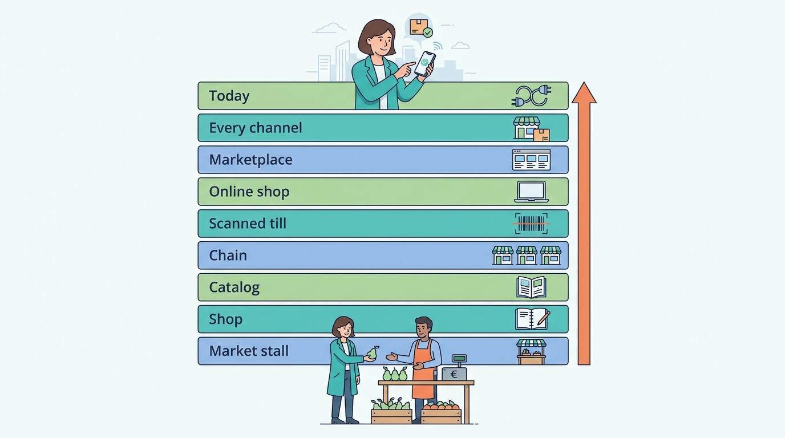
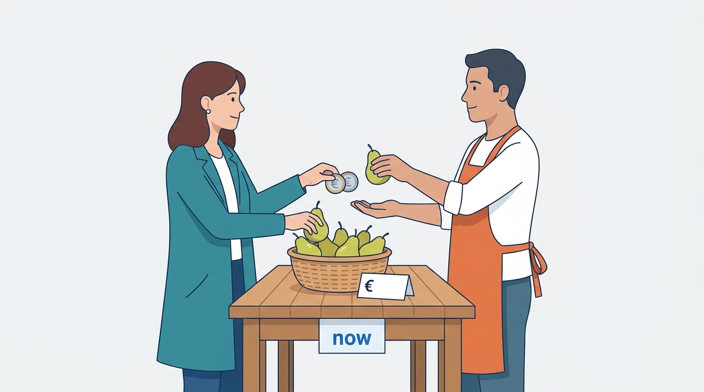
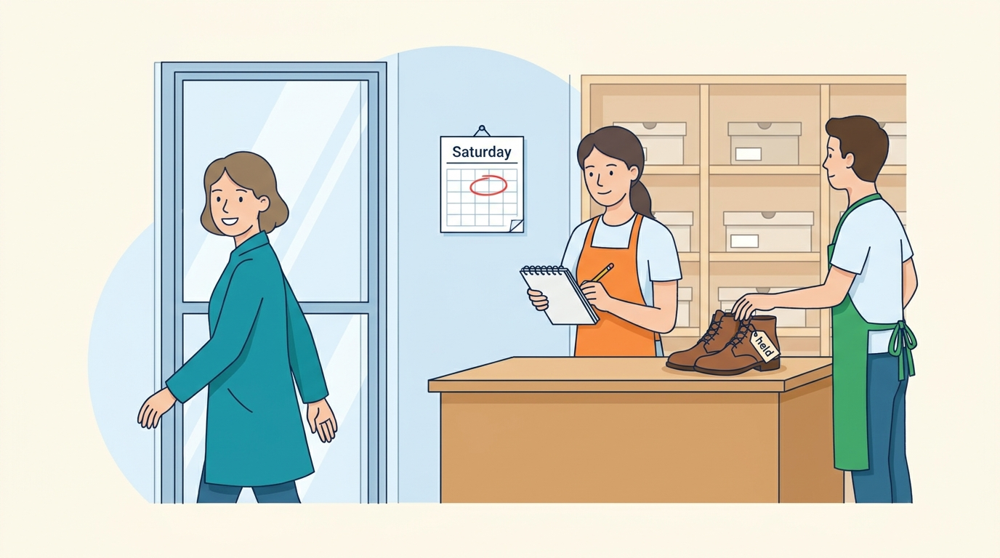
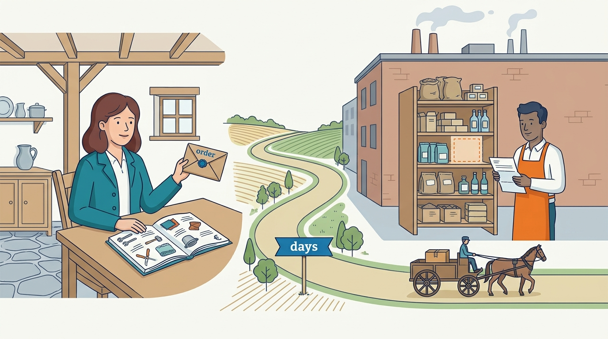
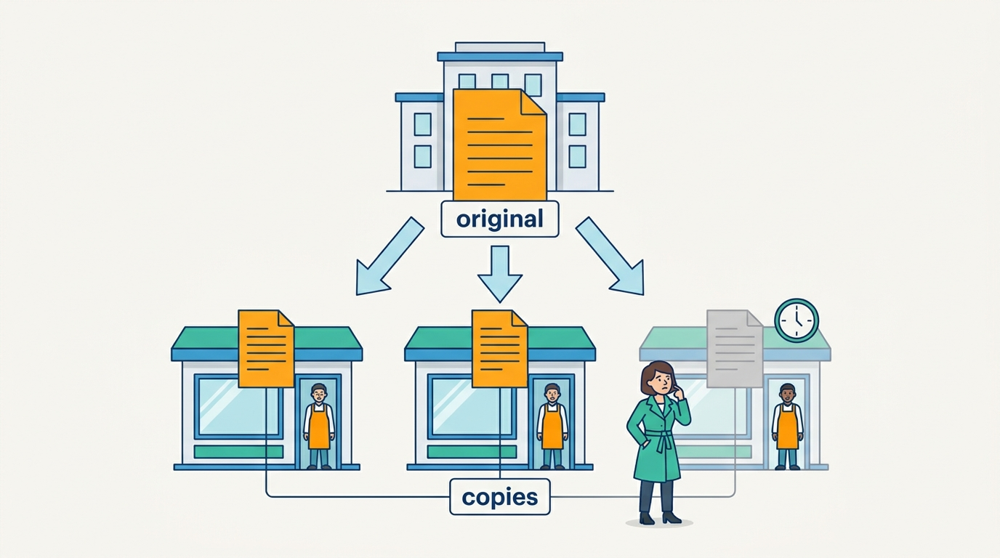
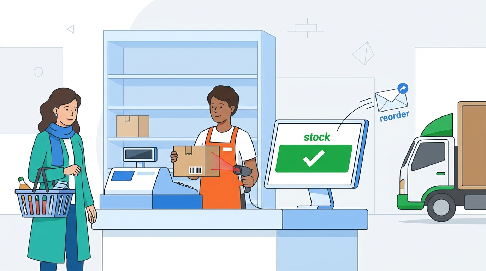
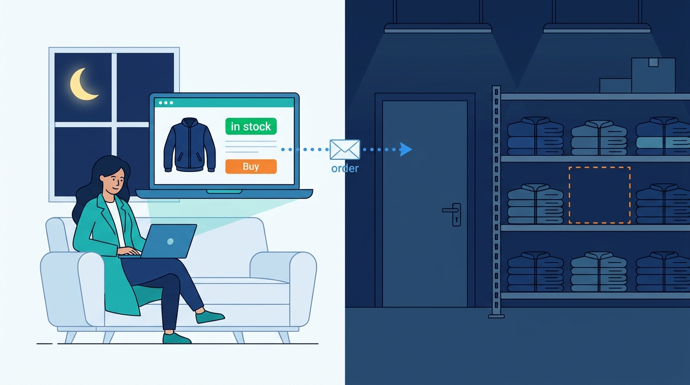
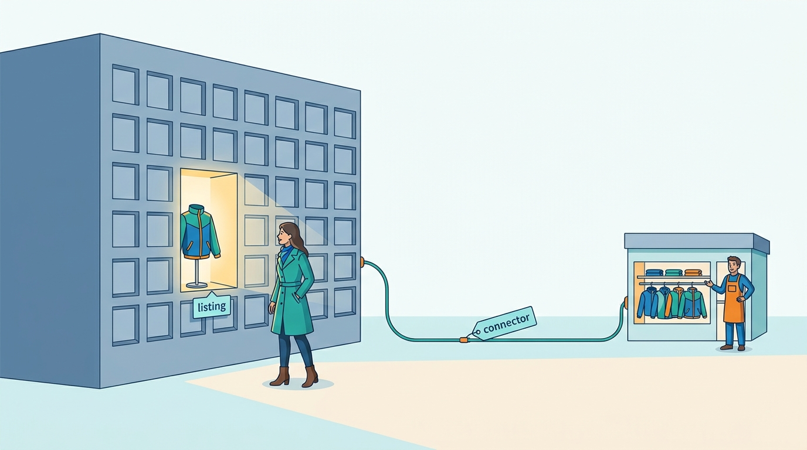
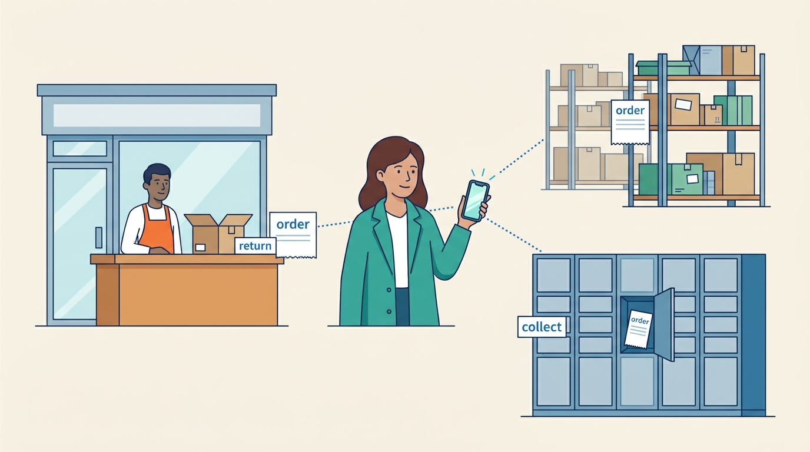
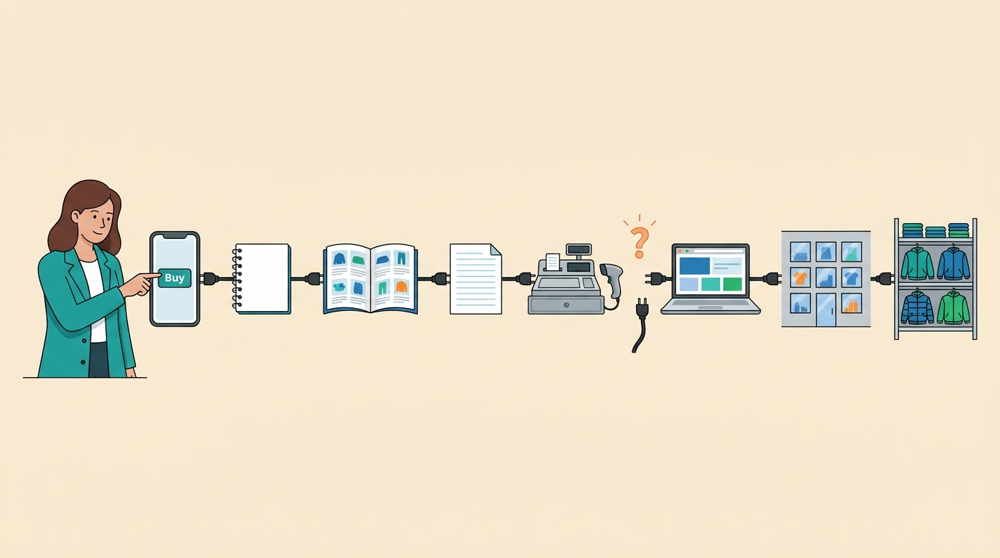

> **IN THIS SECTION, YOU WILL:** Follow selling from a market stall to an order placed on a phone, and meet each commerce concept at the step that first needed it.

> **KEY POINTS:**
>
> * **Every new way of selling let someone buy who could not buy before.** The shopkeeper's notebook kept a pair of boots for a customer until payday. The mail-order catalog sold to a farm far from any shop. The online shop sells at night, and the marketplace sells for a seller the buyer has never heard of.
> * **The price each time was a promise about goods that are not on the table, and one more record that has to be right.** A notebook, a printed catalog, a price list, a stock number in a computer, a web page, a listing on someone else's site. None of these was ever retired, so one order on a phone today rests on all of them.
> * **Selling fails where a promise is made from one record and kept from another.** A record can be out of date, copied wrongly or changed by two hands at once. The sixteen patterns of the next page are those cases, named.

 
At a market stall you pick up the pears, hear the price, pay and walk away with them. The sale is over. Now take the order the [[introduction]] opened with, from the book's fictional example: Eva Janssen taps “Buy” for a €199 jacket and two pairs of socks, and seconds later the shop confirms her order. The jacket is still on a shelf in another town. It arrives two days later, and for two weeks after that she can send it back.

Between the stall and the tap lie seven other ways of selling, and this page walks through them in the order they arrived. **Each was a good bargain: it let someone buy or sell who could not before, at the price of a promise and one more record of it. None was ever retired.** The account is simplified. It follows the ideas, not the full history, which was messier and differed by country. The shops and shopkeepers are illustrations of common practice, the few dates are anchors with sources listed at the end, and the chapters carry the detail.

The walk has nine steps: the market stall; a shop that holds an item for a customer; the mail-order catalog; the chain of shops; the scanned till; the online shop; the marketplace; every channel at once; and today's order, where Eva's jacket returns. Each step says what stopped working, what was added and what the book calls it, what it made possible for seller and buyer, and what it cost. The figure below draws the result as a stack. Each step then answers one question: **what has the seller promised, and which record says so?**

**Figure 1:** *Nine steps, one stack: each way of selling was added on top of the one before, and none was removed, so an order placed on a phone today rests on all of them.*

## The Market Stall: Everything on One Table

Start at a grower's stall on market day, an illustration of the simplest way to sell. The pears lie on the table. The buyer picks one up, looks at it and asks the price. Coins go one way and fruit the other, in the same moment.

Nothing has been promised and nothing is written down. The buyer has seen and handled what she buys, so she has no reason to bring it back. The seller knows the price by heart and sees on the table what is left.

It is that simple only under three conditions. Both people stand at the table. The seller sells only what lies on it. And one person knows the goods, the price and how much is left. **The steps that follow begin where one of these conditions did not hold**: the buyer could not take the goods today, or was far away, or the seller was no longer one person.

**Figure 2:** *At the market stall the goods, the price and the money are on one table and change hands in one moment, which works only while both people stand at the table and the seller sells only what lies on it.*

**What has the seller promised?** Nothing beyond the moment. **Which record says so?** None. The table shows what there is.

## The Shop: A Pair of Boots Held Until Saturday

Picture a shoe shop, as an illustration of a common practice. A regular customer finds boots that fit, but she is paid on Saturday. The shopkeeper says: I will keep them for you until Saturday. For the first time the seller has said something that will have to be made true later. The book calls such a statement a **promise** ([[journey-of-an-order]]).

A promise has to be remembered, so the shopkeeper writes in a notebook who asked, which pair, at what price and until when. The boots stay on the shelf, but they are no longer for sale. The shelf now shows one pair more than the shop can sell. The hold is a **reservation**, and what is on the shelf minus what is promised is what the book calls *available* ([[inventory-and-availability]]).

Both sides gain. The customer gets boots that someone else would have bought before her payday. The shopkeeper makes a sale that would have walked out of the door, and keeps a regular.

The price is that two things now have to agree: the shelf and the notebook. The assistant who works on Thursdays has not read the notebook and sells the pair. Or the shopkeeper counts the shelves at the end of the year, and the count differs from the stock book. Comparing two records of one thing, line by line, until they agree is what the book calls **reconciliation** ([[events-consistency-and-reconciliation]]).

A shopkeeper who makes promises also has decisions to take. Whom to hold for: the regular, not the stranger. How long: until Saturday, not until spring. At what price: the one on the tag the day she asked, even if it goes up on Friday. And whether the boots may come back if they pinch after all. These decisions are the plainest form of the promises every later way of selling makes again. By the online shop they will have grown into the five the introduction counted on Eva's order.

**Figure 3:** *The shopkeeper keeps the boots for the customer until Saturday and writes the promise in a notebook, so the customer gets her boots and the shop its sale, as long as everyone who sells has read the notebook.*

**What has the seller promised?** These boots, at this price, until Saturday. **Which record says so?** A notebook that only the shopkeeper reads.

## The Catalog: A Promise Sent by Post

A shop serves the people who can walk into it. Picture a family on a farm, days from the nearest town, that buys what the local store has. A seller can reach them by printing a list of goods with descriptions and prices and sending it by post. The Chicago History Museum's account (2022) dates the first mail-order catalog of the American company Montgomery Ward to 18 August 1872: “a single sheet of paper, offering 163 distinct items”, from a company whose mission, it says, was to serve “especially consumers in rural and farming communities”. On such a page the printed description has to do what the buyer's eyes did at the stall. The book calls it **product information** ([[product-information]]).

The buyer typically writes down what she wants and posts it with her payment. That letter is an **order**: a written record of what was asked for, at what price, and where to send it ([[order-management]]). The sale is now a document that exists before any goods move. It passes through several hands: the clerk who opens the letter, the packer, and a carrier, a company paid to transport the parcel ([[shipping-and-delivery]]).

Both sides gain. A buyer far from any shop gets a choice, and a printed price, that used to be out of reach. The seller sells to a whole country from one building.

The price is a promise that can be printed months before it is kept. The catalog is a copy of the seller's prices and shelves, and a copy ages. When the letter arrives, the item may be sold out or its price may have changed. The parcel then spends days with a carrier the seller does not control. And the buyer pays for goods she has not seen, so sellers commonly promise to take them back. The same account says Ward's offers were backed by the slogan “satisfaction guaranteed or your money back”. The book calls goods coming back a **return** ([[returns-and-exchanges]]).

**Figure 4:** *The catalog lets a buyer far from any shop order by post, but the promise was printed long before it is kept, so the page and the shelf can differ, and the parcel spends days with a carrier.*

**What has the seller promised?** The item as described, at the printed price, delivered, and the money back if the buyer is not satisfied. **Which record says so?** Three, in three places: the catalog in the buyer's kitchen, the order letter and the seller's stock book.

## The Chain: One Price List, Many Shops

One owner can stand in one shop. A seller with shops in many towns cannot, so a head office typically decides what every shop sells and at what price, and sends each shop the list. Scale shows why: the same museum account says Montgomery Ward opened its flagship store in 1926 and “by the start of the 1930s” operated “more than 500 stores”.

The list that says what each item costs is a **price list** ([[pricing-architecture]]). In a chain it exists once at head office and once more in every shop.

Head office's list is the original. Each shop's list is a copy. The book has a name for the place where a fact is decided: its **system of record**. Everything else is a copy of it ([[boundaries-and-systems-of-record]]).

Both sides gain. The buyer finds the same goods at the same price in every town, and can trust a shop she has never entered. The seller buys in bulk and grows beyond what one owner can watch.

The price is that a copy can be late or wrong. A price changed at head office on Monday is still the old price in one shop on Thursday. Goods now wait in a central warehouse ([[warehouse-and-fulfillment]]) as well as on shop shelves, and head office knows all of them only from reports that can be days old.

**Figure 5:** *A chain sells the same goods at the same price in every town from one price list, but each shop works from a copy, and a copy can still show the old price.*

**What has the seller promised?** The same goods at the same price in every shop. **Which record says so?** Head office's price list and stock book, and a copy of each in every shop.

## The Scanned Till: Stock Becomes a Number

In a chain with thousands of products, a clerk typically reads each price from a sticker, and head office learns what was sold by counting. So each product gets a pattern of bars that a machine reads as a number: the barcode. GS1, the standards body behind it, dates it to 3 April 1973, when “industry leaders in the U.S. retail grocery sector created the barcode”. On 26 June 1974, in a supermarket in Ohio, a pack of chewing gum became “the first product in the world to be scanned”, and a European numbering association followed in Brussels in 1977.

The number names one product exactly, down to its size and color. The seller's own code for one sellable variant is a **SKU** (stock-keeping unit), and the worldwide number under the bars is a GTIN ([[product-information]]).

The till that scans the bars looks the price up in a computer and subtracts one from that product's stock number. Stock is now a number that software keeps and every sale changes. Such a till is a **point of sale**, or POS ([[stores-and-omnichannel]]).

Both sides gain. The buyer gets a shorter queue, an itemized receipt and fewer empty shelves. The seller knows each evening what was sold in every shop. The computer can even reorder from the supplier by a structured message between the two companies' systems, which is called **EDI** ([[edi-and-e-invoicing]]); GS1 dates its first international standard for it to 1989.

The price is that the number is not the shelf. Theft, breakage, a mis-scan or a delivery booked but not unpacked leave the two apart. A 2008 study in *Management Science*, old and of one retailer only, examined “nearly 370,000 inventory records from 37 stores” and found “65% to be inaccurate” ([[inventory-and-availability]]). And because the number is there, the shelf is commonly checked less often.

**Figure 6:** *At the scanned till the computer knows what was sold and reorders by itself, and everyone trusts its stock number, which can differ from the shelf.*

**What has the seller promised?** What the chain promised, but the price is now whatever the computer says. **Which record says so?** A price and a stock number in a computer, which is seldom compared with the shelf.

## The Online Shop: A Page That Promises in Seconds

A printed catalog ages, and a shop closes in the evening. Once prices and stock are numbers in a computer, a web page can show them to anyone at any hour. Amazon's annual report for 1997 says the company “commenced offering products for sale on its Web site in July 1995”. The pages a buyer sees are the storefront ([[storefront-architecture]]).

The buyer collects items in a **cart**, which is a draft and promises nothing. At **checkout** she gives an address and pays ([[cart-and-checkout]], [[commerce-payments]]). Software then creates the order and confirms it. No person has read it.

Both sides gain. The buyer shops from home at any hour and sees today's price and today's stock. The seller reaches a whole country without a shop or a printing press, and even a small seller can rent the shop software as a service ([[commerce-platform-landscape]]).

The first part of the price is that the page promises from copies, and nobody checks. “In stock” is a copy of the stock number that may be an hour old, and the delivery date often comes from a fixed rule. The clerk who read an order letter could write back “sold out”; software confirms at once. The order then goes to the warehouse as a message, which can arrive late, twice or not at all. The book calls that passing of an order from one system to the next a **handoff** ([[journey-of-an-order]]).

The rest of the price comes in three parts. The buyer cannot try the goods, so the return becomes a right in law: for contracts concluded after 13 June 2014, a European directive, which replaced an earlier one, gives consumers “a period of 14 days to withdraw from a distance or off-premises contract, without giving any reason” ([[commerce-regulation]]). On the busiest day of the year every buyer arrives at once. And a rented shop that has been changed deeply to fit one seller can no longer take its vendor's updates.

**Figure 7:** *The online shop sells at any hour to a buyer at home and confirms within seconds, from a page that shows a copy of the stock number, while the shelf itself may already be empty.*

**What has the seller promised?** This item, at this price, in stock, delivered by a date, returnable within 14 days, all within seconds. **Which record says so?** A page built from copies of the stock number, the price list and a delivery rule, and an order that software wrote.

## The Marketplace: Selling in Someone Else's Shop Window

Buyers commonly begin their search on a few very large sites, so a seller's own online shop may never be found. Such a site can let other sellers offer goods on its pages, and is then a marketplace. Amazon's annual report for 2000 describes services through which “any business or individual can sell virtually anything” to its customers.

The seller describes each product in the marketplace's own format, with a price and a stock number. That entry is a **listing** ([[marketplaces-and-channel-integration]]). The marketplace typically takes the order and the money and tells the seller, who ships. The software that copies listings and stock out and brings orders back is a connector ([[integration-styles]]). Each place where a seller sells (its shops, its online shop, a marketplace) is a channel.

Both sides gain. The buyer searches many sellers at once and pays through a site she already trusts. The seller reaches buyers who would never have found its own shop, without building anything.

The price is that another company now makes the promise, in the seller's name and by its own rules, commonly with penalties for late or canceled orders. Each marketplace sells from its own copy of the stock number, so the last unit can be sold on two sites in the same hour. And every such channel needs a connector that someone built, that depends on a format the marketplace may change, and that often only one person understands.

**Figure 8:** *On a marketplace the buyer finds a seller she would never have found, but the promise is made in someone else's shop window, from a copy that reaches the seller's shelf through one connector.*

**What has the seller promised?** The same five things, but the marketplace promises them, on its terms, in the seller's name. **Which record says so?** A listing on each marketplace, each a copy of the seller's product, price and stock, and an order that begins in the marketplace's records.

## Every Channel at Once: Stores as Warehouses

A seller by now commonly has shops, an online shop and marketplace listings, each with its own stock, orders and customers. The buyer sees one brand. She wants to buy online and collect in a shop today, or hand a parcel back over a counter. The trade's word for this is omnichannel; GS1's timeline dates its own strategy for “digital, omni-channel commerce” to 2014.

Buying online and collecting in a store is **click-and-collect**, and a store can also pack online orders from its own shelf ([[stores-and-omnichannel]]). For both, the store's shelf has to be promised on the web page, and one order has to be visible to the store, the online shop and the warehouse alike. That takes one order record for all channels ([[order-management]]).

Both sides gain. The buyer has the item today from a store nearby, and returns it wherever suits her. The seller sells stock that would have sat in a store, and keeps a sale when the warehouse is empty.

The price is that every shelf now promises to every channel, while one order, one customer and one return each have several records. An order can have a different status in each system. The same person is an online account, a loyalty card and an e-mail address, and often no system knows they are one ([[identity-and-master-data]]). A return handed in at a store has to reach the people who refund, restock and correct the invoice, each exactly once.

**Figure 9:** *Selling through every channel lets the buyer collect or return wherever suits her, and gives one order a copy in every place that has to agree with the others.*

**What has the seller promised?** Any item, from any shelf, collected or delivered, returnable anywhere. **Which record says so?** A stock number for each location, an order record in each system and a customer record in each channel, unless one has been named as the one that counts.

## Today: Every Step at Once, and the Connections Between Them

None of these ways of selling was retired when the next one arrived. An order today rests on all of them: a promise and a reservation, an order and a carrier, a price list and its copies, a product number and a stock number, a page, a listing, and shelves in several places. Each is still there because the limit it answered is still there.

What the present adds is not another way of selling. The connections, added one at a time since the online shop, have become the main thing. Each system commonly comes from a different vendor and was connected when the need arose; a connection between two systems is an integration ([[integration-styles]]). And software now acts on its own: apps, scripts and lately AI agents change prices, stock and orders ([[extensibility-and-app-ecosystems]], [[ai-and-agentic-commerce]]).

Eva's order shows all of it together. It comes from Kestrel & Pine, the fictional outdoor brand this book follows ([[meet-kestrel-and-pine]]), which sells through four channels with thirteen systems and 34 connections between them. On Tuesday 13 April 2027 at 21:14 she pays €235, and the shop makes five promises within seconds. Keeping them takes thirteen steps in seven systems, six of which hold their own record of the order. The parcel arrives on Thursday, a day later than the page promised, because the delivery rule on the page was written for an earlier warehouse. [[journey-of-an-order]] follows it system by system.

Together the steps make this possible: almost anyone can buy almost anything, from almost anywhere, at any hour, and send it back. A brand with six stores sells a jacket at 21:14 to a customer in another city, with nobody at a desk.

The price is that every promise rests on a copy, made by a connection that someone has to own. And the whole can be changed carelessly. A design copied from a far larger company brings its machinery without its reasons. Everything is moved to a new platform on one date, with no way back. Several brands are forced onto one set of systems before anyone has measured the benefit. A legal deadline is found when it is months away. A script or an agent changes stock, and nobody owns it.

**Figure 10:** *One tap rests on every earlier way of selling and on the connections between them, and each connection is a place where a promise and its record can come apart.*

**What has the seller promised?** Five things in seconds, which seven systems keep over days. **Which record says so?** One in each system, each right about its own part. Which of them counts is the question this book answers.

## What the Steps Add Up To

Here are the nine steps side by side, each with what it made possible and what it added. The last column uses the names the next page gives to these failures, in bold, and plain words where it has none.

| Step | What it made possible | What it added | New record or party | What can now go wrong |
| --- | --- | --- | --- | --- |
| Market stall | A sale with no trust and no paperwork | Nothing: goods, price and money on one table | None | Only what is on the table can be sold |
| Shop | The customer gets the boots on payday; the shop keeps the sale | A promise, a reservation, reconciliation | The notebook | The held pair is sold; the count and the book disagree |
| Catalog | A buyer far from any shop can buy; the seller sells to a country | Product information, the order, the return | The catalog, the order letter; a carrier | The printed promise is out of date; the parcel is late or lost |
| Chain | The same goods at the same price in every town | The price list, the system of record and its copies | Head office; a copy in every shop | **The Price Nobody Can Explain** |
| Scanned till | A shorter queue; the seller knows what was sold everywhere | The product number, the POS, stock as a number, EDI | A computer's stock number | The number and the shelf disagree, and few look |
| Online shop | Buying from home at any hour; selling without a shop | The storefront, cart and checkout, the handoff, the legal return | A page built from copies; rented shop software | **The Phantom Stock**, **The Message in a Bottle**, **The First Snowfall**, **The Forked Platform** |
| Marketplace | The buyer finds the seller; the seller is found | The listing, the connector | The marketplace; a copy of stock per site | **The Spaghetti Junction**, **The Pulled Rug**, **The Lynchpin** |
| Every channel | Collect or return anywhere; store stock sells online | Click-and-collect, one order record for all channels | A record per location, system and channel | **Schrödinger's Order**, **The Familiar Stranger**, **The Boomerang** |
| Today | Anyone buys almost anything, anywhere, at any hour | Connections between vendors' systems; software that acts on its own | Vendors, apps, scripts, agents | **The Giant's Boots**, **The Burned Bridge**, **One Size Fits None**, **The Long Fuse**, **The Secret Agent** |

The table is in the order of the ideas. The dates this page has given place the same steps in time, and they show how recent most of them are: the mail-order catalog is about 150 years old, the scanned barcode about 50, and selling on the web about 30. The stall and the shop carry no date, because they are common practice and not events.

| Year | What its source dates to that year | Step |
| --- | --- | --- |
| 1872 | Montgomery Ward's first mail-order catalog, by the Chicago History Museum's account | Catalog |
| 1926 | The same company's flagship store; more than 500 by the start of the 1930s | Chain |
| 1973 | The barcode, by GS1's account | Scanned till |
| 1974 | The first product scanned at a till | Scanned till |
| 1977 | The European numbering association, in Brussels | Scanned till |
| 1989 | GS1's first international standard for EDI | Scanned till |
| 1995 | Amazon begins selling on its website | Online shop |
| 2000 | Amazon's annual report describes its services for other sellers | Marketplace |
| 2008 | The study of inventory records | Scanned till |
| 2014 | The European 14-day right to withdraw applies; GS1's omni-channel strategy | Online shop; every channel |

Count what stands behind Eva's tap that did not stand behind the pears. There are five promises, thirteen steps, seven systems and six records of one order. **Every step moved the promise further from the goods**: farther away, later, through more records and more hands. The answer to “what has been promised, and which record says so?” grew from “nothing, and none” to five promises and a record in every system.

It is tempting to read the result as bad design that a new platform or a rebuild would sweep away. It is the opposite: **the complexity is the price of all that trade, not a mistake**. Each step was a bargain that sellers and buyers wanted, and each answers a limit that has not gone away. Buyers are still far away, still shop at night, still start on other companies' sites and still want to collect and return in a store. A new platform has to keep the same records or hand them to someone else. So expect every one of these steps to stay, and **expect a failure wherever a promise is made from one record and kept from another**.

The next page names those failures. [[where-commerce-platforms-go-wrong]] describes sixteen recurring patterns, and after this walk none of them should come as a surprise: each is a promise that one of these records made and another could not keep.

## Sources and Evidence

Each date was read on its source's page on 17 November 2026. No source was found for when chains of shops, online shops, marketplaces or click-and-collect first appeared, so the page claims no “first” for any of them: each anchor says only what its source dates. The mail-order and chain anchors are from the United States, the barcode anchors from GS1's own account, and the legal return from the European Union.

*Company, product and investor sources*

- [Form 10-K for 1997](https://www.sec.gov/Archives/edgar/data/1018724/0000891020-98-000448.txt) — Amazon.com, Inc., filed 1998-03-30; “commenced offering products for sale on its Web site in July 1995” (evidence age: 28 years, used as a date only).
- [Form 10-K for 2000](https://www.sec.gov/Archives/edgar/data/1018724/000103221001500087/0001032210-01-500087.txt) — Amazon.com, Inc., filed 2001-03-23; “Through our Amazon Marketplace, Auctions and zShops services, any business or individual can sell virtually anything” (evidence age: 25 years, used as a date only).

*Standards, regulation and official documentation*

- [50 years of transforming tomorrow](https://www.gs1.org/about/how-we-got-here) — GS1, n.d., accessed 2026-11; the history timeline: the barcode on 3 April 1973, the first scan on 26 June 1974, the European Article Numbering Association in Brussels in 1977, the first international EDI standard in 1989, the omni-channel strategy in 2014 (the organization's own account).
- [Directive 2011/83/EU (Consumer Rights)](http://publications.europa.eu/resource/celex/32011L0083) — Official Journal, 2011-11-22; Article 9(1), the 14-day right of withdrawal; Article 28(2), contracts concluded after 13 June 2014.

*Research and practitioner sources*

- [Montgomery Ward's First Catalog](https://www.chicagohistory.org/montgomery-ward/) — Jojo Galvan, Chicago History Museum, 2022-08-17; the first mail-order catalog on 18 August 1872, a single sheet with 163 items; the money-back slogan; the flagship store in 1926 and more than 500 stores by the start of the 1930s (United States; a museum's account).
- [Inventory Record Inaccuracy: An Empirical Analysis](https://econpapers.repec.org/RePEc:inm:ormnsc:v:54:y:2008:i:4:p:627-641) — Nicole DeHoratius and Ananth Raman, *Management Science* 54(4), 2008; 65% of nearly 370,000 records inaccurate in 37 stores of one retailer (evidence age: 18 years; one retailer), as cited in [[inventory-and-availability]].

Kestrel & Pine is fictional; architectural recommendations, labeled inferences and labeled assumptions are the author's judgement.
