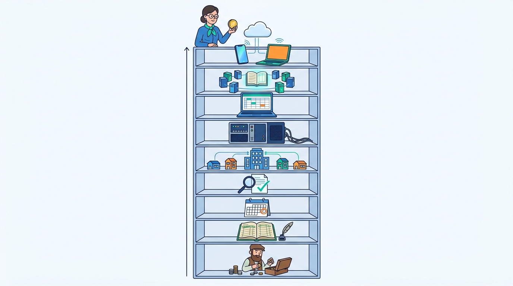
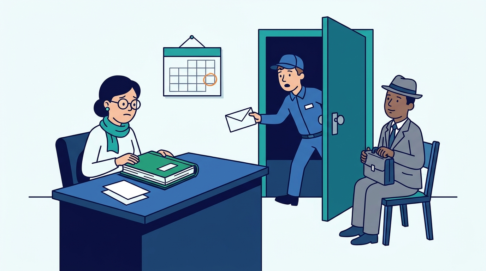
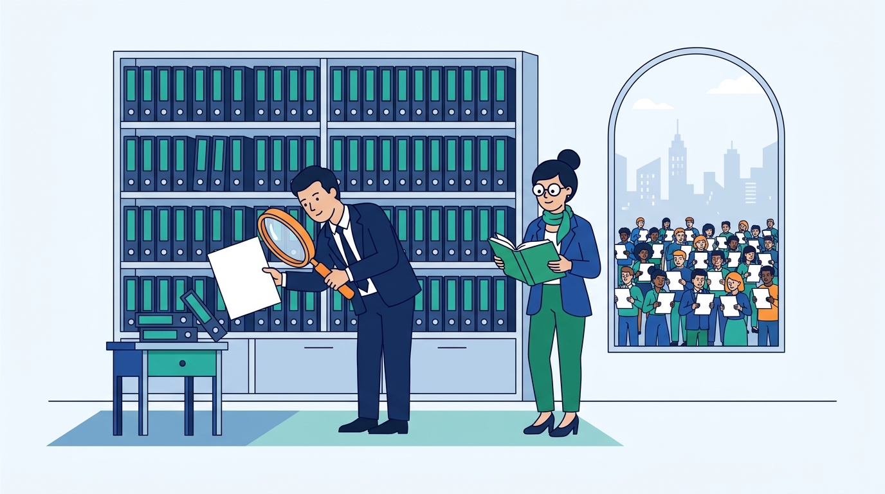
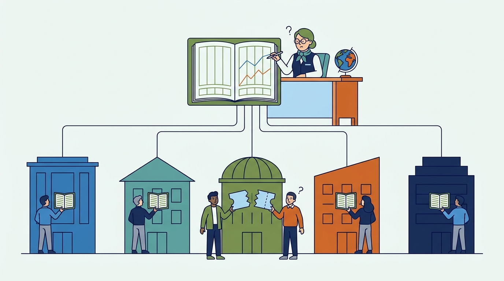
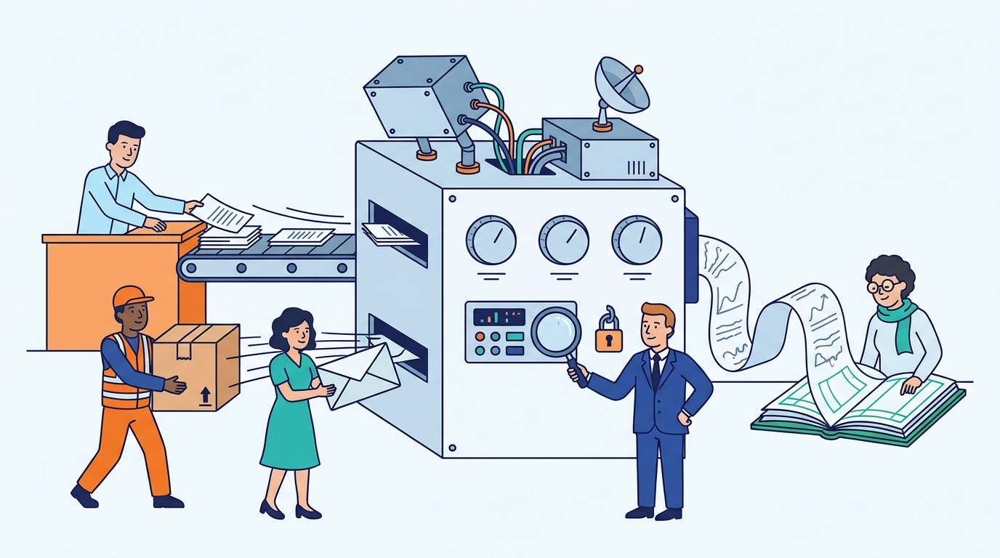
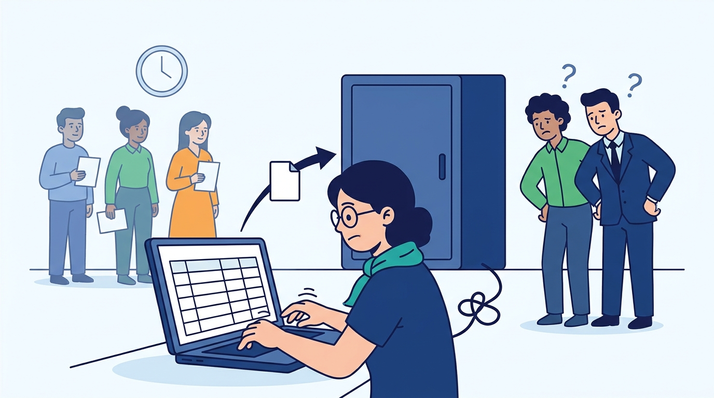
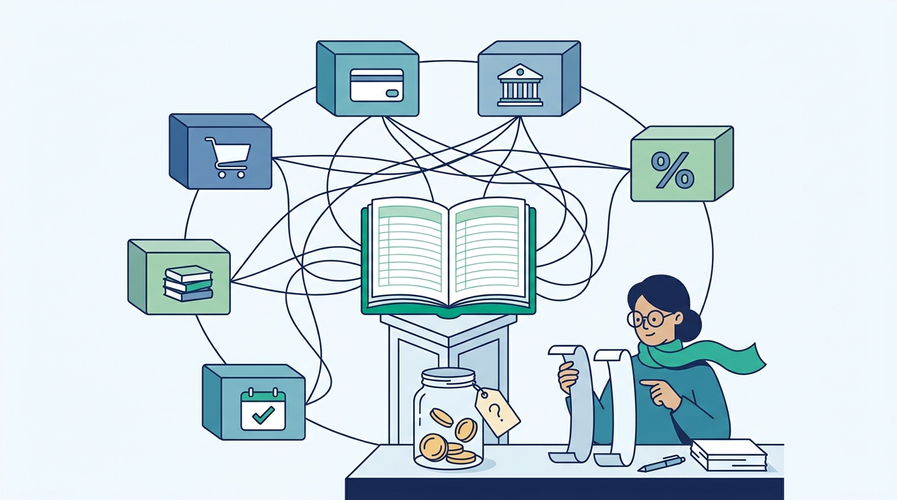
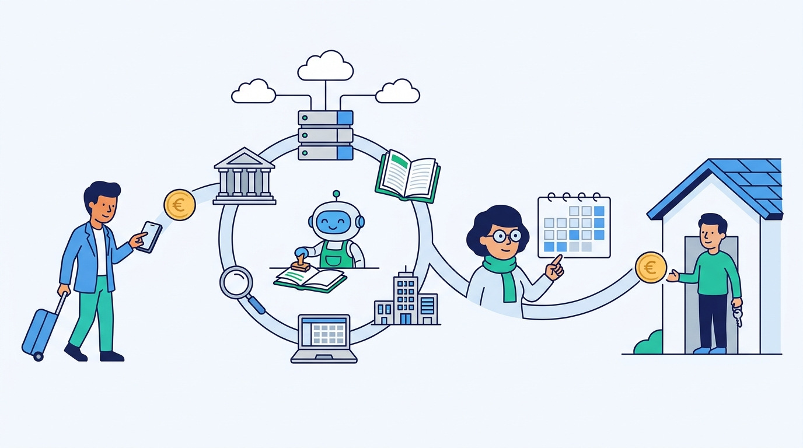

> **IN THIS SECTION, YOU WILL:** Follow the keeping of a business's books from a trader's cash box to today's finance estate, and meet each concept of this book at the step that first needed it.

> **KEY POINTS:**
>
> * **Every new way of keeping the books let someone trust a business they could not watch.** The ledger let a partner invest in a voyage he never sailed on, the audited report lets a stranger buy a share, and the computer lets one company record a million sales a day.
> * **The price each time was one more record of the same money and one more person who has to check it.** The ledger, the year-end statements, the auditor's file, the group's consolidation, the ERP, the spreadsheet and the payment provider's report each hold their own copy, and none was retired.
> * **Finance systems fail where two records of the same money are kept by different hands at different times.** Proving that they agree is what the month-end close spends its days on. The fourteen patterns of the next page are those cases, named.

 
Picture a trader at a market at the end of the day, as an illustration of the simplest case. He tips the cash box onto the table, counts the coins and knows whether the day went well. Nobody else needs to believe him. Now take the booking the [[introduction]] mentioned, from the book's fictional example: on 12 March 2027 a traveler pays €600 for three nights in a Lisbon apartment. Before that payment is a proven number in a published report, a payment provider, a bank, a booking platform, a ledger and a consolidation system have each written it down, and a nine-working-day monthly close and an outside auditor have checked it.

Between the cash box and the €600 lie seven other ways of keeping the books, and this page walks through them in the order they were added. **Each was a good bargain: it let someone trust a business they could not watch, so that the business could borrow, sell on credit, raise money or grow, at the price of one more record and one more person who has to check it. None was ever retired.** The account is simplified: it follows the ideas, not the full history, which was messier and differed by country. The scenes illustrate common practice, the few dates are anchors with sources at the end, and the chapters carry the detail.

Each step says what stopped working, what was added and what the book calls it, what it made possible for the one who keeps the books and the one who must trust them, and what it cost. Each then answers one question: **can someone who was not there trust these numbers, and how would they find out?**

**Figure 1:** *Nine steps, one stack: each way of keeping the books was added on top of the one before and none was removed, so one payment today is recorded and checked in all of them.*

## The Cash Box: The Trader Counts the Coins

Start with a trader who sells cloth at a market and works alone, as an illustration of the simplest case. He buys cloth with his own money, sells it for coins and keeps the coins in a box. At the end of the day he counts them. If the box holds more than it did in the morning, and the stall holds less cloth, he did well.

He may keep a list as well, on a slate: what came in and what went out. The list is for him alone, and the cash box can always correct it. If the list and the box disagree, the box is right.

It is that simple only under three conditions. He is the only owner. Every customer pays at once, in coins. And he borrows from nobody. **The steps that follow begin where one of these conditions failed**: someone else put money in, a customer paid later, or a lender wanted to know what the business was worth.

**Figure 2:** *With a cash box the trader is the only one who needs to know how the day went, and the coins themselves answer him: if his list and the box disagree, the box is right.*

**Can someone who was not there trust these numbers?** Nobody else needs to. **How would they find out?** They would not have to; the trader counts the coins.

## The Partner Who Was Not There: Journal, Ledger and Double Entry

Now the trader wants to buy a shipload of cloth abroad, more than his savings can pay for. A partner puts in half the money and stays at home; a lender advances more; a good customer takes cloth now and will pay at month-end. Each of them has a stake in money they will never see in the box; the partner cannot count coins spent in another port. This scene, too, illustrates common practice, not one time and place.

So the merchant writes everything down, in two books. In the first he writes each event as it happens, in date order: bought cloth, paid the carrier, sold cloth on credit to a named customer. That daybook is the journal, and each dated, balanced record in it is what the book calls a **journal entry** ([[accounting-for-architects]]). In the second he keeps one page for each thing he must track: cash, cloth in store, what each customer owes, what he owes the lender. Those pages are accounts, and the book that holds them is the **ledger**.

Each event is written on two pages: when cloth is sold on credit, the cloth page goes down and the customer's page goes up by the same amount. Because every entry has two equal sides, the whole ledger's two columns must add up to the same total. That habit is **double-entry bookkeeping** ([[accounting-for-architects]]). Luca Pacioli's *Summa de arithmetica*, printed in Venice in 1494, includes a treatise on it, the "Methods of Venice", which the ICAEW library says set down a system that "remains in use today".

Both sides gain. The merchant can buy more than he can pay for, sell to customers who pay later, and borrow. The partner can share in a voyage without sailing on it, and the customer can take the cloth before payday.

The price is that the books are now a second account of the business, kept apart from the money, and a second account can be wrong. A balanced ledger proves the arithmetic, not the truth: a sale never written down, or written twice, leaves both columns equal. To check the books, someone must compare them with something kept independently, such as the coins in the box or the customer's own record. Proving that two independent records of the same reality agree is **reconciliation** ([[traceability-and-reconciliation]]), the idea this book is named for.

And the person who writes the books may handle the cash. A clerk who takes coins can write a line that hides it. The plainest defense is a second pair of eyes: the one who keeps the cash does not keep the books, and someone else checks both, which the book calls **segregation of duties** ([[controls-and-auditability]]). Error, fraud and the question of who checks arrive with the first reader who was not there, and never leave.

**Figure 3:** *The journal and the two-sided ledger let a partner trust a voyage he never sailed on, and the price is a second account of the money that can be wrong, so the one who counts the cash is not the one who writes the books.*

**Can someone who was not there trust these numbers?** If the ledger balances, and someone other than the bookkeeper has compared it with the cash and with what customers say they owe. **How would they find out?** By reading the ledger, and by counting.

## The Year-End: A Business That Never Stops

A voyage has an end: the ship returns and the partners split what is left. A shop that trades every day has no such end, yet its owners still want to know how it is doing, and a bank that lends to it wants to know while it is running. So the business commonly chooses a date, once a year at first, and draws a line. Everything before the line belongs to this year; everything after belongs to the next. That slice of time is the **period**.

Cloth delivered in December but paid for in January is this year's sale; rent paid in December for next year is not this year's cost. Recording income when earned and costs when incurred, whatever day the money moves, is **accrual accounting** ([[accounting-for-architects]]). At the line, every account is listed with its balance, and the two columns must total the same: the **trial balance**. From it come a statement of what the business owns and owes, and one of what it earned and spent.

Completing, checking and locking a period so that statements can be produced is the **period close** ([[finance-processes]]). Large companies now commonly close every month.

Both sides gain. The owner learns each year whether the business made money, and can take a share of the profit without selling it. The lender can lend to a business that never stops trading, because it receives a picture at regular dates and can compare this year with last.

The price is a deadline, and a new thing to argue about. A supplier's bill that arrives after the line belongs to last year, so either the close waits for it or the business estimates it. Which side of the line an item falls on, the **cut-off** ([[finance-processes]]), becomes a decision someone can get wrong, or push the convenient way: a sale moved from January to December makes this year look better. The books now hold estimates as well as facts.

**Figure 4:** *The year-end gives owners and lenders a regular picture of a business that never stops, and with it a deadline and a line that late bills and estimates can fall on the wrong side of.*

**Can someone who was not there trust these numbers?** Once a year, when the books are closed and the statements drawn up, and as far as they trust the estimates. **How would they find out?** By comparing this year's statements with last year's, and by asking the owner where the line was drawn and why.

## Shareholders Who Were Never There: Standards, the Auditor and the Law

A partner knows the merchant; a shareholder in a railway commonly knows nobody in it. When companies sold shares to thousands of strangers, the statements became nearly all the strangers had. Are the numbers true, and do they mean the same as another company's?

Three things were added: rules for drawing up statements, so that "revenue" or "profit" means the same in every company that follows them, the **accounting standards** such as US GAAP and IFRS ([[accounting-for-architects]]); an accountant from outside the company who says whether the statements are fairly presented, the **external auditor** ([[controls-and-auditability]]); and laws that require both. In the United States, the Securities and Exchange Commission (SEC) describes the Securities Act of 1933 as requiring that investors receive "financial and other significant information concerning securities being offered for public sale", and says the Securities Exchange Act of 1934 "empowers the SEC to require periodic reporting of information by companies with publicly traded securities".

The auditor cannot re-check every entry. Commonly, auditors test a sample against its evidence (an invoice, a contract, a bank statement) and ask banks to confirm balances. So the company must keep a path from each number in the report back to the transactions and documents behind it, an **audit trail** ([[controls-and-auditability]]).

Both sides gain. A company can raise money from thousands of people who will never visit it, and grow far beyond what partners could fund. An investor can buy a small share of a company she will never see, and compare it with another, because both report under the same rules and were checked by someone independent.

The price is new parties, new deadlines and a lot of paper. The auditor and the regulator now stand between the company and its owners, and the report is due on a date the company does not choose. Every entry must be backed by a document someone can find years later. And the auditor finds out once a year, from a sample: an error the sample missed can sit in the books for a year or longer.

**Figure 5:** *Standards, the external auditor and the law let strangers buy shares in a company they will never visit, and the auditor checks a sample, once a year, after the year has closed.*

**Can someone who was not there trust these numbers?** If the statements follow the standards and an independent auditor has said so. **How would they find out?** From the auditor's opinion, which rests on a sample, tested once a year, after the fact.

## Many Companies, One Owner: Entities, Intercompany and Consolidation

A company that sells abroad commonly sets up a company in each country, because each country's law, tax authority and banks deal with a local company. A company that buys another usually keeps it as it was, at least at first. So a business becomes a group: a parent that owns many companies, each a **legal entity** with its own books, its own currency and its own local rules ([[global-scale]]).

The companies trade with each other: the Dutch one charges the Portuguese one for a service. Each writes its half in its own books, and the halves must agree. Trade between companies of the same group is what the book calls **intercompany** ([[global-scale]]). Each company also keeps its books in its own currency, so the group must convert them into one at agreed rates ([[accounting-for-architects]] calls this translation).

The parent's owners want one picture. So the group adds the companies' statements together in one currency and removes what they sold to each other, so that it does not report trade with itself. That is **consolidation**, and the removals are eliminations ([[onestream]]). In the European Union, Regulation 1606/2002 requires listed companies to prepare their consolidated accounts under international standards "for each financial year starting on or after 1 January 2005".

Both sides gain. The group can sell in many countries, under each country's rules, and buy other companies to grow. The investor sees the group as one business, with one profit and one balance sheet, without reading dozens of local reports.

The price is many books that must agree with each other, not only with the money. Both halves of every intercompany sale must match, and a rate taken on a different day leaves a difference. Each country brings its own chart of accounts, tax and filing rules. And every country or bought company has real reasons to keep its own way of doing things. Some of those differences are needed; others outlive their reasons and stay for good.

**Figure 6:** *A group can sell in many countries and still show investors one set of statements, at the price of many books that must agree with each other, including both halves of every sale between its own companies.*

**Can someone who was not there trust these numbers?** If every company's books are right, every intercompany pair matches and nothing was left out of the consolidation. **How would they find out?** From the group auditor, who relies on other auditors' work in other countries, and from the eliminations, which show where two of the group's own companies disagree.

## The Machine Keeps the Books: From Punched Cards to the ERP

Large companies came to record more sales, wages and bills than clerks could copy by hand. Commonly, the work moved to punched-card machines and then to computers, which posted entries and printed the ledger. SAP, the German software company, dates its first financial accounting system, RF, to 1973; the "R", its own account says, "stood for 'real time'".

The next step joined the books to the rest of the business. In an integrated suite, a sale, a goods receipt or an approved supplier bill posts its own accounting entry into the same database the accountants use: an enterprise resource planning system, an ERP. SAP's account of its history says that in September 1992 it announced it would ship R/3, its client-server system, "within six weeks to anyone who ordered it there and then". For each legal entity, the ledger in the ERP commonly became the **book of record** ([[finance-landscape]]): the one set of balances that is reported and audited.

Both sides gain. The company records a million entries as easily as a hundred, all posted by the same rules, and closes faster because sales and purchases arrive already posted. The auditor can test how the system posts, once, instead of re-adding the ledger.

The price is that trust moves from the clerk to the machine, and the machine can be changed. A program that posts an entry wrongly does so a million times. So whoever checks must ask who can change the system's rules, who can post, and whether every change was approved and recorded. By then the law asked the same. The Sarbanes-Oxley Act of 2002, which the SEC says mandated reforms to "enhance financial disclosures and combat corporate and accounting fraud", requires a US-listed company's management to assess its **internal control over financial reporting** every year, and larger companies' auditors to attest to it ([[controls-and-auditability]]). Controls inside systems became part of the audit.

Two more costs came with the bargain. Companies commonly changed the package to fit their business, and carried each change through every upgrade. And one system that did so much was soon asked to do everything else too.

**Figure 7:** *The machine posts a million entries by the same rules and joins the books to the rest of the business, and trust moves from the clerk to the machine's settings: who may change them, and what was bolted on.*

**Can someone who was not there trust these numbers?** If the system posts by approved rules and nobody can change them unseen. **How would they find out?** By testing the system's controls (who has access, how changes are approved, how entries are posted) as well as a sample of the entries.

## Meanwhile, the Spreadsheet: Answers Faster Than the System Changes

The spreadsheet reached desks before client-server suites such as R/3 did, and answered a different need. A central system changes slowly; a new rule needs a project. The accountant who must map a newly bought company's accounts to the group's, or explain why two numbers differ, needs the answer this month. The Computer History Museum describes VisiCalc, released in 1979, as "the first spreadsheet for personal computers", thirteen years before R/3 was announced.

A spreadsheet lets anyone who can draw a table build a calculation: a mapping of accounts, a split of costs, a reconciliation, a journal prepared on the desk and then uploaded into the ledger. A file that performs a step a business process depends on, built and kept by its users rather than by an IT team, is what the book calls **end-user computing** ([[technical-debt-and-fitness]]).

Both sides gain. Finance gets a tool it controls and an answer in an hour, not a project in a quarter.

The price is logic that nobody else can see. The formulas that map three thousand accounts sit in one file on one laptop, where a pasted row silently changes the group's numbers. When a control depends on that file, the auditor treats it as **information produced by the entity** and asks for proof that it is complete and accurate ([[controls-and-auditability]]), which is hard to give for a file anyone can edit. And because the file works, it stays for years.

**Figure 8:** *The spreadsheet gives finance an answer this month instead of next year, and puts logic the close depends on in a file that only its author can explain.*

**Can someone who was not there trust these numbers?** Only as far as they trust the file, and the one person who understands it. **How would they find out?** By opening the file and following it cell by cell, if anyone can still explain it.

## Systems Around the Ledger: Each Job Its Own Platform

Then customers began paying by card and online, in many currencies, and some businesses began recording millions of small sales a day. The ledger could not hold every one and stay readable, and some jobs needed specialists. So systems grew up around the ledger, each doing one job and sending it results. This step is common practice of the last few decades and carries no date.

A booking platform keeps every sale, refund and payout in its own detailed record and sends the ledger a daily summary. A detailed record whose total must equal one account in the ledger is a **subledger** ([[accounting-for-architects]]). The shrinking from billions of events to thousands of ledger lines is what [[finance-landscape]] calls the volume gradient.

A company that takes cards is paid by a **payment service provider (PSP)**, days later, in one sum net of fees, with a report of what the sum contains ([[payments-fundamentals]]). Meanwhile the money waits in a **clearing account** in the books ([[payments-to-ledger]]).

Other specialists attach the same way: a tax engine, a treasury system, a close tool that matches transactions and certifies balances, a consolidation system. A platform beside the ledger that owns one capability and returns results to the book of record is a **satellite platform** ([[satellite-platforms]]). Each is joined to the others by an interface, a regular transfer of data that should carry counts and totals so the receiver can prove nothing was lost ([[integration-architecture]]).

Both sides gain. Customers can pay by card from anywhere, and the company can sell in dozens of currencies. Each specialist job is done by a system built for it, and the ledger stays small enough to read and to audit.

The price is that the same money now lives in several records, each kept by a different system, often a different company, on its own clock. They must be matched line by line, and reconciliation, once a check on the bookkeeper, becomes daily work between systems. A balance held in a platform nobody treats as a subledger is never proven against the ledger. An unmatched payment waits in a clearing account. A summary that loses its link to the detail cannot be traced. And every new system adds interfaces to every other.

**Figure 9:** *Systems around the ledger let customers pay by card anywhere and give each specialist job its own platform, and the same money now lives in several records that must be matched with each other every day.*

**Can someone who was not there trust these numbers?** If every hand-off between systems is complete and every copy has been matched with the others. **How would they find out?** By reconciling: system with system, ledger with provider, provider with bank, every day.

## Today: Every Step at Once, on Someone Else's Schedule

None of these steps was retired; the journal entry, the close, the auditor, the consolidation, the ERP, the spreadsheet and the satellites are all still there. The present adds three things.

Much of the estate now runs as rented services in a vendor's cloud, upgraded on the vendor's calendar several times a year, with modules that overlap what other services already do ([[vendor-portfolio-strategy]]). Groups that grew by acquisition commonly run several ERPs side by side ([[multiple-erps]]), so the same supplier can be created and changed in three places ([[finance-data-architecture]]). And tax authorities increasingly want invoices as data, as the sale happens: the EU's VAT in the Digital Age package entered into force on 14 April 2025, and its e-invoicing-based digital reporting applies to cross-border business-to-business sales from 1 July 2030 ([[satellite-platforms]]). Meanwhile bots and AI agents now prepare, match and post entries themselves ([[ai-in-finance]]).

The Lisbon booking shows all of it at once. Northmere Group, the fictional multi-brand commerce group this book follows ([[meet-northmere]]), takes the traveler's €600 on 12 March 2027 through Adyen, its payment provider, for a stay from 18 to 21 April. Adyen pays it, net of a €1.74 fee and inside a larger batch, into the bank account of Northmere Payments B.V. on 16 March. Stayloft's finance platform records the booking, the payment, the €90 commission and the €510 owed to the apartment's owner, and the booking reaches SAP S/4HANA, the group ledger, inside one of about 38,000 summary lines a day. BlackLine matches the provider's report with the bank and the platform; OneStream consolidates 71 legal entities from three ERPs into US dollars. The owner is paid €510 on 26 April.

Both sides gain. A traveler in Germany pays for a flat in Portugal in seconds, and the owner is paid without ever meeting her. The group trades through companies in 38 countries, and an investor in New York reads one audited report about all of them.

The price is that every earlier record is still kept, more are added, and much of the estate changes on someone else's schedule. A vendor's release can land in the middle of a close. Three ERPs hold three versions of the same supplier, and overlapping modules do the same job in different places. A move to a new system is tempted to happen all at once, at year-end. A bot can post entries with nobody's name on them. And in 2026 an average of €14 million waited unexplained in Northmere's payment clearing and suspense accounts at each month-end.

**Figure 10:** *One payment today rests on every earlier step at once, and much of the estate changes on vendors' schedules, so the close spends its days proving that all the copies agree.*

**Can someone who was not there trust these numbers?** Yes, once every copy has been reconciled and every control has left its evidence; at Northmere that takes nine working days a month. **How would they find out?** By following the €600 from the bank statement through the provider's report, the platform and the ledger to the published report, with a key joining the two sides at every hop.

## What the Steps Add Up To

Here are the nine steps side by side. The last column uses the next page's names for these failures, in bold, and plain words where it has none.

| Step | What it made possible | What it added | New party or delay | What can now go wrong |
| --- | --- | --- | --- | --- |
| Cash box | A trader knows how the day went | A private list | None | Only the trader can read it |
| Partner who was not there | Partners invest, lenders lend, customers buy on credit | Journal entry, ledger, double entry, reconciliation, segregation of duties | A partner, a lender, a bookkeeper | A balanced ledger that is wrong; a hidden theft |
| Year-end | Owners take profit; banks lend to a going business | Period, accruals, trial balance, period close, cut-off | A yearly, later monthly, deadline | A late bill; a sale moved across the line |
| Shareholders and the auditor | Strangers buy shares and compare companies | Accounting standards, external auditor, audit trail | An auditor, a regulator, a fixed date | An error the sample missed |
| Many companies, one owner | Selling in many countries; one picture of the group | Legal entities, intercompany, consolidation | Rules and auditors in every country | **The Permanent Exception** |
| The machine and the ERP | A million entries posted by the same rules | The ERP as book of record; ICFR | The software vendor; tests of access and change | **The Swiss-Army ERP**, **Customization Concrete**, **Audit Archaeology** |
| The spreadsheet | An answer this month | End-user computing | One person, one file | **Spreadsheet Glue** |
| Systems around the ledger | Card payment anywhere; specialists for each job | Subledgers, PSPs, clearing accounts, satellites, interfaces | Providers and banks, each on its own clock | **The Shadow Ledger**, **The Suspense Swamp**, **Lost in Aggregation**, **Point-to-Point Spaghetti** |
| Today | Pay anyone in seconds; one report for 38 countries | Cloud services, several ERPs, invoices as data, bots | Vendors' calendars; real-time tax; software actors | **The Doppelgänger Record**, **Capability Creep**, **Big-Bang Bravado**, **The Borrowed Roadmap**, **Nobody's Bot** |

The table follows the ideas. The page's dates place the steps in time: double entry in print is over five hundred years old, the securities laws about ninety, the ERP and the spreadsheet under fifty. The cash box, the year-end and the systems around the ledger carry no date, because they are common practice, not events.

| Year | What its source dates to that year | Step |
| --- | --- | --- |
| 1494 | Pacioli's *Summa*, with its treatise on double entry, printed in Venice | Partner who was not there |
| 1933 | US Securities Act | Shareholders and the auditor |
| 1934 | US Securities Exchange Act: periodic reporting | Shareholders and the auditor |
| 1973 | SAP's first financial accounting system, RF | The machine and the ERP |
| 1979 | VisiCalc, the first spreadsheet for personal computers | The spreadsheet |
| 1992 | SAP announces it will ship R/3 | The machine and the ERP |
| 2002 | Sarbanes-Oxley Act | The machine and the ERP |
| 2005 | International standards for EU listed groups' consolidated accounts | Many companies, one owner |
| 2025 | EU VAT in the Digital Age package in force | Today |
| 2030 | Its cross-border digital reporting applies (scheduled) | Today |

Count what stands behind the Lisbon €600 that did not stand behind the cash box: a provider's batch, a bank statement, a platform's subledger, a summary line in the ledger, a matching tool, a consolidation in another currency, an auditor, and people in several companies who check each one. **Every step moved the books further from the money**, and added one more record of it and one more person who must believe it. The answer to "can someone who was not there trust these numbers, and how would they find out?" grew from "nobody needs to; count the coins" to nine working days of proving that a dozen records of the same money agree.

It is tempting to think that underneath, a finance estate is a ledger and a cash box that a clean, modern system would restore. It is not, and **the complexity is the price of being trusted at a distance, not a mistake**. Each step was a bargain that the business and those who trust it wanted, and each answers a limit that has not gone away: owners still cannot watch the money, groups still span countries, volumes still outgrow any one ledger. A new system must keep the same records and proofs, or hand them to someone else. So expect every one of these steps to stay, and **expect a failure wherever two records of the same money are kept by different hands at different times**. [[long-term-evolution]] takes up the decade ahead, when more will be added.

The next page names those failures. [[where-finance-architecture-goes-wrong]] describes fourteen recurring patterns, and after this walk none of them should come as a surprise: each is the price of one of these steps.

## Sources and Evidence

Each date and quotation was read on its source's page on 18 November 2026. No primary source was read for the trader's cash box, the merchant's partners, the year-end, punched-card bookkeeping or the systems around the ledger, so those passages are common practice and illustration, without dates, and the page claims no "first" except where a source is quoted. An anchor for the first business computers was left out because reputable sources give different dates for its first routine job.

*Vendor documentation*

- [The End of an Era: Hasso Plattner Steps Down](https://news.sap.com/2024/05/the-end-of-an-era-hasso-plattner-steps-down/), SAP News Center, 2024-05-13 — the founding on 1 April 1972, RF as SAP's first financial accounting system in 1973 ("The 'R' in the name stood for 'real time'"), and the September 1992 announcement that R/3 would ship "within six weeks" (the company's own account).

*Standards and regulation*

- [About the Securities Laws](https://www.sec.gov/about/about-securities-laws), U.S. Securities and Exchange Commission, n.d., accessed 2026-11 — the Securities Act of 1933, the Securities Exchange Act of 1934 and the Sarbanes-Oxley Act of 2002, as quoted; section 404's requirements are sourced in [[controls-and-auditability]].
- [Regulation (EC) No 1606/2002 on the application of international accounting standards](https://eur-lex.europa.eu/eli/reg/2002/1606/oj), Official Journal of the European Communities, 2002 — Article 4, consolidated accounts of listed companies under international standards "for each financial year starting on or after 1 January 2005".
- [VAT in the Digital Age (ViDA)](https://taxation-customs.ec.europa.eu/taxation/vat/vat-digital-age-vida_en), European Commission, n.d., accessed 2026-11 — entry into force on 14 April 2025; digital reporting requirements for cross-border business-to-business transactions from 1 July 2030 (also in [[satellite-platforms]]).

*Practitioner and research sources*

- [Summa de arithmetica](https://www.icaew.com/library/library-collection/historical-accounting-literature/highlights-of-the-collection/summa-di-arithmetica), ICAEW Library, n.d., accessed 2026-11 — printed by Paganino de Paganini, Venice, 1494; its double-entry bookkeeping section, the "Methods of Venice", setting down the system "which remains in use today".
- [Software: Putting PCs to Work](https://www.computerhistory.org/revolution/personal-computers/17/305), Computer History Museum, n.d., accessed 2026-11 — VisiCalc, "a 1979 spreadsheet program by Software Arts", "the first spreadsheet for personal computers".

Northmere Group is fictional; architectural recommendations and labeled inferences are the author's judgment.
