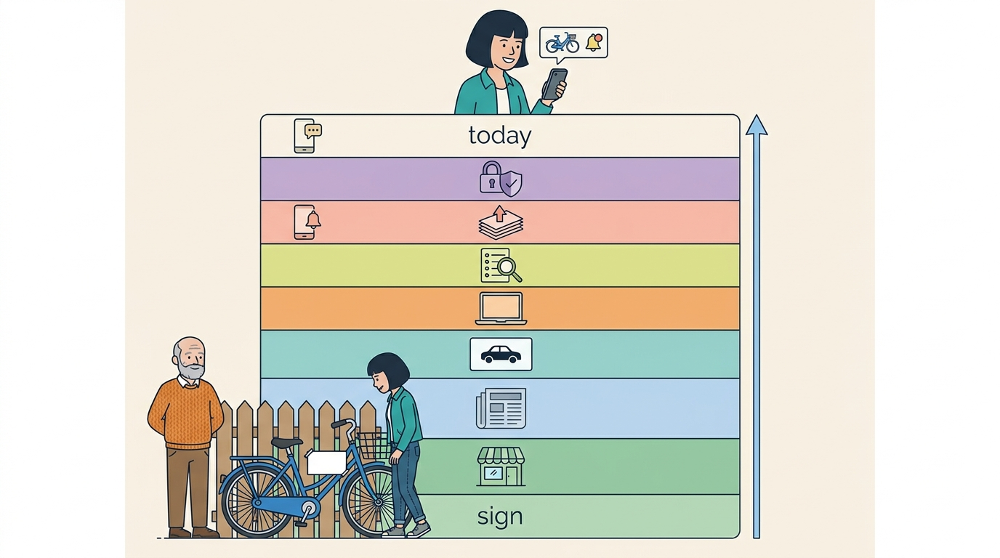
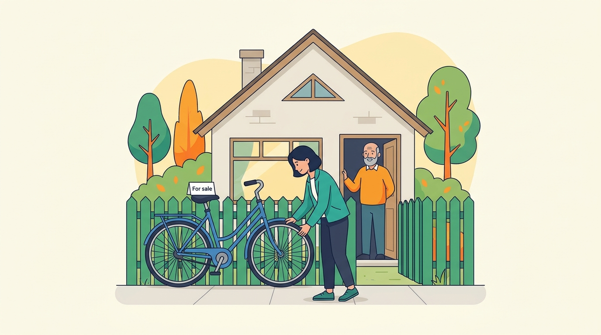
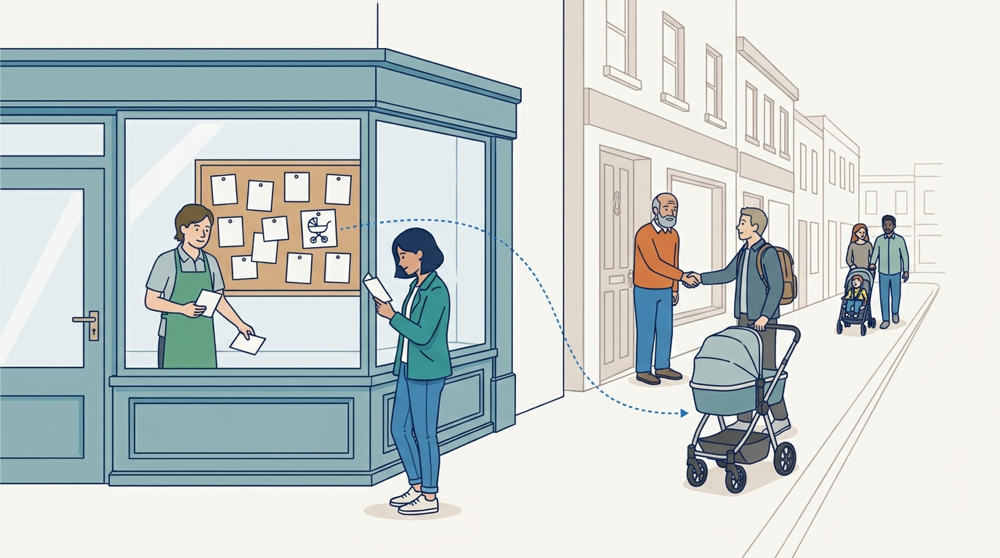
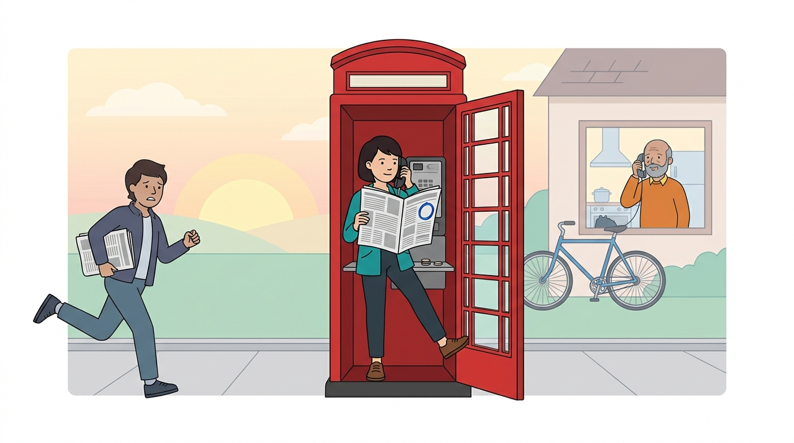
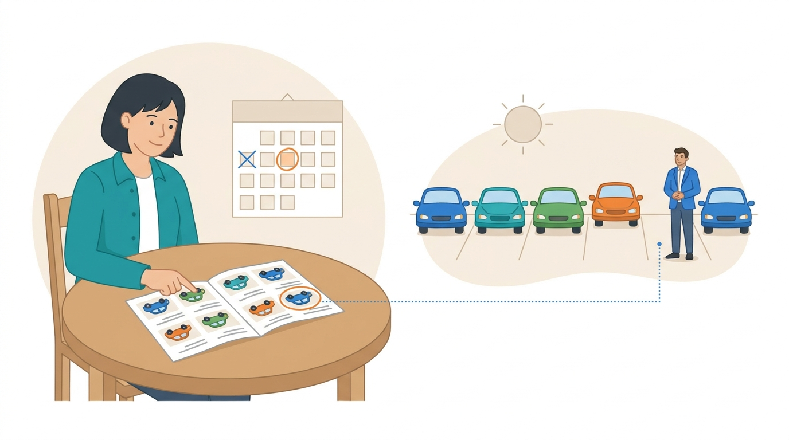
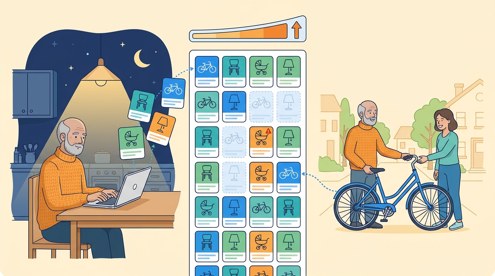
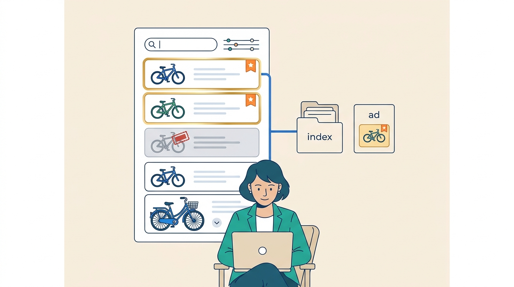
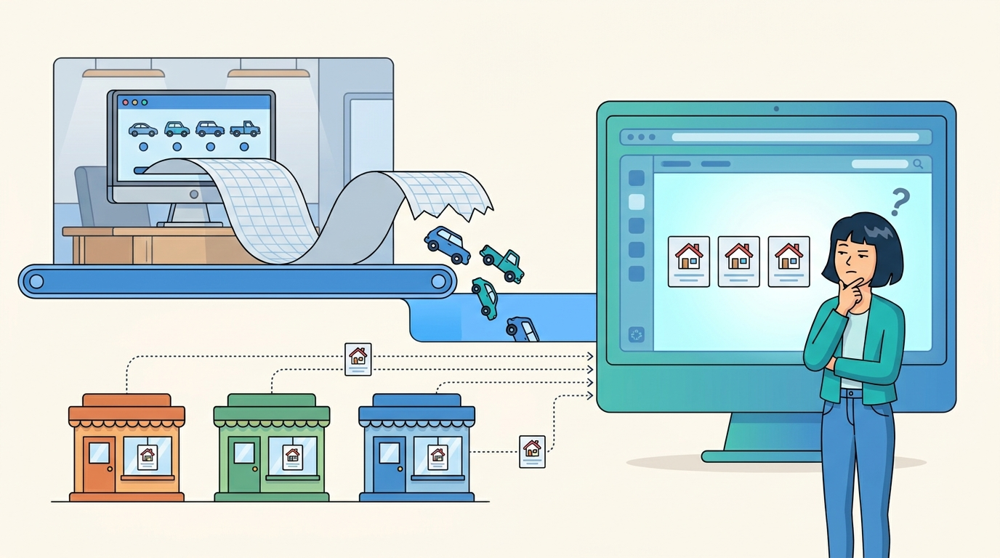
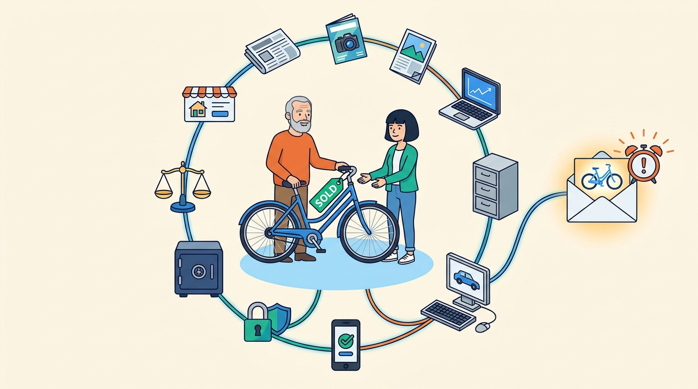

> **IN THIS SECTION, YOU WILL:** Follow the advertising of a used thing for sale from a sign taped to the thing itself to an alert on a phone, and meet each listing-marketplace concept at the step that first needed it.

> **KEY POINTS:**
>
> * **Every new way of advertising let someone buy or sell who could not before.** The card in the shop window reached the neighbors, the newspaper the whole town, the car magazine the region and the website anyone at any hour; an alert on a phone tells a buyer about a new bike within minutes.
> * **The price each time was one more copy of the ad and one more stranger.** The card, the printed column, the web page, the search result, the dealer's file and the alert each learn of a sale at their own time, and the buyer or the seller at the other end may be lying. None of these ways of advertising was ever retired, so one listing today lives in all of them.
> * **Listing systems fail where a copy of the ad learns the truth late, or a stranger acts before anyone checks.** The race to the phone box is still run, now by software. The fifteen patterns of the next page are those cases, named.

 
Picture a Saturday morning a few decades ago, as an illustration of a common practice. The local paper comes out early. A reader who wants a cheap bike buys it as soon as the shop opens, turns to the small ads at the back, rings one with a pen and runs to the nearest telephone box with a handful of coins. If the line is busy, someone else got there first. By nine the bike is sold, and the ad goes on offering it to the whole town until the next edition. Now take the bike the [[introduction]] mentioned, from the book's fictional example: a €240 city bike listed in Rotterdam on a Sunday evening in 2027 gets its first message thirteen minutes later. It is sold on Monday and still offered in 214 alert e-mails on Tuesday morning.

The phone box and the alert are the same race, run by different machinery. Around them lie seven other ways of advertising a thing for sale, and this page walks through them in the order they were added. **Each was a good bargain: it let a seller reach buyers who could not see the thing, and let a buyer reach it sooner, at the price of one more copy of the ad to keep true and one more stranger to trust. None was ever retired.** The account is simplified. It follows the ideas, not the full history, which was messier and differed by country; [[industry-evolution]] tells that history, with its companies and deals. The scenes are illustrations of common practice, the few dates are anchors with sources listed at the end, and the chapters carry the detail.

The walk has nine steps: the sign on the thing; the card in a shop window; the newspaper column; the specialist magazine; the classifieds website; search and the order of results; the dealer's feed; the phone in the pocket; and today's platform, where the Rotterdam bike returns. Each step says what stopped working, what was added and what the book calls it, what it made possible for seller and buyer, and what it cost. The figure below draws the result. Each step then answers one question: **is what the ad says still true, and who finds out first?**

**Figure 1:** *Nine steps, one stack: each way of advertising was added on top of the one before and none was removed, so a listing today rests on all of them.*

## The Sign on the Thing: The Ad Cannot Outlive the Sale

Start with a bike leaning on a garden fence with a card taped to its saddle: "For sale" and a price, an illustration of the simplest way to advertise. A passer-by squeezes the tires, rides it up the street and back, knocks, pays and wheels it away.

The ad, the thing and the seller are in one place. The buyer sees exactly what she buys, and who sells it. When the bike is sold, the sign goes with it, so the ad cannot go on offering a bike that is gone.

It is that simple only under three conditions. The buyer walks past. The thing is where the sign is. And the seller is next to the thing. **The steps that follow begin where one of these conditions did not hold**: the buyer lived elsewhere, the thing was out of sight, or buyer and seller had never met.

**Figure 2:** *With the sign on the thing, the ad, the bike and the seller are in one place, so the ad cannot outlive the sale, but only people who walk past can read it.*

**Is what the ad says still true?** Yes, as long as the sign hangs on the bike. **Who finds out first?** Whoever walks past.

## The Card in the Shop Window: An Ad Away From the Thing

Few buyers walk past any one garden. So the seller writes the same words on a card and pays the corner shop a small sum to put it in the window, among a dozen others; picture this, too, as an illustration of common practice. The card now describes a thing the reader cannot see, at an address round the corner. A public offer about a specific thing, made apart from the thing and for a limited time, is what the book calls a **listing** ([[listing-aggregate]]). It is a promise: the thing exists, it is as described, and it is still for sale.

Both sides gain. The seller reaches everyone who uses the shop, not only those who pass the gate. The buyer sees a dozen offers in one place, and a family that cannot afford a new pram finds a good one two streets away.

The price is that the promise can stop being true while the card still makes it. The pram is sold on Tuesday, and the card stays up until someone remembers to take it down. A card can say "as new" about a pram that is not. And the seller opens the door to a stranger who may never come back or may pay with a check that bounces; deceit is possible on both sides. So the shopkeeper decides which cards go up, for how long and for what fee, and turns away a card that looks like trouble. These are the first rules of a marketplace, and checking ads against them before readers see them is what the book calls **moderation** ([[trust-and-safety-architecture]]).

**Figure 3:** *A card in a shop window reaches everyone who uses the shop, but it is a promise about a thing the reader cannot see, and it can go on offering the pram after it is sold.*

**Is what the ad says still true?** Until the pram is sold; after that the card says otherwise for days. **Who finds out first?** Whoever reads the card first and knocks. The rest find out at the door.

## The Newspaper Column: The Race to the Phone Box

A shop window reaches one street. A newspaper reaches a whole town every morning. So papers commonly sold small ads, set in narrow columns at the back and grouped under headings such as cars, furniture or rooms to let. A business whose job ends when a reader contacts the seller is what the book calls **classifieds** ([[marketplace-taxonomy]]), from the classified ads of the paper. The headings are **categories** ([[categories-and-taxonomies]]). The paper decides which headings exist and the order of ads under each.

The paper is a publisher. It sets the rules, refuses ads it will not print and, commonly, charges by the line or by the word, so sellers learn to say a lot in very few words. A charge to publish an ad is what the book calls an **insertion fee** ([[monetization-models]]).

Both sides gain. The seller reaches a whole town in one morning, and the buyer sees every bike for sale in the town over breakfast. And the paper with the most ads commonly draws the most readers, which draws more ads. That loop, in which each side comes because the other side is there, is what the book calls a **network effect** ([[liquidity-and-network-effects]]), and it still decides which marketplace wins a town.

The best offers go fast, so the race begins at dawn. A buyer who wants a bargain commonly gets the paper as early as possible, rings the ad she wants and runs to a telephone box with coins, because at home someone may be on the phone, or there is no phone. She dials the number printed in the ad. That call, a buyer reaching a seller about an ad, is what the book calls a **contact** ([[messaging-and-leads]]). How soon the first one comes after an ad appears is what the book measures as time to first contact ([[liquidity-and-network-effects]]).

**Figure 4:** *The newspaper column brings a whole town's offers to the breakfast table, and the buyer who gets the paper first and reaches a phone first gets the bike.*

The price is that the ad is out of date the moment the first caller gets through. Printed, it cannot be taken back: the seller's phone rings all day for a bike that is gone. How fast a sold thing disappears from every place where buyers can still see it is what the book calls **freshness** ([[publication-pipeline]]). The race is also unfair: a buyer who gets the paper late, or lives on the far side of town, rarely wins. And buyer and seller are now strangers at a distance whom the paper checks neither: a caller can ask the seller to hold the bike and never come, and a seller can ask for money in advance for a bike that does not exist.

**Is what the ad says still true?** Until the first caller gets through, but it is printed as true until the next edition. **Who finds out first?** The reader who got the paper first and reached a phone first. The rest find out from a busy line or a seller who says "sold".

## The Specialist Magazine: Photos, Dealers and the Same Few Questions

A line of text is enough for a pram. It is not enough for a car, which a buyer wants to compare with every similar car before she calls. So magazines that carried only one kind of goods, such as cars or homes, collected the ads of a whole region, commonly with a photo of each. Auto Trader, the British car marketplace, dates its own beginning to 1977, when John Madejski "launched a small regional classified advertising magazine called Thames Valley Trader"; it became Auto Trader in 1988. A marketplace for one kind of goods is what the book calls a **vertical** marketplace, and one for everything a horizontal one ([[marketplace-taxonomy]]).

Such a magazine commonly prints the same few facts for every car, in the same order: make, model, year, mileage, price. Named facts that every ad of a kind must give are what the book calls **attributes** ([[attribute-schemas]]), and the photo is the first of the pictures and videos the book calls **media** ([[media-pipeline]]). Commonly, most ads come from **professional sellers**, dealers and estate agents who advertise every week and pay for it ([[sellers-and-accounts]]).

Both sides gain. The buyer compares every car in the region on one page before she spends a coin on a call. A dealer sells across a whole region, and a private seller reaches exactly the buyers who want that kind of car.

The price is a longer wait and a picture that can mislead. A weekly or monthly magazine is printed days before it is read, so its ads are older still on the day they appear. A photo can show a different car, or the same car on a better day. And a dealer can advertise one car in two magazines, so the buyer meets it twice.

**Figure 5:** *The specialist magazine lets a buyer compare every car in the region with a photo and the same facts for each, but its ads were printed days before they are read.*

**Is what the ad says still true?** It was true when it was written, days before the magazine was printed, and the photo may not even show this car. **Who finds out first?** The reader in the region who gets the magazine on the day it comes out.

## The Classifieds Website: Free, Instant and Unchecked

A printed page waits for its deadline and charges by the line; a web page can change at any time, and one more ad costs almost nothing. Craigslist's own history says that in early 1995 Craig Newmark began sharing a list of local San Francisco events by e-mail; people began to post jobs, things for sale and flats, and he wrote software that added the e-mailed posts to a website. By then some specialist magazines were going online too: Auto Trader dates its first website to 1996. In the Netherlands, eBay's announcement of its purchase of Marktplaats in 2004 says the site, "Founded in 1999", had "more than one million listings at any given time". These dates are anchors, not claims to be first.

On such a site the seller commonly types the ad herself and it appears at once. Listing a private sale is commonly free; the money comes from professional sellers and from paid extras. Nobody reads the ad first: the seller is her own publisher. And only the seller can change or remove the ad. A listing now has a life of its own, from draft to live, sold or expired, which the book calls the **listing lifecycle** ([[listing-aggregate]]).

Both sides gain, and the gain was real money. The seller pays nothing, reaches anyone at any hour and can take the ad down the minute the bike is sold. The buyer sees every ad in the country without buying a paper. In a 2013 summary of their study of craigslist's arrival in American towns, NYU Stern reports that Robert Seamans and Feng Zhu found a "20.7% drop in classified-ad rates" at newspapers that relied heavily on classified ads, and estimated that "classified-ad buyers saved $5 billion from 2000-2007".

The price comes in three parts. Nobody reads the ad before it appears, so a scam is published as fast as an honest ad, and the checking the shopkeeper did at the window has to be rebuilt by software and people after the fact, at the scale of a country. Removal is left to the seller, who commonly sells the bike to a neighbor and never comes back to mark it sold, so the site fills with ads for things that are gone. And because listing is free, the number of ads and visits can grow much faster than the number of sales, so a site can look healthy by counting what is easy to count.

**Figure 6:** *The free website lets anyone publish at once to anyone, but nobody checks the ads first and only the seller can take them down, so the site fills with ads for things that are gone.*

**Is what the ad says still true?** Only if the seller comes back to say it is sold, and nobody checked that it was true to begin with. **Who finds out first?** The buyer who refreshes the page, or who calls and hears "sold". The site itself may never know.

## Search and Filters: The Site Decides the Order

A newspaper has a column or two of bikes. A website has thousands in one city, and nobody can read them all. So the site adds a search box and filters: under a price, within a distance, with a women's frame. A filter works only if every ad gives the same facts in the same way, so the site asks the seller to pick a category from a tree and to fill in named fields; the magazine's habit of asking the same questions becomes data the site requires ([[categories-and-taxonomies]], [[attribute-schemas]]). To answer quickly, the site keeps a copy of every ad shaped for searching, a **search index** ([[search-architecture]]).

The site also decides the order of the results: newest first, nearest first, or what it judges most relevant. Choosing that order is what the book calls **ranking** ([[ranking]]). Because the order belongs to the site, the site can sell places in it: a "bump" that moves an ad back to the top, or a top slot above the free results. That is **paid visibility** ([[monetization-models]]).

Both sides gain. The buyer finds the one bike she wants among thousands in seconds, and the seller of a good bike is found by exactly that buyer. A seller in a hurry can pay to be seen first.

The price is a second copy and an order nobody can read at a glance. The index is a copy, so it learns of a sale a little later than the ad itself, and a site that serves everything from its index can lose track of which copy is the truth. The category tree and the fields are written into the site, so a new kind of thing, such as an electric bike, needs a change to the site, and what fits no field is typed into free text. And every paid place pushes a free ad down, so the buyer can no longer tell whether the first result is the best one or the one that paid.

**Figure 7:** *Search finds one bike among thousands, but it reads from a copy of the ads, and the order is the site's to decide and to sell.*

**Is what the ad says still true?** In the ad's own record, yes, until the seller says otherwise; in the index, only as of its last update. **Who finds out first?** The site's own record, then the index, then the buyer.

## Feeds: The Dealer's Software Writes the Ad

A dealer with two hundred cars on the lot cannot type each one into four websites and keep them all right every day. Dealers and estate agents commonly keep their stock in their own software, so that software sends the websites a file of the whole stock every night, or a stream of changes as they happen. That flow is what the book calls a **feed** ([[listing-ingestion]]), and the agreement on what it must contain, and on what a car missing from it means, is the **feed contract**. The websites built for cars or homes, often called portals, commonly receive most of their ads this way.

Both sides gain. The dealer lists every car without typing and keeps every portal in step with the lot; the buyer sees the whole stock with the same facts for every car.

The price is that the portal now publishes what another company's system says, when that system says it. A file cut short by an error can remove cars that are still for sale. A car sold on Thursday stays up until the next file says otherwise. Each software vendor sends its own format, and each country has its own. And a flat for sale through three estate agencies arrives in three feeds and appears three times.

**Figure 8:** *A feed lists a dealer's whole lot without typing, but the portal publishes whatever the dealer's software sends, so a torn file removes cars still for sale and one flat sent by three agencies appears three times.*

**Is what the ad says still true?** As of the dealer's last file. **Who finds out first?** The dealer's software, then the portal, then the buyer.

## The Phone in the Pocket: The Race Becomes a Notification

A buyer who has to visit the site to look is back at the paper, only faster: she sees new ads when she remembers to check. Once the site lives on her phone, it can come to her. Apple's newsroom announced on 10 July 2008 that its App Store "will be available beginning today", and a marketplace's own app could then sit on a phone in a pocket. The buyer saves her search, and when a new ad matches it, the app tells her at once. A stored search and the message it triggers are what the book calls a **saved search** and an **alert** ([[saved-searches-and-alerts]]). They are the morning paper and the phone box in one: the race to call first now starts with a buzz in a pocket. The call moves into the app as well: the buyer sends a message, which the platform carries and keeps, and for a dealer each such message is a **lead**, a record that a buyer asked about one of its cars ([[messaging-and-leads]]).

Both sides gain. The buyer hears of the right bike within minutes, wherever she is. The seller gets buyers within minutes without giving her phone number to strangers, and the dealer gets every enquiry recorded.

The price is speed, for good and bad. An alert built from a copy can announce a bike sold an hour ago, and a buyer without the alert rarely sees a bargain. And a stranger's message arrives as fast as an honest one, so fraud now closes in the conversation. In the United Kingdom, UK Finance's Annual Fraud Report 2026 counts 175,809 cases of purchase scams in 2025, in which "the victim pays in advance for goods or services that are never received", with £118.1 million lost. It describes the typical move: "the criminal will persuade their victim to pay via a bank transfer instead" of the platform's own secure payment.

**Figure 9:** *The alert turns the race to the phone box into a buzz in a pocket, and the message inside the app brings the seller a buyer within minutes, and a fraudster just as fast.*

**Is what the ad says still true?** As of the copy the alert was built from. **Who finds out first?** The buyer whose phone buzzes first and who answers first, and that may be a fraudster.

## Today: Payment, Proof and One Platform for Many Marketplaces

None of these ways of advertising was retired: cards still hang in shop windows. What the present adds is that the platform no longer stops at the contact. Some platforms now take the payment too, and hold it until the thing arrives. Marktplaats, by Adevinta's Annual Report 2023, "successfully launched transactional services in 2017" and added shipping in 2019. A promise to give the buyer her money back if the thing does not arrive or is not as described is what the book calls **buyer protection** ([[transactions-and-payments]]). Platforms also check who the people are, to a depth that depends on the risk: **identity verification** ([[identity-and-verification]]). And the law sets rules that the shopkeeper once set alone. The European Union's Digital Services Act "shall apply from 17 February 2024"; it requires every hosting service to let anyone report illegal content, and requires marketplaces to collect and check the identity of traders before they may sell ([[marketplace-regulation]]).

Many marketplaces also belong to groups of brands in several countries. Adevinta completed its purchase of eBay Classifieds Group on 25 June 2021 and described the result as holding "#1 market positions in 16 countries"; [[industry-evolution]] tells how such groups formed. A group decides which systems to share beneath its brands ([[multi-country-platforms]]). And models now decide some of what the shopkeeper decided by eye: which ads come first, which messages to hold, what a car is worth ([[ai-in-listing-systems]]).

Femke's bike shows all of it at once. She sells on Tradeyard, the general classifieds site of Veldmark, the fictional marketplace group this book follows ([[meet-veldmark]]). She lists her €240 city bike in Rotterdam at 19:42 on Sunday 7 March 2027. It is searchable at 19:48, matches 312 saved searches, and the first message arrives at 19:55. At 20:11 a "buyer" sends her a fake payment link from a domain registered that day, and it is delivered before any check catches it; she reports it at 20:19, and the account is suspended at 20:26. On Monday the bike sells for €225 through Tradeyard's own payment service. It is marked sold at 18:10 and gone from search at 18:11. But the alert digest assembled at 17:30 still offers it in 214 e-mails at 07:00 on Tuesday.

Both sides gain. The buyer can pay a stranger in another city and get her money back if nothing comes; the seller sells to a whole country without meeting anyone; a group builds a capability once for many brands.

The price is that the platform now holds money and risk, must know who people are, and answers to regulators. A group that grew by copying its site into new countries, or by buying other marketplaces, runs several copies of everything; when it forces one platform on all of them, some do not fit. What a seller has paid for, a bump or a dealer package, is checked in many places at once. And the models decide whether or not anybody is watching them.

**Figure 10:** *One listing today rests on every earlier way of advertising and on payment, identity checks and law, and each copy learns of the sale at its own time.*

**Is what the ad says still true?** In one record, yes, within a minute; in a dozen copies, only when each catches up. **Who finds out first?** The record that holds the sale. The last to find out is an alert e-mail thirteen hours later.

## What the Steps Add Up To

Here are the nine steps side by side, each with what it made possible and what it added. The last column uses the names the next page gives to these failures, in bold, and plain words where it has none.

| Step | What it made possible | What it added | New party or delay | What can now go wrong |
| --- | --- | --- | --- | --- |
| Sign on the thing | A sale with no description to trust | Nothing: ad, thing and seller in one place | None | Only passers-by can buy |
| Card in a shop window | The neighbors can buy; the seller reaches more than the gate | The listing as a promise; rules and moderation | The shopkeeper; days until the card comes down | The card outlives the sale; a description lies; a stranger at the door |
| Newspaper column | A whole town can buy in one morning | Classifieds, categories, the insertion fee, the network effect, the contact, freshness | The publisher; an edition that cannot be taken back | The ad runs after the first call; the late reader never wins; deceit at a distance |
| Specialist magazine | A buyer compares a region's cars; a dealer sells across a region | The vertical, attributes, media, professional sellers | Dealers and agents; a print deadline days early | A photo of another car; one car in two magazines |
| Classifieds website | Anyone sells free, at once, to anyone | Self-publishing, the listing lifecycle | No editor; removal left to the seller | **Moderation as an Afterthought**, **Ghost Inventory**, **Vanity Liquidity** |
| Search and the order | One bike found among thousands; a seller can pay to be seen | The category tree and fields as data, the search index, ranking, paid visibility | A copy of every ad; the site's order | **The Category Straitjacket**, **The Attribute Junkyard**, **Search as System of Record**, **Multiplier Creep** |
| Feeds | A dealer lists the whole lot without typing | The feed and its contract | The dealer's software and its vendor | **Feed Roulette**, **Seeing Double** |
| Phone in the pocket | The buyer hears within minutes; the seller keeps her number | The saved search, the alert, the message, the lead | Alerts built from copies; strangers in the inbox | **Fast Mail for Fraudsters** |
| Today | Pay a stranger safely; one platform for many brands | Buyer protection, identity verification, regulation, group platforms, models | A payment provider, regulators, a group, models | **The Copy-Paste Country**, **Deal-Shaped Architecture**, **The Forced Fit**, **Billing by Guesswork**, **Set-and-Forget AI** |

The table follows the ideas. The page's dates place the same steps in time and show how recent most are: the magazine anchor is about fifty years old, the website about thirty, and apps on phones under twenty. The sign, the card, the newspaper column and the feed carry no date, because they are common practice and not events.

| Year | What its source dates to that year | Step |
| --- | --- | --- |
| 1977 | Thames Valley Trader, the magazine that became Auto Trader in 1988 | Specialist magazine |
| 1995 | Craigslist begins as e-mailed notices, later posted to a website | Classifieds website |
| 1996 | Auto Trader's first website | Classifieds website |
| 1999 | Marktplaats founded; more than a million listings at any given time by 2004 | Classifieds website |
| 2000–2007 | Classified-ad rates fall; buyers of classified ads save about $5 billion (United States) | Classifieds website |
| 2008 | Apple's App Store opens | Phone in the pocket |
| 2017 | Marktplaats launches transactional services (shipping in 2019) | Today |
| 2021 | Adevinta completes its purchase of eBay Classifieds Group | Today |
| 2024 | The Digital Services Act applies | Today |
| 2025 | 175,809 purchase-scam cases in the United Kingdom | Phone in the pocket |

Count what stands behind Femke's bike that did not stand behind the bike on the fence: a listing record, a search index, 312 saved searches, a messaging check that came too late, a payment service, a digest built from a copy, and rules set by law. **Every step moved the ad further from the thing**, and put more strangers and more copies between seller and buyer. The answer to "is it still true, and who finds out first?" grew from "yes, whoever walks past" to one record and a dozen copies that learn at different times, read by buyers and sellers who may be lying.

It is tempting to think that underneath, a classifieds site is a table of ads and a search box that a clean rebuild would restore. It is not, and **the complexity is the price of all that trade, not a mistake**. Each step was a bargain that sellers and buyers wanted, and each answers a limit that has not gone away. Buyers still live elsewhere, still cannot see the thing, still want to hear first, and still meet strangers. A rebuild has to keep the same copies and the same checks, or hand them to someone else. So expect every one of these steps to stay, and **expect a failure wherever one copy of an ad learns the truth later than another, or a stranger can act before anyone checks**.

The next page names those failures. [[where-listing-systems-go-wrong]] describes fifteen recurring patterns, and after this walk none of them should come as a surprise: each is the price of one of these steps.

## Sources and Evidence

Each date and quotation was read on its source's page on 18 November 2026. No primary source was read for the card in a shop window, the newspaper column, the race to the telephone box or dealer and agency feeds, so those steps are common practice and illustration, without dates, and the page claims no "first" for any step. The anchors come from the United States, the United Kingdom, the Netherlands and the European Union.

*Company engineering and investor sources*

- [Our history](https://plc.autotrader.co.uk/about/our-history/) — Auto Trader Group plc, n.d., accessed 2026-11; the 1977 launch of Thames Valley Trader, the 1988 name, the first website in 1996 and the final print edition in June 2013 (the company's own account; also in [[industry-evolution]]).
- [Mission and history](https://www.craigslist.org/about/mission_and_history) — craigslist, n.d., accessed 2026-11; the start in early 1995 as e-mailed notices of San Francisco events, and software that added e-mailed posts to a website (the company's own account).
- [eBay to acquire Marktplaats.nl](https://www.sec.gov/Archives/edgar/data/0001065088/000129993304001734/exhibit1.htm) — eBay Inc., press release filed with the SEC, 2004-11-10; "Founded in 1999", "more than one million listings at any given time" (evidence age: 22 years, used as a date only).
- [Apple Newsroom: iPhone 3G on Sale Tomorrow](https://www.apple.com/newsroom/2008/07/10iPhone-3G-on-Sale-Tomorrow/) — Apple, 2008-07-10; "The App Store will be available beginning today".
- [Annual Report 2023](https://live.euronext.com/sites/default/files/company_press_releases/attachments_oslo/2024/04/26/616971_Adevinta%20AR%202023.pdf) — Adevinta, 2024; p. 24, Marktplaats "successfully launched transactional services in 2017", shipping in 2019.
- [Adevinta completes acquisition of eBay Classifieds Group](https://adevinta.com/press-releases/adevinta-completes-acquisition-of-ebay-classifieds-group/) — Adevinta, 2021-06-25; completion and "#1 market positions in 16 countries" (also in [[industry-evolution]]).

*Standards, regulation and documentation*

- [Regulation (EU) 2022/2065 (Digital Services Act)](http://publications.europa.eu/resource/celex/32022R2065) — Official Journal, 2022; Article 16 (notice and action), Article 30 (traceability of traders), Article 93(2) ("shall apply from 17 February 2024").

*Research and practitioner sources*

- [New research looks at Craigslist's damaging blow to local newspapers](https://www.stern.nyu.edu/experience-stern/faculty-research/seamans-craigslist) — NYU Stern, 2013-08-13; Seamans and Zhu's "20.7% drop in classified-ad rates" and "$5 billion" saved by classified-ad buyers from 2000 to 2007 (United States; also in [[industry-evolution]]).
- [Annual Fraud Report 2026](https://www.ukfinance.org.uk/system/files/2026-06/UK%20Finance%20Fraud%20Report%202026.pdf) — UK Finance, 2026; purchase scams in 2025: 175,809 cases, £118.1 million, and the move to a bank transfer (United Kingdom; also in [[where-listing-systems-go-wrong]]).

Veldmark is fictional; architectural recommendations and labeled inferences are the author's judgement.
