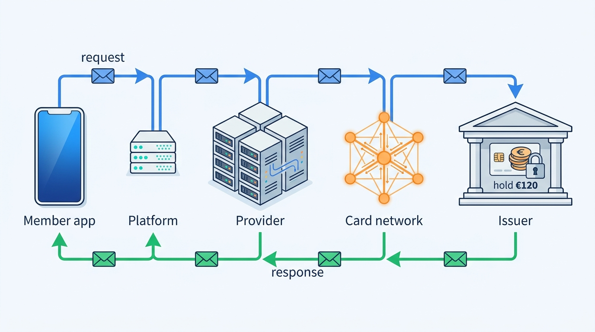
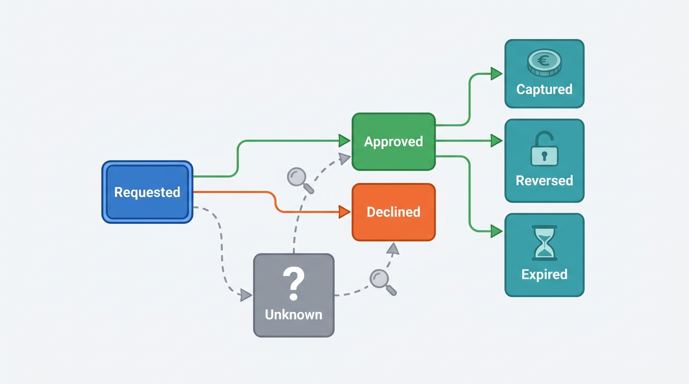
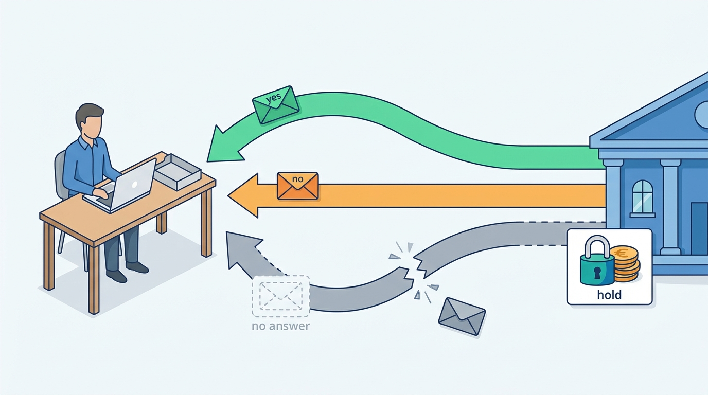

> **IN THIS CHAPTER, YOU WILL:** Learn what an approved card payment promises, who decides, how long the promise lasts, and what to do when no answer comes back.

> **KEY POINTS:**
>
> * **An authorization is a promise, and it moves no money.** The cardholder's bank (the issuer) agrees to honor a claim for up to an approved amount inside a limited window: 5 to 30 days in Visa's general table. Until then the promise can expire, be resized or be withdrawn.
> * **A refusal is three facts, and the network's retry advice governs.** Issuers return most refusals as a generic code. Store the provider's reason, the raw network code and the network's retry advice separately; retrying against the third brings fees.
> * **A timeout is an unknown outcome, not a decline.** The bank may have approved and reserved the money while your code holds no answer. Resolve it with the same request key, the provider's record or your own reference before sending anything new.

> **[FAILURE PATTERNS THIS CHAPTER ADDRESSES](where-payment-systems-go-wrong.html):**
>
> * **The Double Charge** — a request that timed out is sent again as a new request, and the cardholder's bank, which had already approved the first, approves the second.
> * **The Phantom Payment** — a system records “failed” because no answer came, or “paid” because an approval came, when the bank's record says something else.

 
On 1 November 2026 the renewal job at Larkfield, the fictional studio-software platform this book follows, sends a membership charge to its payment provider and waits. No answer comes. It sends the charge again. By the end of the morning **1,840 members have paid twice**, €71,300 has to be refunded, and 212 members dispute the charge with their bank anyway. No request had been refused. The job read a missing answer as a refusal, and each first request had in fact been approved.

What those first requests had obtained is this chapter's subject. An **authorization** is the promise of the cardholder's bank to honor a claim for up to an approved amount inside a limited window. **It moves no money.** Before the claim arrives the promise can lapse, shrink or be withdrawn, and after a timeout **it can exist without you knowing**. The instant answer your API call returns is this promise and nothing more.

**Where we are in the payment's journey.** [[journey-of-a-payment]] followed Mila Janssen's €120.00 class pass through six steps. This chapter stays at the first: 19:42 on Tuesday 9 March 2027, when her bank approves the payment. It is the only step Mila sees.

The chapter starts with the timeout at Larkfield. It then explains what an authorization is, how the issuer decides and reports a refusal, how long an approval lasts, the ways to ask for one, why it matters who is asking, and what to do when no answer comes back. The last two sections compare Stripe and Adyen and replay three Larkfield payments.

## Setting the Scene at Larkfield: A Timeout on the First of the Month

The incident of the introduction is that last case 1,840 times over: an approval that existed without the merchant knowing. It happened inside a peak. On the first of each month Larkfield attempts **38%** of its monthly membership volume in a **6-hour** window. On 1 November 2026, in the middle of that wave, calls to a payment provider began to time out. The renewal job sent each waiting charge again, and it generated a **new idempotency key** for every network call, so each retry reached the provider as a request it had never seen.

The fault was in the job's model of the outcome, not in the network. Its code knew two results, approved and not approved, and filed a timeout under the second. But a timeout says only that the reply did not arrive, not whether the request did. The members' banks had approved the first requests and reserved the money. Femke de Graaf, who joined as Head of Payments Engineering in January 2027, wrote three questions on the post-mortem: **what did the first request promise, who decided, and what could still have changed before any money moved?**

## What an Authorization Is: A Message, a Decision and a Hold

Visa's rules define **Authorization** as "A process where an Issuer, a VisaNet Processor, Visa Scheme Processor, or Stand-In Processing approves a Transaction" (Visa Core Rules and Visa Product and Service Rules, edition of 24 October 2026). The **issuer** is the bank that gave the customer the card. So the decision is made on the issuer's side of the network, and a party other than the issuer can sometimes make it.

The request for Mila's pass makes a round trip. Her phone's wallet hands the member app a payment credential; Larkfield's payment service sends it to Adyen, the provider for Studio Noord; Adyen, on the acquiring side of the network, the side that collects for the merchant ([[acquiring-and-network-connectivity]]), passes it to Visa; Visa passes it to Mila's bank. Visa's annual report (Form 10-K) for fiscal 2026, filed in November 2026, describes the same path: "Through VisaNet, the acquirer presents the transaction data to Visa, which in turn sends the transaction data to the issuer to check the account holder’s account balance or credit line for authorization." The answer returns over the same four hops, and any of them can lose it. The figure draws that round trip; the table under it states what the exchange is built to guarantee, requirement by requirement, and what each guarantee still leaves to you.

**Figure 1:** *An authorization is a request and a response across four hops; it changes only a hold of €120 at the issuer, and no money travels.*

| Requirement | What the card system provides | What is left to you |
| --- | --- | --- |
| Speed | An answer in a few seconds *(industry practice; assumption)* | A timeout, and a plan for when it fires |
| Availability | The network can answer for an unavailable or slow issuer (stand-in processing, below) | Nothing: you are not told who answered |
| Consistency | The issuer's record is the original; other parties hold copies of the answer | Store your copy with the provider's reference and your own |
| On failure | A reply lost on the way back does not undo the approval | Treat the outcome as unknown |

On that path the question travels as an **ISO 8583** message, the card industry's message standard. Stripe's explainer (updated 18 September 2026) says "Each message is built from an MTI, a bitmap, and data elements": a four-digit message type indicator, a map of which fields are present, and the numbered fields. The standard "isn’t self-describing", each network keeps its own variant, and "ISO 8583 still dominates card authorisation, even as ISO 20022 gains adoption on other payment systems" such as bank transfers. You never see this message: "Businesses that use a payments provider such as Stripe don’t have to build or manage these messages themselves", and nothing on the Adyen pages read for this chapter exposes it either. You see the provider's translation of a few fields, above all the response code, such as Visa's "51 (Not sufficient funds)".

An approval makes the issuer place a **hold**: it lowers the amount the cardholder can spend by the approved amount, without debiting the account. Stripe's documentation (n.d., accessed November 2026) says "Authorizing a payment guarantees the amount by holding it on the customer’s payment method"; Adyen's (n.d., accessed November 2026) says a pre-authorization "verifies that the shopper's account is valid and has sufficient funds to cover a transaction, but does not debit the account." Stripe warns that statements "don’t always distinguish between authorizations and captured (settled) payments", which is why Mila believes she paid at 19:42.

Together the message, the decision and the hold make one promise: the issuer will honor a claim for up to the approved amount if the claim arrives in time. The merchant's claim is called a **capture**; the next chapter owns it. Visa's rules give the acquirer a maximum number of days to process the transaction after the approval. That is all the approval promises. It does not say that money has moved, that the merchant will be paid, that the cardholder cannot take the money back, or that the promise lasts. The table sets the promise, in three rows, against the first three of these; the fourth is the promise's own last row, a fixed number of days.

| What an approval promises | What it does not promise |
| --- | --- |
| The issuer will accept a claim for up to the approved amount | That money has moved: that happens at clearing and settlement ([[clearing-and-settlement]]) |
| The amount is reserved on the cardholder's account meanwhile | That you will be paid: the payout is the provider's later promise ([[payouts-and-money-movement]]) |
| The promise holds for a fixed number of days | That the cardholder cannot take the money back: a dispute can come for about 120 days ([[refunds-reversals-and-disputes]]) |

## The Issuer Decides, and Mostly Does Not Say Why

Femke's second question was who decided. The yes comes from the issuer's side of the network: the issuer or, as Visa's definition allowed, a party acting for it. A provider can refuse a payment before asking, but it cannot approve one. Stripe's documentation (n.d., accessed November 2026): "When Stripe blocks a payment, it doesn’t obtain authorization from the card issuer". Adyen's refusal reasons (n.d., accessed November 2026) list the same case as reason 20, FRAUD: "The pre-authorization risk checks resulted in a fraud score of 100 or more." [[payment-fraud-and-risk]] covers those checks.

The issuer's answer arrives as a **response code**, a two-character code in the response message. Visa's rule 7.3.6.3 says an issuer "must send to VisaNet the Decline Response code that most accurately reflects the reason for the decline". In practice the code is usually uninformative. Stripe: "Card issuers categorize most declines as generic (generic_decline), making the exact decline reason unclear." Adyen, on Visa's catch-all group: "The most frequent refusal reason, **05: Do not honor**, falls into this category."

What the networks do attach to the code is a retry rule. Visa sorts decline codes into four categories with reattempt limits (the table below): never after a code in the first category, and up to 20 attempts in 30 days in the other three. Adyen's page on these categories (n.d., accessed November 2026) still says "up to 15 times in a 30-day period" where Visa's rule text says 20; a provider's page can lag the rule, so cite the rule. Mastercard's rules could not be read directly for this book. By Adyen's documentation, Mastercard returns a separate Merchant Advice Code, with values such as "03 : Do not try again" and "30 : Retry after 10 days", and "Not all Mastercard issuers return the MAC."

| Visa category (Table 7-2, 24 October 2026) | Example codes | Merchant reattempt limit |
| --- | --- | --- |
| 1: "Issuer will never approve" | 04 (pick up card), 14 (invalid account number), 46 (closed account) | "a Merchant must never resubmit" for the same card |
| 2: "Issuer cannot approve at this time" | 51 (not sufficient funds), 91 (issuer or switch inoperative) | "Reattempt permitted (up to 20 attempts in 30 days)" |
| 3: "Data quality" | 54 (expired card), N7 (decline for CVV2 failure; CVV2 is the card's printed security code) | The same limit |
| 4: generic response codes | "All other Decline Response codes"; by Adyen's page, 05 (do not honor) | The same limit |

You will also hear that a **soft decline** may be retried and a **hard decline** may not. These are industry shorthand, not terms in the networks' rules. The official equivalents are Visa's Category 1 against Categories 2 to 4, Mastercard's advice code, and the refusal that asks for the customer to be authenticated, which Stripe reports as `authentication_required` and Adyen as reason 38, "Authentication required", whose description ends "Retry with 3D Secure." [[three-d-secure-and-sca]] covers that case; [[authorization-optimization]] covers retry schedules.

Each provider hands you a refusal as **three separate facts**: its own normalized reason, the network's raw code and the network's retry advice. They answer different questions. Stripe's next step for `insufficient_funds` reads "The customer needs to use an alternative payment method", advice for a checkout with the customer present. Visa puts the underlying code, 51, in Category 2, where a later reattempt is permitted. A renewal scheduler needs the second answer, so store all three.

| Fact | Stripe (n.d., accessed November 2026) | Adyen (n.d., accessed November 2026) |
| --- | --- | --- |
| The provider's normalized reason | `decline_code`, for example `insufficient_funds`, `generic_decline` | `refusalReason` and `refusalReasonCode`, for example 12 "Not enough balance" |
| The network's raw code | `network_decline_code`: "The card network provides this 2-4 digit code" | `refusalReasonRaw`, for example "51 : Insufficient funds/over credit limit"; off until enabled in the Customer Area, Adyen's dashboard |
| Retry advice | `network_advice_code`, and Stripe's own `advice_code`: `do_not_try_again`, `try_again_later`, `confirm_card_data` | `additionalData.merchantAdviceCode` for Mastercard; a mapping of raw responses to Visa's categories |

A retry against the network's advice costs money and approvals. Adyen's documentation says: "Visa charges system integrity fees. These fees are related to excessive retries of failed transactions". Both providers also stop such attempts themselves: Adyen's refusal reason 46 is "Transaction blocked by Adyen to prevent excessive retry fees", and Stripe "blocks a payment that would have incurred network retry penalties and likely failed". Stripe also "recommends a maximum of eight retries", because "Card issuers might see creating additional retries as potential fraud". The fee amounts are not in the pages read for this chapter.

## A Promise with an Expiry Date: Validity Windows

A refusal ends the matter until the next attempt; an approval starts a clock. Visa's rules give the acquirer a maximum number of calendar days to process the transaction after "a valid Authorization". The number depends on where the card was used and on who initiated the payment. A payment is **cardholder-initiated** (the providers say customer-initiated) when the cardholder takes part, as at a checkout, and **merchant-initiated** when the merchant charges a stored card alone, as in a renewal. That is enough to read the windows; the rules behind the two labels concern stored cards, and they come two sections below, after the ways of asking that include storing one. The table below is the general one; a second table (5-12) sets different windows for domestic transactions in some countries, India and Japan among them.

| Transaction type (Visa Table 5-11, 24 October 2026) | Maximum processing timeframe |
| --- | --- |
| Cardholder-initiated, card absent (online) | 10 calendar days |
| The same, "with an extended Authorization indicator" | 30 calendar days |
| Estimated authorization at cruise line, lodging and vehicle rental merchants | 30 calendar days |
| Card present (in a shop) | 5 calendar days |
| All merchant-initiated transactions | 5 calendar days |

Stripe and Adyen do not document the same windows for the same payment. For a customer-initiated online Visa payment, Stripe's page gives **7 days** where Visa's rule and Adyen's page give **10**. Stripe's page gives no reason, and I will not supply one. For Mastercard, whose rules I could not read, both providers report 7 days.

| Case | Stripe (n.d., accessed November 2026) | Adyen (n.d., accessed November 2026) |
| --- | --- | --- |
| Visa, online, customer-initiated | 7 days | 10 days |
| Visa, merchant-initiated | 5 days; "The exact authorization window is 4 days and 18 hours, to allow time for clearing processes." | 5 days |
| Mastercard, online | 7 days | 7 days for a final authorization, 30 for a pre-authorization |
| The provider's own limit | `capture_before` on the charge "indicates when the authorization expires" | "Adyen expires (pre-)authorization requests automatically after 28 days from the day the payment is authorized" |

So read the expiry of each approval from the provider and store it with the order; do not compute it. On Stripe this is literal advice: its documentation calls `capture_before` "the most reliable and accurate way to determine your charge’s authorization window". To compute the window yourself you would need to know which row of Visa's table applies, and your API parameters alone do not settle that. Stripe and the network decide whether a payment counts as cardholder-initiated or merchant-initiated, from signals that the cardholder took part and not only from what you sent. The Adyen pages read for this chapter document no equivalent field. There the window follows from Adyen's table per scheme (its word for a card network) and the fields you declared, and an `EXPIRE` webhook reports when a payment "has expired on the Adyen payments platform".

When the window passes, the providers part ways. Stripe: "If the authorization expires before you capture the funds, the funds are released and the payment status changes to `canceled`." Adyen lets you capture late and names the price: it "increases the risk of" a failed capture, "Increased interchange fees" (interchange is the fee the issuer receives; see [[payment-economics]]), "Card scheme transaction fees" and "A cardholder-initiated chargeback for 'No Authorization' or 'Late Presentment' reasons". A chargeback is a payment taken back through the issuer, and Visa's rules list the right to this one as Dispute Condition 11.3. A late claim may still be paid, but nothing promises it.

## Asking for the Promise: Five Variants and When Each Fits

Time is the first thing that changes an approval. The merchant's own choices are the second: there are five ways to ask for an approval (for the exact amount, for an estimate, for an increase to an estimate, for whatever part the issuer will approve, and for no amount at all) and one way to give it back, the reversal. The paragraphs below take them in that order. The default on both providers is the first, a **final authorization** for the exact amount. The second is an **estimated authorization**, which Visa defines as a request "for the amount that a Merchant expects a Cardholder to spend in an individual Transaction and that is submitted before the final Transaction amount is known": the hotel's request at check-in. Adyen calls it a pre-authorization and treats requests as final "By default"; you ask for the other kind with `additionalData.authorisationType`.

An **incremental authorization** raises an approved estimate, as when the guest stays another night. It does not buy time. Visa: "An Incremental Authorization Request does not extend the processing timeframes". Stripe allows "a maximum of 10 incremental authorization attempts per PaymentIntent" (its payment object) and offers the feature to users on IC+, its pass-through pricing plan ([[payment-economics]]). Adyen calls it an authorization adjustment and makes eligibility depend on the merchant category code, the four-digit code for the merchant's line of business.

A **partial authorization** changes the amount from the other side: the issuer approves less than you asked. Visa defines it as "An approval response for an amount less than the amount requested by a Merchant for a Transaction." Both providers make it opt-in: Stripe with `request_partial_authorization` (for users on IC+ pricing, like incremental authorization), returning `amount_authorized` on the charge; Adyen with `additionalData.allowPartialAuth` and the result code `PartiallyAuthorised`. Once you opt in, read the approved amount from the response; never assume it equals the request.

A **zero-value authorization** reserves nothing. Visa calls it an Account Verification: "A message sent by an Acquirer to the Issuer, using a currency unit of zero, for confirmation that a Transaction can be completed using the Card." Before a merchant stores a card, Visa requires an authorization for the amount due or, "If payment is not required", an Account Verification. Adyen is explicit: "We recommend that you store payment details by making a zero-auth transaction". Stripe saves a card with a SetupIntent, its object for setting up a payment method for future payments; its documentation page does not say what goes to the network, but a Stripe support article (n.d., accessed November 2026) does: "When storing customer details, Stripe may send a request to the issuing bank for either a $0, $1, or similar authorization to verify that the card is valid".

A **reversal** gives the promise back. In Visa's rules an Authorization Reversal is "A V.I.P. System message that cancels an Approval Response", and a merchant owes one within 24 hours when an approved sale is not completed, or for the difference when the final amount is lower. The word shifts by provider. On Stripe you cancel the PaymentIntent, which "releases any held funds", and "reversal" means a refund issued shortly after a charge. On Adyen you cancel before capture, and the endpoint named reversal cancels an uncaptured payment and refunds a captured one ([[refunds-reversals-and-disputes]]).

Which should you use? My rule: ask for the exact amount and capture at once unless the sale forces otherwise. Each other variant buys flexibility and leaves you something to track. The table regroups the five variants as designs to choose between: the exact amount appears twice, by when you capture, the estimate and its increments are one design, and the reversal is not a row but something to track. The table is my judgement, and it does not hold where a network rule obliges a merchant category to do otherwise.

| Design | Right when | What you must then track |
| --- | --- | --- |
| Exact amount, captured at once | The sale is complete at checkout: Larkfield's passes and renewals | Nothing beyond the result |
| Exact amount, captured on fulfillment | Goods ship later, or a person must confirm a booking | The stored expiry; a reversal if the order is canceled |
| Estimate with increments | The final amount is unknown: a stay, a rental | The first approval's clock; a reversal for any unused difference |
| Partial approval accepted | Customers pay from prepaid or low debit balances | The approved amount; a second payment for the rest |
| Zero-value check | A card is stored now and charged later | The customer's agreement; the first real charge can still be declined |

**Figure 2:** *A request ends approved, declined or unknown; an approval ends captured, reversed or expired, and only the first of those is the merchant's claim.*

## Who Is Asking: Customer-Initiated, Merchant-Initiated and Stored Credentials

The windows and the variants both turned on a question answered so far in one clause: who started the payment. A merchant-initiated approval lasts 5 days where the cardholder's lasts 10, and the zero-value check is what a merchant sends when it stores a card to charge later. With both uses in view, the two labels can be defined in full, with the rules that hang on them. A **customer-initiated transaction** (CIT) is one the cardholder takes part in. A **merchant-initiated transaction** (MIT) is, in the words of Stripe's documentation (n.d., accessed November 2026), "a transaction that you initiate without direct participation of your customer, based on a prior agreement with that customer authorizing you to store and use their credentials." The label matters because the networks hang rules on it: 10 days against 5 is one.

The rules around that prior agreement are Visa's stored-credential rules. A **stored credential** is card information "stored by ... A Merchant or its agent, a Payment Facilitator, or a Digital Wallet Operator to process future Transactions". Storing it takes the cardholder's written agreement and an approved authorization or Account Verification: "If the initial Authorization Request or Account Verification is not approved, the Merchant must not store the credential." Each later charge must be marked as made with a stored credential (the rules name the marker: "POS Entry Mode code 10"), and when a merchant-initiated request is declined, "the Merchant must notify the Cardholder in writing and allow the Cardholder at least 7 calendar days to pay by other means." Mastercard's equivalent rules were not readable for this book.

Mila's payments at Studio Noord carry both labels. On 12 January 2027 she set up a €49.00 monthly membership by typing in her card and passing a 3-D Secure challenge, the bank's own check of the cardholder. That customer-initiated payment is the agreement every renewal refers to. Each renewal on the 1st is merchant-initiated, and under Visa's table its approval lasts 5 days. The €120.00 pass on 9 March is customer-initiated again, with her phone's fingerprint check in place of a challenge, and its approval would last 10.

Who puts the label on the request differs by provider. On Stripe you pass hints such as `off_session`, but "Stripe and the card network classify transactions as MIT or CIT based on signals of cardholder participation, not solely on API parameters": "a payment with `off_session: true` might still be classified as a CIT if a CVC is present" (the card's security code). On Adyen you declare it with `shopperInteraction` (`Ecommerce` or `ContAuth`) and `recurringProcessingModel` (`CardOnFile`, `Subscription` or `UnscheduledCardOnFile`), and Adyen's validity table applies the merchant-initiated row to "ContAuth + Subscription / UnscheduledCardOnFile". Nothing on the Adyen pages read says Adyen reclassifies.

## When No Answer Comes Back: Unknown Outcomes and Stand-In Processing

Everything so far assumed that an answer arrived; the Double Charge happened when none did. A request has **three outcomes, not two**: approved, declined and unknown. The reply crosses four hops on its way back and can be lost on any of them after the issuer has decided. Then the hold exists at the bank while your code holds nothing. Stripe's documentation (n.d., accessed November 2026) names the state: "When a connection fails, you might not know whether Stripe received or executed the request." Even an error is not a no: "Treat the outcome of a request that returns `500` as indeterminate: the operation might have produced side effects even though you received an error."

**Figure 3:** *A request has three outcomes: yes, no and no answer; in the third the bank may have placed the hold while the merchant holds nothing.*

On Stripe the way out starts with the idempotency key, the identifier that lets the provider recognize a repeat ([[idempotency-and-retries]]): "Retry with the same idempotency key and parameters within the first 24 hours after the original request." Stripe keeps keys "for at least 24 hours" and answers a repeat with the saved response, so the retry returns the first attempt's result instead of creating a second payment. Beyond that window, or in any doubt: "Don’t retry with a new idempotency key until you’ve resolved the original outcome. Retrieve the relevant object". The payment is an object you can fetch.

On Adyen the payment is not an object you can fetch: version 72 of the Checkout API's published specification has three GET operations, and none returns a payment by its reference. The same-key retry therefore carries more weight: "If you do not receive a response (for example, in case of a timeout), you can safely retry the request with the same HTTP header", and keys "are valid for a period of 7 to 14 days after first submission." Beside it stand the `AUTHORISATION` webhook and two operations that work without knowing the outcome. One cancels by your own reference, "up to 24 hours after authorization", recommended only "if you generate a *unique* references for each payment request and do not have the `pspReference` available" (Adyen's identifier for the payment). The other is the reversal, for when "you are not sure if a payment has been captured".

> **INFERENCE, NOT DOCUMENTED:** Adyen's page does not say that the cancel by merchant reference was built for timeouts. That it fits the case where no PSP reference came back is my reading of the condition Adyen attaches to it.

A missing answer also occurs one level down, between the network and the issuer, and there the network has its own remedy. Visa defines **Stand-In Processing (STIP)** as the component "that provides Authorization services on behalf of an Issuer when the Issuer, its VisaNet Processor, or a Visa Scheme Processor is unavailable, when Issuer responses exceed the maximum response time, or when the Issuer has instructed Visa to process a Transaction on behalf of the Issuer." So an approval is not always the issuer's own decision. Where the network cannot stand in, the code is 91, the Category 2 code that the decline table lists as issuer or switch inoperative; Stripe's table of Visa codes glosses it as "time-out when no stand-in". Each provider has a reason of its own for an issuer that could not be reached, Stripe's `issuer_not_available` and Adyen's reason 9, "Issuer Unavailable"; neither page read ties that reason to code 91 for Visa, so that link is my reading.

Here the public record stops, at four points. First, neither Stripe nor Adyen says, in its payment documentation, API reference or support site (searched November 2026), whether an approval came from the issuer or from the network standing in; each names stand-in only for cards it issues itself. Second, neither describes how it turns an API call into a network message. Third, neither says what it does when its own call to the network times out online, though for terminals Adyen does: if the issuer has not processed a payment "within 120 seconds (local integration) or 150 seconds (cloud integration), the Adyen payments platform automatically cancels the transaction". Fourth, Mastercard's stand-in rules could not be read. This chapter describes what the two companies tell integrators, not their internals.

## Stripe and Adyen: Where They Differ

The documented differences come to five, and on a sixth point both companies are silent. The Stripe and Adyen columns repeat facts cited above (both n.d., accessed November 2026); the last column is my reading and is inference.

| Aspect | Stripe | Adyen | What the difference suggests |
| --- | --- | --- | --- |
| Window for a Visa customer-initiated online payment | 7 days | 10 days, as in Visa's rule | Unexplained by Stripe; plan delayed captures to the shorter figure |
| Where the expiry is read | `capture_before` on the charge | Per-scheme table; platform expiry after 28 days; `EXPIRE` webhook | Stripe returns the derived fact; on Adyen you derive it and listen |
| Who classifies customer- or merchant-initiated | Stripe and the network, "based on signals of cardholder participation" | The merchant's `shopperInteraction` and `recurringProcessingModel` | On Stripe the result can differ from what you sent |
| Resolving a timeout | Same key, kept "at least 24 hours"; retrieve the object | Same key, valid "7 to 14 days"; no payment GET; cancel by own reference within 24 hours | Your own unique reference is the only handle on Adyen |
| The network's raw decline code | `network_decline_code` on the charge outcome | `refusalReasonRaw`, once enabled in the Customer Area | Switch it on at Adyen before the first renewal run |
| Whether an approval came from stand-in | Not public | Not public | No material difference in the public record |

For an integrator this comes down to two habits. On Stripe, read what the provider decided, the expiry and the classification, from the object it returns, and do not assume it matches what you sent. On Adyen, declare the classification yourself, give every request a unique reference of your own before it leaves, and enable the raw response. On both, a retry of the same attempt carries the same key.

## In Practice at Larkfield: One Approval, One Decline and One Silence

First the approval. At 19:42 on Tuesday 9 March 2027 Mila buys a ten-class pass for **€120.00** at Studio Noord, which is on Adyen, with the Dutch Visa debit card in her phone's wallet; her fingerprint authenticates her, so there is no 3-D Secure challenge. Her bank approves. Larkfield now holds a promise and two references, and no money has moved. It acts on the webhook, as Adyen advises: "we recommend that you rely on the webhook to trigger any business logic".

| What exists at 19:42 | Where it lives |
| --- | --- |
| The decision to approve, and a hold of €120.00 | Mila's bank, the issuer |
| Result code `Authorised` and a PSP reference | Adyen's response to the payment service |
| An `AUTHORISATION` webhook | Larkfield's webhook receiver, then the payment record store |
| Money moved | None |

Larkfield captures passes automatically, so the expiry never comes into play. Had it been authorized on 9 March for later capture, the promise would lapse on 19 March by Adyen's table and Visa's 10 days. Had Studio Noord been on Stripe, the documented 7 days would end it about 16 March, at the moment in `capture_before`: two deadlines for the same card and bank.

Second, the decline. On 1 April 2027 Mila's €49.00 renewal is refused for insufficient funds. The payment record store keeps three facts: Adyen's reason 12, "Not enough balance"; the raw code, 51; and that code's Visa category, 2, where a reattempt is permitted. Larkfield emails Mila the same day, which also serves as the written notice Visa's rule asks for, and the renewal job schedules the next attempt by the decline code (decision K5 of Keel, Larkfield's 2027 payments program). On 4 April the second attempt is approved. It carries a new idempotency key, because the key includes the attempt number (K1).

Third, the silence. Replay 1 November 2026 under Keel. The call times out, and the payment record store keeps the attempt as `pending`, which now also means "asked, not yet answered". The payment service sends the same request with the same key (K1). For a studio on Stripe the repeat returns the saved response, and a sweep job retrieves any payment still unresolved (K2). For a studio on Adyen the repeat returns the first attempt's response, the webhook confirms it, and if neither arrives the service cancels by its own reference inside 24 hours. A new request goes out only when the first is known to have failed, and none of the 1,840 duplicates is created.

## What to Take Away

**Established.**

* An authorization reserves an amount and moves no money; Visa's rules give the acquirer a fixed time to follow it with a claim: 5, 10 or 30 calendar days by transaction type (edition of 24 October 2026).
* The issuer decides and mostly answers with a generic code, by Stripe's and Adyen's own documentation; Visa attaches a reattempt limit to every code.
* A request without an answer has an unknown outcome. Both providers document a same-key retry for it.

**Depends on context.**

* Separate authorization from capture only when the sale is not complete at checkout; then the expiry and the reversal are yours to track.
* How many retries to schedule depends on the network's category or advice code.
* How to resolve a timeout depends on the provider: fetch the object on Stripe; rely on the key, the webhook and your own reference on Adyen.

**The author's synthesis.**

* The original of an authorization is at the issuer; your copy of the answer can be vague, stale or missing. The remedy is always to go back to a record closer to the issuer before acting.
* A payment record with one status field cannot hold a promise. I would store the approved amount, the expiry, the three facts of a refusal and a state for "asked, not yet answered", because the code that retries needs each of them. That is cheaper than 1,840 refunds: on 1 November 2026 each first request had already obtained a promise, and the renewal job needed a third outcome, the same key and a question to the provider before it sent anything new.

## Questions to Ask

1. When a payment call times out, which state do we record, and what happens next?
2. Does a retry reuse the first attempt's idempotency key, derived from the business event?
3. Does every request carry a unique reference of our own?
4. For an approval we capture later, where do we store the expiry, and did we read it from the provider?
5. Do we store the provider's reason, the raw network code and the retry advice separately, and which does the scheduler read?
6. Have we enabled the raw response at every provider that leaves it off by default?
7. Who classifies our renewals as merchant-initiated, and how would we notice a wrong classification?
8. When an order is canceled before capture, what sends the reversal, and within how many hours?

At 19:42 Mila's bank made a promise and reserved €120.00, and that is all that happened. The steps that move the money come later, in batches and as net amounts between banks that Larkfield never sees. They are the subject of [[clearing-and-settlement]].

## Sources and Evidence

*Company, product and investor sources*

- [Place a hold on a payment method](https://docs.stripe.com/payments/place-a-hold-on-a-payment-method), Stripe, n.d., accessed 2026-11 — validity windows (7 days, 4 days 18 hours), `capture_before`, expiry to `canceled`, the classification statement.
- [Customer-Initiated Transactions (CIT) and Merchant-Initiated Transactions (MIT)](https://docs.stripe.com/payments/cits-and-mits), Stripe, n.d., accessed 2026-11 — definition of a merchant-initiated transaction; `capture_before` as the reliable source.
- [Card declines](https://docs.stripe.com/declines/card), [Declines](https://docs.stripe.com/declines), [Stripe decline codes](https://docs.stripe.com/declines/codes) and [Network decline codes](https://docs.stripe.com/declines/network-codes), Stripe, n.d., accessed 2026-11 — generic declines, network and advice codes, the eight-retry recommendation, blocked payments, code 91.
- [Advanced error handling](https://docs.stripe.com/error-low-level) and [Idempotent requests](https://docs.stripe.com/api/idempotent_requests), Stripe, n.d., accessed 2026-11 — the indeterminate outcome, the 24-hour window, the saved response.
- [Errors](https://docs.stripe.com/api/errors), Stripe API reference, n.d., accessed 2026-11 — the `decline_code`, `network_decline_code` and `network_advice_code` fields.
- [Increment an authorization](https://docs.stripe.com/payments/incremental-authorization), [Partial authorization](https://docs.stripe.com/payments/partial-authorization), [The Setup Intents API](https://docs.stripe.com/payments/setup-intents), [Refund and cancel payments](https://docs.stripe.com/refunds) and [How Payment Intents and Setup Intents work](https://docs.stripe.com/payments/paymentintents/lifecycle), Stripe, n.d., accessed 2026-11 — the authorization variants, canceling, Stripe's use of “reversal”.
- [Payments optimization](https://docs.stripe.com/payments/analytics/optimization), Stripe, n.d., accessed 2026-11 — excessive retry prevention.
- [ISO 8583: The message standard behind card authorisations](https://stripe.com/resources/more/iso-8583), Stripe, updated 2026-09-18 — message structure and its relation to ISO 20022.
- [Unexpected $1 charge on customer's bank statement](https://support.stripe.com/questions/unexpected-1-charge-on-customers-bank-statement), Stripe support, n.d., accessed 2026-11 — a $0, $1 or similar authorization when card details are stored.
- [Authorization adjustment](https://docs.adyen.com/online-payments/adjust-authorisation), Adyen, n.d., accessed 2026-11 — authorization types, validity per scheme, the 28-day expiry, the risks of late capture.
- [Refusal reasons](https://docs.adyen.com/development-resources/refusal-reasons), [Raw responses](https://docs.adyen.com/development-resources/raw-acquirer-responses) and [Mapping to Visa system integrity fee categories](https://docs.adyen.com/development-resources/raw-acquirer-responses/visa-integrity-fees), Adyen, n.d., accessed 2026-11 — refusal codes, the raw response, Mastercard advice codes as Adyen reports them, Visa's fee categories.
- [Cancel](https://docs.adyen.com/online-payments/cancel), [Reversal](https://docs.adyen.com/online-payments/reversal) and [API idempotency](https://docs.adyen.com/development-resources/api-idempotency), Adyen, n.d., accessed 2026-11 — cancel by merchant reference within 24 hours, the reversal, key validity of 7 to 14 days.
- [Make token payments](https://docs.adyen.com/online-payments/tokenization/make-token-payments), [Create tokens](https://docs.adyen.com/online-payments/tokenization/create-tokens) and [Partial authorizations](https://docs.adyen.com/online-payments/partial-authorizations), Adyen, n.d., accessed 2026-11 — declared interaction fields, zero-value authorization, partial approval.
- [Webhook structure and types](https://docs.adyen.com/development-resources/webhooks/webhook-types) and [Result codes](https://docs.adyen.com/online-payments/build-your-integration/payment-result-codes), Adyen, n.d., accessed 2026-11 — the `AUTHORISATION` and `EXPIRE` webhooks, `Authorised` and `PartiallyAuthorised`.
- [Time-outs](https://docs.adyen.com/point-of-sale/error-scenarios/pos-timeouts), Adyen, n.d., accessed 2026-11 — the platform cancels an in-person payment the issuer has not processed within 120 or 150 seconds.
- [Issuing authorizations](https://docs.stripe.com/issuing/purchases/authorizations), Stripe, n.d., accessed 2026-11 — Stripe's stand-in behavior for cards it issues (network fallback).
- [Validation types and refusal reasons](https://docs.adyen.com/issuing/validation-checks), Adyen, n.d., accessed 2026-11 — Adyen's stand-in behavior for cards it issues (relayed-authorisation stand-in).
- [Checkout API specification, version 72](https://github.com/Adyen/adyen-openapi/blob/main/json/CheckoutService-v72.json), Adyen, n.d., accessed 2026-11 — three GET operations, none returning a payment by reference.
- [Form 10-K for the fiscal year ended 30 September 2026](https://www.sec.gov/Archives/edgar/data/1403161/000140316126000134/v-20260930.htm), Visa Inc., 2026-11-05 — the network's description of the authorization path.

*Standards, regulation and official documentation*

- [Visa Core Rules and Visa Product and Service Rules](https://usa.visa.com/dam/VCOM/download/about-visa/visa-rules-public.pdf), Visa, 2026-10-24 — definitions of Authorization, Authorization Reversal, Account Verification, Stand-In Processing and Stored Credential; rule 7.3.6.3; Tables 5-11 and 5-12 (validity), 5-13 (reversal), 5-21 (stored credentials) and 7-2 (decline categories); Dispute Condition 11.3.
- ISO 8583 (the standard itself) — not read; it is sold by ISO. The chapter relies on Stripe's explainer for its structure.
- Mastercard's rule documents — not reachable for this book; Mastercard facts are cited through Stripe's and Adyen's documentation.

*Research and practitioner sources*

- None.

Larkfield is fictional; architectural recommendations, labeled inferences and labeled assumptions are the author's judgement.
