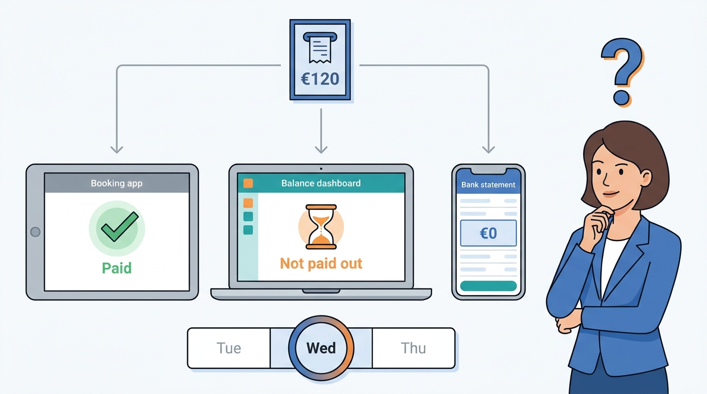
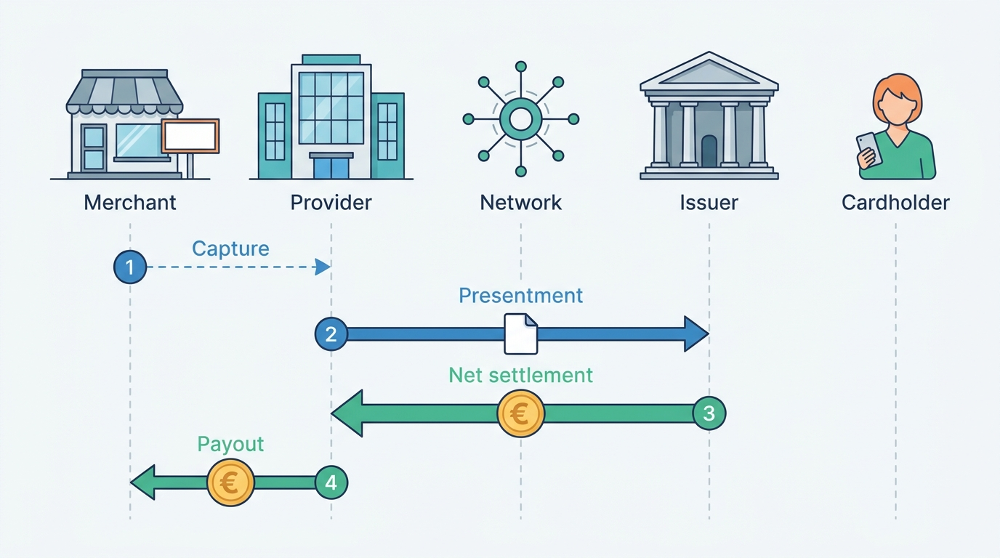
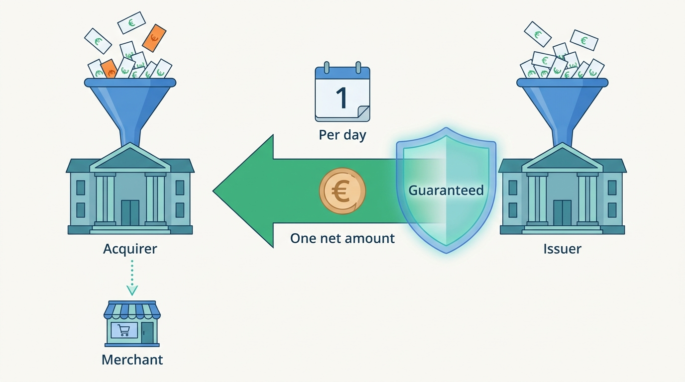
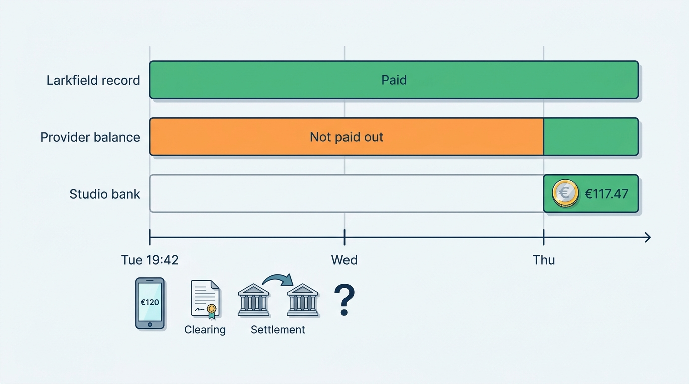

> **IN THIS CHAPTER, YOU WILL:** Follow an approved €120 through capture, clearing, net settlement and payout, and learn to ask which of three events a provider means by “settled”.

> **KEY POINTS:**
>
> * **After the approval, four steps remain, and each belongs to someone else's clock.** The merchant captures, the acquirer presents a clearing record through the network, the network moves one net amount per member bank per day, and the provider pays the merchant on its own schedule. “Settled” names a different event at the network, at the provider and at the merchant's bank.
> * **“Captured” is a claim, not money.** A capture has a deadline set by the approval, it can be rejected after the provider accepted it, and the fee the cardholder's bank receives is fixed from the clearing record, so a late claim can fail, cost more or be disputed.
> * **The records disagree for days, and that is correct.** Stripe counts its “settlement timing” from the capture; Adyen pays a whole sales day on a fixed delay and documents that it pays whether or not the network has paid it yet. Store the capture, the provider's funding date and the payout as three facts, not one status.

> **[FAILURE PATTERNS THIS CHAPTER ADDRESSES](where-payment-systems-go-wrong.html):**
>
> * **The Phantom Payment** — a system that reads “captured” as “received” believes in money that no bank has yet moved and that can still be rejected.
> * **The Black-Box Balance** — a payout is one net figure built from sales, fees, refunds and reversals of different days, and nobody can break it down without the report behind it.
> * **A Card by Any Other Name** — capture as a separate step, a two-day payout delay and a late-capture penalty are card behaviors; other methods settle on other clocks.

 
On Wednesday 10 March 2027 Ines Bakker, who owns the yoga studio Studio Noord, asks a simple question: is the €120 that Mila paid last night hers yet? Studio Noord sells through Larkfield, the fictional studio-software platform this book follows. Larkfield's booking app says the payment is **paid**. The payment provider's balance shows the sale as **not yet paid out**. Ines's bank account shows **nothing**. An engineer looks at three systems giving three answers about one record and starts hunting for the stale copy. Here there is none.

The three answers differ because each reports a different step. After the approval, an online card payment still needs three things: the merchant's **capture**, the acquirer's **clearing** record and the network's daily **net settlement** between banks. The provider's **payout** is a fourth step. The records travel in batches and the money moves as one net amount per bank per day, not per payment. That is why it takes days, and why **“settled” means three different things** depending on whether the network, the provider or the merchant's bank says it.

**Where we are in the payment's journey.** [[journey-of-a-payment]] laid out the six steps of Mila's class pass, and [[payment-authorization]] covered the first: the approval at 19:42 on Tuesday 9 March 2027, a promise that reserved €120 and moved nothing. This chapter covers the steps that do move money, from that moment to Thursday 11 March, when the studio's payout arrives.

The chapter starts with the three answers at Larkfield and explains why an approval is not yet money. It then follows capture, clearing and settlement in the order they happen, and after them the provider's funding step and the three meanings of “settled”. It compares three ways a provider can fund a merchant and what Stripe and Adyen each document, works Mila's €120 through from Tuesday to Thursday, and ends with what goes wrong.

## Setting the Scene at Larkfield: Three Answers to “Has the Studio Been Paid?”

Ines's question reaches Aylin Demir's support team on Wednesday morning, and the team cannot answer it. Mila Janssen bought a ten-class pass for €120.00 at 19:42 on Tuesday. Larkfield's payment record store has shown `paid` since then. Studio Noord is on Adyen, and Adyen's balance view shows the sale among funds that have not been paid out; Adyen's documentation (n.d., accessed November 2026) describes such balances, for example "Pending: the gross amount of sales and refunds that have not yet been settled by the respective card scheme or payment method". The studio's bank statement has no line for it. Support can see all three and cannot say which one answers Ines.

Yet each answer is true of the step it reports. Larkfield's `paid` records that Mila's bank approved and that the studio claimed the money. The provider's balance records the provider's own schedule for releasing it. The bank records only a transfer that has arrived, and none has. The three are not copies of one fact that have drifted apart. They are three facts.

**Figure 1:** *On Wednesday three systems give three answers about one €120 payment, and each is correct about the step it reports.*

So Femke de Graaf, Larkfield's head of payments engineering, turns the support ticket into a question her team can work on, and it is this chapter's question: **what happens to the €120 between Tuesday 19:42 and Thursday, who does each step, and which record shows it?**

## Why an Approval Is Not Yet Money

The answer starts from what Tuesday evening did not do. The authorization reserved €120 on Mila's account at her **issuer** (the bank that gave her the card) and moved nothing. The studio holds a bank's promise, and Larkfield holds a record of that promise. Visa's annual report for fiscal 2026 (filed 5 November 2026) describes what comes later as separate acts: "After the transaction is authorized, the issuer posts the transaction to the consumer’s account and effectively pays the acquirer an amount equal to the value of the transaction, minus the interchange reimbursement fee (IRF). The acquirer pays the amount of the purchase, minus the merchant discount rate (MDR), to the seller." The **acquirer** is the licensed institution that collects card money for the merchant, and the merchant discount rate is what the acquirer charges the merchant for doing so; interchange is explained below. Paying the acquirer and paying the seller are two later events, not part of the approval.

Between that promise and the studio's money lie four steps, and the table sets them side by side; the times are industry practice, not rules. Mastercard's annual report for 2025 (filed 11 February 2026) lists the network's part as three services: it enables "the routing of a transaction to the issuer for its approval", facilitates "the exchange of financial transaction information between issuer and acquirer after a successfully conducted transaction", and settles "by facilitating the exchange of funds between parties via settlement banks chosen by us and our customers". Approval, record and money are three services, and the merchant's own capture and the provider's payout sit around them.

| Step | Who acts | What moves | What the merchant sees | Typical time *(industry practice)* |
| --- | --- | --- | --- | --- |
| Authorization | Issuer | A message; a hold on the cardholder's account | An approval | Seconds |
| **Capture** | Merchant, through its provider | An instruction | A status or an event from the provider | Seconds to days |
| **Clearing** | Acquirer, through the network | A record per transaction, in batches | Nothing | Same day to next day |
| **Settlement** | Network and its member banks | One net amount per member per day | Nothing | Next business day or later |
| **Funding and payout** | Provider | A balance change, then a bank transfer | A balance, a report, a bank line | Two days or more after the sale |

These steps cannot collapse into the two seconds the approval took, for three reasons. Records travel in batches. Money moves between banks as daily net amounts. And the parties that do the work (the acquirer, the card **network** such as Visa or Mastercard, and the issuer) are ones the merchant never talks to, so each keeps its own record, keyed its own way, on its own clock.

## Capture: The Merchant's Claim

The first of the four steps is the only one the merchant performs. **Capture** is the merchant telling its provider to collect an authorized amount. Most integrations never notice it, because both providers do it by default: Adyen's documentation (n.d., accessed November 2026) says "By default, payments are captured automatically without a delay, immediately after authorization of the payment request", and Stripe (n.d., accessed November 2026) captures automatically unless `capture_method` is set to `manual`. The default hides a step that is still there.

A merchant that ships goods later, or does not know the final amount yet, chooses differently: it delays the capture, sends it by hand, captures part of the amount or captures several times. Both providers offer the same choices under different settings, as the table shows (both n.d., accessed November 2026). The one real difference is in the last row: Stripe sets a limit of its own, and Adyen points to the issuer.

| Capture model | Stripe | Adyen |
| --- | --- | --- |
| Automatic (default) | Unless `capture_method: manual` | "automatically without a delay" |
| Delayed automatic | `automatic_delayed`, in private preview | A capture delay of "immediate" or 1 to 7 days per merchant account; `captureDelayHours` per payment |
| Manual | Status `requires_capture`; a capture call with `amount_to_capture` | "Manual capture lets you settle funds on fulfillment, when an order is shipped." |
| Partial | "A partial capture automatically releases the remaining amount." | "Any unclaimed amount that is left over after partially capturing a payment is automatically cancelled." |
| Multiple | "up to 50 non-final captures for a single PaymentIntent"; offered on interchange-plus pricing | Multiple partial captures; the maximum "is determined by the issuer" |

Every capture that is not immediate therefore runs against a deadline. Visa's rules (edition of 24 October 2026, Table 5-11) give the acquirer a maximum time to process a completed transaction, counted from "the date of a valid Authorization": 10 calendar days when the cardholder initiates an online payment, 5 for card-present (in-person) payments and for all merchant-initiated transactions (payments the merchant starts without the cardholder taking part, such as renewals), 30 with an extended authorization indicator. These are the general timeframes; a second table sets different ones for a few countries. That is a deadline for the acquirer's clearing record, not for the capture call, so each provider sets its own cut-off inside or around it. Stripe lists 7 days for a customer-initiated online Visa payment and 5 for a merchant-initiated one, adding that "The exact authorization window is 4 days and 18 hours, to allow time for clearing processes"; a field on the charge, `capture_before`, "indicates when the authorization expires", and after it "the funds are released and the payment status changes to `canceled`". For the global card schemes Adyen "expires (pre-)authorization requests automatically after 28 days", later than the network's window, and says that with manual capture "it is possible to capture remaining balance on a payment after an authorization has already expired on the card scheme's side". [[payment-authorization]] has the windows in full.

Missing the deadline has a price, and Adyen's page names it in one list: a late capture "increases the risk of" a "failed capture", "Increased interchange fees", "Card scheme transaction fees" and a "chargeback for 'No Authorization' or 'Late Presentment' reasons". **Interchange** is the fee the cardholder's bank receives on each payment, scheme fees are what the network charges, and a chargeback is the issuer taking the money back; the next section explains why lateness changes the fee. The dispute right is in Visa's rules as Dispute Condition 11.3, which applies when "A valid Authorization was obtained but the Transaction was not processed within the timeframe", and the issuer has "75 calendar days from the Transaction Processing Date" to use it. A shop that captures on shipment and ships three weeks late has all three risks at once.

A capture can also fail when it was on time. On Adyen the capture request is answered by a `CAPTURE` webhook whose success means only that the request "is valid (for example, the authorization has not expired, and the balance is available) and has been submitted to the bank/third-party processor"; the same page continues: "In rare cases the card scheme can still reject the capture, and you will receive a CAPTURE_FAILED webhook." An automatically captured payment "does *not* trigger a separate CAPTURE webhook"; for delayed automatic capture the page suggests enabling the `CAPTURE` and `CAPTURE_FAILED` event codes. So on Adyen "captured" is documented as *submitted*, with a later failure path. Stripe's page presents capture as a call after which the payment object changes status; it does not say whether a capture can be rejected later at the network. Stripe's API reference for its older capture call on the Charge object (n.d., accessed November 2026) says "Capturing a charge will always succeed, unless the charge is already refunded, expired, captured, or an invalid capture amount is specified", which describes the call, not what the network does with the record afterwards. That silence is a limit of the public record, not evidence that it cannot happen.

## Clearing: The Claim Becomes a Record

What the acquirer does with an accepted claim depends on how the network carries payments. The Federal Reserve (page updated 19 December 2025) defines the two families: a **dual-message** network "typically uses separate messages to authorize and clear a transaction", and a **single-message** network "typically uses a single message to authorize and clear a transaction. These networks normally process PIN-authenticated transactions". Visa's rules have the single-message case too, an Online Financial Transaction that is "authorized, cleared, and settled in a single online financial message", required in the United States for PIN-authenticated Visa debit. Online card payments such as Mila's are typically the two-message kind, which is why capture exists as a step of its own.

In the two-message case the second message is a record, and Visa's glossary names its parts. **Clearing** is "A processing service for the validation and valuation of financial and non-financial records exchanged between Visa and Members", members being the banks and licensed institutions that belong to the network. A **presentment** is "A Clearing Record that an Acquirer presents to an Issuer through Interchange", and interchange, in the rulebook's first sense, is "The exchange of Clearing Records between Members". So the merchant's claim becomes a record that the acquirer presents to the issuer, and the network checks and values those records in batches. The figure below shows which of the arrows is an instruction, which a record and which money.

**Figure 2:** *After the approval, capture is an instruction and presentment is a record; money moves only at net settlement and again at payout.*

One of the values fixed at clearing is the fee the issuer receives. Visa's glossary calls it the Interchange Reimbursement Fee, "A fee between Acquirers and Issuers in the Clearing and Settlement of an Interchange Transaction", and Mastercard's annual report says "We administer the collection and remittance of interchange fees through the settlement process." Both place the fee at clearing and settlement, not at the approval. Which rate a record earns is published only in part: Visa's public "Visa USA Interchange Reimbursement Fees" (24 October 2026) lists the US rates by program, but the "US Interchange Reimbursement Fee Rate Qualification Guide" that its rulebook names among its documents is not reproduced there or on Visa's site. It is industry practice, not a rule I can cite, that the rate depends on the data in the record and on how promptly it is presented; Adyen's warning of "Increased interchange fees" after a late capture is the documented instance. [[payment-economics]] covers the fee itself.

## Settlement: One Net Amount per Member per Day

Cleared records give rise to money, and the money does not move payment by payment. Visa's glossary defines **settlement** as "The reporting and funds transfer of Settlement Amounts owed by one Member to another, or to Visa, as a result of Clearing", and a settlement amount as "The daily net amounts expressed in a Member’s Settlement Currency resulting from Clearing. These amounts include Transaction and Fee Collection Transaction totals". Assume, for illustration, that an acquirer presents €10,000,000 of purchases on one day, has €300,000 of refunds and disputes going the other way and owes €40,000 in interchange and fees. It receives one transfer of €9,660,000. Mila's €120 is in there, and nobody downstream can point to it.

**Figure 3:** *Settlement moves one net amount per member per day, and the network's guarantee covers the transfer between members, not the payment to the merchant.*

What makes a system of daily net transfers safe is a guarantee, and the guarantee has an edge. Visa's annual report says: "We indemnify issuers and acquirers for settlement losses they may suffer due to the failure of another issuer or acquirer to honor its settlement obligations". Mastercard's says: "We guarantee the settlement of many of the transactions from issuers to acquirers", and then: "We do not, however, guarantee payments to merchants by their acquirers". The merchant is outside the guarantee. Once the acquirer has been paid, the merchant's claim is on its provider alone.

A payment in another currency is converted at two layers. At the network, Visa's glossary defines the Currency Conversion Rate as "A rate set by Visa from the range of rates available (not necessarily executed) in wholesale currency markets", and says that when Visa converts into the acquirer's or the issuer's settlement currency, "the rate is applied by Visa and may not be adjusted". At the provider, a second decision follows. Stripe's documentation (n.d., accessed November 2026) says "Stripe automatically converts all incoming funds into your default currency" unless multi-currency settlement is set up, in which case it charges its fee "when funds settle into a non-primary settlement currency, not when you initiate a payout". Adyen (n.d., accessed November 2026) "offers like-for-like (no currency conversion) settlement if the currency is also supported as a settlement currency by the payment method". The two conversions have different rates, owners and moments.

That is where the public record stops. Visa's rules define a Settlement Date ("The date on which Visa initiates the transfer of Settlement Amounts"), a Settlement Bank and a Settlement Currency, and one section covers a national net settlement service. **Network settlement cut-off times and the number of settlement cycles per day are not public**: I found neither in the rule text nor on Visa's sites (November 2026). Mastercard's rule documents could not be read at all for this book (they returned an access error), so nothing here quotes them. The next-business-day timing used in this chapter is industry practice, and the times given for Mila's payment below are illustration.

## Funding: The Provider's Step, and Three Meanings of “Settled”

The last step belongs to the provider. Because the network does not guarantee that an acquirer pays its merchant, when the merchant is paid is decided by the provider's contract and by how the provider is licensed to hold other people's money, not by the network's timetable. That is my reading of the guarantee's edge, not a quoted rule, and [[licences-and-safeguarding]] takes up the license. The practical consequence is that **funding runs on the provider's own schedule**. Usually the payout follows the network's settlement, but nothing in the mechanism ties it there.

Stripe's schedule ages each transaction. Its documentation (n.d., accessed November 2026) says "Funds in the pending state represent incoming transactions that haven’t settled into your balance", defines settlement time as "the time between when a payment or a funding transaction is made and when the funds become available in your Stripe balance", and moves funds "from `pending` to `available` at the corresponding `available_on` time for each balance transaction". For a Dutch account the listed timing is 7 calendar days initially and 3 business days by default. Stripe also says what its clock starts from: "Some payment processors might start “T” from their internal settlement time, meaning when the funds land in their bank accounts. Stripe uses “T” to refer to the transaction time, which indicates the time of the original payment confirmation or capture". And the payout is separate again: "Choosing a payout schedule doesn’t change how long it takes for your pending balance to become available. It only controls when payouts are sent." At Stripe, then, "settlement" means the release of funds to the merchant's balance, by a schedule counted from the capture.

Adyen's schedule ages a day instead. Its page (n.d., accessed November 2026) lists three steps: "Capture: A payment is captured, and the card scheme or payment method sends the funds to Adyen", then "Adyen processing: The funds are assigned to a payable batch", then "Bank processing: Your bank processes and clears the funds." Under Sales day payout, "the default payout model", "You get all the funds from a particular sales day in a single payout batch, with a fixed payout delay": 2 business days, for a typical mix of payment methods, when at least 80% of the transactions are in one of eight listed currencies, the euro among them, and are acquired in that currency's country or region. For platforms the same model is called sales day settlement, and "The date when the schemes or payment methods transfer the funds to Adyen does not affect this timing." Where Stripe names two states of one transaction, Adyen names a batch, and keeps the scheme's transfer to Adyen as an event of its own.

A fixed schedule raises a question: does the provider pay before it has been paid? One of the two documents that it does. Adyen's Sales Day Payout Terms of Service (last update 17 June 2024) say Adyen will "initiate payout of the Net Captured Volume to Merchant on the Payout Day, irrespective of whether the funds are actually received by Adyen from the Acquirer or Scheme Owner". Its documentation (n.d., accessed November 2026) adds the limit: "Prefinancing is capped at 30 days. If the card scheme, payment method, or acquirer does not settle the funds within 30 days, Adyen reverses the prefinanced amount from your payable batch." Adyen's Annual Report 2025 calls paying "only after funds have been received" its "default setup", which I cannot reconcile with those terms from public text ([[balances-and-funds-flows]]). Stripe documents nothing equivalent for standard payouts. Its documentation gives the schedule; its services terms (last modified 28 September 2026) say it transfers "settlement funds" on the payout schedule "unless a Payout Delay occurs", and count as such a delay "a delay or failure of a Financial Provider to settle a Transaction to Stripe". So a network that does not pay can hold a payout back; whether availability otherwise waits for Stripe's own receipt of network funds is stated in neither the terms, the documentation nor the support site. It documents paying ahead only for a paid product: "Funds acquired from card payments are available for Instant Payouts as soon as the charge is complete."

> **INFERENCE, NOT DOCUMENTED:** A schedule that counts from the capture, as Stripe's does, cannot depend on the arrival of each payment's network funds, so Stripe plausibly also carries a timing gap on some standard payouts. Stripe does not say so, and this book does not treat it as fact.

Put together, “settled” names three events, and a quoted “T+2” can only be compared with another once you know which event it ends at and where it starts. The table gives the translation; the provider columns use each company's documented words.

| Layer | What “settled” means there | Who can see it | Stripe's word | Adyen's word | What a “T+N” counts from |
| --- | --- | --- | --- | --- | --- |
| Network | The daily net amount has been transferred to the acquirer | Acquirer and issuer | Not public | "the card scheme or payment method sends the funds to Adyen" | The network's processing date *(industry practice)* |
| Provider | Funds are released to the merchant's balance or batch | Merchant, through the API and reports | "settlement": `pending` becomes `available` | Sales are assigned to a payable batch after the payout delay, and the batch is paid out | Stripe: the capture. Adyen: the sales day |
| Merchant's bank | The payout has arrived | Merchant and its bank | Payout | "Bank processing" | The day the payout was sent |

## Three Ways to Fund a Merchant, and What Each Costs

The two schedules are instances of more general designs, and the simplest is **pass-through funding**: the provider pays the merchant as each payment method's funds arrive. It costs the provider no liquidity. The merchant pays for that in reconciliation, as Adyen's description of its Pass-through payout shows (n.d., accessed November 2026): "Sales are assigned to the payable batch as soon as the schemes or payment methods send the funds to Adyen", so "The sales from Monday, January 1 are paid out in separate batches over the subsequent days, from January 2 to January 7." Adyen lists it as "the only available payout model in Africa, Brazil, and India".

**Fixed-delay funding** does the opposite: the provider pays a whole day's sales after a set number of days and carries the difference between fast and slow methods itself. Adyen describes how it sizes the delay: "The payout delay is calculated to be the break-even point, where faster payment methods settle enough funds to make up for the funds not yet settled by the slower payment methods", and gives the slow case: "American Express has a settlement delay of 7 days. If you process most payments through American Express, Adyen will set your payout delay to 7 business days." Its terms let it lengthen the delay if more than 25% of captured volume uses methods that "structurally settle to Adyen later than the Payout Day". The delay, the 30-day cap and the right to take money back are the provider's risk controls.

**Instant funding** removes the delay and charges for it. Stripe's Instant Payouts page (n.d., accessed November 2026) says "Card payment funds are available immediately, including pending funds within your payout schedule window", and "Stripe assesses a fee on each Instant Payout." The advance does not move the risk: if the payment is later refunded or disputed, the money is still owed back by whoever is liable for the account ([[balances-and-funds-flows]]).

The three designs trade the provider's liquidity and risk against the merchant's speed and reconciliation effort, as the table shows. The rule I use is to choose by what the business is short of. A studio with thin cash wants a predictable day and can pay for speed in emergencies; a finance team with automated reconciliation can take pass-through and lose nothing; and nobody should pick instant funding to cover a cash gap that refunds will reopen.

| Design | Who waits for the network | Who carries the gap | What the merchant must reconcile | When it is right | Documented instance |
| --- | --- | --- | --- | --- | --- |
| Pass-through | The merchant | Nobody | One day's sales across several payouts | Automated reconciliation; markets where nothing else is offered | Adyen Pass-through payout |
| Fixed delay | The provider, for slow methods | The provider, up to a time limit | One batch per sales day, plus later adjustments | Most merchants; predictable cash flow | Adyen Sales day payout |
| Instant | The provider | The provider for timing; the merchant for refunds and disputes | Extra payouts and their fees | Occasional urgent need, priced per use | Stripe Instant Payouts |

## Stripe and Adyen: Where They Differ

Side by side, five documented differences matter to an integrator. Every Stripe and Adyen cell repeats a fact cited above (documentation n.d., accessed November 2026; Adyen's terms 17 June 2024); the last column is my inference from them.

| Aspect | Stripe | Adyen | What the difference suggests |
| --- | --- | --- | --- |
| Capture result | A status change and events on the payment object; a later rejection is not mentioned | A `CAPTURE` webhook meaning valid and submitted; "In rare cases" a later `CAPTURE_FAILED` | On Adyen, treat capture as two events; on Stripe the failure path is not public |
| The provider's own authorization cut-off | `capture_before`; on expiry the payment becomes `canceled` | Expiry after 28 days; a capture after the scheme's window is possible, at the merchant's risk | Stripe enforces the deadline for you; Adyen leaves the trade-off to you |
| What “settlement” and “T” mean | Funds become available in the balance; "T" is the confirmation or capture | Three named steps: scheme funds, payable batch, bank processing | The two companies' "T+N" figures measure different intervals |
| Unit of funding | Each transaction, at its `available_on`; Netherlands default 3 business days | Each sales day, in one batch; typical payout delay 2 business days | Stripe reconciles by transaction, Adyen by batch |
| Paying ahead of the network | Not public for standard payouts, beyond terms that allow a delay when a network fails to settle to Stripe (2026); documented for Instant Payouts | Documented: pays "irrespective of whether the funds are actually received", capped at 30 days, then reversed | Only Adyen documents a standard payout taken back because the network never paid |

On Stripe, read the expiry and the availability time from the object (`capture_before` on the charge, `available_on` on the balance transaction) and never compute them from a rule of thumb. On Adyen, enable the capture webhooks and subscribe to the reversal events `SETTLED_REVERSED` and `REFUND_NOT_CLEARED`, which are disabled by default, and reconcile by payable batch. On both, do not compare the "2" and the "3" above as speeds until you have asked what each counts from.

## In Practice at Larkfield: When Mila's €120 Becomes the Studio's Money

Here is Mila's payment on Adyen, step by step. Only the first and last rows were visible to Larkfield when they happened; the middle rows are industry practice with illustrative timing, because the networks do not publish it. Studio Noord's account uses a sales day that closes at midnight and a payout delay of two business days (illustration, matching Adyen's documented default sales day and its typical delay for euro sales; for platforms Adyen says the default delay is set in the contract). The last row takes the payout as reaching the bank on the day it is paid, which is the best case: Adyen's page says that after the batch closes "it can take one to two business days for the payout to be initiated" and that "your bank may need up to three more business days to post the funds".

| When | Event | Basis | Larkfield's record | Provider balance | Studio's bank |
| --- | --- | --- | --- | --- | --- |
| Tue 9 March, 19:42 | Approval and automatic capture of €120.00 | Ledger; documented default | `paid` | Not paid out | Nothing |
| Tue night to Wed | The presentment goes out in a clearing batch | Industry practice; timing not public | `paid` | Not paid out | Nothing |
| About Wed 10 March | Net settlement between the member banks | Industry practice; timing not public | `paid` | Not paid out | Nothing |
| Wed 10 March | Ines asks whether she has been paid | Scene | `paid` | Not paid out | Nothing |
| Thu 11 March | Payout delay passed; Tuesday's batch is paid: €117.47 after Larkfield's €2.53 fee | Ledger; documented model | `paid` | Paid out | €117.47 |

**Figure 4:** *Mila's €120 is recorded as paid on Tuesday at 19:42, but the studio's bank shows €117.47 only on Thursday; in between, the records disagree and all are right.*

So the answer to Ines on Wednesday is: your payment is claimed and scheduled, not received, and it arrives tomorrow. To let support say that, Larkfield stores three facts where it had one status, each with its own source. This follows two decisions of its 2027 Keel program ([[meet-larkfield]]): the provider's record is the truth, and every movement gets a ledger entry ([[payment-ledgers]]). The five-state vocabulary stays ([[payment-state-machines]]); the three facts sit beside it.

| Fact | Source on Adyen | Source on Stripe | Known when |
| --- | --- | --- | --- |
| Captured | The authorization result (automatic capture), or the `CAPTURE` webhook | The payment object's status | Seconds after the claim |
| Funds released by the provider | The payable batch in the settlement report | `available_on` on the balance transaction | Days later, on the provider's schedule |
| Payout arrived | The payout line in the report, matched to the bank | The payout object, matched to the bank | When the bank shows it |

Had Studio Noord been on Stripe, the same capture on Tuesday evening would follow Stripe's default for a Dutch account: available three business days later, on Friday 12 March, and paid out from then on, because Stripe "pays out funds daily from transactions that were captured 3 business days earlier". The dates are illustration; the schedule is Stripe's documented default. Neither answer is better in itself. They are different intervals, counted from different starts.

## When It Goes Wrong: Late Claims, Rejected Claims and Payouts That Do Not Match

Mila's payment went right at every step; each step can also go wrong, and the first failure is the one the merchant controls. A claim is sent too late because the expiry was computed instead of read, or because a shipment slipped. The capture then fails, costs more or can be disputed, as the capture section showed. Detection is simple: store the provider's expiry (`capture_before` on Stripe; the scheme's validity period on Adyen, since Adyen's own 28-day expiry comes later), alert on every open authorization a day before it, and ask for a new or extended approval instead of capturing late.

The second failure comes from outside, after the merchant has recorded success: a claim that was accepted and later rejected. The only signal is the event or report line that says so. If the sale has already been paid out, the provider takes it back; Adyen's documentation says "If Adyen cannot capture the funds for a sales transaction that we already paid out, we subtract those funds from the current payable batch", and such reversals "appear in the Settlement Details Report as **CaptureFailed** and **RefundFailed** entries". A paid-out sale can thus be undone with no refund and no dispute involved, which is why the receiver's contract in [[payment-webhooks-and-events]] treats a missing event as a state to sweep for.

The third is the general case: a payout almost never equals a day's sales. Adyen says "Refunds, chargebacks, and other adjustments are added to the payable batch as they occur and are not related to the sales day of the original transaction", and on bank holidays "clearing for a specific currency may be closed and therefore Adyen cannot process payouts. Adyen also cannot receive funds". Stripe warns that "When a payout fails, the status might initially show as `paid`, but then change to `failed` within 5 business days." A payout is a net of everything open when the batch closed, and sent is not arrived. Reconcile it from its report lines, never from the day's sales; [[payment-reconciliation-and-reporting]] and [[payouts-and-money-movement]] show how, and RECONCILED's [[payments-to-ledger]] takes the finance side.

## What to Take Away

**Established.**

- **Capture is a claim with a deadline.** Visa's rules (24 October 2026) give the acquirer, in general, 5 to 30 days from the approval to process a transaction, and a late one can be disputed for 75 days under Dispute Condition 11.3.
- **Money moves between members as daily net amounts.** Visa's glossary defines settlement that way, and both Visa's glossary and Mastercard's annual report for 2025 place the fee to the issuer at clearing and settlement, not at the approval.
- **The network's guarantee stops at the acquirer.** Mastercard's annual report for 2025 says it does not "guarantee payments to merchants by their acquirers".

**Depends on context.**

- **When to capture.** Capture at once if you deliver at once. Capture on fulfillment only if fulfillment reliably falls inside the window; if it may not, plan a new approval.
- **Which funding model to accept.** Fixed delay suits most merchants; pass-through suits those with automated reconciliation or no alternative; instant funding suits a rare urgent need.
- **How much to rely on a payout day.** On Adyen a standard payout is pre-financed and can be reversed after 30 days; Stripe's terms say only that a network's failure to settle can delay one. A different method mix changes both.

**The author's synthesis.**

- **“Settled” is a word that needs a layer.** Capture, clearing, settlement and funding are four records held by four parties, each complete on its own terms and none keyed to the others. There is no single moment at which a payment is settled, and faster synchronization does not create one.
- **Store three facts, not one status.** A team with one `paid` flag releases goods and books revenue on its own claim. With the capture, the provider's funding date and the payout stored separately, the three screens Ines saw on Wednesday stop being a contradiction and become three correct reports, each with a date.

## Questions to Ask

These eight questions test a provider's capture and funding behavior, and your own records of it.

1. When your provider says a payment is "settled", which of the three events does it mean: network, balance or bank?
2. What does the "T" in its "T+N" count from: the capture, the sales day, or the arrival of network funds?
3. Where do you read each authorization's expiry, and what alerts you a day before it?
4. Can a capture be rejected after the API accepted it, and which event or report line tells you?
5. Does the provider pay you before the network pays it, for how long, and how does a take-back appear in your reports?
6. Which of your systems treats "captured" as "received", and what does it release or book on that basis?
7. Can you rebuild one payout from its report lines: sales, fees, refunds, chargebacks, reversals?
8. In which currency does each layer convert, at whose rate, and when is the fee charged?

On Thursday the €117.47 is in Studio Noord's account, and the forward journey of Mila's payment is over. What remains is time: for weeks and months after a payment has been cleared, settled and paid out, the merchant can send it back, or the cardholder's bank can take it back. [[refunds-reversals-and-disputes]] follows the money in that direction.

## Sources and Evidence

*Company, product and investor sources*

- [Place a hold on a payment method](https://docs.stripe.com/payments/place-a-hold-on-a-payment-method), Stripe, n.d., accessed 2026-11 — default and manual capture, validity windows, `capture_before`, partial capture, `automatic_delayed` (private preview).
- [Capture a payment multiple times](https://docs.stripe.com/payments/multicapture), Stripe, n.d., accessed 2026-11 — up to 50 non-final captures; offered on interchange-plus pricing.
- [Capture a charge](https://docs.stripe.com/api/charges/capture), Stripe API reference, n.d., accessed 2026-11 — what the older capture call returns and when it raises an error.
- [Balances and settlement time](https://docs.stripe.com/payments/balances), Stripe, n.d., accessed 2026-11 — pending and available, `available_on`, settlement timing by country.
- [Receive payouts from Stripe](https://docs.stripe.com/payouts), Stripe, n.d., accessed 2026-11 — what "T" counts from, payout schedule versus availability, failed payouts.
- [Instant Payouts for Stripe Dashboard users](https://docs.stripe.com/payouts/instant-payouts), Stripe, n.d., accessed 2026-11 — card funds available on completion of the charge, for a fee.
- [Stripe Services Agreement: Services Terms](https://stripe.com/legal/ssa-service-terms), Stripe, last modified 2026-09-28 — Stripe Payments Terms 4.2 and 4.3 (pooled accounts, transfer of settlement funds on the payout schedule) and the definition of Payout Delay.
- [Multi-currency settlement](https://docs.stripe.com/payouts/multi-currency-settlement), Stripe, n.d., accessed 2026-11 — conversion into the default currency and when the fee is charged.
- [Capture](https://docs.adyen.com/online-payments/capture), Adyen, n.d., accessed 2026-11 — capture models, the `CAPTURE` and `CAPTURE_FAILED` webhooks.
- [Authorization adjustment](https://docs.adyen.com/online-payments/adjust-authorisation), Adyen, n.d., accessed 2026-11 — 28-day expiry, the risks of late capture, the issuer's limit on partial captures.
- [Getting paid](https://docs.adyen.com/account/getting-paid), Adyen, n.d., accessed 2026-11 — the three steps from capture to payout, payout models, currencies, payout timing after the batch closes, bank holidays.
- [Sales day payout](https://docs.adyen.com/account/sales-day-payout), Adyen, n.d., accessed 2026-11 — the default model, payout delay, adjustments, reversal events (disabled by default).
- [Upgrade to Sales day payout](https://docs.adyen.com/account/sales-day-payout/upgrade-to-sdp), Adyen, n.d., accessed 2026-11 — the 30-day cap on pre-financing and the report entries for reversals.
- [Pass-through payout](https://docs.adyen.com/account/pass-through-payout), Adyen, n.d., accessed 2026-11 — payout as scheme funds arrive.
- [Balances](https://docs.adyen.com/account/balances), Adyen, n.d., accessed 2026-11 — the definition of the pending balance.
- [Settle funds](https://docs.adyen.com/platforms/settle-funds), Adyen, n.d., accessed 2026-11 — sales day settlement for platforms; the default settlement delay is set in the contract.
- [Sales Day Payout Terms of Service](https://www.adyen.com/legal/sales-day-payout-terms-of-service), Adyen, last update 2024-06-17 — payout irrespective of receipt of funds; the 25% clause.
- [Annual Report 2025](https://investors.adyen.com/financials/2025), Adyen N.V., signed 2026-03-05 — the risk section: paying "only after funds have been received" as the "default setup"; liquidity mismatches "primarily through pre-financing in accelerated payout schedules" (audited; read in the PDF this page offers for download).
- [Form 10-K for the fiscal year ended 30 September 2026](https://www.sec.gov/Archives/edgar/data/1403161/000140316126000134/v-20260930.htm), Visa Inc., 2026-11-05 — the payment walkthrough and the settlement indemnification.
- [Form 10-K for 2025](https://www.sec.gov/Archives/edgar/data/1141391/000114139126000013/ma-20251231.htm), Mastercard Incorporated, 2026-02-11 — the three network services, the settlement guarantee and its limit, interchange through settlement.

*Standards, regulation and official documentation*

- [Visa Core Rules and Visa Product and Service Rules](https://usa.visa.com/dam/VCOM/download/about-visa/visa-rules-public.pdf), Visa, 2026-10-24 — glossary definitions (clearing, presentment, interchange, settlement, settlement amount, currency conversion rate), Table 5-11, Dispute Condition 11.3.
- [Visa USA Interchange Reimbursement Fees](https://usa.visa.com/dam/VCOM/download/merchants/visa-usa-interchange-reimbursement-fees.pdf), Visa, 2026-10-24 — the published US interchange rates by program.
- [Average Debit Card Interchange Fee by Payment Card Network](https://www.federalreserve.gov/paymentsystems/regii-average-interchange-fee.htm), Federal Reserve Board, last update 2025-12-19 — definitions of dual-message and single-message networks.

*Research and practitioner sources*

- None.

Larkfield is fictional; architectural recommendations, labeled inferences and labeled assumptions are the author's judgement.
