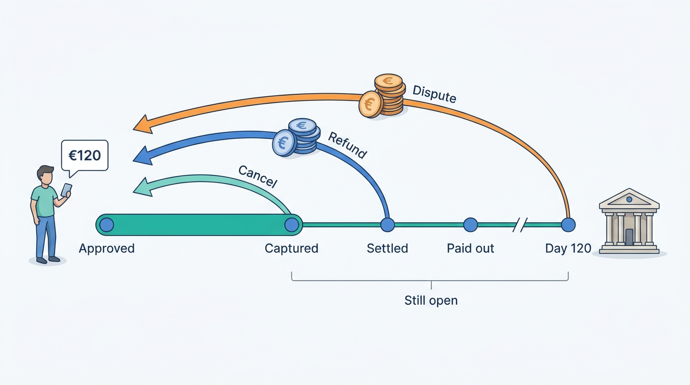
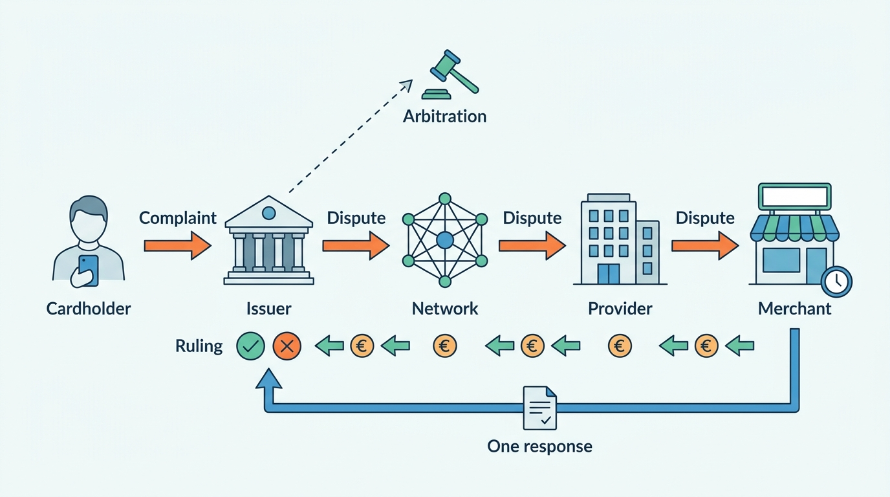
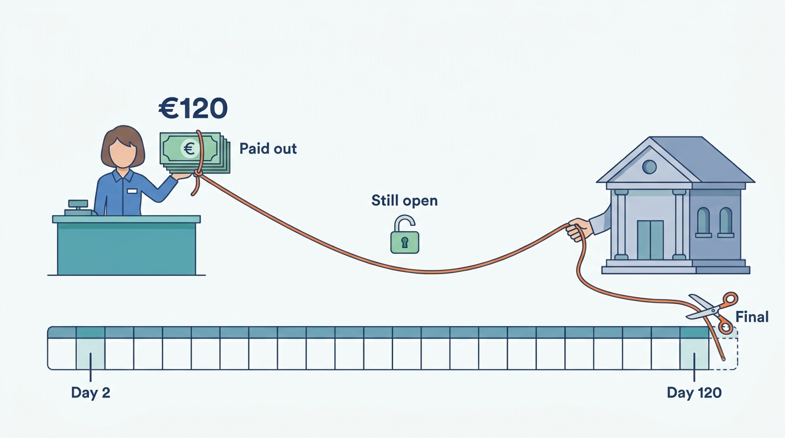
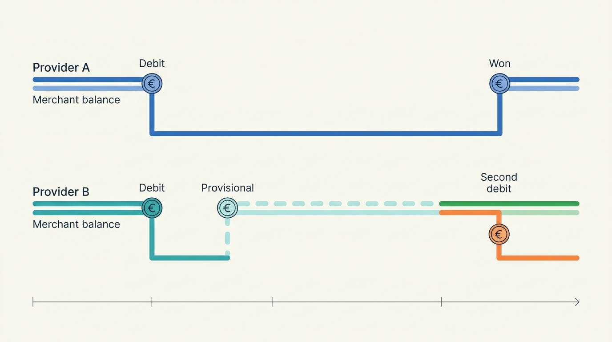

> **IN THIS CHAPTER, YOU WILL:** Learn the three routes by which money goes back, who decides each, and what your records must keep open for months after payout.

> **KEY POINTS:**
>
> * **Three routes back, not one undo.** A cancel or reversal withdraws the bank's promise before any money has moved. A refund is a new transaction that the merchant starts and that can fail. A dispute is the cardholder's bank taking the money back under the card network's rules, with the merchant allowed one answer.
> * **The dispute runs on the bank's clock.** Visa's rules (edition of 24 October 2026) give the cardholder's bank 120 days from processing for most disputes, and up to 540 days where a service is delivered later. Settlement and payout do not shorten it, and the networks count every dispute whether or not the merchant wins.
> * **A paid-out payment stays open.** Refunds and disputes need records of their own, with states, deadlines and ledger entries. Stripe gives a dispute one object, one debit and at most one return; Adyen reports a series of events in which a returned amount can be taken again.

> **[FAILURE PATTERNS THIS CHAPTER ADDRESSES](where-payment-systems-go-wrong.html):**
>
> * **The Orphaned Refund** — refunds and chargebacks arrive weeks after the sale, and a system that stores them as a flag on the payment cannot tie the money to its origin.
> * **A Card by Any Other Name** — a direct debit can be taken back without a reason and a bank transfer not at all, so dispute handling built for cards is wrong for both.
> * **The Trusted Doorbell** — a dispute's deadline of days starts with one webhook, and a missed message becomes a dispute lost by default.

 
On Thursday 11 March 2027, Studio Noord has the money for Mila's **€120 class pass** in its bank account: approved, captured, settled, paid out. Yet Mila's bank can take the €120 back until about 7 July, because Visa's rules (edition of 24 October 2026) give it "120 calendar days from the Transaction Processing Date" for most disputes. Neither the studio, nor Larkfield, nor Adyen decides whether it does. So in what sense was the payment ever finished?

Money goes back by **three routes that are not variations of one undo**. A cancel or reversal withdraws the promise made by the issuer (the cardholder's bank) before any money has moved. A refund is a new transaction that the merchant starts. A dispute is the issuer taking the money back under the card network's rules.

The third route is the one the merchant does not start, and it **runs on the issuer's own clock**, whatever has been settled and paid out. Two consequences follow. The record of a payment has to stay open in its financial effect for months. And the evidence that answers a dispute has to exist before anyone asks for it, because the answer is due within days.

**Where we are in the payment's journey.** Mila Janssen bought her ten-class pass at Studio Noord on 9 March 2027, at Larkfield, the fictional studio-software platform this book follows ([[meet-larkfield]]). Earlier chapters took the €120 forward: the approval ([[payment-authorization]]), then capture, settlement and the payout of 11 March ([[clearing-and-settlement]]). This chapter covers everything after that payout: the months in which the €120 can travel back.

The chapter starts with a €120 chargeback that reached Larkfield three weeks after a sale. It separates the three routes back, shows why a refund is a second payment, and follows a card dispute through its stages. Then come what happens before and above a dispute, the payer's rights outside cards, and two design decisions: how to record a backward flow and how to answer one. It ends with Stripe and Adyen side by side, the €120 dispute worked through with dates, and what goes wrong. Unless a sentence says otherwise, every statement about Stripe or Adyen is from their documentation and price pages as read in November 2026, and every Visa rule is from the edition of 24 October 2026.

## Setting the Scene at Larkfield: A €120 Payment Comes Back

On 2 February 2027 a member named Bram de Wit bought a €120 pass at Studio Noord with a Dutch Mastercard credit card. The studio was paid within days, and Larkfield's payment record store showed the payment as `paid`. On 24 February a **chargeback** arrived: Bram's bank had taken the €120 back because he said he did not recognize the charge, and a €15.00 dispute fee *(illustrative)* came with it. The record had one word left for this, `disputed`.

Nobody at Larkfield had started this, so the first questions were about ownership. Jonas Weber, who leads risk and compliance, asked who had decided it, whether Larkfield or the studio could answer, and by when. Priya Raman, the finance controller, asked where the €120 and the €15 belonged in the books, since Larkfield's terms say the studio carries a lost dispute and its fee. A status field answered none of it.

Bram's dispute was not an exception. At the end of 2025, Larkfield's ledger disagreed with its two providers by €412,000, an incident the book calls the Unexplained €0.4 Million. Refunds made after payout accounted for **€317,200** of it and chargeback fees for **€73,500**, from 4,900 disputes that year. The money had moved at the providers; what Larkfield lacked was a record for each backward movement.

## Three Routes Back, Three Different Owners

The route money takes back depends on two things: how far the payment has travelled, and who starts the return. A payment that is still only an authorization (the issuer's promise to pay, [[payment-authorization]]) can be withdrawn. A payment that has been captured (claimed by the merchant, after which money moves) can only be answered with more money. That gives three routes that share almost nothing.

| Route | Who starts it | When it is possible | What happens to the money | Who decides | What the cardholder sees |
| --- | --- | --- | --- | --- | --- |
| Cancel or reversal | The merchant | Before capture | Nothing moves; the hold is released | The merchant | The pending charge disappears |
| Refund | The merchant | After capture | A new credit, funded by the merchant's side | The merchant, then the issuer accepts or rejects the credit | A separate credit, days later |
| Dispute | The cardholder, through the issuer | After the money has moved, for months | The issuer takes the amount back | The issuer, under network rules | A credit from their own bank |

A **cancel** or **reversal** (often called a void) withdraws an authorization before capture. Visa's glossary defines an Authorization Reversal as "A V.I.P. System message that cancels an Approval Response": a message about a promise, not about money. No payment ever appears on the cardholder's statement. Both providers offer the route only at this stage: Stripe's documentation (n.d., accessed November 2026) says you can cancel a payment "before it’s completed at no cost", and Adyen's (same date) says "After a payment has been captured, you can no longer cancel it."

A **refund**, by contrast, sends money, because the promise has already been kept. Visa's word for it is a Credit Transaction: "A Transaction or a Faster Refund, representing a Merchant’s refund or price adjustment credited to a Cardholder’s account." It is a transaction in its own right, and Adyen's refund page (n.d., accessed November 2026) states its boundary: "You can only refund a payment after it has been captured."

A **dispute** is the route the merchant does not start. Visa defines it as "A Transaction that an Issuer returns to an Acquirer", the acquirer being the bank or provider that collects card payments for the merchant ([[journey-of-a-payment]]). Chargeback is the older, still common name for it and for the money taken back. The cardholder starts it by complaining to the issuer, and the issuer rules. Stripe's dispute documentation (n.d., accessed November 2026) says the outcome "is at the sole discretion of the account owner’s bank". The figure below places all three routes on one payment's timeline.

**Figure 1:** *One payment, three routes back: a cancel before capture, a refund after it, and a dispute that can start as late as day 120.*

## A Refund Is a Second Payment, and It Can Fail

A refund is paid from the merchant's current balance at the provider, not from the original payment. Take the ledger's example: on 18 March 2027 Mila asks for €84.00 back for seven unused classes, a week after Studio Noord was paid. The original €120 is gone, so the refund needs new money. Stripe's refund documentation (n.d., accessed November 2026) says "Refunds use your available Stripe balance (not including pending amounts)"; if that is short, "Stripe holds the refund as pending for card transactions (refunds for other payment method types fail)", and after 45 days it fails with `insufficient_funds`. Adyen's refund page (same date) lists the same dependency as a failure reason, `Insufficient in-process funds on account`. Whose balance pays on a platform is covered in [[splits-balances-and-platform-payouts]].

Once funded, a refund's outcome arrives in two stages: the provider accepts the request, then the card network and the issuer process it, and the second can fail after the first succeeded. Adyen says "The refund process is asynchronous": a `REFUND` webhook with `success: true` means "we sent the refund request to the card scheme" (scheme is Adyen's word for the network), yet the scheme can still reject it, which "can happen even a few days after you submit the refund request". Stripe models the same thing as a Refund object with a status of `pending`, `requires_action`, `succeeded`, `failed` or `canceled`, and says the money from a failed refund can take up to 30 days to return. The table shows the same gap on all three routes.

| Route | What the API tells you at once | What is true later | Can it fail after "success"? |
| --- | --- | --- | --- |
| Cancel or reversal | The request was accepted | The issuer releases the hold on its own schedule | No money moved, so there is nothing to recover |
| Refund | The request was accepted | The cardholder's account is credited, days or weeks later | Yes: `REFUND_FAILED` on Adyen, status `failed` on Stripe |
| Dispute | A notification, and on Stripe an immediate debit | The issuer's ruling, which Stripe says can take 2–3 months | Yes, in both directions (see "When It Goes Wrong") |

A refund also does not undo the cost of the sale. Stripe's page says "Stripe’s processing fees from the original transaction aren’t returned", and Adyen's public price list (n.d., accessed November 2026) has a column headed "Payment method refund fee". The customer waits as well: Adyen says "It can take up to 40 business days before the funds are returned to the shopper's account, depending on the payment method", and one passage of Stripe's page says the customer "sees the refund as a credit approximately 5-10 business days later, depending upon the bank".

The border between refund and reversal is where the two providers differ most. On Stripe you ask for a refund and the system may turn it into a reversal: "Some refunds—those issued shortly after the original charge—appear in the form of a *reversal* instead of a refund. In the case of a reversal, the original charge drops off the customer’s statement". Adyen gives the uncertain case its own request: "If you are not sure if a payment has been captured, you can use a reversal to return the funds to the shopper" (reversal page, n.d., accessed November 2026). It cancels an uncaptured payment and refunds a captured one. The same page excludes two cases that matter to a platform: a payment with multiple partial captures, and one that carries split data. Adyen also lets you cancel by your own payment reference "up to 24 hours after authorization", which covers a request that timed out before Adyen's identifier came back ([[idempotency-and-retries]]).

Because a refund and a dispute are started by different parties, both can be in flight for the same payment, and the customer can then be paid back twice. Each layer has a guard. Stripe says "You can’t issue a refund outside the dispute process while the dispute is open". Adyen (n.d., accessed November 2026) says disputes on refunded payments "can be auto-defended if more than 90 percent of the captured transaction amount was refunded". Visa has written a rule for it: "Effective for Disputes processed on or after 24 April 2027 Before initiating a Dispute, the Issuer must validate and reconcile all credits and debits processed by the same Merchant", and dispute only the net amount.

## How a Card Dispute Runs: The Issuer Decides, on the Issuer's Clock

In a dispute the issuer rules. The network's rules say on what grounds and in what order, and the network itself decides only at the last stage, which Visa defines as Arbitration: "A process where Visa determines financial liability between Members for Interchange Transactions that are presented and have completed the Dispute cycle." Members are the banks. The merchant is not a party to that ruling, and Stripe says of its own role that it "facilitates your case, but doesn’t have influence over the outcome".

The issuer's time limit counts from the transaction, not from the payout. Visa's limit for most conditions is "120 calendar days from the Transaction Processing Date", and 75 days for the authorization conditions. For services not received, the limit can instead count "120 calendar days from the last date that the Cardholder expected to receive the merchandise or services", "Not to exceed 540 calendar days from the Transaction Processing Date". A ten-class pass is such a service. Adyen's timeframes page (n.d., accessed November 2026) gives the same 120 and 540 days for both Visa and Mastercard. Mastercard's own rules could not be read for this book, so its figures here are a provider's rendering.

Within that time the issuer needs a ground, called a **reason code**, and the grounds fall into four families. Visa numbers them as categories 10 to 13. The family decides what evidence could answer the claim.

| Family | Visa category and example conditions (rules of 24 October 2026) | Mastercard code as Adyen lists it | What the cardholder or issuer is saying |
| --- | --- | --- | --- |
| Fraud | 10; for example 10.4 Other Fraud – Card-Absent Environment | 4837 No Cardholder Authorization | "I did not make this payment" |
| Authorization | 11; for example 11.3 No Authorization/Late Presentment | 4808 | "The merchant had no valid approval" |
| Processing errors | 12; for example 12.6 Duplicate Processing/Paid by Other Means | 4834 Point of Interaction error | "The amount, currency or count is wrong" |
| Consumer disputes | 13; for example 13.1 Merchandise/Services Not Received, 13.2 Cancelled Recurring Transaction, 13.6 Credit Not Processed | 4853 Cardholder Dispute | "I did not get what I paid for" |

After the dispute, the steps depend on the family. In Visa's consumer and processing disputes the acquirer answers with a Dispute Response, long known as the **representment** because the merchant's side presents the transaction again with evidence; if the issuer rejects it, the issuer must open pre-arbitration, a last exchange between the two banks before the network is asked to rule. In fraud and authorization disputes the merchant's answer is itself the pre-arbitration attempt (Visa's Tables 11-2 and 11-3). Adyen (n.d., accessed November 2026) calls the two flows Collaboration and Allocation, and lists Mastercard's as notification of chargeback, chargeback, information supplied, chargeback reversed, pre-arbitration, second chargeback and scheme arbitration. The older first step, a retrieval request for information, is one that Stripe says "Mastercard and Visa no longer use". The trade name "Visa Claims Resolution" does not appear in the current rule text.

**Figure 2:** *A dispute travels from the cardholder's bank to the merchant, the merchant sends one response back, and the issuer rules; the network decides only in arbitration.*

The merchant's part in those stages is small. Stripe's page on responding (n.d., accessed November 2026) says "You’ve only one opportunity to submit your response", and its page on how disputes work gives the time to do so as "usually 7-21 days, depending on the card network"; its Dispute object carries the exact deadline as `evidence_details.due_by`. Adyen publishes its deadlines: 18 days for a Visa chargeback (9 for payments processed locally in the United States and Canada, since 21 July 2025), and for Mastercard "You must provide your defense documents within **40 days**. There is no opportunity later in the process to provide information or to update information you provided." Later stages are open only to eligible businesses on both providers: Stripe requires that appeals are enabled, Adyen additional configuration and its approval.

> **INFERENCE, NOT DOCUMENTED:** Visa's rules give the acquirer 30 calendar days for its step, and both providers give the merchant fewer. Neither explains the gap; the likely reason is the time the provider needs to check and forward the response. The provider's deadline is the real one.

One submission with a deadline of days means the evidence must already exist when the dispute arrives. Visa's term for what works is Compelling Evidence: information that "attempts to prove that the Cardholder participated in the Transaction, received goods or services, or otherwise benefited from the Transaction". One accepted form is history. For Visa's condition 10.4, Stripe says it "automatically evaluates your transaction history to determine eligibility with Visa Compelling Evidence 3.0". None of this can be created afterwards. It is a by-product of the sale, so it has to be captured at the sale.

That evidence exists mainly to answer one kind of dispute. Stripe's documentation (n.d., accessed November 2026) defines it: "Friendly fraud—also known as “first-party misuse” or “first-party fraud”—occurs when a legitimate cardholder makes a purchase, but then disputes it at a later date", by accident or on purpose. Such a dispute arrives under the same fraud code as one over a stolen card, and only what the merchant recorded can tell the two apart.

## Before the Dispute and Above It: Fraud Reports, Rapid Resolution and Monitoring Programs

Before a dispute there is often a fraud report: a message from the issuer that a cardholder reported fraud. Adyen (n.d., accessed November 2026) says of its Notification of Fraud: "This is not a dispute, and no money is withdrawn from your account." Stripe calls these early fraud warnings (EFWs), says they "include Visa TC40 reports and Mastercard’s System to Avoid Fraud Effectively (SAFE) reports", and reports that "about 40% of Visa and Mastercard EFWs become fraud disputes". A refund can head off the dispute but not the report: "Proactively refunding a flagged payment doesn’t affect the fraud warning."

Between the report and the dispute sits pre-dispute resolution: rules under which a cardholder's complaint is refunded automatically before it becomes a dispute. Visa's glossary defines Rapid Dispute Resolution as "A pre-dispute resolution service that provides the ability for Merchants and Payment Facilitators to automate the acceptance of liability for a disputed Transaction." Adyen says such a case "is resolved through a refund and does **not** become a chargeback". Stripe (n.d., accessed November 2026) "integrates directly with Verifi and Ethoca", the Visa-owned and Mastercard-owned services, says "Resolved disputes don’t count towards your dispute rate and don’t incur a dispute received fee", and its price page lists "€20.00 per Visa resolution" and "€40.00 per Mastercard resolution" in the Netherlands as of November 2026. This chapter does not cite the two services' own pages.

Above every individual case sits a **dispute monitoring program**: a network scheme that counts a merchant's fraud reports and disputes against its sales each month and fines or restricts those above a threshold. Visa's fact sheet on the Visa Acquirer Monitoring Program, VAMP (2025), defines the program's measure as "VAMP Ratio = Count of [Fraud (TC40) + Disputes (TC15)] ÷ Count of Settled Transactions (TC05)", on card-not-present transactions, meaning those where the card is not physically read; TC40, TC15 and TC05 are Visa's record types for fraud reports, disputes and settled sales. Thresholds are in basis points (bps, hundredths of a percent), and every figure below is as of November 2026.

| Program | What is counted | Threshold | Source |
| --- | --- | --- | --- |
| Visa Acquirer Monitoring Program (VAMP), merchant | Fraud reports plus disputes ÷ settled transactions, monthly | Excessive at ≥150 bps since 1 April 2026 (≥220 bps before), with ≥1,500 cases a month, in Europe, the United States, Canada and Asia-Pacific | Visa fact sheet, 2025 |
| VAMP, acquirer | The same ratio over the acquirer's portfolio | Above Standard at ≥50 bps; Excessive at ≥70 bps | Visa fact sheet, 2025 |
| Mastercard Excessive Chargeback Merchant | Chargebacks this month ÷ payments last month (Stripe's description) | 100–299 chargebacks and a rate of 1.5–2.99% | As Stripe and Adyen report the thresholds (n.d., accessed November 2026); not Mastercard's own text |

What moves these ratios is not what a merchant expects. The programs count a dispute when it is received and ignore what happens next. Stripe states it twice: "Monitoring programs don’t consider refunds when identifying disputes", and "monitoring programs don’t consider dispute outcomes". A fraudulent payment that produces both a report and a dispute "will be counted twice for the VAMP count". The one exclusion Visa publishes is that the ratio "Excludes disputes resolved through pre-dispute solutions". Winning recovers money and leaves the ratio where it was; only fewer disputes, or disputes resolved before they exist, lower it.

## Outside Cards: From No Right to Take It Back to an Unconditional One

Everything so far is card rules. Whether and for how long a payer can take money back is set by each payment method's own rules or by law, and neither provider can change it. Larkfield's checkout offers both extremes ([[local-payment-methods]]).

| Method | Payer's right | Window | Can the merchant contest? |
| --- | --- | --- | --- |
| Card | Dispute under network rules | 120 days from processing; up to 540 | Yes, once |
| SEPA Direct Debit | Refund without a reason; then only as unauthorized | 8 weeks; then up to 13 months | No |
| iDEAL | None through the payer's bank | Not applicable | Nothing to contest |
| PayPal, Klarna | A dispute decided by the method's own provider | Typically up to 180 days, as Stripe documents it | Depends on the method |

The strongest payer right belongs to the direct debit, a payment the merchant pulls from a bank account under a mandate (the payer's standing permission). In the Single Euro Payments Area (SEPA) it is statute: the second Payment Services Directive of 2015 lets the payer request a refund "for a period of 8 weeks from the date on which the funds were debited" (Article 77) and report an unauthorized debit "no later than 13 months after the debit date" (Article 71). **(Evidence age: 11 years; the directive is in force.)** Both providers' SEPA Direct Debit pages (n.d., accessed November 2026) pass the rule through. Stripe: "You can’t submit evidence or counter a SEPA Direct Debit dispute through Stripe". Adyen: "You cannot defend SEPA chargebacks." Direct debit is 21% of Larkfield's online volume.

At the other end there is nothing to defend against. For iDEAL, the Dutch bank-transfer method, Stripe's page (n.d., accessed November 2026) says "Customers can’t dispute iDEAL | Wero payments with their bank." In between are methods with their own judge: Stripe says of local payment methods (LPMs) that "The LPM provider, such as Klarna or PayPal, decides the dispute instead of a card issuer", and customers typically have "up to 180 days to file a dispute".

These differences reach the data model through vocabulary. Stripe calls a payer's SEPA return a dispute. Adyen calls it a chargeback, and lists among the things a SEPA chargeback notification can mean "There were insufficient funds in the shopper's bank account", which is a failed collection and not an objection by the customer. An integrator who maps both providers' words to one internal "dispute" will count failed debits as disputes on one provider and not on the other. The remedy for this case of A Card by Any Other Name is an internal vocabulary that names the event, not the provider's label.

## Two Design Decisions: How to Record a Backward Flow and How to Answer One

The first decision is how to record a backward flow, and the common choice, a flag or status on the payment, cannot hold one. A backward flow has its own amount, time, state and outcome, and a payment can have several. Stripe notes that a disputed amount "might be lower or higher than the amount of the original charge" and that "you might receive more than one dispute per payment"; Adyen allows multiple partial refunds up to the captured amount. Larkfield's vocabulary ends in `refunded` and `disputed`, and until 2027 refunds after payout and chargeback fees had no ledger entries. That design produced the €412,000.

I would hold each refund and each dispute as a record of its own, linked to the payment, with its own states, its own deadline and a ledger entry for every movement of money. Both providers supply the link: an Adyen webhook for a refund carries `originalReference` (the payment) and `pspReference` (the refund), and a Stripe Dispute carries the `charge` it belongs to and its `balance_transactions`. This is what decision K3 of Keel, Larkfield's 2027 program for its payment systems, requires: refunds and disputes are ledger entries, and a clearing account per studio shows what is still to be recovered until it returns to zero ([[payment-ledgers]]). [[payment-state-machines]] takes this further.

The second decision is how to answer a claim, and there are four answers. They differ in fee, in effort and in whether the claim counts in the monitoring ratio. The fees are Stripe's Netherlands list prices as of November 2026; Adyen's are set in the merchant's contract; the one amount on its site is CAD 24.00 per chargeback, in its standard fee disclosure for Canada.

| Answer | What it costs beyond the amount | Counts in the monitoring ratio? | Effort | When it is right |
| --- | --- | --- | --- | --- |
| Refund first, when the customer or a fraud report reaches you | The original fees, already paid | No dispute; a fraud report still counts | Low | Small amounts; a customer you want to keep |
| Resolve before it is a dispute | A fee per resolution (€20.00 Visa, €40.00 Mastercard) | No: excluded from Visa's ratio | None once rules are set | Near a threshold; amounts below the cost of contesting |
| Accept the dispute | The dispute fee (€20.00 received) | Yes | Low | The claim is right, or you have no evidence |
| Contest it | The received fee plus a countered fee (€20.00, returned on a win) | Yes, whatever the outcome | One evidence package, within days | The amount is worth it and the evidence already exists |

My rule is to decide by three things: the amount against the fee, whether the evidence already exists, and how far the account is from a monitoring threshold. I would make that decision once, as policy with amounts in it, and not case by case under a deadline. Providers reason the same way in public: Stripe's advice on early fraud warnings is that "It’s likely not worthwhile to refund EFWs on charges more than 35 percent higher than your dispute fee." That is Stripe's analysis, not a general law, and my rule fails near a threshold, where staying out of the count is worth more than any single payment.

**Figure 3:** *Paid out on day 2 is a position on the calendar: the €120 stays tied to the cardholder's bank until day 120 at the earliest.*

## Stripe and Adyen: Where They Differ

On seven aspects of a backward flow the two providers document different shapes, timings and prices. The Stripe and Adyen columns come from their documentation and price pages (n.d., accessed November 2026), listed under Sources and Evidence; the last column is my reading, an inference.

| Aspect | Stripe | Adyen | What the difference suggests |
| --- | --- | --- | --- |
| Shape of a dispute | One `Dispute` object linked to the charge, with a `status` (`needs_response`, `under_review`, `won`, `lost` and six others) | Webhook events against the payment (`NOTIFICATION_OF_CHARGEBACK`, `CHARGEBACK`, `CHARGEBACK_REVERSED`, `SECOND_CHARGEBACK` and others) and a Disputes API of actions; no call that returns a dispute's state on the pages read | On Stripe you mirror a resource; on Adyen you assemble one from events |
| When the money leaves | At creation: Stripe "Debits the disputed amount, plus a dispute fee" | "Depending on the payment method, the chargeback debit happens a few days after you receive the NoC, or after you defend the dispute" (NoC: notification of chargeback) | The same dispute hits the balance on different days |
| When the money returns | Only on a win: "Stripe passes this amount back to you" | On `CHARGEBACK_REVERSED`, while the issuer still reviews: "This stage is not final"; in Visa's fraud and authorization flow the amount "will not be immediately transferred back" | A credit from Adyen can be provisional; a credit from Stripe is an outcome |
| Where the deadline is read | `evidence_details.due_by`; "usually 7-21 days" | A published table: 18 days Visa (9 in the United States and Canada), 40 days Mastercard | Read the deadline from the provider each time |
| Dispute fee | Netherlands list: €20.00 received, €20.00 countered (returned on a win) | A "chargeback processing fee" is debited, "non-refundable" under Adyen's terms (2023); the amount is set in the contract (CAD 24.00 in Canada's standard disclosure) | Stripe's cost can be modeled from its price page, Adyen's only from the contract |
| Capture state unknown | No separate request; an early refund may be processed as a reversal | A reversal request; cancel by merchant reference for 24 hours | Adyen names the unknown-outcome case in its API |
| After an apparently final state | A "late win": `lost` can become `won` | A second chargeback after a reversed one | Neither provider's last event is safely the last |

**Figure 4:** *One contested dispute as each provider documents it: Provider A (Stripe) debits once and returns the amount only on a win; Provider B (Adyen) can return it provisionally and take it again.*

The practical consequence differs by provider. On Stripe, mirror the Dispute object, store its status verbatim, and let a `lost` record reopen, because a late win is documented. On Adyen, build the dispute from its events, keyed by the dispute's reference and the original payment's, and book a `CHARGEBACK_REVERSED` credit as provisional until the defense is accepted or the issuer's time runs out. On both, read the deadline from the provider, and for Adyen take the fee from your contract.

## In Practice at Larkfield: Bram's €120, Day by Day

Studio Noord is on Adyen, so Bram's dispute reaches Larkfield as a sequence of events, and the money leaves before anyone has judged the claim. Adyen's platform documentation (n.d., accessed November 2026) says that by default it "withdraws the disputed funds from your platform's liable balance account" and that the platform can book the amount elsewhere; Larkfield's terms put the loss on the studio ([[splits-balances-and-platform-payouts]]). The table lays the ledger's dates on Adyen's documented stages. Dates after 24 February are illustrative.

| Date (2027) | Event on Adyen | Money | What Larkfield records |
| --- | --- | --- | --- |
| 2 February | Bram buys the pass | +€120.00, less Larkfield's fee | Payment `paid` |
| 24 February | Notification of chargeback; the chargeback is booked | −€120.00 and −€15.00 fee *(illustrative)* | A dispute record with its deadline; two ledger entries |
| 3 March | Larkfield submits the defense, once | None | State "answered" |
| Days later | Chargeback reversed | +€120.00, provisional | A provisional entry |
| Weeks later, either | The issuer accepts, or its time runs out | None | State "won"; the credit is final |
| or | Second chargeback | −€120.00 again | State "lost"; the studio carries €135.00 |

Larkfield can answer because the booking app already holds the evidence. Bram bought the pass from a logged-in session and checked in to two classes with it, on 4 and 11 February. That proves the cardholder took part and received the service, and it existed when the notification arrived. Assume here that the payment carried no liability shift, the rule under which an authenticated payment's fraud loss moves to the issuer ([[three-d-secure-and-sca]]); had it carried one, Adyen lists such chargebacks among those it can defend automatically. For Mastercard, Adyen's deadline is 40 days from the notification, which is 5 April, and there is one submission.

Had Studio Noord been on Stripe, the same dispute would be one Dispute object. The €120.00 and a received fee leave at creation; at Stripe's Netherlands list price that fee is €20.00, not the ledger's illustrative €15.00, and "These funds are held for the entire duration of the dispute." Contesting adds a €20.00 countered fee. A win returns the €120.00 and the countered fee; the received fee stays paid. On Stripe Connect, the documentation (n.d., accessed November 2026) says whose balance is debited depends on the charge type: the studio's connected account for direct charges, the platform's otherwise ([[platform-payment-models]]). That is two money movements where Adyen's version can have three or four.

Whatever the outcome, the payment's financial effect stays open until at least 2 June 2027, which is 120 days after the sale. Across the platform that adds up. Larkfield's online card volume is 52% of €910 million, about €473 million a year, and 120/365 of that is about **€156 million** of already paid-out card payments inside the dispute window at any moment. This is my arithmetic on Larkfield's figures; it measures what is still disputable, not what will be lost. [[journey-dispute]] follows Bram's case to its end.

## When It Goes Wrong

Each backward flow has a first answer and a later truth, and the failures happen between the two. The table pairs each with a check a nightly job can run.

| Failure | How it shows | Detection | Recovery |
| --- | --- | --- | --- |
| Refund accepted, then failed | The customer never gets the money | Refunds pending after N days; `REFUND_FAILED` or `failed` | Refund another way |
| Refund and dispute on one payment | The customer is paid twice | A dispute on a payment with a refund; on Stripe, a refund failed as `charge_for_pending_refund_disputed` | Answer with the refund as evidence |
| Movement with no link to its payment | An unexplained balance | Provider movements with no matching record | Match by original reference; post the entry |
| Dispute notification missed | Lost by default | Open disputes at the provider with no local record | Answer if time allows |
| Provisional credit treated as final | A second chargeback hits a closed record | Records closed on a reversed chargeback | Reopen; mark provisional |
| Lost dispute treated as closed | A late win cannot be posted | Credits that reference a closed dispute | Let lost become won |
| Unpaid direct debit counted as a dispute | Counts differ by provider | Compare by reason, not label | Use an internal vocabulary |

The third row is the Orphaned Refund, and it is what Larkfield's €412,000 mostly consisted of: €317,200 of refunds after payout and €73,500 of chargeback fees. Every one of those movements was visible at a provider. What was missing was the link from the movement to the payment and the entry that link would have posted. [[payment-reconciliation-and-reporting]] builds the job that finds such movements.

A missed message is worse than a late one, because a deadline is running. Larkfield's Silent Webhook of 14 September 2026 dropped Stripe's events for 9 hours; a dispute notification in that window would have gone unseen. So, under Keel decision K2, open disputes and pending refunds are swept against the provider's own record and not left to the webhook ([[payment-webhooks-and-events]]). On Stripe that record is the Dispute or Refund object with its status and `due_by`. On Adyen, whose payment API has no call that returns a payment by its identifier, it is the report: Adyen's refund page points to its payment accounting report for refunds that failed or were reversed.

Finally, a favorable event is not always the last one. In Bram's case a `CHARGEBACK_REVERSED` credit a few days after the defense would look like a win, and Adyen says of it: "This stage is not final and a second chargeback can be presented by the issuing bank". Stripe documents the opposite surprise, a dispute whose status "can change from `lost` to `won`". A record closed on the first such event has to be reopened by hand, in a ledger period that may already be shut.

## What to Take Away

**Established.**

* Money goes back by three routes with different owners: Visa's rules (24 October 2026) define a reversal as a message that cancels an approval, a refund as a credit transaction, and a dispute as a transaction the issuer returns.
* The issuer rules a card dispute, and its time limit starts from the transaction: 120 days for most Visa conditions, up to 540 for services delivered later. Payout does not end it.
* A refund is funded from the merchant's balance and can fail after it was accepted; both providers document this.
* Monitoring programs count disputes when they are received, whatever their outcome (Stripe's documentation, on a ratio Visa's 2025 fact sheet defines).

**Depends on context.**

* Whether to refund first, resolve early, accept or contest depends on the amount against the fee, on whether evidence exists, and on the distance to a threshold. Near a threshold, staying out of the count outweighs winning.
* How long to keep a record open depends on what you sell. For goods delivered at once, 120 days covers most cases; for passes and annual plans, plan for the longer limit.
* What to mirror depends on the provider: one object on Stripe, an event series with provisional credits on Adyen. Confirm Mastercard's deadlines and Adyen's fees with the provider; neither was available from a primary public source.

**The author's synthesis.**

* "Paid" is a position on a calendar, not an end state: Mila's €120 was finished as a forward payment on 11 March and stays open as a liability until at least 7 July. I would keep every payment open in its financial effect until its dispute window closes, because the alternative is finding the difference at year-end.
* The figure I would put on a platform's dashboard is paid-out volume still inside the window, per seller. It is the honest size of what could come back.

## Questions to Ask

1. For a payment in each state, which backward route applies, and does the system choose it or does a person?
2. Does every refund and every dispute have its own record, with the provider's reference for it and for the original payment?
3. Where does a refund's money come from, and what happens when that balance is short?
4. How do we learn that an accepted refund failed, and who tells the customer?
5. Where do we read a dispute's deadline, and what alerts us when one is three days away?
6. What evidence do we capture at the sale, and could we send it today for a payment made ten weeks ago?
7. What is our policy, in amounts, for refunding first, resolving early, accepting and contesting?
8. Which entity do the networks count in their monitoring programs for us, and what is our own estimate of its ratio this month?
9. Can a dispute record reopen after it was closed, and can the ledger post the result?

The chain is now complete in both directions: an issuer that promises and can take the money back, a network that guarantees settlement between banks, and a provider that pays out and stands behind the merchant. Each of those parties charges for the promise it carries. [[payment-economics]] follows the fee on Mila's €120 to each of them, and asks what the provider's own share leads it to build.

## Sources and Evidence

*Company, product and investor sources*

- [Refund and cancel payments](https://docs.stripe.com/refunds), Stripe documentation, n.d., accessed 2026-11 — refund funding from the available balance, the 45-day pending rule, failed refunds, fees not returned, refunds processed as reversals.
- [The Refund object](https://docs.stripe.com/api/refunds/object), Stripe API reference, n.d., accessed 2026-11 — refund statuses and failure reasons.
- [How disputes work](https://docs.stripe.com/disputes/how-disputes-work), Stripe documentation, n.d., accessed 2026-11 — the debit at creation, issuer's discretion, early fraud warnings, response and decision times, late wins, disputed amounts, local payment method disputes.
- [Respond to disputes](https://docs.stripe.com/disputes/responding), Stripe documentation, n.d., accessed 2026-11 — the single submission; Compelling Evidence 3.0 eligibility.
- [Manage disputes through pre-arbitration and arbitration](https://docs.stripe.com/disputes/arbitration), Stripe documentation, n.d., accessed 2026-11 — later stages available to eligible businesses that enable appeals.
- [The Dispute object](https://docs.stripe.com/api/disputes/object), Stripe API reference, n.d., accessed 2026-11 — statuses, `evidence_details.due_by`, `charge`, `balance_transactions`.
- [Card monitoring programs](https://docs.stripe.com/disputes/monitoring-programs), Stripe documentation, n.d., accessed 2026-11 — what the programs count; Stripe's rendering of Mastercard's thresholds.
- [Dispute prevention](https://docs.stripe.com/disputes/prevention-preview), Stripe documentation, n.d., accessed 2026-11 — Verifi and Ethoca integration; resolved disputes not counted.
- [Common types of online fraud](https://docs.stripe.com/disputes/prevention/fraud-types), Stripe documentation, n.d., accessed 2026-11 — the definition of friendly fraud.
- [SEPA Direct Debit payments](https://docs.stripe.com/payments/sepa-debit), Stripe documentation, n.d., accessed 2026-11 — SEPA disputes cannot be countered.
- [iDEAL | Wero](https://docs.stripe.com/payments/ideal), Stripe documentation, n.d., accessed 2026-11 — no disputes through the payer's bank.
- [Disputes on Connect platforms](https://docs.stripe.com/connect/disputes), Stripe documentation, n.d., accessed 2026-11 — which balance is debited by charge type.
- [Pricing (Netherlands)](https://stripe.com/en-nl/pricing), Stripe, n.d., accessed 2026-11 — dispute received and countered fees; resolution fees; Verifi and Ethoca named as Visa's and Mastercard's services.
- [Refund](https://docs.adyen.com/online-payments/refund), Adyen documentation, n.d., accessed 2026-11 — refunds only after capture, asynchronous outcome, late failure, 40 business days, failure reasons, the payment accounting report.
- [Reversal](https://docs.adyen.com/online-payments/reversal), Adyen documentation, n.d., accessed 2026-11 — the request for a payment whose capture state is unknown; its exclusions (multiple partial captures, split data).
- [Cancel](https://docs.adyen.com/online-payments/cancel), Adyen documentation, n.d., accessed 2026-11 — cancel only before capture; cancel by merchant reference for 24 hours.
- [Dispute process and flow](https://docs.adyen.com/risk-management/understanding-disputes/dispute-process-and-flow), Adyen documentation, n.d., accessed 2026-11 — stages, events, timing of the debit, the provisional reversal.
- [Dispute timeframes](https://docs.adyen.com/risk-management/understanding-disputes/dispute-timeframes), Adyen documentation, n.d., accessed 2026-11 — 120 and 540 days; response deadlines by network.
- [Visa chargebacks](https://docs.adyen.com/risk-management/chargeback-guidelines/visa-chargebacks), Adyen documentation, n.d., accessed 2026-11 — Allocation and Collaboration; rapid dispute resolution.
- [Mastercard chargebacks](https://docs.adyen.com/risk-management/chargeback-guidelines/mastercard-chargebacks), Adyen documentation, n.d., accessed 2026-11 — Adyen's rendering of the Mastercard flow; the 40-day deadline.
- [Manage disputes](https://docs.adyen.com/risk-management/manage-disputes), Adyen documentation, n.d., accessed 2026-11 — automatic defense of refunded and liability-shifted payments.
- [Disputes API](https://docs.adyen.com/risk-management/disputes-api), Adyen documentation, n.d., accessed 2026-11 — the action endpoints and the dispute reference.
- [Dispute reason codes](https://docs.adyen.com/risk-management/understanding-disputes/dispute-reason-codes), Adyen documentation, n.d., accessed 2026-11 — Mastercard codes as Adyen lists them.
- [Dispute and fraud monitoring](https://docs.adyen.com/risk-management/dispute-and-fraud-monitoring), Adyen documentation, n.d., accessed 2026-11 — Adyen's rendering of Visa and Mastercard thresholds.
- [SEPA Direct Debit](https://docs.adyen.com/payment-methods/sepa-direct-debit), Adyen documentation, n.d., accessed 2026-11 — SEPA chargebacks cannot be defended; what a notification can mean.
- [Split chargebacks](https://docs.adyen.com/platforms/online-payments/split-transactions/split-chargebacks), Adyen documentation, n.d., accessed 2026-11 — the default debit of the liable balance account and its alternatives.
- [Pricing](https://www.adyen.com/pricing), Adyen, n.d., accessed 2026-11 — a refund fee column; no chargeback fee amount on this page.
- [Adyen Terms and Conditions](https://www.adyen.com/legal/adyen-terms-and-conditions), Adyen, last update 2023-11-01 — clause 8.2: a non-refundable chargeback fee "as set out in the Agreement".
- [Information summary and fee disclosure box](https://www.adyen.com/licenses/canada-information-summary-box), Adyen Canada, n.d., accessed 2026-11 — standard template terms for Canada: chargeback fee CAD 24.00 per transaction.

*Standards, regulation and official documentation*

- [Visa Core Rules and Visa Product and Service Rules](https://usa.visa.com/dam/VCOM/download/about-visa/visa-rules-public.pdf), Visa, 24 October 2026 — definitions, the four dispute categories, process Tables 11-2 and 11-3, time limits, the rule effective 24 April 2027.
- [Visa Acquirer Monitoring Program Overview](https://corporate.visa.com/content/dam/VCOM/corporate/visa-perspectives/security-and-trust/documents/visa-acquirer-monitoring-program-fact-sheet-2025.pdf), Visa, 2025 — the ratio, its exclusions and thresholds.
- [Directive (EU) 2015/2366 on payment services (PSD2)](http://publications.europa.eu/resource/celex/32015L2366), Official Journal of the European Union, 2015-12-23 (adopted 2015-11-25) — Articles 71, 76 and 77 on refund rights (evidence age: 11 years; in force).
- Mastercard's Chargeback Guide and Transaction Processing Rules could not be retrieved (HTTP 403); no Mastercard rule is cited from Mastercard's own text.

*Research and practitioner sources*

- None.

Larkfield is fictional; architectural recommendations, labeled inferences and labeled assumptions are the author's judgement.
