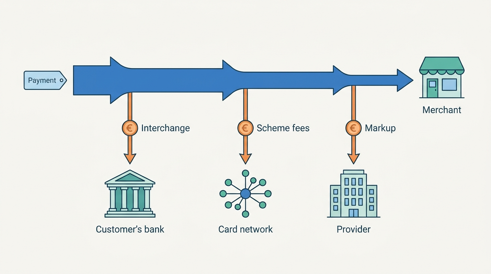
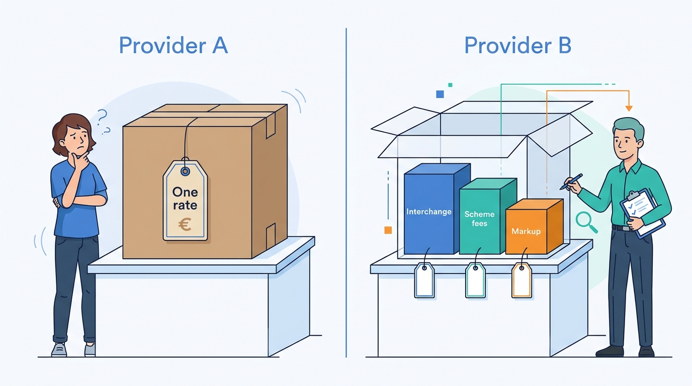
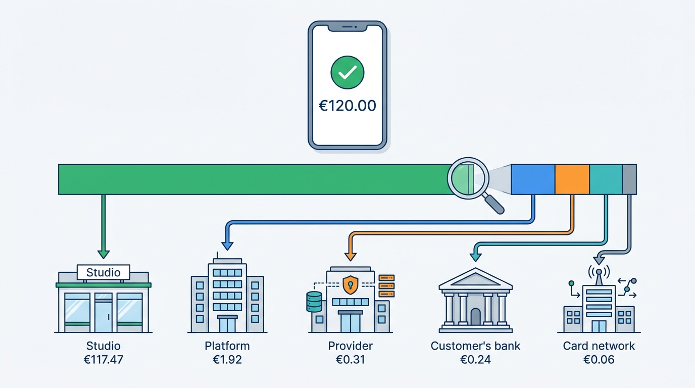
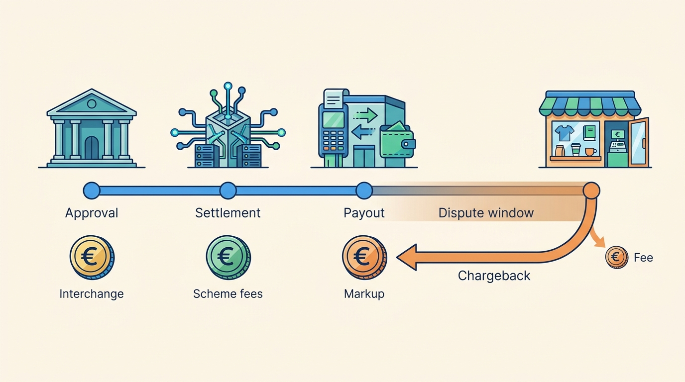

> **IN THIS CHAPTER, YOU WILL:** Split a card fee into interchange, scheme fees and markup, compare blended with pass-through pricing, and see how each shapes what Stripe and Adyen build.

> **KEY POINTS:**
>
> * **A card fee is three payments to three parties.** Interchange goes to the customer's bank, scheme fees to the card network and a markup to the provider. The networks set default interchange and do not earn it; EU law caps it at 0.2% for consumer debit and 0.3% for consumer credit cards.
> * **A blended rate and a pass-through markup do not measure the same thing.** Stripe's published standard price is one blended rate (1.5% + €0.25 on a standard European card in the Netherlands). Adyen's published price passes interchange and scheme fees through at cost and adds a fixed fee and 0.60%. Compare them only after adding the network costs to the markup.
> * **The pricing model reaches into the product.** Pass-through obliges a provider to calculate and show network costs per transaction, and Stripe documents five authorization and capture features as offered on interchange-plus pricing. Adyen reports a take rate (16.2 basis points for the first half of 2026); Stripe publishes no revenue, so its take rate cannot be computed.

> **[FAILURE PATTERNS THIS CHAPTER ADDRESSES](where-payment-systems-go-wrong.html):**
>
> * **The Black-Box Balance** — a blended fee that nobody can split into interchange, scheme fees and markup can be neither forecast nor checked.
> * **A Card by Any Other Name** — a cost model built on a domestic consumer debit card is wrong for a commercial card, a card from outside the legal caps or a payment that needs currency conversion.
> * **The Orphaned Refund** — refunds and chargebacks arrive weeks after the sale with fees of their own, and a margin calculated at the time of sale never sees them.

 
On 2 February 2027 a ten-class pass for €120.00 was bought with Bram de Wit's card at Studio Noord, a yoga studio on **Larkfield, the fictional studio-software platform this book follows**. The payment was approved and the studio received €117.47. The other €2.53 was Larkfield's platform fee, and out of it three more companies were paid. On 24 February a **chargeback** (a reversal forced by the cardholder's bank) took the €120 back. It undid none of those payments and added one: a €15.00 dispute fee. Who was paid what, and for which promise?

Beneath the platform's own fee, **the fee on a card payment is three payments to three parties**: interchange to the customer's bank, scheme fees to the card network, and a markup to the payment provider. A provider either blends the three into one rate, as Stripe's published standard pricing does, or passes the first two through at cost, as Adyen's published Interchange++ pricing does. That is more than a commercial term for procurement to settle: it decides which network costs you can see, who keeps the saving when one falls, and **what the provider has to calculate for every transaction**.

**Where we are in the payment's journey.** That was Bram's pass. The payment this book follows is a different one, for the same amount at the same studio: Mila's class pass, €120.00 bought on 9 March 2027 at Studio Noord. It has been authorized ([[payment-authorization]]), cleared, settled and paid out ([[clearing-and-settlement]]), and you know how it could still come back ([[refunds-reversals-and-disputes]]). This chapter adds no step. It puts a price on each step and on the party that carried it: Larkfield's fee on the pass was €2.53, of which €0.61 went to the provider and the parties behind it. That €0.61, like every Larkfield figure, is illustrative: an assumption made for teaching.

The chapter starts at Larkfield, where two providers send two kinds of invoice. It then takes the fee apart, says what the law caps and compares the two ways a provider prices the parts. Next come the costs of declines, late captures, refunds and disputes, then what a pricing model makes a provider build and where the public record stops, then what each company reports about its own earnings. It ends with Stripe and Adyen side by side and the fee on Mila's €120 split to the cent.

## Setting the Scene at Larkfield: Two Invoices for One Kind of Payment

In February 2027 Priya Raman, Larkfield's finance controller, brings one line of the 2026 accounts to Femke de Graaf, who has led payments engineering for a month. Larkfield earned **€19.8 million** in payment fees from studios on **€1.12 billion** of member payments, and paid **€12.6 million** of that to its two providers, Stripe and Adyen. Priya asks why nearly two-thirds of the fee income goes straight out again, and why she cannot forecast the cost from month to month.

Femke opens the two providers' statements and finds that they do not have the same shape. For a studio on Adyen, a payment such as the one Mila will make in March, a €120 pass on a Dutch debit card, carries three cost lines that sum to €0.61, and the three differ from one payment to the next. For a studio on Stripe, each payment carries one fee. Both shapes are documented: Adyen's pricing page (n.d., accessed November 2026) says you "can see exactly what you’re being charged for each transaction", and Stripe's documentation (same date) contrasts its pass-through plan with "a flat rate for all transactions". So Femke turns Priya's question into one she can answer: **what are the three lines, who sets each, and are they also inside the single fee on the other statement?**

## Three Payments Inside One Fee: Interchange, Scheme Fees and Markup

The total a merchant pays to accept a card payment is called the **merchant discount rate** in the card networks' own filings. It is the sum of three payments to three of the parties from [[journey-of-a-payment]]: the **issuer** (the cardholder's bank), the **network** (Visa or Mastercard) and the **acquirer** (the bank or licensed provider that takes the payment on the merchant's behalf; here, Stripe or Adyen).

| Part of the fee | Paid to | Set by | Scales with | Public? |
| --- | --- | --- | --- | --- |
| **Interchange** | The issuer | The network, as a default; capped by law for some cards | Value, kind of card, where it was issued | Legal caps: yes |
| **Scheme fees** | The network | The network | Value, number of messages, crossing a border | Kinds: yes. Schedules: no |
| **Markup** | The acquirer or provider | The acquirer or provider | Whatever the contract says | List prices: yes. Negotiated: no |

First, **interchange**: a fee the acquirer pays the issuer on each transaction. The network sets the default level and does not keep the money. Visa's annual report for fiscal 2026 (filed November 2026) says: "Generally, IRFs are paid by acquirers to issuers. We establish default IRFs that apply absent other established settlement terms." (IRF is Visa's abbreviation for interchange reimbursement fee.) Mastercard's report for 2025 (filed February 2026) is blunter: "Although we do not earn revenues from interchange, interchange rates can impact the volume of transactions we see on our payment products." In this part's terms, interchange is what the issuer earns for making the first promise.

**Scheme fees**, by contrast, are what the network does keep: its charges to issuers and acquirers for running the system. The schedules are not public, but the kinds show in what Visa reports as revenue: "Payments volume is the primary driver for our service revenue, and the number of processed transactions is the primary driver for our data processing revenue", with a third line, international transaction revenue, "Earned for cross-border transaction processing and currency conversion activities". So expect scheme fees on the value, on each message and on crossing a border; that mapping to an acquirer's bill is my reading.

Then the **markup**: what the acquirer or provider charges for its own service. The acquirer also decides the total. Mastercard's filing says: "The merchant discount rate is established by the acquirer to cover its costs of both participating in the four-party system and providing services to merchants." The networks fix what the acquirer pays; they do not fix how the acquirer presents it to you.

Once the three are defined, the last question is how they are collected, and none is invoiced by the party that earns it. They travel on the path the money already takes ([[clearing-and-settlement]]). Mastercard's filing says "We administer the collection and remittance of interchange fees through the settlement process", so the issuer's share is taken as the banks settle, and the provider then deducts or bills the total. As a matter of industry practice, the interchange a payment carries is decided by its clearing record, not by its approval, so a fee computed at authorization can still change. Adyen's documentation (n.d., accessed November 2026) gives a case: capturing after an authorization has expired risks "Increased interchange fees".

**Figure 1:** *One card fee is three payments: interchange to the customer's bank, scheme fees to the card network and a markup to the provider.*

## What the Law Caps, and What It Leaves Alone

Each of the three parts is set by a private party, and the law has put a ceiling on only one. **Interchange is capped for some cards in some places; scheme fees and the markup are capped in neither the EU nor the United States.** Interchange is therefore the one part of a quote you can bound without asking anyone, if you know the kind of card.

In the European Union, for example, the ceiling is Regulation (EU) 2015/751, the Interchange Fee Regulation. **(Evidence age: 11 years; in force.)** Article 3 reads: "Payment service providers shall not offer or request a per transaction interchange fee of more than 0,2 % of the value of the transaction for any debit card transaction." Article 4 sets "0,3 %" for credit cards, and member states may set lower domestic caps. The caps cover consumer cards on four-party networks. They do not apply to "transactions with commercial cards" (cards issued to businesses) or to cards "issued by three party payment card schemes" (networks in which one company is both issuer and acquirer). So on Mila's €120 debit payment the issuer can receive at most €0.24, and on Bram's credit card payment at most €0.36.

Cards outside the caps, however, cost more everywhere, and public price lists show the trace. Stripe's Netherlands price list (n.d., accessed November 2026) has four card prices, each a single rate for every card of its kind: "1.5% + €0.25 for standard European Economic Area cards", "2.8% + €0.25 for premium European Economic Area cards", "2.5% + €0.25 for UK cards" and "3.15% + €0.25 for international cards", with "+ 2% if currency conversion is required". (The European Economic Area, or EEA, is the EU plus Iceland, Liechtenstein and Norway.) That Stripe's tiers follow the line between capped and uncapped cards is my inference; the page does not explain them. I did not research UK interchange after Brexit.

Beyond capping the amount, the Interchange Fee Regulation rules on how the price is shown. Article 9 reads: "Each acquirer shall offer and charge its payee merchant service charges individually specified for different categories and different brands of payment cards with different interchange fee levels unless payees request the acquirer, in writing, to charge blended merchant service charges." (A merchant service charge is the regulation's name for what the previous section called the merchant discount rate.) Article 12 gives the merchant, for each transaction, "the amount of any charges for the card-based payment transaction, indicating separately the merchant service charge and the amount of the interchange fee", unless the merchant agrees to aggregated figures. In European law an itemized price is the default an acquirer must offer, and a price blended into a single rate is something the merchant asks for.

> **INFERENCE, NOT DOCUMENTED:** Stripe's blended standard pricing in the EU presumably rests on the merchant's agreement to a blended charge under Article 9. Stripe's pricing policy (last modified 12 October 2026) defines a blended rate as an agreed fee "regardless of the underlying differences in Network Costs" and does not cite the regulation, nor does its services agreement or support site (searched November 2026); the link to Article 9 is my reading.

The United States, by contrast, caps much less. Under the Durbin amendment (the statute behind the cap) and the Federal Reserve's Regulation II, which implements it, a covered issuer "may not receive, for any electronic debit transaction, an interchange fee that exceeds $0.21 plus 0.05 percent multiplied by the value of the transaction, plus a $0.01 fraud-prevention adjustment, if eligible" (Federal Reserve, page updated December 2025). The cap covers debit cards only, and only issuers "with $10 billion or more in assets" (Federal Reserve, October 2023; evidence age: 3 years); credit cards are left uncapped. In the Federal Reserve's 2024 figures, covered debit transactions averaged $0.23 in interchange and exempt ones $0.51: without the cap, the issuer receives on average more than twice as much.

A second rule in Regulation II matters more to engineers. It "prohibits all issuers and networks from restricting the number of networks over which debit transactions may be processed to less than two unaffiliated networks", which is what lets a provider send a debit payment over the cheaper network ([[payment-routing-and-orchestration]]).

That is the rule as written; **as of 17 November 2026 both the debit cap and the level of credit interchange are unsettled.** Take debit first. In late October 2026 the Eighth Circuit Court of Appeals, in *Corner Post, Inc. v. Board of Governors of the Federal Reserve System*, unanimously upheld a lower court's decision to vacate the 21-cent standard. I did not read the opinion; that account rests on two secondary sources, a law-firm briefing and a banking trade journal. According to the briefing, the court's decision "would not become effective until issuance of the mandate". Visa's annual report of 5 November 2026 speaks of "Recent conflicting federal court decisions on the validity of Regulation II's interchange fee standard". Credit cards have no cap for a court to strike down. What is open there is a settlement over credit interchange between the two networks and a class of US merchants: the same filing reports that an amended settlement received preliminary approval "on June 9, 2026" and that the merchants asked for final approval on 15 July 2026; it reports no final approval.

## Two Ways to Price It: Blended and Interchange-Plus-Plus

Three parts, one of them capped for some cards: a provider has two ways to turn that into the price it quotes. **Blended pricing** is one percentage plus a fixed amount for every payment of a kind, whatever the card behind it costs the provider. The total is fixed and the provider's share is whatever remains. Take 1.5% + €0.25 on €120: the merchant pays €2.05. If the interchange inside is €0.24, the provider and the network share €1.81; if it is €0.36, they share €1.69. The merchant sees neither figure.

**Interchange-plus-plus pricing**, written IC++ and also called pass-through pricing, turns that around. The provider charges the interchange of each payment at cost, plus its scheme fees at cost, plus a markup stated in advance; those are the two pluses. Stripe calls the same model IC+ and defines it (documentation, n.d., accessed November 2026) as "A pricing plan where businesses pay the variable network cost for each transaction plus the Stripe fee rather than a flat rate for all transactions." Here the provider's share is fixed and the total varies.

Stripe's published default, for one, is blended. The Netherlands list quoted above promises "No setup fees, monthly fees, or hidden fees" and prices a standard European card at 1.5% + €0.25. The pass-through model exists at Stripe but not on the price list: the page's Custom column, "available for businesses with large payments volume or unique business models", names "IC+ pricing" among its options. Stripe's pricing policy (last modified 12 October 2026) says that under IC+ it "attributes underlying Network Costs to you and adds a Stripe fee (markup)"; the size of the markup is published nowhere I searched (price list, legal pages, documentation and support site, November 2026).

Adyen's published default, in contrast, is pass-through. Its pricing page (n.d., accessed November 2026) says: "For each transaction, we charge a fixed processing fee + a fee determined by the payment method." For Visa and Mastercard, in the rows marked Global, it shows a processing fee of $0.13 and a method fee of "Interchange+ + 0.60%", and explains: "Interchange fees are variable, our Interchange++ pricing passes these fees directly to you". The same page limits what you can conclude from it: "The fees outlined above are indicative", and "We do have a minimum invoice depending on industry or business model". Some methods carry a fixed percentage instead, and Adyen's platform documentation (n.d., accessed November 2026) defines one fee type as "The transaction fee due to Adyen under blended rates". So neither company is purely one model; the default is what differs.

Taken together, the two definitions point to differences that go beyond presentation: what the merchant can see, who carries the variance in card mix, who keeps a saving, and what each side has to compute. The table describes the models, not the two companies, and its entries follow from the definitions.

| Question | Blended | Interchange-plus-plus |
| --- | --- | --- |
| What does the merchant see? | One fee per payment | Interchange, scheme fees and markup per payment |
| Who carries a change in card mix? | The provider, until it reprices | The merchant, at once |
| Who gains when a network cost falls? | The provider | The merchant |
| Who is charged a network penalty? | The provider, unless the contract passes it on | The merchant, as a line on the statement |
| How easy is the cost to forecast? | Easy: volume times rate | Harder: it needs the card mix |
| What must the provider compute per transaction? | The total | Each network cost, itemized |

**Figure 2:** *A blended price (Provider A, priced like Stripe's published default) shows one rate; a pass-through price (Provider B, priced like Adyen's published default) shows the three parts inside it.*

One row of that table matters more than the others, because it connects pricing to engineering: who gains when a network cost falls. Under a blended price the merchant's bill does not change, so the saving stays with the provider. Under pass-through the bill falls and the markup is what it was. The same cost-reducing feature is therefore margin for a blended provider and, for a pass-through provider, something to offer the merchant, perhaps at a price. This is reasoning from the definitions, not a documented fact about either company.

Which model to choose therefore depends on who should carry the variance, and the judgement is mine. Blended pricing suits a business that wants one predictable number and has nobody to audit a fee statement. Pass-through suits a business with enough volume to negotiate the markup, a cheap card mix and a finance team that will read the statement. The rule fails in one direction: a merchant whose cards are mostly commercial or issued outside the EEA can pay more under pass-through than under a flat rate without tiers.

One rule holds whichever model you choose: **never compare a blended rate with a markup**. The first is a total and the second is one of its three parts. Add the interchange and the scheme fees to the markup first, for your own card mix.

## What Failure Costs: Declines, Late Captures, Refunds and Disputes

A price list shows what a successful payment costs. The payments and steps of the previous three chapters that do not succeed each have a price too. The pricing model decides whether you see these four costs as lines on a statement or never see them. The paragraphs below take them in the order they can happen to one payment and quote the public record (both companies' pages n.d., accessed November 2026); a table at the end of the section sets the two companies side by side.

First, the decline: an attempt that fails still costs a network fee. Stripe's optimization documentation, addressing businesses on IC+ pricing, says of one feature: "We block payments that are unlikely to succeed before they reach the card networks, saving you unnecessary scheme fees." Adyen's platform documentation (n.d., accessed November 2026) says its own processing costs are "also applicable to refused and cancelled payments". Retrying a declined card too often costs more. Adyen's documentation says: "Visa charges system integrity fees. These fees are related to excessive retries of failed transactions, and excessive numbers of transactions that failed due to incorrect payment details." Both companies will block such a retry for you, as the table at the end of the section shows. Under pass-through the cost of an attempt is a line on the statement; under a blended price the merchant does not see it. [[authorization-optimization]] covers the retry rules.

After a promise refused comes a promise allowed to run out: an authorization has an expiry ([[payment-authorization]]). Adyen will let a merchant capture after it has passed, and names the price: the practice "increases the risk of" a failed capture, "Increased interchange fees", "Card scheme transaction fees" and a chargeback. Keeping the promise open on purpose costs money as well: for extended authorizations (approvals held open beyond the standard window, for up to 30 days) on Visa cards, outside the hotel, lodging, vehicle rental and cruise line **merchant categories** (the networks' classification of a business by what it sells), "Stripe charges an additional 0.08% fee per transaction". The validity window has a price on both sides of it, and only a pass-through statement shows that price as a line of its own.

Later still, the money may have to go back. A refund is a new transaction, and it does not undo the fee on the old one. Stripe's documentation says: "Stripe’s processing fees from the original transaction aren’t returned." Under pass-through even the form of the refund has a price: a refund issued soon after the charge can go out as a reversal, and "IC+ users might see a difference in cost between reversals and refunds because reversals usually incur lower network fees." Adyen's public price list has a "Payment method refund fee" column beside the payment fee.

A dispute differs from a refund in who starts it: the cardholder's bank takes the money back, and the provider adds a fee. Stripe publishes its fee. In the Netherlands it is "€20.00 for each dispute you receive" and a second €20.00 "for each dispute you respond to manually" ("You get this fee back for won disputes"), with the note "In rare cases, network fees also apply." Adyen's documentation says it "debits the payment amount and the chargeback processing fee from your account", and its public price list gives no amount. The €15.00 on Bram's dispute is Larkfield's illustrative figure, not Adyen's price. The table sets the four events side by side.

| Event | Stripe (documented) | Adyen (documented) |
| --- | --- | --- |
| Declined or retried authorization | Blocks a retry "that would have incurred network retry penalties" | Describes Visa's "system integrity fees"; refusal reason 46 blocks a retry to avoid them |
| Capture after the validity window | "an additional 0.08% fee per transaction" for extended authorization on Visa cards in most merchant categories | "Increased interchange fees", "Card scheme transaction fees" |
| Refund | Original processing fees "aren’t returned" | A "Payment method refund fee" column on the price list |
| Dispute | €20.00 per dispute received (Netherlands) | A "chargeback processing fee", "non-refundable" under Adyen's terms (2023); amount set in the contract (CAD 24.00 in Canada's standard disclosure) |

## What a Pricing Model Makes a Provider Build

Some of those costs the merchant sees and some it does not, and a saving stays with a different party under each model. It follows that the way a provider earns its share decides what its systems owe the merchant. A provider that passes network costs through must work out the interchange and scheme fees of each transaction and show them. Adyen says so on its pricing page: "Interchange++ is a pricing model which accurately tracks Interchange rates and scheme fees right down to a transaction level. This means we can calculate the cost of each payment even before it is completed." In the EU, Article 12 makes the breakdown a legal duty unless the merchant agrees to aggregated figures. A provider on a blended rate presumably makes the same calculation for its own accounts, but owes the result to nobody.

Stripe's documentation, for example, shows features following the pricing model. Five authorization and capture features carry the label "IC+ feature" (n.d., accessed November 2026): extended authorization (holding an approval for up to 30 days), incremental authorization (raising an approved amount), multicapture (capturing one approval in parts), overcapture (capturing more than was approved) and partial authorization (accepting an approval for less than was asked). The wording on the first is typical: "We offer extended authorizations to users on IC+ pricing. If you’re on blended Stripe pricing and want access to this feature, contact us". The features are not refused to everyone else, but their documented home is the pass-through plan.

Cost-reducing features are priced and reported by plan as well. Stripe's optimization page says "Optimization features can help reduce network costs for businesses on IC+ pricing", and that "Stripe uses interchange and scheme fee rules or specifications from card networks to compute costs you would have incurred without the use of optimizations." Its Netherlands price list sells the bundle of such features, Authorisation Boost, on two terms: "Included at no additional charge for businesses on standard payments pricing" and "0.2% per successful online card transaction for accounts with custom payments pricing". On the standard plan the features come with the price; on custom pricing they are a product, and for businesses on IC+ Stripe estimates what they saved.

Read together, these two cases have one thing in common, and saying what it is takes me past the documentation. Where a network cost is passed on, a feature that changes that cost is the merchant's business, so it is offered, priced and reported there. Where the cost is absorbed in a flat rate, the same feature changes only the provider's remainder.

> **INFERENCE, NOT DOCUMENTED:** Neither company says why features are tied to pricing. My reading is that the five IC+ features change what the networks charge for a payment in ways a flat rate could not absorb predictably, and that under a blended rate cost reduction is the provider's own margin. Adyen's equivalents (authorization adjustment, multiple partial captures, partial authorization) are enabled through its support team and by merchant category, with no pricing-plan condition on the documentation pages read.

The pattern is visible, but here the public record on what the two providers build stops, well short of the prices themselves. How either company computes network costs inside its systems is not public; Stripe's policy says only that it "may retroactively adjust the Network Cost charged". The scheme fee schedules of Visa and Mastercard are not public. Neither is Stripe's markup under IC+, nor Adyen's negotiated markup, nor its chargeback fee outside one standard disclosure for Canada (CAD 24.00). Adyen's minimum invoice is published for one market: its Australian payment-method pages give AU$150 per month (n.d., accessed November 2026), and its pricing page says the amount depends "on industry or business model". For a real quote these numbers come from the provider's sales team and then from your own fee statements.

## What Each Company Reports: Volume, Net Revenue and Take Rate

One payment's price can be taken apart, even where parts are unpublished. Add a provider's share over every payment it handles and you reach the figures a company does or does not report. **Net revenue** is what the provider keeps after passing interchange and scheme fees on. **Take rate** is net revenue divided by the value of the payments processed, usually in **basis points** (one basis point is 0.01%). Adyen's own definition deducts other costs. Its interim statements (August 2026) define net revenue as "Net non-interest revenue ("Non-interest revenue" less "Costs incurred from financial institutions" and "Costs of goods sold") and Net interest income". The two costs deducted there are not the interchange and scheme fees of this chapter: the revenue note says they are third-party fees outside the settlement fees Adyen passes through. I read that wording to mean the fees Adyen passes through are outside its revenue line altogether, which would make Adyen's net revenue its own share, as in the plain definition.

Adyen, for instance, is a listed company and publishes both figures. Its results for the first half of 2026 (13 August 2026) say: "Net revenue was €1,302.9 million, up 19% year-on-year" and "Processed volume was €803.8 billion, up 24% YoY". Its unaudited shareholder letter states the ratio: "Take rate landed at 16.2 bps, reflecting expected volume tiering as enterprise merchants process at larger scale on our infrastructure." Set that beside the price list: the indicative markup is 60 basis points plus a fixed fee, and the average earned is about 16. My reading is that much of Adyen's volume pays far less than list.

Stripe, by contrast, is private and publishes less. Its annual letter for 2025 (24 February 2026) says: "Last year, businesses running on Stripe generated $1.9 trillion in total volume, up 34% from 2024, and equivalent to roughly 1.6% of global GDP", and that "Stripe remained robustly profitable". The letter gives no figure for Stripe's revenue as a company (its one revenue number is for a product family, the Revenue suite, "on track to hit an annual run rate of $1 billion this year") and does not define total volume. **Stripe's take rate cannot be computed from public figures.** Any number you see for it is someone's estimate, and this book does not use one.

Because of that asymmetry, these numbers do not rank the two companies. The volumes are in different currencies, under different definitions, from different customers. And a take rate is a property of a customer base, not a price, because it falls as customers get larger. Adyen's results for 2025 (12 February 2026) show the effect: processed volume was "up 21% excluding a single large-volume customer, or 8% YoY including this customer", while net revenue rose 18%. One customer pulled volume growth from 21% down to 8%, yet net revenue grew almost in step with the others' volume. My reading is that this customer's volume carried little revenue, because the largest customers pay the lowest rates. A lower take rate tells you who a provider's customers are, not what you would pay.

## Stripe and Adyen: Where They Differ

In short, the two companies differ on the public record in six documented ways, collected here from the sections above. Price lists and documentation are n.d., accessed November 2026; other dates are in the cells. The last column is my inference, not a documented fact.

| Aspect | Stripe | Adyen | What the difference suggests |
| --- | --- | --- | --- |
| Published default price for a card payment | Blended: 1.5% + €0.25 on a standard EEA card (Netherlands list) | Pass-through: $0.13 processing fee plus interchange and scheme fees at cost plus 0.60%, marked "indicative" | Stripe's default hides the network costs; Adyen's shows them and assumes someone will read them |
| The other model | IC+ under custom pricing; markup Not public | Fixed-percentage rows for some methods; a fee type for "blended rates" in the platform documentation; a minimum invoice; negotiated markup Not public | Each sells both models; only the default differs |
| Refunds | Original processing fees "aren’t returned" | A "Payment method refund fee" column on the price list | A refund is a cost on both; model it per method |
| Dispute fee | €20.00 received and €20.00 countered (Netherlands list) | A "non-refundable" chargeback fee "as set out in the Agreement" (terms, 2023); the one published amount is CAD 24.00, for Canada | Budget disputes on Adyen from the contract, not the website |
| Features tied to the pricing plan | Five "IC+ feature" pages; Authorisation Boost included on standard pricing, 0.2% on custom pricing | Equivalents enabled by support and merchant category; no pricing-plan condition on the pages read | Changing plan on Stripe changes the feature set and the bill for optimization |
| Reported financials | Total volume $1.9 trillion for 2025 (letter, February 2026); revenue and take rate Not public | Net revenue €1,302.9 million, processed volume €803.8 billion, take rate 16.2 basis points for the first half of 2026 (August 2026) | The figures measure different things and do not rank the companies |

Those differences change what I would do on each provider. On Stripe, before moving from the standard plan to IC+, I would ask which features and reports change and what the optimization bundle will then cost. On Adyen, I would get the markup, the minimum invoice and the chargeback fee in writing, because what Adyen publishes is indicative or local, and then build the fee reconciliation an itemized statement makes possible.

## In Practice at Larkfield: The Fee Stack on Mila's €120

Now Femke can do for Priya, on one payment, what the comparison does for the two companies. Every figure in this section is **illustrative**: Larkfield is fictional, its negotiated rates are assumptions made for teaching, and scheme fees are not public. On 9 March 2027 Mila Janssen buys a ten-class pass for €120.00 at Studio Noord with a Dutch Visa debit card, a consumer card under the 0.2% cap. Studio Noord is on Adyen. Larkfield's fee is 1.9% + €0.25 = €2.53, and the studio receives €117.47.

On Adyen, to begin with, Larkfield is on negotiated pass-through pricing *(assumption)*, so the statement itemizes the provider cost of €0.61 as in the table: €0.24 of interchange, €0.06 of scheme fees and €0.31 for Adyen, which leaves Larkfield €1.92. The table calls Adyen the acquirer "by inference" because Adyen publishes where it acquires, not which of its entities acquires in each country ([[acquiring-and-network-connectivity]]). At Adyen's indicative public price the same payment would cost about €1.13 (0.60% of €120 is €0.72, plus the fixed fee, $0.13 on the page and taken here as €0.11 as in Larkfield's assumed rate, plus the same interchange and scheme fees).

| Who is paid | For what | Amount | Basis |
| --- | --- | --- | --- |
| Mila's bank (the issuer) | Interchange | €0.24 | The legal maximum, 0.2% of €120 *(assumption: charged in full)* |
| Visa (the network) | Scheme fees | €0.06 | *(assumption; schedules are not public)* |
| Adyen (the acquirer, by inference) | Processing fee and markup | €0.31 | €0.11 plus €0.20, about 0.17% *(assumption: negotiated)* |
| **Provider cost** | | **€0.61** | The three lines above |
| Larkfield (the platform) | Its fee less the provider cost | €1.92 | €2.53 − €0.61 |
| Studio Noord (the merchant) | The sale | €117.47 | €120.00 − €2.53 |

**Figure 3:** *The illustrative split of Mila's €120.00: €117.47 to the studio, €1.92 to the platform, €0.31 to the provider, €0.24 to the customer's bank and €0.06 to the card network.*

Had Studio Noord been on Stripe, by contrast, the statement would show one line. At Larkfield's negotiated blended rate for standard European cards, 0.6% + €0.15 *(assumption)*, the fee is €0.87 and Larkfield keeps €1.66. At the public list price of 1.5% + €0.25 it would be €2.05, leaving €0.48. Either way the same €0.24 goes to Mila's bank and the same assumed €0.06 to Visa. They are inside the fee and not shown.

So which provider is cheaper for Larkfield depends on comparing like with like across its cards. Seven in ten of Larkfield's online card payments by volume are debit; assume the rest are consumer credit. At the caps, the average interchange on €120 is 0.7 × €0.24 + 0.3 × €0.36 = €0.28. On Adyen the average cost is then €0.28 + €0.06 + €0.31 = €0.65. On Stripe it is €0.87, of which €0.87 − €0.28 − €0.06 = €0.53 stays with Stripe. The comparison is €0.31 against €0.53, not "0.17%" against "0.6%". And it flips with the card: for a commercial card with an assumed interchange of 1.5% (€1.80), the Adyen cost is €2.17, while the flat €0.87 holds unless the contract has a premium tier, as Stripe's public list does. That answers Priya's second question, about forecasting: on Adyen the cost moves with the card mix; on Stripe it moves only when the contract does. Her first, why nearly two-thirds of the fee income goes out, one payment cannot answer: on Mila's pass the provider cost is €0.61 of €2.53, about a quarter, and the two-thirds is the 2026 total over every payment method and both providers. The numbers are invented and say nothing about which company is cheaper for a real business.

Mila's payment stayed paid. Bram de Wit's pass, the payment from the chapter's opening that came back, shows the backward cost on top of the same split. On 2 February the pass was paid for with his Dutch Mastercard credit card, so the cap is 0.3%: up to €0.36 for his bank, an assumed €0.06 for Mastercard and €0.31 for Adyen, €0.73 in all, leaving Larkfield €1.80 and the studio the same €117.47. On 24 February the chargeback took back €120.00 and added the €15.00 dispute fee *(illustrative; it stands in for Adyen's unpublished chargeback fee)*, which under Larkfield's terms the studio carries. Adyen's terms call the chargeback fee "non-refundable"; whether any fee of 2 February comes back in a lost dispute is not stated in its terms, pricing page or dispute documentation (November 2026).

## What to Take Away

Lay the timeline of the last four chapters and this chapter's fee stack on one line, and they are the same picture. The issuer makes the first promise and is paid interchange. The network runs the settlement between the banks and is paid scheme fees. The acquirer or provider pays the merchant out and is paid the markup. Each party that says yes on the way forward is paid for it, and each backward flow adds a new cost for whoever was left holding the promise, usually the merchant. On 2 February Bram de Wit's bank, Mastercard, Adyen and Larkfield were each paid for a yes. None of those yeses could stop the €120 and a €15 fee being taken back on 24 February, because the right to dispute belongs to the cardholder and outlasts them all. A provider's pricing model decides how much of this picture you are shown.

**Figure 4:** *Each party that makes a promise on the way forward is paid for it; a chargeback in the dispute window adds a cost for the merchant.*

**Established.** The parts of that picture the field agrees on:

- A card fee is interchange, scheme fees and a markup. The networks set default interchange and do not earn it, and the acquirer sets the merchant's price (Visa's and Mastercard's annual reports, 2026).
- EU law caps consumer interchange at 0.2% for debit and 0.3% for credit, exempts commercial cards and three-party schemes, and makes the itemized price the default an acquirer must offer (Regulation (EU) 2015/751).
- Stripe's published default is blended and Adyen's is pass-through; each also sells the other model (both price lists, n.d., accessed November 2026).
- Declines, late captures, refunds and disputes carry charges of their own.

**Depends on context.** What changes with the situation, in contrast:

- Which pricing model is cheaper depends on your card mix, your volume and whether anyone will audit the statement.
- The US debit cap depends on litigation that was not finished on 17 November 2026, and the credit settlement was not final. Check the date of any US figure.
- A take rate describes a provider's customer base. It helps you understand the company and is useless as a quote.

**The author's synthesis.** My own position, as distinct from both:

- Treat the pricing model as part of the architecture. It decides which costs reach your statements, which features you can use and what you must reconcile.
- Never compare a blended rate with a markup. Add the network costs back first, on one typical payment split to the cent.

## Questions to Ask

Those take-aways turn into questions for a provider or a design review:

1. For our most common kinds of card, what are the interchange, scheme fees and markup on a typical payment, and can the provider show them per transaction?
2. Is the quoted price blended or pass-through, and if blended, which card categories have their own tier?
3. What do a declined attempt and an excessive retry cost us?
4. What happens to the original fee when we refund a payment, and is there a refund fee per payment method?
5. What is the dispute fee, when is it charged, and is any of it returned if we win?
6. Which features and reports are available only on one pricing plan, and what do the optimization features cost on each?
7. Is there a minimum invoice or a volume commitment, and how does the markup change with volume?
8. Who reconciles the fee lines against the agreed price, and from which report?

Part I has followed one payment through every promise and every fee, and all the way it treated the issuer's yes as given. It is not given. The same payment can be approved or declined depending on how the provider reaches the networks and how it models the payment, and every party on the line is paid only when the yes comes. [[part-2]] unpacks what stands between the request and that first promise.

## Sources and Evidence

*Company, product and investor sources*

- [Pricing (Netherlands)](https://stripe.com/en-nl/pricing), Stripe, n.d., accessed 2026-11 — standard card prices, the Custom column with IC+ pricing, dispute fees, Authorisation Boost pricing (volatile).
- [Place an extended hold on an online card payment](https://docs.stripe.com/payments/extended-authorization), Stripe documentation, n.d., accessed 2026-11 — the definition of IC+ pricing, the "IC+ feature" label, the 0.08% fee.
- [Increment an authorization](https://docs.stripe.com/payments/incremental-authorization), [Capture a payment multiple times](https://docs.stripe.com/payments/multicapture), [Capture more than the authorized amount on a payment](https://docs.stripe.com/payments/overcapture) and [Partial authorization](https://docs.stripe.com/payments/partial-authorization), Stripe documentation, n.d., accessed 2026-11 — the other four "IC+ feature" pages.
- [Payments optimization](https://docs.stripe.com/payments/analytics/optimization), Stripe documentation, n.d., accessed 2026-11 — estimated network cost savings for businesses on IC+ pricing, excessive retry prevention, decline prevention.
- [Refund and cancel payments](https://docs.stripe.com/refunds), Stripe documentation, n.d., accessed 2026-11 — original fees not returned; reversals and refunds under IC+.
- [Stripe Pricing Policy](https://stripe.com/legal/pricing-policy), Stripe, last modified 2026-10-12 — the definitions of the blended and IC+ models, the markup, retroactive adjustment of network costs.
- [Stripe's 2025 annual letter](https://stripe.com/annual-updates/2025), Patrick and John Collison, 2026-02-24 — total volume of $1.9 trillion; no company revenue figure (unaudited, company-reported; the full letter is the PDF linked from this page).
- [Pricing](https://www.adyen.com/pricing), Adyen, n.d., accessed 2026-11 — processing fee, Interchange++ and 0.60%, "indicative" prices, minimum invoice, refund fee column (volatile).
- [Visa payment method](https://www.adyen.com/payment-methods/visa), Adyen, n.d., accessed 2026-11 — the Visa price row.
- [Visa payment method (Australia)](https://www.adyen.com/en_AU/payment-methods/visa), Adyen, n.d., accessed 2026-11 — the minimum invoice of AU$150 per month (volatile).
- [Adyen Terms and Conditions](https://www.adyen.com/legal/adyen-terms-and-conditions), Adyen, last update 2023-11-01 — clause 8.2, the non-refundable chargeback fee "as set out in the Agreement".
- [Information summary and fee disclosure box](https://www.adyen.com/licenses/canada-information-summary-box), Adyen Canada, n.d., accessed 2026-11 — standard template terms for Canada: chargeback fee CAD 24.00 per transaction.
- [Authorization adjustment](https://docs.adyen.com/online-payments/adjust-authorisation), Adyen documentation, n.d., accessed 2026-11 — the costs of capturing after an authorization has expired; availability by merchant category.
- [Capture](https://docs.adyen.com/online-payments/capture) and [Partial authorizations](https://docs.adyen.com/online-payments/partial-authorizations), Adyen documentation, n.d., accessed 2026-11 — multiple partial captures and partial authorizations are enabled by the support team.
- [Transaction fees](https://docs.adyen.com/platforms/online-payments/transaction-fees), Adyen documentation, n.d., accessed 2026-11 — processing costs on refused and cancelled payments; the fee type for blended rates.
- [Mapping to Visa system integrity fee categories](https://docs.adyen.com/development-resources/raw-acquirer-responses/visa-integrity-fees) and [Refusal reasons](https://docs.adyen.com/development-resources/refusal-reasons), Adyen documentation, n.d., accessed 2026-11 — retry fees and refusal reason 46.
- [Dispute flow](https://docs.adyen.com/risk-management/understanding-disputes/dispute-process-and-flow), Adyen documentation, n.d., accessed 2026-11 — the chargeback processing fee.
- [Adyen publishes H1 2026 financial results](https://www.adyen.com/press-and-media/adyen-publishes-h1-2026-financial-results-3wjne), Adyen, 2026-08-13 — net revenue and processed volume.
- [H1 2026 Shareholder Letter](https://investors.adyen.com/financials/h1-2026-c2a1a), Adyen, 2026-08-13 — take rate of 16.2 basis points, the definition of net revenue (unaudited; the document is the PDF linked from this page).
- [Adyen publishes H2 2025 financial results](https://www.adyen.com/press-and-media/adyen-publishes-h2-2025-financial-results-3pgu2), Adyen, 2026-02-12 — full-year 2025 net revenue and volume, the single large-volume customer.
- [Form 10-K for the fiscal year ended 30 September 2026](https://www.sec.gov/Archives/edgar/data/1403161/000140316126000134/v-20260930.htm), Visa Inc., 2026-11-05 — default interchange, the merchant discount rate, revenue lines, US regulation and litigation status.
- [Form 10-K for 2025](https://www.sec.gov/Archives/edgar/data/1141391/000114139126000013/ma-20251231.htm), Mastercard Incorporated, 2026-02-11 — interchange is not Mastercard's revenue; the merchant discount rate; collection through settlement.

*Standards, regulation and official documentation*

- [Regulation (EU) 2015/751 on interchange fees for card-based payment transactions](http://publications.europa.eu/resource/celex/32015R0751), Official Journal, 2015-05-19 — the caps, their scope, unblending (Article 9), per-transaction information (Article 12) (evidence age: 11 years; in force).
- [Average Debit Card Interchange Fee by Payment Card Network](https://www.federalreserve.gov/paymentsystems/regii-average-interchange-fee.htm), Federal Reserve Board, updated 2025-12-19 — the US debit cap formula and 2024 averages.
- [Regulation II (Debit Card Interchange Fees and Routing)](https://www.federalreserve.gov/paymentsystems/regii-about.htm), Federal Reserve Board, updated 2024-05-17 — the two-network routing rule.
- [Federal Reserve Board requests comment on a proposal to lower the maximum interchange fee](https://www.federalreserve.gov/newsevents/pressreleases/bcreg20231025a.htm), Federal Reserve Board, 2023-10-25 — the $10 billion threshold (evidence age: 3 years).

*Research and practitioner sources*

- [Eighth Circuit invalidates Federal Reserve's 21-cent debit card interchange fee cap](https://www.consumerfinancemonitor.com/2026/10/28/eighth-circuit-invalidates-federal-reserves-21-cent-debit-card-interchange-fee-cap-holding-that-the-durbin-amendment-requires-a-transaction-specific-cost-analysis/), Consumer Finance Monitor (Ballard Spahr), 2026-10-28 — the *Corner Post* ruling and when it takes effect (secondary source).
- [Eighth Circuit affirms vacatur of Regulation II](https://bankingjournal.aba.com/2026/11/eighth-circuit-affirms-vacatur-of-regulation-ii/), ABA Banking Journal, 2026-11-03 — the same ruling (secondary source).
- [[payments-fundamentals]] in RECONCILED — fees as the finance team sees them in provider reports.

Larkfield is fictional; architectural recommendations, labeled inferences and labeled assumptions are the author's judgement.
