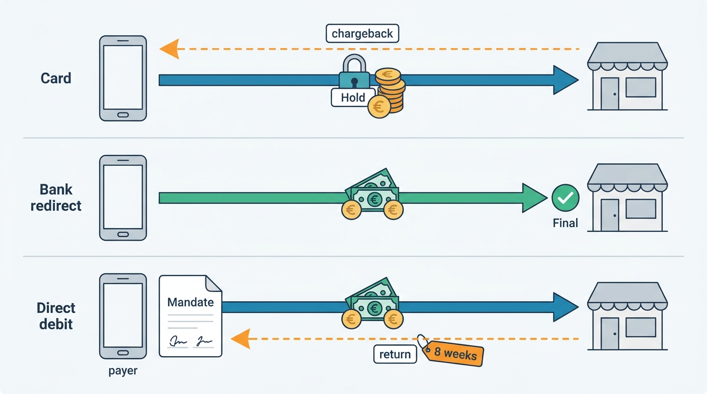
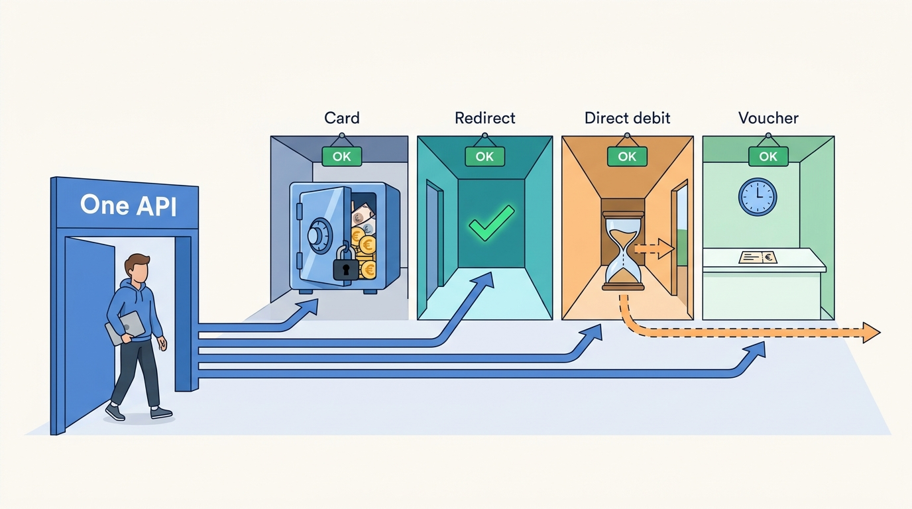
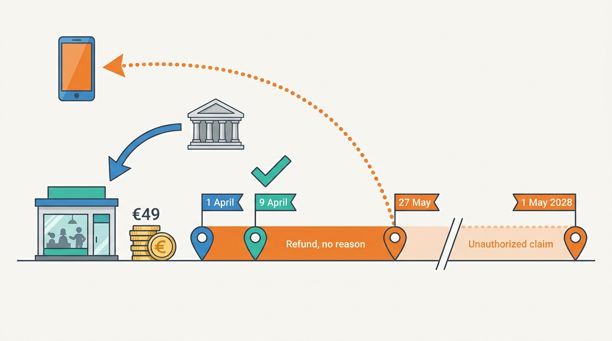

> **IN THIS CHAPTER, YOU WILL:** Learn the seven questions that separate any payment method from a card, and write a rule per method family for what your system may do after “succeeded”.

> **KEY POINTS:**
>
> * **One API unifies the start and the status, not the meaning.** When the outcome is known, whether there is a hold and whether the payer can take the money back are fixed by each scheme, so the integration carries a rule per method family.
> * **“Succeeded” is a different promise per method.** An iDEAL payment cannot be disputed through the payer's bank. Under EU law a SEPA direct debit can be refunded without a reason for eight weeks and contested as unauthorized for thirteen months. “Real-time” is speed between banks, not finality.
> * **The two providers name the same event differently.** A returned direct debit is a “dispute” at Stripe and a “chargeback” at Adyen, and Adyen also reports an unpaid debit as a chargeback. A system on both needs terms of its own.

> **[FAILURE PATTERNS THIS CHAPTER ADDRESSES](where-payment-systems-go-wrong.html):**
>
> * **A Card by Any Other Name** — logic written for cards is applied to methods with no hold, no chargeback or an eight-week right of return.
> * **The Phantom Payment** — a direct debit is treated as paid on the day it is submitted, days before the provider can confirm collection.
> * **The Orphaned Refund** — a debit comes back weeks later, and nobody can say whether it was a dispute, a refund claim or an empty account.

 
On the 1st of the month a member's €49 membership, paid by direct debit, shows as paid. She books three classes. On the 6th her bank sends the debit back: there was not enough money in the account. **Was the payment ever paid?** Nothing in the status stored on the 1st warned of it.

The status came from the provider; its meaning came from somewhere else. **One API can unify how a payment is started and how its status is reported. It cannot unify what success means**, because each scheme (the body of rules a payment method runs on) fixes when the outcome is known, whether there is a hold on the money, and whether the payer can take it back. The integration therefore has to carry a rule per method family for what it may do after “succeeded”.

Reading every method as a card costs money in three places. Access is granted before the money is certain. Sellers are paid out with money that can still leave. Reports count a failed collection as a dispute. Each is this book's gap between the instant answer and the slow truth, here weeks wide.

**Where we are in the payment's journey.** Mila's class pass, the €120.00 payment this book follows ([[journey-of-a-payment]]), is a card payment made from a phone wallet. This chapter covers the step before that journey starts, the choice of method at checkout, and asks what later steps would have looked like had she chosen iDEAL or a direct debit.

The chapter starts at Larkfield, where a direct debit was treated like a card. It sets out seven questions that separate a method from a card and reads what “succeeded” promises, method by method. It shows how Stripe and Adyen each present the variety through one API, compares three ways to handle the differences in your own code, and sets the two providers side by side. It then works a direct debit through Larkfield's rule per method family and ends with the failures.

## Setting the Scene at Larkfield: Paid Until It Was Not

In February 2027 Femke de Graaf is six weeks into leading payments engineering at Larkfield, the fictional studio-software platform this book follows ([[meet-larkfield]]), and into Keel, the 2027 program to repair its payments estate. In the 2026 figures she finds that **almost half of the online volume is not paid by card**: SEPA Direct Debit, the euro-area direct debit, carries 21%, the Dutch bank payment iDEAL 14%, the UK's Bacs Direct Debit 5% and Belgium's Bancontact 4%, against 52% for cards. In the code she finds one rule for every method: `paid` grants access to classes and counts toward the studio's payout, the transfer of its balance to its bank account.

For a direct debit, that rule produced three symptoms. Larkfield's members pay €910 million a year online. At the typical €49, SEPA Direct Debit's 21% of that is about 325,000 debits a month. Assume 1.5% come back *(an illustrative rate)*: about 4,900 a month. Each had been marked `paid` when the provider accepted the debit, so members had access and then lost it. The amount left the studio's balance again, sometimes after a payout. And at Adyen, one of the two providers Larkfield runs on, each return arrived as a chargeback event and was recorded as `disputed`, so the dispute report of Jonas Weber, the Risk and Compliance Lead, was mostly empty accounts. That behavior is documented: Adyen's SEPA Direct Debit page (n.d., accessed November 2026) says a chargeback notification “can indicate” that “There were insufficient funds in the shopper's bank account”.

The question Femke writes down is not which methods to offer. It is: **what may we do after `paid`, for each kind of method?**

## Seven Questions That Separate a Method From a Card

Her question needs a vocabulary. A **payment method** is a way of paying that runs on a scheme: a body of rules plus the banks and companies that follow them. Visa is a scheme; so is iDEAL, the Dutch bank payment. Both providers sort methods into families. Stripe's overview (n.d., accessed November 2026) lists ten: cards, bank debits, bank redirects, bank transfers, buy now pay later, real-time payments, stablecoin payments, vouchers, wallets and gift cards, saying “Payment methods in the same family have similar features and checkout experiences”. Adyen's payment methods catalog (n.d., accessed November 2026) gives each method a type and a flow such as Direct, Redirect or voucher. The family, not the brand, is the unit to design for.

Families differ on a short list of properties, which I hold as seven questions; the answers decide what a system may do after success. The table sets the card answer from [[part-1]] ([[payment-authorization]], [[refunds-reversals-and-disputes]]) beside what other families do; it is my synthesis of the properties both providers print per method.

| Question | The card answer | What other methods do |
| --- | --- | --- |
| Who starts the payment? | The merchant pulls, against an authorization (the approval of the issuer, the cardholder's bank, which holds the amount) | The payer pushes (sends the money from their own bank) in redirects (payments approved at the payer's bank) and transfers; direct debits are pulled (taken by the merchant) |
| When is the outcome known? | In seconds | Seconds for redirects; days for direct debits; days or never for vouchers |
| Is there a hold to capture later? | Yes: authorize now, capture (take the money) later | Mostly no: one step |
| Can the payer take it back, and until when? | Yes, by chargeback (a reversal forced through the issuer), for months | Not for iDEAL; eight weeks without a reason for a SEPA direct debit |
| How does a refund travel? | Back along the card payment | As a new transfer the other way, which can fail |
| Is a mandate (a standing permission to debit an account) needed? | No; a stored-card agreement | Yes for direct debits |
| When do funds settle (reach the merchant's balance)? | Days | From the same day to more than a week |

The first question matters most, because most of the others follow from it. In a **push**, the payer instructs their own bank to send money, usually in their banking app. In a **pull**, the merchant instructs the payer's bank to take money, under a permission given earlier. A payer who approved a transfer has little ground to deny it; a payer debited by someone else is protected by a right to reverse it. So pulls stay revocable; pushes mostly do not. Two terms used from here on follow from this. Money that is pushed or pulled between two bank accounts, with no card network in between, is an **account-to-account payment**. And the point after which the payer can no longer take a payment back through their bank is its **finality**: a push mostly has it at once, a pull only when the right to reverse it has run out.

The permission behind a pull is a **mandate**: the payer's standing permission for a named creditor to debit their account, a record somebody must be able to produce years later. Stripe's SEPA Direct Debit page (n.d., accessed November 2026) says “Checkout and the Payment Element automatically display the required mandate terms and record the customer’s acceptance”. Adyen's (n.d., accessed November 2026) says “By default, Adyen uses its creditor ID on your behalf”, the creditor ID being the collecting party's identifier, and adds a blind spot: “Adyen is only notified of a cancelled SEPA mandate when a payment is charged back”. A canceled permission is learned from a failure.

## What “Succeeded” Promises, Method by Method

The status word can now be read properly. Stripe's documentation (n.d., accessed November 2026) puts it plainly: “A `succeeded` status indicates that the payment completed successfully according to the payment method’s processing flow, but funds can still be refunded, disputed, returned, or reversed.” The status describes the method's process; what it says about the money depends on the method. So this section reads the promise family by family: first the two that carry Larkfield's non-card volume, from the most final to the least, then four cases that a quick reading gets wrong (wallets, real-time payments, Wero and vouchers), and last the refund, which concerns them all.

Take bank redirects first. In a **redirect flow** the customer leaves the merchant's page to approve the payment at their bank, and may not come back. iDEAL and Bancontact (Belgium) work this way: pushes with an immediate answer, no hold and no dispute through the payer's bank. Stripe's iDEAL page (n.d., accessed November 2026) lists “immediate notification” and no manual capture, and says “Customers can’t dispute iDEAL | Wero payments with their bank” (Wero is the European scheme that is replacing iDEAL, taken up below); its Bancontact page (n.d., accessed November 2026) says customers “can’t file a chargeback through their bank”. Adyen's iDEAL page (n.d., accessed November 2026) shows no separate captures and no chargebacks, and its catalog, which files Bancontact under cards and wallets and not under online banking, lists no chargebacks for it either. Both print the same properties because they belong to the scheme; the figure below sets this shape beside two others.

**Figure 1:** *A card is a pull with a hold, a bank redirect is a push that the payer cannot take back through the bank, and a direct debit is a pull with no hold and a return window of 8 weeks.*

A direct debit is the opposite case, and here the rule is law. For euro direct debits under SEPA (the Single Euro Payments Area), the EU's second Payment Services Directive (PSD2, Directive (EU) 2015/2366 of 2015) gives the payer two separate rights. Article 76(1) says “the payer has an unconditional right to a refund within the time limits laid down in Article 77”, and Article 77(1) sets that limit at “a period of 8 weeks from the date on which the funds were debited”. Article 71(1) lets a payer claim a transaction was unauthorized “no later than 13 months after the debit date”. The directive's rights are two rules, not one: a no-questions refund of a debit the payer agreed to, and a claim that there was no valid mandate. **(Evidence age: 11 years; still in force.)** Final compromise texts of the directive's successors, a third directive (PSD3) and a Payment Services Regulation, were published in April 2026 and awaited formal adoption, according to a law-firm briefing, a secondary source.

Both providers document the same rights, plus a property the law does not mention: the outcome arrives days after the request. Stripe's SEPA Direct Debit page (n.d., accessed November 2026) warns “Wait at least 6 business days before treating a SEPA Direct Debit payment as successful”, and says “You can’t submit evidence or counter a SEPA Direct Debit dispute through Stripe”. Adyen's API-only guide for SEPA Direct Debit (n.d., accessed November 2026) shows an example that answers the request with the result code `Received`, and its method page says “You cannot defend SEPA chargebacks” and “Due to the risk of chargebacks, we do not recommend using SEPA for one-off payments or the sale of physical goods”.

Other direct debit schemes are alike in kind and differ in numbers. For Bacs, the UK scheme, Stripe's page (n.d., accessed November 2026) says a payment “typically takes 4 business days to confirm” when a mandate is already in place; Adyen's page (n.d., accessed November 2026) says “Unpaid direct debits are booked as chargebacks”. For ACH (Automated Clearing House), the US scheme, the evidence stops: the two providers' ACH pages (n.d., accessed November 2026) differ, Stripe printing a consumer dispute window of “up to 60 calendar days after a debit on a personal account” and Adyen “up to two years after the settlement date”. I could not check either against the rules of Nacha, which governs ACH. A provider page points to the rule; it is not the rule.

Redirects and direct debits are methods that are not cards. A wallet turns that around: it looks like a new method at checkout and can be a card underneath. Stripe lists wallets as a family, but for the seven questions a wallet is not one. Apple Pay and Google Pay carry a card, so every card rule survives: Adyen's Apple Pay page (n.d., accessed November 2026) says it “uses network tokenization” (a card-network stand-in for the card number, [[network-tokens]]), and its catalog lists chargebacks and separate captures for it. PayPal and buy-now-pay-later providers such as Klarna are schemes of their own: Stripe's Klarna page (n.d., accessed November 2026) says “Klarna collects the initial payment from your customer and any future installment payments”. The checkout button does not tell you the family; the scheme does.

Speed is a different property again. **“Real-time” describes how fast the payer's money moves between banks. It says nothing about whether the payment is final, or when the merchant has the funds.** Regulation (EU) 2024/886 of March 2024 obliges the payee's bank to make an instant euro transfer available “within 10 seconds of the time of receipt of the payment order”. Speed between banks need not reach a merchant's checkout at all: the Federal Reserve's page on its FedNow service (last updated 20 July 2023) says it “went live on July 20, 2023” as a service for banks, and I found it in neither provider's method list or documentation index in November 2026. **(Evidence age: 3 years; the page is live.)** And where a real-time system is a checkout method, its speed settles neither finality nor funds: for Pix, Brazil's real-time system, Stripe's Pix page (n.d., accessed November 2026) lists settlement as “Up to 2 business days (T+2)” and supports disputes, and Adyen's Pix page (n.d., accessed November 2026) says a shopper can “open a dispute with their bank within 90 days”.

Wero shows the same split, between a bank's fast answer and the arrival of the money, step by step. It is the account-to-account scheme of the European Payments Initiative (EPI) that is replacing iDEAL and that iDEAL's own site describes as “backed by 16 major European banks”. Adyen's Wero page (n.d., accessed November 2026) says “Wero is currently in development” and describes an authorization as a bank's guarantee, with the funds arriving in a later step: “The payment guarantee is the shopper's bank's commitment to pay Adyen. It is not the receipt of funds.” If that step keeps failing, the merchant receives a `CAPTURE_FAILED` event. All of this is likely to change: iDEAL's migration page (n.d., accessed November 2026) says “By the end of 2027 at the latest, all iDEAL merchants will have transitioned to Wero”, with milestones “subject to further consultation with the regulator”.

Real-time methods answer in seconds. On that scale, of when the outcome is known, vouchers sit at the far end: the answer may never come. With a voucher, in the words of Stripe's overview (n.d., accessed November 2026), “customers complete online purchases in person”: checkout produces a barcode and the customer pays cash at a shop, later or not at all. Adyen's catalog gives such cash methods the flow “voucher”. The API response is an instruction to the customer: nothing to capture, an outcome by webhook days later, and an order that needs its own expiry.

The way back differs too. Outside the card networks a refund is a new payment in the other direction, with its own window, delay and way of failing. Stripe's method pages (n.d., accessed November 2026) say SEPA Direct Debit refunds “appear as separate credits to the customer’s bank account instead of reversals”, within 180 days, and iDEAL refunds “can remain in a pending state for up to 7 days”. Adyen's refund page (n.d., accessed November 2026) says that for “bank transfers, iDEAL, or Bancontact, the status of the payment can change from Refunded to RefundedReversed”, meaning the money came back to the merchant.

## How One API Presents Them: A Stored Instrument or a Parameter

A provider can make three things the same for every method: the request that starts a payment, the instruction for what the customer must do next, and the channel on which status is reported. Stripe's Payment Methods API (n.d., accessed November 2026) lets you “accept a variety of payment methods through a single API”, and “The `PaymentIntent` object’s `next_action` property specifies the customer action”, the PaymentIntent being Stripe's payment object ([[payment-state-machines]]). Adyen's integration guide (n.d., accessed November 2026) describes two server flows, each of which can “Make a payment with any available payment method”. The question here is how the method itself is carried.

Stripe carries it as a stored object, the customer's instrument. The same page says “A PaymentMethod object contains the payment method details to create payments”, combined with a PaymentIntent to pay or a SetupIntent to save for later. It is uniform at the top and specific one level down: “Each `PaymentMethod` has a type attribute, such as `"type": "sepa_debit"`, and a corresponding hash that contains information specific to the payment method.” Even reuse depends on the method: some “can’t be attached to customers because they’re consumed after a payment attempt”.

Stripe also decides which instruments are offered. In a blog post of 17 August 2023 it announced: “today, we’re changing the default behavior of the PaymentIntents and SetupIntents API”. The changelog for API version 2023-08-16 records that the previous default was to “accept only card payments”. **(Evidence age: 3 years; the current documentation confirms it as the default.)** With dynamic payment methods the list comes from dashboard settings, and with Stripe's prebuilt payment forms (n.d., accessed November 2026) “Stripe handles the logic for dynamically displaying the most relevant eligible payment methods to each customer”. Switching a method on is usually a toggle (“Activation is generally instantaneous and doesn’t require additional contracts”), though the pages of some, SEPA Direct Debit and Bacs Direct Debit among them, give the access type as “Approval required”. So a default integration can start offering a method its code never named.

Adyen, by contrast, carries the method as a parameter and offers what the merchant has had configured. A request names the method in `paymentMethod.type`, for example `sepadirectdebit`. The Advanced flow, one of the two server flows, makes three server requests, “/paymentMethods, /payments, and /payments/details”, the first returning the methods available. Which methods exist is an account operation: Adyen's guide to managing payment methods (n.d., accessed November 2026) says you request them in the Customer Area, its dashboard, after which “we will contact you if there are additional requirements”; adding one to a store is “an asynchronous process” confirmed by a webhook. The flow type printed per method tells the client what to handle after the first call.

On one question both are equally explicit: whether there is a hold to capture is documented per method. Stripe states on each method page (n.d., accessed November 2026) whether manual capture is supported; the iDEAL and Wero pages label the property “Manual capture support”. Adyen names the two modes outright. Its capture page (n.d., accessed November 2026) separates direct capture, where “Capture timing settings do not apply”, from separate capture: “Most card payment methods use separate capture ... Some online banking payment methods, for example iDEAL, only support direct capture.” The answers need not match across providers: for SEPA Direct Debit, Stripe's page lists no manual capture, while Adyen's lists separate captures.

So both abstractions leak, in the same four places: capture, refund, the name of a reversal, and the time at which success is known. Each is the answer to one of the seven questions showing through: the hold, the refund's way back, the payer's right to take the money back, and the time the outcome is known. A capture setting does nothing for a method with no hold. A refund can fail days later. A “dispute” arrives that nobody can contest. A status stays in processing for a week. Neither API is at fault: the door is shared and the rooms behind it are not, as the figure below shows.

**Figure 2:** *The API is one door; the same sign of success hangs over rooms of different shapes, and the scheme, not the provider, built the rooms.*

What stands behind the door is mostly not public. I found no page of either company that says how it adds a method or lists the methods it reaches through another payment company (documentation, legal pages, help centers and sites searched, November 2026). The nearest list is Stripe's sub-processor list (last updated 27 September 2026), which names three "Payment method integration service providers" (PPRO, Payla and NETSTARS) without saying for which methods. The method pages (accessed November 2026) leave traces. The French mandate text on Stripe's SEPA Direct Debit page authorizes “Stripe, notre prestataire de services de paiement et/ou PPRO, son prestataire de services local”, naming a second payment company as a local service provider. Stripe's Pix page says “Ebanx appears as the payment recipient” on the customer's bank statement and calls it “our Pix partner”. Adyen's ACH page mentions “The legacy BOA acquirer” that its own “AdyenACH” replaced. So this chapter describes the contract each documents, not what is behind it.

> **INFERENCE, NOT DOCUMENTED:** These traces suggest that a method offered under one API may be delivered, in some countries, by another payment company or bank. How widely that holds at either company cannot be told from public sources; ask the provider per method and country.

## Three Ways to Handle the Differences in Your Own Code

The leaks land in your code, and there are three ways to meet them. You can act on the status alone, which is what a card-first integration already does. You can branch on the method's name, which is what it becomes after its first incident. Or you can keep a **policy per method family**: store the family with each payment and look up, in a table with a row per family that holds its answers to the seven questions, what may happen next.

The three trade first-day effort against what happens when a method is added, renamed or migrated; the last column is my judgement.

| Design | Cost to build | When a method is added | Where it fails | When it is right |
| --- | --- | --- | --- | --- |
| Status only | None | Nothing changes, which is the problem | The first method with a delayed outcome or a right of return | Cards, and wallets that carry cards, only |
| Branch per method | Low at first | A code change wherever it branches | Branches drift; a renamed method (iDEAL to Wero) breaks them | One or two non-card methods in one market |
| Policy per family | A table, a stored family, a default for unknown families | A row, or nothing | A method that does not fit its family (Bacs and SEPA windows differ) | Several families, a platform, or two providers |

All three designs handle a method you already offer. The question Femke set aside in the scene, whether to offer a revocable method at all, can be answered only now that the handling is known, and it is a pricing decision as much as a technical one. Larkfield charges a studio 0.8% + €0.25 for a direct debit and 1.9% + €0.25 for a card, so a €49 membership costs €0.64 by direct debit and €1.18 by card, roughly half. The cheaper method can be taken back for eight weeks. I would offer direct debit for recurring payments to known customers, where a return ends a relationship the customer wants to keep, and not for one-off sales. Adyen's guidance, quoted above, draws the same line. What changes this is your return rate: measure it per method ([[payment-economics]] has the cost side). How much of the offer is yours to decide, and what the chosen design must absorb, also depends on the provider.

## Stripe and Adyen: Where They Differ

The comparison of the two providers comes only here because its last column cannot be read sooner: it says what each difference asks of your code, and the scheme rules, the two abstractions and the three designs are what that reading needs. The differences the API section documented for each provider are gathered here in one table. The two providers document the same scheme rules and differ in what carries the method, who chooses the list, how a method is switched on and the words for a reversal. The last column is my inference from the documented facts in the other two, cited above (accessed November 2026).

| Aspect | Stripe | Adyen | What the difference suggests |
| --- | --- | --- | --- |
| What carries the method | A `PaymentMethod` object with a `type` (n.d.) | A `paymentMethod.type` value in the request; a type and flow printed per method (n.d.) | Inference: Stripe models the instrument as a stored resource, Adyen the method as a parameter |
| Which methods a customer is shown | Chosen by Stripe per session from dashboard settings; default since API version 2023-08-16 (2023) | The methods configured on the merchant account or store (n.d.) | Inference: Stripe optimizes for merchants who will not tune the list; Adyen returns what was requested |
| Turning a method on | Dashboard; “generally instantaneous”; some methods “Approval required” (n.d.) | Request in the Customer Area; Adyen “will contact you if there are additional requirements” (n.d.) | Inference: the same scheme onboarding at a different default speed |
| Hold to capture | Manual capture, supported or not, printed per method (n.d.) | Direct or separate capture per method (n.d.) | No material difference in how it is documented; the answer for one scheme can differ (SEPA Direct Debit) |
| A returned direct debit | A “dispute”; an unpaid debit is a failed payment with a failure code (n.d.) | A “chargeback”, which can also indicate insufficient funds (n.d.) | Inference: a system on both needs its own terms |
| Methods delivered through another payment company | No list by method is public; the sub-processor list names three integration providers (2026); the Pix page names Ebanx as “our Pix partner” and the French SEPA mandate text names PPRO (n.d.) | No list is public; the ACH page mentions a “legacy BOA acquirer” replaced by “AdyenACH” (n.d.) | No comparison is possible |

On Stripe, decide whether Stripe or your code names the methods, and if Stripe does, make your code safe for a method it has never met: an unknown family is not fulfilled automatically. On Adyen the list is fixed by configuration you requested, so the surprise is elsewhere: map every chargeback event by its reason code before counting it as a dispute. On both, answer the seven questions from the method page, and do not assume the two pages agree.

## In Practice at Larkfield: A Rule per Method Family

Larkfield runs on both. Under Keel, the payment record store keeps the **method family** beside each payment, and one table says per family when `paid` is set, when access is granted and until when a reversal is expected. The record's five states (`pending`, `authorized`, `paid`, `refunded` and `disputed`, the subject of the next chapter) do not change, and Keel decision K2 still holds: a state changes only on the provider's own record. One cell of the table below needs a source: in the direct debit row, Bacs is “open-ended” because the scheme is. The UK's Direct Debit Guarantee (n.d., accessed November 2026) promises “a full and immediate refund” if an error is made and its text names no time limit, and Stripe's Bacs page says “There’s no set time limit for customers to file Bacs Direct Debit disputes”.

| Family | Methods at Larkfield | `paid` is set when | Access is granted | Expect a reversal until |
| --- | --- | --- | --- | --- |
| Card | Cards, Apple Pay, Google Pay | The provider confirms the authorization and capture | On `paid` | The card networks' dispute windows ([[refunds-reversals-and-disputes]]) |
| Bank redirect | iDEAL, Bancontact | The provider's webhook confirms, not the return to the app | On `paid` | None through the payer's bank |
| Direct debit | SEPA, Bacs | The provider confirms collection, days later | While `pending`, if the mandate is active; withdrawn on a failed collection | SEPA: 8 weeks without a reason, 13 months as unauthorized. Bacs: open-ended |
| Unknown | Any method without a row | Never automatically | No | Blocked until the seven questions are answered and a row added |

Take Daan Peters, a fictional member of Studio Noord, who pays his €49.00 membership by SEPA Direct Debit, collected on Thursday 1 April 2027, the day the debit is submitted and dated. Larkfield's fee is €0.64 and the studio receives €48.36. The record is `pending` and becomes `paid` only when the provider confirms the collection; meanwhile Daan can book, a risk the studio accepts. By Friday 9 April, six business days later (the wait Stripe's page advises, quoted earlier), the debit is past the point where Stripe says most failures occur. Until 27 May 2027 Daan's bank will refund it without a reason, and until 1 May 2028 he can contest it as unauthorized. Larkfield stores both dates with the payment and, per studio, compares the debits still inside their eight weeks with the studio's balance ([[splits-balances-and-platform-payouts]]).

**Figure 3:** *A €49 direct debit collected on 1 April 2027 can be refunded without a reason until 27 May 2027 and contested as unauthorized until 1 May 2028.*

When a return does come, the providers' names for it will not do: Stripe and Adyen report the same scheme event with different words, so Larkfield records every reversal under one of four terms of its own. The Stripe column follows its SEPA Direct Debit page, the Adyen column its SEPA chargebacks guide (n.d., accessed November 2026); matching reason codes to rows is my reading. Jonas's dispute report now counts only the last two rows of the table below, the unauthorized-debit claim and the card chargeback; a payer refund claim is left out because the payer needs no reason for it.

| Scheme event | Stripe reports | Adyen reports | Larkfield's term |
| --- | --- | --- | --- |
| The debit could not be collected (no funds, closed account) | A failed payment with a failure code such as `insufficient_funds` | A `CHARGEBACK` event, for example reason AM04 “Insufficient Funds” | Failed collection |
| The payer asks their bank for the money back within eight weeks | A dispute, or a failed payment with the code `debit_disputed` | A `CHARGEBACK` event, for example reason MD06 “Refund Request By End Customer” | Payer refund claim |
| The payer says there was no valid mandate | A dispute | A `CHARGEBACK` event, for example reason MD01 “No Mandate” | Unauthorized-debit claim |
| A cardholder disputes a card payment | A dispute | A chargeback | Card chargeback |

## When It Goes Wrong

Even with the rule in place, a method's own rules can catch an integration out. The first failure is a success the system never hears of. A customer approves an iDEAL payment and never returns to the merchant's page; an integration that fulfills on the return has lost a paid order. Stripe's Payment Methods API page: “For payment methods that require customer action, configure webhook endpoints for notifications on whether a payment has succeeded or not.” Adyen's webhooks page (n.d., accessed November 2026): “with payment methods like iDEAL, it can take time to get a confirmation that the payment was completed”. Both say that the confirming message is the webhook, not the customer's return in the browser. Detect it by sweeping payments still `pending` after a few minutes ([[payment-webhooks-and-events]]).

The second failure is a success withdrawn. A debit reported as collected fails afterwards, and the provider does not wait for you. Stripe's SEPA Direct Debit page: “If the payment fails after a delay, Stripe immediately deducts the payment amount from your Stripe balance”. Detection is yours: a daily report per seller of money still inside its reversal window, and a reconciliation that expects negative lines for direct debits ([[payment-reconciliation-and-reporting]]). Recovery is a new collection attempt ([[invoicing-collections-and-dunning]]).

The third failure pays the customer twice. A member asks the studio for a refund and also asks the bank. Both providers' SEPA Direct Debit pages warn of it. Stripe: “If you refund while the bank also starts a dispute, the customer can receive two credits”. Adyen: “Shoppers can dispute a payment with their bank even after you’ve issued a refund, potentially resulting in two credits for the same payment.” No idempotency key prevents it, since the second credit is not your request. The defense is procedural: tell the customer the refund is on its way and how long it takes. Adyen holds SEPA refunds for a week after settlement to reduce the overlap.

The fourth failure arrives for a whole method at once, when the scheme changes. The iDEAL migration came as provider deadlines. Adyen's API-only integrators had “between January 29, 2026 and March 31, 2026” to rename the method and change its logo; Stripe told users to “Rebrand your integration in the first quarter of 2026 to iDEAL | Wero”. Details still move: in November 2026 Stripe's overview marks Wero “Public preview” and its Wero page lists manual capture support and no dispute support, while Adyen says the immediate flow “is the only Wero flow Adyen supports today” and that “Dispute support starts in February 2027”. An integration that names methods in code has to change before each deadline. I would put scheme migrations on the calendar of API upgrades (Keel decision K7, [[payment-api-versioning]]) and re-answer the seven questions: a successor scheme is a new row, not a new logo.

## What to Take Away

**Established.**

- The properties that separate payment methods are set by schemes and law, not providers. PSD2 (2015, in force) gives the payer of a euro direct debit eight weeks for a refund without a reason and thirteen months for an unauthorized claim; both providers say such returns cannot be contested.
- A succeeded status describes the method's flow: Stripe says such a payment “can still be refunded, disputed, returned, or reversed”.
- “Real-time” is speed between banks: Regulation (EU) 2024/886 sets ten seconds. Settlement to the merchant and dispute rights are separate questions.

**Depends on context.**

- Offer direct debit for recurring payments to known customers, where its lower cost outweighs its returns; for one-off sales the balance tips the other way. Your measured return rate decides.
- Let the provider choose the method list only if you have a policy for unknown families.
- Grant access before a direct debit is confirmed only if you can withdraw it and someone has agreed to carry the returns.

**The author's synthesis.**

- Store the method family and a reversal horizon with every payment, and let a table decide what happens next. The provider owns the verb (start, report) and the scheme owns what was promised, so a status alone is half of the payment. The membership that showed as paid on the 1st and came back on the 6th was collected under a rule that let the bank return it: `paid` was never the right word for it on day one, and its return is a failed collection.
- Keep reversal terms of your own; two providers that agree on the rule and disagree on the word will otherwise write your fraud report.

## Questions to Ask

1. For each method we offer: who starts the payment, the payer or us?
2. When is the outcome known: in the response, by webhook, or possibly never?
3. Is there a hold we can capture later?
4. Can the payer take the money back through their bank, until when, and can we contest it?
5. How does a refund travel, within what window, and how do we learn that it failed?
6. If a mandate is needed, who stores it, and how do we learn that it was canceled?
7. What does each provider call a returned payment, and which of those events are disputes?
8. Who decides which methods a customer is shown, and what do we do with a method we have no rule for?

Across the methods in this chapter, the answers to the first two questions of this list, who starts the payment and when its outcome is known, vary along two lines: whether the customer must act before the payment completes, and whether the outcome arrives now or days later. One status word read the same way for every method, as Larkfield's `paid` was, cannot hold that. The next chapter, [[payment-state-machines]], gives the one model that holds all of these methods: a payment as a long-lived record with explicit states, and the two ways Stripe and Adyen present that record.

## Sources and Evidence

*Company, product and investor sources*

- [Payment Methods API](https://docs.stripe.com/payments/payment-methods), Stripe, n.d., accessed 2026-11 — the PaymentMethod object, `next_action`, the webhook advice, the “succeeded” sentence, activation.
- [Stripe Service Providers, Sub-Processors & Affiliates](https://stripe.com/legal/service-providers), Stripe, last updated 2026-09-27 — three "Payment method integration service providers": PPRO Payment Services S.A., Payla Services GmbH, NETSTARS Co., Ltd.
- [Payment method overview](https://docs.stripe.com/payments/payment-methods/overview), Stripe, n.d., accessed 2026-11 — the ten families, the one-line description of each, Wero marked “Public preview”.
- [Dynamic payment methods](https://docs.stripe.com/payments/payment-methods/dynamic-payment-methods), Stripe, n.d., accessed 2026-11 — Stripe chooses the methods displayed; API version 2023-08-16.
- [Introducing dynamic payment methods](https://stripe.com/blog/dynamic-payment-methods), Stripe, 2023-08-17 — the change of default (evidence age: 3 years).
- [Automatic payment methods enabled by default](https://docs.stripe.com/changelog/2023-08-16/automatic-payment-methods), Stripe changelog, 2023-08-16 — the previous default of cards only (evidence age: 3 years).
- [SEPA Direct Debit payments](https://docs.stripe.com/payments/sepa-debit), Stripe, n.d., accessed 2026-11 — access type, confirmation timing, capture, disputes, refunds, failure codes, mandate text including the PPRO mention.
- [iDEAL | Wero](https://docs.stripe.com/payments/ideal), Stripe, n.d., accessed 2026-11 — properties, refunds, migration notice.
- [Wero](https://docs.stripe.com/payments/wero), Stripe, n.d., accessed 2026-11 — manual capture support, no dispute support (public preview; volatile).
- [Bancontact](https://docs.stripe.com/payments/bancontact), Stripe, n.d., accessed 2026-11 — no chargeback through the payer's bank.
- [Bacs Direct Debit](https://docs.stripe.com/payments/bacs-debit), Stripe, n.d., accessed 2026-11 — access type, confirmation timing, no time limit for disputes.
- [ACH Direct Debit](https://docs.stripe.com/payments/ach-direct-debit), Stripe, n.d., accessed 2026-11 — the 60-day window as Stripe states it.
- [Pix](https://docs.stripe.com/payments/pix), Stripe, n.d., accessed 2026-11 — T+2 settlement, disputes, Ebanx named as the Pix partner.
- [Klarna](https://docs.stripe.com/payments/klarna), Stripe, n.d., accessed 2026-11 — who collects from the customer.
- [Payment methods catalog](https://docs.adyen.com/payment-methods), Adyen, n.d., accessed 2026-11 — payment types, flows and enabled features per method, including Apple Pay, Bancontact and the voucher methods.
- [SEPA Direct Debit](https://docs.adyen.com/payment-methods/sepa-direct-debit), Adyen, n.d., accessed 2026-11 — chargebacks, creditor ID, mandate cancelation, separate captures, refund guidance.
- [SEPA Direct Debit, API only](https://docs.adyen.com/payment-methods/sepa-direct-debit/api-only), Adyen, n.d., accessed 2026-11 — the method type, the `/paymentMethods` request and the `Received` result code.
- [SEPA chargebacks](https://docs.adyen.com/risk-management/chargeback-guidelines/sepa-chargebacks), Adyen, n.d., accessed 2026-11 — reason codes and the chargeback webhook.
- [iDEAL | Wero](https://docs.adyen.com/payment-methods/ideal), Adyen, n.d., accessed 2026-11 — features and the co-branding deadline.
- [Wero](https://docs.adyen.com/payment-methods/wero), Adyen, n.d., accessed 2026-11 — the payment guarantee, capture and its failure, the start of dispute support (in development; volatile).
- [Bacs Direct Debit](https://docs.adyen.com/payment-methods/bacs), Adyen, n.d., accessed 2026-11 — unpaid debits booked as chargebacks.
- [ACH Direct Debit](https://docs.adyen.com/payment-methods/ach-direct-debit), Adyen, n.d., accessed 2026-11 — the two-year window as Adyen states it; the legacy acquirer and AdyenACH.
- [Pix](https://docs.adyen.com/payment-methods/pix), Adyen, n.d., accessed 2026-11 — the 90-day dispute route.
- [Apple Pay](https://docs.adyen.com/payment-methods/apple-pay), Adyen, n.d., accessed 2026-11 — network tokenization.
- [Capture](https://docs.adyen.com/online-payments/capture), Adyen, n.d., accessed 2026-11 — direct and separate capture per method.
- [Refund](https://docs.adyen.com/online-payments/refund), Adyen, n.d., accessed 2026-11 — `RefundedReversed`.
- [Manage payment methods in your account](https://docs.adyen.com/payment-methods/add-payment-methods), Adyen, n.d., accessed 2026-11 — requesting methods; the asynchronous webhook.
- [Build your integration](https://docs.adyen.com/online-payments/build-your-integration), Adyen, n.d., accessed 2026-11 — Sessions flow and Advanced flow.
- [Webhooks](https://docs.adyen.com/development-resources/webhooks), Adyen, n.d., accessed 2026-11 — why asynchronous methods need them.

*Standards, regulation and official documentation*

- [Directive (EU) 2015/2366 on payment services (PSD2)](http://publications.europa.eu/resource/celex/32015L2366), Official Journal of the European Union, 2015-12-23 — Articles 71, 76 and 77: the thirteen-month and eight-week rights (evidence age: 11 years; in force).
- [Regulation (EU) 2024/886 (instant payments)](http://publications.europa.eu/resource/celex/32024R0886), Official Journal of the European Union, 2024-03-19 — the ten-second obligation.
- [From iDEAL to Wero](https://ideal.nl/en/naar-wero), iDEAL (Currence iDEAL B.V.), n.d., accessed 2026-11 — the end-of-2027 transition and its caveat; the banks behind Wero (volatile).
- [About the FedNow Service](https://www.federalreserve.gov/paymentsystems/fednow_about.htm), Board of Governors of the Federal Reserve System, last updated 2023-07-20 — launch date and nature of the service (evidence age: 3 years).
- [The Direct Debit Guarantee](https://www.directdebit.co.uk/direct-debit-guarantee/), Pay.UK, n.d., accessed 2026-11 — the refund promise for Bacs debits.

*Research and practitioner sources*

- [PSD 3/PSR: Final compromise texts published](https://www.algoodbody.com/insights-publications/psd-3-psr-final-compromise-texts-published), A&L Goodbody, 2026-04-24 — the state of PSD2's successors in April 2026 (secondary source).
- [[commerce-payments]] in ORDERED — how payment methods bend authorization, capture and refund from a merchant's side.
- [[payments-fundamentals]] in RECONCILED — the parties and pricing behind the methods, from the finance side.

Not verified for this chapter: Nacha's rules on ACH return windows, the SEPA Direct Debit rulebook itself (the rights are cited from PSD2), Mastercard's rules, and the scheme rules of Pix.

Larkfield is fictional; architectural recommendations, labeled inferences and labeled assumptions are the author's judgement.
