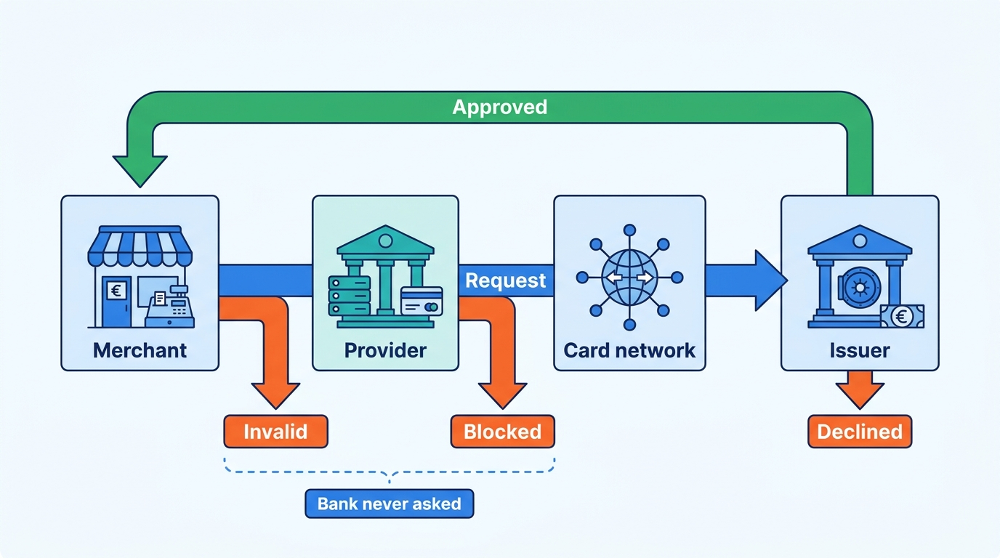
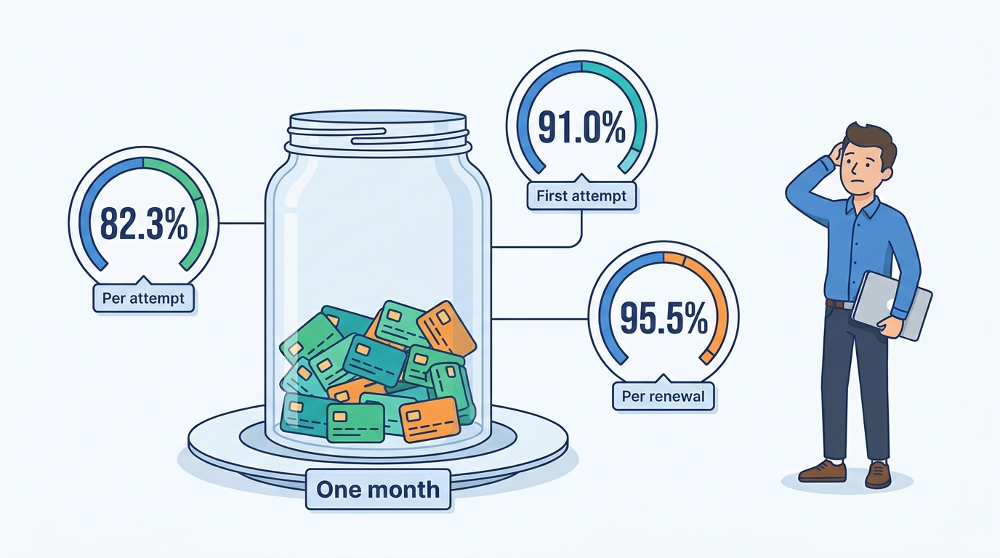
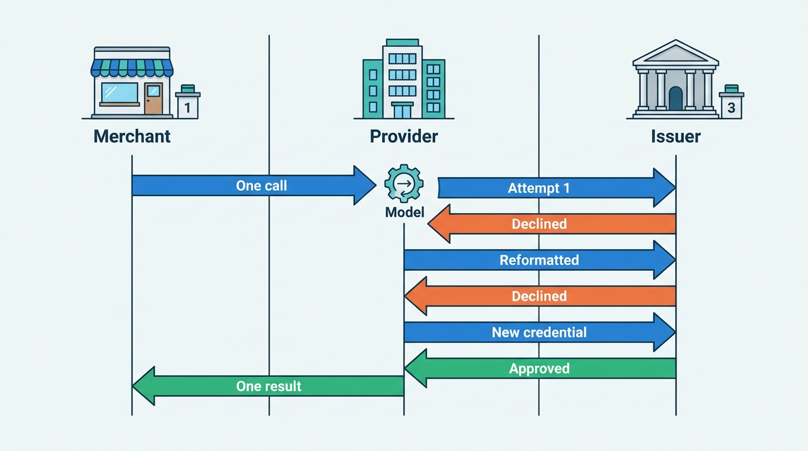

> **IN THIS CHAPTER, YOU WILL:** Learn who can refuse a card payment, how an approval rate is counted, and how to test what a provider's optimization product does to it.

> **KEY POINTS:**
>
> * **A decline is one bank's private reading of one message.** A payment can fail at the issuer, at the provider before the network, or as an invalid request. Only the first is the bank's decision, and most such declines arrive as a generic code with no reason to act on.
> * **An approval rate is a counting rule before it is a result.** The same month of renewals reads 82.3%, 91.0% or 95.5% depending on whether attempts or purchases are counted. State the numerator, denominator, cohort and counting rule, or the number means nothing.
> * **The provider acts inside the call, and its uplift is a claim until you measure it.** Stripe and Adyen document reformatting, retrying, rerouting and blocking payments unasked. Their headline figures (3.8% and "up to 6%") use different metrics and cannot be compared; a randomized holdout on your own payments is the only measurement.

> **[FAILURE PATTERNS THIS CHAPTER ADDRESSES](where-payment-systems-go-wrong.html):**
>
> * **The Phantom Payment** — a system records "declined by the bank" for a payment the provider blocked or retried, so its record says something the bank never did.
> * **The First of the Month** — a renewal job and a provider's automatic retries resubmit the same declined cards and spend one network retry allowance twice.
> * **The Borrowed Blueprint** — an uplift measured on a vendor's pilot merchants is taken as the gain a much smaller business should expect.

 
A member's card is valid, the account has money in it and the member wants to pay. The bank still answers no, with a two-digit code, 05, that means only "do not honor". Nothing in the merchant's systems is wrong. Stripe's guide to authorization rates (n.d., accessed November 2026) calls this ordinary: "some banks classify nearly all declines as 'Do not honor.'". For a business that bills monthly, each such refusal can end a membership nobody chose to end.

The remote system here is one of thousands of banks, and each **decides alone, on its own reading of one authorization message**, usually without saying why. Between merchant and bank sits a provider that now reformats the request, swaps the card number for another credential, retries, changes the route or withholds the request. So **the approval rate is partly the provider's product**, and the uplift figures Stripe and Adyen publish for it cannot be compared with each other or checked from public data.

**Where we are in the payment's journey.** When Mila Janssen buys her €120.00 class pass at 19:42 on 9 March 2027, the issuer's approval comes back within the same call ([[payment-authorization]]). This chapter covers what happens between the request and that answer, and follows her €49.00 membership renewal, declined on 1 April 2027 and approved on 4 April; [[payment-state-machines]] showed that a failed attempt returns a payment to a state from which another attempt can be made.

The chapter starts at Larkfield, the fictional studio-software platform this book follows, with two approval rates for one month. It then covers who can say no, how approvals are counted and which levers move them. Next come what Stripe and Adyen do inside the call, how to read an uplift figure and measure your own, and three ways to divide retry decisions between merchant and provider. The comparison of the two companies follows, then Larkfield's recount and first test, and the ways optimization goes wrong.

## Setting the Scene at Larkfield: Two Approval Rates for One Month

In January 2027, in Femke de Graaf's first month as Head of Payments Engineering, CTO Daniel Osei shows her two figures for December's card renewals: **82.0% on Stripe and 95.5% on Adyen**. About 540,000 of Larkfield's 940,000 monthly renewals are paid by card *(an assumption derived from the ledger's method mix; both rates are illustrative too)*. Decision K8 of the Keel program lets the payment service move a studio's online card payments to the other provider, and Daniel asks whether the card renewals should move to Adyen.

Femke first asks where the numbers come from. Both are warehouse queries written years apart. The Stripe query divides approvals by every attempt, retries included; the Adyen query divides renewals eventually paid by renewals due. The populations differ too: Stripe carries the United Kingdom, the United States, Belgium and studios onboarded before 2024, while Adyen carries Dutch and German studios onboarded or migrated since.

So she writes four questions on the whiteboard before any payment moves: **who said no, what is being counted, what could change the answer, and who is already changing it?** They are this chapter's sections.

## Who Says No: The Issuer, the Provider or the Request

A card payment fails in one of three places. Stripe's documentation (n.d., accessed November 2026) says: "There are three reasons why a payment might fail": issuer declines, blocked payments and invalid API calls. The **issuer** is the bank that gave the customer the card and answers every authorization request. A **blocked payment** is one the provider stops itself before it reaches the card network (Visa, Mastercard or another network that carries the request to the issuer), as a risk block (its fraud screening judges the payment too risky; see [[payment-fraud-and-risk]]) or, as later sections show, to save a fee: "When Stripe blocks a payment, it doesn't obtain authorization from the card issuer." Only the first of the three is the bank's decision.

**Figure 1:** *A payment can stop in three places, and only the last, the issuer's decline, is the bank's decision.*

The issuer's decision is a model's judgement, made alone. Stripe's documentation says the issuer's "automated systems and models decide whether to authorize it. These tools analyze signals such as spending habits, account balance, and card data (expiration date, address information, and CVC)". The request reaches the bank as an ISO 8583 message, the standard format for card transaction messages, and Stripe's guide adds: "there are 128 fields in the ISO 8583 message, and each issuing bank can choose how to interpret and combine them". The same request can be approved by one bank and refused by another, which is what a provider can adapt to.

Little of that judgement comes back. Stripe's documentation on card declines states: "Card issuers categorize most declines as generic (generic_decline), making the exact decline reason unclear", and "For privacy and security reasons, card issuers discuss the specifics of a decline only with their cardholders." Adyen's vocabulary has the same gap: its refusal reason 27, "Declined Non Generic", "maps all those response codes that cannot be reliably mapped" (n.d., accessed November 2026).

What a code does tell the merchant is whether it may try again. The usual words are **soft decline** (a refusal that might become an approval later, or with corrected data) and **hard decline** (one that will not change for this card). Both are industry shorthand, not network terms. The network vocabulary is Visa's four categories of decline code, in Visa's rules (Product and Service Rules, edition of 24 October 2026, Table 7-2), and Mastercard's Merchant Advice Code, a second code that says whether and when to retry. Mastercard's rule documents could not be read, so its code is given as Adyen's documentation renders it: "03 : Do not try again", "24 : Retry after 1 hour" through "30 : Retry after 10 days", and "Not all Mastercard issuers return the MAC."

| Visa category | Example codes | May the merchant reattempt? | Shorthand |
| --- | --- | --- | --- |
| 1: "Issuer will never approve" | 04 pick up card, 14 invalid account number, 43 stolen, 46 closed account | Never, for the same card | Hard |
| 2: "Issuer cannot approve at this time" | 51 not sufficient funds, 59 suspected fraud, 91 issuer inoperative | Yes, within the limit | Soft |
| 3: "Data quality – Revalidate payment information" | 54 expired card, N7 security code failure | Yes, after fixing the data | Soft |
| 4: "Generic response codes" | All others, including 05 do not honor | Yes, within the limit | Soft |

Each provider wraps these codes in three layers of its own, listed below from the two companies' documentation (n.d., accessed November 2026). A retry policy needs all three stored for every attempt, and the normalized vocabularies do not match.

| Layer | Stripe | Adyen |
| --- | --- | --- |
| Normalized reason | A decline code such as `insufficient_funds` or `generic_decline` | `resultCode` **Refused** with `refusalReason` and `refusalReasonCode` |
| Network's raw code | `network_decline_code` and `network_advice_code` | `refusalReasonRaw` and `refusalCodeRaw`, once enabled; the code "only available for Visa and Mastercard transactions through our own acquiring platform" |
| Retry advice | `advice_code`: `do_not_try_again`, `try_again_later`, `confirm_card_data` | `merchantAdviceCode` for Mastercard; a published mapping of raw codes to Visa's categories |

## Counting Approvals: Three Rates and Two Counting Rules

Three sources of failure give three rates, which differ in the denominator. Stripe's documentation defines two. For the **authorization rate**, "we divide the number of payments authorized by the card issuer by the number of unique payment attempts submitted to the card network for authorization. We exclude invalid API calls, payments that fail 3D Secure authentication, and blocked payments in the denominator". The **payment success rate** divides the same approvals by "unique payment attempts submitted through Stripe". In Stripe's example, 103,000 requests include 3,000 invalid calls, 1,000 failed authentications and 1,000 blocked payments, and 93,000 are authorized: a payment success rate of 93% (93,000 / 100,000) and an authorization rate of 94.9% (93,000 / 98,000). **Checkout conversion** is wider still: completed payments over checkouts started.

A second choice multiplies the readings: count per attempt or per purchase. Stripe calls these the raw and the deduplicated rate. "The raw rate includes all payment attempts (including retries) to make the same purchase"; the deduplicated rate "groups the retried payment attempts together and calculates the acceptance rate based on the final outcome". One purchase that fails twice and then succeeds has a raw rate of 33.3% and a deduplicated rate of 100%. The table applies both rules to one illustrative month of Larkfield's card renewals on Adyen: the same payments read 82.3%, 91.0% or 95.5%, each correct under its own rule.

| December 2026, card renewals on Adyen *(assumption)* | Count | Rate |
| --- | --- | --- |
| Renewals due (first attempts) | 210,000 | |
| Approved at the first attempt | 191,100 | 91.0% of first attempts |
| Retry attempts on declined renewals | 33,600 | |
| Renewals paid in the end | 200,550 | 95.5% per renewal (deduplicated) |
| All attempts | 243,600 | 82.3% per attempt (raw: 200,550 / 243,600) |

**Figure 2:** *The same month of card renewals reads 82.3%, 91.0% or 95.5%, depending on whether attempts, first attempts or renewals are counted.*

The denominators also show what a block does to the numbers. A blocked payment, one the provider stops before the network because it expects a refusal or a penalty fee, leaves the authorization-rate denominator; Stripe's record of one reads `"type": "blocked"`, `"network_status": "not_sent_to_network"`. Take Stripe's example and block 1,000 more payments that would have been declined: the authorization rate becomes 93,000 / 97,000 = 95.9%, the payment success rate stays at 93%, and nobody has sold anything more. If 50 of those 1,000 would have been approved, 50 sales are lost and the authorization rate still rises. A block is not an issuer decline: it raises one rate and can only lower sales.

The rule that follows is to state every approval rate with four things: numerator, denominator, cohort (first payments or renewals, which countries, online only) and counting rule. Compute it from your own record, with attempts and purchases kept as separate entities. Adyen's glossary (n.d., accessed November 2026) gives one formula: "The payment conversion rate is calculated by taking the number of authorized transactions, divided by the number of initiated transactions, shown as a percentage". A knowledge-hub article (July 2026) adds that Adyen "reports payment acceptance rate on a gross basis as standard", counting every message sent to an issuer. Neither says what counts as an initiated transaction or gives a formula for "authorization rate", so a comparison across the two providers still has to rest on the merchant's own counts.

## What Moves the Rate: Credentials, Message, Route, Retries and Timing

Every lever that raises approvals changes what the issuer sees or when it is asked. This section takes the levers in the order they act on a payment.

| Moment | Lever | What changes for the issuer |
| --- | --- | --- |
| Before the request exists | Account updater; network token | The stored credential is current |
| As the request is sent | Acquiring entity; message fields; authentication | Where the payment arrives from, how it is described, whether the cardholder was verified |
| Straight after a refusal | Retry with changed fields, credential or network | A second, different request |
| Days later | Scheduled retry | The same request at a better moment |

An **account updater** is a card-network service that gives the provider a replaced card's new number or expiry date, so a stored card keeps working after the bank reissues it. Stripe's documentation says it "automatically attempts to update saved card details whenever a customer receives a new card", is "widely supported in the United States", and that "International support varies from country to country"; an update arrives as a `payment_method.automatically_updated` event. Adyen's Real Time Account Updater works on a refusal: "When you submit a payment that is refused, our Real Time Account Updater instantly checks for updated card details. If there is an update, we immediately retry the payment with the updated card details. This all happens while the payment is being processed, and appears as a single transaction." On Adyen the update is itself a retry inside the call.

A **network token** is a card-network stand-in for the card number that stays valid when the card is reissued ([[network-tokens]]). Both providers treat it as a choice made per payment, beside the real card number, the PAN. Stripe's guide says: "We maintain PAN redundancy to retry failed network token transactions on the underlying PAN". Andreu Mora, Adyen's global head of engineering data, wrote in January 2025 that "the AI in Uplift can choose to tokenize, use a token, or swap a token for a PAN based on global optimization targets". Adyen documents one boundary: "Network tokenization is only applicable for payments acquired by Adyen." Neither publishes the approval gain from tokens alone.

Three levers change the request as it is sent. The first is which entity acquires it, that is, which licensed member of the card network submits the payment for the merchant: Stripe's guide says "banks are often more likely to approve domestic payments" ([[acquiring-and-network-connectivity]]). The second is how the message's fields are filled: Stripe's guide describes testing postcode formats bank by bank, and Adyen's Smart Payment Messaging "optimizes issuer messaging (for example, CVC and AVS fields) to increase authorization rates on low-risk transactions" (CVC is the card's security code, AVS the address check). The third is whether the cardholder is authenticated with 3-D Secure, the protocol by which the bank verifies its customer online. Adyen's Authentication Engine "helps decide when to offer strong customer authentication, which exemptions to ask for, and when to request the frictionless or the challenge flow"; [[three-d-secure-and-sca]] owns that subject.

After a refusal the lever is the retry, and the networks cap it. Visa's Table 7-2 says that after a category 1 code "a Merchant must never resubmit an Authorization Request or Account Verification for the same Payment Credential", and for categories 2, 3 and 4: "Reattempt permitted (up to 20 attempts in 30 days)". Provider documentation lags or simplifies the rule: Adyen's mapping page (accessed November 2026) still says "up to 15 times in a 30-day period" and names the penalty, an "excessive retry fee". Stripe "recommends a maximum of eight retries" and warns that issuers "might see creating additional retries as potential fraud". Mastercard's thresholds are known here only from an acquirer's guidance (PayPal, May 2026; a secondary source, which cites Mastercard's Transaction Processing Rules of June 2023): 10 retries in 24 hours and 35 in 30 days. **(Evidence age of the cited rules: 3 years; the current thresholds may differ.)**

A **retry policy** says which refusals are retried, how many times and when. For recurring payments the "when" is spread over days, because a card short of funds on the 1st may be funded on the 4th, and the merchant sets a count and a window. Stripe's Smart Retries, part of its billing product, defaults for new accounts to "up to 8 retries within 2 weeks" and does not retry a hard decline until there is a new payment method. Adyen's Auto Rescue retries refused payments made without the shopper present "at optimal times" inside a window of 1 to 48 days. Each has one post on its retry model: Stripe's of 23 January 2024 ("more than 500 attributes") and Adyen's of 3 December 2020 (one experiment that converted "about 6% more orders than the baseline"). Neither publishes a recovery rate across merchants: Adyen's knowledge-hub guide of 16 June 2026 quotes one customer's 4% improvement, with no baseline, and Stripe's "55%" covers its recovery tools together. The process around the retry, dunning, belongs to [[invoicing-collections-and-dunning]].

## Inside the Call: What Stripe and Adyen Do Without Being Asked

Stripe documents that it pulls these levers itself. Authorization Boost, announced in May 2025, bundles Adaptive Acceptance, the card account updater and network tokens. The documentation (n.d., accessed November 2026) says: "Adaptive Acceptance uses AI to reformat payment requests based on card issuers' preferences. Stripe can make these changes before sending a payment or after a payment is declined." It retries declined payments in real time, "without the end customer ever seeing the initial decline" (Stripe blog, 12 February 2025). In the United States it "might automatically retry an eligible transaction on a US debit network". And for accounts on interchange-plus pricing, which pay network costs directly ([[payment-economics]]), it blocks: "Decline prevention: Stripe blocks a payment from reaching the card network that was unlikely to succeed, avoiding additional scheme fees for the payment."

Adyen documents the same kinds of action under Uplift, launched on 9 January 2025, and its partner guide (n.d., accessed November 2026) gives each a default. Intelligent Payment Routing, which sends each transaction to the "highest-converting or lowest-cost acquirer or network", "is off by default". Smart Payment Messaging "is enabled by default". The Excessive Retry Prevention Service, which blocks transactions that would incur network retry penalties, "is opt-in, not priced, and in maintenance mode" and "may have a negative impact on authorization rates". The retry inside the call appears on Adyen's product page, not in the documentation I read: "Auto Retries intelligently retries declined transactions by adapting the route, messaging, authentication, and tokenization to maximize the chance of success – in milliseconds."

So one API call no longer equals one request to a bank. It can produce several network attempts, as when Adyen's updater retries and the result "appears as a single transaction". It can use another network than the merchant expected, as when Stripe decides to "reattempt a declined payment on an alternative card network". Or it can produce no attempt at all, as when Stripe's outcome reads `not_sent_to_network`. The merchant receives one result each time, so its count of attempts and the network's can differ.

**Figure 3:** *One API call can stand for several network attempts: the merchant counts one request, the issuer may have seen more.*

Both companies say machine-learned models take these decisions, and each has published a different half of the picture. Stripe names the model: "Our previous approach, based on a gradient-boosted tree model (XGBoost), saved Stripe users billions of dollars in revenue... We transitioned to a TabTransformer-based deep neural network, which we call TabTransformer+", and "We can now train and deploy new versions of our Adaptive Acceptance model multiple times per week" (12 February 2025). The call's behavior can therefore change from week to week. Adyen describes the system around its models: a collection of models "optimized globally through Reinforcement Learning", within an "SLA for transaction processing: 1 second including acquirer communications which consumes around 600 ms" (listed among its platform numbers for 2023), where each transaction over the Black Friday weekend of 2024 "touched between 2 and 5 different AI endpoints" with "an allocated latency of 20 ms (median)" (17 January 2025).

What stays rule-based is the envelope the merchant sets. On Stripe that is the retry count and window of Smart Retries. On Adyen it is a routing objective (for the United States and Australia: balance conversion and cost, prioritize cost, or prioritize conversion), the messaging optimization level, the rescue window, and custom risk rules. The decision for each payment belongs to a model whose inputs and reasons the merchant cannot inspect.

> **INFERENCE, NOT DOCUMENTED:** Adyen's published budget suggests why neither company offers control per payment. With about 600 ms of a one-second target spent reaching the acquirer and 20 ms allowed per model call, the decision has to be made by small models in the payment path. Neither company states this as its reason.

## Reading an Uplift Figure, and Measuring Your Own

Both companies put a number on what these actions achieve. Every figure below is the vendor's own claim, with its wording and date; none was audited by a third party.

| Company | Claim, as worded | Source and date |
| --- | --- | --- |
| Stripe | "businesses using Authorization Boost's real-time optimizations can increase their acceptance rate by 3.8% on average, with some seeing up to 7%" | Stripe blog, 15 May 2025; the 3.8% average is repeated on 29 April 2026 |
| Stripe | "recovering a record-high $6 billion in falsely declined transactions" in 2024 | Stripe blog, 12 February 2025 |
| Adyen | "AI helps businesses increase payment conversion rates by up to 6% compared to legacy implementations"; "Piloted by 60 enterprise businesses" | Adyen press release, 9 January 2025 |
| Adyen | "Based on the average conversion improvement of merchants that participated in the pilot and used all modules of Adyen Uplift." | Footnote to the 6%, Adyen product update, January 2025 |

The two headline figures look alike and measure different things. Stripe's is an "acceptance rate", not defined where the 3.8% is stated: relative or percentage points, raw or deduplicated, for which merchants. Adyen's is a "payment conversion rate", "up to" 6% in the headline and an "average" in the footnote, against "legacy implementations", for pilot merchants that used all of Uplift's modules (five in today's documentation, among them checkout and risk features). Neither states a formula, a cohort or a baseline, so the figures can be neither compared nor checked. Stripe's documentation says how to treat its number: "Stripe doesn't guarantee any outcomes for your use of Authorization Boost features. The optimization calculations we provide are estimates."

The figure in a merchant's Stripe dashboard is an estimate of the same kind. The documentation explains: "For each payment, Stripe assesses the likelihood that optimizations contributed to its success, given that some payments might have otherwise still been approved." That is a model's view of what would have happened without the feature, not a difference measured between two groups.

Both companies also describe the stronger method, randomized groups, and each says what its control group still receives. Stripe previewed an A/B test of Authorization Boost on 29 April 2026; in November 2026 its documentation still labels it a private preview, with a form to request early access. Eligible volume is split at random into two equal groups for 30 days, results come after 37 days so that retries can finish, the metric is the deduplicated payment success rate, and significance is declared at 5%. The control group keeps the merchant's existing optimizations, and the card account updater runs in both groups because Stripe "can't apply card credential updates selectively". Adyen's engineering account says: "we still act on the control group as we define baseline as a 'market baseline'", including "forcing a network token, and retrying with a challenge if the authentication fails. This results in a lower, but more honest uplift calculation". For merchants, Adyen's experiments run on live transactions, with a limit: "You can only start optimization experiments following a recommendation."

From these designs I take six rules for turning a claimed uplift into a measured one. They are my judgement, not a standard.

1. **Fix the metric.** For a business decision, paid purchases over purchases attempted; say whether by count or by value.
2. **Fix the cohort.** First payments or renewals, which countries, online only. A change in mix moves the rate with no change in approvals.
3. **Randomize a holdout.** A before-and-after comparison mixes the feature with season, card mix and issuer behavior.
4. **Wait for retries to finish** before reading the result, as Stripe's 37 days do.
5. **Watch guardrails in the same test:** fraud and disputes (payments a cardholder contests through the bank), fees, the count of blocked payments, latency.
6. **Know what the control group receives,** and size the test first: a common rule of thumb is about 16 × p(1−p)/d² payments per group to detect a difference d at a rate p.

The rules are needed because the public record stops short of verification. No source I read gives the features or labels behind either company's models, results by issuer, the share of blocked payments that would have been approved, a recovery rate across merchants for Smart Retries or Auto Rescue, or an audited lift. Stripe's May 2025 post glosses false declines as "legitimate transactions mistakenly rejected due to suspected fraud" but does not say how it knows that a declined payment was legitimate, or how the $6 billion was counted. Since its pilot of 60 businesses Adyen has published one figure across merchants and figures for single named customers. A press release of 11 February 2026 says "the 6,500+ businesses that are using Adyen Uplift saw an average increase of 1.19% in payment conversion rates above standard industry baselines", without stating the baseline or whether the 1.19% is relative; one of 22 September 2026 quotes increases of 11% and 12% at two customers of its Authenticate module. It has published no price for Uplift (pricing page, product pages and documentation searched, November 2026). Mastercard's retry thresholds were not confirmed from a Mastercard document.

## Three Ways to Own the Retry, and What Each Costs

A provider that acts inside the call leaves the merchant three designs, compared below. The rule I use: let the provider act inside the call, because only it has the data on each issuer and the milliseconds to use it; own the schedule across days only if you run your own billing; and never let two schedulers retry the same payment. Adyen expects the third design: it publishes its code mapping for merchants who "have built your own retry logic". The rule changes for a merchant too small to measure anything, which should take the defaults, and for one with several providers, which needs one schedule above them all.

| Design | Who decides the next attempt | What you build | Right when | Main risk |
| --- | --- | --- | --- | --- |
| Provider decides everything | The provider's models, in the call and across days | Reading of outcomes only | Volume is too small to test | Believing an estimate; a silent regression |
| Provider decides, merchant measures | The provider | An attempt record, a holdout, guardrail metrics | You have volume and use the provider's billing | The provider's test rules limit the holdout |
| Merchant schedules its own retries | The merchant's job across days; the provider in the call | Retry logic from raw and advice codes, per network | You run your own billing or several providers | Two schedulers on one payment; penalty fees |

## Stripe and Adyen: Where They Differ

Every Stripe and Adyen cell below is a documented fact cited earlier in this chapter; the last column is my reading, an inference.

| Aspect | Stripe | Adyen | What the difference suggests |
| --- | --- | --- | --- |
| Metric definitions | Two rates with formulas, raw and deduplicated (docs, n.d., accessed November 2026) | Payment conversion rate: authorized over initiated transactions (glossary, n.d.); attempts counted gross (article, 2026); no formula for authorization rate | Stripe's numbers can be reproduced; Adyen's definition leaves "initiated" open, so compute your own |
| Acting inside the call | Adaptive Acceptance reformats and retries in real time (docs, n.d.) | Messaging optimization on by default; updater retry as "a single transaction" (docs, n.d.) | Same idea; Adyen states a default per feature |
| Blocking before the network | Decline and excessive-retry prevention for interchange-plus accounts (docs, n.d.) | Opt-in service "in maintenance mode"; refusal reason 46 (docs, n.d.) | Stripe is building on blocking as a cost feature; Adyen appears not to be |
| Scheduled retries | Smart Retries, in Billing; 8 in 2 weeks by default (docs, n.d.) | Auto Rescue, in payments; window of 1 to 48 days (docs, n.d.) | Adyen's suits a merchant that runs its own billing |
| Published model detail | Model family and retraining pace (February 2025) | Reinforcement learning, latency budget, control group (January 2025) | Stripe published the model, Adyen the system around it |
| Headline claim | "acceptance rate" up 3.8% on average (May 2025, April 2026) | "payment conversion" up to 6%, pilot of 60 (January 2025) | Different metrics and cohorts; not comparable |
| How a merchant can measure | Modeled estimate; randomized 30-day test in preview (docs, n.d.) | Experiments only "following a recommendation" (docs, n.d.) | Neither lets the merchant design a test freely |

On Stripe, read the `outcome` of every attempt, including `type` and `network_status`, and adopt the documented rate definitions so that dashboard and warehouse agree. On Adyen, have raw responses enabled before going live, check the default of each Uplift feature on your account, and build your rates from your own attempt records; Adyen's Checkout API has no call that returns a payment by its identifier, so the confirming record is the webhook ([[payment-webhooks-and-events]]). On both, ask which rate a quoted improvement refers to before repeating the number internally.

## In Practice at Larkfield: One Basis, Then One Test

Tom Hendriks reruns December on one basis from the payment record store, which keeps each attempt beside the renewal it belongs to. The figures are illustrative assumptions. The scene's 82.0% was a per-attempt rate and its 95.5% a per-renewal rate: on one basis the 13.5-point gap becomes 0.8 points at the first attempt and 0.4 points per renewal. Even that remainder does not rank the providers, because it compares British, American and Belgian cards with Dutch and German ones. The 1,140 Dutch and German studios still on Stripe give a closer comparison, though not a randomized one.

| December 2026, card renewals *(assumptions)* | Stripe | Adyen |
| --- | --- | --- |
| Renewals due | 330,000 | 210,000 |
| Approved at the first attempt | 297,660 (90.2%) | 191,100 (91.0%) |
| Retry attempts | 52,800 | 33,600 |
| Renewals paid in the end | 313,830 (95.1%) | 200,550 (95.5%) |
| Per attempt | 82.0% (313,830 / 382,800) | 82.3% (200,550 / 243,600) |

One renewal shows how a payment lands in each count. Mila's €49.00 renewal at Studio Noord is declined on 1 April 2027 for insufficient funds: on a Visa card that is code 51, category 2, so a reattempt is permitted. Under decision K5 the renewal job schedules the retry from the decline code, and on 4 April the payment is approved. Under K1 each scheduled attempt carries its own idempotency key (membership, billing period, attempt number), so the provider does not answer the retry with the stored decline ([[idempotency-and-retries]]). This is two attempts and one paid renewal: 50% per attempt, 100% per renewal. [[journey-failed-renewal]] follows it end to end.

Femke's first test randomizes something Larkfield controls, its own retry schedule for card renewals, because a provider feature is harder to hold out. The plan is fixed before the test starts.

| Element | Choice |
| --- | --- |
| Randomized by | Membership id, hashed into two groups |
| Cohort | Card renewals at Dutch and German studios on Adyen |
| Treatment and control | A schedule driven by decline category and Mastercard advice code, against the current fixed schedule |
| Metric and duration | Renewals paid within 14 days of the due date; one monthly cycle |
| Size | About 27,500 renewals per group to detect 0.5 points at 95.5% (16 × 0.955 × 0.045 / 0.005²) |
| Guardrails | Attempts per renewal, disputes, fees per paid renewal, payments blocked with refusal reason 46 |

## When It Goes Wrong

The first failure is two schedulers spending one allowance. A merchant's renewal job retries a declined card on its own calendar while the provider's scheduler (Auto Rescue or Smart Retries) retries the same payment, and the provider may already have retried inside the call. The network counts reattempts whichever system sent them; according to PayPal's guidance of May 2026 (a secondary source), Visa matches them on data that includes the acquirer, the merchant identifier, the card or token, and the amount. The symptom on Adyen is refusal reason 46, "Transaction blocked by Adyen to prevent excessive retry fees"; on any provider it is a rising number of attempts per purchase. The repair is one scheduler per payment. Whether a retry through a second provider counts against the same limit is not stated in any source I read.

The second failure is at the boundary: the merchant's code reads every failure as "the bank said no" and every stored card as unchanged. A member whose payment was blocked before the network is then told to contact a bank that never saw the request, and after an automatic update the app shows the last four digits of a card that has been replaced. Both changes are announced in documented fields: Stripe's outcome `type` and `network_status`, Adyen's refusal reason, and Stripe's `payment_method.automatically_updated` event, which carries "the card's new expiration date and last four digits". The payment record has to store them per attempt, beside Larkfield's own five states.

The third failure starts with the provider and hides behind a better number. Both companies concede that blocking to save fees can remove payments that would have been approved: Adyen says its service "may have a negative impact on authorization rates", and Stripe's product page describes declining charges "most likely to be rejected, while balancing impact to your auth rates". An authorization rate that rises while paid purchases fall, or while disputes and fees rise, is visible only to a merchant that tracks the guardrails continuously and keeps a small standing holdout where the provider allows one.

## What to Take Away

**Established.**

- A payment can fail at the issuer, at the provider before the network, or as an invalid request, and only the first is the bank's decision (Stripe documentation; Adyen refusal reasons).
- Most issuer declines are generic, and a code's retry meaning comes from the network: Visa allows no reattempt for category 1 and up to 20 in 30 days for the others (Visa's rules, Product and Service Rules, edition of 24 October 2026).
- Both providers document reformatting, retrying and blocking inside the authorization call, so one API call can stand for several network attempts or none.

**Depends on context.**

- Which rate to manage: payment success per purchase for revenue decisions; the authorization rate only to diagnose issuers, alongside the count of blocked payments.
- Whether to accept blocking before the network: it saves fees for a merchant that pays network costs directly and offers nothing on blended pricing (one flat rate that already includes network costs).
- Who schedules retries across days: the provider if you use its billing product, your own job if you run billing yourself or have two providers.
- Whether a test is possible: at about 27,500 payments per group for half a point, a small merchant cannot measure and should take the defaults.

**The author's synthesis.**

- The approval rate is a joint product of an issuer you cannot see and a provider that edits the question, so I treat the provider's actions as a dependency: recorded per attempt and tested.
- A published uplift is a hypothesis about my traffic. I would not move payments between providers until one formula, one cohort and a randomized comparison stand behind the two rates, because the gap is usually in the counting.

## Questions to Ask

1. For each approval figure we report, what are the numerator, denominator, cohort and counting rule, and where is that written down?
2. Do we store every attempt separately from its purchase, with the provider's normalized reason, the raw network code and the retry advice?
3. Can we tell an issuer decline from a payment the provider blocked, and how many were blocked last month?
4. Which provider features act inside the call on our account today, and which were on by default?
5. How many systems can submit a retry for the same payment, and who counts attempts against the network limits?
6. When the provider quotes an improvement, which rate is it, against what control group, over which merchants?
7. What is the smallest effect our volume lets us detect in a month, and is the claimed gain larger?
8. Which guardrails do we watch in the same test, and who can switch the feature off?

Every lever in this chapter sits inside one provider, whose decisions the merchant cannot inspect and whose outage stops every payment. The usual proposal is a second provider and a layer that routes between them. [[payment-routing-and-orchestration]] examines what such a layer unifies, what it leaves separate for each provider, and when a simple, rehearsed switch is enough.

## Sources and Evidence

*Company, product and investor sources*

- [Declines](https://docs.stripe.com/declines), Stripe documentation, n.d., accessed 2026-11 — the three failure types, blocked-payment outcomes and the issuer's decision.
- [Card declines](https://docs.stripe.com/declines/card), Stripe documentation, n.d., accessed 2026-11 — generic declines, network and advice codes, the eight-retry recommendation.
- [Acceptance analytics](https://docs.stripe.com/payments/analytics/acceptance), Stripe documentation, n.d., accessed 2026-11 — authorization rate, payment success rate, raw and deduplicated rates, the worked examples.
- [Payments optimization](https://docs.stripe.com/payments/analytics/optimization), Stripe documentation, n.d., accessed 2026-11 — Adaptive Acceptance actions, the estimate method and the disclaimer.
- [Set up an A/B test for Authorization Boost](https://docs.stripe.com/payments/analytics/optimization/a-b-testing), Stripe documentation, n.d., accessed 2026-11 — test design, the 37 days, the control group (preview).
- [Automate payment retries](https://docs.stripe.com/billing/revenue-recovery/smart-retries), Stripe documentation, n.d., accessed 2026-11 — Smart Retries defaults and hard decline codes.
- [How we built it: Smart Retries](https://stripe.com/blog/how-we-built-it-smart-retries), Kiran Chandran, Stripe blog, 2024-01-23 — the Smart Retries model: prediction of retry time from more than 500 attributes (vendor post; evidence age 2 years).
- [Rescuing failed subscription payments using contextual multi-armed bandits](https://www.adyen.com/knowledge-hub/rescuing-failed-subscription-payments-using-contextual-multi-armed-bandits), Ralph Myers and Richard Price, Adyen, 2020-12-03 — the Auto Rescue model and one experiment against a four-day fixed schedule (vendor post; evidence age 6 years).
- [Cards](https://docs.stripe.com/payments/cards/overview), Stripe documentation, n.d., accessed 2026-11 — automatic card updates, coverage and the update event.
- [Optimizing authorization rates](https://stripe.com/guides/optimizing-authorization-rates), Stripe guide, n.d., accessed 2026-11 — ISO 8583 and the 128 fields, "Do not honor", domestic payments, the postcode example.
- [Understanding the benefits of network tokens](https://stripe.com/guides/understanding-benefits-of-network-tokens), Stripe guide, n.d., accessed 2026-11 — the choice between token and card number.
- [Authorization Boost](https://stripe.com/authorization-boost), Stripe product page, n.d., accessed 2026-11 — the bundle and the wording on declining charges likely to be rejected (vendor page).
- [AI enhancements to Adaptive Acceptance](https://stripe.com/blog/ai-enhancements-to-adaptive-acceptance), Ming Chen, Keshav Manjrekar, Vanya Rybkin and Pierre Garrigues, Stripe, 2025-02-12 — the model change, retraining pace and the $6 billion claim.
- [Using AI to optimize payments performance with the Payments Intelligence Suite](https://stripe.com/blog/using-ai-optimize-payments-performance-payments-intelligence-suite), John Affaki, Stripe, 2025-05-15 — the Authorization Boost announcement, the 3.8% claim and the gloss of false declines.
- [Everything we announced at Sessions 2026](https://stripe.com/blog/everything-we-announced-at-sessions-2026), Will Gaybrick, Stripe, 2026-04-29 — the repeated claim and the A/B test preview.
- [Adyen Uplift](https://docs.adyen.com/uplift), Adyen documentation, n.d., accessed 2026-11 — the five modules and the Authentication Engine.
- [Enable Adyen Uplift](https://docs.adyen.com/partners/uplift-enablement), Adyen documentation (partner guide), n.d., accessed 2026-11 — feature defaults, routing objectives and the retry-prevention service.
- [Adyen Uplift experiments](https://docs.adyen.com/uplift/uplift-experiments), Adyen documentation, n.d., accessed 2026-11 — experiment types and limits.
- [Adyen glossary](https://docs.adyen.com/adyen-glossary), Adyen documentation, n.d., accessed 2026-11 — the formula for the payment conversion rate.
- [What your payment acceptance rate isn't showing you](https://www.adyen.com/knowledge-hub/payment-acceptance-rate), Adyen knowledge hub, 2026-07 (page metadata 2026-07-23; displayed date not read) — gross and net rates; Adyen reports on a gross basis (vendor article).
- [Adyen Launches 'Personalize' to Tailor Checkout Experiences in Real-Time](https://www.adyen.com/press-and-media/adyen-launches-personalize), Adyen press release, 2026-02-11 — 6,500+ businesses, an average 1.19% increase in payment conversion "above standard industry baselines" (vendor claim, no baseline stated).
- [Mapping to Visa system integrity fee categories](https://docs.adyen.com/development-resources/raw-acquirer-responses/visa-integrity-fees), Adyen documentation, n.d., accessed 2026-11 — the code mapping, the fees and the "15 times" statement.
- [Raw acquirer responses](https://docs.adyen.com/development-resources/raw-acquirer-responses), Adyen documentation, n.d., accessed 2026-11 — Mastercard's Merchant Advice Code as Adyen renders it.
- [Refusal reasons](https://docs.adyen.com/development-resources/refusal-reasons), Adyen documentation, n.d., accessed 2026-11 — refusal fields, reasons 27 and 46.
- [Real Time Account Updater](https://docs.adyen.com/online-payments/account-updater/real-time-account-updater), Adyen documentation, n.d., accessed 2026-11 — the retry with updated details.
- [Auto Rescue](https://docs.adyen.com/online-payments/auto-rescue) and [Auto Rescue for card payments](https://docs.adyen.com/online-payments/auto-rescue/cards), Adyen documentation, n.d., accessed 2026-11 — scheduled retries and the rescue window.
- [Network tokenization](https://docs.adyen.com/online-payments/network-tokenization), Adyen documentation, n.d., accessed 2026-11 — the limit to payments acquired by Adyen.
- [Optimize](https://www.adyen.com/uplift/optimize), Adyen product page, n.d., accessed 2026-11 — the "Auto Retries" wording (vendor page).
- [Introducing Adyen Uplift](https://www.adyen.com/press-and-media/adyen-uplift-launch), Adyen press release, 2025-01-09 — the launch, the pilot of 60 and the 6% and 5% claims.
- [Boost your payment conversion with Adyen Uplift](https://www.adyen.com/the-latest/boost-your-payment-conversion-with-adyen-uplift), Adyen product update, 2025-01 — the footnote to the 6% claim.
- [Adyen Launches First-to-Market Upgrade to Authenticate, Unlocking Double-Digit Conversion Gains for Global Merchants](https://www.adyen.com/press-and-media/adyen-launches-authenticate-upgrade), Adyen press release, 2026-09-22 — the single-customer conversion figures published after the pilot.
- [The AI behind Uplift](https://www.adyen.com/knowledge-hub/the-ai-behind-uplift), Andreu Mora, Adyen, 2025-01-17 — models, latency budget, token choice and the control group.

*Standards, regulation and official documentation*

- [Visa Core Rules and Visa Product and Service Rules](https://usa.visa.com/dam/VCOM/download/about-visa/visa-rules-public.pdf), Visa, 2026-10-24 — section 7.3.6.3 and Table 7-2: decline categories and reattempt limits.

*Research and practitioner sources*

- [How to avoid excessive retries penalties](https://www.paypal.com/us/brc/article/avoid-excessive-retries-penalties), PayPal, 2026-05-15 — Mastercard's retry thresholds, cited from Mastercard's rules of June 2023 (evidence age of the cited rules: 3 years), and how Visa matches reattempts (secondary source).

Larkfield is fictional; architectural recommendations, labeled inferences and labeled assumptions are the author's judgement.
