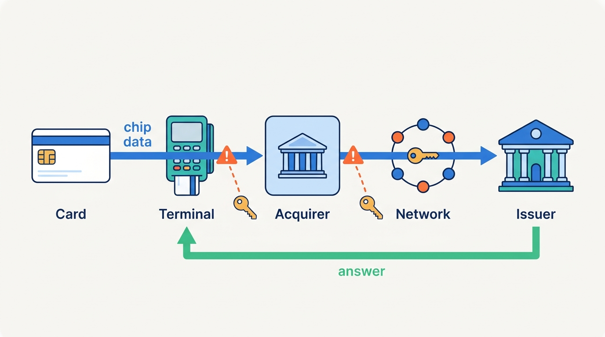
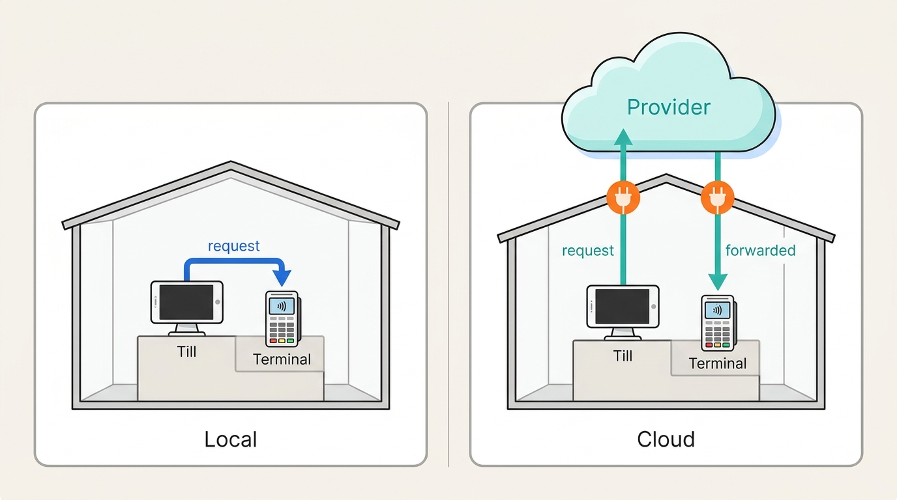
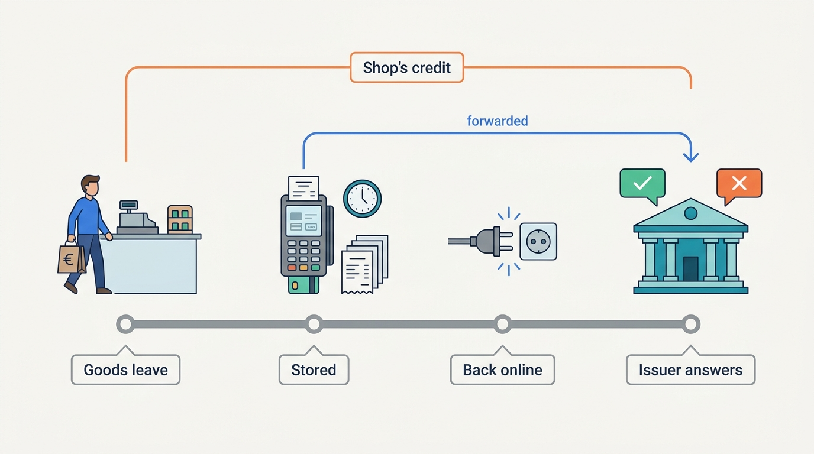
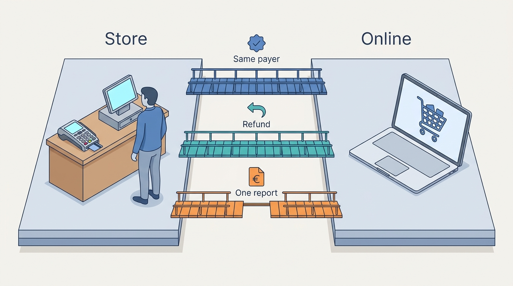

> **IN THIS CHAPTER, YOU WILL:** Learn what a terminal adds to a card payment, who carries the loss when it works offline, and how to test a claim that store and online payments are unified.

> **KEY POINTS:**
>
> * **A terminal is a computer in the payment path.** It holds keys and runs versioned software, and under Visa's published rules (edition of October 2026) who carries a counterfeit-fraud loss depends on the terminal reading the chip and the acquirer passing the chip data on.
> * **A payment taken offline is credit the merchant extends.** Offline, either the card approves on terms its issuer set in advance, or the terminal stores the payment and asks later. In the second case the goods leave before any bank has answered, and Stripe and Adyen both document that the loss is the merchant's.
> * **"Unified commerce" is three checks, not one.** A shared identifier for the payer, a refund that crosses channels and one settlement report are separate properties. Stripe approaches them by reusing its online payment object at the counter, Adyen by shared references on one platform.

> **[FAILURE PATTERNS THIS CHAPTER ADDRESSES](where-payment-systems-go-wrong.html):**
>
> * **The Phantom Payment** — a terminal working offline prints "approved" for a payment no issuer has seen, and the till records it as paid.
> * **The Orphaned Refund** — a refund requested at the counter for a payment made online cannot be tied to the original unless the till knows its reference.
> * **The Single Rail** — every counter depends on one provider and on the shop's internet connection, and offline acceptance does not cover the provider's own outage.

 
On a Saturday morning a studio's internet connection drops while six people queue at the front desk. The terminal on the counter still lights up when a card is tapped and still prints "approved". No bank has been asked. **Who approved those payments, and who pays if one of them is refused on Monday?**

An engineer who has integrated online payments tends to see a terminal as an input device that hands a card number to the same payment API. That picture costs money. **A terminal is a computer in the payment path.** What it reads decides who carries a fraud loss, and what it stores while offline is credit the merchant has extended. Nor does a payment it takes join the same customer's online payments unless somebody builds the join: a shared identifier for the payer, a refund path across channels and one settlement report (the provider's file of what it paid out, payment by payment).

**Where we are in the payment's journey.** Mila's class pass, the €120.00 payment this book follows, was bought in the member app on 9 March 2027, so no terminal touched it. This chapter covers the step that payment skipped: the same Visa debit card tapped at the front desk of Studio Noord, where a device stands between the card and the acquirer (the licensed institution that takes the merchant's side of a card payment, [[acquiring-and-network-connectivity]]).

The chapter starts at the front desks of Larkfield, the fictional studio-software platform this book follows, with two requests its online payment stack could not answer. It then explains what the chip adds and which liability rule depends on it, shows the terminal as a managed computer, and compares the ways software drives a terminal. Next come the two meanings of "offline" and the three checks behind "unified commerce". The chapter then compares Stripe and Adyen, works both requests through at Larkfield and lists how the counter fails. As the last chapter of Part II, it closes by setting the six layers of a "yes" side by side.

## Setting the Scene at Larkfield: Two Requests From the Front Desk

Larkfield's front desks are a device estate on one provider. Terminals stand at **2,100 studios**, all supplied by Adyen and driven by the front-desk app, a tablet app that studio staff use to check members in and sell drop-ins, passes and retail. In 2026 they took **€210 million in 3.8 million payments**, about €55 each and close to a fifth of everything members paid through Larkfield.

In February 2027 two requests reached Femke de Graaf, a month into leading payments engineering, and neither could be answered from the online stack. A studio owner in Cologne, whose Wi-Fi had failed during a Saturday class change, wanted the terminal to keep working next time. And a member at one of the **1,140 studios** that are on Stripe for online payments and on Adyen terminals at the front desk wanted a pass she had bought in the app refunded at the counter, where the front-desk app could not see the payment. The first request is about the device and its connection, the second about joining two channels.

## What the Chip Adds, and Who Pays When It Is Not Read

A **card-present** payment is one where a terminal reads the physical card, or a phone standing in for it. The oldest way of reading a card is the magnetic stripe, and its weakness is simple: the stripe holds the same data on every swipe, so whoever copies it onto a blank card has a second card a terminal cannot tell from the first: a counterfeit card.

**EMV**, named after Europay, Mastercard and Visa, is the chip-card standard that answers this. EMVCo, the body that publishes it, describes the mechanism (n.d., accessed November 2026): "EMV Chip technology uses advanced cryptography to generate a one-time security code (cryptogram) for each transaction that allows the card issuer and merchant point-of-sale terminal to authenticate the card. The security code is unique to each transaction and cannot be reused". (The issuer is the bank that issued the card to the cardholder.) The chip does this whether the card is inserted (contact) or held near the reader (contactless, which is also how a phone wallet pays). EMVCo's statistics, measured on card-present transactions over the twelve months to the fourth quarter of 2025, put chip at "97% of card-based transactions" worldwide. EMVCo also says that it "does not mandate or enforce EMV compliance": the standard and the rules that give it consequences have different owners.

A cryptogram helps only if it reaches the party that can check it, the issuer. So the card-present flow is the authorization of [[payment-authorization]], the issuer's yes or no to a payment request, with one added load. The terminal reads the chip, and the chip data travels inside the authorization request through the provider and its acquirer, across the card network (Visa or Mastercard, for example), to the issuer, which verifies the cryptogram before it answers. The figure below shows the two places where that data can be lost.

**Figure 1:** *The chip's one-time code protects a payment only if it reaches the issuer; it can be lost at a terminal that does not read the chip or at an acquirer that does not pass it on.*

The networks attach money to that path through the **EMV liability shift**. A liability shift is a network rule that moves a fraud loss from one side of a payment to the other depending on whether a named security step was taken; online, the step is 3-D Secure, the card networks' protocol for authenticating the cardholder ([[three-d-secure-and-sca]]). It works through disputes ([[refunds-reversals-and-disputes]]) and is not a law. In Visa's public rules (edition of 24 October 2026), an issuer may dispute under "Dispute Condition 10.1: EMV Liability Shift Counterfeit Fraud" when the transaction "was completed with a Counterfeit Card in a Card-Present Environment", "The Cardholder denies authorization", "The Card is a Chip Card", and one of three things is true: "The Transaction did not take place at a Chip-Reading Device", or it "was Chip-initiated and, if the Transaction was authorized Online, the Acquirer did not transmit the Full-Chip Data to Visa in the Authorization Request", or it "was approved offline, and the Acquirer did not transmit the Full-Chip Data to Visa in the Clearing Record". Which transactions take part varies by Visa region (Table 11-1 of the same rules).

Read as an engineer, the rule makes liability **a property of data in transit**. When a counterfeit copy of a chip card is used, the loss falls on the side that did not do its part for the chip, and the acquirer passes its share to the merchant by contract. But two of the three conditions are about what the acquirer transmits, in the authorization request or, for a payment approved offline, in the clearing record that later claims the money ([[clearing-and-settlement]]). A certified terminal behind a provider that drops the chip data protects nobody. One limit: Mastercard's public rules could not be read for this chapter (the file returned an access error), so this is Visa's text, and Mastercard's equivalent rule is industry knowledge I have not verified.

## A Terminal Is a Managed Computer

A payment terminal is a certified computer with an expiry date. Its hardware is approved under PCI PTS, the PIN Transaction Security standard of the Payment Card Industry (PCI) Security Standards Council, which sets, in the council's words (n.d., accessed November 2026), "security requirements for the characteristics and management of devices used to protect cardholder PINs (personal identification numbers)". The approval is tied to a version of that standard. Adyen's terminal catalog (n.d., accessed November 2026) labels each model "PCI PTS 5" or "PCI PTS 6" and states that "PCI PTS 5 payment terminals will no longer be available for order starting April 30, 2026". The software is the provider's to change: Adyen's documentation (2023) says its terminals "can be centrally managed, and will automatically update themselves with the latest Adyen software", and Stripe's page for its S700 reader (n.d., accessed November 2026) says "The reader restarts every day at midnight for PCI compliance". A device that reboots itself nightly and ages out of a certification is not a peripheral.

The card data inside it is encrypted before the merchant's software can see it, and here the two providers have the same structure. Each encrypts by default with its own end-to-end encryption (E2EE) and offers, as an option, a solution validated against PCI's **point-to-point encryption (P2PE)** standard, which protects card data "from the point where a merchant accepts the payment card to the secure point of decryption" (PCI Security Standards Council, n.d.). The choice decides which self-assessment questionnaire (SAQ), the form in which a merchant states its compliance with the PCI Data Security Standard, the merchant completes. Adyen (2025) says its default needs only "the SAQ B-IP", with the caveat that E2EE "does not have the PCI P2PE-validated “stamp”"; Stripe (n.d., accessed November 2026) says "Stripe P2PE is an optional, paid feature" and that Terminal-only merchants "can validate using SAQ C". [[tokenization-vaulting-and-pci]] explains scope and questionnaires.

Tap to pay on a phone removes the terminal hardware and keeps everything else. Apple's developer page (n.d., accessed November 2026) says an app must "integrate with a supported payment service provider (PSP) who processes the payments read by Tap to Pay on iPhone and provides the certified terminal configurations that are loaded on the merchant's device". The phone replaces the device, not the acquirer or the certification. A separate PCI standard, Mobile Payments on COTS (MPoC; COTS is commercial off-the-shelf, an ordinary phone), covers such software, and a provider's certification need not cover every feature: Adyen (May 2026) says store-and-forward in its Mobile SDK for Android is in limited availability "because it is not yet PCI MPoC certified".

What the two companies publish about running the estate is uneven, and it stops short of the part an engineer would most like to read. Adyen documents how it stages software: its page on terminal releases (n.d., accessed November 2026) says new versions come "every four weeks", that "We roll out releases gradually and monitor the performance", and that a merchant who updates manually can do so in batches. Stripe documents the mechanics of updates and no rollout policy: its smart readers "receive updates automatically from Stripe when not in use", at midnight in the location's time zone, and for mobile readers the date at which an optional update becomes required "can vary across devices in the fleet" (documentation, n.d., accessed November 2026). Neither company describes how payment keys are loaded into terminals and rotated, or how often terminals fail (documentation, support sites and product pages searched, November 2026; neither company's P2PE instruction manual was read). A Stripe guide article says only that Stripe handles key injection and decryption for its readers. Both expose device management, Adyen through its Management API (n.d., accessed November 2026) and Stripe through "Dashboard tools for ordering and managing readers". My recommendation follows from the gap: whoever deploys the devices keeps a record per device and site (model, certification version, software version, last contact), because nobody else will say which counter is about to stop.

## Driving the Terminal: Local or Cloud, SDK or Server

The point-of-sale software (POS, the merchant's till) knows the amount, and the terminal knows the card. Every counter payment therefore needs a control channel between the two that carries amounts and results and never card numbers. There are two places to put it: the store's own network, or the provider's cloud. What the channel must guarantee is the same in both; the targets below are mine, not a provider's.

| Requirement | Target | Why |
| --- | --- | --- |
| How consistent | One request, one payment | The till will time out and retry |
| How available | As available as the till, no more | A terminal that works while the till cannot sell is of little use |
| On failure | The till can ask what happened to its last request | The till may not know what the terminal knows |

Adyen's Terminal API takes its shape from the retail industry, not from Adyen's online API. Its documentation (n.d., accessed November 2026) says "Our Terminal API is based on the nexo Retailer Protocol", a card-payment industry specification for messages between a till and a terminal. Even duplicate protection is the protocol's: each request carries a `ServiceID` that "Must be unique within the last 48 hours for the terminal". The API runs in two architectures. With **local communications**, "you make an API request directly to the IP address of the terminal", and "you need to add Adyen's certificate to your POS app, and encrypt your messages". With **cloud communications**, "you send your Terminal API requests to an endpoint on the Adyen payments platform. This request is forwarded to the terminal". Adyen's summary: cloud "is easier to implement but does not support all use cases", and local "can be more robust but requires an additional effort".

Stripe offers the same two places under other names, and starts from the opposite end. In an **SDK integration** the Terminal SDK runs inside the POS app and talks to the reader. In a **server-driven integration**, Stripe's documentation (n.d., accessed November 2026) says, the merchant's back end calls the Stripe API, which "Receives requests and forwards them to a smart reader"; the same page says "Server-driven integration doesn’t support" collecting card payments while offline. In both shapes the counter payment is a PaymentIntent, the object that represents an online payment ([[payment-state-machines]]). Adyen adopted the protocol tills already speak; Stripe extended its online object model to the counter.

Set side by side, the four shapes pair up. The two that stay inside the store keep working when the internet connection drops and cost the merchant network work; the two that go through the provider's cloud are simpler and stop with the connection.

| Shape | Path of the request | Merchant's extra work | When the internet drops |
| --- | --- | --- | --- |
| Adyen, local | Till to terminal over the store network | Fixed terminal address, certificate, message encryption | Can accept offline payments, if enabled |
| Stripe, SDK | POS app to reader through the SDK | SDK in the app | Can store payments, if enabled |
| Adyen, cloud | Till to Adyen to terminal | Platform credentials | Offline "not very useful", in Adyen's words |
| Stripe, server-driven | Back end to Stripe API to reader | API calls only | Offline card payments not supported |

**Figure 2:** *A till reaches its terminal either inside the shop or through the provider's cloud; the cloud path is simpler to build and stops when the shop's internet link does.*

The rule I use: take the cloud path for many small sites whose networks nobody manages, and the in-store path where a shop must keep selling through an outage. The in-store path needs a reserved address per terminal, a certificate in the till software and someone who can debug a shop's router; across thousands of small sites, that work is the cost. The cloud path needs none of it and fails when the shop's link fails. The rule flips when the till itself works offline, or when lost sales in an outage cost more than running the networks.

## Two Meanings of Offline, and Who Carries the Loss

"Offline" names two mechanisms, and Adyen's documentation (n.d., accessed November 2026) separates them cleanly. The first is **offline EMV**: "the payment terminal verifies that the PIN entered by the shopper matches the PIN on the EMV chip embedded in the card, and then asks the card to approve the payment. Whether the transaction is approved, depends on how the issuer configured the card." An issuer's decision exists; it was made in advance and is carried on the chip. Its reach is narrow: "Most debit cards do not support this type of payment."

The second is **store-and-forward**, and it is a different thing: "the payment terminal or Mobile SDK approves payments without any verification", stores them, and sends them for authorization when the connection returns. The goods have left before any issuer has answered. I call that **credit extended by the merchant**, and both providers say whose loss it is. Adyen: "You are fully liable for the risk of failed captures, chargebacks, and disputes related to payments that you process offline." (A chargeback is a payment taken back through the issuer after the cardholder disputes it.) Stripe, which documents store-and-forward only: "You, as the user, assume all decline and tamper-related risks associated with an offline transaction". Adyen puts the later authorization rate at "95% in some industries to several percentage points higher", a vendor's statement with no published method.

**Figure 3:** *In store-and-forward the goods leave first and the issuer answers last; for the time in between, the only party that has promised anything is the shop.*

Because the exposure is the merchant's, its size is set by limits, and the two providers put the limits in different hands. Adyen has the merchant choose them: a floor limit (the largest amount a terminal may approve offline), a "Store-and-forward max. amount" and a "Max. payments" count per terminal, and "you need to set a transaction floor limit before your integration can make offline payments". Stripe sets one ceiling itself, "the Stripe-enforced offline maximum of 10,000 USD or equivalent in your operating currency", and lets the integration add stricter limits. Its entry rules are tighter by default: in the European Economic Area "customers are required to insert their card and enter a PIN".

Store-and-forward covers the shop's connection failing and little else. Adyen states that "Store-and-forward offline payments do not work in the event of an outage of the Adyen payments platform", and that with cloud communications "it is not very useful to enable offline payments". Stripe makes offline a state that has to be prepared while online: for a smart reader "you must have previously connected to the same reader using a valid connection token within the last 24 hours, on the same local network", and a reader whose "software hasn’t been updated in 30 days or more" must go online first.

> **INFERENCE, NOT DOCUMENTED:** Adyen's page does not say why its terminals refuse store-and-forward during a platform outage. A plausible reason is that the terminal can tell a failed shop link from an unreachable platform and treats only the first as the case the merchant accepted risk for.

A stored payment then has a second life after the outage. At Adyen the offline response "misses the PSP reference. Only contains the tender reference": the PSP reference is the identifier Adyen's platform gives every payment and the tender reference is the one the terminal generates, so for a while the till holds a payment the platform has never numbered. Once forwarded it can be declined, and with Auto Rescue, a retry feature the merchant asks Adyen to enable, "failed store-and-forward payments that are eligible will be automatically retried for one calendar month". At Stripe "the SDK or smart reader automatically forwards any stored payments", and the outcome returns as an event after the sale is closed. Either way the result arrives late and needs its own path into the merchant's records ([[payment-reconciliation-and-reporting]]).

## Unified Commerce Is Three Separate Checks

So much for one counter payment. The chapter's second question is what it takes to treat that payment and an online payment as one, which providers sell as "unified commerce" or "omnichannel". Adyen's documentation (n.d., accessed November 2026) says "With Adyen's single payments platform you have a unified view on all your customers". Stripe's (n.d., accessed November 2026) offers to "Manage online and in-person payments in a single Stripe account". Neither says what exactly is unified. In data terms I count three properties, and my judgement, which is not a documented finding about either company, is that they are separable and must be verified one by one.

The first check is **a shared identifier for the payer**: can you tell that the card tapped at the counter is the card stored online? Adyen returns a card alias in a terminal response (n.d., accessed November 2026): "You can use this to identify the shopper based on their card, but not to make payments". Charging takes a different thing, a token (the provider's stand-in for a stored card): "If you tokenize the shopper's payment details when they make a payment at the point of sale, you can use that token in a later online payment". Stripe documents a `fingerprint` that "uniquely identifies a particular card number" on online and in-person card records alike, with an exception that matters at any counter: "Cards from mobile wallets (for example, Apple Pay or Google Pay) don’t share a fingerprint with cards used online." And a card read in person is not itself reusable; "in most cases, Stripe can create a reusable `generated_card` PaymentMethod". At both, recognizing a card and charging it are different objects, and at Adyen too a wallet needs its own identifier.

The second check is **a refund that crosses channels**. Adyen's terminal refunds come in two kinds: referenced, tied to the original payment by its identifier, and unreferenced, which sends any amount to any card presented. Its comparison table (n.d., accessed November 2026) has a row for this case, "Omnichannel refunds", which reads "Supported, using the PSP reference" for referenced refunds and "Not supported" for unreferenced ones. At Stripe the terminal takes almost no part in refunds. A refund is a server call "passing in the PaymentIntent ID or the charge ID", made through the same Refunds API as for an online payment; a method that creates the same refund from the iOS or Android SDK, without the card, was in private preview as of November 2026. And "In-person refunds are only available on Interac", a Canadian debit network. Both paths work only if the till can find the original payment's reference.

The third check is **one settlement report covering both channels**, and here the documentation I read gives general statements and no field-level proof. Adyen says "The PSP reference and tender reference can be found in your Customer Area, and in reports generated by Adyen"; Stripe recommends "reconciling payments on your back end after a day’s activity". Neither page shows a combined report. This is the check to run on real files, and one case deserves its own test: a store-and-forward payment enters the provider's records after the sale, so a report can cover both channels and still disagree with the till's day.

Each check has its own test and its own way of failing, which is why passing one says nothing about the others.

| Check | Test to run | Sign that it fails |
| --- | --- | --- |
| Shared payer identifier | Pay online with a card, then at the counter with the same card, then with that card in a phone wallet; compare identifiers | The wallet payment does not match; or the identifier matches but cannot be charged |
| Cross-channel refund | Buy online; refund at the counter to the original card without presenting it | The refund needs the card, or goes out unreferenced |
| One settlement report | Find one online, one counter and one stored offline payment in one report, with fees and store | Counter payments in another file; the stored payment missing from its day |

**Figure 4:** *A store payment and an online payment are joined by three separate links, and a provider can deliver two of them while the third is missing.*

## Stripe and Adyen: Where They Differ

The two companies publish very different amounts about their in-person business. Adyen announced "its first in-house designed terminals" on 18 August 2022 (**evidence age: 4 years**), and it reports the channel: its Annual Report 2025 gives "point-of-sale volumes" of "€310.9 billion, comprising 22% of total processed volume, up from 18% in 2024", and its third-quarter 2026 update says "The number of transacting terminals across the platform reached 878k". These are company-reported volumes, not revenue, and "transacting" is not defined. Stripe announced Terminal on 17 September 2018 as "a programmable point of sale for in-person payments" (**evidence age: 8 years**); I found no Terminal volume, reader count or in-person share in what it publishes. The two cannot be ranked on this.

On seven aspects the public record shows a consistent difference. The Stripe and Adyen columns repeat facts cited above; Stripe's documentation is undated (n.d.) and was accessed in November 2026. The last column is my reading, an inference from those facts.

| Aspect | Stripe | Adyen | What the difference suggests |
| --- | --- | --- | --- |
| How software drives the device | Terminal SDK in the POS app, or server-driven through the Stripe API (n.d.) | Terminal API "based on the nexo Retailer Protocol", local or cloud (2023) | Adyen adopted a protocol tills already speak; Stripe extended its own API to the counter |
| The payment record | A PaymentIntent, as online (n.d.) | A terminal transaction with a tender reference and a PSP reference (2023) | Stripe unifies by reusing an object; Adyen by shared references |
| Recognizing a card across channels | `fingerprint`, not shared by wallets; `generated_card` for reuse (n.d.) | Card alias, "not to make payments"; a separate value for wallets; a token for charging (2023, 2026) | No material difference in the public record |
| Offline acceptance | Store-and-forward only; Stripe-enforced maximum of 10,000 USD; not in server-driven integrations (n.d.) | Offline EMV and store-and-forward; merchant-set limits; in a Terminal API integration, local communications only (2026) | Adyen exposes more of the card-present toolkit; Stripe offers one safer default |
| Refund across channels | Refund through the Refunds API; refund from the SDK in private preview; in-person refunds "only available on Interac" (n.d.) | Referenced refund at the terminal; omnichannel refunds "Supported, using the PSP reference" (2026) | Stripe's refund is an API matter; Adyen's can be a counter operation |
| Encryption and scope | E2EE by default; P2PE "an optional, paid feature" (n.d.) | E2EE by default with SAQ B-IP; validated P2PE as an opt-in (2025) | No material difference in the public record |
| Published scale | Not public | €310.9 billion in 2025, 22% of processed volume; 878k transacting terminals (Q3 2026) | In-person is a reported line of business for Adyen only |

An integrator on Stripe should design around the PaymentIntent and decide early whether offline acceptance is needed, because that rules out the server-driven shape. An integrator on Adyen should choose local or cloud first, then own what the platform leaves to the merchant: the offline limits, both references in the till's records, and the certificate work of the local path. On both, terminal key management and failure rates are not public; a gradual rollout of fleet software is documented by Adyen, while Stripe documents automatic updates and their timing without a rollout policy.

## In Practice at Larkfield: One Estate, No Offline, Three Checks

Larkfield put every terminal on Adyen in 2024, and the reason was the estate more than the price. For a platform with thousands of small sites, what in-person payments cost to run is one device range to stock and replace, one certification path and one adapter in the front-desk app. Two terminal providers would have meant two of each, for a channel that earns Larkfield **1.4% + €0.10** per payment.

To the studio owner in Cologne, Femke's answer was no. The front-desk app drives the terminals through Adyen's Terminal API with cloud communications, chosen in 2024 because Larkfield manages no studio's network, and on that shape offline acceptance is not practical. The local path would not have helped either: the front-desk app cannot sell a pass without reaching the booking app, so a stored payment would have nothing to be sold against. Offline payment is only as useful as the till's own offline mode. Femke still sized what was being declined: a store-and-forward maximum of €120 (one ten-class pass) and 25 stored payments per terminal *(assumption)* would cap the exposure at 25 × €120 = **€3,000 per terminal per outage**. That is a credit limit, and it needs an owner before it needs a configuration screen.

The member's refund led to the three checks, and at the 1,140 split studios none passes at the provider level. A Stripe fingerprint and an Adyen card alias are two unrelated values for one card, an Adyen terminal has no reference for a pass bought through Stripe, and the two channels settle in two providers' reports. So Larkfield supplies each property itself. The shared identifier is its own member id, attached to both payments. The refund requested at the counter becomes a call from the front-desk app to the payment service, which creates the refund at Stripe against the original payment, with no card presented and no terminal involved. And the reconciliation job, extended to both providers under decision K3 of Keel, Larkfield's 2027 program for its payments estate, is where a studio's counter and online payments meet.

At Studio Noord, where both channels are on Adyen, the same request could be served at the terminal, and Mila's refund shows what that takes. On 18 March 2027 she asks for **€84.00** back, the seven unused classes of the €120.00 pass she bought in the app on 9 March. Had she asked at the front desk, the app could send a referenced refund through the terminal, but only with what Adyen's documentation (2025) asks for: "the PSP reference, the date, and the currency of the original payment". All three come from Larkfield's payment record store, not from the terminal. Even on one provider, the cross-channel refund is a lookup in the platform's own record before it is a provider feature. ([[journey-platform-payment]] follows the money side of this refund.)

## When It Goes Wrong

**The outcome is unknown at the till.** The till loses contact with the terminal after the card was presented, and the customer may or may not have been charged. Starting the payment again is how a customer is charged twice at a counter. Adyen's instruction, given for its mobile SDK, is "check the transaction status before you start the transaction again"; Stripe recommends "reconciling payments on your back end after a day’s activity to prevent unintended authorizations and uncollected funds". [[idempotency-and-retries]] gives the general rule.

**A stored payment is declined after the customer has left.** This is the Phantom Payment at the counter: the till said paid, and the issuer later says no. Detection is the forwarding event or webhook and, behind it, the settlement report; recovery is the provider's retry and then a loss that someone must book. If nobody owns the write-off, an outage's stored payments stay "paid" in the till forever.

**A device drifts out of service.** Terminals stop quietly: a certification version can no longer be ordered (Adyen's PCI PTS 5 models after 30 April 2026), a reader that has not been online recently cannot work offline (Stripe's 30-day rule), a unit moves between sites and reports under the wrong store. Each is visible in a device inventory with a last-seen date and a software version, and invisible without one.

**The provider is down.** An estate on one provider has no second rail at the counter, and store-and-forward is not one: by Adyen's own sentence it does "not work in the event of an outage of the Adyen payments platform". Larkfield accepts this risk knowingly. Its rehearsed switch, Keel's decision K8, moves a studio's online card payments to the other provider; the front desk stays on Adyen, and during an Adyen outage studios take cash or send members to the app ([[payment-reliability-and-availability]]).

## What to Take Away

**Established.**

- The chip produces a one-time cryptogram per transaction, and the card networks, not the standard body, attach consequences to it (EMVCo).
- Under Visa's rules (edition of 24 October 2026), an issuer can push a counterfeit-fraud loss to the acquirer when the transaction did not take place at a chip-reading device or the acquirer did not transmit the full chip data. Mastercard's rules were not verified here.
- "Offline" is two mechanisms: approval by the card on its issuer's preset terms, and store-and-forward, for which Stripe and Adyen both document that the merchant carries declines and disputes.

**Depends on context.**

- **Local or cloud.** The cloud path fits many small sites with unmanaged networks; the in-store path fits a shop that must sell through an outage and can run its own network.
- **Whether to accept offline.** Worth it where goods are cheap, customers are regulars and an outage empties the shop; not where the till cannot record the sale anyway.
- **One provider or two across channels.** One provider makes the three unified-commerce properties available; it does not deliver them.

**The author's synthesis.**

- Treat a terminal rollout as taking on **a device estate and a credit line**: an inventory with versions and last contact, offline limits with a named owner, and a reconciliation path for stored payments. At the counter the merchant's side holds state and risk that online it had handed to the provider.
- Treat "unified" as **three tests**, run separately, with a phone wallet in the test set, because the documented exceptions sit exactly there.

**The six layers, side by side.** The terminal is the last of six layers that Part II has put around the issuer's decision, and no single chapter has set them next to each other. Each has a different owner, so an approval rate describes the whole stack: it belongs to a provider, a country and a method together, and cannot be carried from one setup to another.

| Layer of a "yes" | Who decides it | What it decides | Chapter |
| --- | --- | --- | --- |
| Acquirer and license | The license holder | How the payment arrives at the issuer | [[acquiring-and-network-connectivity]] |
| Payment method | The method's scheme | What the answer promises | [[local-payment-methods]] |
| State model | The provider | How the wait is shown | [[payment-state-machines]] |
| Optimization inside the call | The provider | How many attempts sit behind one call | [[authorization-optimization]] |
| Choice of providers | The merchant | How many stacks there are | [[payment-routing-and-orchestration]] |
| Device | The merchant, with the provider | What data the issuer gets at the counter | This chapter |

That is why Larkfield's K8 keeps two providers and one rehearsed switch and adds no orchestration product: at its volume the gain is in knowing each stack, and a routing layer would unify the request while leaving two sets of disputes, settlements and stored cards. The 1,140 studios charged through Stripe online and through Adyen at the front desk are one card meeting two stacks, and the terminal on the counter is the last layer of one of them. As for the queue on that Saturday morning: nobody had approved those payments yet, and the studio was the lender. What to write down, for each provider and country, is short: the acquiring entity, each payment method with the date its payments become final, the provider states your own record mirrors, the approval metric with its denominator, and the date the switch was last rehearsed. For the counter, add the device inventory, the offline limits with their owner, and the three tests.

## Questions to Ask

1. Does our provider confirm that full chip data is sent in authorization and clearing for every terminal we deploy?
2. Who holds the inventory of our terminals, with versions and last contact, and who acts when a certification version ends?
3. What happens at the counter when the shop's internet connection drops? When the provider's platform is down?
4. If we accept offline payments, is it approval by the card or store-and-forward, and who signed off the limits as a credit decision?
5. Where do the outcomes of forwarded payments arrive, and who books a stored payment that is finally declined?
6. Can we recognize the same card online and at the counter, including from a phone wallet, and can we charge the identifier or only match it?
7. Can a payment made online be refunded at the counter to the original card without the card? Where does the till get the reference?
8. Do counter, online and stored offline payments appear in one settlement report, on the day we expect them?
9. What does the till do when it does not know whether the terminal completed a payment?

An approved payment, whichever stack produced it, is not yet money in anyone's account. It creates debts between issuer, network, provider and merchant that are paid over days, and the payment's state, however carefully modeled, does not say who owes whom. That takes a second record and a way to prove it, which is where [[part-3]] begins.

## Sources and Evidence

*Company, product and investor sources*

- [Offline payments](https://docs.adyen.com/point-of-sale/offline-payment), Adyen documentation, n.d., accessed 2026-11 — offline EMV and store-and-forward, liability, limits, the platform-outage and cloud limitations, tender reference, automatic retries, checking transaction status.
- [Choose an integration architecture](https://docs.adyen.com/point-of-sale/design-your-integration/choose-your-architecture), Adyen documentation, n.d., accessed 2026-11 — local and cloud communications and Adyen's summary of the trade.
- [Terminal API](https://docs.adyen.com/point-of-sale/design-your-integration/terminal-api), Adyen documentation, n.d., accessed 2026-11 — nexo Retailer Protocol, `ServiceID`, tender and PSP references in reports.
- [Refund a payment](https://docs.adyen.com/point-of-sale/basic-tapi-integration/refund-payment), Adyen documentation, n.d., accessed 2026-11 — referenced and unreferenced refunds, the "Omnichannel refunds" row.
- [Referenced refund](https://docs.adyen.com/point-of-sale/basic-tapi-integration/refund-payment/referenced), Adyen documentation, n.d., accessed 2026-11 — what refunding an ecommerce payment at a terminal needs.
- [Card acquisition](https://docs.adyen.com/point-of-sale/card-acquisition), Adyen documentation, n.d., accessed 2026-11 — card alias and `PaymentAccountReference`.
- [Tokenization (point of sale)](https://docs.adyen.com/point-of-sale/recurring-payments), Adyen documentation, n.d., accessed 2026-11 — a point-of-sale token used in a later online payment.
- [Adyen's E2EE and P2PE PCI security](https://docs.adyen.com/development-resources/e2ee-p2pe-comparison), Adyen documentation, n.d., accessed 2026-11 — default encryption, the P2PE option and their questionnaires.
- [Terminals](https://docs.adyen.com/point-of-sale/what-we-support/select-your-terminals), Adyen documentation, n.d., accessed 2026-11 — PCI PTS versions per model and the end of PTS 5 orders.
- [In-person payments](https://docs.adyen.com/point-of-sale), Adyen documentation, n.d., accessed 2026-11 — centrally managed, self-updating terminals.
- [Automate the management of your terminals](https://docs.adyen.com/point-of-sale/automating-terminal-management), Adyen documentation, n.d., accessed 2026-11 — device management through the Management API.
- [Update to a new release](https://docs.adyen.com/point-of-sale/release-updating), Adyen documentation, n.d., accessed 2026-11 — four-weekly terminal software releases, gradual automatic rollout, manual updating in batches.
- [Omnichannel](https://docs.adyen.com/unified-commerce), Adyen documentation, n.d., accessed 2026-11 — the Unified Commerce claim.
- [Adyen advances in-person payments with the launch of in-house designed terminal range](https://www.adyen.com/press-and-media/adyen-advances-in-person-payments-with-the-launch-of-in-house-designed-terminal-range), Adyen, 2022-08-18 — first in-house designed terminals (evidence age: 4 years).
- [Annual Report 2025](https://investors.adyen.com/financials/2025), Adyen, signed 2026-03-05 — point-of-sale volume of €310.9 billion, 22% of processed volume.
- [Q3 2026 Business Update](https://investors.adyen.com/financials/q3-2026-10c88s), Adyen, 2026-10-28 — 878k transacting terminals.
- [Accept offline payments](https://docs.stripe.com/terminal/features/operate-offline/overview), Stripe documentation, n.d., accessed 2026-11 — store-and-forward, supported networks and readers, entry rules, forwarding flow.
- [Collect card payments while offline](https://docs.stripe.com/terminal/features/operate-offline/collect-card-payments), Stripe documentation (smart readers, iOS variant), n.d., accessed 2026-11 — risk statement, the 10,000 USD maximum, the 24-hour and 30-day conditions, stricter limits set by the integration.
- [Set up your integration](https://docs.stripe.com/terminal/payments/setup-integration), Stripe documentation (server-driven variant), n.d., accessed 2026-11 — SDK and server-driven integrations and what server-driven does not support.
- [Collect and save payment details for future use](https://docs.stripe.com/terminal/features/saving-payment-details/overview), Stripe documentation, n.d., accessed 2026-11 — `generated_card` and card fingerprints across channels.
- [Refund transactions](https://docs.stripe.com/terminal/features/refunds), Stripe documentation (server-driven variant), n.d., accessed 2026-11 — refunds by API, the SDK refund in private preview, in-person refunds on Interac only, the reconciliation recommendation.
- [How Terminal works](https://docs.stripe.com/terminal/overview), Stripe documentation, n.d., accessed 2026-11 — default encryption, the P2PE option, single account, reader management in the Dashboard.
- [Stripe Reader S700/S710](https://docs.stripe.com/terminal/readers/stripe-reader-s700-s710), Stripe documentation, n.d., accessed 2026-11 — the daily restart, automatic software updates.
- [Stripe Terminal smart readers](https://docs.stripe.com/terminal/smart-readers) and [Connect to a reader](https://docs.stripe.com/terminal/payments/connect-reader), Stripe documentation, n.d., accessed 2026-11 — automatic updates at midnight local time; optional and required updates for mobile readers, whose required date "can vary across devices in the fleet".
- [Point-to-point encryption (P2PE) and PCI compliance](https://stripe.com/resources/more/point-to-point-encryption-p2pe), Stripe guide article, n.d., accessed 2026-11 — Stripe handles key injection and decryption for Terminal readers (read in a translated edition; paraphrased, vendor article).
- [What is PCI DSS compliance?](https://stripe.com/guides/pci-compliance), Stripe guide, n.d., accessed 2026-11 — SAQ C for Terminal-only merchants.
- [Stripe announces Stripe Terminal, a programmable point of sale for in-person payments](https://stripe.com/newsroom/news/stripe-launches-terminal), Stripe newsroom, 2018-09-17 — launch date and description (evidence age: 8 years).
- [Tap to Pay on iPhone](https://developer.apple.com/tap-to-pay/), Apple, n.d., accessed 2026-11 — the payment service provider's role and certifications.

*Standards, regulation and official documentation*

- [Visa Core Rules and Visa Product and Service Rules](https://usa.visa.com/dam/VCOM/download/about-visa/visa-rules-public.pdf), Visa, edition of 2026-10-24 — EMV liability shift participation (Table 11-1) and Dispute Condition 10.1 (Table 11-9, entry last updated October 2023).
- [EMV Contact Chip](https://www.emvco.com/emv-technologies/emv-contact-chip/), EMVCo, n.d., accessed 2026-11 — the one-time cryptogram.
- [Overview of EMVCo](https://www.emvco.com/about-us/overview-of-emvco/), EMVCo, n.d., accessed 2026-11 — EMVCo does not mandate or enforce.
- [Worldwide EMV deployment statistics](https://www.emvco.com/about-us/worldwide-emv-deployment-statistics/), EMVCo, n.d., accessed 2026-11 — the 97% chip share, data as of Q4 2025, measured on card-present transactions.
- [Point-to-Point Encryption (P2PE)](https://www.pcisecuritystandards.org/standards/point-to-point-encryption-p2pe/), PCI Security Standards Council, n.d., accessed 2026-11 — definition of P2PE.
- [PTS Point of Interaction (POI)](https://www.pcisecuritystandards.org/standards/pts-point-of-interaction-poi/), PCI Security Standards Council, n.d., accessed 2026-11 — what the PIN Transaction Security standard covers.
- [Mobile Payments on COTS (MPoC)](https://www.pcisecuritystandards.org/standards/mobile-payments-on-cots-mpoc/), PCI Security Standards Council, n.d., accessed 2026-11 — the standard for acceptance on ordinary devices.

*Research and practitioner sources*

- [[commerce-payments]] in ORDERED — store payments from the merchant's order system; [[payments-fundamentals]] in RECONCILED — the parties and channels from the finance side.

Larkfield is fictional; architectural recommendations, labeled inferences and labeled assumptions are the author's judgement.
