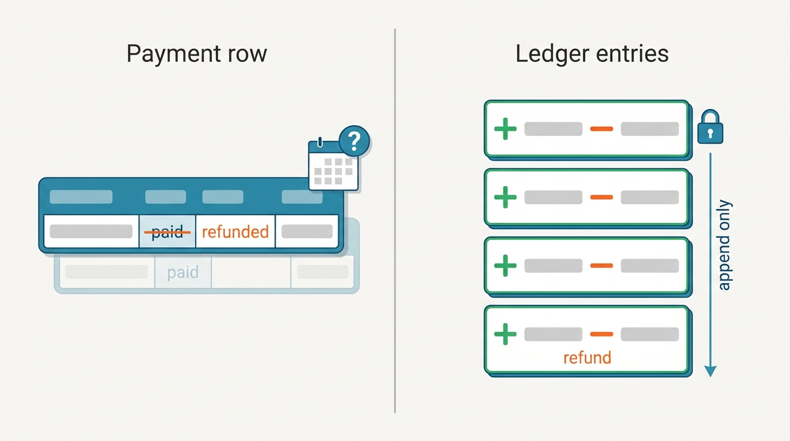
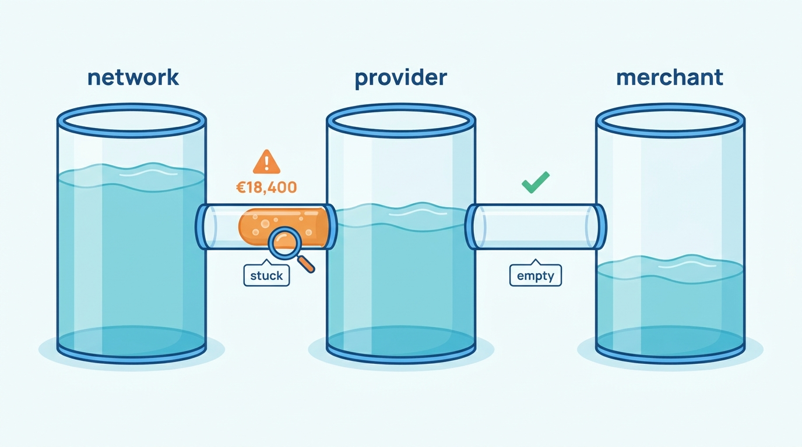
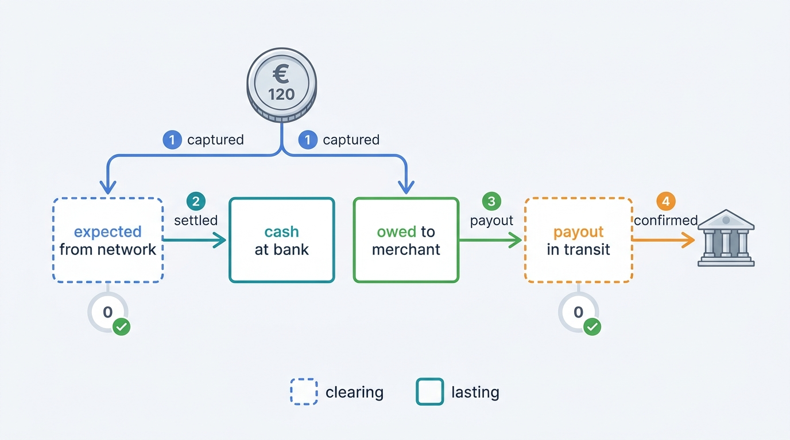
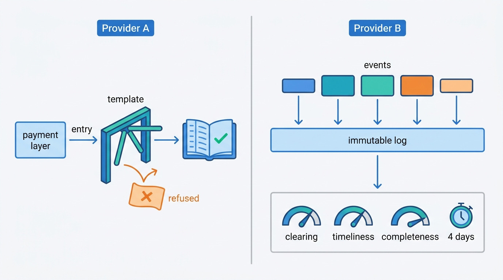

> **IN THIS CHAPTER, YOU WILL:** Learn how a double-entry ledger makes missing money visible, how Stripe and Adyen say they enforce it, and which parts of their designs to copy.

> **KEY POINTS:**
>
> * **The payment table is not the book.** A payment row holds one payment's current state and is overwritten. A payment company knows whose money it holds from a separate, append-only double-entry ledger, in which every amount in flight sits in a clearing account that must return to zero, so a missing movement shows up as a balance that will not clear.
> * **The rule is enforced at the write or proven afterwards.** Adyen's 2021 engineering post, now five years old, says records enter its books only through templates proven to net to zero. Stripe's 2024 post describes many systems publishing into an immutable log that is checked afterwards, with 99.99% of dollar volume verified within four days. Neither says how that ledger relates to the balance you read from its API.
> * **Copy the rules, not the machinery.** Larkfield's unexplained €412,000 came from three kinds of money movement that had no entry. Six accounts, one posting function and four rules would have shown each one on the day it began.

> **[FAILURE PATTERNS THIS CHAPTER ADDRESSES](where-payment-systems-go-wrong.html):**
>
> * **The Black-Box Balance** — a figure computed as a sum over payments cannot be broken down into the refunds, fees and amounts owed back that changed it.
> * **The Orphaned Refund** — a refund after payout that only flips a status leaves no record of what the seller now owes back.
> * **The Borrowed Blueprint** — sharded accounting clusters and a log of five billion events a day answer volumes a platform does not have; only the rules transfer.

 
At the end of 2025, every payment in the payment record store of Larkfield, the fictional studio-software platform this book follows, had the right status. Yet Larkfield's books said it owed its studios **€412,000 more** than the balances at its two providers, Stripe and Adyen, showed. It took three weeks to find out why.

That difference could not be found in the payments because it was never in them. **A payment company does not know whose money it holds from its payment database.** It knows it from a separate record: an append-only double-entry ledger, in which every movement of money is written as lines that balance, and every amount that is between two parties sits in a clearing account that must return to zero. A movement that is missing or mismatched then shows up as a balance that will not clear.

But the ledger does not know it at every moment either. Its knowledge is as current as its proof, and proof is slow: Stripe's 2024 engineering post on its ledger says that "99.99% of our dollar volume is fully ingested and verified within four days". This is the book's central gap in its accounting form: the payment is answered in a second, and **who owes whom is proven days later.**

**Where we are in the payment's journey.** Mila Janssen's €120.00 class pass was approved at 19:42 on Tuesday 9 March 2027, and Studio Noord was paid on Thursday 11 March. This chapter covers the record that exists between those two moments and after them: at each step, who owes the €120 to whom.

The chapter starts with Larkfield's €412,000 and shows why a list of paid payments could not explain it. It then defines the parts of a ledger (entry, account, clearing account, fund flow) on one €120 payment. Two sections describe the two published ways to enforce the ledger's rule: refusing a bad entry at the write, as Adyen described in 2021, and letting many systems write and proving the result afterwards, as Stripe described in 2024 and 2026. The trade-offs follow, then the required comparison of Stripe and Adyen, including what neither has published. The chapter ends with Larkfield's own small ledger and the ways a ledger fails.

## Setting the Scene at Larkfield: €412,000 and a List of Paid Payments

In January 2027 Priya Raman, Larkfield's finance controller, walks the new head of payments engineering, Femke de Graaf, through the audit finding she owns. At year-end 2025 Larkfield's books put what it owed studios €412,000 higher than the providers' balances (a **balance** is the provider's running figure of what it owes an account holder; [[balances-and-funds-flows]]). Three causes account for all of it. One of them involves the **chargeback**, a card payment reversed by the cardholder's bank after a dispute ([[refunds-reversals-and-disputes]]).

| Cause | Amount | Why the books missed it |
| --- | --- | --- |
| Refunds made after the studio had been paid | €317,200 | The payment's status changed to `refunded`; nothing recorded that the studio now owed money back |
| Chargeback fees | €73,500 | 4,900 disputes at an illustrative €15.00 each; every fee was a line in a provider report, and no payment row changed |
| Currency-conversion rounding | €21,300 | Larkfield's own posting job converted and rounded each payment; the providers' reports carried different totals |
| **Total** | **€412,000** | |

What the three share is timing. Each is money that moved after the payment row was last correct. And the books of 2025, although the team called them a ledger, were written only from payment rows: a nightly job wrote one entry when a payment became `paid` and one when a **payout** (the provider's transfer of a studio's money to its bank account) was created. A refund three weeks after the payout, a fee on a dispute, a rounding difference: none of them had an entry of its own.

Femke's question to Priya is this chapter's question. Three weeks of comparing payments by hand found the money. **What must a book record so that such a difference shows up on the day it begins, without anyone comparing payments one by one?**

## Why the Payment Table Cannot Be the Book

The natural view, and the one this chapter argues against, is that the payment tables already are the record. Sum the successful payments, subtract refunds and fees, and you have each merchant's money; a ledger is a reporting layer that finance can add later. Larkfield ran on it for eight years: until 2025, what each studio was owed was a nightly query, the sum of its `paid` payments less Larkfield's fees and the payouts already sent.

But a refund made after the payout overwrites the row, and then the sum for a past date changes with nothing to record that it changed. Take the pass. On 11 March 2027 Studio Noord is paid €117.47, the €120.00 less Larkfield's fee of €2.53. On 18 March Mila asks for a refund of the seven unused classes, €84.00. Larkfield's payment vocabulary has five states, and the row moves from `paid` to `refunded`. Whether the nightly query now counts that row or drops it, it is wrong, by different amounts. Worse, the figure it produced on 11 March can no longer be reproduced, because the row it was computed from is gone.

The row also has no place for money that is between parties. Between the approval and the payout the €120 is owed by the card network to the provider and by the provider to the studio. After the refund, Studio Noord has been paid €84.00 that it now owes back. That €84 is not a property of Mila's payment. It is a claim on a studio, to be settled out of some other payment's proceeds.

Payment companies describe the same two limits in their own early systems. Square's 2019 engineering post on its ledger service says that with a single-entry settlement table, computing what a merchant should be paid "requires doing an expensive group-by aggregate for each merchant", and that "It’s impossible to split a single payment into multiple payouts". **(Evidence age: 7 years; Square's current system may differ.)** Modern Treasury, a vendor of ledger software, observes in its developer guide (2022, updated 2025) that companies usually add accounting concepts "after painful incidents involving missing funds, broken payout flows, or inconsistent balances". That is a vendor's observation, not a measurement.

Two changes fix both limits. First, money is recorded as append-only entries that balance, so a refund is a new entry and never an edit. Second, amounts in flight get accounts of their own, which must return to zero, so what a seller owes back stays visible until it is recovered.

| Question | Payment table | Ledger |
| --- | --- | --- |
| What is the state of this payment now? | Answers it | Not its job |
| What was each seller owed on a past date? | Cannot: rows were overwritten | Sum the entries up to that date |
| Where is an amount that is between two parties? | No place for it | In a clearing account |
| What does a seller owe back? | A status, at best | A balance that stays until recovered |
| How does an error show? | A total that differs from someone else's | A clearing account that is not at zero |

**Figure 1:** *A payment row keeps only its latest state; a ledger adds the refund as a new entry and leaves the earlier ones untouched.*

## Entries, Accounts and Clearing Accounts: How a Ledger Works

An **account** is a named bucket of value with a balance, such as "owed to Studio Noord". An **entry** is a set of signed lines, each against one account, that sum to zero. **Double entry** means that every movement of value is recorded in at least two accounts at once, so the whole book always sums to zero and a missing half is visible. Accountants call the positive and negative lines debits and credits ([[accounting-for-architects]]); this chapter uses signs. Stripe's 2024 post gives the same definition as the basis of its system: "Ledger is based on double-entry bookkeeping, a standard method for guaranteeing that all money in a system is fully accounted for by balancing credits and debits."

Entries are also **immutable**: nothing is edited and nothing is deleted. A correction is a new entry that reverses the wrong one. A balance is then never stored as the truth; it is computed from the entries, which is why any past date can be rebuilt. Stripe's 2024 post says of its ledger: "Transactions previously published into Ledger cannot be deleted or modified, and we can always reconstruct past state by processing all events up to that point." TigerBeetle, a database built only for this kind of record, states the same rule in its documentation (n.d., accessed November 2026): "once transfers are recorded, they cannot be erased. Reversals are implemented with separate transfers to provide a full and auditable log of business events."

A **clearing account** is the special kind of account that holds an amount only while a process with several steps is in flight. It must return to zero when the process completes. An account such as "owed to merchant" or "cash at bank", by contrast, is meant to hold a balance. Stripe's 2024 post pictures it as plumbing: "At steady state, terminal (nonclearing) reservoirs are full, and intermediate (clearing) pipes are empty. If there is water stuck in the pipes, then you have a problem".

**Figure 2:** *Accounts meant to hold money are the tanks; clearing accounts are the pipes, and €18,400 stuck in a pipe is a flow that did not finish.*

A **fund flow** strings these accounts together. It is the fixed path an amount takes through accounts for one kind of business event, and it is a state machine: the accounts are the states and the entries are the transitions. The term and that reading are Stripe's (2024): "Ledger encodes a state machine representation of producer systems, and models its behavior as a logical fund flow—the movement of balances (events) between accounts (states)." The table below is a teaching model of one fund flow for a €120.00 card payment as a provider might book it. It is not either company's chart of accounts, and it leaves out every fee ([[payment-economics]]). A positive line means the book holds or is owed more; a negative line means it owes more or holds less. "Captured" means the approved payment was claimed, and the network "settles" when it moves the money between the banks ([[clearing-and-settlement]]).

| Entry | What triggers it | Account | Line (€) |
| --- | --- | --- | --- |
| 1 | The payment is captured | Card funds expected from the network *(clearing)* | +120.00 |
| | | Owed to merchant | −120.00 |
| 2 | The network settles: its file lists the payment and the bank account is credited | Cash at bank | +120.00 |
| | | Card funds expected from the network *(clearing)* | −120.00 |
| 3 | The payout is instructed | Owed to merchant | +120.00 |
| | | Payout in transit *(clearing)* | −120.00 |
| 4 | The bank statement shows the transfer | Payout in transit *(clearing)* | +120.00 |
| | | Cash at bank | −120.00 |

**Figure 3:** *One €120 payment is four entries; when the flow completes, both clearing accounts are back at zero.*

After entry 4 every account in the table is back at zero. The construction rests on four rules: every movement is a balanced entry, entries are never edited, a correction is a new entry, and every amount in flight sits in a clearing account that must return to zero. Under those rules a missing, late or misidentified movement cannot hide. If entry 2 never arrives, €120.00 stays in "card funds expected from the network". Finding it takes one query, however many payments there are. Stripe's 2024 post says so directly: "Even when we have billions of transactions, a single missing, late, or incorrect transaction immediately creates a detectable accuracy issue with a simple query—for example, 'Find the clearing Accounts with nonzero balance.'"

Here is how to read such a balance. Suppose *(illustrative figures)* that an account named "card funds expected from the network" shows €18,400, and has shown it for nine days. Card networks settle within a few days, so a nine-day-old balance means a flow that should have completed did not. A settlement is missing, or late, or it was recorded against the wrong identifier and is sitting in some other account. Nobody compared individual payments to learn this. The book reported it by not being empty.

The four rules prove less than they seem to, however. They prove that the book agrees with itself, not that it agrees with the world. An entry for a settlement that never happened still balances. Only records written by someone else can show whether a movement took place: the network's files, the bank's statements. Those are imperfect too: Stripe's 2024 post lists "malformed reports or propagated errors from banking or network partners" among the failures it sees. Proving the book against them is reconciliation ([[payment-reconciliation-and-reporting]]).

## Design One: Refuse the Entry That Does Not Balance

Every ledger shares these rules; systems differ in where they enforce them. The first design enforces them at the write. Only certain writers exist, and none of them can produce an entry that does not balance. Correctness is a property of the write path.

Adyen is the anchor that has published this design. Its 2021 engineering post on its accounting system, by tech lead Willem Pino, says: "The only way to add new records to the accounting system is by means of templates." A template is described as "a recipe that takes certain amounts and accounts as input and converts them into specific journals that can be inserted into the ledger". The templates themselves are checked by machine: "These templates are mathematically verified", by proving "that every combination of amounts will result in a net sum of 0", and "This verification is fully automated and runs on every change to the templates." The result is the invariant in its strongest form: "if at any time, we sum up all the records in the accounting system, the result will always be 0." **(Evidence age: 5 years; the current system may differ, and no newer Adyen account of it was found.)**

The same post names what this costs. "Over the lifetime of a payment transaction, about 50 rows have to be inserted into the accounting database", and when the PostgreSQL database behind it stopped scaling, "we decided to shard our accounting database into several accounting clusters", filled by "a simple round-robin strategy". Sharding a ledger moves the difficulty to where money crosses shards: a payout "needs to come from one account", so "the money needs to be transferred from one cluster to the other". And the payment path does not wait for any of this. The post says "for the accounting systems we don't mind if they are down for a little bit as long as we can guarantee their reliability and consistency"; the payment layer "saves the payment in a local database and a separate process picks it up when possible". In 2021, then, Adyen's book was a separate system from the one that answers the payment, by stated priority.

Two other systems take the same position. Square's 2019 post on its ledger service, Books, states the goal as "you should never be able to transact with the database in a way that results in an illogical financial transaction." **(Evidence age: 7 years.)** TigerBeetle puts the rule into the database engine: its documentation (n.d., accessed November 2026) says "Where SQL allows destructive UPDATE and DELETE, TigerBeetle enforces append-only immutability", and it has pending amounts built in: "A two-phase transfer moves funds in stages", first reserved and then posted or voided. The second is design documentation, not evidence of how any payment company runs.

## Design Two: Let Many Systems Write, Then Prove the Result

Stripe's 2024 post, by Ilya Ganelin of its Ledger team, starts from a constraint that rules out a single gate. Stripe's platform is many independently built systems, and "there is no intrinsic mechanism forcing these systems to represent or deliver data in the same way." Some run in real time and others monthly, and "some producers generate billions of events per day, while others may only generate a few hundred". The stated need is a mechanism to "prove that these individual systems are collectively modeling our financials correctly".

The answer is a common structure that all of them publish into. "We built Ledger, an immutable and auditable log, as a trustworthy system of record for all of our financial data." Each producing system's work arrives as events that move balances between accounts. The writers are not coordinated at the write; the log does the joining, by identifier. In the post's example of a charge that is created and later released, "the creation and release events are completely independent. Even if they arrive out of order, or are created by different sources, Ledger maintains accurate fund flows".

Correctness is then measured after the fact, by three questions the post lists: "Clearing: Did the fund flow complete correctly?", "Timeliness: Did the data arrive on time?" and "Completeness: Do we have a complete representation of the underlying data system?" Clearing is the query from the previous section. Completeness is a cross-check against the writers: "we ensure that every ID in a producer database has a matching Ledger event". The measures roll up into scores per team, and open clearing balances are aged: in the post's example, "the 50% score for Aging Balances means that some clearing issues have persisted over time".

Checks that run afterwards run with a delay, and the post puts a number on it. "Each day, Ledger sees five billion events and 99.99% of our dollar volume is fully ingested and verified within four days." Together with its tooling, Stripe claims "over 99.9999% explainability of money movement". Faster is named as future work: "In the future, we want to improve timeliness to minute-level analysis and response". These are Stripe's own figures, as of February 2024.

> **INFERENCE, NOT DOCUMENTED:** A system whose volume is verified within four days is a system of proof after the fact. It is unlikely to be what answers a balance request during an API call, and the post does not say what does.

An immutable log cannot be repaired by an update, so the repair is itself a flow. The 2024 post says: "we can’t run simple queries to mutate the state; instead, we have to revert and reprocess prior operations", and "All operations must go through a two-phase review and commit of the data". ([[payment-safe-change]] returns to this.)

A second Stripe post, from April 2026, shows the same vocabulary still in use and adds something the 2024 post lacks: a rule enforced at the write. Describing how fee credits were built, Pratik Gupta and Sai Samant write that "we extended Stripe’s existing Money Movement and Storage (MMS) platform", whose primitive is "the financial account, which represents an entity capable of holding a balance and participating in money transfers". Transfers between such accounts follow "a three-phase lifecycle through the ledger: submitted → prepared → disbursed". And for credit accounts that hold no real cash: "We reject attempts to create a transfer between a logical account and a real account at the platform level". So the two designs are not exclusive. How MMS, the "internal ledger" of this post and the Ledger of the 2024 post relate to each other is not stated in either.

## Trade-offs: What Each Enforcement Point Costs

Set on the same criteria, the two designs and the no-ledger baseline differ in who may write, what an error looks like and how long it takes to know. One caution on the middle column: refusing an unbalanced entry does nothing about an entry that was never written. A missing movement is caught by a clearing account in both designs.

| | Computed sums over the payment table | Prevention at the write | Detection after the write |
| --- | --- | --- | --- |
| Who can write | Any code that updates a payment | One write path: templates, a ledger service or a ledger database | Any system that can publish an event |
| What an error looks like | Nothing; a total just differs from someone else's | A rejected write | A clearing balance that does not empty; a late or missing event |
| When you know | When someone compares totals | At once for an unbalanced entry | After the checks run; days, in Stripe's 2024 figures |
| Main cost | Unexplained differences | Every writer must go through the gate, and the gate bounds the books | Tooling to triage, and a period in which the book is unproven |
| Right when | A prototype that pays nobody out | Few writers, and one team owns the books | Many independent writers on different cadences |

Why does each company sit where it does? My reading is that the choice follows the number of writers. One write path can be put behind a template. Hundreds of producers, some sending a monthly file and some a real-time stream, cannot be forced through one synchronous gate, so their agreement is checked continuously instead.

> **INFERENCE, NOT DOCUMENTED:** Neither company says this. It is consistent with Stripe's 2024 description of many producers and Adyen's 2021 description of one in-house accounting framework. The designs also overlap. Stripe refuses some transfers "at the platform level" (2026), and Adyen's 2021 post describes matching partners' reports to its records after the fact, in a framework that would "first parse a file and then split it into the relevant parts for each cluster".

**Figure 4:** *Provider A is Adyen as it described itself in 2021 (templates refuse an unbalanced entry); Provider B is Stripe as it described itself in 2024 (many writers, three checks afterwards, 99.99% of dollar volume within four days).*

Where the two designs agree matters as much. Both keep the ledger off the path that answers the payment, because the two have opposite priorities: the payment must be fast and available, and the book must be complete and consistent. The table below states what a ledger has to promise. A contrast company reached the same separation from the other direction: Uber's 2020 post says its older design had separate systems for collecting and disbursing with "no holistic view of end-to-end money movements", and that its replacement "is a single, integrated, SOX-compliant system built on the principles of double-entry accounting and can reconcile itself" (SOX is the US Sarbanes-Oxley Act on financial controls). **(Evidence age: 6 years.)** ([[case-uber-payments]] follows that case.)

| Requirement | What a ledger promises | Basis |
| --- | --- | --- |
| How fast | Not on the path that answers the payment; entries may trail by seconds to days | Adyen (2021); Stripe (2024) |
| How consistent | An entry is written whole or not at all, and its lines sum to zero | Adyen (2021); Square (2019) |
| How available | May pause without stopping payments | Adyen (2021) |
| On failure | Queue and catch up; never drop a movement and never estimate one | Adyen (2021) for the queue; the rest is common practice |

## Stripe and Adyen: Where They Differ

Seven aspects of the two ledgers can be compared from dated public sources, all cited above. The last column is my inference, not either company's statement.

| Aspect | Stripe | Adyen | What the difference suggests |
| --- | --- | --- | --- |
| Public engineering account | Two posts: February 2024 (Ledger) and April 2026 (fee credits) | One post, August 2021, five years old | Stripe's record is newer; Adyen's may describe a system since replaced |
| Where the rule is enforced | After the write: clearing, timeliness and completeness measured on an immutable log (2024); some transfers also refused "at the platform level" (2026) | At the write: only templates proven to net to zero can add records (2021) | The same double-entry idea; Stripe publishes how it finds failures, Adyen how it makes one class of them impossible |
| Who writes | Many producer systems, from "billions of events per day" to "a few hundred" (2024) | The payment layer, through a local database and a separate process, into one in-house accounting framework (2021) | The enforcement point follows the number of writers |
| Published scale | Five billion events a day; 99.99% of dollar volume verified within four days (2024) | About 50 rows per payment (2021) | Not comparable: different units and years |
| Storage | Not public | PostgreSQL, sharded round-robin into several accounting clusters (2021) | No comparison possible |
| Correcting an error | Revert and reprocess, under "a two-phase review and commit" (2024) | Not public | No comparison possible |
| One core for payments and stored balances | Financial accounts are the shared primitive of the money-movement platform (2026) | "We leverage this same system of accounting for our banking platform" (2021) | No material difference in the public record |

What the table shows is two partial accounts, and what neither company has published bounds every reading in its last column. Stripe names no storage engine, schema or consistency model for Ledger in its engineering posts, documentation or site (searched November 2026), and neither Stripe post says how the balance in its API is derived from, or related to, Ledger. For Adyen, no engineering account newer than August 2021 was found on its knowledge hub, engineering blog or documentation (November 2026), so the templates, the PostgreSQL clusters and the round-robin sharding may all have changed; nothing public describes the internals of its platform balance accounts either. Airbnb's 2017 post on double-entry reporting, a possible contrast, could not be retrieved and is not used.

For an integrator, the consequence is that nothing differs at the API, because neither ledger is exposed. What each provider hands you is a derived, one-sided line. Stripe's balance transaction object carries an `amount`, a `fee` and a `net` against one balance, and an example query in Stripe's Sigma documentation labels the balance transactions table "the canonical record of changes to your Stripe balance" (n.d., accessed November 2026). Adyen's settlement details report lists entries by journal type, such as `Settled`, `Refunded`, `Chargeback` and `MerchantPayout` (documentation, n.d., accessed November 2026). On both, build your own two-sided book from those lines, and ask the provider how long after a movement its line appears. Treat Adyen's 2021 details as history until Adyen publishes again.

## In Practice at Larkfield: A Ledger Small Enough to Copy

Neither provider's ledger is visible to Larkfield, so under Keel, its 2027 program, Larkfield keeps its own. Keel decision K3 reads "a ledger entry for every movement". The ledger has three lasting accounts and three clearing accounts for each provider and currency. It records claims, not cash: Larkfield never holds members' money, which sits with the provider until payout ([[licences-and-safeguarding]]).

| Account | Kind | What a balance means |
| --- | --- | --- |
| Funds at provider | Lasting | What the provider holds for the studios and Larkfield together |
| Owed to studio (one per studio) | Lasting | What the studio is owed: sales not yet paid out, and payouts not yet known to have arrived |
| Fees owed to Larkfield | Lasting | Larkfield's fees not yet paid out to it |
| Sales awaiting settlement report | Clearing | Payments the provider has reported as captured, not yet listed in its settlement report |
| Payouts in transit | Clearing | Payouts sent, not yet known to have arrived |
| To recover from studio (one per studio) | Clearing | Money a studio was paid and now owes back |

Mila's pass moves through these accounts in four entries. Each is written from a record that Larkfield did not write, a line in a provider report, and never from a webhook, which changes only the payment record store. First comes the report line for the capture (on Adyen, a `SentForSettle` record in the payment accounting report; documentation, n.d., accessed November 2026), then the **settlement report** (the provider's itemized file of what it has settled and paid; [[payment-reconciliation-and-reporting]]), then the provider's payout records. After the fourth entry both clearing accounts are at zero. What remains is €2.53 in "funds at provider" against €2.53 of fees owed to Larkfield, until Larkfield's own payout. The provider's processing cost inside that fee is left out here.

| Entry | Trigger | Account | Line (€) |
| --- | --- | --- | --- |
| 1 | A report line shows the payment of 9 March, 19:42, as captured | Sales awaiting settlement report *(clearing)* | +120.00 |
| | | Owed to Studio Noord | −117.47 |
| | | Fees owed to Larkfield | −2.53 |
| 2 | The settlement report lists the payment | Funds at provider | +120.00 |
| | | Sales awaiting settlement report *(clearing)* | −120.00 |
| 3 | 11 March: the provider reports the studio's payout as sent | Payouts in transit *(clearing)* | +117.47 |
| | | Funds at provider | −117.47 |
| 4 | 25 March: the payout is marked arrived, ten business days after it was sent with no return ([[payouts-and-money-movement]]) | Owed to Studio Noord | +117.47 |
| | | Payouts in transit *(clearing)* | −117.47 |

A week before that fourth entry, on 18 March, comes the case the payment table could not hold. Mila's €84.00 refund is one more entry, written from the provider's report line for the refund: −84.00 on "funds at provider", because the money went back to her, and +84.00 on "owed to Studio Noord", because the studio funds the refund and its sales since the payout (€212.40 that day, *an assumption*) cover it. Its next payout is €84.00 smaller ([[splits-balances-and-platform-payouts]]). No earlier entry changes. Had the studio's balance been empty, the +84.00 would have gone to "to recover from Studio Noord", the account for the part of a refund that a studio's balance cannot cover. It would have stayed in that clearing account, visible and dated, until the studio's later sales covered it; a further entry would then have moved it out (−84.00 "to recover from Studio Noord", +84.00 "owed to Studio Noord"). If the studio leaves first, the balance remains and someone must decide who bears it ([[platform-payment-models]]). The old nightly sum would have lowered a figure that had already been paid out, and said nothing. The providers book such deductions when they happen too: Adyen's documentation says refunds and chargebacks "are added to the payable batch as they occur" (n.d., accessed November 2026).

Replayed through these accounts, the €412,000 would not have reached year-end. The €317,200 of refunds after payout would have been entries, one per refund, on the day the provider reported each: against "owed to studio" where the studio's balance covered the refund, and into "to recover from studio" only for the part it could not cover. The €73,500 of chargeback fees would have been entries booked from the lines in the providers' reports: +15.00 on "owed to studio" and −15.00 on "funds at provider" each time, since under Larkfield's terms the studio carries the fee. The €21,300 of rounding would not have arisen, because the ledger now books the amount the provider reports and does not recompute it.

I would copy the four rules and none of the machinery, and that is what Tom Hendriks, the senior engineer who built the payment service, did: one relational database, and one posting function that refuses an entry whose lines do not sum to zero and refuses a second entry for the same business event ([[idempotency-and-retries]]). There are no shards, no event log with a quality platform and no template prover. Prevention at the write fits because the ledger has one writer: the reconciliation job, which posts entries only from the providers' report lines. Adyen's 50 rows per payment and Stripe's five billion events a day answer volumes that Larkfield's 31.4 million payments a year do not approach. This judgement stops holding the day a second system starts writing entries of its own.

## When It Goes Wrong

A ledger built this way still fails, in a few recognizable ways. Each has a visible sign in the book, and each repair adds entries without editing any. One row is documented at scale: Stripe's 2024 post says that if a release event "is never published or has the wrong `id`, Ledger would not clear the balance".

| Failure | How it shows in the book | Recovery |
| --- | --- | --- |
| The same movement is posted twice | A clearing account passes zero to the wrong sign | Key every entry on the business event's id so the second write is refused; if it got through, post a reversing entry |
| An event never arrives | A clearing balance that does not empty | Confirm against the provider's own record ([[payment-webhooks-and-events]]), then post the missing entry |
| An event arrives late or out of order | A clearing balance that empties late | Nothing to repair if entries are joined by identifier and not by arrival order; track its age |
| An event carries the wrong identifier | One balance stuck, and an unexpected one elsewhere | Reverse the misdirected entry and post the right one |
| Someone edits an entry in place | Nothing shows, which is the failure: yesterday's balance can no longer be reproduced | Remove the permission; corrections are new entries |
| A payment is recorded while the ledger is down | The payment store is ahead of the book | Queue and replay in order |

The last row deserves more than a cell. When the ledger falls behind the payments, the safe behavior is to queue, catch up, and date every balance "as of" the last entry applied. It is never to write estimated entries. Adyen's 2021 post describes choosing a late book over a wrong one: its pick-up process "will run behind if we have doubt about whether we can guarantee consistency in the accounting or if an accounting database is not available but that will not impact the availability of the PAL itself" (the PAL is Adyen's payment processing layer).

And every row of the table depends on one condition outside the software. A clearing balance detects an error only if someone owns it and its age is tracked; the older an unexplained amount is, the more likely it is a loss. Stripe's 2024 post treats this as part of the system: clearing problems are scored per team under "Aging Balances", and the platform raises "auto-generated tickets". Larkfield's version is one line in the Keel runbook: every clearing balance has a named owner, and one open for more than five business days goes to Priya Raman's weekly review.

## What to Take Away

**Established.**

* Double entry is the published basis of the books at Stripe (2024), Adyen (2021), Square (2019) and Uber (2020). Stripe, Square and Uber also say their records are immutable; Adyen's post does not say.
* A clearing account that does not return to zero is a missing, late or misidentified movement, and one query finds it at any volume (Stripe, 2024).
* A balanced ledger is consistent with itself only. Whether its entries happened is shown by records someone else wrote ([[payment-reconciliation-and-reporting]]).
* The book is a separate system from the path that answers the payment: stated by Adyen (2021), and implied by Stripe's four-day figure (2024).

**Depends on context.**

* Enforce the rules at the write when one path, owned by one team, writes the entries. Detect afterwards when many independent systems write. The condition changes the day a second writer appears.
* How stale the book may be depends on what reads it. A platform that never holds funds can post nightly. A system that approves spending against a balance cannot, and needs pending amounts in the store itself.

**The author's synthesis.**

* Copy the four rules, not the machinery. They cost a few tables and one function.
* Read any balance, your own or a provider's, as a claim that is as current as its last proof, and ask how old that proof is. At Stripe in 2024 the published answer was up to four days.

## Questions to Ask

These eight questions test a ledger in a design review, whether it is yours or a provider's.

1. For each money movement (sale, fee, split, refund, dispute, payout, payout return), which entry is written, and by which single code path?
2. Which accounts are clearing accounts, and what is the query that lists those not at zero?
3. Who owns each clearing balance, and at what age does it escalate?
4. Can any entry be edited or deleted, and by whom? How is a correction made, and who reviews it?
5. Can you reproduce what each seller was owed on a given past date?
6. Is balance enforced when an entry is written, or checked afterwards? If afterwards, how long afterwards?
7. What happens to payments when the ledger is unavailable, and what does the ledger do when it catches up?
8. Which outside record proves each kind of entry, and how late can that record arrive?

Everything in this chapter is the provider's view: a complete, two-sided record of every movement, kept for its own proof. The merchant sees none of it. What reaches a merchant, by contrast, is one side only: lines against a balance, each with an amount and a date. And there the open question is no longer how much. It is when the amount becomes the merchant's to use, which is the subject of [[balances-and-funds-flows]].

## Sources and Evidence

*Company, product and investor sources*

- [Ledger: Stripe's system for tracking and validating money movement](https://stripe.dev/blog/ledger-stripe-system-for-tracking-and-validating-money-movement), Ilya Ganelin, Stripe, 2024-02-16 — fund flows as state machines, clearing accounts, immutability, the three data-quality measures, scale and four-day figures, correction by revert and reprocess.
- [How we built Stripe Credits: A programmable, auditable way to pay your Stripe fees](https://stripe.dev/blog/how-we-built-stripe-credits-a-programmable-auditable-way-to-pay-your-stripe-fees), Pratik Gupta and Sai Samant, Stripe, 2026-04-16 — the Money Movement and Storage platform, financial accounts, the transfer lifecycle, transfers refused at the platform level.
- [Design to Duty: The Accounting and Reporting Systems at Adyen](https://www.adyen.com/knowledge-hub/design-to-duty-adyen-architecture-part2), Willem Pino, Adyen, 2021-08-23 — verified templates, the zero-sum guarantee, rows per payment, PostgreSQL sharding, the payment layer decoupled from accounting, partner-report matching (evidence age: 5 years).
- [The Balance Transaction object](https://docs.stripe.com/api/balance_transactions/object), Stripe API reference, n.d., accessed 2026-11 — `amount`, `fee` and `net` on a single-sided balance line.
- [Sigma data freshness](https://docs.stripe.com/data/data-freshness), Stripe documentation, n.d., accessed 2026-11 — an example query whose comment labels the balance transactions table "the canonical record of changes to your Stripe balance".
- [Settlement details report](https://docs.adyen.com/reporting/settlement-reconciliation/transaction-level/settlement-details-report), Adyen documentation, n.d., accessed 2026-11 — report entries by journal type.
- [Payment accounting report](https://docs.adyen.com/reporting/invoice-reconciliation/payment-accounting-report), Adyen documentation, n.d., accessed 2026-11 — the `SentForSettle` record that precedes `Settled` in a payment's reported lifecycle.
- [Sales day payout](https://docs.adyen.com/account/sales-day-payout), Adyen documentation, n.d., accessed 2026-11 — refunds and chargebacks added to the payable batch as they occur.
- [Books, an immutable double-entry accounting database service](https://developer.squareup.com/blog/books-an-immutable-double-entry-accounting-database-service/), Łukasz Strzałkowski, Square, 2019-10-16 — limits of a single-entry settlement table; prevention by construction (evidence age: 7 years).
- [Revolutionizing Money Movements at Scale with Strong Data Consistency](https://www.uber.com/blog/money-scale-strong-data/), Uber, 2020-10-02 — contrast: one integrated double-entry platform replacing separate systems (evidence age: 6 years).

*Standards, regulation and official documentation*

- [Debit/Credit: The Schema for OLTP](https://docs.tigerbeetle.com/concepts/debit-credit/), TigerBeetle documentation, n.d., accessed 2026-11 — immutability and reversals as separate transfers, enforced by the database (design documentation).
- [Two-Phase Transfers](https://docs.tigerbeetle.com/coding/two-phase-transfers/), TigerBeetle documentation, n.d., accessed 2026-11 — pending amounts in the store.

*Research and practitioner sources*

- [Accounting for Developers, Part I](https://www.moderntreasury.com/journal/accounting-for-developers-part-i), Modern Treasury, 2022-08-17, updated 2025-08-13 — ledgers added after incidents (vendor source).

Larkfield is fictional; architectural recommendations, labeled inferences and labeled assumptions are the author's judgement.
