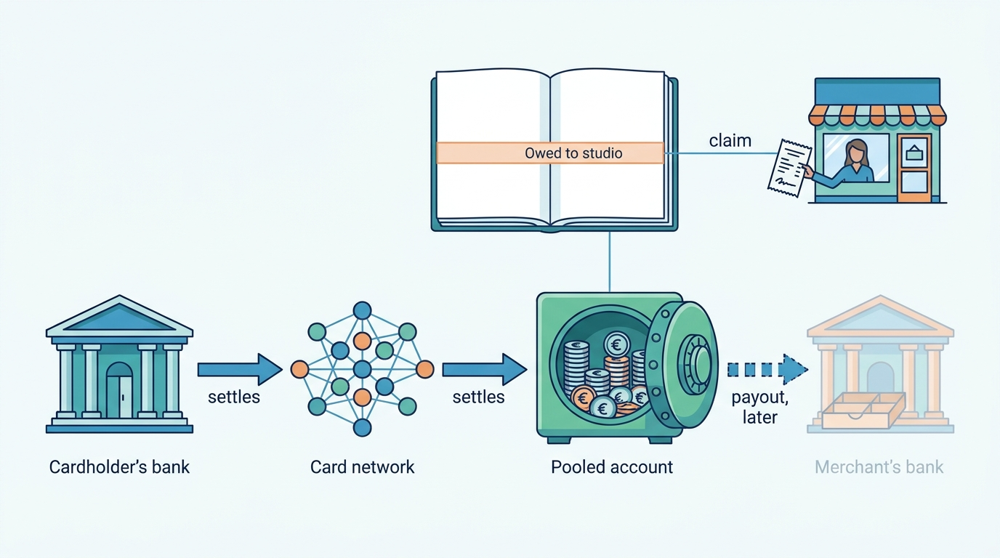
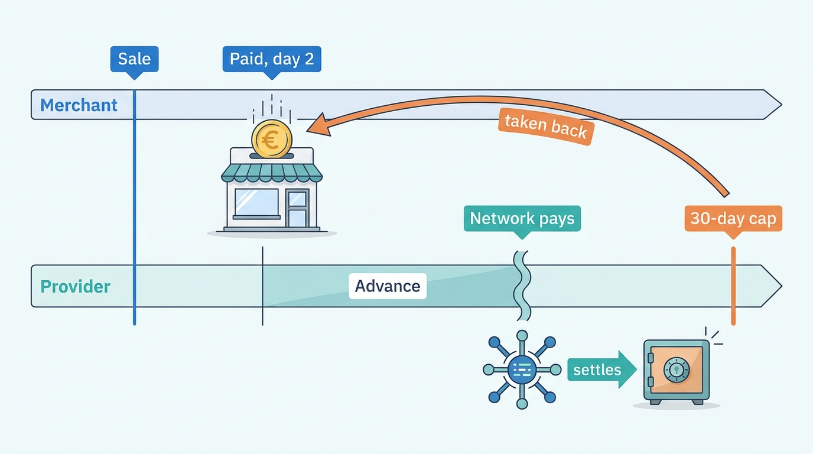
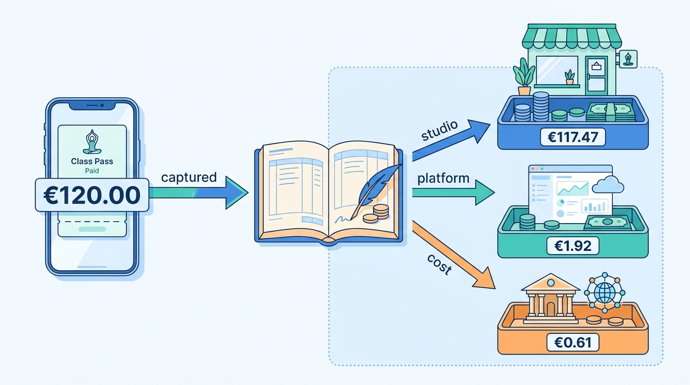

> **IN THIS CHAPTER, YOU WILL:** Follow Mila's €120 through three balances and learn to read pending, available and reserved as a provider's decisions about a debt.

> **KEY POINTS:**
>
> * **A balance is a claim on the provider, not money in an account.** Between payment and payout the cash is moving through the card network or sitting in pooled bank accounts that are not the merchant's. The merchant has a line in the provider's books.
> * **"Pending", "available" and "reserved" are decisions, and only one provider says what "available" assumes.** Stripe dates every transaction by a schedule per country and payment method, and does not say whether that schedule waits for the network, beyond terms that let a payout wait when a network fails to pay Stripe. Adyen dates a whole sales day, states that it pays whether or not the card scheme has paid it, and takes back what has not settled within 30 days.
> * **Money leaves a balance without a payout.** Refunds, chargebacks, fees, holds and reversals are booked when they occur. Store one entry per movement with its own dates, and map vocabularies by function: "reserve" is the provider's hold at Stripe and the merchant's own buffer at Adyen.

> **[FAILURE PATTERNS THIS CHAPTER ADDRESSES](where-payment-systems-go-wrong.html):**
>
> * **The Black-Box Balance** — a provider total copied into your own system cannot be broken down into sales, fees, refunds and holds, so nobody can say why it changed.
> * **The Orphaned Refund** — a refund or chargeback is booked on the day it occurs, against a balance that paid out the original sale long before.
> * **A Card by Any Other Name** — availability differs by payment method: on Stripe's schedule a Dutch card payment waits three business days and a SEPA Direct Debit six.

 
A balance on a payment provider's dashboard looks like a bank balance, and nearly everyone reads it as one. A studio owner sells a €120 class pass on Tuesday evening. On Wednesday morning her payments screen shows €117.47, and her bank account shows nothing. She asks what sounds like one question and is three: **is that money mine, where is it right now, and why can I not have it until Thursday?**

This chapter's answer is that **she holds a claim, not money**. Between the payment and the payout, the cash is moving through the card network or sitting in bank accounts that are not hers, and her share exists only as the provider's record of what it owes her. "Pending", "available" and "reserved" are the provider's decisions about when and how much of that debt it will pay. This is the book's gap between the instant answer and the slow truth, seen from the merchant's side. Adyen's terms say that it pays "irrespective of whether the funds are actually received by Adyen"; Stripe's documentation gives a schedule and does not say whether it waits for the network.

For an integrator the consequence is a modeling one. A team that stores the balance as one running total gets **the Black-Box Balance**: a figure nobody can break down into sales, fees, refunds and holds. Larkfield, the fictional studio-software platform this book follows, ended 2025 with its own "owed to studios" figure €412,000 away from its providers' balances.

**Where we are in the payment's journey.** Mila Janssen bought her ten-class pass for €120.00 on Tuesday 9 March 2027 at 19:42, and the payment was captured (the instruction to collect an approved amount) at once. Studio Noord's payout arrives on Thursday 11 March. This chapter covers the two days in between, after [[clearing-and-settlement]] and before [[payouts-and-money-movement]].

The chapter starts with the question as it reached Larkfield. It then says what a provider balance is, and shows how Stripe and then Adyen decide when an amount becomes payable. Next comes what each has published about paying a merchant before the network has paid the provider, then what takes money out of a balance without a payout: fees, holds, negative balances and currency conversion. Three ways to model a balance follow, then the two providers side by side, Mila's €120 worked through, and the ways a balance goes wrong.

## Setting the Scene at Larkfield: Whose €117.47 Is It?

On Wednesday 10 March 2027, Ines Bakker, who owns Studio Noord in Utrecht, opened Larkfield's back office and saw €117.47 against Mila's pass: the €120.00 less the fee of €2.53 that Larkfield, as the platform, takes on the sale. Studio Noord takes its payments through Adyen. She wrote to support: is this mine, where is it, and why does it only arrive on Thursday? Aylin Demir, Head of Studio Support, could answer the third part from habit and neither of the others.

Femke de Graaf, Larkfield's Head of Payments Engineering, looked at why. The back office showed each studio one running total per provider, copied from the provider, with no dates and no reasons. The **1,140 studios** that take online payments through Stripe and front-desk payments through Adyen saw two totals, in two vocabularies, and support had no table saying which words meant the same thing.

She rewrote Ines's question as three that a system could answer. **Where is the cash? Who decides when the studio may use the amount, and by what rule? What can still be taken out of it?** The next sections take them in that order.

## A Balance Is a Claim on the Provider, Not an Account

A **merchant balance** is the net amount the provider's books say it owes the merchant at a given moment: sales credited, less everything debited, less what has already been paid out. Adyen's documentation (n.d., accessed November 2026) says: "Adyen pays you on a net basis. This means your payable batch is made up from your sales figure from which we deduct" transaction costs, refunds, chargebacks and other adjustments. Stripe's (n.d., accessed November 2026) says of its payments balance: "When a customer initiates a refund or files a dispute, funds are also deducted from the payments balance."

It has to be a figure in a book, because no bank account holds one merchant's sales. A card network (Visa or Mastercard, also called a scheme) settles with its member banks in net amounts ([[clearing-and-settlement]]). The acquirer, the licensed institution that takes card payments in on the merchant's side, receives one amount per network and currency, and commonly keeps it in pooled accounts with the money of many other merchants. Adyen's first step from capture to payout reads: "A payment is captured, and the card scheme or payment method sends the funds to Adyen." One merchant's share exists only as a line in the provider's ledger ([[payment-ledgers]]). Which accounts hold the pooled cash, and what protects it, is the subject of [[licences-and-safeguarding]].

Between payment and payout, four parties each hold something different, and only one of the four things is cash.

| Party | In plain words | What it holds between payment and payout | What it risks |
| --- | --- | --- | --- |
| Issuer | The cardholder's bank, which approved the payment | The cash, until it settles with the network | A cardholder who does not repay a credit card |
| Card network (scheme) | The rules and the switch between banks | An obligation to settle net amounts between its members | A member bank that fails to settle |
| Acquirer or provider | Stripe or Adyen, taking the payment in for the merchant | Pooled cash once the network pays, and a debt to the merchant | Paying the merchant and not being paid; a merchant who cannot cover later refunds |
| Merchant | Studio Noord | A claim on the provider: the balance | A claim that is reduced later |

**Figure 1:** *The cash stops in the provider's pooled account; what the merchant holds until the payout is a line in the provider's book.*

Five terms describe the state of that claim. Each is a statement about the debt, and none says where cash is.

* **Pending funds** — owed to the merchant, not yet payable.
* **Available funds** — payable now, and what refunds are taken from.
* **Reserve** — owed, but held back by the provider against refunds and chargebacks that may still come. A chargeback is a payment reversed by the cardholder's bank after a dispute ([[refunds-reversals-and-disputes]]).
* **Negative balance** — the debits exceed the credits, so the merchant owes the provider.
* **Pre-funding** — the provider pays the merchant before the network has paid the provider.

## Stripe: A Balance per Currency and a Date on Every Transaction

Stripe's documentation (n.d., accessed November 2026) describes an account that "can have one or more balances that hold funds for different products and currencies". The main one is the payments balance; beside it are a refunds and disputes balance the merchant can fund in advance and a reserve balance that Stripe creates. Funds are in one of two states. "For example, when a customer makes a card payment, the charge amount (minus Stripe’s fee) appears in your pending balance until settlement." Then: "After the funds settle, they move to your available balance." The fee is taken off before the amount appears.

Every change to a balance is a **balance transaction**. Stripe's API reference (n.d., accessed November 2026) gives it an `amount`, a `fee`, a `net` ("You can calculate the net impact of a transaction on a balance by `amount` - `fee`"), a `type`, a `source` (the payment, refund or payout behind it), a `status` that is "either `available` or `pending`", and `available_on`: "The date that the transaction’s net funds become available in the Stripe balance." The availability date belongs to each entry, not to the balance. A comment in an example query in Stripe's documentation for Sigma, its SQL reporting product, calls the table of these objects "the canonical record of changes to your Stripe balance".

> **INFERENCE, NOT DOCUMENTED:** A balance transaction is a one-sided statement line: one amount against one balance. It reads like a merchant's view of the two-sided ledger Stripe described in 2024 ([[payment-ledgers]]), but no public source says how the one is derived from the other, or how quickly a ledger entry becomes visible in the API.

The value of `available_on` comes from a published schedule. Stripe defines its term: "Settlement time is the time between when a payment or a funding transaction is made and when the funds become available in your Stripe balance." In this documentation "settle" therefore means the schedule running out, a different event from the network settling with its banks. The schedule is by country: 2 business days in the United States, and in the Netherlands, Germany, Belgium and the United Kingdom 7 calendar days for an account's first payout and 3 business days after that. It is also by payment method: a SEPA Direct Debit (a payment pulled from a euro bank account, which the payer's bank can send back) takes 6 business days. Stripe gives the reason: "These payments have a higher risk of returns or reversals, which factors into their longer settlement periods." Availability is a risk decision written as a date.

Sales are only one `type` of balance transaction. The list also includes `refund`, `stripe_fee`, `reserve_hold`, `payout`, `transfer` and `adjustment`, which is how a dispute appears. Stripe's list of types says: "When a customer disputes a charge, Stripe deducts the disputed amount from your balance." Each is booked when it happens. Nor is every fee netted on its sale: "Your account might have fees debited from your balance on a daily or monthly basis."

## Adyen: A Batch per Sales Day and a Delay Computed From the Mix

Adyen's unit is a day, where Stripe's is a transaction. Its documentation (n.d., accessed November 2026) describes what happens after capture: "The funds are assigned to a payable batch based on your payout model. The payable batch closes according to your payout frequency. If the payable balance is positive when the payable batch closes, Adyen instructs the payout to you." A **payable batch** is the set of entries paid together. Under Sales day payout, the default model, "You get all the funds from a particular sales day in a single payout batch, with a fixed payout delay." A sales day runs from midnight to midnight in the account's time zone unless configured otherwise.

The payout delay is computed. "The payout delay is calculated to be the break-even point, where faster payment methods settle enough funds to make up for the funds not yet settled by the slower payment methods." For a typical mix, Adyen gives 2 business days when at least 80% of transactions are in one of eight listed currencies (the euro, the pound and the US dollar among them) and acquired in that currency's own region, and 3 business days otherwise (3, 7 or 12 for an account that came to Adyen through a partner). A mix dominated by a slow-settling scheme gets a longer delay. The date is a liquidity calculation over the whole mix; it does not wait for each payment.

Adyen pays net, and what it nets is booked when it occurs: "Refunds, chargebacks, and other adjustments are added to the payable batch as they occur and are not related to the sales day of the original transaction." Fees reach the merchant twice. Transaction costs are deducted in the batch, and then, per Adyen's invoice documentation, "Each month, Adyen gives you a Payment processing invoice", after which "There can be a difference between the costs in the invoice and the deductions from your settlement batches during the month. Adyen will credit or debit the difference to the next settlement batch".

The names of the resulting balances are where a reader coming from Stripe goes wrong. Adyen's Balances page defines **available funds** as a sum of parts, among them "Pending: the gross amount of sales and refunds that have not yet been settled by the respective card scheme or payment method" and "Next payout: the current amount to be settled to your bank account at the next moment of payout". At Adyen, then, "available funds" contains "pending"; at Stripe the two are opposite states. The other parts of the sum are a reserve and a negative refund allowance; beside available funds Adyen keeps a second balance, the deposit. The reserve and the deposit are taken up two sections below.

Larkfield's studios are on Adyen for Platforms, where the claim sits in a **balance account** per studio and the same day-based rule applies under the name settlement delay. Adyen's platform documentation (n.d., accessed November 2026) says: "Adyen settles a settlement batch after its sales day ends and the configured settlement delay has passed. The date when the schemes or payment methods transfer the funds to Adyen does not affect this timing." Each entry in the platform's accounting report has two dates: "The booking date is when the event (like a payment) took place, and the value date is when the actual balance is credited or debited to a balance account." That is the same pair as Stripe's `created` and `available_on`.

## Paying Before Being Paid: Pre-Funding and Who Carries the Gap

Both schedules fix when an amount becomes payable, and neither mentions the day the network pays the provider. Put a fixed payout delay of two business days next to a scheme that, in Adyen's words, "has a settlement delay of 7 days", and on some payments the provider has paid out money it has not yet received. That is **pre-funding** (Adyen writes "prefinancing"): the provider pays the merchant from its own liquidity. The question for an integrator is whether "available" tells you that the network has paid.

At Adyen it does not, and Adyen says so twice. Its Sales Day Payout Terms of Service (last updated 17 June 2024) state that Adyen will "initiate payout of the Net Captured Volume to Merchant on the Payout Day, irrespective of whether the funds are actually received by Adyen from the Acquirer or Scheme Owner". Its documentation (n.d., accessed November 2026) names the mechanism: "Adyen prefinances your payments. When Adyen settles a transaction's funds to your payable batch before the card scheme or payment method settles those funds to Adyen, Adyen advances you the funds while settlement is still pending." Adyen's Annual Report 2025 is more cautious: its risk section calls paying "only after funds have been received" the "default setup" and places liquidity mismatches "primarily through pre-financing in accelerated payout schedules". The two statements cannot be reconciled from public text.

The advance has a limit and a way back. "Prefinancing is capped at 30 days. If the card scheme, payment method, or acquirer does not settle the funds within 30 days, Adyen reverses the prefinanced amount from your payable batch. These reversals appear as SettledReversed and RefundNotCleared entries." If the money turns up later, it is booked again. The platform model has the same rule: "If Adyen does not receive the funds within 30 days after a payment's capture, we subtract those funds from the current settlement batch." The reversal is also quiet: the `SETTLED_REVERSED` and `REFUND_NOT_CLEARED` webhook event types "apply to all payment methods and are disabled by default".

**Figure 2:** *Under Adyen's Sales day payout as its documentation describes it, the merchant is paid on a fixed day, the network pays the provider later, and an advance still unsettled after 30 days is taken back.*

Adyen bounds the risk it takes by advancing. Under the terms, payment methods that settle late or unpredictably are excluded and paid only on receipt, and "If more than 25% of the Captured Volume on a sub-account consists of Payment Methods that structurally settle to Adyen later than the Payout Day, Adyen will have the right to accordingly delay the Payout Day by one or more business days." Activation is subject to Adyen's review of the merchant. Its other model, Pass-through payout, pays on receipt, and Adyen's documentation calls it "the only available payout model in Africa, Brazil, and India". Pre-funding is a credit decision about the merchant and its mix.

Stripe documents an advance explicitly in one product. Its Instant Payouts documentation (n.d., accessed November 2026) says of the funds that can be paid out at once: "Card payment funds are available immediately, including pending funds within your payout schedule window. Bank debit funds (ACH, SEPA) are only included after they fully settle, since they can be reversed before that point." The loss follows liability. On a platform, Stripe's Connect documentation says: "When platforms and marketplaces are liable for losses, you’re liable for uncovered negative balances due to refunds or disputes on instantly paid out funds."

For Stripe's standard payouts, the public record stops at the schedule. The balances, payouts and Connect balance pages, as read in November 2026, give the schedule and use no term such as pre-financing, and the list of balance transaction types has no entry described as taking back an advance that the network never settled. The nearest entry is `payment_reversal`, "Created when a debit/failure related to a payment is detected from a banking partner", which "takes funds that were previously credited to the merchant for a payment out of the merchant balance"; the list does not say which payment methods it covers or whether it applies after a payout. Stripe's services terms (last modified 28 September 2026) add two rights: a payout can be held back by "a delay or failure of a Financial Provider to settle a Transaction to Stripe", and Stripe may reverse a settlement if "the Payment Method Provider invalidates the Transaction". **No public source (documentation, terms or support site) says whether `available_on` otherwise waits for the network's settlement of a payment, or does not.** The absence is not evidence either way.

> **INFERENCE, NOT DOCUMENTED:** At Adyen the two risks are split. Adyen carries the timing gap with its own liquidity, for at most 30 days. The merchant carries the outcome: an amount that never settles is taken back from a later batch by set-off (netting a debt against money owed). For Stripe's standard payouts the terms let Stripe delay or reverse; who carries the timing gap in the normal case is not public.

## What Leaves a Balance Without a Payout: Fees, Holds, Negative Balances and Currency

The reversal of an advance is one of six kinds of movement that reduce a balance with no payout. At each provider one itemized record says which it was: the balance transactions at Stripe, and at Adyen the journal types (the kinds of entry) in the settlement details report, which Adyen creates when a payable batch closes (both sets of documentation n.d., accessed November 2026).

| Movement | Stripe: balance transaction `type` | Adyen: journal type |
| --- | --- | --- |
| A refund | `refund` | `Refunded` |
| A chargeback | `adjustment`, with the dispute as `source` | `Chargeback`, `SecondChargeback` |
| A fee debited apart from the sale | `stripe_fee` | `Fee`, `InvoiceDeduction` |
| A hold raised by the provider | `reserve_hold`, `reserved_funds` | `DepositCorrection` |
| A pre-funded amount taken back | Not public for standard payouts; the nearest type is `payment_reversal` | `SettledReversed`, `CaptureFailed` |
| The merchant's own buffer refilled | `payout_minimum_balance_hold` | `ReserveAdjustment` |

Both providers hold back part of a merchant's money against refunds and chargebacks still to come. Stripe calls this a **reserve**. Its support article on reserves (n.d., accessed November 2026) says: "A reserve is a temporary hold on a portion of a business’s funds for a predetermined period of time", and names two types, fixed and rolling. Adyen calls its hold a **deposit** and sizes it continuously: "Unlike the reserve, you cannot determine your own deposit amount. Adyen calculates the deposit requirement for your account daily, based on variables such as your processing volume and the number of chargebacks and refunds." A hold can therefore grow on any day, out of that day's sales.

Both also let the merchant keep a buffer of its own. At Stripe it is a minimum balance: "Automatic payouts only pay out funds exceeding this minimum balance to your bank account." At Adyen it is the **reserve**: "the available amount you configure to cover for refunds, chargebacks, and other operational expenses". So "reserve" names the provider's hold at one and the merchant's buffer at the other. Map the two by what they do.

| Function | Stripe term | Adyen term |
| --- | --- | --- |
| Held by the provider for risk | Reserve | Deposit |
| Buffer set by the merchant | Minimum balance | Reserve |

When debits exceed credits, the merchant owes the provider. Stripe's payouts documentation (n.d., accessed November 2026) gives the example: "if you receive 100 USD in payments but refund 200 USD of prior payments, your account balance would be -100 USD." Without further payments to cover it, Stripe creates a payout that debits the merchant's bank account, "a Payout object with a negative `amount`". On a platform, where each seller has its own connected account, the Connect documentation adds a step: an account property says whether Stripe or the platform is responsible for a seller's negative balance. Where it is the platform, "Stripe holds a reserve on your platform account’s `available` balance", and "When a connected account holds a negative balance amount for 180 days, Stripe transfers a portion of your balance to zero out that account’s balance". Meanwhile the seller cannot be paid out.

Adyen's documented default is to net forward. Under its Sales Day Payout terms (2024), if the amount to be paid out is negative, "Adyen may in its discretion (i) transfer such negative balance to the immediately following Payout Day, or (ii) exercise its set-off right or other rights in accordance with the terms of the Agreement." The settlement details report shows the carry-over as its own journal type, `Balancetransfer`. On a platform, the platform's own account stands behind its sellers. Adyen's account structure page (n.d., accessed November 2026) defines the liable balance account as "the account where your business' funds are held. Funds can be deducted from this account if your users' balance accounts incur negative balances due to refunds and chargebacks."

Currency adds one more movement: a sale in one currency reaches a balance in another, at a rate recorded on the entry. Stripe's documentation (n.d., accessed November 2026) says: "Stripe automatically converts all incoming funds into your default currency." With multi-currency settlement, a merchant can instead keep balances in up to 18 currencies. The balance transaction carries an `exchange_rate`. Adyen "offers like-for-like (no currency conversion) settlement if the currency is also supported as a settlement currency by the payment method", and where it converts, the settlement details report has an Exchange Rate column. Read the recorded rate; do not recompute it. Part of Larkfield's €412,000 came from a rounding rule of its own.

## Three Ways to Model a Provider Balance in Your Own System

A balance moved by many kinds of entry, on their own dates and in two vocabularies, has to be held somehow in your own system. The first design copies the provider's total and shows it. It costs almost nothing, and it is what Larkfield's back office did before Keel, its 2027 program for the payments estate. It explains nothing: the number has no date, no parts and no reason. I would accept it only where the figure is displayed and nobody else is owed anything from it.

The second design recomputes the balance from your own payment records: paid payments, less refunds, less the fees you expect. It can say which sales make up the figure, and it drifts from the provider with every entry that is not a sale. Larkfield's Unexplained €0.4 Million was this design: the three causes found (refunds after payout, chargeback fees, a conversion rounding rule) were all entries for which the payment table had no row.

The third design keeps one internal entry for every movement the provider reports, and it is the one I would build. Each entry has a type assigned by function, an amount, a booked-at time, an available-at time and the provider's own reference. Both providers expose these fields: Stripe on the balance transaction (`type`, `created`, `available_on`, `source`), Adyen in the settlement details report (journal type, payment reference, batch) and the platform accounting report (booking date, value date). Larkfield's Keel decision K3, "a ledger entry for every movement", is this design.

What decides between the three designs is whether anyone else is owed from the balance.

| Design | What it can answer | What it misses | When it is right |
| --- | --- | --- | --- |
| Mirror the provider's total | What the provider says now | Why it changed; what is payable when | Display only, and nobody else is owed from the balance |
| Recompute from your payments | Which sales make up the figure | Every entry that is not a sale: separate fees, holds, reversals, conversions, adjustments for other days | As a cross-check on the entry model, never as the record |
| One entry per provider movement | Why it changed, what is payable on which date, what is held | Nothing the provider reports; it costs a mapping per provider and a reconciliation ([[payment-reconciliation-and-reporting]]) | As soon as you owe sellers from the balance or must explain it to finance |

## Stripe and Adyen: Where They Differ

Six documented differences separate the two models. The Stripe and Adyen columns restate facts cited above (documentation accessed in November 2026; Adyen's terms of June 2024). The last column is my reading, an inference.

| Aspect | Stripe | Adyen | What the difference suggests |
| --- | --- | --- | --- |
| Unit of the claim | A balance per product and currency; one balance transaction per change | A payable batch per merchant account; a balance account per user on platforms | Stripe's view is account-like; Adyen's is batch-like for merchants, account-like for platforms |
| When funds become payable | Per transaction, at `available_on`, by a schedule per country and payment method | Per sales day, after a computed payout delay (typically 2 or 3 business days) | Stripe ages a transaction; Adyen ages a day |
| Tie to the network's settlement | Not public for standard payouts, beyond terms that allow a delay when a network fails to settle to Stripe (2026); documented for Instant Payouts | Documented: pays whether or not funds were received; reversal after 30 days | Only Adyen tells an integrator what "available" assumes |
| Fees | Netted per transaction; some fees debited daily or monthly | Netted in the batch; a monthly invoice trued up in the next batch | Adyen needs an invoice reconciliation; Stripe shows the fee on each entry |
| Provider's hold and merchant's buffer | Reserve; minimum balance | Deposit; reserve | Same two functions, crossed names |
| Negative balance | A negative payout debits the bank account; on platforms, a transfer from the platform after 180 days | Carried to the next payout day or set off; on platforms, the liable balance account can be debited | Stripe documents a pull from the bank; Adyen documents netting forward |

On Stripe, read `available_on` on each balance transaction instead of assuming a number of days, and expect a negative balance to be collected from the bank account. On Adyen, reconcile per batch, enable the `SETTLED_REVERSED` and `REFUND_NOT_CLEARED` events that are off by default, and reconcile the monthly invoice against the fees already netted.

## In Practice at Larkfield: The Three Balances Behind Mila's €120

On the evening of Tuesday 9 March, Mila's €120.00 becomes three figures in Adyen's books. Larkfield's split instruction ([[splits-balances-and-platform-payouts]]) books the studio's share to Studio Noord's balance account and Larkfield's fee to Larkfield's liable balance account. Adyen's documentation (n.d., accessed November 2026) says of transaction fees on platforms: "By default, these costs are deducted from your liable balance account". So the processing cost comes out of Larkfield's figure. None of the three is a bank account of Studio Noord's.

| Figure in the provider's books | Whose claim | Amount |
| --- | --- | --- |
| Studio Noord's balance account | Studio Noord's | €117.47 |
| Larkfield's liable balance account | Larkfield's: its fee of €2.53 less the processing cost | €1.92 |
| The processing cost | Nobody's claim; the provider keeps it and passes part on to the issuer and the network ([[payment-economics]]) | €0.61 *(assumption)* |
| Total | | €120.00 |

**Figure 3:** *Mila's €120.00 becomes three figures in the provider's book: €117.47 owed to the studio, €1.92 owed to Larkfield and €0.61 of processing cost.*

The studio's €117.47 is booked on Tuesday and changes state on Thursday 11 March. Studio Noord's settlement delay is two business days (a Larkfield contract detail, illustrative), which matches the example in Adyen's platform documentation: sales captured on a Monday "are settled two business days later, on Wednesday, regardless of when the schemes pay out the funds." The payout that includes the pass reaches Ines's bank the same Thursday. Whether Visa had paid Adyen by then, Ines cannot know, and it changes nothing for her unless the funds have still not arrived after 30 days.

Had Studio Noord been on Stripe, the same sale would be a balance transaction with `status` pending and an `available_on` of Friday 12 March, on Stripe's documented Dutch default of three business days. If it were the account's first payout, the wait would be seven calendar days. The claim is the same and the date differs, for a reason unrelated to Mila's card.

On 18 March Mila asks for a refund of the seven unused classes, €84.00. Adyen books refunds "as they occur", so the debit lands on 18 March, against a balance that no longer contains Mila's payment: that was paid out on the 11th. What covers it is whatever Studio Noord has sold since, €212.40 that day *(assumption)*, so the refund is covered; where a studio's later sales are not enough, the platform funds the shortfall ([[splits-balances-and-platform-payouts]]). The point here is the date: an entry that belongs to a sale of 9 March sits in the batch of 18 March.

Under Keel decision K3, Larkfield replaced the copied total with entries, and the back office now answers Ines with three amounts and their dates: on its way, ready to pay out, and held. I would use words of your own like these: they force the mapping to be done by function, once, in code.

| Larkfield's field | Fed at Stripe by | Fed at Adyen by |
| --- | --- | --- |
| On its way | Balance transactions with `status` pending, each with its `available_on` | Bookings whose value date is still in the future |
| Ready to pay out | Balance transactions with `status` available | Amounts settled to the balance account |
| Held by the provider for risk | Reserve | Deposit |
| Buffer the merchant set | Minimum balance | Reserve |

## When It Goes Wrong

The commonest failure is a balance that fell with no payout. The total will never say why. List the entries since the last figure you can explain and group them by type: balance transactions by `created` and `type` at Stripe, the settlement details report by journal type at Adyen, or the accounting report on a platform. The answer is one of the six movements in the table above. With entries of your own this is a query; with a total it is a support ticket.

The failure that arrives latest is an advance taken back. Adyen books `SettledReversed` "when it does not receive the funds from the card scheme or payment method within 30 days after capture. No action is required. Adyen adjusts your balance automatically." That describes Adyen's side. On yours, a sale paid out a month ago has just been debited, and with the event disabled by default you learn of it only from the report. Enable the event, post the reversal against the original payment, and decide in advance who bears it: the seller or you.

The third failure stops payouts without a failed API call. A hold is raised, or a balance goes negative, and the next payout is smaller or absent. At Adyen, "If the deposit requirement increases, funds from your sales are booked to the deposit". At Stripe, a connected account with a negative balance cannot be paid out at all. Both show up only as entries. Watch for the hold types and for the sign of each balance, and tell the seller before they ask.

## What to Take Away

**Established.**

- A provider balance is a net figure in the provider's books. Stripe and Adyen both document it as sales less refunds, disputes, fees and other adjustments.
- Both publish the rule that makes funds payable: Stripe a schedule per country and payment method on each transaction, Adyen a computed payout delay on each sales day.
- Both book adjustments when they occur. A day's payout cannot be recomputed from that day's sales.
- Adyen documents that it pays before it is paid, capped at 30 days and reversed by a later entry.

**Depends on context.**

- How long funds stay pending depends on country, payment method and the provider's risk view of the account. Read the date on the entry.
- Whether a hold applies, and how large it is, is the provider's decision and can change daily at Adyen.
- Who covers a seller's negative balance depends on the platform's liability set-up ([[platform-payment-models]]). Where the platform is liable, a seller's refund can become the platform's loss.

**The author's synthesis.**

- "Available" is a risk decision expressed as a timestamp. I keep entries with a booked-at and an available-at time and never a bare total, because every question a seller or an auditor asks is about a date or a reason.
- I map provider vocabularies by function and never by name, and I treat a provider's silence about what availability assumes as a question to put to it, not a fact to infer.

## Questions to Ask

1. Can we show the entries behind every balance figure in our system, each with its type and dates?
2. Do we store when an amount becomes payable as a date on each entry, or do we assume a fixed number of days?
3. What does this provider's "available" assume about the card network having paid, and where is that written?
4. Which events or report rows say that an amount already paid out was taken back, and are they enabled?
5. Which term at each provider means the provider's hold, and which a buffer we set?
6. What happens when a seller's balance goes negative: who is debited, after how long, and do payouts stop meanwhile?
7. Where do fees appear: on each sale, as separate debits, on a monthly invoice, or all three?
8. Do we book currency conversions at the provider's recorded rate?

Ines's €117.47 was never cash waiting for her. On Wednesday it was a debt Adyen had recorded, and on Thursday it became a debt Adyen had decided to pay. Paying it means leaving the provider's ledger for a bank rail, where the provider can record that it sent the money and cannot see whether it arrived. That is the subject of [[payouts-and-money-movement]].

## Sources and Evidence

*Company, product and investor sources*

- [Balances and settlement time](https://docs.stripe.com/payments/balances), Stripe documentation, n.d., accessed 2026-11 — balance types, pending and available, settlement timing by country and payment method, fees debited daily or monthly.
- [The Balance Transaction object](https://docs.stripe.com/api/balance_transactions/object), Stripe API reference, n.d., accessed 2026-11 — fields (`amount`, `fee`, `net`, `status`, `available_on`, `exchange_rate`) and the `type` list.
- [Balance transaction types](https://docs.stripe.com/reports/balance-transaction-types), Stripe documentation, n.d., accessed 2026-11 — disputes booked as adjustments, reserve and minimum-balance types, `payment_reversal`.
- [Sigma data freshness](https://docs.stripe.com/data/data-freshness), Stripe documentation, n.d., accessed 2026-11 — the balance transactions table as "the canonical record" (a comment in an example query).
- [Receive payouts from Stripe](https://docs.stripe.com/payouts), Stripe documentation, n.d., accessed 2026-11 — negative balances and negative payouts.
- [Understanding Connect account balances](https://docs.stripe.com/connect/account-balances), Stripe documentation, n.d., accessed 2026-11 — responsibility for negative balances, the platform reserve, the 180-day transfer, payouts stopped while negative.
- [Instant Payouts for Stripe Dashboard users](https://docs.stripe.com/payouts/instant-payouts), Stripe documentation, n.d., accessed 2026-11 — which funds are eligible before they are available.
- [Instant Payouts for Connect](https://docs.stripe.com/connect/instant-payouts), Stripe documentation, n.d., accessed 2026-11 — platform liability for instantly paid funds.
- [Stripe Services Agreement: Services Terms](https://stripe.com/legal/ssa-service-terms), Stripe, last modified 2026-09-28 — Stripe Payments Terms on the transfer of settlement funds and on reversals; the definition of Payout Delay.
- [Annual Report 2025](https://investors.adyen.com/financials/2025), Adyen N.V., signed 2026-03-05 — the risk section: paying "only after funds have been received" as the "default setup"; liquidity mismatches "primarily through pre-financing in accelerated payout schedules" (audited; read in the PDF this page offers for download).
- [Minimum balances for automatic payouts](https://docs.stripe.com/payouts/minimum-balances-for-automatic-payouts), Stripe documentation, n.d., accessed 2026-11 — the merchant-set buffer.
- [Multi-currency settlement](https://docs.stripe.com/payouts/multi-currency-settlement), Stripe documentation, n.d., accessed 2026-11 — conversion to the default currency and balances in up to 18 currencies.
- [Ledger: Stripe's system for tracking and validating money movement](https://stripe.dev/blog/ledger-stripe-system-for-tracking-and-validating-money-movement), Ilya Ganelin, Stripe, 2024-02-16 — that Stripe's internal ledger is double-entry (the fact behind the inference about balance transactions).
- [Reserves - Frequently Asked Questions](https://support.stripe.com/questions/reserves-frequently-asked-questions), Stripe support, n.d., accessed 2026-11 — definition of a reserve; fixed and rolling reserves.
- [Getting paid](https://docs.adyen.com/account/getting-paid), Adyen documentation, n.d., accessed 2026-11 — the payable batch, payout models, net payouts, like-for-like settlement, where Pass-through payout is the only model.
- [Sales day payout](https://docs.adyen.com/account/sales-day-payout), Adyen documentation, n.d., accessed 2026-11 — the payout delay and its calculation, adjustments as they occur, reversal events disabled by default.
- [Upgrade to Sales day payout](https://docs.adyen.com/account/sales-day-payout/upgrade-to-sdp), Adyen documentation, n.d., accessed 2026-11 — "Adyen prefinances your payments", the 30-day cap, the reversal journal types.
- [Pass-through payout](https://docs.adyen.com/account/pass-through-payout), Adyen documentation, n.d., accessed 2026-11 — the model that pays on receipt.
- [Sales Day Payout Terms of Service](https://www.adyen.com/legal/sales-day-payout-terms-of-service), Adyen, last update 2024-06-17 — payout irrespective of receipt, the 25% rule, excluded payment methods, negative balance.
- [Balances](https://docs.adyen.com/account/balances), Adyen documentation, n.d., accessed 2026-11 — available funds, pending, next payout, reserve and deposit.
- [Settlement details report](https://docs.adyen.com/reporting/settlement-reconciliation/transaction-level/settlement-details-report), Adyen documentation, n.d., accessed 2026-11 — journal types and the Exchange Rate column.
- [Payment processing invoice](https://docs.adyen.com/reporting/invoice-reconciliation/payment-processing-invoice), Adyen documentation, n.d., accessed 2026-11 — the monthly invoice and the difference booked to the next batch.
- [Settle funds](https://docs.adyen.com/platforms/settle-funds), Adyen for Platforms documentation, n.d., accessed 2026-11 — sales day settlement, the settlement delay, settlement reversal after 30 days.
- [Account structure](https://docs.adyen.com/platforms/account-structure-resources), Adyen for Platforms documentation, n.d., accessed 2026-11 — the liable balance account.
- [Transaction fees](https://docs.adyen.com/platforms/online-payments/transaction-fees), Adyen for Platforms documentation, n.d., accessed 2026-11 — fees deducted from the liable balance account by default.
- [Balance Platform Accounting Report](https://docs.adyen.com/platforms/reports-and-fees/balance-platform-accounting-report), Adyen for Platforms documentation, n.d., accessed 2026-11 — booking date and value date.

*Standards, regulation and official documentation*

- None.

*Research and practitioner sources*

- None.

Larkfield is fictional; architectural recommendations, labeled inferences and labeled assumptions are the author's judgement.
