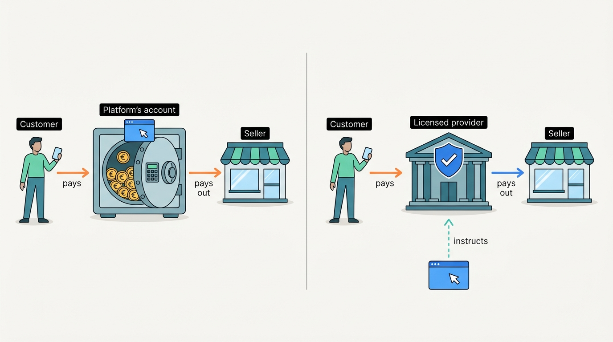
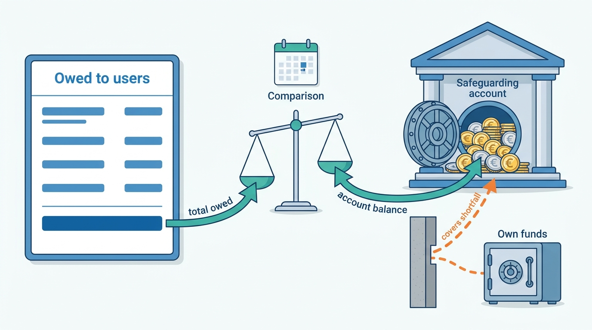
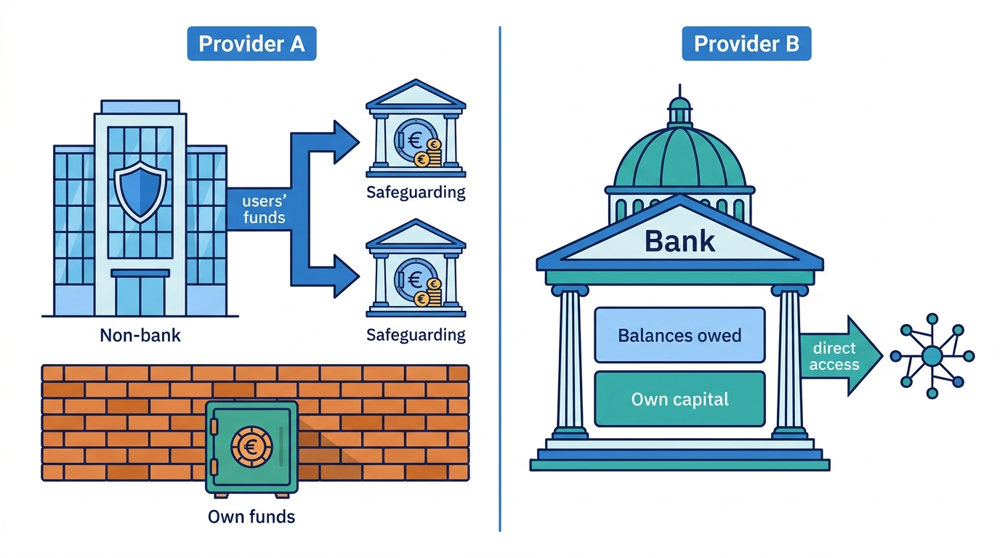

> **IN THIS CHAPTER, YOU WILL:** Learn which licenses allow a firm to hold other people's money, how safeguarding (keeping customers' money apart from the firm's own) shapes a ledger, and how to keep your own platform out of possession.

> **KEY POINTS:**
>
> * **The license is a design input.** It decides which accounts a provider's ledger must contain, which funds may never be mixed and what must be compared with a bank. A licensed non-bank may hold customers' money only apart from its own, and where its bank account is pooled, its own record is the only division between customers.
> * **Stripe is a licensed non-bank; Adyen is a bank.** Stripe states that it is an e-money institution in Europe and "not a bank" in the United States. Adyen N.V. states that it is a Dutch credit institution with UK and US branches. Neither names the banks that hold the money.
> * **A platform is outside these rules only while it never has possession or control.** One arrow through your own bank account raises a license question.

> **[FAILURE PATTERNS THIS CHAPTER ADDRESSES](where-payment-systems-go-wrong.html):**
>
> * **The Accidental Bank** — a funds flow through the platform's own account makes the platform a holder of customer funds, with the duties that follow.
> * **The Black-Box Balance** — a balance is a claim on an institution; unless you know which entity holds the cash, you cannot say what protects it.

 
On a whiteboard, an engineer draws one arrow from "customer" to "our bank account" and a second from there to "sellers", with a note: hold for 14 days, then pay out. Nothing in code review will object. Yet that first arrow changes what the company is in law: **money received for someone else is not the receiver's money**, and holding it is reserved for licensed institutions.

The rule that the arrow brings in is a license, and a license is a design input. **It decides which accounts the holder's ledger must contain, which funds may never be mixed and what must be compared with a bank.** Stripe says it is a licensed non-bank, which may hold customers' money only apart from its own; Adyen says it is a bank, which may use what it holds. The previous chapter compared a ledger with a bank's record; this one asks whose bank account that is.

**Where we are in the payment's journey.** Mila Janssen bought a ten-class pass for €120.00 from Studio Noord on Tuesday 9 March 2027 at 19:42, at Larkfield, the fictional studio-software platform this book follows ([[meet-larkfield]]). Studio Noord receives its €117.47 on Thursday 11 March. This chapter covers the two days in between and asks one question: who is holding that money, and by what right?

The chapter starts with a Larkfield proposal to hold studio payouts in its own account for 14 days. It then defines the licenses that allow a firm to hold other people's money and shows how safeguarding, the legal duty of a licensed non-bank to keep customers' money apart from its own, works. Next come what Stripe documents as a licensed non-bank, what Adyen documents as a bank, and why regional entities are money boundaries. The chapter then compares the three places a platform can stand, puts Stripe and Adyen side by side, follows Mila's €120 by license holder and ends with the ways custody goes wrong.

## Setting the Scene at Larkfield: The Fourteen-Day Buffer

In April 2027 Larkfield's product team proposed a **refund buffer**. On 18 March Mila had asked for €84.00 back for seven unused classes, a week after Studio Noord had been paid, and somebody had to fund that refund ([[platform-payment-models]] owns the liability rule). The proposal: collect member payments into a Larkfield bank account, pay studios 14 days later, and take any refund out of the buffer first.

The size of the buffer follows from Larkfield's 2026 figures: €1.12 billion processed for studios, about €3.07 million a day. Fourteen days of that is about **€43 million** in Larkfield's account at any moment, against a whole year's revenue of €46.0 million. The company would be holding other people's money on the scale of itself.

Jonas Weber, Larkfield's risk and compliance lead, stopped the proposal in review: "That account would contain forty-three million euros that are not ours, and holding money that is not ours is a regulated activity." His objection was about **possession**: who holds the money while it is owed. Two questions follow: what would holding it require, and can Larkfield get the buffer without holding it? The figure below shows the two flows.

**Figure 1:** *Money that passes through the platform's own account is in the platform's possession; money held by a licensed provider that the platform only instructs is not.*

## Why Holding Other People's Money Needs a License

Holding money for others is regulated because of what happens when the holder fails. A bank account shows one balance. If its owner goes bankrupt, lenders, staff and customers all claim that balance, unless a rule and a record say which part of the cash was never the company's own. Every license below answers three questions: may this firm hold customers' money, may it use it as its own, and what protects the customer if it fails?

The first answer is the **bank**. EU law calls it a credit institution. The first limb of the definition is an undertaking whose business is "to take deposits or other repayable funds from the public and to grant credits for its own account" (Regulation (EU) No 575/2013, Article 4, read in the consolidated text of 1 January 2026; a later amendment added a second limb for the largest investment firms). **(Evidence age: 13 years; in force as amended.)** Money left with a bank becomes the bank's own asset, which it may lend, and the customer holds a claim on the bank. In exchange, a bank lives under far heavier capital and liquidity rules.

A **payment institution** is the contrast: a licensed non-bank that may move customers' money and may not treat it as its own; it must keep that money apart, a duty the law calls safeguarding and the next section describes. The EU's second Payment Services Directive (PSD2) says so directly. Such an institution may hold only payment accounts "used exclusively for payment transactions", and the funds it receives "shall not constitute a deposit or other repayable funds" (Directive (EU) 2015/2366, Article 18, 2015). Its capital may "at no time be less than EUR 125 000" for the main payment services (Article 7), small next to a bank's. **(Evidence age: 11 years; in force, replacement pending.)**

An **electronic money institution**, or e-money institution, may do one thing more: keep a customer's money as a stored balance, called e-money, to spend or withdraw later. It must safeguard the money received for that balance in the same way, and in any event "by no later than five business days" after the e-money is issued (Directive 2009/110/EC, Article 7, 2009). **(Evidence age: 17 years; in force.)** A license from one member state can be used across the European Economic Area (EEA), which is called passporting.

The United States has no single counterpart. A non-bank that holds or moves money for others is licensed state by state as a **money transmitter**. The state regulators' model law sets "net worth (capital), surety bond, and permissible investments (liquidity) requirements", and "thirty-one states have enacted the law in full or in part" (Conference of State Bank Supervisors, n.d., accessed November 2026). A surety bond is a third party's promise to pay if the firm cannot. For what only a bank may do, the non-bank relies on a **partner bank**. A partner bank that provides card-network membership is called a sponsor bank ([[acquiring-and-network-connectivity]]). Where a partner bank holds the non-bank's customer balances, they commonly sit in a **for-benefit-of (FBO) account**: one bank account held for many customers, where the bank sees a single balance.

Side by side, the four differ on the column that matters most to an architect: only the bank may use the money it holds as its own, and the other three must keep it apart. Reading "permissible investments" as the US counterpart of safeguarding is my own.

| License | May hold customers' funds | May use them as its own | What protects the customer |
| --- | --- | --- | --- |
| Bank (credit institution) | Yes, as deposits | **Yes** | Bank capital and liquidity rules; bank supervision |
| Payment institution (EU, UK) | Yes, for payment transactions | No | Safeguarding |
| E-money institution (EU, UK) | Yes, also as a stored balance | No | Safeguarding |
| Money transmitter (US states) | Yes | No | State rules such as permissible investments and a surety bond |

## How Safeguarding Works: A Ledger, an Account and a Comparison

**Safeguarding** is what the law makes a licensed non-bank do with money it may not use. PSD2 gives two methods. Under the first, funds "shall not be commingled at any time with the funds of any natural or legal person other than payment service users on whose behalf the funds are held"; if still held "by the end of the business day following the day when the funds have been received", they "shall be deposited in a separate account in a credit institution or invested in secure, liquid low-risk assets"; and they must be "insulated ... against the claims of other creditors". Under the second, the funds are covered by "an insurance policy or some other comparable guarantee" (Article 10).

Read as a system requirement, the first method needs three things: a ledger that says, per user, how much is owed; a bank account, the safeguarding account, that holds users' money and nothing else; and the total of the first covered by the balance of the second. The bank that holds the account does not know the users. Where that account is pooled, **the institution's own ledger is the only thing that divides the cash between customers**, so a bug in that ledger is a bug in who owns what. The figure below shows the structure.

**Figure 2:** *Safeguarding as a system: a ledger of what is owed to each user, one pooled account at a bank that sees only the total, a comparison between the two, and the firm's own funds kept apart to cover a shortfall.*

The rule also carries a clock: funds still held at the end of the business day after receipt must already be in the separate account. So the system has to know, every business day, how much it holds for users and where. As requirements:

| Requirement | What a system must do | On failure |
| --- | --- | --- |
| No commingling, at any time | Classify every ledger account as user funds or own funds; block transfers that mix them | A breach, whatever the amount |
| Separate account by the next business day | Compute the amount still held each day; sweep it to the safeguarding account | Funds exposed to the firm's creditors |
| The account covers what is owed | Compare the ledger total with the bank statement on a schedule | A shortfall, paid from the firm's own funds |

The UK regulator has written the comparison out most fully. The policy statement PS25/12 of the Financial Conduct Authority (FCA), published on 7 August 2025, sets interim rules that "will come into force on 7 May 2026". They did: the FCA's safeguarding page for firms, last updated on 7 May 2026, records an "Update following new safeguarding rules coming into effect". Firms must reconcile "at least once each reconciliation day", comparing what should be in safeguarding accounts (the "D+1 segregation requirement") with what they hold (the "D+1 segregation resource"); D+1 is the business day after funds are received, the deadline of the clock above. "If the D+1 segregation resource is lower than the D+1 segregation requirement, a payments firm will be required to remedy the shortfall. If it is not possible to use relevant funds to do so, the firm must use its own funds" (FCA, PS25/12, 2025). The rules add a monthly return and an annual audit.

You have seen this comparison before. It is the reconciliation of [[payment-reconciliation-and-reporting]]: a ledger matched against a record that somebody else keeps, here the bank's statement of the safeguarding account. Two things differ: the comparison is **required by law**, on a schedule, and the firm pays a break from its own money before it investigates. So the license decides what a ledger must contain: for a non-bank, the accounts of [[payment-ledgers]] and the balances of [[balances-and-funds-flows]] are legally sorted into users' funds and the firm's own.

One caution applies to every EU citation in this section and the one before: PSD2 is about to be replaced by a third directive (PSD3) and a Payment Services Regulation. As of 17 November 2026 they are agreed and not adopted. The European Parliament's procedure files for both texts show an indicative plenary date of 14 December 2026 and the status "Awaiting Parliament 2nd reading" (Legislative Observatory, accessed 17 November 2026). Article numbers will change; [[payment-compliance-and-regulation]] carries the calendar.

## What a Licensed Non-Bank Documents: Stripe

Stripe is the first example of a firm that must safeguard: its legal pages state that it is an e-money institution in both European regimes. In the EEA: "STEL is authorised as an electronic money institution by the Central Bank of Ireland (reference number: C187865)", STEL being Stripe Technology Europe, Limited (Stripe legal page, last updated 5 April 2019). In the UK: "SPUKL is authorised as an electronic money institution by the U.K. Financial Conduct Authority (reference number: 900461)", SPUKL being Stripe Payments UK Ltd (Stripe legal page, last updated 26 January 2017). **(Evidence age: 7.5 and almost 10 years; both entities are named in Stripe's Services Agreement of 28 September 2026.)** A 2024 Stripe FAQ adds that "STEL passports its electronic money institution licence" across the EEA.

Safeguarding follows from that license, and Stripe says so. In the same FAQ (last updated 18 January 2024), funds owed to a platform's sellers "are settled to Stripe’s safeguarding accounts, before payout", and "only Stripe has control over the funds held in the Stripe-titled safeguarded bank account". For the UK, a Stripe support article (n.d., accessed November 2026; read through a summarizing tool, so paraphrased) says that users' funds are kept in safeguarding accounts at credit institutions and that Stripe is not covered by the Financial Services Compensation Scheme, the UK's deposit guarantee. **The banks are not named** on any page I read.

In the United States the structure is assembled from parts. Stripe Payments Company lists money transmitter licenses or authorities in 53 jurisdictions by my count: 49 states, the District of Columbia and three territories (Stripe licenses page, n.d., accessed November 2026). For card acquiring, Stripe's acquirer disclosure (n.d., accessed November 2026) says that another entity, Stripe, LLC, is a "Payment Facilitator" (a company that signs up merchants under an acquirer's network membership) of six named acquirers: five banks and Stripe MALPB, Stripe's own limited-purpose acquiring bank in the US state of Georgia, described below. For stored balances in its Treasury product, the documentation (n.d., accessed November 2026) says "Stripe is not a bank" and describes two structures: a deposit account in the business's own name at "Stripe’s banking partner" (a footnote names Fifth Third Bank), or an FBO arrangement in which "The bank’s records show that the account holds funds for the benefit of Stripe customers" and "Stripe records how much of the total balance belongs to your business and reconciles that record against the funds held at the bank". That is the previous section's structure in a provider's own words.

The same distinction appears inside Stripe's ledger design. A Stripe engineering post of 16 April 2026 on fee credits, balances that users can spend only on Stripe's fees, says: "Every real Stripe financial account—merchant payment balances, bank settlement accounts, treasury accounts—is backed by a real bank account." Credits are different: "we can classify the money sitting behind a credit as corporate funds. It doesn’t need to be safeguarded, swept to a bank account, or reconciled against a real cash position." The boundary is enforced: "We reject attempts to create a transfer between a logical account and a real account at the platform level" (Gupta and Samant, Stripe's developer blog, 2026), a logical account being one, such as a credit balance, with no bank account behind it. That is the license as code.

In 2025 and 2026 Stripe added two narrow charters, and neither makes it a deposit-taking bank. The first is already operating. The May 2026 bulletin of Georgia's Department of Banking and Finance lists Stripe MALPB, Atlanta, with an approval date of 30 June 2025 and a date to begin business of 28 May 2026. Stripe's terms for it (last updated 28 May 2026) call it "a Georgia Merchant Acquirer Limited Purpose Bank", and Stripe's acquirer disclosure lists it among its US acquirers. According to a banking trade association's news item of 8 July 2025 (a secondary source), such a bank "may not solicit or accept deposits from the general public". The second is approved only in a preliminary way. On 12 February 2026 the Office of the Comptroller of the Currency (OCC) granted Bridge, Stripe's subsidiary for stablecoins (tokens redeemable for a currency such as the dollar), "preliminary conditional approval" for Bridge National Trust Bank, a charter for fiduciary and custody business and for issuing stablecoins: "Final approval ... will not be granted until all preopening requirements are met" (OCC decision letter, 2026). As of 17 November 2026 the OCC's list of decisions shows no later decision for the bank, and I found no announcement of a final approval.

## What a Bank Documents: Adyen

Adyen is the other kind of holder. Its license page states: "Adyen N.V. is authorised as a credit Institution under the supervision of Dutch Central Bank", valid across the EEA by passport. In the UK the same company is "authorised as an overseas branch of an EEA credit institution". In the US, "Adyen N.V. San Francisco Branch is a federal Branch of Adyen, N.V., licensed by the Office of the Comptroller of the Currency and the Federal Reserve Board of Governors", a federal branch being a US office of a foreign bank (Adyen's license pages for EMEA and the United States, n.d., accessed November 2026). Adyen's 2021 release on the US branch dates its European banking license to 2017. **(Evidence age: 5 years; confirmed by the current pages.)** The shape is one legal entity with branches, where Stripe has one licensed entity per regime.

Adyen also says what the licenses are for. Its press release of 9 April 2026: "Adyen is one of the select fintech companies that holds its own banking licenses across the U.S., the U.K., and Europe. This infrastructure enables direct connections to payment rails and card schemes, reducing intermediaries and fund settlement times". Its accounts page offers platform users "interest on deposited funds" (n.d., accessed November 2026). That this offer rests on the banking license is my reading: the accounts page does not say so, and the press release does not mention interest.

What the bank status means for how merchant funds are held is stated for one product only. For the business accounts that a platform can offer its users, Adyen's documentation (n.d., accessed November 2026) carries an EU depositor information sheet: "Deposits in Adyen N.V. are protected by" the "Dutch statutory Deposit Guarantee Scheme", with a limit of "EUR 100 000 per depositor per credit institution". Nothing I read says whether a balance waiting for payout in a payments integration is a deposit in that sense. One more product behavior is documented. Under Sales day payout, a payout model that pays each day's sales out in one batch, Adyen pays out "irrespective of whether the funds are actually received by Adyen from the Acquirer or Scheme Owner" (terms of service, last updated 17 June 2024), and "Prefinancing is capped at 30 days" (documentation, n.d., accessed November 2026). Adyen's Annual Report 2025, however, calls paying "only after funds have been received" the "default setup". No public text I read says how that default fits with the Sales day payout terms. Nothing I read connects that product to the license; [[balances-and-funds-flows]] covers the mechanics.

> **INFERENCE, NOT DOCUMENTED:** A credit institution holds a merchant's balance as the bank's own liability under bank rules, not as safeguarded funds under PSD2 Article 10. If Adyen's merchant balances are treated that way, there is no safeguarding account to reconcile against, and paying a merchant before the card network pays Adyen is an ordinary use of a bank's balance sheet. Both statements are my reading of what a banking license permits. Adyen's pages call the money in its business accounts deposits at Adyen N.V. Its terms and conditions (last update 1 November 2023) describe a balance waiting for payout only as "amounts held by Adyen prior to Settlement", on which "No interest will be due"; they do not call it a deposit.

For both companies the public record stops short of the accounts. Stripe does not name its safeguarding banks: its services terms (last modified 28 September 2026) say only "Pooled Accounts at one or more Financial Providers". Adyen's terms make Adyen itself the holder ("amounts held by Adyen prior to Settlement"). Its documentation page on payout currencies (n.d., accessed November 2026) gives, for each settlement currency, the country "Where Adyen holds the funds", such as euros in the "Eurozone" and pounds in the United Kingdom, without naming a bank. Adyen's closest statement on banks is an aggregate in its shareholder letter for the first half of 2026: "We ended the half with €12.4 billion of total cash. The majority of that number represents balances moving through our system on behalf of our merchants", with finance income "generated primarily from our balances at central and commercial banks" (Adyen, 13 August 2026). There is no split by bank, currency or region. I did not query regulators' registers; every license statement here is the company's own.

## Regional Entities Are Money Boundaries

Where a platform can stand, the next section's subject, depends on which entity holds the money in each country, and both companies expose that regional license structure to integrators. At Stripe it is in the contract: the Services Agreement (last modified 28 September 2026) names "Stripe Payments Europe, Limited", the Stripe company the agreement is made with, together with "Stripe Technology Europe, Limited" for the EEA and with "Stripe Payments UK Ltd" for the United Kingdom, the two e-money institutions above, as parties for the regulated services. At Adyen it is in the data model: "You must have a separate balance platform for each region in which you acquire payments" (Adyen documentation, n.d., accessed November 2026).

The consequence is that a region is a different institution, branch or set of accounts, and money crossing regions is a real transfer ([[payouts-and-money-movement]]), never a row moving between tables. Stripe's fee-credits post gives one glimpse from inside: its money movement platform "runs automated intercompany sweeps based on ledger data". What the license structure does **not** tell you is where data is stored; [[payment-multi-region-and-data-residency]] takes up that question.

## Three Places a Platform Can Stand

A platform that takes payments for others can stand in three places relative to the money. In the first, **the provider holds the sellers' funds for the sellers, and the platform only instructs**. This is how Stripe describes its platform product, Connect, in the 2024 FAQ: "the platform does not have possession of user’s funds at any point"; it gives "pre-agreed instructions" and "does not have discretionary authority over the funds". The FAQ names the test: platforms "would generally only be considered to be engaged in providing payment services where they are in possession or control of user funds". Larkfield runs this way on both providers.

In the second position **the platform becomes the licensed holder** and owns everything in the safeguarding section: the accounts, the comparison, the audit, the shortfall. Stripe's guide to becoming a payment facilitator (n.d., accessed November 2026) puts US money transmitter licenses at "US$150,000/year for approximately 3 years to set up 50 states = US$450,000 minimum". For Europe it says: "Platforms that control the flow of funds need to acquire an e-money license, which can take months and millions of euros to obtain." These are an interested vendor's estimates in an undated guide whose one dated reference is from 2018; treat them as orders of magnitude.

In the third position **the platform already holds the money and uses a provider only to send it**. Stripe's documentation for its standalone payout product draws the line: "Global Payouts is best for businesses that already hold the licenses required to move money themselves". In its comparison with Connect: "If you manage your customers’ funds, you might need a license such as an MTL" (a money transmitter license), and "you’re responsible for any desired tracking of recipient funds"; whereas Connect payouts are "Covered by Stripe’s licensing" (Stripe documentation, n.d., accessed November 2026). The difference between the two products is who has possession and who keeps the record.

All three positions treat possession as what decides. A common objection says it is not: "We only hold the money in transit, for a few days." The text of the rule does not support it. Article 10 applies to "all funds which have been received", and its only time limit runs the other way: one business day before the funds must be in a separate account. Exemptions exist, a lawyer's question, and Stripe's 2024 FAQ expects two of them to be narrowed by PSD3. My reading, an engineer's and not legal advice: duration does not change whose money it is.

The rule I use: stay in the first position, instructing a licensed provider, until you need to do something with the money that no provider will do on instruction. Holds, splits, delayed payouts and reserves can all be instructions ([[splits-balances-and-platform-payouts]]). When the answer becomes "we will just collect it ourselves", price the second position, holding a license, first. The table below sets the three positions side by side, and which of them a provider supports depends on its own license, which is why the two providers are compared next.

| Design | Who holds the funds | Who keeps the record of who is owed what | What the platform takes on | When it is right |
| --- | --- | --- | --- | --- |
| Instruct a licensed provider | The provider, for the sellers | The provider; the platform keeps a copy to reconcile | The provider's rules and timing | Payments are a feature of a software business |
| Hold a license | The platform, in safeguarding accounts | The platform, as a legal record | Licensing, capital, comparison, audit, shortfall | Holding and moving money is the product |
| Send funds you hold through a payout product | The platform, before the payout | The platform | The license question for those funds | The platform is licensed, or the funds are its own |

## Stripe and Adyen: Where They Differ

Each provider's license shapes what a platform on it can do, so the two are set side by side here. The Stripe and Adyen columns restate facts cited above, except the Stripe cell of the last row, which brings in Stripe's Instant Payouts for the first time and cites it there; the last column is my inference throughout.

| Aspect | Stripe | Adyen | What the difference suggests |
| --- | --- | --- | --- |
| License in the EEA | E-money institution, Central Bank of Ireland, passported (legal page 2019; FAQ 2024) | Credit institution, Dutch Central Bank, passported (license page, n.d., accessed November 2026) | Stripe must place users' funds at banks; Adyen is the bank |
| License in the UK | E-money institution, FCA reference 900461 (legal page 2017; Services Agreement 2026) | UK branch of the Dutch credit institution (license page, n.d.) | Stripe's UK entity is in scope of the FCA's safeguarding rules; Adyen's branch is under bank supervision |
| License in the US | State money transmitter licenses; "not a bank"; a partner bank for stored balances; five sponsor banks plus its own Georgia acquiring bank, in business since May 2026 (n.d., accessed November 2026; Georgia bulletin 2026) | Federal branch of Adyen N.V. (license page, n.d.; release 2021) | Stripe assembles permissions function by function; Adyen extends one bank |
| Where customer funds sit | Safeguarding accounts at unnamed credit institutions (EU, UK; FAQ 2024); deposit or pooled FBO accounts at a partner bank for Treasury (US; docs, n.d.) | Business accounts: deposits at Adyen N.V. under the Dutch deposit guarantee (docs, n.d., accessed November 2026). Balances waiting for payout: "held by Adyen prior to Settlement" (terms, 2023), in a country documented per settlement currency (docs, n.d.); the banks are Not public; in aggregate, "balances at central and commercial banks" (H1 2026 letter) | Stripe documents the structure; Adyen documents the license and one product |
| Paying out before funds arrive | Instant Payouts only: card funds are "available for Instant Payouts as soon as the charge is complete" (docs, n.d., accessed November 2026) | Sales day payout, pre-financing "capped at 30 days" (terms 2024; docs, n.d.) | Consistent with a bank's balance sheet, though Adyen does not say so |

On Stripe, ask which entity and which safeguarding or partner-bank arrangement applies to each account country, because the protection differs by region. On Adyen, ask how balances are treated in each region, because the public pages state the license and, beyond the business-account product, stop. [[stripe-and-adyen-bets-compared]] weighs the two bets; [[case-stripe]] and [[case-adyen]] give each company's account. The figure below sets the two structures side by side.

**Figure 3:** *Provider A is Stripe as it documents itself in the EEA and the UK: a non-bank with users' funds in safeguarding accounts at banks. Provider B is Adyen, a bank; that balances sit on its own balance sheet is the author's inference.*

## In Practice at Larkfield: Mila's €120 by License Holder

Follow Mila's €120.00 by who holds it, instead of by its payment status. Studio Noord is on Adyen. At 19:42 on 9 March 2027 the payment is approved, with a split of €117.47 to Studio Noord and €2.53 to Larkfield instructed by Larkfield's payment service. Until the payout on 11 March, the €117.47 is a balance for Studio Noord at Adyen N.V., a bank; that reading rests on Adyen's license page, since Adyen names no entity per country. Larkfield's ledger has an entry for it (decision K3 of Keel, Larkfield's 2027 payments program: a ledger entry for every movement), and that entry is only a record. At no step does a Larkfield bank account contain Studio Noord's money.

Had Studio Noord been on Stripe, the same €117.47 would by Stripe's description be settled to a safeguarding account of its Irish e-money institution before payout. Across Larkfield's five markets (the Netherlands, Germany, Belgium, the United Kingdom and the United States) the holder changes with provider and country; Femke de Graaf, who leads Keel, has her team keep the map below next to the routing table that assigns payments to providers.

| Larkfield flow | Licensed holder, as read from the provider's public pages | License type |
| --- | --- | --- |
| Online, Dutch and German studios on Adyen | Adyen N.V. | Credit institution |
| Online, Belgium and the 1,140 Dutch and German studios still on Stripe | Stripe Technology Europe | E-money institution |
| Online, United Kingdom, on Stripe | Stripe Payments UK | E-money institution |
| Online, United States, on Stripe | Stripe's US entities; the bank holding platform balances is not named ("Pooled Accounts at one or more Financial Providers", services terms, 2026) | State money transmitter, with partner banks |
| Front-desk terminals, all markets, on Adyen | Adyen N.V. and its UK and US branches | Credit institution |

The refund buffer was built without Larkfield holding anything. The delay became an instruction: a longer payout schedule and a held amount on the studio's own balance at the provider, with a ledger entry on Larkfield's side that says how much is held back and why. A refund like Mila's €84.00 then comes out of the studio's balance at the provider; [[splits-balances-and-platform-payouts]] owns the mechanics and their limits. The €43 million never needed to pass through Rotterdam, where Larkfield has its head office, to be held.

## When It Goes Wrong

**The record of a pooled account is wrong, and the firm that kept it fails.** Proposing new record-keeping rules on 17 September 2024, the chairman of the Federal Deposit Insurance Corporation (FDIC) called them "an important step to ensure that banks know the actual owner of deposits placed in a bank by a third party such as Synapse, whether the deposit has actually been placed in the banks, and that the banks are able to provide the depositor their funds even if the third party fails" (FDIC press release, 2024). The release names Synapse, a non-bank intermediary, without describing the case. As of 17 November 2026 the proposal is still a proposal: the FDIC's and the Federal Register's listings show it published on 2 October 2024 with comments closing on 16 January 2025, and no final rule or withdrawal (accessed 17 November 2026). The lesson is in the sentence: the bank did not know the owners.

**A shortfall at your provider is invisible to you.** No API field reports whether a safeguarding account covers what is owed. What you can know is your exposure: how much you and your sellers leave at the provider, for how long, under which protection. By Stripe's own statement, no deposit guarantee stands behind its UK e-money institution. So pay out on a schedule and know the holding entity per region.

**The platform comes into possession by accident.** Nobody decides to become a payment institution. It happens through a refund paid from the company's own account "to be quick", a top-up collected for studios, or a temporary collection account used while a seller's onboarding is pending. The test can be run against a bank statement: does any account in the company's own name receive money owed to someone else? If so, stop the flow or move it to a provider, and ask counsel. This is the Accidental Bank; [[marketplace-regulation]] treats the same line for marketplaces.

**The license structure changes underneath you.** In 2025 and 2026 a Stripe bank appeared in its acquirer disclosure, a trust bank was conditionally approved and the EU's rules came within weeks of a vote. An integration does not break when these change; contracts, disclosures to your sellers and answers to an auditor do. Date each license fact you record, and recheck yearly.

## What to Take Away

**Established.**

- Funds received by a payment or e-money institution are not deposits and must be safeguarded: kept apart, in a separate account or secure assets, insulated from creditors (PSD2 Article 10).
- A bank may use what it holds; a licensed non-bank may not. Stripe states that it is an e-money institution in the EEA and the UK and "not a bank" in the US; Adyen N.V. states that it is a credit institution.
- Where a non-bank's account at a bank is pooled, its own ledger is the only record of who owns what; Stripe documents reconciling that record against the bank.

**Depends on context.**

- Whether a platform should hold a license depends on whether moving money is its product; for a software platform it is not, until no provider will do on instruction what the business needs.
- How much to leave in a provider balance depends on the holder's license and the protection behind it; a longer payout delay is a larger exposure.

**The author's synthesis.**

- I check possession at every arrow of a funds-flow diagram, the way I check idempotency at every write. The whiteboard arrow from the opening brings in a license, a safeguarding account, a daily comparison and an audit.
- I treat a provider's license as a dated fact in my own records, per region, because the two companies differ in kind and both are changing.

This chapter closes Part III, and across the part the ledger, the balance, the payout, the reconciliation and the license turn out to be one control seen five ways: a statement of who owes whom, made true by comparing it with a record somebody else keeps. "Where is the money" has no answer inside the provider: the cash is at banks, the provider holds claims and the proof that they match, and you cannot inherit that proof by reading a balance. Larkfield's €412,000, the gap between its ledger and its providers at year-end 2025 told in [[payment-reconciliation-and-reporting]], sat in refunds after payout, chargeback fees and a currency-conversion rounding rule, which a record of payments has no place for. So for each kind of movement in your system (fee, split, refund, dispute, payout, return), write the entry, name the clearing account it must empty and name the outside report that proves it, as decision K3 does.

## Questions to Ask

1. At each arrow of our funds-flow diagram, which legal entity has possession of the money, and under which license?
2. Does any bank account in our own name ever receive money owed to a seller, a customer or a recipient?
3. In each region, which entity of the provider holds our sellers' funds?
4. Does the provider safeguard those funds or hold them as a bank, and what protects them if it fails?
5. If the account is pooled, who keeps the record of each share, and how often is it compared with the bank?
6. Which of the things we want to do with the money (hold, split, delay) can be instructions to the provider?
7. If we use a payout-only product, does its documentation assume we are licensed and track recipients' funds ourselves?
8. When did we last read the provider's license and acquirer pages?

[[part-3]] looked at the provider from inside, where every movement is recorded twice and proven against networks and banks over days. A developer sees none of this: they send a request and get an answer in seconds. [[part-4]] asks what of the slow record that fast interface shows, and what it must add so that the answer is not mistaken for the truth.

## Sources and Evidence

*Company, product and investor sources*

- [Stripe Technology Europe, Limited: legal information](https://stripe.com/legal/stel), Stripe, last updated 2019-04-05 — e-money authorization by the Central Bank of Ireland (evidence age: 7.5 years; confirmed by the 2024 FAQ and 2026 Services Agreement).
- [Stripe Payments UK Ltd: legal information](https://stripe.com/legal/spukl), Stripe, last updated 2017-01-26 — e-money authorization by the FCA (evidence age: almost 10 years; entity named in the 2026 Services Agreement).
- [Stripe Services Agreement](https://stripe.com/gb/legal/ssa), Stripe, last modified 2026-09-28 — contracting entities per region.
- [Stripe Services Agreement: Services Terms](https://stripe.com/legal/ssa-service-terms), Stripe, last modified 2026-09-28 — Stripe Payments Terms 4.2: settlement funds are held in pooled accounts at unnamed financial providers.
- [Frequently asked questions about Stripe Connect and PSD2](https://stripe.com/guides/frequently-asked-questions-about-stripe-connect-and-psd2), Stripe, last updated 2024-01-18 — passporting, safeguarding accounts, possession and control, exemptions under PSD3.
- [Safeguarding Stripe users' funds in the UK](https://support.stripe.com/questions/safeguarding-stripe-users-funds-in-the-uk), Stripe support, n.d., accessed 2026-11 — safeguarding accounts at credit institutions; no FSCS cover (read through a summarizing fetch; paraphrased).
- [Stripe Payments Company licenses](https://stripe.com/legal/spc/licenses), Stripe, n.d., accessed 2026-11 — US money transmitter licenses; the count of 53 is the author's.
- [Acquirer Disclosure & Acquirer Terms](https://stripe.com/legal/acquirer-disclosure), Stripe, n.d., accessed 2026-11 — acquiring entities per region; Stripe, LLC as payment facilitator of six named US acquirers, "Stripe MALPB" among them (volatile).
- [Stripe MALPB Acquirer Terms](https://stripe.com/legal/stripe-malpb-acquirer-terms), Stripe, last updated 2026-05-28 — "a Georgia Merchant Acquirer Limited Purpose Bank".
- [Treasury](https://docs.stripe.com/treasury.md), Stripe documentation, n.d., accessed 2026-11 — "Stripe is not a bank", deposit and FBO structures, Fifth Third Bank for checking accounts, reconciliation of the per-customer record (volatile).
- [Instant Payouts for Stripe Dashboard users](https://docs.stripe.com/payouts/instant-payouts.md), Stripe documentation, n.d., accessed 2026-11 — card funds available for payout as soon as the charge is complete.
- [Understand differences between Global Payouts and Connect cross-border payouts](https://docs.stripe.com/connect/cross-border-payouts-to-recipients/compare-global-payouts.md) and [Global Payouts](https://docs.stripe.com/global-payouts.md), Stripe documentation, n.d., accessed 2026-11 — license and record-keeping responsibilities per product.
- [Introduction to payment facilitation](https://stripe.com/guides/payfacs), Stripe, n.d., accessed 2026-11 — the vendor's cost estimates for licenses (undated; its one dated reference is from 2018).
- [How we built Stripe Credits: A programmable, auditable way to pay your Stripe fees](https://stripe.dev/blog/how-we-built-stripe-credits-a-programmable-auditable-way-to-pay-your-stripe-fees), Pratik Gupta and Sai Samant, Stripe, 2026-04-16 — financial accounts backed by bank accounts, user funds versus corporate funds, intercompany sweeps.
- [Licenses and disclosures: EMEA](https://www.adyen.com/licenses/emea) and [United States](https://www.adyen.com/licenses/united-states), Adyen, n.d., accessed 2026-11 — credit institution status, UK branch, US federal branch.
- [Adyen granted US branch license](https://www.adyen.com/press-and-media/adyen-granted-us-branch-license), Adyen, 2021-06-14 — the US federal branch; European banking license dated to 2017 (evidence age: 5 years).
- [Adyen launches Intelligent Money Movement](https://www.adyen.com/press-and-media/adyen-launches-intelligent-money-movement), Adyen, 2026-04-09 — the company's statement of what its banking licenses enable.
- [H1 2026 Shareholder Letter](https://investors.adyen.com/financials/h1-2026-c2a1a), Adyen, 2026-08-13 — total cash and where finance income is earned (the letter is the PDF linked from this page).
- [Annual Report 2025](https://investors.adyen.com/financials/2025), Adyen N.V., signed 2026-03-05 — the risk section: paying "only after funds have been received" as the "default setup"; liquidity mismatches "primarily through pre-financing in accelerated payout schedules" (audited; read in the PDF this page offers for download).
- [Accounts](https://www.adyen.com/accounts), Adyen, n.d., accessed 2026-11 — interest for submerchants.
- [EU depositor information sheet](https://docs.adyen.com/platforms/compliance-financial-products/eu-depositor-info-sheet.md), Adyen documentation, n.d., accessed 2026-11 — deposits in Adyen N.V. business accounts and the Dutch deposit guarantee.
- [Supported payout currencies](https://docs.adyen.com/account/supported-currencies), Adyen documentation, n.d., accessed 2026-11 — the column "Where Adyen holds the funds", per settlement currency and acquiring region.
- [Adyen Terms and Conditions](https://www.adyen.com/legal/adyen-terms-and-conditions), Adyen, last update 2023-11-01 — "amounts held by Adyen prior to Settlement" bear no interest; the definition of Settlement.
- [Sales Day Payout Terms of Service](https://www.adyen.com/legal/sales-day-payout-terms-of-service), Adyen, last updated 2024-06-17, and [Upgrade to Sales day payout](https://docs.adyen.com/account/sales-day-payout/upgrade-to-sdp.md), Adyen documentation, n.d., accessed 2026-11 — payout before receipt of funds; the 30-day cap.
- [Account structure](https://docs.adyen.com/platforms/account-structure-resources.md), Adyen documentation, n.d., accessed 2026-11 — one balance platform per acquiring region.

*Standards, regulation and official documentation*

- [Directive (EU) 2015/2366 on payment services (PSD2)](http://publications.europa.eu/resource/celex/32015L2366), Official Journal, 2015-12-23 — Articles 7, 10 and 18 (evidence age: 11 years; in force, replacement pending).
- [Directive 2009/110/EC (e-money)](http://publications.europa.eu/resource/celex/32009L0110), Official Journal, 2009-10-10 — Article 7 (evidence age: 17 years; in force).
- [Regulation (EU) No 575/2013](http://publications.europa.eu/resource/celex/32013R0575), Official Journal, 2013-06-27 — definition of a credit institution (evidence age: 13 years; in force as amended, read in the [consolidated text of 2026-01-01](http://publications.europa.eu/resource/celex/02013R0575-20260101)).
- [Procedure file 2023/0210(COD), Payment Services Regulation](https://oeil.europarl.europa.eu/oeil/en/procedure-file?reference=2023/0210%28COD%29) and [procedure file 2023/0209(COD), PSD3](https://oeil.europarl.europa.eu/oeil/en/procedure-file?reference=2023/0209%28COD%29), European Parliament Legislative Observatory, accessed 2026-11-17 — status of the replacement.
- [PS25/12: Changes to the safeguarding regime for payments and e-money firms](https://www.fca.org.uk/publications/policy-statements/ps25-12-changes-safeguarding-regime-payments-and-e-money-firms) and its [policy statement PDF](https://www.fca.org.uk/publication/policy/ps25-12.pdf), Financial Conduct Authority, 2025-08-07 — the interim regime, reconciliation, shortfall rule, monthly return, annual audit.
- [Safeguarding requirements for payment institutions and electronic (e-money) institutions](https://www.fca.org.uk/firms/emi-payment-institutions-safeguarding-requirements), Financial Conduct Authority, last updated 2026-05-07 — the new rules took effect on 7 May 2026.
- [Money Transmission Modernization Act](https://www.csbs.org/csbs-money-transmission-modernization-act-mtma), Conference of State Bank Supervisors, n.d., accessed 2026-11 — the states' model law and its adoption (volatile).
- [Corporate Decision #1365, Bridge National Trust Bank](https://www.occ.treas.gov/topics/charters-and-licensing/interpretations-and-decisions/2026/cd1365.pdf), Office of the Comptroller of the Currency, 2026-02-12 — status of the trust bank charter.
- [Interpretations and decisions](https://www.occ.treas.gov/topics/charters-and-licensing/interpretations-and-decisions/index-interpretations-and-decisions.html), Office of the Comptroller of the Currency, n.d., accessed 2026-11-17 — no later decision listed for Bridge National Trust Bank.
- [Financial Institutions Bulletin, May 2026](https://dbf.georgia.gov/financial-institutions-bulletin-2026), Georgia Department of Banking and Finance, 2026-05 — Stripe MALPB: approved 30 June 2025, began business 28 May 2026.
- [FDIC proposes deposit insurance recordkeeping rule for banks' third-party accounts](https://www.fdic.gov/news/press-releases/2024/fdic-proposes-deposit-insurance-recordkeeping-rule-banks-third-party), Federal Deposit Insurance Corporation, 2024-09-17 — the regulator's statement of the pooled-account failure.
- [2024 FDIC Federal Register publications and public comments](https://www.fdic.gov/federal-register-publications/2024-fdic-federal-register-publications-and-public-comments), Federal Deposit Insurance Corporation, n.d., accessed 2026-11-17, and [Federal Register documents for RIN 3064-AG07](https://www.federalregister.gov/documents/2024/11/20/2024-27097/recordkeeping-for-custodial-accounts-extension-of-comment-period), accessed 2026-11-17 — "Recordkeeping for Custodial Accounts": proposed 2 October 2024 (89 FR 80135), comment period extended to 16 January 2025; no final rule or withdrawal listed.

*Research and practitioner sources*

- [Georgia approves Stripe application to form MALPB](https://www.icba.org/w/georgia-approves-stripe-application-to-form-malpb), Independent Community Bankers of America, 2025-07-08 — the limits of the Georgia charter (secondary source).

Larkfield is fictional; architectural recommendations, labeled inferences and labeled assumptions are the author's judgement.
