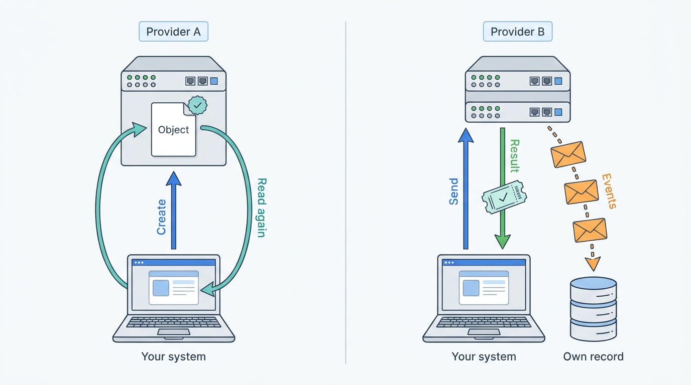
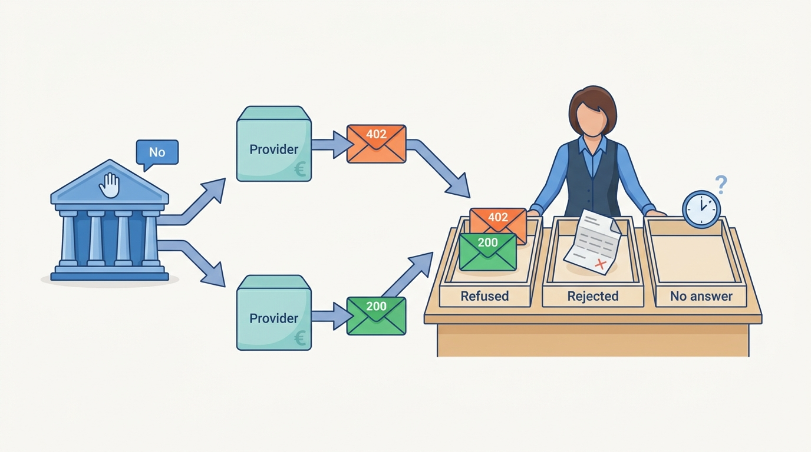
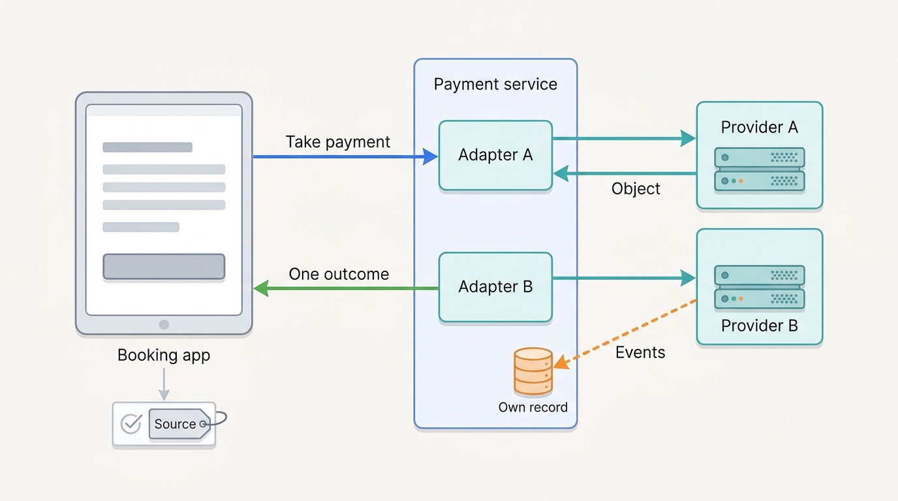

> **IN THIS CHAPTER, YOU WILL:** Learn to read a payment API for what your own system must store, compare Stripe's and Adyen's object models, and design an adapter over both.

> **KEY POINTS:**
>
> * **Depend on three things that do not change.** A stable identifier for each payment, a normalized vocabulary of states and refusal reasons, and an explicit line between what the response answers and what arrives later.
> * **Stripe and Adyen differ in where the state lives.** Stripe returns typed objects you can fetch again by identifier. Adyen's Checkout API returns a reference and a result code, has no call that returns a payment, and reports later states through webhooks and reports.
> * **A refused payment is not a failed request.** Stripe sends it as an HTTP 4xx error with a decline code, Adyen as an HTTP 200 with the result code `Refused`. An adapter maps both to one outcome; it hides the two vocabularies, not where each state was read.

> **[FAILURE PATTERNS THIS CHAPTER ADDRESSES](where-payment-systems-go-wrong.html):**
>
> * **The Phantom Payment** — a system that takes the API response, or its own copy of the events, for the provider's confirmed record cannot tell the two apart when they disagree.
> * **A Card by Any Other Name** — an object model shaped around instant card answers breaks when a method answers later, as Stripe's first model did.
> * **The Double Charge** — a refusal read as a failed request, or a lost response with no record written first, is sent again as a new payment.

 
Larkfield, the fictional studio-software platform this book follows, has a payment service with a call named **get payment**. It works for both of Larkfield's providers, and it has never asked either of them anything. It reads Larkfield's own table. On Adyen's Checkout API, its API for online payments, there is nothing else to read. On Stripe there is, and on 14 September 2026, with webhooks down for nine hours, nobody could reach it through that call. One name covered two facts: a provider's record, and Larkfield's memory of what it had been told.

That gap leads to this chapter's claim. A payment API stays usable for ten years when the integrator's code depends only on **a stable identifier** for each payment, **a normalized vocabulary** of states and refusal reasons, and **an explicit line between what the response answers and what arrives later**. Stripe and Adyen both supply all three. They differ in where the current state lives: in a typed object you can fetch again at Stripe, and in a reference and a result code, followed by webhooks and reports, at Adyen's Checkout API.

**Where we are in the payment's journey.** Take Mila's class pass: €120.00 paid to Studio Noord on Tuesday 9 March 2027 at 19:42. This chapter covers the request Larkfield's payment service sends at 19:42 and the response it gets back: which names and codes it carries, and what it leaves for later messages.

The chapter starts with Larkfield's adapter, explains why payment APIs age, takes an object model apart, and covers the error model and the line between now and later. It then compares the two overall shapes, one resource model or several API families, reports what each company has published about its design practice, and sets the providers side by side. It ends with the adapter as rebuilt in 2027 and the ways an object model fails its integrator.

## Setting the Scene at Larkfield: One Interface over Two Object Models

Larkfield built its payment service in 2024, when it added Adyen beside Stripe. Tom Hendriks, the senior engineer who wrote it, gave the booking app one internal API: take a payment, refund, pay out (send a studio the money it is owed). An adapter per provider sits behind it, chosen by studio; Stripe carried 44% of 2026 member payment volume and Adyen 56%. Whatever either provider says is reduced to five states of Larkfield's own in the payment record store: `pending`, `authorized`, `paid`, `refunded`, `disputed`. Two vocabularies go in and one comes out.

The cost of that tidiness showed on Monday 14 September 2026, the day of the incident Larkfield calls the Silent Webhook. A webhook is the provider's call to your server when something happens ([[payment-webhooks-and-events]]). The TLS certificate of the Stripe webhook receiver expired shortly after midnight, events failed for 9 hours, and 3,200 memberships were shown as unpaid when members arrived that Monday morning. Stripe's own objects were correct the whole time, and Stripe's API reference (n.d., accessed November 2026) documents a call that returns a payment by its identifier. But the adapter's only read call returned the record store's row. It had been leveled down to what both providers could do, and Adyen's Checkout API has no such read.

Femke de Graaf joined in January 2027 as Head of Payments Engineering and leads Keel, the program that repairs the payments estate. Keel decision K2 already says that a state change is confirmed against the provider's own record: the payment object where the API lets Larkfield read it, the settlement report where it does not. Her question to Tom was about the interface: **which parts of the two object models can we make identical, and which difference must our callers be able to see?**

## Why Payment APIs Age: The Networks Underneath Keep Changing

The providers face a harder version of Femke's question, because a payment API sits on systems that do not behave alike. A card payment is answered within seconds by the issuer, the bank that issued the customer's card, through a card network such as Visa or Mastercard. A SEPA (Single Euro Payments Area) Direct Debit, a pull from a European bank account, is confirmed days later. iDEAL, a Dutch bank-payment method, sends the customer to their bank first ([[local-payment-methods]]). Stripe's account of its payments APIs, an engineering post written by Michelle Bu in December 2020, sorts methods by two questions: is the payment "immediately finalized" or finalized later, and must the customer act? Cards alone are immediate and need no action. Her conclusion: "Global payment methods aren't different; cards are!" **(Evidence age: 6 years; the current system may differ.)**

Over the years, an integration lives through many such additions. Daniel Osei, Larkfield's CTO, wrote its first Stripe integration in 2017, and the webhook receiver from that period still runs in 2027. Over such a span the provider's objects swell. Bu's post counts: "Between 2011 and 2018, the Charge resource grew from having 11 properties to 36 properties and Charge creation grew from accepting 5 parameters to 14 parameters!" That is what an object model looks like when each new method is fitted into a shape made for the first one.

Growth alone breaks nobody; an integrator can ignore a new field. An integration breaks when a difference between methods reaches code that assumed there was none. Stripe names that cause itself: "we built support for new payment methods on top of a set of abstractions that were designed for the simplest payment method of them all: cards". Integrators had copied the assumption: call once, get yes or no, deliver. Stripe's remedy, the PaymentIntent of 2018, is told in [[payment-state-machines]].

So what can code depend on for ten years? Three things can stay fixed while methods and rules change. A **stable identifier** for each payment: a new method is a new way to pay, not a new kind of name. A **normalized vocabulary** of states and refusal reasons: a new answer from an issuer is mapped into a word the code already handles. And an **explicit line between what the response answers and what arrives later**: a slower method moves an answer across the line, and the code already listens on the other side. This is my argument, not either company's; the next sections test it against both.

## What an Object Model Is Made Of: Identity, State and Related Data

Those three things live in particular parts of an API, so start with what the API lets you name. A **resource model** is the set of things an API gives an identifier and lets you read again. Stripe's reference offers `GET /v1/payment_intents/{id}`, which "Retrieves the details of a PaymentIntent that has previously been created" (n.d., accessed November 2026). The alternative is an API of **commands**: calls that do something and return a result, leaving nothing to fetch. Adyen's `POST /payments` is one, and version 72 of its Checkout API specification, the OpenAPI file Adyen publishes on GitHub for the version released in April 2026, defines no operation that returns a payment.

The names come next. Every payment has two identifiers, the provider's and yours. Stripe's says what kind of object it names: `pi_` for a PaymentIntent, `ch_` for a Charge. The rationale on record is a 2022 article by Paul Asjes, a developer advocate at Stripe, published on the DEV Community site and not on Stripe's own: "adding a prefix makes the ID human readable" **(Evidence age: 4 years.)** Adyen's identifier names a request. Its glossary (n.d., accessed November 2026) says: "Every payment or modification request (such as a refund or a capture request) in Adyen's system has a globally unique 16-character string called the PSP reference"; PSP stands for payment service provider. A capture, the instruction to collect an approved amount, therefore gets a reference of its own. What groups such requests is yours: `reference` is a required field of the payment request, and the v72 specification says "We strongly recommend that you use a unique value for each transaction".

By contrast with the names, what a name lets you read is where the two models part. On Stripe the current state is a `status` field on the object, "one of `requires_payment_method`, `requires_confirmation`, `requires_action`, `processing`, `requires_capture`, `canceled`, or `succeeded`", and a GET returns it at any time. On Adyen's Checkout API the state is a result code on each response, a word such as `Authorised` or `Refused`, followed by webhooks. Of the 31 operations in the v72 specification three are GETs (a payment link, a session, stored payment methods), and none returns a payment. The state machines themselves belong to [[payment-state-machines]].

**Figure 1:** *Provider A is Stripe, where a payment is an object you can read again; Provider B is Adyen's Checkout API, where a request returns a reference and a result, and later states reach your own record as events.*

A payment also points at other things, such as a customer. An **expandable object** is a related object that the API returns as an identifier by default and as the full object on request. Stripe's reference page on expanding responses says: "Many objects allow you to request additional information as an expanded response by using the `expand` request parameter". Expansions nest "up to a maximum depth of four levels", and the cost is stated: "Performing deep expansions on numerous list requests might result in slower processing times". The newer part of Stripe's API, the `/v2` paths described below, dropped the convention: "The `expand` parameter isn't supported", and some endpoints take an `include` parameter instead (both n.d., accessed November 2026).

Adyen's Checkout API, by contrast, has nothing like it. Extra fields are switched on per account, not per request, and arrive as string keys in a map called `additionalData`. The v72 specification describes the map: "Contains additional information about the payment. Some data fields are included only if you select them first: Go to **Customer Area** > **Developers** > **Additional data**." The Customer Area is Adyen's back-office site. Two requests with the same body can therefore return different fields on two accounts, so an adapter has to treat every such field as optional.

Lists split in the same way. On Stripe's `/v1` paths a list takes a `limit` and a cursor that is an object identifier. On the `/v2` paths the cursor is a page token, and the promise changed: "Lists are eventually consistent by default and lower-latency", where on `/v1` "Top-level lists are immediately consistent (with higher latency to render)" (Stripe's overview of API v2, n.d., accessed November 2026). Adyen's Checkout API has no paginated lists; its Management API pages mostly by `pageNumber`, its Configuration API mostly by `offset`, its Transfers API by `cursor` (OpenAPI files, accessed November 2026).

After the provider's names, states, relations and lists, one field belongs to you. **Metadata** is a set of key-value pairs the provider stores and returns without interpreting. Stripe's reference page on metadata allows "up to 50 keys" and says "Stripe doesn't use metadata—for example, we don't use it to authorize or decline a charge". Its guide to advanced error handling says what the field is for: "When creating a resource, include a local identifier in its metadata so you can match an object received through a webhook to your local records" (both n.d., accessed November 2026). Adyen's payment request has a smaller `metadata` map, limited to 20 pairs, but there the required `reference` does the tying.

## The Error Model, and the Line Between Now and Later

All of that describes a call that worked. An **error model** is how the API says what went wrong, and for payments it has to keep three outcomes apart. **No answer**: the request timed out, and whether anything happened is unknown. **Rejected**: the provider turned the request away as malformed, unauthorized or over a limit, and nothing happened. **Refused**: the request was processed, it reached the issuer, and the issuer said no. A refusal is also called a decline. A rejection is corrected and sent again. A refusal already is the answer; sending it again asks the same bank the same question. No answer is the subject of [[idempotency-and-retries]]. A model that merges any two misleads whatever code decides to retry.

Stripe, for example, reports a refused card as an HTTP error. Its reference page on errors (n.d., accessed November 2026) says codes in the 4xx range cover "an omitted required parameter, a failed charge, or a declined card", and lists 402 as "The parameters were valid but the request failed". Its guide to 3-D Secure, the card networks' protocol for authenticating the cardholder, names the code for a failed payment: "The request failed with a `402` HTTP status code, meaning that the payment was unsuccessful" (n.d., accessed November 2026). The body is an error object with a `type`: `api_error`, `card_error`, `idempotency_error` or `invalid_request_error`. A refused card is a `card_error`, with a `decline_code` for a program and a `message` for a person. On Stripe, then, the status code does not separate a refusal from a bad request. The error type does.

Adyen does the opposite and sends the same refused card as a successful request. Its page on HTTP status codes (n.d., accessed November 2026) says: "Although an HTTP response status code of `200` means that the request was submitted correctly and Adyen processed it successfully, it does not necessarily mean that the payment or modification request was successfully executed." The body carries the result code `Refused` with a `refusalReason` and a `refusalReasonCode`. 4xx and 5xx are kept for requests that left no trace: in those cases "the Adyen payments platform does not accept or store submitted requests". The table sets one declined card side by side.

| | Stripe | Adyen Checkout API |
| --- | --- | --- |
| HTTP status of a refused card | 4xx; `402` in the reference's table and the 3-D Secure guide | `200` |
| Where the outcome is | `error.type` is `card_error` | `resultCode` is `Refused` |
| The reason | `decline_code`, for example `insufficient_funds` | `refusalReasonCode` and `refusalReason`, for example `12`, "Not enough balance" |
| A rejected request | `400`, `401`, `403`, `429` with another error type | 4xx or 5xx; not accepted or stored |

**Figure 2:** *One refusal by the customer's bank arrives as an HTTP 402 from one provider and an HTTP 200 from the other; both belong in the same tray, apart from a rejected request and from no answer.*

Inside either envelope, the reason comes from a **normalized vocabulary**. An issuer answers with its own short response code; each provider maps those codes, and its own risk decisions, into a list it maintains. Stripe's list of decline codes includes `insufficient_funds` and `generic_decline`, which covers an unknown reason "or Stripe Radar or Adaptive Acceptance blocked the payment"; Radar is Stripe's fraud product, and Adaptive Acceptance a Stripe feature that, by its page on declines, can block payments with a low likelihood of authorization. Adyen's refusal reasons are numbered: 12 is "Not enough balance", 20 "FRAUD". Adyen tells you to keep all of the detail from the customer: "To prevent malicious use, do not expose the details of the refusal reason to shoppers". Stripe says so for particular codes, such as `fraudulent` and `stolen_card`: "Don't report more detailed information to your customer" (all n.d., accessed November 2026). The list is what your retry logic keys on ([[authorization-optimization]]).

Beside the three kinds of no sits a second distinction: is this response an answer or an acknowledgment? Adyen's response-handling page lists what an HTTP 200 on a capture means, including "We received your request" and "We still do not know if the capture operation will be successful or not". Even a payment's result code is provisional: "The status of a payment can sometimes change after you get the result code, so we recommend that you do not use the result code to update your order management system" (Adyen's page on result codes). Stripe draws the same line as a state: a PaymentIntent paid by bank debit sits in `processing`, and such methods "can take up to a few days to process" (Stripe's page on how PaymentIntents work; all n.d., accessed November 2026). In the table, a dispute is a cardholder's challenge to a payment through their bank ([[refunds-reversals-and-disputes]]), and settlement is the movement of the money itself ([[clearing-and-settlement]]).

| Operation | The response answers | Arrives later, by event or report |
| --- | --- | --- |
| Card payment, no customer action | The issuer's approval or refusal | The capture result, settlement, any dispute |
| Bank debit or another delayed method | Received, or processing | Success or failure, days later |
| Capture or refund on Adyen | `received` | A `CAPTURE` or `REFUND` webhook; a failure can still follow it (Adyen's capture and refund pages, n.d., accessed November 2026) |
| Dispute | Nothing: no request of yours starts it | An event, weeks or months after the payment |

As a result, an API that states this line is harder to start with. Stripe's engineers said so in writing in 2020: "PaymentIntents is also objectively a harder integration for users who only care about accepting card payments in the US and Canada." They paid that cost because the simple model had failed for every method except cards. I read the trade the same way: an API that admits what it does not know yet is harder in the first week and cheaper in the tenth year.

## Two Shapes for the Whole: One Resource Model or Several API Families

The elements have to be assembled into a whole API, and the two companies assemble them differently. Stripe has one host and one object model, in two **namespaces**, path prefixes with their own conventions: "API v1: The `/v1` namespace includes most of the existing Stripe API today. API v2: The `/v2` namespace includes endpoints that use `/v2` design patterns." A June 2026 engineering post dates it: "In 2024, Stripe introduced the v2 namespace to bring improved domain modeling and updated API semantics to our users". The second sits beside the first, with different request encoding and pagination and no `expand`. In the documentation I read in November 2026, PaymentIntents, Refunds and Disputes are `/v1` objects; I found no statement in Stripe's documentation, changelog or engineering posts on whether payments will move.

Adyen's surface, in contrast, is several APIs. An **API family** is a group of endpoints with its own version counter and conventions, and usually its own host, built for one kind of job. The word is Adyen's: its September 2022 post, written by one of its developer advocates, describes "different layers (internal and external) and families (payments, banking, platform) of REST APIs sitting on top of a large dynamic platform" **(Evidence age: 4 years; the current specifications show the same grouping.)** Adyen's documentation page on versioning (n.d., accessed November 2026) tells integrators to expect it: "Most integrations use multiple Adyen APIs" and "Each API has a different version". The table is drawn from the published OpenAPI files (accessed November 2026).

| API and version | Used for | Style | Identifier | Pagination | Error body |
| --- | --- | --- | --- | --- | --- |
| Checkout API v72 | Online payments, sessions, captures, refunds | Commands: 25 of 31 operations are POST | PSP reference per request | None | `status`, `errorCode`, `message`, `errorType` |
| Management API v3 | Accounts, stores, terminals, credentials | Resources: 69 of 166 operations are GET | `companyId`, `merchantId`, `storeId` | Mostly `pageNumber`, `pageSize` | `type`, `title`, `status`, `detail`, `requestId` |
| Configuration API v2 and Transfers API v4 | Account holders, balance accounts, transfers of funds | Resources | Prefixed identifiers such as `AH…`, `BA…` | `offset` and `limit`; `cursor` | Same shape as Management |
| Terminal API | In-person payments ([[in-person-payments]]) | Messages based on the nexo Retailer Protocol, a point-of-sale standard (Adyen's documentation, n.d., accessed November 2026) | — | — | — |

Two styles sit within that table. The Checkout API is command-shaped. A capture or a refund is a new POST under the payment's reference, such as `/payments/{paymentPspReference}/refunds`. The APIs for platforms and account management are resource-shaped; the Management API alone has 69 GET operations out of 166.

> **INFERENCE, NOT DOCUMENTED:** The families appear to carry the conventions of the period in which each was designed, with payments as commands and the later platform APIs as resources. Adyen has not published a reason for the difference between families. For one part of the command shape it has: its 2021 architecture post (updated June 2022) says "Instead of keeping the state in our edge layer, we decided to process modifications asynchronously, which keeps the edge layer stateless" **(Evidence age: 5 years; the current system may differ.)** A stateless edge would also fit a Checkout API with no call that returns a payment, but no Adyen source I found says so.

Taken together, neither shape is free: each moves work between the provider and you. The comparison below is mine, and the documented cells are the ones cited above.

| Aspect | Fetchable resources | Commands, references and events |
| --- | --- | --- |
| Reading the current state | GET by identifier | Your own record, built from responses and webhooks |
| After a lost response | The object may exist and can be found | Only your reference ties later events to the attempt |
| What you must store | Your reference and the provider's identifier | Those, plus every result code and event |
| Cost to the provider | Reads that must be current; Stripe notes v1 lists are consistent "with higher latency to render" | Fewer read paths to serve *(inference)* |
| What you must learn | One set of conventions per namespace | One per family; generated libraries hide most of it |
| Right when | Your own record is young or weak | You already record every attempt and event |

The usual verdict on such a comparison, however, is that the uniform API simply wins. On this view an API ages well because it is resource-oriented throughout, and Adyen's families, with three pagination styles and two error formats, are design debt that integrators pay off in adapter code. The view has a point: uniform conventions lower the cost of learning, and the table concedes it.

But uniformity cannot be what made either API last. Stripe's uniform model was redesigned at its center in 2018, and by its own account "rolling out this change took almost two years". In 2024 it gained a second namespace with different encoding, pagination, expansion and list consistency. Adyen's Checkout API, meanwhile, returns a PSP reference, a result code and a refusal reason from `/payments` in each of the 18 versions whose specification Adyen publishes, from v37 (February 2018) to v72 (April 2026). Old versions do end: Adyen's release notes of 18 September 2026 say "Checkout API v37 is no longer supported". Both changed conventions, and both are still built on. What integrators' code went on depending on is narrower than style: the identifier, the vocabulary of outcomes, and the line between now and later.

## How Each Company Says It Designs Its API, and Where the Record Stops

Two APIs that survived changes of convention raise the question of how such models get designed. Stripe's fullest account is the same 2020 post **(Evidence age: 6 years; the current system may differ.)** "A team of five people—four engineers and a PM—walked through every payment method we supported and we could imagine supporting in the future." Their test was to write the documentation first: "We wrote these for every payment method we could list—and even for some payment methods we made up, like sending cash via carrier pigeon." That is the ten-year question asked at design time: does the model hold for a method that does not exist yet?

On the review of changes, moreover, the record is thinner. A 2017 post on Stripe's blog by Brandur Leach has one paragraph: "Outgoing changes are funneled through a lightweight API review process where they're written up in a brief supporting document and submitted to a mailing list." **(Evidence age: 9 years; the current system may differ.)** The June 2026 post, by Mikael Mello and Anna Mason, describes checks in the merge pipeline: "we've codified a set of design patterns that all APIs must follow. Before a PR can merge, a set of automated tests validate API changes against those patterns", among them naming, field types and backwards compatibility. Nine years apart, the two statements show review moving from a mailing list toward automated checks. The patterns themselves are not published; I found them in neither Stripe's documentation nor its engineering posts.

Adyen, by contrast, has published one post on the subject, in September 2022 **(Evidence age: 4 years; I found no newer statement.)** Teams own their APIs, and review is advisory: "The API Review group recruits API stakeholders and champions to establish best practices and help teams to make good decisions (typically at design time) but does not dictate how and when things get done." The same post says a linter checks the specifications for "their consistency with the API Style guide"; the guide itself is not public. Teams that own their APIs, advised by a group, would be consistent with families whose conventions differ; the post does not draw that connection, and I offer it only as a reading.

One practice, though, both companies document in the same way: client libraries are generated from a machine-readable specification. Stripe's 2026 post gives the date: "In 2019, we used OpenAPI to auto-generate a Stripe SDK for the first time, releasing stripe-java@8.0". Adyen's 2023 post on its API libraries says "Adyen's OpenAPI specifications are generated internally and published to Github" **(Evidence age: 3 years; the specifications and the scripts that generate the libraries are public on GitHub today.)** For you, this means the library's types are the object model at one API version, which [[payment-api-versioning]] takes up.

Here, however, the record stops. Neither company has published its API design guide, the criteria its reviewers apply or who sits on the review. How Adyen's API layer is built is on record only in outline. The 2021 post describes a stateless "Payments Acceptance Layer" through which all payments pass, and a 2020 post describes its platform API validating a request, queuing it and answering before it is processed **(Evidence age: 5 and 6 years.)** The 2022 post says "we have created our own frameworks" and does not describe them. The comparison that follows is therefore of what the two APIs document about themselves, not of how well either company designs.

## Stripe and Adyen: Where They Differ

In sum, the documented facts differ on six aspects. The Stripe and Adyen columns repeat what the sections above cite (documentation and specifications accessed November 2026, unless a year is given); the last column is my inference from the difference.

| Aspect | Stripe | Adyen | What the difference suggests |
| --- | --- | --- | --- |
| Shape of the API | One host, one object model, two namespaces, `/v1` and `/v2` (the second since 2024) | Several API families with their own version counters and, in most cases, hosts; three pagination styles and two error formats among them | Stripe asks you to learn one model; Adyen lets each product area change separately |
| Payment identifier | Type-prefixed object identifier, such as `pi_…` | 16-character PSP reference per request, plus your required `reference` | On Adyen your own reference is the thread through a payment's requests |
| Reading a payment back | GET by identifier returns the object and its `status` | Checkout API v72: 3 GET operations of 31, none for a payment | For an online payment on Adyen, your own record is the only one you can query by API |
| A refused card on the wire | HTTP 4xx (`402` in the reference and the 3-D Secure guide), `card_error`, `decline_code` | HTTP 200, `resultCode` `Refused`, `refusalReasonCode` | Branch on the body, never on the status code alone |
| Related data | `expand` per request in v1; `include` in v2 | `additionalData`, switched on per account | A Stripe read is shaped by the request, an Adyen response by account configuration |
| Published design practice | Design method (2020), review paragraph (2017), automated checks (2026); design guide: Not public | One post naming an API Review group and a linted style guide (2022); design guide: Not public | Stripe has explained more of its reasons; neither can be checked against its own rules |

It follows that the same integration is built differently on each. On Stripe, treat the provider's object as the record you can read again, put your identifier in metadata, and branch on the error type. On Adyen, write your own record before each request, send its identifier as the `reference`, branch on the result code inside a 200, and learn every later state from webhooks and reports. On both, send your own reference with every payment: it is the one name that exists before the provider answers.

## In Practice at Larkfield: An Adapter That Hides Two Vocabularies and Shows One Difference

Larkfield has to do both behind one interface, and in the spring of 2027 Tom and Femke settled what that interface is. It has four elements. Larkfield's own payment identifier is written to the payment record store before any provider is called. A request returns one of six outcomes. A refusal carries a Larkfield reason, with the provider's raw value kept beside it. And a new call, confirm, returns a state together with where that state was read. The six outcomes describe a request; the five states of the record store still describe the payment. The design is illustrative; the provider fields are the documented ones above.

| Element | What callers see | Built on Stripe from | Built on Adyen from |
| --- | --- | --- | --- |
| Identifier | Larkfield payment ID | Sent as metadata; the `pi_…` identifier stored on return | Sent as `reference`; the PSP reference stored on return |
| Outcome of a request | `approved`, `refused`, `action_needed`, `received`, `rejected`, `unknown` | The PaymentIntent's `status`, or the error type | The `resultCode`, or the HTTP status |
| Reason for a refusal | Larkfield reason, plus the raw value | `decline_code` | `refusalReasonCode` |
| Confirm | A state and its source | The retrieved PaymentIntent | Larkfield's record of verified webhooks; later the settlement report |

Take Mila's class pass as the first example: €120.00 on Tuesday 9 March 2027 at 19:42. Studio Noord is on Adyen. The payment service first writes an attempt row with Larkfield's payment ID, then sends the request with that ID as the `reference`. The response carries a PSP reference and the result code `Authorised`. The service stores both and returns `approved`. The row itself stays `pending`. Following Adyen's advice not to update an order system from the result code, it becomes `paid` only when the `AUTHORISATION` webhook arrives, matched by the reference that was written first ([[payment-state-machines]] has the full mapping).

The refusal case, by contrast, is Mila's €49.00 membership renewal of 1 April 2027. Her bank declines it for insufficient funds. Adyen answers HTTP 200 with `Refused` and refusal reason 12, "Not enough balance". Had Studio Noord been on Stripe, the same decline would have come as an HTTP 402 with a `card_error` and the decline code `insufficient_funds`. The adapter returns one thing for both: `refused`, reason `insufficient_funds`, raw value attached. That outcome goes to the renewal schedule, which Keel decision K5 ties to decline codes, not to a transport retry. The attempt of 4 April is a new scheduled attempt, and it succeeds. Treating the 402 as a failed request would have sent an answered payment again within seconds.

The confirm call, unlike the rest, is where the providers are allowed to differ. It returns the state and a `source`. On Stripe the adapter retrieves the PaymentIntent, and the source is `provider_object`. On Adyen it returns the record store's state with the source `own_events`, which changes to `report` once the reconciliation job has matched the payment's line in the settlement report, Adyen's itemized file of what it paid out ([[payment-reconciliation-and-reporting]]). Had it existed on 14 September 2026, the check-in screen could have asked Stripe about each of the 3,200 memberships. For an Adyen studio it could not have asked, and the caller would have known that from the answer.

**Figure 3:** *Larkfield's payment service returns one outcome for both providers and tags each confirmed state with its source: the provider's object on Provider A (Stripe), Larkfield's own record of events on Provider B (Adyen).*

## When It Goes Wrong: Lost Responses, Unknown Codes and Models That Leak

The failure with money in it is the lost response. A create request goes out and nothing comes back, so you hold no provider identifier. On Stripe the object may exist, and you can find it when a later event carries the metadata you set; Stripe's guidance to "include a local identifier in its metadata" is written for this case. On Adyen's Checkout API nothing can be read back, and the `merchantReference` in a later webhook is the only tie to your attempt. In both models the row written before the request is what makes recovery possible. Whether and how to send the request again is the next chapter's question.

A second failure is a response that arrives and is not understood: a value your code has never seen. The vocabulary is normalized, not closed. Stripe renamed two PaymentIntent statuses in 2019 (its lifecycle page still lists the old names), and the August 2026 release of its Dahlia API version added "standardized error codes for authentication failures, expired payment methods, incorrect postal codes, and restricted payment methods". Larkfield's rule *(illustrative)*: store the raw value, change no state on an unknown status and raise it for review, treat an unknown refusal reason as a refusal that is not retried until someone maps it, and count unknown values per day.

Worse than an unknown value is one classified wrongly: a refusal handled as a failed request. A generic HTTP client treats any 4xx as a failure, and retry libraries send again on failure; on Stripe a refusal is a 4xx. The consequence is the same declined payment sent again within seconds, although card networks limit how often a declined payment may be attempted again (Adyen's documentation, n.d., accessed November 2026, describes Visa's fees for excessive retries; [[authorization-optimization]] has the limits). You detect it as more than one attempt for one business event. The repair is in the adapter: classify the response before any retry logic can see it.

The last group is quieter as well: a convenience of the model used where its documented limit applies. Deep expansion on list calls is slow, by Stripe's own warning. A `/v2` list is "eventually consistent by default", so a list read straight after a write may not show the new object. A result code taken as final is sometimes overtaken, as Adyen's page says. One rule covers all three: on paths that decide money, read single objects by identifier or wait for the confirming message, and keep expansion and lists for the back office.

## What to Take Away

**Established.**

- Both providers supply the three things an integration can depend on: an identifier (Stripe's typed object identifier; Adyen's PSP reference with your `reference`), a normalized list of refusal reasons, and a documented line between a response and its later result.
- They encode a refused card on opposite sides of HTTP success: a 4xx `card_error` at Stripe, a 200 with `Refused` at Adyen (documentation accessed November 2026).
- A Stripe payment can be fetched by identifier; the v72 specification of Adyen's Checkout API (2026) has no operation that returns one.

**Depends on context.**

- By contrast with those facts, the value of a fetchable object depends on your own record. If you already write every attempt before sending it and process webhooks reliably, an API of references and events costs you little more.
- Several families are a burden mainly for a hand-written HTTP client. With the generated libraries, most differences in pagination and error format leave your code.
- Whether to adopt a newer namespace such as Stripe's `/v2` depends on what it covers; as of November 2026 the payment objects are documented under `/v1`.

**The author's synthesis.**

- In addition, my own position: every element of an object model answers one question, what the provider will remember for you and let you ask about again. The two providers differ mainly in whether you can ask twice, so I judge a payment API by what my own system must remember, not by how uniform its style is.
- An adapter over two providers should hide their vocabularies and show where each state was read.
- The exercise I would do first: for each provider, list from its API reference what you can read back by identifier and what you cannot, and for every item you cannot, name the record of your own that holds it and the message that updates it.

## Questions to Ask

These eight questions apply that position in a design review.

1. Which payment facts can we read back from the provider by identifier, and which exist only in our own records?
2. Is our own reference written before each request and sent with it, and does it return on every webhook and report line?
3. Does our code separate no answer, a rejected request and a refused payment, on each provider?
4. Which field do we branch on for a refusal, and does any HTTP client or retry library see the response before we classify it?
5. For each operation we use, what does the response answer, and by which channel does the rest arrive?
6. What happens when the provider sends a state or a reason our mapping does not contain?
7. Which response fields depend on account configuration and not on the request?
8. What has the provider published about how it designs and reviews its API, and how old is that account?

Larkfield's payment service still has a call named get payment. The difference is that its answer now says whether it came from the provider's object or from Larkfield's own record of events. But every element in this chapter assumed that the response arrived. When a create request times out, you hold your own row and no answer: no identifier, no result code, no refusal reason. [[idempotency-and-retries]] starts there, with the unknown outcome and the key that tells the provider a second send is the same intention as the first.

## Sources and Evidence

*Company, product and investor sources*

- [Stripe's payments APIs: The first 10 years](https://stripe.dev/blog/payment-api-design), Michelle Bu, Stripe, 2020-12-15 — the two-question classification of payment methods, growth of the Charge resource from 11 to 36 properties, the design team and its made-up payment methods, the cost of PaymentIntents to the simple case, the two-year rollout (evidence age: 6 years).
- [How API changes flow into Stripe's developer products](https://stripe.dev/blog/how-api-changes-flow-into-stripes-developer-products), Mikael Mello and Anna Mason, Stripe, 2026-06-15 — automated design-pattern checks, the v2 namespace (2024), the first generated SDK (2019).
- [APIs as infrastructure: future-proofing Stripe with versioning](https://stripe.com/blog/api-versioning), Brandur Leach, Stripe, 2017-08-05 — the one public paragraph on Stripe's API review process (evidence age: 9 years).
- [Designing APIs for humans: Object IDs](https://dev.to/4thzoa/designing-apis-for-humans-object-ids-3o5a), Paul Asjes, DEV Community, 2022-08-30 (edited 2025-09-24) — rationale for prefixed identifiers; written by a developer advocate at Stripe and published under an organization account on DEV, not on Stripe's own site (evidence age: 4 years).
- [Retrieve a PaymentIntent](https://docs.stripe.com/api/payment_intents/retrieve), Stripe, n.d., accessed 2026-11 — a payment can be read back by identifier.
- [The PaymentIntent object](https://docs.stripe.com/api/payment_intents/object), Stripe, n.d., accessed 2026-11 — the `status` values and `last_payment_error`.
- [Expanding responses](https://docs.stripe.com/api/expanding_objects), Stripe, n.d., accessed 2026-11 — the `expand` parameter, the four-level limit, the warning on list performance.
- [Pagination](https://docs.stripe.com/api/pagination), Stripe, n.d., accessed 2026-11 — cursor pagination by object identifier in the v1 namespace.
- [Metadata](https://docs.stripe.com/api/metadata), Stripe, n.d., accessed 2026-11 — up to 50 keys; "Stripe doesn't use metadata".
- [Advanced error handling](https://docs.stripe.com/error-low-level), Stripe, n.d., accessed 2026-11 — a local identifier in metadata to match webhook objects to local records.
- [Errors](https://docs.stripe.com/api/errors), Stripe, n.d., accessed 2026-11 — HTTP status table including 402, the four error types, `decline_code` and `message`.
- [Authenticate with 3D Secure](https://docs.stripe.com/payments/3d-secure/authentication-flow), Stripe, n.d., accessed 2026-11 — a failed payment request returns HTTP 402.
- [Decline codes](https://docs.stripe.com/declines/codes), Stripe, n.d., accessed 2026-11 — `insufficient_funds` and `generic_decline`, including blocks by Radar; the instruction not to report detail to the customer for codes such as `fraudulent`.
- [Declines](https://docs.stripe.com/declines), Stripe, n.d., accessed 2026-11 — Adaptive Acceptance can block payments with a low likelihood of authorization.
- [API v2 overview](https://docs.stripe.com/api-v2-overview), Stripe, n.d., accessed 2026-11 — the two namespaces, their differences in encoding, pagination, expansion and list consistency (volatile).
- [How Payment Intents and Setup Intents work](https://docs.stripe.com/payments/paymentintents/lifecycle), Stripe, n.d., accessed 2026-11 — the `processing` status and the 2019 renaming of two statuses.
- [Dahlia changelog](https://docs.stripe.com/changelog/dahlia), Stripe, 2026-08-26 — standardized error codes added across payment method types.
- [API-first approach at Adyen platform](https://www.adyen.com/knowledge-hub/api-first-adyen), Beppe Catanese, Adyen, 2022-09-27 — API families, the advisory API Review group (evidence age: 4 years).
- [Design to Duty: How we make architecture decisions at Adyen](https://www.adyen.com/knowledge-hub/design-to-duty-adyen-architecture), Adyen, 2021-07-28 (marked "Updated June 2022") — the stateless Payments Acceptance Layer; modifications processed asynchronously to keep the edge layer stateless (evidence age: 5 years).
- [The Adyen way of engineering: we design for 20x](https://www.adyen.com/knowledge-hub/the-adyen-way-of-engineering--we-design-for-20x), Miguel Gonzalez, Adyen, 2020-10-22 — the Adyen for Platforms API validates and queues a request and answers before processing (evidence age: 6 years).
- [Building better applications with Adyen API libraries](https://www.adyen.com/knowledge-hub/adyen-api-libraries), Beppe Catanese, Adyen, 2023-03-28 — specifications generated internally and published (evidence age: 3 years).
- [Adyen OpenAPI definitions](https://github.com/Adyen/adyen-openapi), Adyen, accessed 2026-11 — `CheckoutService-v72` (operation counts, absence of a payment GET, `reference`, `metadata`, `additionalData`, error schema), `CheckoutService-v37`, `ManagementService-v3`, `BalancePlatformService-v2` and `TransferService-v4` (operation counts, pagination parameters, error schema, identifier examples); all 18 published Checkout versions, v37 to v72, checked for the `/payments` response fields.
- [Adyen SDK Automation](https://github.com/Adyen/adyen-sdk-automation), Adyen, accessed 2026-11 — public build scripts that generate the API libraries.
- [Online payments release notes](https://docs.adyen.com/online-payments/release-notes), Adyen, entries dated 2018-02-23, 2026-04-15 and 2026-09-18 — Checkout API v37 and v72; v37 no longer supported (the 2018 entry is 8 years old).
- [Glossary: PSP reference](https://docs.adyen.com/adyen-glossary), Adyen, n.d., accessed 2026-11 — the 16-character reference per payment or modification request.
- [HTTP status codes](https://docs.adyen.com/development-resources/response-handling), Adyen, n.d., accessed 2026-11 — what an HTTP 200 does and does not mean, 4xx and 5xx requests not accepted or stored.
- [Refusal reasons](https://docs.adyen.com/development-resources/refusal-reasons), Adyen, n.d., accessed 2026-11 — numbered refusal reasons and the instruction not to expose them to shoppers.
- [Result codes](https://docs.adyen.com/online-payments/build-your-integration/payment-result-codes), Adyen, n.d., accessed 2026-11 — the advice not to update an order system from the result code.
- [Versioning](https://docs.adyen.com/development-resources/versioning), Adyen, n.d., accessed 2026-11 — "Each API has a different version".
- [Webhook types](https://docs.adyen.com/development-resources/webhooks/webhook-types), Adyen, n.d., accessed 2026-11 — `merchantReference` in webhook payloads.
- [Capture](https://docs.adyen.com/online-payments/capture), Adyen, n.d., accessed 2026-11 — a capture request is answered `received`; a `CAPTURE_FAILED` webhook can follow a successful `CAPTURE` webhook.
- [Refund](https://docs.adyen.com/online-payments/refund), Adyen, n.d., accessed 2026-11 — a refund request is answered `received`; a refund can fail after a successful `REFUND` webhook.
- [Terminal API](https://docs.adyen.com/point-of-sale/design-your-integration/terminal-api), Adyen, n.d., accessed 2026-11 — the Terminal API is based on the nexo Retailer Protocol.
- [Mapping to Visa system integrity fee categories](https://docs.adyen.com/development-resources/raw-acquirer-responses/visa-integrity-fees), Adyen, n.d., accessed 2026-11 — Visa charges fees for excessive retries of declined transactions.

*Standards, regulation and official documentation*

- None.

*Research and practitioner sources*

- None.

Larkfield is fictional; architectural recommendations, labeled inferences and labeled assumptions are the author's judgement.
