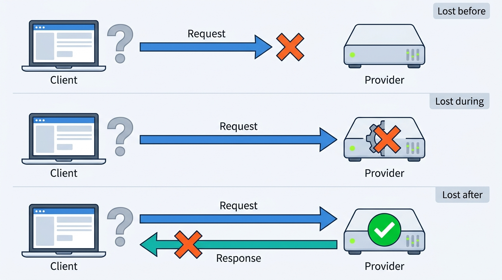
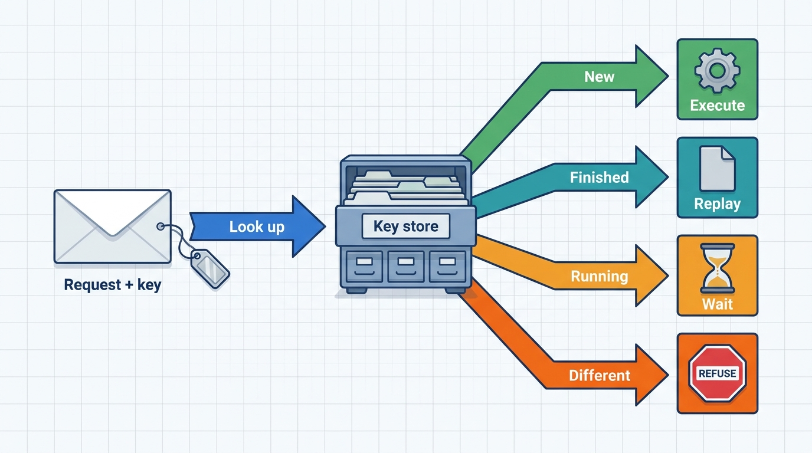
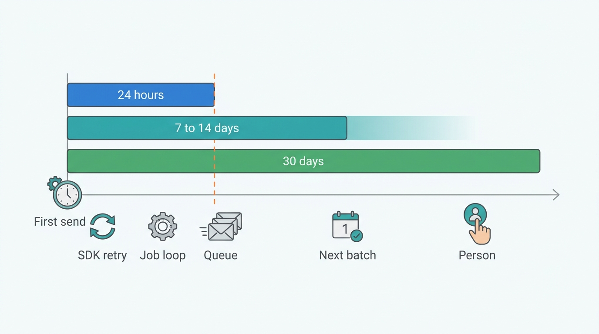

> **IN THIS CHAPTER, YOU WILL:** Learn why a timeout leaves a payment's outcome unknown, how idempotency keys make a request repeatable at Stripe and Adyen, and how to choose keys and retries.

> **KEY POINTS:**
>
> * **No answer is not a no.** A request can be lost before the provider sees it, during the work or after it, and the client cannot tell which. The safe moves are the same request under the same key, or a read of the provider's record.
> * **The provider's memory has an end date.** Stripe's API v1 replays the stored first response, errors included, for at least 24 hours. Adyen keeps a key for 7 to 14 days. A resend that arrives later is a new charge.
> * **The key must come from the business event.** A key generated per network call protects nothing. Derive it from what was meant to happen once, store it before the first send, and check every resend path against the window.

> **[FAILURE PATTERNS THIS CHAPTER ADDRESSES](where-payment-systems-go-wrong.html):**
>
> * **The Double Charge** — a timeout retried under a new key is a second payment, and this chapter is about the key that prevents it.
> * **The Phantom Payment** — a system that files a timeout or a stored error as “failed” believes something the provider's record may contradict.
> * **The First of the Month** — timeouts cluster at the peak, and retries without backoff, jitter and a deadline make the peak worse.

 
The previous chapter ended with a create request that returns an identifier ([[payment-api-design]]). Now suppose the response never arrives. A renewal job sends a €49 membership charge, waits, and gets nothing back. **Both of its choices can be wrong.** If it does nothing, a membership may go unpaid. If it sends again, the member may pay twice. On 1 November 2026 the renewal job at Larkfield, the fictional studio-software platform this book follows, sent again, each time under a new idempotency key, and 1,840 members paid twice.

Sending again can be made safe, under a narrow condition that is this chapter's claim. **“Charge this card” is safe to send twice only when both sends carry the same key**, a key derived from the business event and stored before the first attempt, and the second send arrives **while the provider still remembers that key**. That memory is finite: at least 24 hours on Stripe's API v1, 7 to 14 days on Adyen (documentation accessed November 2026, as is every Stripe and Adyen documentation page quoted in this chapter). The key makes the request repeatable; **it does not make the outcome known**. After a timeout you repeat the same request or read the provider's own record. You never start a new one.

**Where we are in the payment's journey.** Take Mila's class pass: €120.00 paid to Studio Noord on Tuesday 9 March 2027 at 19:42. This chapter covers the seconds between the booking app's request and the provider's answer, when the app does not yet know whether she was charged. The same gap opens at every later call that moves her money, including the €84.00 refund of 18 March.

The chapter starts with Larkfield's retries under new keys. It then explains why no answer is not a no, what a server must remember to recognize a repeat, and what Stripe and Adyen document. Next comes the client's side: how to choose a key, how to retry, and what a key does not solve. After a comparison of the two providers, it replays 1 November under Larkfield's new rule and ends with the ways the mechanism itself fails.

## Setting the Scene at Larkfield: 1,840 Retries Under New Keys

For example, take the morning it went wrong. On the first of each month Larkfield attempts 38% of its monthly membership volume in a 6-hour window. On 1 November 2026, in the middle of that wave, calls to a payment provider began to time out, and the renewal job sent each waiting charge again under a new idempotency key. **1,840 members were charged twice.** Larkfield refunded €71,300, an average of €38.75 per duplicate, and 212 members disputed the charge with their bank anyway. [[payment-authorization]] tells the incident from the bank's side: the first requests had been approved.

The cause was not a missing safeguard. The job sent an idempotency key, an identifier that lets the provider recognize a repeat, with every request. But its HTTP layer generated that key at each network call, so the key identified **a network call, not a renewal**. The provider then did what it documents. Stripe's error guide (n.d., accessed November 2026) puts the rule in one sentence: “A new key can start a second operation.”

Decision K1 of Keel, Larkfield's 2027 program for its payments estate, is the repair: one writer, and one key per business event, never one per network call. Femke de Graaf, who leads Keel, reduced it to three things to decide. **What identifies one renewal? Where is that key stored before the first send? And how long does each provider remember it?**

## Why No Answer Is Not a No: The Unknown Outcome

Those questions rest on a simpler one: what does a missing answer tell the client? Stripe's engineering post of February 2017 lists three places where a call between two machines can fail: “The initial connection could fail as the client tries to connect to a server. The call could fail midway while the server is fulfilling the operation, leaving the work in limbo. The call could succeed, but the connection break before the server can tell its client about it.” **(Evidence age: 9 years; the current system may differ.)** On this point the current error guide agrees: “When a connection fails, you might not know whether Stripe received or executed the request.” From the client, the three cases look the same.

**Figure 1:** *A request can be lost before the provider sees it, during the work or after it, and the client sees the same silence in all three.*

The state this leaves has a name. An **unknown outcome** is the state in which the client cannot tell whether money moved. It is wider than a timeout. Stripe's guide says: “Treat the outcome of a request that returns `500` as indeterminate: the operation might have produced side effects even though you received an error.” It is also different in kind from a decline, where the issuer (the bank that gave the customer the card) answered, and the answer was no. A decline is information. A timeout or a server error is the absence of it.

The network cannot repair this, because no protocol between two parties delivers a message exactly once: the sender cannot distinguish a lost request from a lost acknowledgement. If it never resends, the outcome stays unknown. If it resends, the work may be done twice. As a result, the usable design is to resend and let the server apply the effect once. An operation with that property is **idempotent**; the 2017 post describes idempotent endpoints as ones that “can be called any number of times while guaranteeing that side effects only occur once”.

That correction needs something from the client, because the server cannot recognize a repeat from the request's content. A member who buys two €16.00 drop-ins for the same evening, one for a friend, sends two identical requests minutes apart and wants both. Only the client knows which requests are one intention, and it says so with an **idempotency key**. In the 2017 post's words, “a client generates a unique ID to identify just that operation and sends it up to the server along with the normal payload. The server receives the ID and correlates it with the state of the request on its end.”

## What the Server Must Remember: Key, Fingerprint and Result

To honor that key the server has to remember things. This section describes them in general form; it is a reference design, not either company's implementation. The server keeps a small record per key, within a scope such as one merchant's account, and with it every incoming request falls into one of four cases.

| The server finds | It does | The client gets |
| --- | --- | --- |
| Key not known | Records the key and the request, then executes | The result of this request |
| Key known, request finished | Nothing new | The stored result of the first request |
| Key known, request still running | Nothing new | A “conflict” answer; send the same key again later |
| Key known, request differs | Nothing | An error that points to a client bug |

**Figure 2:** *With a key, the server sorts every request into four cases: execute, replay, wait or refuse.*

The fourth case needs more than the key. A **request fingerprint** is the server's stored record of what the first request asked for: its parameters, or a hash of them. Without it, a client bug that reuses a key for a different charge would get the old result back as the answer to a new question. Stripe documents the check and its purpose: “The idempotency layer compares incoming parameters to those of the original request and errors if they’re not the same to prevent accidental misuse.”

The finished request is the easy case; the request that failed halfway is where designs part. A server can **return the stored first answer**, even when that answer is an error. Or it can **carry the unfinished work to completion**. The 2017 post describes the second: “On a failure midway through an operation, the server picks up the work and carries it through. The exact behavior is heavily dependent on implementation”. Stripe's current reference documents the first contract for its API v1 and the second for API v2, as the next section shows.

Whichever contract it offers, the store that keeps this record sits on the path of every write. It therefore has to be consistent, fast and available at once, and because every key costs storage, keys expire. Two companies have described the constraint from the builder's side. Adyen's documentation (n.d., accessed November 2026) says it “must retain a consistent, stateful data store to compare each request against”, and its engineering post of July 2021 adds where: “The information needs to be available locally, so we eventually decided on integrating Cockroach, a distributed database, with our PALs” (the Payments Acceptance Layer, its edge service). **(Evidence age: 5 years.)** Airbnb's 2019 post chose a library inside each service over a separate idempotency service because “We needed ultra low latency”. **(Evidence age: 7 years.)** The table states the requirements in general form.

| Requirement | What it means for a key store |
| --- | --- |
| How fast | One lookup and one write before any work is done, on every keyed request |
| How consistent | Two simultaneous requests with one key must not both find “not known” |
| How available | When the store is down, a keyed write must wait or go unprotected |
| On failure | Half-finished work is rolled back or resumable, or the stored answer is an error |
| How long | Finite, because every key costs storage: at least 24 hours, 7 to 14 days or 30 days in the documented cases below |

For example, one design for such a record is public in detail, and it implements the second contract: a personal article from October 2017 by Brandur Leach, the author of the Stripe post, on his own site. **(Evidence age: 9 years.)** Its key record holds a lock time, the request's parameters, the stored response and a **recovery point**: the name of the last step that completed, so that a retried request resumes there. Work is cut into “atomic phases”, each committed before a call to another system; a “completer” pushes abandoned requests through, and a “reaper” deletes keys after “about 72 hours”. The article says what it is: “Let’s look at how to design idempotency keys for an API by building a reference implementation.” It was built for a demo application. **It is not a description of Stripe's system.**

By contrast with that reference design, the record of the two companies' own implementations stops early. In Stripe's documentation, support site and engineering posts I found nothing (November 2026) about where keys are stored, how a request is fingerprinted, or what “after endpoint execution begins” means internally. Adyen has published that one 2021 paragraph and one sentence of documentation; no later Adyen publication that I could find says whether the same database is still used, and nothing describes the key record, expiry or recovery. The database vendor's customer story of 14 February 2023 (a secondary source, read in an archived copy) dates Adyen's move to it to 2019.

> **INFERENCE, NOT DOCUMENTED:** Adyen documents that keys are not checked across its regional endpoints, and its 2021 post wants the data “available locally”. I read the two together as a key store that is not shared across regions on the request path. Adyen does not say so.

## What Stripe and Adyen Document: 24 Hours, 30 Days, 7 to 14 Days

What the companies do publish is behavior, and an integrator can build on that. Start with Stripe's API v1 (Stripe quotations in this section are from documentation accessed November 2026). It is the replay contract: “For API v1, Stripe saves the status code and body of the first request made with a given idempotency key after endpoint execution begins. Retries with the same key return the saved response, including `500` errors.” A replay carries the header `Idempotent-Replayed: true`. Nothing is saved for a request that fails validation or “conflicts with another request that’s executing concurrently”; the concurrent case returns a `409`. A key reused “on a request that does not match the first request’s API endpoint and parameters” gets an `idempotency_error`. Keys are “up to 255 characters long” and apply to `POST` requests.

In addition to what a repeat returns, Stripe states how long: “Stripe retains keys for at least 24 hours and can remove them after that. Reusing a key after it’s removed can execute a new request.” A 2025 post on Stripe's developer blog gives the same figure. Notice that **24 hours is a lower bound on Stripe's memory and an upper bound on safe resending**. The guide draws the consequence: “If the outcome is still unknown after that window, don’t retry with either the old key or a new one. Retrieve the relevant object, inspect the request in the Dashboard, and use webhook events to reconcile the outcome.”

Because v1 stores the answer and not the outcome, the two can differ. Stripe describes the case: “During incident recovery, Stripe attempts to reconcile failed operations and send webhook events for any objects created during reconciliation. The cached response doesn’t change, and reconciliation isn’t guaranteed to resolve every operation.” So a client can hold a stored `500` for a payment that exists, which is why the guide advises putting “a local identifier” in the object's metadata. The key made the request repeatable, and the outcome still had to be read from the record. How a receiver confirms an event against that record is the subject of [[payment-webhooks-and-events]].

Stripe's API v2 gives the other contract. When a repeat arrives, “If the first request failed (or partially failed), the API re-executes the failed requests and returns the new response.” The window is longer: requests are replays when they use the same key “for the same API”, “in the scope of the same account or sandbox”, “within 30 days of each other”, and `DELETE` requests are covered too. But the overview also says that the `/v1` namespace “includes most of the existing Stripe API today”, and the API reference lists payments and refunds at `/v1/payment_intents` and `/v1/refunds`. **As of November 2026, the 24-hour replay governs “charge this card” on Stripe.**

Adyen, by contrast, documents one contract on one page (n.d., accessed November 2026). A repeat with the same `idempotency-key` header, at most 64 characters, is answered from memory: “If the Adyen payments platform already processed the request, the response to the first attempt will be returned without duplication.” The scope and lifetime are stated: “Keys are stored at a company account level”, and “Idempotency keys are valid for a period of 7 to 14 days after first submission.” Regions are separate: keys “will not be checked for duplication in other regions”. A duplicate sent before the first request completes gets a 422 or 409 with “the error code 704”, and a response header, `transient-error`, set to `true` “indicates that the request can be retried at a later time using the same idempotency key”. When Adyen cannot check a key at all, because its key store is unavailable, “the API returns an HTTP 503 – Service Unavailable status with the error code 703”.

Three things that Stripe states, however, Adyen's page leaves unsaid: what a reused key with a **different request body** returns, whether an **error response** is stored and replayed, and what decides where in the 7-to-14-day range a key expires. I checked the idempotency page, the HTTP status page and the entries for codes 703 and 704 on the error-codes page. An integrator should therefore plan against 7 days and test the first two behaviors in Adyen's test environment.

## Choosing the Key: The Business Event, Stored Before the First Send

Windows of 24 hours and 7 days, and repeats recognized only by key, leave the client two jobs: choose the key, and control who resends it and when. A key can come from three places, and they differ in which repeats can find it again. Stripe's guide names the last two rows of the table as the common strategies: a random token “like UUID v4”, or “Derive the key from a user-attached object, like the ID of a shopping cart. This provides a relatively straightforward way to protect against double submissions.”

| Where the key comes from | Retry inside the same call | Process restart or queue redelivery | Second trigger for the same event (double tap, two workers) | What it needs |
| --- | --- | --- | --- | --- |
| A new value per call (your code, or the SDK's default) | Only the SDK's own retries | No | No | Nothing |
| A random value, stored per operation before the first send | Yes | Yes | Only if the row is unique per business event | A table and a uniqueness constraint |
| A value derived from the business event | Yes | Yes | Yes | A stable business identity |

Against this stands the view that retries are a transport concern: the SDK (the provider's client library) retries with a generated key, and a queue with exactly-once semantics does the rest. Stripe's own text marks where that stops: “If your application retries across separate SDK calls or process restarts, generate and persist a key for the operation and supply it to every attempt.” The queue does not close the gap, because its guarantee covers delivery of a message to a worker, not the worker's call to the provider. A worker that crashes after sending and before acknowledging gets the message again, makes a new SDK call, and sends a new key.

So I would derive the key from the **business event**: the thing a customer or a schedule meant to happen once, such as a cart, an invoice, a renewal attempt, a refund request or a payout period. Stripe recommends the same for its payment object: the key “is typically based on the ID that you associate with the cart or customer session in your application”. And I would write the key to my own record, with a fingerprint of the request and the state `pending`, **before the first send**. A key written only after the response arrives is lost in exactly the case it exists for.

A key can, however, be too coarse as well as too fine. A renewal that is declined is tried again days later, on purpose. If the key were made of membership and billing period alone, the second attempt would be a repeat of the first. Adyen would return “the response to the first attempt” for 7 to 14 days, which I read as including a bank's refusal, since a refusal is an answer and not an error; Stripe would replay the decline while it still held the key. **A deliberate new attempt is a new business event** and needs a new key. Stripe says the same of a corrected request: “Use a new key for the corrected operation.”

In addition, both providers constrain what a key may contain. Stripe: “Avoid using sensitive data (for example, email addresses or personal identifiers) as idempotency keys.” Adyen: “Generate unique idempotency keys per request using the version 4 (random) UUID type to prevent two API credentials under the same account from accessing each others responses”. One design satisfies both: generate a random UUID once, store it in a row that is unique on the business event's identity, and send the stored value on every attempt. A readable derived key is easier to debug and acceptable when one system holds the only credential that can move money.

Finally, the window turns into a check on the whole system: **any path whose longest delay can exceed the window must read the provider's record before it sends**. Take a nightly job whose queue redelivers one charge 36 hours after the first send. The correct key is the stored one, the same as the first attempt's. At Adyen that key is still valid and the first result comes back. At Stripe the key may be gone and the resend would be a new charge, so the job must not send until it has read what the first attempt did. The table applies the test to five paths; its delays are typical values *(assumption)*, and the windows are documented.

| Path that can resend | Longest delay *(assumption)* | Inside Stripe v1's 24 hours | Inside Adyen's 7 days |
| --- | --- | --- | --- |
| The SDK's automatic retry | Seconds | Yes | Yes |
| The job's own retry loop | Minutes | Yes | Yes |
| Queue redelivery after a crash | Minutes to days, by configuration | Only if capped | Only if capped |
| The next scheduled batch | A day or more | No | Yes |
| A person pressing “retry” | Days | No | Not reliably |

**Figure 3:** *A retry path is safe only while it fires inside the provider's window: 24 hours on Stripe's API v1, 7 to 14 days on Adyen, 30 days on Stripe's API v2.*

## Retry Policy: Backoff, Jitter and a Deadline

With the key and the paths settled, what remains is timing. A **retry policy** is the rule for which failures are retried, after what wait, and how many times. The wait should grow exponentially, with a random element called jitter. The 2017 Stripe post gives the reason: when many clients fail together, their retries return together, the “thundering herd problem”. Current documentation agrees: Adyen asks for “an exponential backoff strategy when retrying transactions to avoid flooding the API”, and its status-code page adds jitter for HTTP 429. Marc Brooker's 2015 AWS post compares the variants and calls the fully random one “Full Jitter”. **(Evidence age: 11 years; AWS added a note in May 2023 that the approach still stands.)**

Beyond the wait, both providers say in a response header whether to retry at all. Stripe's `Stripe-Should-Retry` is explicit: `true` means “Retry the request using exponential backoff”, `false` means “Don’t retry the request.” Adyen's rule is stricter: “If the API does not return a transient error header, or returns a header with a value of false, do not retry the request.” Two kinds of response are not unknown outcomes and follow rules of their own. A decline is an answer, and trying again is governed by card-network limits ([[authorization-optimization]]). A rate limit is a refusal before any work ([[payment-developer-platform]]).

In short, retrying needs an end. Stripe sets the outer limit: “Limit retries of an unresolved operation to the first 24 hours after the original request, using the same key and parameters.” I would stop well inside the provider's window and, at that deadline, hand the attempt to a resolution path that reads the provider's record. An attempt left in an open-ended loop is the one that fires after the key is gone.

## What a Key Does Not Solve: Business Duplicates and the Calls Downstream

All of that makes one request repeatable. It does not stop the same intention from arriving as two requests. A member taps “Pay” twice on a €120.00 pass, and the app generates a fresh random key for each tap. To the provider these are **two valid, distinct operations**, and it charges twice. Derived from the cart or the order, the key would have made the second tap a repeat of the first.

Both providers also document a second guard, one that sits on the payment and needs no key. At Stripe it is the payment object. Stripe lists “No double charges” and “No idempotency key issues” among the benefits of its PaymentIntent, and advises: “If the checkout process is interrupted and resumes later, attempt to reuse the same PaymentIntent instead of creating a new one.” At Adyen it is accounting, applied to captures (a capture is the merchant's claim on an amount the customer's bank has approved, or authorized) and refunds. “The accounting rules in the Adyen payments platform take care of most potential double-processing issues that can impact payment modifications”: with partial captures “it is not possible to capture a higher amount than the authorized one”, and “by default the total refunded value cannot exceed the captured amount.”

These guards have gaps, though. An amount cap does not stop a partial operation sent twice. Mila's €84.00 refund sent twice would total €168.00, more than the €120.00 captured, so by that rule the second would be refused; a €30.00 partial refund sent twice totals €60.00 and passes. On the Stripe side, the documentation states the benefit of one PaymentIntent and not the mechanism; that the object's state refuses a second confirmation is my reading ([[payment-state-machines]]). And no guard at the provider stops a second system of your own that sends the same business event by its own path.

Further out, past the provider's API, the provider is itself a client, and there the request's identity is carried by the protocol. One case is documented: Adyen's Terminal API (documentation n.d., accessed November 2026), which drives card readers ([[in-person-payments]]), requires a `ServiceID` that “Must be unique within the last 48 hours for the terminal (`POIID`) being used.” A second sits at the API's edge: Adyen lets you cancel a payment by your own reference “up to 24 hours after authorization” ([[payment-authorization]]). Between provider and card network, messages follow variants of ISO 8583, the international standard for card payment messages, a paid standard I could not read for this book. By common industry account each message carries trace numbers, and a party that gets no answer sends a reversal, a message that cancels the request it got no answer to. Treat that as industry practice, not as a cited fact.

The middle, however, is not public. Neither Stripe nor Adyen has published how its own calls to card networks and banks are made repeatable. On how a network timeout is resolved, one outcome is documented, for in-person payments: if the issuer has not processed a transaction within 120 seconds (150 through the cloud), “the Adyen payments platform automatically cancels the transaction”. Their idempotency pages describe the merchant-facing key and stop there.

> **INFERENCE, NOT DOCUMENTED:** A provider plausibly relies on protocol-level reversals for network calls that time out, and on reconciliation against the networks' clearing files (their daily records of completed transactions) to catch what those miss ([[payment-reconciliation-and-reporting]]). Neither company describes this for its own system.

## Stripe and Adyen: Where They Differ

To sum up the documented record: both companies offer the same mechanism on different terms. The Stripe and Adyen columns repeat facts cited in this chapter (documentation accessed November 2026 unless a year is given); the last column is my inference from each difference.

| Aspect | Stripe | Adyen | What the difference suggests |
| --- | --- | --- | --- |
| Retention window | API v1: at least 24 hours; API v2: 30 days | 7 to 14 days after first submission | A next-day retry is inside Adyen's window and outside Stripe v1's guarantee |
| What a repeat returns | v1: the saved status code and body, `500` included; v2: failed work re-executed, updated response | “the response to the first attempt”; whether errors are stored is not documented | Stripe has published two contracts; on Adyen, test what a failed first attempt replays |
| Same key, different request | Error of type `idempotency_error` | Not documented | Compare your own fingerprint before resending to Adyen |
| Scope of a key | The account (v2: the account or sandbox, per API) | The company account, per region, shared by all its credentials | Adyen's scope explains its advice to use random UUIDs |
| In-flight duplicate and retry signal | `409`; `Stripe-Should-Retry`; `Idempotent-Replayed: true` | 422 or 409 with code 704; `transient-error` header; the key echoed back | No material difference: both signal in headers |
| Key store unavailable | Not public | 503 with code 703; pause, or resend without the key | Adyen leaves the choice between availability and protection to the integrator |
| Published implementation | 2017 post: rationale, no storage design | 2021 post: a distributed database beside the edge layer | Neither publishes the key record, fingerprinting or expiry; do not rank them on it |

It follows that an integrator plans differently on each. On Stripe, check every resend path against 24 hours and use the object you can read back. On Adyen, plan against 7 days, test what a changed request and a failed first attempt return, and decide in advance what you do when the key store answers 503. On both, your own row per attempt is what outlasts the window.

## In Practice at Larkfield: 1 November Replayed Under K1

Larkfield's answer to Femke's three questions shows those terms at work. Under K1 the payment service is the only writer. Before it sends a renewal it stores a row in the payment record store: the key, a fingerprint of the request, the time of the first send and the state `pending`. The key is built from the membership, the billing period and the number of the scheduled attempt, for example `renewal:M-204817:2026-11:1` (an invented membership).

Now replay the timeouts for a studio on Stripe. The call times out; the service waits, with backoff and jitter, and resends the stored key. Whichever of the three failures occurred, Stripe's documented behavior yields one charge. If the first request never arrived, this one executes. If the first is still running, the answer is `409` and the service waits again. If the first finished, the saved response returns with `Idempotent-Replayed: true`. None of the 1,840 duplicates is created, and none of the €71,300 is refunded.

A studio on Adyen ends in the same place by different signals. The resend returns the response to the first attempt, with the key echoed in the `idempotency-key` response header. While the first request is in progress the answer is error 704, and the `transient-error` header says whether to try again.

Late resends are where the two providers part. Larkfield allows a path to resend under the stored key for **20 hours** after the first send on Stripe and **6 days** on Adyen, both chosen inside the documented windows. A queue redelivery 36 hours later is therefore allowed on Adyen and refused on Stripe. Past the limit nothing is sent, and the attempt goes to the sweep of decision K2. On Stripe the sweep reads the payment object, found by the Larkfield identifier that the service put in its metadata. Adyen's Checkout API has no call that returns a payment ([[payment-state-machines]]), so there the sweep waits for the webhook and, failing that, the settlement report, Adyen's itemized record of what it paid out ([[payment-reconciliation-and-reporting]]).

A scheduled re-attempt, by contrast, must not reuse the key. Mila Janssen's €49.00 renewal at Studio Noord, which is on Adyen, is declined on 1 April 2027 for insufficient funds and tried again on 4 April. The first attempt's key ends in `:2027-04:1`, the second in `:2027-04:2`. Had the key stopped at the billing period, the request of 4 April would have been a repeat inside Adyen's window, and by my reading of Adyen's page, which returns “the response to the first attempt”, Adyen would have returned the refusal of 1 April without asking her bank again.

## When It Goes Wrong: Expired Keys, Cached Errors, Changed Requests and a Store That Is Down

In the replay every condition of the thesis held; the mechanism has four failures of its own in which one does not. The most common is the **expired key**. Stripe: “We generate a new request if a key is reused after the original is pruned.” Detection is the stored time of the first send. The recovery is to send nothing and establish the outcome from the provider's record; where that fails, Stripe's instruction is to “contact Stripe support before repeating the operation”.

The second is also on Stripe's v1: the **stored error**. “For API v1, Stripe caches `500` responses from `POST` requests that use an idempotency key. Retrying with the same key returns the cached response while Stripe retains it.” Repeating the request cannot help. The attempt is resolved by reading the object or by its event, and the guide forbids the shortcut: “Don’t retry with a new idempotency key until you’ve resolved the original outcome.”

Third, the request can change under its key, usually because an amount was recomputed between attempts. Stripe refuses it: “Sending the same idempotency key with different parameters produces an error indicating that the request didn’t match the original.” Adyen's page does not describe the case. So the check belongs on the client: compare the stored fingerprint before every resend, and treat a mismatch as a bug, not as a reason for a new key.

The rarest failure matters most to decide in advance: the provider's key store is down. Adyen's page, which gave the 503 and code 703 above, also gives the choices: “you can either: Pause processing and retry the requests later (if this is feasible). Fall back to non-idempotent processing by not submitting the `idempotency-key` HTTP header.” Stripe documents no equivalent case. For a call that moves money I would pause; a delayed renewal is cheaper than a double one. I would treat a switch between Adyen's regional endpoints the same way, since keys are not checked across regions.

> **INFERENCE, NOT DOCUMENTED:** Answering 503 instead of processing without the check means Adyen's API refuses a keyed request it cannot deduplicate, and passes the decision to accept that risk to the caller. That is my reading of the documented behavior, not a design statement by Adyen.

## What to Take Away

**Established.**

- A timeout or a server error leaves the outcome unknown. Stripe's 2017 post sets out the three cases, and its current guide calls a `500` “indeterminate”.
- Both providers document a resend under the same key, with a stated window: at least 24 hours on Stripe's API v1, 30 days on API v2, 7 to 14 days on Adyen (documentation accessed November 2026).
- A new key is a new operation. Past the window, so is the old key.
- Neither company has published its implementation beyond a fragment: nothing from Stripe on storage, one 2021 paragraph from Adyen.

**Depends on context.**

- A derived key is enough with one writer and one credential; a stored random one fits Adyen's advice when several credentials share a company account.
- How far inside the window to stop resending depends on your longest retry path. Larkfield's 20 hours and 6 days suit a job that finishes in a day.
- Pause or drop the key when Adyen's store is down: pause for charges, refunds and payouts; dropping it can be defended only where a duplicate is harmless.

**The author's synthesis.**

- A repeat is safe while two memories overlap: the provider's memory of the key and the client's memory of what it meant by it. I design the second, because it is the one that has to outlast the first.
- The key belongs in the application's data model, not in the HTTP client. Larkfield's job had the mechanism and no memory, so its retry could only be a new request. The retention window is the number I read before writing a retry.

## Questions to Ask

In a design review, those points become nine questions.

1. For each call that moves money, what is the business event, and does the key come from it?
2. Is the key written to our own record before the first send?
3. How long does each provider keep a key, and where is that written down in our code?
4. Which paths can resend (SDK, loop, queue, batch, person), and what is the longest delay of each?
5. Does a path whose delay exceeds the window read the provider's record before it sends?
6. When does retrying stop, and who owns an attempt that is still unknown at the deadline?
7. What happens when the request changes between attempts, and have we tested it on each provider?
8. Which duplicates would get past the key, and which guard on the payment catches them?
9. What do we do when the provider cannot check the key?

The idempotency key is something the provider remembers on your behalf, for hours or days, so that one request can be repeated. There is a second thing it remembers for you, on a much longer clock: the version of the API your integration was built against. [[payment-api-versioning]] is about that memory, and about what happens when it ends.

## Sources and Evidence

*Company, product and investor sources*

- [Designing robust and predictable APIs with idempotency](https://stripe.com/blog/idempotency), Brandur Leach, Stripe, 2017-02-22 — the three failure cases, the definition of the idempotency key, picking up unfinished work, backoff and jitter (evidence age: 9 years).
- [Idempotent requests](https://docs.stripe.com/api/idempotent_requests), Stripe API reference, n.d., accessed 2026-11 — saved status code and body for API v1, parameter comparison, 255 characters, pruning after 24 hours, what is not saved.
- [Advanced error handling](https://docs.stripe.com/error-low-level), Stripe, n.d., accessed 2026-11 — indeterminate `500`, the 24-hour limit on retries, “A new key can start a second operation”, incident reconciliation, SDK-generated keys, key strategies, `Stripe-Should-Retry`, `Idempotent-Replayed`.
- [API v2 overview](https://docs.stripe.com/api-v2-overview), Stripe, n.d., accessed 2026-11 — 30-day window, re-execution of failed requests, scope, the `/v1` namespace.
- [Errors](https://docs.stripe.com/api/errors), Stripe API reference, n.d., accessed 2026-11 — the `idempotency_error` type.
- [Create a PaymentIntent](https://docs.stripe.com/api/payment_intents/create), Stripe API reference, n.d., accessed 2026-11 — payments are created under `/v1`.
- [Create a refund](https://docs.stripe.com/api/refunds/create), Stripe API reference, n.d., accessed 2026-11 — refunds are created under `/v1`.
- [The Payment Intents API](https://docs.stripe.com/payments/payment-intents), Stripe, n.d., accessed 2026-11 — “No double charges”, reusing a PaymentIntent, keys based on the cart or session.
- [Because nobody likes being charged twice](https://stripe.dev/blog/because-nobody-likes-being-charged-twice), Ben Smith, Stripe developer blog, 2025-04-10 — the 24-hour figure repeated.
- [API idempotency](https://docs.adyen.com/development-resources/api-idempotency), Adyen, n.d., accessed 2026-11 — header and length, replay of the first response, company-account scope, 7 to 14 days, regions, UUID advice, transient errors, codes 703 and 704, accounting rules.
- [HTTP status codes](https://docs.adyen.com/development-resources/response-handling), Adyen, n.d., accessed 2026-11 — HTTP 429 and backoff with jitter; the 409 and 422 entries.
- [Error codes and messages](https://docs.adyen.com/development-resources/error-codes), Adyen, n.d., accessed 2026-11 — the entries for codes 703 and 704, which say nothing about a changed request or a stored error.
- [Terminal API](https://docs.adyen.com/point-of-sale/design-your-integration/terminal-api), Adyen, n.d., accessed 2026-11 — `ServiceID` unique within 48 hours per terminal.
- [Time-outs](https://docs.adyen.com/point-of-sale/error-scenarios/pos-timeouts), Adyen, n.d., accessed 2026-11 — automatic cancellation of an in-person payment the issuer has not processed in 120 or 150 seconds.
- [Cancel](https://docs.adyen.com/online-payments/cancel), Adyen, n.d., accessed 2026-11 — cancel by your own reference up to 24 hours after authorization.
- [Design to Duty: How we make architecture decisions at Adyen](https://www.adyen.com/knowledge-hub/design-to-duty-adyen-architecture), Adyen, 2021-07-28 — a distributed database beside the acceptance layer for API idempotency (evidence age: 5 years).
- [The Price of Payments: How Adyen Guarantees Idempotency & Eliminates Downtime](https://web.archive.org/web/20230215205456/https://www.cockroachlabs.com/blog/adyen-guarantees-idempotency/), Cockroach Labs, Cassie McAllister, 2023-02-14; the original URL returns 404, archived copy of 2023-02-15 — a vendor's customer story dating Adyen's use of the database to 2019 (secondary source; evidence age: 3 years).

*Standards, regulation and official documentation*

- None.

*Research and practitioner sources*

- [Implementing Stripe-like Idempotency Keys in Postgres](https://brandur.org/idempotency-keys), Brandur Leach, personal site, 2017-10-27 — the reference implementation: key record, atomic phases, recovery points, completer and reaper (evidence age: 9 years; not a description of Stripe's system).
- [Avoiding Double Payments in a Distributed Payments System](https://medium.com/airbnb-engineering/avoiding-double-payments-in-a-distributed-payments-system-2981f6b070bb), Jon Chew and Ninad Khisti, Airbnb, 2019-04-16 — an idempotency library chosen over a separate service for latency (evidence age: 7 years; the article page returns 403 to automated clients, so the text was read through the publication's RSS feed).
- [Exponential Backoff and Jitter](https://aws.amazon.com/blogs/architecture/exponential-backoff-and-jitter/), Marc Brooker, AWS Architecture Blog, 2015-03-04, updated May 2023 — jitter variants, “Full Jitter” (evidence age: 11 years).

Larkfield is fictional; architectural recommendations, labeled inferences and labeled assumptions are the author's judgement.
