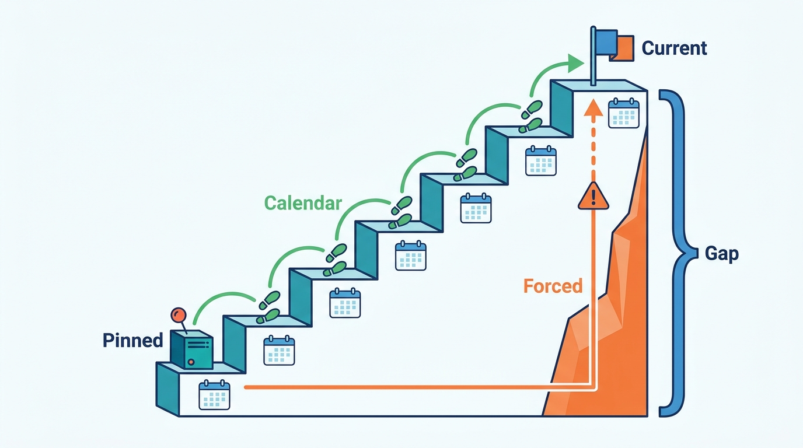
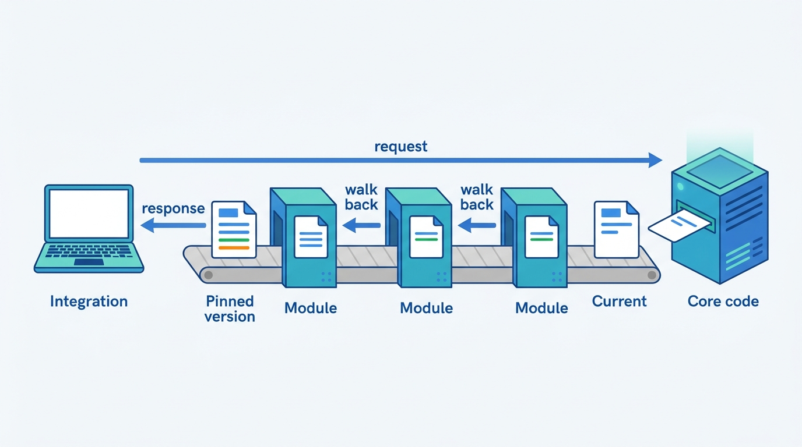
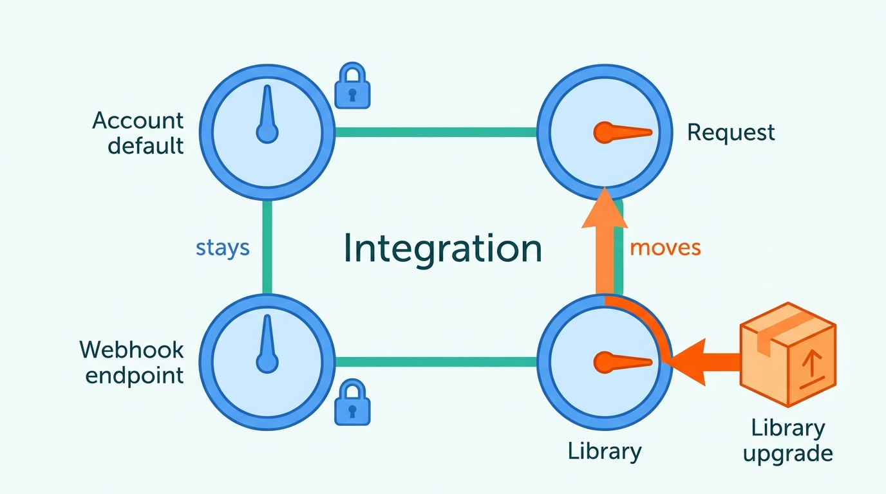

> **IN THIS CHAPTER, YOU WILL:** Learn how Stripe and Adyen change their APIs without breaking integrations, where your version is actually set, and how to upgrade on your own schedule.

> **KEY POINTS:**
>
> * **A pinned version moves the cost of change; it does not remove it.** The provider keeps serving the shape your integration was built against, and pays for that in code. You pay later: every release you skip adds to the distance of the upgrade you will eventually make.
> * **The two providers pin differently, and only one publishes a due date.** Stripe uses one dated version for its whole API, set by account default, by header or, since 2023, by SDK release, with two named breaking releases a year since October 2024. Adyen puts a number in the URL of each API and gives a deprecated Checkout API version two years before end-of-life.
> * **Your version is set in several places, and the webhook endpoint is one of them.** Find every place, give each an owner and a date, and upgrade on a calendar. An upgrade you scheduled crosses one release; an upgrade something else forced crosses all of them at once.

> **[FAILURE PATTERNS THIS CHAPTER ADDRESSES](where-payment-systems-go-wrong.html):**
>
> * **The Version Cliff** — an integration left on an old version until a library upgrade or an end-of-life date moves it across years of changes in one step is this chapter's central case.
> * **The Trusted Doorbell** — webhook payloads have a version of their own, so a handler that assumes events look like API responses breaks when only one of the two is upgraded.
> * **The Borrowed Blueprint** — Stripe's machinery for serving every old version answers a problem of scale that an API with a handful of known consumers does not have.

 
The previous chapter ended with something the provider remembers for you. An idempotency key, the identifier that lets a provider recognize a repeated request, is kept for hours or days so that one request can be sent twice ([[idempotency-and-retries]]). The **API version** is a second thing the provider remembers on your behalf, and it remembers it for years, so that an integration written long ago keeps working while the API changes around it. It raises the same question the key did: what happens when that memory ends?

Larkfield, the fictional studio-software platform this book follows, found out in March 2026. An engineer upgraded one client library to get one feature. No request failed and no alert fired. For six days the subscription revenue reports were wrong, because the upgrade had quietly moved every request of the billing integration across three years of API changes.

That incident shows both halves of this chapter's claim. **A provider evolves its API by letting each integration keep seeing the version it was built against** while the provider's own code moves on. This moves the cost of change without removing it. The provider maintains every version it still serves. The integrator who never upgrades **accumulates a gap that some later change forces it to cross in one step**.

**Where we are in the payment's journey.** This chapter is not a step on the payment's path; it concerns the wording of every step. When Mila Janssen buys her €120.00 class pass on Tuesday 9 March 2027, Larkfield's payment service sends a request to one version of Adyen's Checkout API and reads an answer in that version's shape. Every message in the book's recurring payment has a version in this sense.

The chapter starts with Larkfield's library upgrade. It then explains why a payment API cannot simply change, compares three ways to version one, and reports how Stripe described its mechanism in 2017 and what changed in 2023 and 2024. Adyen's documented model follows, then the places a version is set, the comparison of the two providers, Larkfield's upgrade calendar and the ways an upgrade goes wrong.

## Setting the Scene at Larkfield: One Library Upgrade, Six Days of Wrong Reports

Larkfield bills its studios with Stripe Billing ([[subscriptions-and-billing-engines]]). The code that does this, the billing integration, then belonged to the growth team and not to the payments team. Until March 2026 it sent no version with its requests, and it used a Stripe client library old enough to carry none. So every request ran on the **account's default version**, a setting stored at Stripe. Someone had last moved it in early 2023, to `2022-11-15`, the version current at that time in Stripe's changelog. The version lived in the provider's record of the account, not in Larkfield's code, and nobody owned it.

In March 2026 the growth team needed a feature that only a newer release of the library offered. Stripe's documentation (n.d., accessed November 2026) says what such a release brings with it: “When you use a server-side SDK, your API calls to Stripe use the API version that was current when the SDK was released.” The new library carried `2026-02-25.clover`. Every request moved across four dated versions and three named major releases, and one of those releases, `2025-03-31.basil`, had removed the `subscription` field from the Invoice object. Larkfield's finance export used that field to tie each invoice to its subscription. It found nothing, raised no error, and filed the invoices as one-off sales. Subscription revenue reports were wrong for six days. The webhook endpoint, meanwhile, stayed on the account default, so the event handlers saw nothing unusual.

In 2027 Femke de Graaf, who leads the Keel program, has decision K7 to carry out: versions are upgraded on a calendar. She turned it into three questions that this chapter answers. **Where is each of our API versions set, who owns it, and on what date do we next move it on purpose?**

## Why a Payment API Cannot Simply Change, and Cannot Only Add

The field Larkfield lost is an example of a **breaking change**: a change to an API after which client code that was correct can fail or misbehave without having been modified. Adyen's versioning page (n.d., accessed November 2026) lists what it counts as breaking: adding a required request field, removing an endpoint or a field, renaming a field, changing a field's type, changing an HTTP status code or an error code, and “Changing the behavior in a way that requires API consumers to change their integration for it to work properly.”

Such a change costs more in payments than in most software, because a payment integration is written once and then runs unattended for years. Nobody is watching when the response changes shape. The result is not a broken page but failed charges or, as at Larkfield, wrong books. Stripe's 2017 engineering post on versioning put the provider's obligation this way: “Just like a power company shouldn't change its voltage every two years, we believe that our users should be able to trust that a web API will be as stable as possible.” **(Evidence age: 9 years; the current system may differ.)**

The obvious way out is to never break anything: add fields and endpoints, never remove or reshape one, and versions are not needed. Both companies make additive changes without forcing an upgrade: Adyen applies them to the versions already in use, and Stripe ships them in monthly versions to which, its versioning reference (n.d., accessed November 2026) says, you can upgrade “without updating your code.” Both also record changes that are not additive. Stripe's 2017 post counted “almost a hundred backwards-incompatible upgrades over the past six years.” Its release page for the major version Basil (31 March 2025) says “This version introduces a significant number of breaking changes.” Adyen's release notes for Checkout API v72 (15 April 2026) have a “Breaking Changes” heading and state that “Previously deprecated parameters have been removed.” Across nine years of records, adding alone has not been enough for either.

There is a second problem with “only add”: what counts as additive is itself declared by the provider. Adyen's versioning page distinguishes its newer APIs, such as Checkout, from four older “classic” ones: “in new Adyen APIs, adding an optional field to a response body is a non-breaking change, while in classic APIs this change is considered breaking and therefore requires a new API version.” Stripe's Basil release, described later in this chapter, marks the row “Adds expired status for Issuing Authorizations” as breaking (Issuing is Stripe's product for creating payment cards): a new value of a status field in responses, with nothing new required in what a client sends. Whether a change is safe depends on what clients were told they may assume, so the provider must publish the rule and the integrator must code to it.

## Three Ways to Version an API, and Who Pays in Each

An API that may not break its clients and cannot stay frozen needs versions, and the designs differ in who pays for a breaking change and when. The oldest design is a small number of large versions (v1, v2, v3), each a redesign, with the old one switched off at a deadline. The integrator pays, all at once, on the provider's date. Stripe's 2017 post (evidence age: 9 years) rejected this design because such changes are “so big and so impactful for users that it's almost as painful as re-integrating from scratch”, and because providers end up “retiring API versions and by extension cutting those users off, or maintaining the old versions forever at considerable cost.”

The opposite design makes versions small and frequent and holds each integration at the one it was built against. This is **version pinning**: fixing the version of the API that one integration sees, so that the provider's changes reach it only when it asks for a newer version. Here the provider pays, by continuing to serve every version that some integration is still pinned to.

A middle design combines the two. The provider applies additive changes to every existing version, reserves a new version number for breaking changes, and publishes a **deprecation policy**: a lifecycle that ends old versions after a stated notice period. The pin holds, and it also has a date on which it runs out. The cost is shared and scheduled.

All three designs share one property, and it is the one that hurt Larkfield. The provider keeps the old shape alive, and meanwhile the distance to the current shape grows on the integrator's side. **A pin works like a loan**: it buys time, and the amount owed grows with every release. The table sets out the three allocations; it is my analysis, not a documented classification.

| Design | Who pays when the API changes | What the integrator must do | Fits when |
| --- | --- | --- | --- |
| Large versions with a switch-off date | The integrator, all at once, on the provider's date | Re-integrate before the deadline | Integrators are few, or a redesign cannot be delivered any other way |
| Small versions pinned per integration, no stated end | The provider, for as long as it serves each version; the integrator later, by choice or by accident | Know where the pin is set and choose its own upgrade dates | Integrators are too many to coordinate |
| Additive changes on every version, numbered versions for breaks, a published lifecycle | Both, on a schedule | Parse leniently and upgrade inside the notice period | Old versions must end, for security or regulatory reasons |

**Figure 1:** *A pin is a loan: each release adds a step to the gap, which is crossed either one step at a time on a calendar or all at once when something forces it.*

## How Stripe Described Its Mechanism in 2017: Version-Change Modules

Of the two providers, only Stripe has published how it pays for pinning. Everything in this section comes from Stripe's engineering post “APIs as infrastructure: future-proofing Stripe with versioning”, dated 5 August 2017. **(Evidence age: 9 years; the current system may differ. The next section says which parts current documentation confirms.)** In that account each version is named by its release date: “we implement versioning with rolling versions that are named with the date they're released (for example, 2017-05-24).” An account is pinned at its first request: “The first time a user makes an API request, their account is automatically pinned to the most recent version available, and from then on, every API call they make is assigned that version implicitly.” A single request can override the pin by sending a `Stripe-Version` header.

The post then explains how one code base answers in every version. The server builds each response in the shape of the current version. For each incompatible change there is a **version-change module**: “we encapsulate it in a version change module which defines documentation about the change, a transformation, and the set of API resource types that are eligible to be modified.” Having found the caller's version, from the header, an authorized application or the account's pin, the server “walks back through time and applies each version change module that finds along the way until that target version is reached.” Old versions are therefore produced by a chain of small transformations, not by old code paths, and the core code handles one shape only.

**Figure 2:** *As Stripe described it in 2017, a response is built once in the current shape and walked back through version-change modules until it matches the version the caller is pinned to.*

Not every change fits inside such a transformation. A change in behavior, as opposed to a change in the shape of a response, cannot be undone by rewriting the response afterwards. The 2017 post describes modules marked as having side effects, whose presence the core code has to check for directly, and it is frank about them: “This reduced encapsulation makes changes with side effects more complex to maintain, so we try to avoid them.”

The result is a cost that grows with every version, and the 2017 post says so: “Providing extensive backwards compatibility isn't free; every new version is more code to understand and maintain.” Checks that cannot be encapsulated end up “littered throughout the project, making it slower, less readable, and more brittle.” At that time Stripe had kept every version alive (“we've maintained compatibility with every version of our API since the company's inception in 2011”) and did not expect to do so forever: “we expect to eventually start retiring our older API versions.”

Whether to copy this machinery is a separate question, and my answer for most readers is no. Its cost is permanent and grows per version. Its benefit is proportional to the number of clients that their provider cannot change. For an internal API with a handful of known consumers, the expand-contract pattern is cheaper: add the new form beside the old, move the consumers, then remove the old. Adyen's versioning page names that pattern for its own additive changes. [[api-contracts-and-versioning]] in ORDERED covers versioning between a company's own services.

## What Changed at Stripe in 2023 and 2024, and What Nobody Has Re-Described

The 2017 account is nine years old, and Stripe has documented two changes to it since. The first is in the sentence that caught Larkfield. Stripe's upgrade guide (n.d., accessed November 2026) says a server-side SDK uses “the API version that was current when the SDK was released.” The same page dates the change through the SDK changelog entries it links to: versions of stripe-node before v12 (6 April 2023), and of stripe-ruby before v9, stripe-python before v6 and stripe-php before v11 (all 16 August 2023), “use your account's default API version.” For Java, Go and .NET the version “is *fixed*” to the SDK release. For SDK users the pin has moved from the account to the dependency, and **an SDK upgrade is an API upgrade**. Stripe now advises: “Make sure that you specify the API version that you're integrating against in your code instead of relying on your account's default API version.”

The second change is the rhythm. A Stripe post of 1 October 2024 describes the old practice: “Historically, we've released new API features as soon as they're ready for production—regardless of whether they're backward-compatible or not.” Since then, “Each semiannual major release—like Acacia—includes breaking changes and is named after a plant”, and “Each monthly release adds new features without breaking changes.” A footnote keeps an exception: “We may introduce an out-of-cycle breaking change if we determine that your integration would be severely impacted without it.” The changelog shows five majors so far: `2024-09-30.acacia`, `2025-03-31.basil`, `2025-09-30.clover`, `2026-03-25.dahlia` and `2026-09-30.endive`. As of November 2026 the current version is `2026-10-28.endive`. An integrator now has two dates a year to plan around.

Basil shows what one such release holds. Among its changes, the page “Invoicing resources now specify how they were generated” (31 March 2025) lists `quote`, `subscription`, `subscription_details` and `subscription_proration_date` as removed from the Invoice object, and instructs: “Use `invoice.parent.subscription_details.subscription` (verify `invoice.parent.type` is `subscription_details`) instead of `invoice.subscription`.” That is the field Larkfield's export read. An integration that stayed pinned before Basil kept the old shape; one that crossed Basil had to change code.

With both changes in hand, the 2017 post's claims sort into three groups: confirmed by current documentation, replaced, and not re-described by anyone since. The only later statement I found about keeping old versions correct is in a Stripe post of 15 June 2026 on its API tooling. It says that “Due to the historical architecture of the v1 platform, it's not trivial to regenerate descriptions for non-current API versions”, and that for the newer v2 namespace ([[payment-api-design]]) “we also detect and display changes to past API versions (if applicable).” Neither sentence describes how responses are served.

| Claim in the 2017 post | Status in November 2026 | Source |
| --- | --- | --- |
| Versions are named by release date | Confirmed; since 2024 the release name is appended (`2026-10-28.endive`) | Versioning reference, n.d. |
| An account has a pinned default version, set at its first request | Confirmed: “Your default API version gets set the first time you make an API request” | “How API versioning works”, n.d. |
| A `Stripe-Version` header overrides it per request | Confirmed | Versioning reference, n.d. |
| Each dated version carries a small set of incompatible changes | Replaced in October 2024 by two named major releases a year | Release-process post, 2024 |
| The account is the pin | Replaced for SDK users in 2023 by the SDK release; Stripe advises setting the version in code | Upgrade guide, n.d. |
| Responses are walked back through version-change modules | Not re-described since 2017 | None found |
| Every version since 2011 is still served; retirement is expected | No later statement found | None found |

That leaves a real gap in the public record. No Stripe source I could find (documentation, support site and engineering posts, November 2026) says whether Stripe has retired any dated version, how many versions it serves, or whether version-change modules still produce the responses of its v1 API. The versioning reference, the page “How API versioning works”, the upgrade guide, the changelog and the release-process post contain no retirement policy and no sunset notice. Stripe's webhook documentation (n.d., accessed November 2026) still uses an account “set to an older API version, such as 2015-02-16” as its example. So the size of Stripe's compatibility cost today is not known outside the company.

> **INFERENCE, NOT DOCUMENTED:** Very old dated versions are plausibly still served by Stripe, given the 2015 example in current documentation and the absence of any retirement notice. This is a reading of what the documentation omits. It is not a guarantee, and the 2017 post itself said retirement was expected.

## Adyen's Documented Model: A Number in Each URL and a Published Lifecycle

Adyen's model differs from Stripe's at the first step: the caller writes the version into every request. Its versioning page (n.d., accessed November 2026) says: “Each API URL contains a version suffix starting with either "v" or "V" character followed by a whole number to indicate the API version. We increment the number for every version, but we may skip numbers when needed.” There is no account default to fall back on. Each API also counts on its own: “Most integrations use multiple Adyen APIs”, and “Each API has a different version.” The page's examples show a Checkout URL at `v68`, an account API at `v6` and the Balance Platform API at `v1`. An integration that uses several Adyen APIs holds several version numbers at once.

A version number at Adyen does not freeze the payload. “We implement non-breaking changes in all versions of an API, so that you benefit from it without having to upgrade your API version”, the page says, and only “When we introduce a breaking or incompatible change, we release a new API version.” For Checkout, “we only release major versions.” The consequence for the integrator is stated on Adyen's webhook-types page (n.d., accessed November 2026): “you should set up your server to be able to accept webhooks of more types and receive more event type values than are listed below.” On the newer APIs, a new response field can appear on the version you already call. **Code that rejects what it does not recognize will fail on a change Adyen has declared safe.**

What Adyen adds, and Stripe does not publish, is how long a version lasts. Its upgrade page (n.d., accessed November 2026) gives every major version of the Checkout API four lifecycle states and a reason: “We deprecate older versions to protect your data and maintain compliance with financial regulations.”

| State | What Adyen's upgrade page says of a Checkout API version in this state |
| --- | --- |
| Active | “The latest major version of Checkout API.” |
| Inactive | It “only receives bug fixes and changes required to comply with new regulations.” |
| Deprecated | No features or fixes. “After a version reaches this state, you have 2 years to upgrade” |
| End-of-Life | “you no longer receive support from Adyen and payment processing can be suspended anytime.” |

The lifecycle is applied in practice. Adyen's release notes of 18 September 2026 list under “Removed”: “Checkout API v37 is no longer supported. If your integration still uses v37, you must upgrade your integration to the latest available version.” The general versioning page reads more softly: “if you decide stay in your current version, you can continue to do so. We maintain older versions of our APIs that you can continue to use until you are ready to upgrade.” The documentation does not reconcile the two statements. I treat the lifecycle page as the rule for Checkout, because it is the more specific and the release note agrees with it. New versions are rare: v71 is dated 1 November 2023 and v72 15 April 2026.

On its own side of the interface Adyen has published almost nothing. I found no engineering source, in its knowledge hub or elsewhere, on how one platform serves its many Checkout versions. A 2022 article on Adyen's API practice says only that deprecation is flagged in the specifications and documentation “while the deprecated elements are deleted only after one or more versions” **(evidence age: 4 years)**. Adyen's upgrade page says the lifecycle state of each version is shown in its API Explorer, an interactive reference. The copy of its Checkout page that I fetched in November 2026 listed 17 versions from v40 to v72 and marked v72 “latest”, but showed no lifecycle state, so check there for the version you call. The provider's cost of versioning has public evidence from Stripe alone.

## Where a Version Is Set: Requests, Libraries and Webhook Endpoints

Both models leave a practical question: in how many places does one integration hold a version? At Stripe a request version can come from three places. The versioning reference (n.d., accessed November 2026) names two: “Requests made with curl use your Stripe account's default API version (controlled in Workbench) unless you override it by setting the `Stripe-Version` header.” The SDK release is the third. Stripe's page “How API versioning works” (n.d., accessed November 2026) lists all three in order: the header if you set one, the version pinned by your SDK if you use one, and the account default otherwise. The most specific setting wins, and only the header and the SDK are visible in the integrator's code. Workbench, Stripe's developer dashboard ([[payment-developer-platform]]), shows “which API versions your integration uses”, which is the way to find out what is in effect.

The events Stripe sends you are versioned separately. An event is the provider's notice that something happened, delivered to a webhook endpoint ([[payment-webhooks-and-events]]). “Webhook events also use your account's default API version unless you set an API version during endpoint creation”, the reference says. The shape is fixed when the event is created. The webhook documentation gives the case of an account on an old version where one request overrides it: the event “generated and sent to your destination is still based on the 2015-02-16 API version. You can't change Event objects after creation.” **So after an SDK upgrade your requests can be on one version and your event handlers on another.**

Because an endpoint's version is set only when the endpoint is created, Stripe's upgrade guide documents a cut-over with two endpoints. You create a second endpoint with the same URL plus a query parameter and the target version. Then “every event is sent twice: once with the old API version and once with the new one.” You process one copy and acknowledge the other, then switch. After the switch the guide recommends answering the old endpoint with a 400 status, so that if you must revert “Stripe automatically resends all the events”, and finally disabling it. Stripe's newer *thin events*, which carry identifiers and no versioned payload, need none of this: “Thin event payloads are unversioned.”

Adyen's places correspond. The version is in the URL of each API. Its server libraries hide that: they let you call the APIs “without needing to know the API versions. Instead, you need to consider the library version”, so the library release is where the version is really set. Each webhook configuration has a setting named “Version”, described only as “The webhook version.” I found no statement in its documentation or help center on how long old webhook versions are delivered. And Adyen's client-side checkout libraries, Drop-in and Components, require a minimum server version: “Web Drop-in/Components v5.0.0 is only compatible with Checkout API v68 or later.” Those libraries have their own lifecycle, with one year from Deprecated to End-of-Life. A front-end upgrade can therefore force a back-end one.

The inventory worth keeping is one table of every place a version is set, with one extra column: does it move when a dependency is upgraded? The rows marked “Yes” are the ones that move without anyone deciding.

| Where a version is set | Stripe | Adyen | Moves when a dependency is upgraded? |
| --- | --- | --- | --- |
| Account default at the provider | Used by requests that state no version and by endpoints created without one | None; the caller states the version | No |
| The request itself | `Stripe-Version` header or a client option | Version segment in each API's URL | Only if a library sets it |
| Server library release | Since 2023 carries the version current at its release; fixed in Java, Go and .NET | Each release wraps specific API versions, named in its release notes | Yes |
| Client-side checkout library | Stripe.js has named versions, released twice a year, chosen in the script URL or the npm package | Drop-in/Components requires a minimum Checkout API version | Yes; at Adyen it can force the server's |
| Webhook endpoint or configuration | Set at endpoint creation, else the account default; thin events are unversioned | A “Version” setting per configuration | No |

**Figure 3:** *One integration holds its version in several places; a library upgrade moves the requests and leaves the account default and the webhook endpoint where they were.*

## Stripe and Adyen: Where They Differ

Taken together, the documented models differ on six aspects. The Stripe and Adyen columns repeat facts cited in the preceding sections, from documentation accessed in November 2026 unless a year is given; the last column is my inference from the difference.

| Aspect | Stripe | Adyen | What the difference suggests |
| --- | --- | --- | --- |
| Where the version lives | Account default, `Stripe-Version` header or SDK release; one dated version spans the whole API | In the URL of each API, an integer per API; no default | Stripe's version can be invisible in your code; Adyen's is in every request line, once per API |
| Additive changes | Monthly releases that add features “without breaking changes” (2024); the documentation advises ignoring “unfamiliar fields and event types” | Applied to “all versions of an API” | Adyen says outright that a version you already call gains fields; parse leniently on both |
| Breaking changes | Two named major releases a year since October 2024, with an out-of-cycle exception reserved | A new version number per API; Checkout v71 in 2023, v72 in 2026 | Stripe gives a rhythm to plan against; Adyen gives rarer and larger steps |
| Published end of a version | Not public; the 2017 post expected retirements | Checkout: two years from Deprecated to End-of-Life; v37 no longer supported (2026) | Adyen sets the due date; on Stripe you must set your own |
| Webhook payload version | Per endpoint, fixed at creation, else the account default; thin events unversioned | A “Version” setting per webhook configuration; how long old versions are delivered is not public | At both it is a separate setting to track |
| Published mechanism for serving old versions | Version-change modules (2017; evidence age 9 years), not re-described since | Not public | The provider's cost is evidenced only from Stripe, and only as of 2017 |

These differences change what an integrator does. On Stripe, set the version in code, treat every SDK upgrade as an API upgrade, and plan around the two major releases a year, since no notice will arrive to prompt you. On Adyen, make your parsers ignore unknown fields and event types, track the lifecycle state of each API version you call, and upgrade each API separately, because each has its own counter.

## In Practice at Larkfield: Upgrading on a Calendar

At Larkfield, K7 began with a **version register**: one row for each place a version is set, with its current value, an owner and the date it was last moved. In 2027 the register has rows for the Stripe requests of the payment service and of the billing integration (now owned by the payments team), each set explicitly in code. It has the Stripe webhook receiver's endpoint version, the Adyen Checkout version in the payment service's URLs (v71, the latest when Larkfield integrated in 2024), the Adyen webhook configuration, and the client libraries in the booking app. The register is the previous section's inventory, filled in for one company.

The Stripe row moves once per half-year, in May and November, some weeks after the major releases that have landed in March and September. Tom Hendriks, the senior engineer who built the payment service, runs the same sequence each time. He reads the changelog entries tagged as breaking between the two versions, against a list of every field the code and the finance exports read. He replays recorded requests in a Stripe sandbox, an isolated test account, at the target version, and compares the responses field by field with the recorded ones. Then the version in code changes, in a pull request that changes nothing else. Each upgrade crosses one major release, so the list to read is one release long.

The webhook endpoint moves as a second change, a week later, by Stripe's two-endpoint procedure. The Stripe receiver is older than the payment service, and its handlers and the exports that read stored events have to be checked against the new payload shape on their own. For that week every event arrives in both shapes, and Larkfield compares them before switching which one it processes.

The Adyen row behaves differently. Checkout versions arrive years apart, so the half-yearly slot is more often a check than a move. By the documented lifecycle the Active state belongs to the latest major version, which has been v72 since April 2026, so v71 is no longer Active. Whether it is Inactive or Deprecated in 2027 is something this chapter cannot state; Larkfield reads it in the API Explorer at each slot and records it in the register. It also confirms that its parsers ignore unknown fields, and it upgrades one Adyen API at a time.

The calendar costs Larkfield about three to five engineer-days per provider per half-year *(assumption)*. In return, each upgrade crosses one release's changes while nothing else changes. The March 2026 upgrade crossed four dated versions and three major releases inside a feature change, and cost six days of wrong revenue reports plus the work of correcting them. [[payment-safe-change]] takes up the general discipline of changing a payment system safely.

## When It Goes Wrong: Split Versions, Silent Nulls and Forced Jumps

Upgrades that fail usually fail quietly. The first quiet failure is a split: after a library upgrade the requests are on a new version while webhook payloads stay on the old one. Each works alone. The fault appears only in code that compares or merges the two, such as a handler that updates a record first written from an API response. Stripe's versioning reference advises closing the split, for example “match your webhook endpoint API version to the version pinned by your `stripe-ruby` version”. To detect it, store the API version with every response and every event you keep, and alert when the two differ for longer than a planned cut-over.

The second is the silent null, which is what Larkfield had. In a dynamically typed client a removed field does not raise an error; it reads as empty, and the failure surfaces days later in a report. Stripe's upgrade guide notes the opposite behavior for strongly typed SDKs, where a mismatched version can “result in request failures”: typed clients fail loudly. The defense in either case is a test that asserts the presence of every field an export or a ledger posting reads, run against the target version before the upgrade.

The third runs the other way, and belongs to additive change. A client that rejects unknown fields, unknown status values or unknown event types breaks on a change the provider has declared non-breaking. Adyen says it applies such changes to every version, so a pinned Adyen version is not a frozen payload. Stripe's page “How API versioning works” counts “Adding new properties to existing API responses” and “Adding new event types” as backward-compatible and advises: “Design your integration to ignore unfamiliar fields and event types.” It does not say in so many words that such changes reach older versions; I assume they can. Strict deserialization of a provider's responses is a fault waiting for a release.

The last case is the forced upgrade, set off by an end-of-life date or by a feature that needs a newer library. It is where the first three tend to arrive together. My recommendation is to cross the gap in stages where the provider allows it: first pin the old version explicitly, then upgrade the library with the pin in place, then raise the version one major release at a time. Stripe's dynamically typed SDKs accept an explicit version per client or per request, so this works there. For Java, Go and .NET the version is fixed to the SDK release, and staging means stepping through SDK releases instead. Adyen's upgrade guides are written step by step (to v69 from v68, to v70 from v69, to v72 from v70 or v71), which gives the same staging.

## What to Take Away

**Established.**

- Breaking changes happen at both providers and are documented as such: Stripe's 2017 post (nine years old) counted almost a hundred in six years, and Adyen's Checkout v72 release notes (2026) list removed parameters.
- Stripe pins one dated version across its API by account default, by header or, since 2023, by SDK release, and since October 2024 ships breaking changes in two named major releases a year.
- Adyen puts an integer version in the URL of each API, applies non-breaking changes to every version, and gives a deprecated Checkout API version two years before end-of-life (documentation accessed November 2026).
- Webhook payloads carry a version of their own at both providers, set separately from the request version.

**Depends on context.**

- How often to upgrade: twice a year suits Stripe's release rhythm and an integration that reads many fields; a small integration that reads few can go yearly, at the price of crossing two major releases at once.
- Whether to build version-pinning machinery for your own API: it pays with many external integrators you cannot upgrade; with a few known consumers, expand, migrate and contract.
- Whether thin events spare you the webhook cut-over: on Stripe they do, where your handlers fetch the object instead of reading the payload; the object you fetch is still versioned like any other response ([[payment-webhooks-and-events]]).

**The author's synthesis.**

- Stripe's dated pin and Adyen's numbered URL look like opposite designs and allocate the same debt: the provider carries the old shapes, you carry the distance to the new one. They differ in who announces the due date. Adyen publishes one. On Stripe I set my own, because otherwise a dependency upgrade sets it for me.
- I treat the API version as a dependency with an owner and a date. The cheapest upgrade I know is the one nothing forced.

## Questions to Ask

1. In which places is our API version set on each provider, and which of them are outside our repository?
2. Which version do our webhook payloads use, and is it the same as the version of our requests?
3. If we upgraded the provider's library tomorrow, to which API version would our requests move?
4. Which response fields do our exports, ledger postings and reports read, and does a test fail when one is absent?
5. Do our parsers ignore fields, status values and event types they do not know?
6. What end has the provider published for the version we call, and who watches for the notice?
7. When was each version last moved on purpose, who owns the next move, and on what date?
8. What has the provider published about how it serves old versions, how old is that account, and what would we do if a version we rely on were retired?

For three chapters the integrator has called and the provider has answered, and the pinned version has fixed the shape of the answers. As the webhook endpoint showed, the same pin also fixes the shape of what the provider sends when it is the one that calls. That reversed direction has its own rules for acknowledgement, retry, order and authenticity, and [[payment-webhooks-and-events]] covers them.

## Sources and Evidence

*Company, product and investor sources*

- [APIs as infrastructure: future-proofing Stripe with versioning](https://stripe.com/blog/api-versioning), Brandur Leach, Stripe, 2017-08-05 — rolling dated versions, account pinning, the header override, version-change modules, changes with side effects, the stated cost, expected retirement (evidence age: 9 years).
- [Introducing Stripe's new API release process](https://stripe.com/blog/introducing-stripes-new-api-release-process), Michael Glukhovsky and Wissam Abirached, Stripe, 2024-10-01 — the earlier practice, two named major releases a year, monthly releases without breaking changes, the out-of-cycle exception.
- [How API changes flow into Stripe's developer products](https://stripe.dev/blog/how-api-changes-flow-into-stripes-developer-products), Mikael Mello and Anna Mason, Stripe, 2026-06-15 — the difficulty of regenerating descriptions of non-current v1 versions; detection of changes to past versions for v2.
- [Versioning](https://docs.stripe.com/api/versioning), Stripe API reference, n.d., accessed 2026-11 — the release process in brief, monthly releases adopted without code changes, the current version, the account default, the header, webhook versions, matching the endpoint version to the SDK.
- [How API versioning works](https://docs.stripe.com/api-versions), Stripe, n.d., accessed 2026-11 — the default version set at the first request, the three sources of a request's version, the list of backward-compatible changes, the advice to ignore unfamiliar fields and event types.
- [Upgrade your integration](https://docs.stripe.com/upgrades), Stripe, n.d., accessed 2026-11 — SDK releases carrying an API version and the dates this began, fixed versions in Java, Go and .NET, the advice to set the version in code, Workbench, the two-endpoint webhook cut-over, unversioned thin events.
- [Receive Stripe events in your webhook endpoint](https://docs.stripe.com/webhooks), Stripe, n.d., accessed 2026-11 — the event's version fixed at creation, with the 2015-02-16 example.
- [Stripe.js versioning and support policy](https://docs.stripe.com/sdks/stripejs-versioning), Stripe, n.d., accessed 2026-11 — named Stripe.js versions released twice a year, set in the script URL or the npm package.
- [Changelog](https://docs.stripe.com/changelog), Stripe, accessed 2026-11 — the list of dated versions from 2022-11-15 and of named releases from Acacia to Endive.
- [Basil](https://docs.stripe.com/changelog/basil), Stripe changelog, 2025-03-31 — “a significant number of breaking changes”; the Issuing status row marked breaking.
- [Invoicing resources now specify how they were generated](https://docs.stripe.com/changelog/basil/2025-03-31/adds-new-parent-field-to-invoicing-objects), Stripe changelog, 2025-03-31 — removal of `subscription` and related fields from the Invoice object and their replacement by `parent`.
- [Versioning](https://docs.adyen.com/development-resources/versioning), Adyen, n.d., accessed 2026-11 — the version in the URL, one counter per API, breaking and non-breaking changes for new and classic APIs, non-breaking changes on all versions, expand-contract, library versions.
- [Upgrade your integration](https://docs.adyen.com/online-payments/upgrade-your-integration), Adyen, n.d., accessed 2026-11 — the four lifecycle states for Checkout API and Drop-in/Components, the two-year and one-year periods, the reason for deprecation, minimum Checkout versions, upgrade guides per version step.
- [Release notes](https://docs.adyen.com/online-payments/release-notes), Adyen, entries of 2023-11-01, 2026-04-15 and 2026-09-18 — Checkout API v71 and v72, the v72 breaking changes, v37 no longer supported.
- [Configure and manage webhooks](https://docs.adyen.com/development-resources/webhooks/configure-and-manage), Adyen, n.d., accessed 2026-11 — the “Version” setting of a webhook configuration.
- [Webhook structure and types](https://docs.adyen.com/development-resources/webhooks/webhook-types), Adyen, n.d., accessed 2026-11 — the instruction to accept more webhook and event types than are listed.
- [Checkout API overview](https://docs.adyen.com/api-explorer/Checkout/latest/overview), Adyen API Explorer, n.d., accessed 2026-11 — the list of Checkout API versions from v40 to v72, with v72 marked latest; no lifecycle state in the fetched page.
- [API-first approach at Adyen platform](https://www.adyen.com/knowledge-hub/api-first-adyen), Adyen, 2022-09-27 — the one published sentence on deleting deprecated elements (evidence age: 4 years).

*Standards, regulation and official documentation*

- None.

*Research and practitioner sources*

- [[api-contracts-and-versioning]] in ORDERED — versioning contracts between a company's own services, where expand, migrate and contract usually suffices.

Larkfield is fictional; architectural recommendations, labeled inferences and labeled assumptions are the author's judgement.
