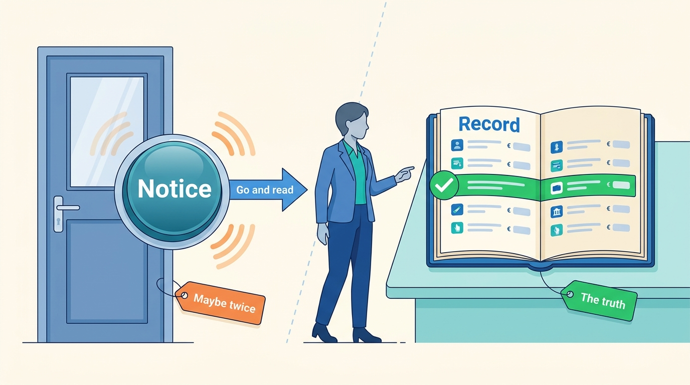
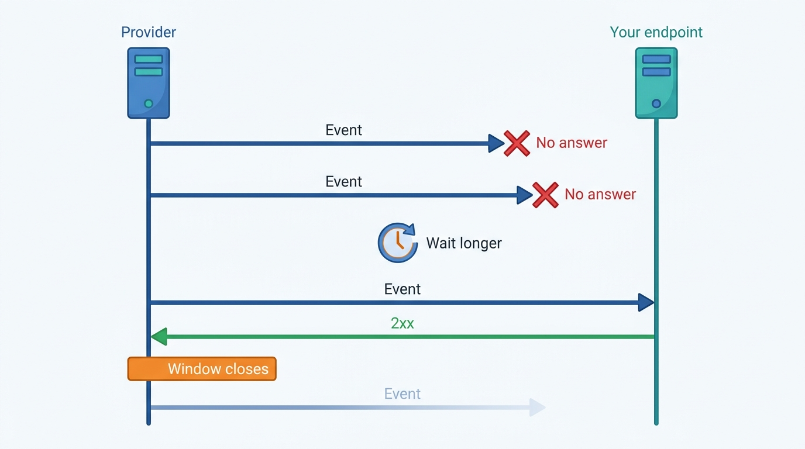
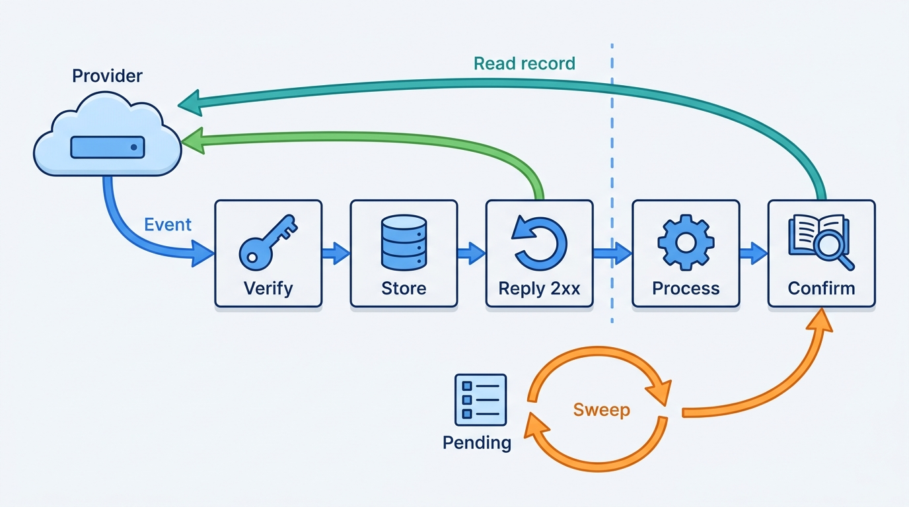
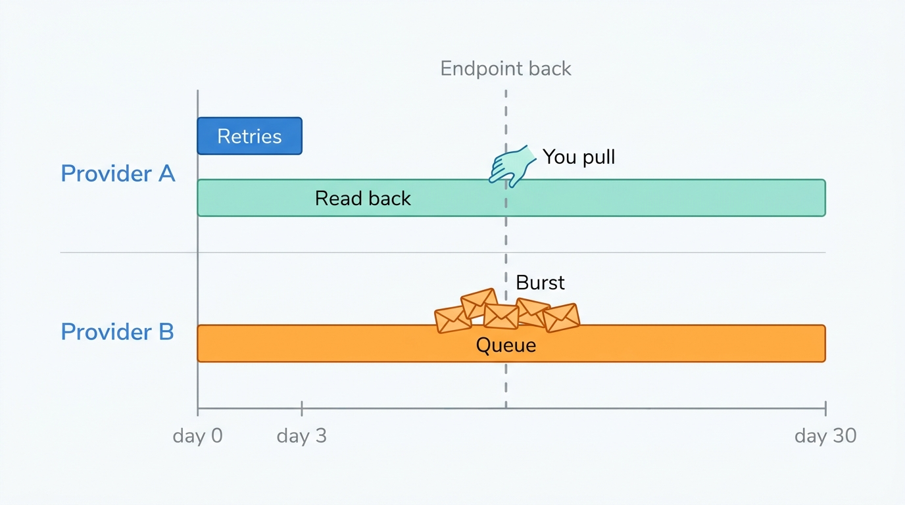

> **IN THIS CHAPTER, YOU WILL:** Learn what Stripe and Adyen promise when they deliver an event, what they do not promise, and how to build a receiver that stays correct anyway.

> **KEY POINTS:**
>
> * **Delivery is at-least-once, inside a window.** A sender knows only that your endpoint answered, so it repeats each event until it gets a 2xx or its retries end. You may not assume an event arrives once, in order, with current data, or at all after the window.
> * **The two documented contracts differ on every term.** Stripe wants a 2xx “quickly”, retries for up to three days, disclaims order and keeps events readable through its API for 30 days. Adyen wants a 2xx within 10 seconds, queues a failing endpoint's events for up to 30 days, and has no call in its Checkout API that returns an online payment (documentation accessed November 2026).
> * **The webhook is the doorbell; the provider's record is the truth.** Verify, store and acknowledge before any business logic, remove duplicates, confirm state against the object (Stripe) or the settlement report (Adyen), and sweep what stays pending. Silence means unknown, never unpaid.

> **[FAILURE PATTERNS THIS CHAPTER ADDRESSES](where-payment-systems-go-wrong.html):**
>
> * **The Trusted Doorbell** — a handler that updates state straight from the payload assumes delivery is complete, ordered and once-only, which neither provider promises.
> * **The Phantom Payment** — a record that reads a missing event as “unpaid”, or a stale snapshot as current, disagrees with the provider's confirmed record.
> * **The First of the Month** — the renewals that arrive together produce events that arrive together, and a receiver that processes them inline fails at the moment it matters.

 
On the morning of Monday 14 September 2026 members who had paid for their memberships were turned away at the studio door. Their provider had recorded every payment. No money was missing. At Larkfield, the fictional studio-software platform this book follows ([[meet-larkfield]]), the certificate on one receiving endpoint had expired, and for nine hours its records waited for messages that could not get in. **What failed was a notification, and the business treated it as the record.**

The three chapters before this one had the same shape: you call, the provider answers. This chapter runs the other way. **The provider calls you**, as an HTTP client, under rules it sets: what counts as an acknowledgement, how long it retries, what it says about order, how it proves who it is. You become the server whose availability matters. Two things carry over. The unknown outcome of [[idempotency-and-retries]], a response that never arrives, has a twin here: an event that never arrives. And the version pinned in [[payment-api-versioning]] also fixes the shape of what the provider sends.

That raises the question of what such a server may rely on, and the answer is narrow. A provider sends each event again until your endpoint acknowledges it or a retry window closes, and **that repetition is the whole delivery guarantee**. You may not assume an event arrives once, in order, with current data, or at all once the window has closed. So a webhook is a notice to store and then **confirm against the provider's own record**: the object read back by its identifier where the API allows it, the settlement report (the provider's itemized record of the money it settled) where it does not.

**Where we are in the payment's journey.** Take Mila's class pass: €120.00 paid to Studio Noord at 19:42 on Tuesday 9 March 2027. Studio Noord takes its online payments through Adyen, Larkfield's other provider besides Stripe. Her app shows the approval at once, but Larkfield's own record becomes `paid` only when the provider's notification arrives a moment later ([[payment-state-machines]]). This chapter covers that message and every later one about the same payment, such as the one that confirms her refund of 18 March.

The chapter starts with Larkfield's nine hours without events. It then explains why any sender can promise only at-least-once delivery, reads the two documented delivery contracts term by term, and looks at signatures and at what an event carries. After that it turns to the sending side, which explains why one provider's recovery arrives as a burst and the other's events arrive out of order; the receiver's contract comes next because its steps answer those behaviors. A comparison of the two providers follows. It ends by replaying the incident under Larkfield's new rules and going through the ways a receiver fails.

## Setting the Scene at Larkfield: Nine Hours Without Events

Before the Keel program of 2027, Larkfield's Stripe webhook receiver did one job nobody had written down: it was the only thing that ever wrote `paid` on a payment taken through Stripe. Shortly after midnight on Monday 14 September 2026 its TLS certificate expired, and Stripe's deliveries failed for **9 hours**. Renewals went through at Stripe as usual. At Larkfield **3,200 memberships** stayed unconfirmed, the booking app showed them as unpaid, and front-desk staff turned members away at check-in on Monday morning. No money was lost. Support took 460 tickets.

Two different things failed in those nine hours, and only one was repaired. The first was delivery. Stripe's webhook documentation (n.d., accessed November 2026) says “Stripe attempts to deliver events to your destination for up to three days with an exponential back off in live mode”, and nine hours is well inside three days: once the certificate was renewed, the missed events came again and the rows corrected themselves. The second was a reading. For nine hours Larkfield took **the absence of an event as the fact “unpaid”**, and no retry could repair that, because the harm was done before the retries succeeded.

This is why Keel decision K2 reads “the provider's record is the truth; the webhook is the doorbell”. Femke de Graaf, who leads Keel, turned it into a design question: **what may our receivers assume about each provider's deliveries, and what do we have to build ourselves for everything they may not assume?**

## Why a Sender Can Promise Only At-Least-Once

Two words first. An **event** is the provider's record that the state of something changed; in the words of Stripe's API reference (n.d., accessed November 2026), “When the state of another API resource changes, Stripe creates an `Event` object that contains all the relevant information associated with that action”. A **webhook** is the delivery of that event as an HTTP request to an endpoint you registered. Events exist because many payment outcomes are not known when the API responds. Adyen's webhook overview (n.d., accessed November 2026) says: “Many flows in Adyen integrations are asynchronous, meaning the final status of a resource is not known immediately after you make an API request.” A direct debit, a payment pulled from the customer's bank account, is confirmed after the customer has left ([[local-payment-methods]]). A capture, the request to collect an authorized amount, can be rejected days later. A dispute, in which the cardholder's bank takes a payment back, arrives weeks later ([[refunds-reversals-and-disputes]]).

Because the webhook is an ordinary HTTP request, the sender learns exactly one thing from it: whether a response came back. It cannot see whether you processed the event, and your acknowledgement can be lost on the way, just as the provider's response could be lost in [[idempotency-and-retries]]. A sender that must not lose events has one option: send again until it gets an answer. That is **at-least-once delivery**: every event is delivered one or more times, and no sender can promise exactly once across a network.

Repetition has consequences for the receiver. An event you processed but acknowledged too slowly comes a second time: a **duplicate**. An event that failed and is retried a minute later arrives after a newer event that got through at once: **disorder**. And between the moment an event is created and the moment you process it, the object it describes can change again, so whatever the event carries is a picture of the past.

There is a fourth limit, and it is the one that hurt Larkfield. No sender retries forever, because an undelivered event must be stored and re-sent at the sender's cost. Every delivery contract therefore has a **retry window**, after which an unacknowledged event is not sent again. The event stream can then go quiet for two reasons that look the same from the receiving side: nothing happened, or something happened and the message is not coming. **The absence of an event is not evidence that nothing happened.** The table collects these limits as promises a webhook makes and does not make. Two rows look ahead: a signature, the subject of a later section, is what lets a receiver trust that an event came from the provider, and some changes produce no event at all, such as a successful settlement at Adyen, as the receiver's section shows.

| A webhook promises | A webhook does not promise |
| --- | --- |
| An event you have not acknowledged is sent again while the window is open | That an event arrives only once |
| A signed event came from the provider | That events arrive in the order they happened |
| | That the data in the payload is still current |
| | That an event is sent again after the window closes |
| | That every change has an event ([[payment-reconciliation-and-reporting]]) |

**Figure 1:** *A webhook is the doorbell: it says something changed, possibly twice or late; what is true is read from the provider's record.*

## The Two Delivery Contracts, Term by Term

Stripe and Adyen each document their version of these limits, and the first term is what counts as an acknowledgement. Both take an HTTP 2xx status. Stripe says the endpoint “must quickly return a successful status code (`2xx`) before any complex logic that could cause a timeout” and publishes no number of seconds, in its documentation or its support articles. Adyen's guide to handling webhook events (n.d., accessed November 2026) gives one: “If Adyen does not receive this response within 10 seconds, for example because your server is down, we mark the webhook as Failing and put it in a retry queue.” The deadline is old; the acknowledgement by status code is recent. An article by an Adyen developer advocate, dated 1 May 2024, says that receivers already had to accept “within 10 seconds” and that until then “All integrations built with Adyen have been accepting webhooks by responding with a response body containing the string '[accepted]'”, and that existing webhooks “are not automatically updated and keep functioning as before”. If you inherit an older Adyen integration, check which acknowledgement its webhooks expect.

The second term is what happens when the acknowledgement does not come, and here the two differ most. Stripe retries each event “for up to three days with an exponential back off in live mode”. The intervals are not published, and a sandbox does not reproduce the window: “We retry event deliveries created in a sandbox three times over the course of a few hours.” Adyen's troubleshooting page (n.d., accessed November 2026) describes a queue, and differs from the guide quoted above on when the Failing status begins: the guide marks the webhook Failing as soon as the 10 seconds pass, while the troubleshooting page says “We retry sending the webhook message a few more times before we set the status of the webhook to Failing”. Either way the event ends up in the queue, and “we automatically try to send the webhook for up to 30 days” at published intervals that grow from 30 seconds to 8 hours. The queue holds everything for the endpoint: Adyen's configuration page (n.d., accessed November 2026) says “all webhook events to your endpoint go to the retry queue”, and the troubleshooting page adds “If a retry is successful, we continue with the next webhook in the queue.” Recovery is therefore sudden: “the queued webhooks are sent in a short timeframe”.

Because retries reorder events, the third term is what each provider says about order. Stripe is explicit: “Stripe doesn’t guarantee the delivery of events in the order that they’re generated.” It also takes away the obvious workaround, in a sentence about snapshot events, the kind that carry a copy of the object and are described later: “Snapshot events record `created` in seconds, so distinct events can share a timestamp. Don’t use `created` to determine event order or whether you’ve already processed an event.” Adyen's guide says: “To ensure you are processing events in the correct chronological order, always check the timestamp. Some webhooks also contain unique identifiers such as `sequenceNumber`”. The sequence number exists on the transfer webhooks of Adyen for Platforms, Adyen's product for platforms such as Larkfield ([[platform-payment-models]]); those webhooks report movements of funds on its balance platform, the layer that keeps each seller's balance. Adyen's published OpenAPI specification of those webhooks (version 4, accessed November 2026) says the sequence number “can help you restore the correct sequence of events even if they arrive out of order”. The **Standard webhook**, Adyen's main webhook for payments, has only an `eventDate`. No Adyen page I read either guarantees delivery order or disclaims it.

The other consequence of retries is the duplicate, and both providers say plainly that it happens. Stripe: “Webhook endpoints might occasionally receive the same event more than once.” Every Stripe event has its own ID to deduplicate on, and the documentation names a second kind of duplicate: “In some cases, two separate Event objects are generated and sent. To identify these duplicates, use the ID of the object in `data.object` along with the `event.type`.” An Adyen Standard webhook item has no event identifier. Its identity is a pair of business fields: the event code, such as `AUTHORISATION` or `REFUND`, and the PSP reference (PSP stands for payment service provider), the 16-character identifier Adyen gives every payment and every later operation on it. Duplicates, Adyen says, “have the same values in the `eventCode` and `pspReference` fields, while the `eventDate` and other fields can be different. Your server should use the details from the latest webhook event.”

The last delivery term is what you can do once automatic retries are not enough, and it is where the two contracts part. Stripe pairs its short push window with a longer pull window. The API reference says “You can access events through the Retrieve Event API for 30 days”, and Stripe's guide to managing webhook endpoints (n.d., accessed November 2026) shows how to list the events whose delivery has not succeeded and process them yourself, with a warning: “Stripe still considers manually processed events as undelivered and continues its automatic retry schedule.” Adyen has a longer push window and, for online payments, no pull path: version 72 of its Checkout API specification (accessed November 2026) has three read operations (payment links, session results, stored payment methods) and none that returns a payment by its PSP reference ([[payment-api-design]]). Recovery there runs through the queue, the Retry and Ignore buttons of the Customer Area (Adyen's back-office site), alerts sent “after 5 retry attempts” and “after 7 days of a webhook failing”, and reports.

**Figure 2:** *Every delivery contract is this loop: the event is sent again, with growing waits, until a 2xx comes back or the retry window closes.*

## Proving Who Sent It: Signatures and Replay Protection

Beyond the delivery terms, one term of the contract is left: how you know the sender. A webhook endpoint is a public URL, and a message that says “this payment succeeded” is worth goods to whoever can forge it. Stripe states the threat: “Without verification, an attacker could send fake webhook events to your endpoint to trigger actions like fulfilling orders, granting account access, or modifying records.” The defense at both providers is **signature verification**. The provider computes an HMAC (hash-based message authentication code), a keyed hash of the message using a secret that only it and you hold; you recompute it over what you received and compare. A match proves that the provider sent the bytes the signature covers and that nobody changed them.

Stripe's scheme, for example, covers everything and adds time. The `Stripe-Signature` header carries a timestamp `t` and a signature `v1`, an HMAC with SHA-256 over the timestamp, a dot, and “the unmodified HTTP request body”. Because the timestamp is inside the signed bytes, an attacker who captures a message cannot change its age, and you can refuse old ones: “Our libraries have a default tolerance of 5 minutes between the timestamp and the current time.” Retries are not caught by that rule, because “If Stripe retries an event (for example, your endpoint previously replied with a non-`2xx` status code), then we generate a new signature and timestamp for the new delivery attempt.”

Adyen's scheme for the Standard webhook covers less. Its verification guide (n.d., accessed November 2026) has you join eight fields with colons (`pspReference`, `originalReference`, `merchantAccountCode`, `merchantReference`, `value`, `currency`, `eventCode`, `success`), compute an HMAC with SHA-256, and compare it with the signature that travels inside the payload. Those fields say which payment, how much and whether it succeeded; `eventDate` is not among them, and no tolerance window is documented. Adyen also lets you authenticate the sender. Its page on securing webhooks (n.d., accessed November 2026) says OAuth 2.0 is “strongly recommended and supported for the Standard webhook and all Balance Platform webhook types”, and offers basic authentication with the caution that it “only guarantees that the webhook event was sent by Adyen, not that it wasn't modified during transmission”. There is no fixed address list to allow: “We do not provide a list of IP addresses.” The page offers the domain name `out.adyen.com` for an allowlist instead.

> **INFERENCE, NOT DOCUMENTED:** Because the Standard webhook's signature covers no timestamp, a captured message would verify again if someone replayed it later. Adyen does not say this, and does not say what it relies on instead; it is my reading of the field list. On that reading, what stops a replay from doing harm is your own deduplication on event code and PSP reference, together with TLS and the authentication of the sender.

## What the Event Carries: Snapshots, Thin Events and Event Buses

Once a message is verified, the next question is what is in it, and the classic answer is a **snapshot event**: a copy of the object as it was when the event was created. The copy can be out of date by the time you read it; Stripe's event guide (n.d., accessed November 2026) says, “Because this snapshot can be stale by the time your application processes it, fetch the latest version of the resource from the API before acting on the data.” A copy also has a shape, which belongs to one API version: “The API version in your account settings when the event occurs dictates the API version, and therefore the structure of an Event sent to your destination.” That is the webhook side of [[payment-api-versioning]]. Adyen's webhooks are snapshots too: “Webhook messages contain a snapshot of the resource so your system can update its state accordingly”.

Stripe's answer to both properties is the **thin event**: a notice that carries the event's type and identifiers and no state, so that the receiver has to fetch the current object. As of November 2026 the event guide recommends it: “For new integrations, use thin events. Thin events are unversioned, fully typed in the Stripe SDKs, and let your integration fetch the latest resource state.” Two cautions apply. Coverage is recent: Stripe's changelog of 30 September 2024 introduced thin events with one API, billing meters, and a Stripe developer post of 24 June 2026 still offered “early access to thin events for v1 resources”, the family payments belong to. Stripe's thin event catalog (n.d., accessed November 2026) now lists payment types such as `v1.payment_intent.succeeded` and `v1.charge.refunded`; check it for every event type you need. And a thin event costs one API read per event, which counts against your request limits ([[payment-developer-platform]]).

Stripe has also added a second transport. The event guide says “Stripe pushes events to your configured destinations, which can be webhook endpoints, Amazon EventBridge, or Azure Event Grid”: Stripe publishes into an event bus in your own cloud account. A Stripe developer post of 31 October 2024 announced the feature as generally available, arguing that merchants “can trust each event is from Stripe without needing to verify webhook signatures in their code”. The contract does not change: Stripe's EventBridge page (n.d., accessed November 2026) repeats the three days of retries and the sentence on order. I found no destination other than HTTP in Adyen's documentation.

In short, a snapshot saves a read and can mislead, a thin event is always confirmed and always costs a read, and a bus moves the availability problem to a cloud provider and leaves duplicates and disorder where they were. The table's last column is my judgement.

| Design | What the receiver gets | What it costs | When I would choose it |
| --- | --- | --- | --- |
| **Snapshot event** | The object as it was, with no extra call | Stale data if acted on directly; a payload version to manage | Audit trails and tools that need the full payload; any Adyen integration |
| **Thin event** (Stripe) | A pointer, then the current object | One API read per event | New Stripe integrations whose event types are in the thin catalog |
| **Event bus destination** (Stripe) | Events inside your cloud account; no public endpoint, no signature code | A cloud dependency; the same retry window | Teams already built around that bus |

## What Building the Sender Involves, and What Nobody Has Published

Two behaviors from the delivery contracts are still unexplained: Adyen releases a recovered endpoint's queue as a burst, and Stripe's events arrive out of order. Both come from the sending side, and so far the contract has been read only from the receiving side, which is all there is to see. **Neither Stripe nor Adyen has published how its webhook sender is built.** I found no engineering post or talk from either company on the subject (engineering blogs, Adyen's knowledge hub and web searches, November 2026), only guidance for receivers. A few properties show from outside. Stripe's event guide says “Events are delivered asynchronously”; each webhook endpoint has its own signing secret, and each destination its own delivery log with the time of the next retry; an account can register “a maximum of 16 event destinations”. Adyen's pages show a Failing status and a retry queue per endpoint.

What follows is therefore **reference-architecture inference**: what any sender meeting such a contract needs, not an account of either company's system. The event must be written durably together with the state change it reports, or a crash between the two loses it. Each event must be fanned out to every destination subscribed to its type. Delivery state (attempts, next retry, outcome) must be kept per destination. Slow destinations must be isolated, so that an endpoint taking ten seconds per request does not delay everyone else's events. And the backlog must be stored for as long as the window lasts.

Among these, one choice cannot be avoided: what to do with later events for a destination while an earlier one is failing. A sender can hold them behind the failing one, which keeps their order, produces a burst when the endpoint recovers, and lets one message the receiver keeps rejecting block the rest. Or it can deliver each event independently, which keeps events flowing and gives up order.

> **INFERENCE, NOT DOCUMENTED:** Adyen's wording (“we continue with the next webhook in the queue”) reads like a queue per endpoint released in order; Stripe's (retries per event, no guarantee of order) reads like independent deliveries. Neither company states which design it uses, how it isolates a slow endpoint or how it stores a backlog. I use the reading only to explain two documented behaviors: the burst after an Adyen endpoint recovers, and the disorder Stripe warns about.

## The Receiver's Contract: Verify, Store, Acknowledge, Confirm, Sweep

Whichever way a sender is built, it can promise only repetition inside a window: duplicates, disorder, stale payloads, a burst or a gap after an outage, and silence once the window closes. The receiver's design answers those limits, and it starts with four steps in a fixed order: verify the signature on the raw body, store the message, return a 2xx, process later. Both providers prescribe the order. Adyen's guide lists verify, “Store the webhook message in your database or a queue so you can process it later”, accept, process, and gives the reason: “Make sure that you acknowledge the webhook before applying any business logic, because errors in your business logic could lead to failing webhooks.” Stripe's version is “you must return a `200` response before updating a customer’s invoice as paid in your accounting system”. The table states the requirements; the right-hand column is what I would build to, not a provider's figure.

| Requirement | Documented term | A reasonable target *(assumption)* |
| --- | --- | --- |
| Time to acknowledge | Adyen: 10 seconds. Stripe: “quickly”, no number | Under one second: verify, one insert, respond |
| Availability | Retries end after three days (Stripe) or up to 30 days (Adyen) | A small separate service, with certificate-expiry alerts |
| Durability | Adyen: store, then accept | The insert is committed before the 2xx is sent |
| On failure | The event is retried inside the window, then not sent again | The sweep described below |

Storing comes with a rule: the stored message gets a unique key, so that a repeat changes nothing. At Stripe the key is the event ID, with object ID plus event type as a second check. At Adyen there are two keys, because its two webhook families identify themselves differently: event code plus PSP reference for the Standard webhook, and transfer ID plus sequence number for the platform's transfer webhooks. A unique constraint on the inbox table does the work. For an Adyen repeat whose other fields differ, keep the later details, as the documentation says.

Next, the handler must not read arrival order as the order of events. Where it can read the object, it does, and the order of the notices stops mattering. Where it cannot, it orders by what the provider gives (a sequence number where there is one, the event's own time where there is not) and applies an event only if its state machine has a transition for it from the current state ([[payment-state-machines]]). An event that fits no transition is kept and flagged, and the state does not move.

Order is one case of a wider rule: **an event is confirmed against the provider's own record before the business acts on it.** On Stripe that means reading the object, as Stripe's own snapshot warning asks. On Adyen an online payment cannot be read back through the Checkout API, and the event stream does not even say when money has moved: “Adyen does not send a webhook message when a payment settles successfully”, as its webhook types page (n.d., accessed November 2026) puts it. The confirming record there is the settlement report ([[payment-reconciliation-and-reporting]]). Until it arrives, the verified, stored events are the only record from Adyen you have: the business acts on them as Adyen's own word, notes that this is their source, and lets the report confirm them later. An event that is lost cannot be rebuilt by an API call. Storing before acknowledging is good practice at Stripe; at Adyen it carries more weight.

All of that handles the events that arrive. For the ones that do not, a **sweep** is needed: a job that takes every payment pending longer than a set time and resolves it from the provider's record. On Stripe it reads the object. On Adyen it waits for the report and raises whatever the report does not explain. Until the sweep has an answer, the payment is shown as *unknown*, to staff and to other systems, and never as failed. The receiver needs this because the one thing an event stream cannot tell you is that an event is missing.

**Figure 3:** *The receiver verifies, stores and acknowledges before it processes; confirmation reads the provider's record, and a sweep covers the events that never arrive.*

## Stripe and Adyen: Where They Differ

Seven aspects of the two contracts can be compared from documentation accessed in November 2026, all cited above. The last column is my reading of each difference, not a statement by either company.

| Aspect | Stripe | Adyen | What the difference suggests |
| --- | --- | --- | --- |
| Acknowledgement | Any 2xx, returned “quickly”; no number of seconds published | A 2xx within 10 seconds; webhooks created before the 2024 change may still expect the body `[accepted]` | Build to Adyen's published deadline on both |
| Retry window | Up to three days, exponential backoff, intervals not published | Up to 30 days from a per-endpoint retry queue, intervals published | Adyen holds events ten times longer; Stripe expects you to pull what it stops pushing |
| Order | Not guaranteed; do not order by `created` | “always check the timestamp”; a sequence number on transfer webhooks only | Ordering is the receiver's job at both |
| Duplicate identity | An ID per event; object ID plus type for the two-events case | No event ID on the Standard webhook; event code plus PSP reference; “use the details from the latest” | An Adyen duplicate may be an update |
| Signature | HMAC-SHA256 over a timestamp and the whole body; 5-minute default tolerance | Standard webhook: HMAC-SHA256 over eight fields, no timestamp; OAuth 2.0 or basic authentication | Replay protection is built into Stripe's scheme and falls to your deduplication at Adyen (inference) |
| Payload and destinations | Snapshot or thin events; HTTP, Amazon EventBridge or Azure Event Grid | Snapshots over HTTP; no other destination found | Stripe is moving state out of the message; Adyen keeps it in |
| Reading state back | Events for 30 days and the payment object through the API | No call in the Checkout API returns an online payment; retry queue, Customer Area and reports | At Adyen your stored events are the working record |

It follows that the same receiver is tuned differently on each. On Stripe, plan for a short push window and a longer pull window: read the object after every event, and after an outage list the undelivered events well before the 30 days run out. On Adyen, plan for a long queue that arrives all at once: store every message before you acknowledge it, size the receiver for the burst, and take the settlement report as the check.

## In Practice at Larkfield: The Silent Webhook Replayed Under K2

Measured against the documented contract, the Silent Webhook was a small outage. It lasted **9 hours** against a retry window of three days, so every missed event was sent again once the certificate was renewed, and the 3,200 rows corrected themselves. That is the part of the harm the retries repaired: the data. They could not repair the morning at the front desk, or the 460 tickets that followed.

Under K2, by contrast, the same expired certificate would do far less. A state change on Stripe is written only after the payment service has re-read the PaymentIntent, Stripe's object for a payment, and the sweep runs every 15 minutes over renewals pending for more than 30 minutes *(assumption; Larkfield's settings)*, with or without an event. So the rows would be wrong for about half an hour, not nine hours. In the meantime the check-in screen shows an unconfirmed renewal as “being checked” and lets the member in, because for a €49 membership a wrong refusal costs more than a wrong admission. **K2 addresses the reading of silence, which is the part retries never could.**

The same contract applies on Adyen, with the confirming record changed. When Mila buys her €120.00 pass at 19:42 on 9 March 2027, Adyen sends an `AUTHORISATION` notification with `success` true. The receiver verifies the signed fields, stores the message under `AUTHORISATION` plus the PSP reference, and answers 2xx well inside the 10 seconds. The Checkout API offers no object to re-read, so the confirming step reads the record Adyen has given: the stored, verified notification. The row moves to `paid` with Adyen's own events named as its source, and that source changes to the report when the settlement report confirms the payment, and the reconciliation job writes the ledger entries from that report, not from the webhook.

## When It Goes Wrong: Long Outages, Bursts, Disorder and Failed Verification

Nine hours was inside both windows. The failure that loses events for good is an outage longer than a window. Suppose an endpoint is down from Friday 18:00 to Wednesday 09:00, four and a half days. At Stripe the events from Friday evening to early Sunday are past their three days and will not come again; they are still in the Events API, so you list the events for the outage period, feed them through the same handler, and then read every payment still pending. At Adyen the whole period is in the queue and arrives in a burst once the endpoint acknowledges; since an online payment cannot be read back, the settlement reports for those days are the check. At both, remove duplicates and ignore arrival order.

| Outage | Stripe | Adyen |
| --- | --- | --- |
| Shorter than 3 days | Retries deliver every event | The queue delivers every event, in a short time, once the endpoint acknowledges |
| 3 to 30 days | Early events are no longer retried; list them from the Events API, run them through the same handler, then read each pending object | Still in the queue; expect the burst; check against the settlement reports |
| Longer than 30 days | Full event payloads are gone; read the objects and reconcile against reports | Not documented; assume the events are lost and rebuild from reports |

**Figure 4:** *One outage, two contracts: Provider A (Stripe) retries for 3 days and lets you read events back for 30; Provider B (Adyen) queues for up to 30 days and delivers the backlog as a burst.*

Once the endpoint is back, recovery itself can fail in two ways. The first is the burst. Adyen's troubleshooting page lists the status 429 with the note that it “can happen after you fix a failing endpoint, as the queued webhooks are sent in a short timeframe”. Stripe gives the same warning for ordinary peaks: “Any large spike in webhook deliveries (for example, during the beginning of the month when all subscriptions renew) might overwhelm your endpoint hosts.” The second is the poison message: one payload that makes your handler return an error every time, while at Adyen the endpoint's other events wait in its queue. For a 422 the page gives the cure: “We recommend acknowledging receipt with `[200 OK]` first, and performing business logic separately.”

Outages and their recovery delay or lose events. Disorder, the next failure, misleads without losing anything. Your receiver gets a “refunded” event for a payment and, one second later, a “captured” event for the same payment. Nothing can be concluded from that about which happened first. The handler stores both. On Stripe it retrieves the PaymentIntent and its refunds and writes what it finds. On Adyen it compares the two event dates and asks its state machine: `refunded` has no transition to `paid`, so the capture is recorded as history and the state stays where it is. A repeat of either event meets the unique key and changes nothing.

The failures so far concern genuine events that arrive late, all at once or out of order, and are misread. The last is the reverse: a genuine event that your own verification rejects. The documented causes are few. Something between the provider and your code changed the body: “Any manipulation to the raw body of the request causes the verification to fail”, Stripe warns. A secret was rotated before the receiver knew the new one; Adyen asks that “you can still accept webhook events signed with your previous HMAC key for some time”. Or the server's clock is off by more than Stripe's five-minute tolerance. What I would never do is switch verification off to get deliveries moving again: the retry window gives you days to fix the cause.

## What to Take Away

**Established.**

- Delivery is at-least-once inside a window at both providers: up to three days of retries at Stripe, up to 30 days in a retry queue at Adyen (documentation accessed November 2026).
- Both providers document duplicates, and both tell you to acknowledge before you apply business logic.
- Stripe says order is not guaranteed and that a snapshot can be stale; Adyen's Checkout API has no call that returns an online payment.
- Neither company has published how its webhook sender is built.

**Depends on context.**

- Snapshot or thin events: thin events suit a new Stripe integration whose event types are in the thin catalog; snapshots are the only format at Adyen.
- An HTTP endpoint or an event bus: a bus pays off for a team already built around it, and changes neither the retry window nor the ordering terms.
- How often to sweep: it depends on what a wrong state costs per minute. A check-in screen needs minutes; an invoice run can wait hours.
- How much to lean on Adyen's longer queue: it forgives a long outage only if your receiver survives the burst.

**The author's synthesis.**

- I design a receiver from the list of things it may not assume: storing before acknowledging answers the deadline, the unique key answers repetition, the read or the sequence number answers disorder and staleness, and the sweep answers the window.
- Silence is a state of its own. A system that can say “unknown, checking” fails more gently than one that must choose between paid and unpaid. On 14 September 2026 Stripe's retries delivered every event; what would have kept Larkfield's doors open was a receiver that read nine hours of silence as “unknown, go and read”, not as unpaid.
- I judge a delivery contract by its two windows, how long events are pushed and how long they can be pulled, because the provider's uptime says nothing about my endpoint's.

## Questions to Ask

1. For each provider, what counts as an acknowledgement, and how many seconds do we have?
2. How long is an unacknowledged event retried, and what can we read back after that, for how long?
3. Does our receiver store the message before it returns 2xx, and is anything else done before the response?
4. Which state changes do we write directly from a payload, without reading the provider's record or waiting for the report?
5. What does a payment look like, to staff and to other systems, while we do not know its outcome?
6. Which job finds a payment whose event never came, and how long can that payment stay pending?
7. If the endpoint were down for five days, what exactly would we do on each provider, and have we tried it?
8. Who is alerted when events stop arriving, when the provider marks our endpoint as failing, and before the certificate expires?

A receiver built this way reads the provider's record after every event, sweeps its pending payments, and replays a backlog after an outage. As a consequence, everything this part has asked you to build is traffic on an API shared with every other customer: it is sent with credentials, rehearsed in a test environment and subject to limits. [[payment-developer-platform]] covers those terms, which decide whether the mechanisms of these four chapters still work on the first of the month.

## Sources and Evidence

*Company, product and investor sources*

- [Receive Stripe events in your webhook endpoint](https://docs.stripe.com/webhooks), Stripe, n.d., accessed 2026-11 — acknowledgement rule, three-day retries, sandbox retries, ordering and duplicate statements, signature scheme, tolerance, raw body, spike warning.
- [How events work](https://docs.stripe.com/events/how-events-work), Stripe, n.d., accessed 2026-11 — asynchronous delivery, snapshot and thin events, the recommendation of thin events, destinations, the limit of 16 destinations, event retention.
- [Manage webhook endpoints](https://docs.stripe.com/events/manage-webhook-endpoints), Stripe, n.d., accessed 2026-11 — listing and processing undelivered events; manual processing does not stop automatic retries; the threat that verification answers.
- [Events API reference](https://docs.stripe.com/api/events), Stripe, n.d., accessed 2026-11 — definition of an event; events retrievable for 30 days.
- [Send events to Amazon EventBridge](https://docs.stripe.com/event-destinations/eventbridge), Stripe, n.d., accessed 2026-11 — same retry and ordering terms on the event bus.
- [Event notification handlers and thin events](https://stripe.dev/blog/event-notification-handlers-thin-events), David Brownman, Stripe developer blog, 2026-06-24 — early access to thin events for v1 resources as of June 2026.
- [Growing your Stripe integration with Event Destinations](https://stripe.dev/blog/growing-your-stripe-integration-with-event-destinations), Ben Smith, Stripe developer blog, 2024-10-31 — general availability of event destinations; no signature verification with EventBridge.
- [Adds support for retrieving thin events](https://docs.stripe.com/changelog/acacia/2024-09-30/api-v2-thin-events), Stripe changelog, 2024-09-30 — first release of thin events, with the Meters API.
- [Types of events (thin event catalog)](https://docs.stripe.com/api/v2/core/events/event-types), Stripe, n.d., accessed 2026-11 — thin event types for v1 resources, payment types among them.
- [Webhooks](https://docs.adyen.com/development-resources/webhooks), Adyen, n.d., accessed 2026-11 — asynchronous flows; webhook messages contain a snapshot.
- [Handle webhook events](https://docs.adyen.com/development-resources/webhooks/handle-webhook-events), Adyen, n.d., accessed 2026-11 — verify, store, accept, process; 10 seconds; timestamp and sequence number; duplicates.
- [Troubleshoot webhooks](https://docs.adyen.com/development-resources/webhooks/troubleshoot), Adyen, n.d., accessed 2026-11 — retry queue, intervals, 30 days, burst on recovery, Retry and Ignore, alerts.
- [Configure and manage webhooks](https://docs.adyen.com/development-resources/webhooks/configure-and-manage), Adyen, n.d., accessed 2026-11 — all events for an endpoint go to the retry queue.
- [Secure webhooks](https://docs.adyen.com/development-resources/webhooks/secure-webhooks), Adyen, n.d., accessed 2026-11 — OAuth 2.0, basic authentication, key change, no IP address list, the domain name to allow.
- [Verify HMAC signatures](https://docs.adyen.com/development-resources/webhooks/secure-webhooks/verify-hmac-signatures), Adyen, n.d., accessed 2026-11 — the eight signed fields and where the signature travels.
- [Webhook structure and types](https://docs.adyen.com/development-resources/webhooks/webhook-types), Adyen, n.d., accessed 2026-11 — no webhook when a payment settles successfully; the Standard webhook's fields and event codes.
- [Optimizing Webhook Integration: a new approach to accept events from the Adyen platform](https://www.adyen.com/knowledge-hub/webhooks-accept-2xx), Beppe Catanese, Adyen knowledge hub, 2024-05-01 — the earlier `[accepted]` acknowledgement, the 10-second deadline and the migration.
- [Adyen OpenAPI definitions](https://github.com/Adyen/adyen-openapi), Adyen, n.d., accessed 2026-11 — Checkout API v72 (`CheckoutService-v72.json`) has no operation returning a payment by its PSP reference; the transfer webhook's sequence number (`BalancePlatformTransferNotification-v4.json`); the Standard webhook's fields and 16-character PSP reference (`Webhooks-v1.json`).

*Standards, regulation and official documentation*

- None.

*Research and practitioner sources*

- None.

Larkfield is fictional; architectural recommendations, labeled inferences and labeled assumptions are the author's judgement.
