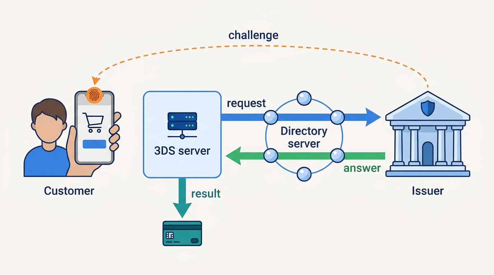
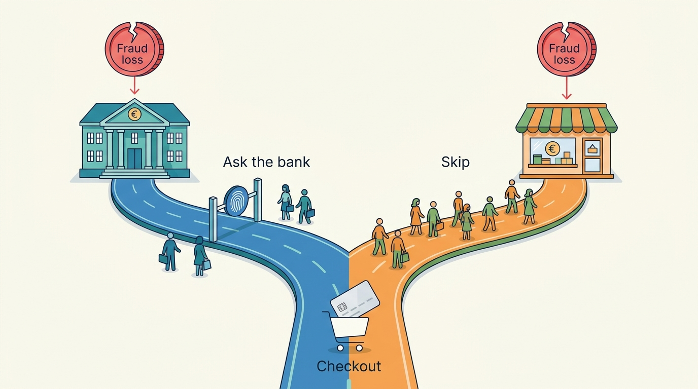
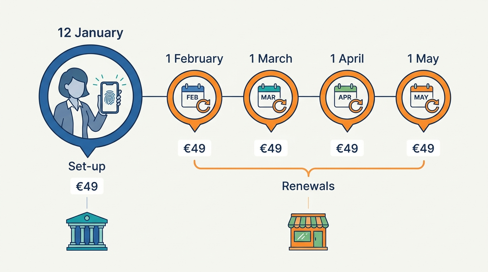
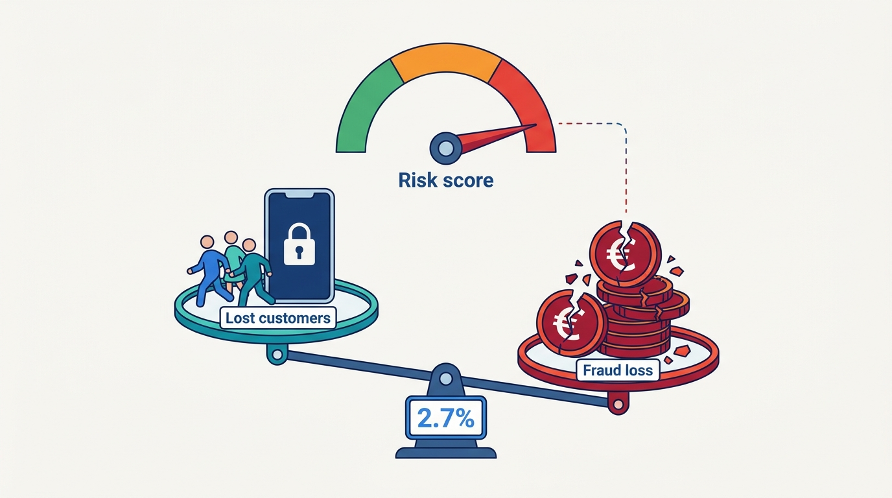

> **IN THIS CHAPTER, YOU WILL:** Learn how a card's issuer checks who is paying online, when that check moves a fraud loss to the issuer, and how providers decide when to ask.

> **KEY POINTS:**
>
> * **The issuer answers, and the issuer decides how.** 3-D Secure sends transaction and device data from the checkout to the bank that issued the card, which approves silently or challenges the cardholder. Stripe's documentation says it cannot guarantee a requested flow "because the issuer determines the ultimate authentication flow".
> * **The fraud loss moves only when authentication happens.** An exemption requested on the merchant's side, a merchant-initiated payment and a data-only flow all leave a fraud dispute with the merchant. An authentication policy is therefore a decision about who carries losses.
> * **The room to skip is shared and moving.** The low-risk exemption is capped by the provider's fraud rate across all its merchants (0.13%, 0.06% and 0.01% for payments up to €100, €250 and €500). Scheme passkeys are in pilot or first rollout, and PSD3 and the Payment Services Regulation were not adopted on 17 November 2026.

> **[FAILURE PATTERNS THIS CHAPTER ADDRESSES](where-payment-systems-go-wrong.html):**
>
> * **The Phantom Payment** — a payment waiting for the customer to finish a challenge is neither paid nor failed, and a system that treats it as either holds a payment that exists only in its own records.
> * **The Borrowed Blueprint** — "authenticate everything" or "authenticate as little as allowed" is copied from another business whose margins, fraud and loss allocation are not yours.

 
Two members buy the same €120 class pass from the same studio through the same checkout. One is sent to her banking app to approve the payment. The other pays without being asked anything. Three weeks later the second payment is disputed as fraud, and the studio is debited the €120 and a dispute fee. Had the first payment been disputed the same way, the member's bank would have paid. **Nobody at the studio chose either path.**

The risk rules of [[payment-fraud-and-risk]] had a third action between allow and block, "request 3-D Secure", and on every payment a merchant allowed it kept the loss. An engineer tends to see that third action as a pop-up between the customer and the sale, to be shown as rarely as the rules permit. It is more than that. It hands the question of who is paying to the **issuer**, the bank that issued the card, and **the fraud loss follows the question**: it moves to the issuer only when the issuer has authenticated the payer. Deciding when to ask is deciding who carries the loss.

**Where we are in the payment's journey.** Mila's class pass, the €120.00 payment this book follows, was paid from her phone's wallet on 9 March 2027. The wallet checked her fingerprint on the device, so the payment met no 3-D Secure. This chapter covers the step a typed card number takes instead, which Mila did meet on 12 January 2027 when she set up her membership.

The chapter starts at Larkfield, the fictional studio-software platform this book follows, with one member who was challenged and one who was not. It then states what the law requires, shows how 3-D Secure carries the question to the issuer, and says when the loss moves and when it stays. Two applications follow: the design of a membership, and the decision of when to ask. Then come the controls Stripe and Adyen expose, their comparison, what is moving (other markets, passkeys, PSD3), Larkfield's policy written as a loss table, and the ways authentication fails.

## Setting the Scene at Larkfield: One Member Challenged, One Not

Within three weeks in early 2027, Studio Noord took two card payments that were treated differently. On 12 January Mila Janssen set up a €49.00 monthly membership by typing in her Dutch Visa debit card, and her banking app asked her to approve it. On 2 February Bram de Wit bought a €120.00 ten-class pass with a Dutch Mastercard credit card and was asked nothing. Studio Noord is on Adyen, and both payments came through the same booking widget.

On 24 February Bram's payment came back as a **chargeback**, the forced reversal of a card payment by the cardholder's bank ([[refunds-reversals-and-disputes]]), marked "not recognized" and carrying a dispute fee of €15.00 *(an illustrative figure; Adyen publishes no euro amount)*. Under Larkfield's terms the studio carries a lost dispute. Jonas Weber, who leads risk and compliance, brought two questions to Femke de Graaf, the head of payments engineering. Who decided not to ask Bram? And why does Studio Noord, which decided nothing, pay?

## What the Law Requires: Two Factors, Unless an Exemption Applies

The rule that says when a payer must be asked is European law. **Strong customer authentication (SCA)** comes from the second Payment Services Directive (PSD2, Directive (EU) 2015/2366; **evidence age: 11 years, in force**), which defines it as "an authentication based on the use of two or more elements categorised as knowledge (something only the user knows), possession (something only the user possesses) and inherence (something the user is) that are independent, in that the breach of one does not compromise the reliability of the others". Article 97 obliges a payment service provider to apply it when the payer "initiates an electronic payment transaction". The duty sits on providers, in practice the issuer, and not on the merchant. The technical standards that fill in the detail (Delegated Regulation (EU) 2018/389) "shall apply from 14 September 2019".

Those standards also list the cases in which a provider may skip the two factors. Each is an **exemption**. The standards address "payment service providers", so either the issuer or the provider on the merchant's side can invoke one. For online card payments three matter.

| Exemption | Article | Condition |
| --- | --- | --- |
| Low value | 16 | The payment "does not exceed EUR 30", and since the last authentication either the total is not over EUR 100 or there were no more than five payments |
| Trusted beneficiary | 13 | The payer has put the payee on a list held by the payer's own bank, using strong authentication |
| Transaction risk analysis (TRA, the low-risk exemption) | 18 | The provider's fraud rate is at or below a reference rate, the amount is within the matching band, and a real-time analysis finds nothing abnormal |

The low-risk exemption matters most, and it is **rationed by the provider's own fraud rate**. Article 18 ties it to "the fraud rate for that type of transaction, reported by the payment service provider". The annex sets the reference rates for remote card payments: 0.13% to exempt payments up to €100, 0.06% up to €250 and 0.01% up to €500. Under Article 20 a provider "shall immediately cease to make use of the exemption" in a band "where their monitored fraud rate exceeds for two consecutive quarters the reference fraud rate". So the largest amount one merchant can have exempted depends on every other merchant at the same provider. Stripe's documentation (n.d., accessed November 2026) says "EEA merchants have access to TRA exemptions for qualifying low risk transactions up to 250 EUR", a limit that "depends on the Stripe overall fraud rates" (EEA: the European Economic Area). Adyen states no ceiling of its own in its documentation, help center or site (November 2026).

A payment the merchant initiates while the payer is absent, such as a membership renewal, is a different thing. It is not exempted. It is **outside the rule**, because Article 97 is triggered by the payer initiating. The condition is the set-up. The standards do not name merchant-initiated payments; Article 14 states the condition for a series of equal payments: providers "shall apply strong customer authentication when a payer creates, amends, or initiates for the first time, a series of recurring transactions with the same amount and with the same payee". The regulators' 2025 fraud report describes merchant-initiated payments in general as resting on "a previously existing mandate that requires the application of SCA when the mandate is granted". Stripe's documentation says such payments "technically fall outside the scope of SCA". Adyen's says: "The initial transaction should have gone through SCA and the shopper should have agreed to the terms and conditions of the succeeding MITs." (MIT: merchant-initiated transaction.)

These exits account for most card payments made online without the check. The 2025 fraud report of the European Banking Authority (EBA) and the European Central Bank, on 2024 data, says: "In 2024, around 29% of remote card payments without SCA were exempted under TRA". Merchant-initiated transactions "amounted to 22% in 2024", and "26% of remote transactions were reported as being outside the scope of SCA requirements under PSD2". All three are shares of the remote card payments made without strong authentication, not of all remote card payments. If they have the same base, as the report presents them, the three reasons cover about three quarters of those payments. The same report says that "fraud rates for card payment transactions authenticated with SCA were consistently and substantially below fraud rates for card transactions without SCA".

## How 3-D Secure Carries the Question to the Issuer

The law puts a duty on the issuer, but an online payment starts in a merchant's checkout, which the issuer does not see until the authorization request arrives ([[payment-authorization]]). **3-D Secure** is the card networks' protocol that closes this gap. EMVCo, the body that publishes it, says (n.d., accessed November 2026): "EMV 3DS enables the exchange of data, or messages, between the merchant and the issuer to authenticate the consumer and approve the transaction." Three parties each run one component: a **3DS server** on the merchant's side, operated by the provider; a **directory server** (DS) at the card network; and an **access control server** (ACS) at the issuer. In Stripe's words: "Stripe communicates with the card network's DS and the issuer's Access Control Server (ACS)." This chapter describes version 2; Stripe notes that "Major card brands no longer support 3D Secure 1".

Between those components the exchange has up to four steps. The checkout collects data about the customer's device. The 3DS server sends an authentication request through the directory server to the access control server. If the issuer wants more, a challenge runs between the cardholder and the issuer. Finally the result travels inside the authorization request. Stripe's standalone 3-D Secure API (n.d., accessed November 2026) shows the same sequence, ending with "On success, extract the cryptogram, ECI, and DS Transaction ID". The cryptogram is a one-time value that proves the authentication took place; the ECI (Electronic Commerce Indicator) is a code that says how it ended. One limit: the EMVCo specification sits behind a license and was not read, so the sequence follows the providers' documentation and omits the protocol's message names. The figure below shows the path.

**Figure 1:** *The merchant's side sends the request and receives the answer; the optional challenge runs between the issuer and the cardholder, and the issuer decides whether there is one.*

Once the request reaches the access control server, the issuer answers in one of two ways. Adyen's documentation (n.d., accessed November 2026) defines both. "In a **frictionless** flow, the acquirer, issuer, and card scheme exchange all necessary information in the background through passive authentication using the shopper's device fingerprint. The transaction is completed without further shopper interaction." "In a **challenge** flow, the issuer requires additional shopper interaction, either through biometrics, two-factor authentication, or similar methods". ("Card scheme" is Adyen's word for card network; the acquirer is the institution on the merchant's side.) The merchant's side can state a preference and cannot choose. Stripe: "Stripe can't guarantee your preference because the issuer determines the ultimate authentication flow."

Because the challenge runs between the cardholder and the issuer, authentication turns a card payment into **a state the customer's device must resolve**. The wait can last minutes or never end, so the payment cannot be modeled as one synchronous call. On Stripe, "The PaymentIntent transitions to a status of `requires_action`" and the client reads `next_action`; Adyen returns an `action` object with result codes such as `ChallengeShopper` ([[payment-state-machines]] covers both models). The properties to design for are few.

| Property | What holds |
| --- | --- |
| Who decides the flow | The issuer |
| How long it takes | A silent answer arrives within the checkout call; a challenge takes as long as the customer does, or never finishes |
| What your server learns synchronously | A state, not an outcome |
| If 3-D Secure is unavailable or errors | Per Stripe, "the payment proceeds normally" and liability "doesn't generally shift to the issuer" |

## When the Loss Moves, and When It Stays

The issuer's answer does more than let the payment through. The **liability shift** is the card networks' rule that a payment authenticated through 3-D Secure, if later disputed as fraud, is the issuer's loss and not the merchant's. It has a root in the law. PSD2 Article 74(2) reads: "Where the payer's payment service provider does not require strong customer authentication, the payer shall not bear any financial losses unless the payer has acted fraudulently. Where the payee or the payment service provider of the payee fails to accept strong customer authentication, it shall refund the financial damage caused to the payer's payment service provider." Whoever avoids the check pays. Stripe's documentation (n.d., accessed November 2026) states the network rule: "If 3DS authenticates a payment, the liability for any fraud-related disputes for that payment typically shifts from the seller to the issuer." It covers fraud disputes only.

Sorted by what happened before authorization, the cases divide cleanly. One term in the table is new: in a **data-only** flow the merchant's side uses the 3-D Secure channel to share data with the network and requests no authentication. Each row quotes the documentation of one or both providers (n.d., accessed November 2026).

| What happened | Who carries a fraud dispute | As documented |
| --- | --- | --- |
| The cardholder completed a challenge | The issuer | Adyen: "the liability for fraudulent chargebacks shifts from you to the card issuer" |
| The issuer authenticated silently (frictionless) | The issuer, by network and region | Adyen: "Both a successful challenge flow and a successful frictionless flow result in a liability shift" |
| The merchant's side requested an exemption and the issuer granted it | The merchant | Adyen: "the chargeback liability stays with you". Stripe: "liability shift for fraudulent transactions doesn't apply" |
| The merchant initiated the payment | The merchant | Stripe: "neither a customer challenge nor a liability shift occurs" |
| Data-only | The merchant | Adyen: "there is no liability shift for the data-only flow" |
| A phone wallet authenticated the customer on the device | Usually the issuer | Adyen: "Apple Pay supports liability shift for American Express, Discover, JCB, Mastercard, and Visa cards" |

**Figure 2:** *Asking the bank costs some customers at the gate and sends a later fraud loss to the bank; skipping keeps every customer and leaves the loss with the merchant.*

One case turns on who asked. An issuer may apply the low-risk exemption itself, with no request from the merchant's side. Adyen's documentation says that then "The chargeback liability shifts to the issuer", and its table of Mastercard rules gives "Yes" where the "issuing bank applies a PSD2 exemption without the merchant or acquirer requesting for it". That fits Article 74(2): the issuer chose not to ask, so the issuer pays. Stripe's SCA readiness page reads more bluntly: "If the card issuer applies exemptions, the payment isn't authenticated through 3D Secure, and liability shift doesn't apply." I read the two as describing different payments, one sent through 3-D Secure and waved through by the issuer, the other never sent through it. That reading is mine; check the rule per network with your provider.

Even for an authenticated payment the shift is an expectation and not a guarantee. Stripe's documentation says so in a sentence: "Successful 3DS authentication doesn't guarantee liability shift." Its cases include a merchant with "an excessive level of fraud" enrolled in a network's monitoring program, and an unanswered inquiry that leads to a "no-reply" chargeback, which "could invalidate the liability shift". Adyen's documentation adds a window ("For Visa transactions, the chargeback protection is valid for 90 days") and, on its page about scheme passkeys, a warning: "A card scheme can downgrade a payment's liability shift during authorization, even if the ECI value indicated a liability shift during authentication."

## The First Payment and the Ones After It

A membership is built from those two rules. The set-up is the one moment the cardholder is present, so it **must be authenticated**, and it must record the customer's agreement to later charges. Both providers give it a distinct shape in the API (documentation n.d., accessed November 2026). On Stripe, "you authenticate the card when it's being saved" and "must also secure agreement from the customer"; the card is saved with `setup_future_usage` set to `off_session` during a first payment, or with a SetupIntent when there is none. On Adyen the first payment carries `shopperInteraction` **Ecommerce** and a `recurringProcessingModel` such as **Subscription**, and "Zero-value authorizations to set up merchant-initiated transactions, for example subscriptions, do require SCA." [[subscriptions-and-billing-engines]] covers the billing objects built on top.

**Figure 3:** *A €49 membership has one authenticated payment, the set-up on 12 January, whose fraud loss would be the bank's; every renewal after it is initiated by the merchant, and a fraud dispute on it is the merchant's.*

Every later charge is then flagged as merchant-initiated. Stripe's instruction is "Set off_session to `true` when creating an off-session payment". Adyen's is `shopperInteraction` **ContAuth** with the same processing model. The flag spares the customer a challenge nobody is present to answer, at a price. Stripe: "marking a payment as MIT is similar to requesting an exemption; neither a customer challenge nor a liability shift occurs". Adyen's Mastercard table lists "PSD2 SCA out-of-scope transactions that were not authenticated with 3D Secure 2" with liability shift "No". The merchant carries any fraud dispute on a renewal.

The flag is a claim, and the issuer and the network can reject it. Stripe warns that "Exemptions aren't guaranteed, and off-session payments might still require authentication by the bank", and that "Stripe and the card network classify transactions as MIT or CIT based on signals of cardholder participation, not solely on API parameters like off_session" (CIT is a customer-initiated transaction). Its decline codes include `authentication_required`. Adyen notes that "some issuing banks require SCA for **ContAuth** with **CardOnFile** transactions". When that happens no retry helps: the customer has to come back into a checkout.

## Deciding When to Ask: Three Policies and Their Cost

A renewal leaves nothing to decide. A customer-present payment that the law allows to be exempted does, and the decision has three terms: the customers a challenge loses, the fraud loss the merchant keeps when it does not ask, and, on some contracts, a fee per attempt. Adyen's documentation puts the first two in one passage: "By requesting 3D Secure, you add friction. This friction impacts conversion because some shoppers might drop off. However, at the same time, if the authentication is successful, you reduce fraud and obtain a liability shift." On the third, Stripe's Dutch pricing page (n.d., accessed November 2026) lists 3-D Secure as "Included at no additional charge for businesses on standard payments pricing" and at "€0.03 per 3D Secure attempt for accounts with custom pricing", and Adyen says its risk-based authentication "increases authentication costs".

A worked example on the chapter's €120 pass shows the shape of the trade. Assume 3% of challenged customers give up, and that a fraud dispute costs the studio €135: the €120 and an illustrative €15 fee. The rates are assumptions for the arithmetic, and the example ignores fraud a challenge would stop outright. The two policies cost the same when the fraud probability is 3% × €120 ÷ €135, about **2.7%**. That is far above ordinary traffic: the regulators' report puts the fraud rate of remote card payments in 2024 at "0.091% in values". So for most payments exempting is cheaper, for a risky few it is much dearer, and the decision needs a risk estimate for each payment.

| Per 1,000 payments of €120 | Events | Cost to the studio |
| --- | --- | --- |
| Challenge every payment | 30 customers give up *(assumption: 3%)* | €3,600 of lost sales |
| Exempt; 0.05% are fraud *(assumption)* | 0.5 disputes | €67.50 |
| Exempt; 5% are fraud *(assumption)* | 50 disputes | €6,750 |

**Figure 4:** *With the chapter's assumed figures, challenging and exempting a €120 payment cost the same at a fraud probability of about 2.7%; below it the challenge loses more than it saves.*

Because the break-even depends on the single payment, three policies are realistic, and only the third follows it. The third is what both providers document: Adyen's table sends low-risk payments to an exemption, a frictionless flow or data-only, high-risk ones to a challenge, and declines the highest; Stripe's adaptive 3DS "runs machine learning in the background to authenticate medium-risk payments". The last column is my judgement.

| Policy | Who carries fraud on what is not authenticated | What it costs | When it is right |
| --- | --- | --- | --- |
| Always authenticate | Almost nothing is left unauthenticated | Abandoned checkouts, a fee per attempt | Resalable high-value goods, thin margins, fraud already present |
| Only when the law or the issuer insists | The merchant, on everything exempted | Fraud disputes and fees | Low-value, low-fraud sales |
| Risk-based | The merchant, on what the model judged safe | Trust in a score and the cost of its errors | Most merchants, if they watch what the model exempts |

There is one outcome that gives the merchant both the sale and the shift: a frictionless authentication. Only the issuer can grant it. What the merchant's side controls is the data it sends. Adyen advises, of the exemption an issuer applies on its own: "Send additional information in your payment request to maximize the probability of getting the exemption", and states that "By default, to optimize conversion, a transaction will use the frictionless flow if it is available." Stripe's client library likewise "collects basic device information during 3DS2 authentication and sends it to the issuing bank for their risk analysis".

The issuer can also refuse outright. An exemption is a request ("The issuer decides whether to grant the exemption", in Adyen's words), and a refusal arrives as a decline that asks for authentication. The providers call this a soft decline, which is their shorthand and not a card-network term. Stripe then sends the payment through 3-D Secure after all: "If requested by the issuer with a soft decline, we automatically reattempt and continue as if required." National practice can narrow the exits further. Adyen records that in France, from 10 March 2025, "issuers will soft decline all customer initiated authorization exemptions except those requested via EMV 3DS".

## How Stripe and Adyen Expose the Decision

Stripe and Adyen each run a risk-based policy for their merchants; what follows is their documentation as accessed in November 2026 (n.d. unless dated). Both apply the legal floor on their own account, and neither lets the merchant switch it off. Stripe: "Stripe's mandatory authentication rules run automatically, regardless of whether or not you manually request 3DS", and "You can't use Stripe APIs to manually turn off 3DS." Adyen: "we always authenticate transactions with 3D Secure if this is required by regulations such as PSD2". Both also request exemptions by default: "Stripe requests applicable SCA exemptions on your behalf", and "By default Adyen sends a request for the most suitable exemption type on your behalf."

Above that floor, Stripe puts the merchant's part of the decision **inside its fraud product**, Radar. "The default method to trigger 3DS is using Radar to dynamically request 3D Secure based on risk level and other requirements. Triggering 3DS manually is for advanced users integrating Stripe with their own fraud engine." A rule looks like `Request 3D Secure if :risk_level: != 'normal' and :amount_in_usd: > 25`; later rules can act on the result through the attributes `is_3d_secure`, `is_3d_secure_authenticated` and `has_liability_shift`. Custom rules need the Radar Plus or Radar Pro plan. The API parameter `request_three_d_secure` states a preference (`any` or `challenge`), and the charge records which flow the issuer chose in `authentication_flow`.

Adyen keeps **a rule list of its own**, Dynamic 3D Secure, next to its risk rules. It has a default preference ("When you create a new company account or merchant account, the default rule is set to **Prefer not**"; the alternative is **Always**) and ordered rules: "Rules are evaluated in order, from first to last." Each payment response reports what Adyen asked for, in an `additionalData.scaExemptionRequested` field "containing the type of exemption". Adyen warns that certain request parameters override its decisions, "reducing our ability to optimize the authentication flow". And "From July 2026, Adyen is rolling out risk-based exemptions to select companies using Protect premium" (the premium tier of Protect, Adyen's risk product), described as "boosting authorization rates by up to ten percent": Adyen's own claim, with no method published.

Adyen has also published an argument for its design, in its press release of 22 September 2026: "unlike legacy 3D Secure (3DS) providers, Adyen operates as both the authentication provider and the acquirer. This position allows Authenticate's machine learning, trained on trillions of interactions, to learn from final authorization outcomes down the funnel, rather than authentication results alone." The customer results quoted there (conversion gains of 11% and 12% at two merchants) are testimonials without a method. Adyen's documentation adds method selection: its Authentication Engine "Selects the most appropriate authentication method, such as 3D Secure 2, scheme passkey authentication, or Google Secure Payment Authentication". Stripe's documentation has neither. Its product page (n.d.) claims an engine that selects the "authentication pathway for your business" and calls Stripe a "full-stack payments processing solution", and a Stripe Sessions talk of 2026 says its Adaptive 3DS "is also trained on past issuer behavior"; its support site describes one further method in trial, covered below under passkeys. Both companies do sell authentication on its own, for payments acquired elsewhere.

> **INFERENCE, NOT DOCUMENTED:** Stripe also authenticates and acquires, so the training signal Adyen describes is available to it too. Stripe's talk names past issuer behavior as a training input. Whether that includes final authorization outcomes, and how either company's model is built, is not public.

## Stripe and Adyen: Where They Differ

On six aspects the documentation of November 2026 can be set side by side, and on four it differs. The Stripe and Adyen columns repeat facts cited above; the last column is my reading, an inference from them.

| Aspect | Stripe | Adyen | What the difference suggests |
| --- | --- | --- | --- |
| The floor and the default | Authenticates when regulation or the issuer requires; requests exemptions for the merchant (n.d.) | The same; default rule "Prefer not" (n.d.) | No material difference in the public record |
| Where the merchant's rules live | Radar rules, inside the fraud product; custom rules on Radar Plus or Pro (n.d.) | Dynamic 3D Secure, a separate ordered list that a risk rule can trigger (n.d.) | Stripe treats authentication as one more fraud action; Adyen as a decision of its own |
| Override per request | `request_three_d_secure`: `any` or `challenge`, "for advanced users" (n.d.) | Several parameters, documented as "reducing our ability to optimize" (n.d.) | No material difference in the public record: both prefer the model to decide |
| What is disclosed about exemptions | The ceiling: up to 250 EUR, 220 GBP for UK and Swiss merchants (n.d.) | The exemption requested on each payment, in `scaExemptionRequested`; ceiling not public (n.d.) | Stripe discloses the limit, Adyen the per-payment decision |
| Methods beyond 3-D Secure | Stripe Authentication, device verification under delegated authentication, "currently being trialed" (support site, n.d.); an engine that selects the "authentication pathway" is claimed on the product page, not documented | Authentication Engine chooses among 3-D Secure 2, scheme passkeys (pilot) and Google's method (n.d.) | Both are adding device-based methods; only Adyen documents an engine that chooses among them |
| Stated design argument | One product-page line, "full-stack payments processing solution" (n.d.); Adaptive 3DS "trained on past issuer behavior" (talk, 2026) | Authentication provider and acquirer in one, so models learn from authorization outcomes (22 September 2026) | Adyen argues from its structure; Stripe has the same structure and only asserts it |

An integrator on Stripe should treat authentication rules as part of its fraud rules, and store `authentication_flow` and the expected liability shift from each charge. An integrator on Adyen should keep override parameters out of its requests, store the exemption Adyen reports, and decide early between the two ways of presenting a challenge: native, "within your website or mobile app", or redirect, which Adyen says "might lead to lower conversion rates due to technical errors during the redirection". To use the Authentication Engine in Adyen's Sessions flow, "You must set the `nativeThreeDS` to **disabled**", so the newer methods need the redirect.

## What Is Moving: Other Markets, Passkeys and PSD3

All of this describes the European Economic Area. Elsewhere the same protocol serves other rules. The regulators' texts for these markets were not read, so each row is the providers' account (n.d., accessed November 2026).

| Market | Rule, as the providers document it |
| --- | --- |
| United Kingdom | SCA under "the Payment Services Regulations 2017" (Adyen); Stripe gives its thresholds in pounds: 25, 85, 220 and 440 |
| India | "banks are required to perform authentication on all domestic ecommerce transactions" (Adyen) |
| Japan | SCA for online credit card payments "effective **April 01, 2025**" (Adyen) |
| Australia | Mandatory once a merchant exceeds both "More than AUD 50,000 in fraud losses" and a "Fraud-to-sales ratio of 0.2% or above" for two consecutive quarters (Adyen) |
| United States, Canada | No mandate. Data-only flows, and a Visa program that ties lower interchange (the fee paid to the issuer on each payment) to shared data (Stripe); "no liability shift" (Adyen) |

The method is changing as well. A **passkey** is a credential held on the customer's device and unlocked by a fingerprint or face scan. Visa announced its Payment Passkey Service on 15 May 2024. Adyen's press release of 29 October 2026 says: "Adyen will initially offer Visa Payment Passkey through Authenticate in the UK, with further enhancements and a global expansion planned for 2027." Its documentation is narrower: "Scheme passkeys are currently in pilot phase, and only enabled for a specific group of merchants", they are "supported for Mastercard network tokenized transactions" (payments made with a network token, [[network-tokens]]), and "You cannot enforce scheme passkey authentication". I found no Stripe page on scheme passkeys in its documentation, support site or product pages. Stripe's support site (n.d., accessed November 2026) describes a method of its own, Stripe Authentication, "currently being trialed on card payments that require authentication": the cardholder verifies on the device, for a card "supporting delegated authentication, which allows Stripe to strongly authenticate cardholders on behalf of the card issuer". That is authentication delegated to the provider. Neither company documents authentication delegated to the merchant as a product; calling scheme passkeys delegation to the network is my classification.

The law is changing too, and has not changed yet. **PSD3, the third Payment Services Directive, and the Payment Services Regulation that accompanies it were not adopted on 17 November 2026.** The European Parliament's Legislative Observatory, read that day, shows both files at "Awaiting Parliament 2nd reading", with an "Indicative plenary sitting date, 2nd reading" of 14 December 2026. The Council adopted its position at first reading at the end of October 2026 (its statement of reasons for the Directive is marked "Adopted by the Council on 29 October 2026"), and the Observatory lists it as published on 5 November. Parliament's vote and publication in the Official Journal were still to come. I did not read the agreed texts. What follows is Adyen's reading of them, published on 12 October 2026, a secondary source: "SCA isn't going anywhere"; "Merchant-initiated transactions for recurring billing also stay as they are"; "The transaction risk analysis exemption remains but its qualifying conditions could change"; and "Issuing banks can seek to recoup losses from acquirers". On passkeys: "Whether a specific passkey flow qualifies as SCA will depend on the EBA's technical standards." Adyen's forecast is general application "around late 2028". [[payments-what-is-moving]] returns to this.

## In Practice at Larkfield: The Policy Written as a Loss Table

Femke could now answer Jonas. Nobody at Larkfield decided not to ask Bram. Assume that the response for his €120.00 payment carried `scaExemptionRequested` with the transaction-risk-analysis type: Adyen's default requested the low-risk exemption, and Bram's bank agreed. So the dispute stayed on the merchant's side, and under Larkfield's terms that side is Studio Noord. On 24 February its balance was debited €120.00 plus the €15.00 fee, **€135.00**, which is what the studio loses if the dispute is lost. The €15.00 is illustrative: Adyen's pricing page lists no chargeback fee, the one amount I found is CAD 24.00 in the fee disclosure of its Canadian entity, and its documentation (n.d., accessed November 2026) says "A chargeback fee is charged for every booked chargeback", so a defense that fails can cost a second fee. [[journey-dispute]] follows the dispute itself and its outcome.

The same reasoning sorts every kind of payment Larkfield takes into four rows, and only one of them is a choice.

| Payment | What happens | Who carries a fraud dispute |
| --- | --- | --- |
| Mila's pass, €120.00, phone wallet | The wallet authenticates her on the device | The issuer, as documented for wallets |
| Mila's membership set-up, €49.00, typed card | A challenge, because a series is created | The issuer |
| Mila's renewals, €49.00 on the 1st | Merchant-initiated, no challenge | The studio |
| A typed-card pass such as Bram's, €120.00 | Exempted, frictionless or challenged, as the provider's model and the issuer decide | The studio if exempted; the issuer if authenticated |

For the fourth row Femke and Jonas kept the providers' risk-based default; the break-even of about 2.7% is their written reason for not challenging everyone. In April 2027 they added one constraint on both providers: request 3-D Secure on a new member's first typed-card purchase of €100 or more. On Adyen that is a Dynamic 3D Secure rule set to **Always**, on Stripe a Radar rule that requests 3-D Secure. They also added three fields to every card payment in the payment record store: the authentication outcome (none, frictionless or challenge), the exemption requested, and whether a liability shift is expected. When a studio asks why it paid, the answer is a lookup.

The largest unprotected amount is there by design. About 540,000 card renewals a month *(an illustrative assumption from [[authorization-optimization]])* at the typical €49 come to roughly **€26.5 million** a month of merchant-initiated payments with no liability shift. That is the price of renewals without challenges, and the policy now says so in writing. The party that chooses here, Larkfield with its provider's model, is not the studio that pays, and I think a platform owes its sellers that explanation.

## When It Goes Wrong

The policy assumes the mechanism works. It fails in four ways, and the first is the customer who never finishes a challenge. Stripe's documentation describes "payments stuck in an `incomplete` (Dashboard) or `requires_action` (API) status" and notes: "Your customer might also have abandoned the checkout flow." The payment is waiting on the customer. A system that reads that state as paid, or as failed, has The Phantom Payment. Larkfield's payment record store marks such a row `waiting_on` = `customer` and expires it ([[payment-state-machines]]).

The second failure succeeds. When 3-D Secure is unavailable for a card or errors out, Stripe documents that "the payment proceeds normally. When this occurs, liability doesn't generally shift to the issuer". Nothing fails, and an outage on the issuer's side has quietly changed who carries the loss. Detect it by counting payments approved without an expected shift after authentication was requested.

The third concerns a series. A renewal that the issuer answers with a demand for authentication cannot be retried into success, because the customer is not there. Stripe's guidance for the `authentication_required` decline on a saved card is to use the declined payment's client secret "to allow the customer to authenticate the payment", which means a message to the customer and a return to a checkout. That is the start of the collection process in [[invoicing-collections-and-dunning]].

The fourth reaches everyone at once. The provider's exemption ceiling can fall for reasons no single merchant controls: under Article 20 a provider loses a band after two consecutive quarters above the reference rate, and Stripe says its limit depends on "the Stripe overall fraud rates". I found no public account of either company losing a band; this follows from the rule and is not a documented incident. A merchant would see it only as more challenges at an unchanged checkout, so the challenge rate by amount band is worth a monitor.

## What to Take Away

**Established.**

- Strong customer authentication is a duty on payment service providers under PSD2 Article 97, with exemptions and thresholds in Delegated Regulation (EU) 2018/389; a merchant-initiated payment is outside it once its set-up was authenticated.
- The issuer decides between a silent answer and a challenge. Both providers document this.
- A requested exemption, a merchant-initiated payment and a data-only flow carry no liability shift (Stripe and Adyen documentation, accessed November 2026), which follows PSD2 Article 74(2).
- PSD3 and the Payment Services Regulation were not adopted on 17 November 2026 (European Parliament Legislative Observatory).

**Depends on context.**

- **Adding rules to the provider's default.** Worth it where one segment is clearly riskier (first purchases, resalable goods); not where your rules would only override a model that sees more than you do.
- **Always authenticating.** Right when a single fraud loss is large against the margin; wrong for low-value repeat sales, where the worked example puts the break-even near 2.7%.
- **Authenticating with one provider and acquiring with another.** Both companies sell it; you then carry the authentication result across the seam yourself, and by Adyen's own argument the model loses the authorization outcome.

**The author's synthesis.**

- An authentication policy is **a loss-allocation policy**. Write it as a table of payment types and loss bearers, store the outcome on every payment, and show it to whoever pays, because the rule assigns the loss and the prompt is only its visible part.
- Treat the exemption ceiling as **a dependency on your provider**: it rests on other merchants' fraud and on rules that are about to be rewritten.

## Questions to Ask

1. For each kind of payment we take, is authentication required, exempted, out of scope or our choice, and who carries a fraud dispute in each case?
2. Which exemptions does our provider request for us by default, up to what amount, and can we see on each payment which one was requested?
3. Do we store, per payment, the authentication flow and whether a liability shift is expected?
4. Is the first payment of every subscription authenticated, with the customer's agreement recorded, and is every later charge flagged as merchant-initiated?
5. What do we do when a renewal is declined with a demand for authentication?
6. What does our client do with a payment that is waiting for a challenge, and when does that payment expire?
7. Would we notice if the share of payments with an expected liability shift dropped, or if challenges rose in one amount band?
8. If we are a platform, do the sellers who carry disputes know which of their payments are unprotected, and why?

As for the two members and their €120 passes: the provider's model and each member's bank decided, the dispute fell on the studio because the exemption was requested on the merchant's side, and an authentication would have moved it. That closes four chapters about the payer and the card: where the number is kept, which credential is sent, whether the payment looks like fraud, and whether the cardholder was authenticated. Each was a decision about one payment. The last control in this part concerns the other end, the business being paid, which the provider must know and keep knowing as a standing state on an account: [[payment-compliance-and-regulation]].

## Sources and Evidence

*Company, product and investor sources*

- [Authenticate with 3D Secure](https://docs.stripe.com/payments/3d-secure/authentication-flow), Stripe documentation, n.d., accessed 2026-11 — automatic triggers, `requires_action`, the issuer deciding the flow, `request_three_d_secure`, the limits of liability shift, behavior when 3-D Secure is unavailable.
- [Strong Customer Authentication (SCA) exemptions](https://docs.stripe.com/payments/3d-secure/strong-customer-authentication-exemptions), Stripe documentation, n.d., accessed 2026-11 — exemptions requested for the merchant, the 250 EUR and 220 GBP ceilings, merchant-initiated payments, data-only.
- [Radar rules](https://docs.stripe.com/radar/rules), Stripe documentation, n.d., accessed 2026-11 — "Request 3D Secure" rules, rule attributes, liability for fraud disputes.
- [Risk settings](https://docs.stripe.com/radar/risk-settings), Stripe documentation, n.d., accessed 2026-11 — adaptive 3DS.
- [Standalone 3DS](https://docs.stripe.com/payments/3d-secure/standalone-3d-secure), Stripe documentation, n.d., accessed 2026-11 — the directory server and access control server, the steps of an authentication, authentication sold separately from acquiring.
- [Strong Customer Authentication readiness](https://docs.stripe.com/strong-customer-authentication), Stripe documentation, n.d., accessed 2026-11 — off-session payments, stuck payments, the sentence on issuer-applied exemptions.
- [Place a hold on a payment method](https://docs.stripe.com/payments/place-a-hold-on-a-payment-method), Stripe documentation, n.d., accessed 2026-11 — classification as merchant- or customer-initiated by signals of cardholder participation.
- [How Radar works](https://docs.stripe.com/radar/how-radar-works), Stripe documentation, n.d., accessed 2026-11 — custom rules on the Radar Plus and Radar Pro plans.
- [Stripe Authentication](https://support.stripe.com/questions/stripe-authentication), Stripe support site, n.d., accessed 2026-11 — device verification under delegated authentication, in trial.
- [Authentication](https://stripe.com/payments/authentication), Stripe product page, n.d., accessed 2026-11 — the authentication engine that selects a pathway, delegated authentication, "full-stack payments processing solution"; a vendor page.
- [The truth about 3DS and conversion](https://stripe.com/sessions/2026/the-truth-about-3ds), talk and transcript, Amandeep Batra and Cip Blujdea (Stripe), Stripe Sessions, 2026 — Adaptive 3DS "trained on past issuer behavior"; a vendor event.
- [Decline codes](https://docs.stripe.com/declines/codes), Stripe documentation, n.d., accessed 2026-11 — `authentication_required`.
- [Save and reuse a payment method](https://docs.stripe.com/payments/save-and-reuse), Stripe documentation, n.d., accessed 2026-11 — recovering from `authentication_required` on a saved card.
- [Data Only](https://docs.stripe.com/payments/3d-secure/data-only), Stripe documentation, n.d., accessed 2026-11 — Visa's data-sharing program and interchange in the United States and Canada.
- [Pricing (Netherlands)](https://stripe.com/en-nl/pricing), Stripe, n.d., accessed 2026-11 — 3-D Secure included on standard pricing; €0.03 per attempt on custom pricing.
- [SCA exemptions](https://docs.adyen.com/online-payments/psd2-sca-compliance-and-implementation-guide/sca-exemptions), Adyen documentation, n.d., accessed 2026-11 — who keeps liability under a requested and an issuer-applied exemption, `scaExemptionRequested`, the issuer granting exemptions.
- [SCA is not required](https://docs.adyen.com/online-payments/psd2-sca-compliance-and-implementation-guide/business-models/out-of-scope-transactions), Adyen documentation, n.d., accessed 2026-11 — out-of-scope payments and the authenticated set-up.
- [Dynamic 3D Secure](https://docs.adyen.com/risk-management/dynamic-3d-secure), Adyen documentation, n.d., accessed 2026-11 — the compliance floor, default and ordered rules, the friction trade-off, risk-based authentication and exemptions.
- [Authentication](https://docs.adyen.com/online-payments/authentication), Adyen documentation, n.d., accessed 2026-11 — the Authentication Engine, outcomes by risk, override parameters, the redirect requirement, the United Kingdom's rule.
- [3D Secure 2 authentication](https://docs.adyen.com/online-payments/3d-secure), Adyen documentation, n.d., accessed 2026-11 — frictionless and challenge flows, native and redirect.
- [3D Secure for regulation compliance](https://docs.adyen.com/online-payments/3d-secure-for-regulation-compliance), Adyen documentation, n.d., accessed 2026-11 — liability shift rules by network (Mastercard's rules as Adyen reports them), the 90-day window, France, India.
- [Data-only](https://docs.adyen.com/online-payments/3d-secure/data-only), Adyen documentation, n.d., accessed 2026-11 — no liability shift in the data-only flow.
- [Make token payments](https://docs.adyen.com/online-payments/tokenization/make-token-payments), Adyen documentation, n.d., accessed 2026-11 — `shopperInteraction` and `recurringProcessingModel`; issuers that require SCA for card-on-file payments.
- [Create tokens](https://docs.adyen.com/online-payments/tokenization/create-tokens), Adyen documentation, n.d., accessed 2026-11 — `shopperInteraction` **Ecommerce** on the first payment.
- [Result codes](https://docs.adyen.com/online-payments/build-your-integration/payment-result-codes), Adyen documentation, n.d., accessed 2026-11 — `ChallengeShopper`.
- [Native 3D Secure 2 authentication](https://docs.adyen.com/online-payments/3d-secure/native-3ds2), Adyen documentation, n.d., accessed 2026-11 — the `action` object in the payment response.
- [Standalone authentication](https://docs.adyen.com/online-payments/3d-secure/standalone-authentication), Adyen documentation, n.d., accessed 2026-11 — authentication with Adyen and authorization with another provider.
- [Manage disputes](https://docs.adyen.com/risk-management/manage-disputes), Adyen documentation, n.d., accessed 2026-11 — a fee for every booked chargeback.
- [Information summary and fee disclosure box](https://www.adyen.com/licenses/canada-information-summary-box), Adyen Canada Ltd, n.d., accessed 2026-11 — standard-terms chargeback fee of CAD 24.00 per transaction; Adyen's pricing page lists none.
- [Apple Pay](https://docs.adyen.com/payment-methods/apple-pay), Adyen documentation, n.d., accessed 2026-11 — liability shift for a wallet payment.
- [Scheme passkeys](https://docs.adyen.com/online-payments/authentication/scheme-passkeys), Adyen documentation, n.d., accessed 2026-11 — pilot status and limits; liability shift can be downgraded.
- [Credit Card Security Guidelines compliance guide](https://docs.adyen.com/industries/markets/japan/credit-card-security-guidelines-compliance-guide), Adyen documentation, n.d., accessed 2026-11 — Japan's requirement from 1 April 2025.
- [AusPayNet compliance guide](https://docs.adyen.com/online-payments/auspaynet-compliance-guide), Adyen documentation, n.d., accessed 2026-11 — Australia's merchant fraud thresholds.
- [Adyen Launches First-to-Market Upgrade to Authenticate, Unlocking Double-Digit Conversion Gains for Global Merchants](https://www.adyen.com/press-and-media/adyen-launches-authenticate-upgrade), Adyen press release, 2026-09-22 — the three decisions and the authentication-provider-and-acquirer argument; customer figures are testimonials.
- [Adyen Rolls Out Visa Payment Passkey](https://www.adyen.com/press-and-media/adyen-visa-payment-passkey), Adyen press release, 2026-10-29 — United Kingdom first, expansion planned for 2027.
- [PSD3](https://www.adyen.com/knowledge-hub/psd3), Adyen knowledge hub, 2026-10-12 (secondary source) — Adyen's reading of the agreed PSD3 and Payment Services Regulation texts and its timing forecast.
- [Visa Payment Passkey Service announcement](https://usa.visa.com/about-visa/newsroom/press-releases.releaseId.20686.html), Visa press release, 2024-05-15 — what the service does.

*Standards, regulation and official documentation*

- [Directive (EU) 2015/2366 on payment services (PSD2)](http://publications.europa.eu/resource/celex/32015L2366), Official Journal of the European Union, 2015-12-23 (adopted 2015-11-25) — Articles 4(30), 74(2) and 97 (evidence age: 11 years; in force). Quotations match the Official Journal text served at this address by the Publications Office of the EU.
- [Commission Delegated Regulation (EU) 2018/389](http://publications.europa.eu/resource/celex/32018R0389), Official Journal of the European Union, 2018-03-13 — Articles 13, 14, 16, 18, 20 and 38 and the annex of reference fraud rates (evidence age: 8 years; in force). Quotations match the Official Journal text served at this address by the Publications Office of the EU.
- [Procedure file 2023/0210(COD), Payment Services Regulation](https://oeil.europarl.europa.eu/oeil/en/procedure-file?reference=2023/0210(COD)), European Parliament Legislative Observatory, accessed 2026-11-17 — stage and dates; the Directive's file 2023/0209(COD) is at the same stage.
- [Statement of the Council's reasons, position at first reading on the Directive, 8535/1/26 REV 1 ADD 1](https://data.consilium.europa.eu/doc/document/ST-8535-2026-REV-1-ADD-1/en/pdf), Council of the European Union, 2026-10-29 — the Council's adoption of its position at first reading.
- [2025 Report on payment fraud](https://www.ecb.europa.eu/press/intro/publications/pdf/ecb.ebaecb202512.en.pdf), European Banking Authority and European Central Bank (EBA/REP/2025/40), 2025-12 — shares of remote card payments without SCA by reason; the mandate behind merchant-initiated payments; fraud rates with and without SCA.
- [EMV 3-D Secure](https://www.emvco.com/emv-technologies/3-d-secure/), EMVCo, n.d., accessed 2026-11 — what the protocol exchanges. The specification itself was not read.

*Research and practitioner sources*

- [[payments-fundamentals]] in RECONCILED — the parties of a card payment from the finance side; [[fraud-prevention]] in LISTED — fraud controls on a marketplace.

Larkfield is fictional; architectural recommendations, labeled inferences and labeled assumptions are the author's judgement.
