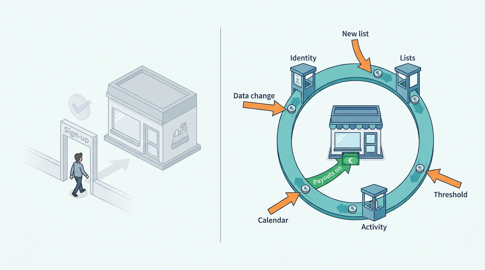
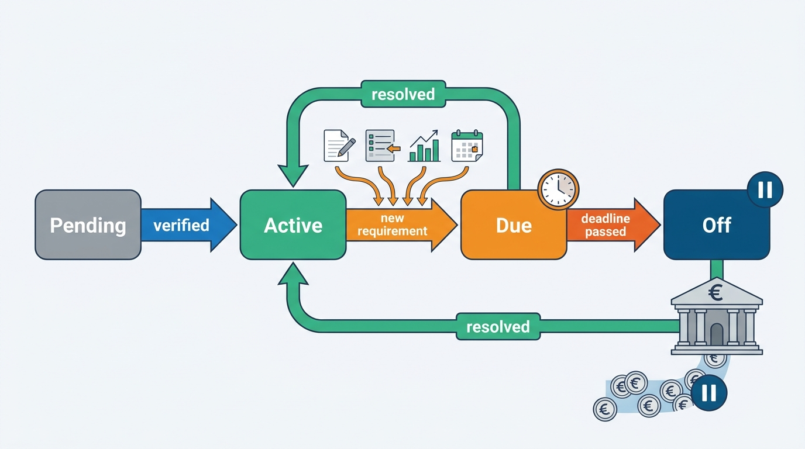
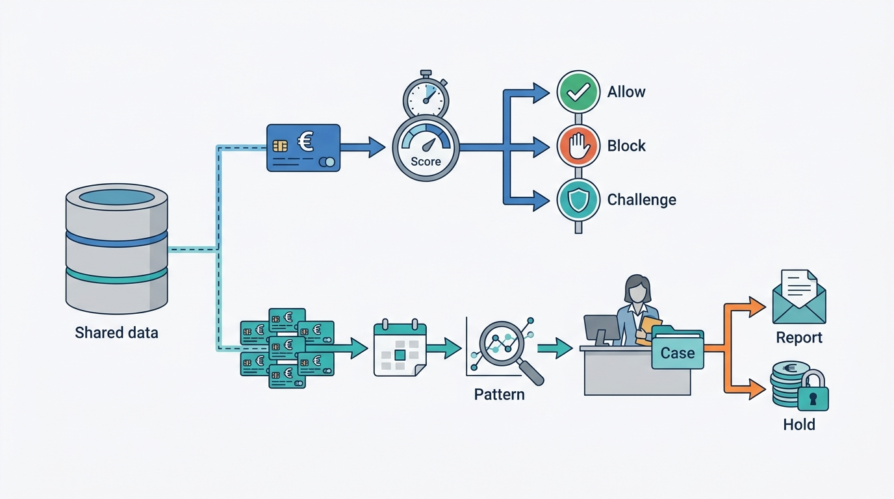
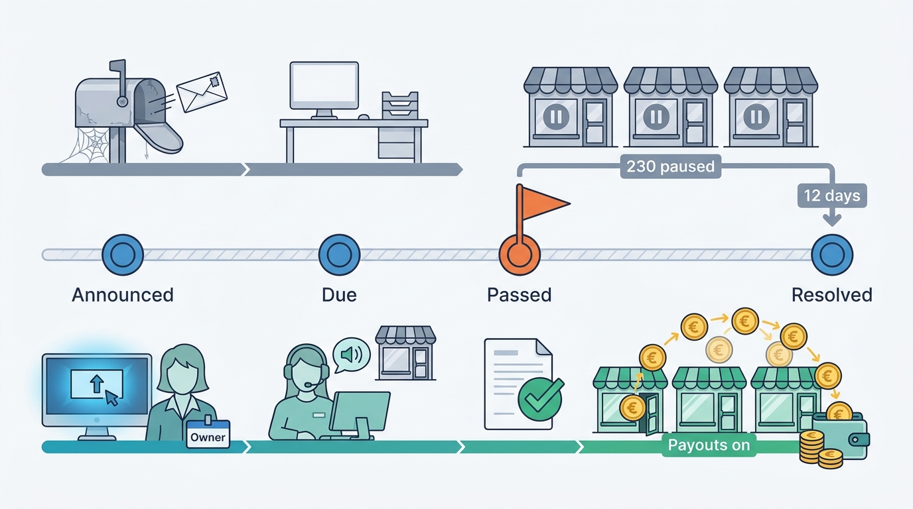

> **IN THIS CHAPTER, YOU WILL:** Learn what a payment provider must keep knowing about a business, how that becomes requirements, deadlines and capabilities on an account, and how a platform should track them.

> **KEY POINTS:**
>
> * **Compliance is a loop, not a form.** The law obliges a payment company to know who a business is, who owns it, whether any of them is under sanctions and whether its transactions look like money laundering, for as long as it serves that business. Each check has a trigger that runs it again.
> * **In software, verification is account state.** Stripe and Adyen both hold it as requirements with deadlines that switch capabilities such as payouts on and off, and deliver changes by webhook. An approved seller can become restricted without doing anything.
> * **The provider keeps the duty; the platform keeps the deadlines.** A missed deadline shows up as stopped payouts. How either company monitors transactions or screens against sanctions lists is not public, and this chapter describes those systems only as labeled inference.

> **[FAILURE PATTERNS THIS CHAPTER ADDRESSES](where-payment-systems-go-wrong.html):**
>
> * **The Frozen Seller** — verification treated as a sign-up form leaves nobody watching when a requirement changes, and the seller finds out when payouts stop.
> * **The Trusted Doorbell** — verification state arrives by webhook, and one documented class of change sends no webhook at all.

 
In May 2026, 230 fitness studios on Larkfield, the fictional studio-software platform this book follows ([[meet-larkfield]]), stopped receiving payouts. None had changed its owner, its bank account or its business. Each had been verified and approved by the payment provider years earlier. **What had changed was a rule**: the provider needed one more piece of information, by a date, and the date had passed.

The last four chapters were about the payer and the card: where the number is kept, which credential is sent, whether the payment looks like fraud, whether the cardholder was authenticated. Each was a decision about one payment. This chapter turns to the other end, the business being paid, which the provider must know and keep knowing. That knowledge is **a standing state on an account, not a decision per payment**: requirements with deadlines that switch capabilities such as payouts on and off, and that can change months after onboarding without the business doing anything. Stripe and Adyen document that state field by field. Neither documents how it watches transactions for money laundering, and the chapter says where the public record stops.

**Where we are in the payment's journey.** This chapter is off the path of Mila Janssen's class pass, and it still decides the last step. Mila paid Studio Noord €120.00 on Tuesday 9 March 2027, and €117.47 reaches the studio's bank on Thursday 11 March. That happens only because Studio Noord's ability to receive payouts is switched on that day. This chapter is about what keeps it on.

The chapter starts with the Frozen Studios. It then sets out what a payment company must know and keep knowing, and how both providers turn verification into requirements, deadlines and capabilities. Next come what is public and what is inference about watching the money, and the regulatory calendar as of November 2026. After that it compares three ways a platform can hold verification state, puts Stripe and Adyen side by side, replays the incident under Larkfield's decision K6 and ends with the ways this goes wrong.

## Setting the Scene at Larkfield: The Frozen Studios

Femke de Graaf, who has led payments engineering at Larkfield since January 2027, reviewed the incident with Jonas Weber, the risk and compliance lead, in her first months. The 230 studios were on Stripe Connect, Stripe's product for platforms, set up so that Larkfield collects verification information from its studios and passes it to Stripe. In the spring of 2026 a verification requirement changed. The change was announced in advance, with a deadline. For 230 studios the deadline passed with the new information missing, and their payouts were paused.

The cost was the studios' own money standing still. Larkfield processed €1.12 billion for 6,200 studios in 2026, about €495 per studio per day. For 230 studios over the longest wait of 12 days that is about **€1.4 million**, an upper bound, sitting in provider balances while rent and instructors were due. No money was lost, but a platform whose product is getting studios paid had failed at exactly that.

The cause was not missing information. Larkfield had treated verification as a form that each studio finished at sign-up, so its whole response to the change was one batch email to each studio's sign-up address. For the 230, that was a mailbox nobody read. No person at Larkfield owned the deadline, and Aylin Demir's support team heard about it first, from studios. "Nothing was wrong with these studios," Femke wrote in her review notes. "So what is it that the provider has to keep knowing about a business it has already approved?"

## What a Payment Company Must Know, and Keep Knowing

The answer starts in anti-money-laundering (AML) law. A firm that moves money is the point at which the proceeds of crime could enter the payment system, so the law makes it an **obliged entity**: it must know its customers, a duty known as KYC (know your customer), and for a business customer as KYB (know your business). In the EU these duties move into one directly applicable rulebook, Regulation (EU) 2024/1624 (the EU's AML Regulation, published in June 2024), which "shall apply from 10 July 2027"; until then national laws under the earlier directive, which is repealed on the same date, apply. I quote it below with that date in mind.

Knowing a business means identifying the people behind it. A **beneficial owner** is, in the regulation's words, "any natural person who ultimately owns or controls a legal entity", and Article 52 sets the ownership test at "direct or indirect ownership of 25 % or more of the shares or voting rights or other ownership interest in the corporate entity". The United States uses the same number for banks, securities brokers, mutual funds and similar firms, which its rule calls covered financial institutions: they must "identify and verify the identity of any individual who owns 25 percent or more of a legal entity, and an individual who controls the legal entity" (a guidance page of FinCEN, the US Treasury's Financial Crimes Enforcement Network, n.d., accessed November 2026). The rule was issued in 2016 and has applied since May 2018 **(evidence age: 10 years; still in force)**, and a FinCEN order of 13 February 2026 removed the duty to identify the owners again each time an existing customer opens another account. The threshold reappears as an onboarding field: Adyen's documentation of verification requirements (n.d., accessed November 2026) asks for "Individuals who directly or indirectly own 25% or more of the total shares, voting rights or other equity in the organization". The answer changes whenever shares change hands.

Once the owners are known, they are checked against lists. **Sanctions screening** compares the business and its owners with government lists of persons and entities nobody may deal with: Article 20(1)(d) requires "verifying whether the customer or the beneficial owners are subject to targeted financial sanctions". In the US, the Treasury's 50 Percent Rule (frequently asked questions of its Office of Foreign Assets Control, n.d., accessed November 2026) treats an entity owned 50 percent or more by blocked persons as blocked itself, so screening needs the ownership data. A second screen looks for a **politically exposed person** (PEP), "a natural person who is or has been entrusted with prominent public functions", who is not forbidden as a customer but gets closer checks. Lists change, so Article 26(4) requires banks and financial institutions to repeat the sanctions check "upon any new designation".

The third duty concerns what the customer does. **Transaction monitoring** runs, in Article 26(1), "throughout the course of a business relationship, to ensure that those transactions are consistent with the obliged entity’s knowledge of the customer, the customer’s business activity and risk profile". A suspicion is reported to the country's financial intelligence unit, the public body that receives such reports: under Article 69, "All suspicious transactions, including attempted transactions". The report is confidential. Under Article 73 the firm "shall not disclose to the customer concerned or to other third persons" that an analysis or a report is under way.

On top of the law, each provider keeps its own list of **prohibited and restricted businesses**, so a lawful business can still be refused or asked for more. Adyen's published list (last update 13 November 2025) marks each category "P" for prohibited or "R" for restricted ("We will require additional documentation prior to onboarding") and gives its reasons: laws, "Requirements of our payment partners (e.g. card networks)", "Level of assessed risk (e.g. chargebacks, fraud)" and "Reputational impact to Adyen". Stripe's published list (last updated 22 September 2026) likewise has prohibited and restricted categories and additions per jurisdiction; I paraphrase it. Part of each list is therefore risk appetite, not law.

None of these checks is finished at sign-up, because each has a trigger that runs it again. From July 2027 the EU rule also puts a ceiling on the interval: Article 26(2) says the period between updates of customer information shall not exceed "1 year" for higher-risk customers and "5 years" for all others, and Article 26(3) adds a review on any "change in the relevant circumstances of a customer". **Onboarding is the first run of a loop.** The table sets the checks side by side; the triggers in its third column come from Article 26 and from the provider documentation cited in the next section.

| Check | The question | What runs it again | Output |
| --- | --- | --- | --- |
| Identity and ownership | Who is this business, and which people own or control it? | The business changes its data; a threshold of time or volume; a rule change | Verified, or a requirement |
| Sanctions and PEP screening | Is the business, an owner or a controller on a list? | A new designation on a list; a change of owners | Clear, or a review and possibly a freeze |
| Transaction monitoring | Do the transactions fit what is known about the business? | Every transaction, looked at over time | A case for an analyst; possibly a confidential report |
| Periodic review | Is what we hold still true? | The calendar | Confirmed, or a requirement |

**Figure 1:** *Onboarding is the first run of a loop: a data change, a new list entry, a threshold or the calendar sends an approved business through the checks again.*

## How Verification Becomes Software: Requirements, Deadlines, Capabilities

A one-time "verified" flag cannot represent a loop. Both providers therefore hold the result of verification as three things. A **capability** is a named permission on an account, such as taking card payments or receiving payouts. A **requirement** is a missing fact or document. A **deadline** is the date by which a requirement must be met, and an unmet requirement at its deadline switches a capability off. Capabilities are computed from two inputs, the facts held about the business and the rules in force, and either input can change after onboarding. The figure shows the resulting state machine; [[platform-onboarding-and-verification]] covers what a platform does with it at sign-up.

**Figure 2:** *A capability that is active can become due and then switched off: a new requirement starts a deadline, and a passed deadline stops payouts until the requirement is resolved.*

Stripe publishes the outstanding work as lists on the account. Its documentation on handling verification with the API (n.d., accessed November 2026) defines a `requirements` structure, and a platform learns of changes through the `account.updated` webhook. Six of its fields carry the contract between Stripe and a platform about one seller:

| Field in `requirements` | What Stripe's documentation says it holds |
| --- | --- |
| `currently_due` | "requirements that you must resolve by the `current_deadline` for the account to remain `active`" |
| `eventually_due` | "requirements that you might need to resolve, depending on whether the corresponding thresholds are reached" |
| `past_due` | "requirements that have disabled capabilities because they weren’t resolved before the `current_deadline`" |
| `pending_verification` | "requirements that are being reviewed or that might become required based on the review" |
| `current_deadline` | "the earliest deadline across all of the account’s requested capabilities and risk requirements" |
| `disabled_reason` | "why the account isn’t enabled and why it can’t process charges or transfers" |

What happens at the deadline is documented too, and it lands on the seller's money. The same page says: "Stripe typically disables payouts on the account if we don’t receive the information by the `current_deadline`", and, if the account stays unresponsive, "Stripe might also disable the ability to process charges." A requirement can also become due while the seller simply keeps trading. Stripe's identity verification page (n.d., accessed November 2026) says: "At certain variable thresholds—usually when a specified amount of time has passed or volume of charges have been made—you might need to collect and verify additional information. Stripe temporarily pauses charges or payouts if the information isn’t provided or verified". A periodic confirmation is announced as well: a Stripe support article (last updated October 2026) introduces "KYC Refresh", under which "Stripe will periodically add attestation requirements to connected accounts", first in Europe. Its API was in private preview in 2026, when such requirements "have no due dates and do not affect capabilities", with a public preview planned for the first quarter of 2027.

Rule changes are a third way for a requirement to appear, and Stripe announces them as data. Its page on handling verification updates (n.d., accessed November 2026) says "Stripe frequently updates KYC requirements, often due to changes implemented by financial regulators, card networks, and other financial institutions." Upcoming entries sit in a second structure, `future_requirements`, whose deadline "represents when entries in `future_requirements` will move to `requirements`". Who must act depends on configuration. Where Stripe collects verification information from sellers, it "handles upcoming requirement changes for your connected accounts automatically"; where the platform collects it, the platform handles them, and a platform that built its own forms on the API "must plan on reviewing and updating onboarding requirements at least every 6 months" (Stripe's page on onboarding configurations, n.d., accessed November 2026).

Compliance reviews reach a Stripe platform through the same structure, and this is the only place where the screening and monitoring of the previous section become visible. The documentation lists requirement types such as `sanctions_review` ("We must verify that the business isn’t involved with a sanctioned person or jurisdiction"), `pep_review`, `restricted_or_prohibited_industry_diligence`, `other_compliance_inquiry` and `legal_hold` ("Stripe is required to hold funds for a legal reason"). The `disabled_reason` field can read `under_review` or `listed`: "The account might be on a prohibited persons or companies list. Stripe investigates and either rejects or reinstates the account accordingly." A platform can store these values. It cannot see what produced them.

Adyen models the same thing from the capability's side. Its verification overview (n.d., accessed November 2026) opens with the duty: "As required by payment industry regulations, Adyen must verify the users in your platform before you can process payments, pay out their funds, and offer financial products to them." What is verified is a legal entity. What is switched is a capability on that entity's account holder, with three flags, `requested`, `allowed` and `enabled`, of which the last is the platform's own switch: "The capability can only be used when it is both allowed and enabled." Each capability also has a `verificationStatus` of `pending`, `valid`, `invalid` or `rejected`, and when something is wrong a list of problems: verification errors with the actions that would fix them (Adyen's capabilities page, n.d., accessed November 2026).

At Adyen, verification runs again when capabilities are requested, when the seller's data changes and when Adyen requires a periodic data review, and for each it may set a deadline. The overview page gives standard lengths: a "30-day period" for payout-side capabilities such as `sendToTransferInstrument`, a "60-day period" for `receivePayments` and others. "Users are allowed to continue using the capabilities while the deadline is active", though "a standard deadline could be shortened or removed in specific situations". The periodic review is a documented flow: "Adyen occasionally requires your users to review and confirm that their data is up-to-date." A webhook then sets the status to `invalid` with error 3_10, "Review of data is required", while `allowed` "Remains set to `true`" until the deadline (Adyen's page on periodic data reviews, n.d., accessed November 2026). Platforms that are payment facilitators (they sign up sellers under their own registration with the card networks) may verify in tiers, and when a seller moves up a tier, "their payouts are temporarily disallowed until they complete additional verification checks" (Adyen's verification types page, n.d., accessed November 2026). One gap is stated outright: the account-holder webhooks "are only triggered for capability-related changes to the account holder. Data changes to the legal entity of the account holder do not trigger webhooks." I found no counterpart to `future_requirements` in Adyen's API documentation; changes to verification requirements are announced in its dated release notes (for example, a proof-of-signatory check for business accounts announced for the second quarter of 2024).

On both providers, then, an account that was fully enabled can become restricted by five routes. Four need no action by the seller: a rule change, a threshold of time or volume, a periodic review (on Stripe still in preview in 2026), and a compliance review. The fifth is a change in the seller's own data, which sends it through verification again. The failure section returns to this list as a diagnosis.

## Watching the Money: What Is Public and What Is Inference

Verification asks who the business is. Monitoring asks what it does, and an engineer's first idea is to reuse the fraud engine of [[payment-fraud-and-risk]] for it. Both run rules and models over transactions, but they are different jobs. The comparison below is industry practice and my own summary, not either company's description.

| | Fraud scoring | Money-laundering monitoring |
| --- | --- | --- |
| The question | Is this payment made by the cardholder? | Does this business's activity fit what is known about it? |
| When it runs | Inside the authorization (the real-time request to the cardholder's bank), in milliseconds | Afterwards, over days or weeks |
| What it looks at | One payment and its signals | A customer's behavior over time, against the customer record |
| Output | Allow, block or challenge | A case for a person; possibly a report to an authority, or a freeze |
| Is the customer told? | Yes: the payment is declined | Possibly not: the law can forbid it |

**Figure 3:** *Fraud scoring decides one payment in milliseconds; money-laundering monitoring studies behavior afterwards and ends in a case, a confidential report or a hold. They share data, not a decision path.*

Neither Stripe nor Adyen publishes its monitoring scenarios, its sanctions-screening logic or its re-verification intervals. What is public is the effect on an account. Stripe has the requirement types `legal_hold` and `other_compliance_inquiry` cited above, and its Radar documentation (n.d., accessed November 2026) says of its account-level fraud models: "We calculate account-level risk using KYC information, transactions, geographic risk factors, and behavior patterns." Adyen's verification overview has one sentence: "Verification deadlines may be adjusted based on ongoing account monitoring and subsequent verification checks." Each also says so as policy. Stripe's financial-crimes policy statement (support site, dated November 2023) reports "ongoing screening of its users against sanctions lists administered by the UN, US, EU, UK, Canada, and other applicable jurisdictions" and "ongoing transaction monitoring of user activity". Adyen's privacy statement on compliance obligations (n.d., accessed November 2026) says it will "Monitor your behavior and transactions across the Adyen platform, including by using automated systems such as machine learning models", and its glossary defines party screening as checking the people and entities behind an account "against global sanctions lists, Politically Exposed Persons (PEP) databases, and adverse media sources". Each company confirms that accounts are watched after onboarding and says nothing about how; Stripe's Radar sentence is about fraud risk, not money laundering. A Stripe guide for platforms (last updated 31 August 2026) lists patterns that monitoring commonly looks for, such as transactions kept just under a review threshold, but it is general education, not a description of Stripe's own system. Part of that silence is required: Article 73, quoted earlier, forbids telling a customer that an analysis is under way.

I found no public source, in either company's documentation, support site, policies or engineering posts, that describes how these systems are built. What can be said comes from the duties alone, and I mark it as such.

> **INFERENCE, NOT DOCUMENTED:** A system that meets the duties above plausibly needs six parts: a versioned record of each customer and its owners; a risk rating with a next-review date (Article 26(2)); a re-screening job that runs when a sanctions list changes and when a customer's data changes (Article 26(4)); detection that compares weeks of transactions with what is known about the business (Article 26(1)); a case queue in which analysts decide and, where needed, report (Article 69); and a way to hold funds or switch off a capability. This is derived from the legal text. It is not a description of Stripe's or Adyen's systems, and I do not know which of these parts either company has built, bought or combined with its fraud systems.

## The Regulatory Calendar as of November 2026

Stripe's sentence about requirements changing "due to changes implemented by financial regulators" points at a calendar. Each item on it has one of three statuses: **in application**, **adopted with a future date**, or **not adopted**. A status without a date is useless, so the table gives both as they stood on 17 November 2026.

| Rule | Status on 17 November 2026 | Dates | What it changes for a payment system |
| --- | --- | --- | --- |
| DORA, Regulation (EU) 2022/2554 | In application | Since 17 January 2025 | Incident reporting and a register of technology suppliers become legal duties |
| Instant payments, Regulation (EU) 2024/886 | In application for euro-area providers that already offered credit transfers (in practice, banks); future date for others | Receive by 9 January 2025, send by 9 October 2025; euro-area payment and e-money institutions by 9 April 2027 | Euro transfers credited in ten seconds; sanctions screening of the customer base every day |
| Verification of payee, same regulation | In application in the euro area | 9 October 2025; non-euro member states 9 July 2027 | A check of the payee's name before a transfer is authorized |
| EU AML Regulation, (EU) 2024/1624 | Adopted with a future date | Applies from 10 July 2027 | One rulebook; review intervals of at most one and five years |
| AMLA, the EU's new anti-money-laundering authority | Operating; direct supervision not started | Start of direct supervision "During 2028", by AMLA's own timeline | An EU-level supervisor for selected cross-border firms |
| PSD3 and the Payment Services Regulation | Not adopted | Parliament's second reading indicated for 14 December 2026 | Nothing yet |
| US beneficial-ownership relief, FinCEN order FIN-2026-R001 | In effect | 13 February 2026 | Covered institutions need not identify owners again at each new account |

DORA, the EU's Digital Operational Resilience Act (Regulation (EU) 2022/2554, published in December 2022; evidence age about 4 years, and the text is in application), is on this calendar for its date and status only. "It shall apply from 17 January 2025", and its scope names credit institutions, payment institutions and electronic money institutions, so it binds both kinds of provider. But it regulates resilience, not knowledge of the customer: Article 19 says "Financial entities shall report major ICT-related incidents" (ICT is information and communication technology), and firms must keep a register of their contracts with technology suppliers. On 18 November 2025 the European supervisory authorities published, in a joint press release, the list of technology suppliers they designated as critical and placed under direct oversight. I found no DORA statement by Stripe or Adyen and claim nothing about either; [[payment-reliability-and-availability]] takes up the engineering.

The instant-payments rules (Regulation (EU) 2024/886, 2024) show why the status column needs the license next to it. Euro-area payment service providers had to receive instant euro transfers by 9 January 2025 and send them by 9 October 2025, and to offer "a service ensuring verification of the payee" by the same October date. Payment institutions and e-money institutions (the licensed non-banks of [[licences-and-safeguarding]]) in the euro area have until 9 April 2027 for instant transfers. A provider that is a bank was due in 2025; one that is an e-money institution is due in 2027. [[payouts-and-money-movement]] follows the payee check through a payout.

The same regulation legislates this chapter's claim. A transfer that must reach the payee "within 10 seconds" leaves no room for a manual sanctions review, so Article 5d moves the check. Providers "shall carry out such verifications immediately after the entry into force of any new targeted financial restrictive measures … and at least once every calendar day", against their whole customer base, and during an instant transfer they "shall not verify" payer or payee against those lists again. A control that sat in the payment path now sits in account state, by law.

The remaining items are to be tracked, not built. The EU AML Regulation is adopted and applies from 10 July 2027. PSD3, the directive that will replace the EU's payment services law, and its companion Payment Services Regulation were **not adopted on 17 November 2026**: the Parliament's procedure files for the two texts, read on that day, showed "Council position published" on 5 November 2026, the status "Awaiting Parliament 2nd reading" and an indicative plenary date of 14 December 2026. Adyen's explainer (12 October 2026) expects that "General application is expected 21 months after entry into force", which is a provider's expectation, not law. I would put both on the calendar with an owner and build to neither until the text and the date are final; [[three-d-secure-and-sca]] covers what the drafts would change for authentication.

## Three Ways a Platform Can Hold Verification State

A platform that embeds payments can respond to all this in three ways, which differ in what it stores. In **the form**, it stores nothing after sign-up: verification was a step, and it is done. That was Larkfield in 2026. In **the pass-through**, it stores a yes or no per seller and leaves everything else to the provider's hosted pages and notices, which matches the configuration in which the provider collects requirements. In **the mirror**, it stores each seller's requirements, deadlines and capability status, with an owner. The mirror is what Larkfield's Keel decision K6 prescribes: "verification is state, not a form".

The three trade build effort against the platform's ability to notice a new requirement and to explain a stopped payout.

| Design | What the platform stores | Who notices a new requirement | What the seller sees when payouts stop | When it is right |
| --- | --- | --- | --- | --- |
| The form | Nothing after sign-up | Nobody at the platform | "Payouts paused", with no reason | Never, once sellers depend on payouts |
| The pass-through | Enabled or not, per seller | The provider, through its own pages and notices | A link to the provider | The provider collects requirements and the seller uses the provider's dashboard |
| The mirror | Requirements, deadlines, capability status, owner | The platform | The requirement, the date and what to do, in the platform's own back office | The platform is the seller's only interface, or carries the seller's losses |

I would build the mirror whenever the platform is the seller's only interface or carries the seller's losses, because the provider enforces a missed requirement on the seller's payouts and only a platform that stores the state can show the seller why. I would accept the pass-through where the seller already works in the provider's own dashboard and the provider collects the requirements. [[platform-onboarding-and-verification]] has the detail of the platform's side.

## Stripe and Adyen: Where They Differ

The two providers expose the same duties through different structures. Every Stripe and Adyen cell below repeats a fact cited above from documentation, support pages and release notes accessed in November 2026, or says "Not public"; the last column is my reading, an inference.

| Aspect | Stripe | Adyen | What the difference suggests |
| --- | --- | --- | --- |
| What is verified, and what is switched | An account and its persons; capabilities on the account | A legal entity; capabilities on its account holder, each `requested`, `allowed` and `enabled` | Adyen's `enabled` flag gives the platform a switch of its own |
| What is outstanding | Lists of requirements: `currently_due`, `eventually_due`, `past_due`, `pending_verification` | A `verificationStatus` per capability, with verification errors and remediating actions | Stripe says what is missing; Adyen says what is allowed and why not |
| Deadline | One `current_deadline`, the earliest across capabilities; for updated requirements on Custom accounts, "typically" 14 days to keep payouts and 28 to keep payments (support article) | Per capability; a standard "30-day period" or "60-day period" that can be "shortened or removed" | Adyen's can be planned around; Stripe's must be read per account |
| Announced rule changes | `future_requirements`, with the date entries move to `requirements` | Not public as an API structure: none found in the documentation; changes appear in dated release notes | On Stripe a rule change is data a platform can act on before it bites |
| Periodic re-verification | Announced as "KYC Refresh": attestation requirements in `requirements`, first in Europe; API in private preview in 2026 (support article, last updated October 2026); no interval published | A documented flow: error 3_10, a deadline, a confirmation call; no interval published | Adyen's flow is released and routine; Stripe's was still in preview in 2026 and arrives as one more requirement |
| Sanctions and PEP reviews | Named requirement types: `sanctions_review`, `pep_review`, `legal_hold` | "Party screening" is defined in the glossary; no such status is named in the verification pages | A Stripe platform can tell a compliance review from a missing document |
| Transaction monitoring | Stated as policy (2023); method not public | Stated in the privacy statement, "machine learning models" included; method not public | No material difference in the public record |

On Stripe, read `future_requirements` on a schedule, not only on a webhook, and treat the single deadline as data that differs per account. On Adyen, build reminders on the published 30- and 60-day periods, handle the data-review error as a routine event, and re-read a legal entity after you change it, because "Data changes to the legal entity of the account holder do not trigger webhooks." On both, store the reason next to the status.

## In Practice at Larkfield: The Frozen Studios, Replayed under K6

Femke's team replayed the incident against the fields above. It had four stages, and each was visible in the provider's record before any studio felt anything. The table is an illustration; the fields in its second column are the documented ones.

| Stage | What the provider's record showed | Larkfield in May 2026 | Larkfield under K6 |
| --- | --- | --- | --- |
| Announced | The new requirement in `future_requirements`, with the date it takes effect | One batch email to sign-up addresses | Stored per studio; a banner in the studio's back office; the owner sees the count |
| Due | The requirement in `currently_due`, with a `current_deadline` | Nothing | Reminders in the back office; support contacts studios still open |
| Passed | The requirement in `past_due`; payouts disabled | Learned from support tickets | Expected to be empty; any studio here is an open item with an owner |
| Resolved | The requirement gone; payouts enabled | Up to 12 days later for the 230 | When the studio submits and the provider verifies |

**Figure 4:** *The same four stages twice: in 2026 one email and no owner left 230 studios paused for up to 12 days; with stored state and an owner the requirement is resolved before the deadline.*

Under K6 the payment service keeps one verification record per studio in Larkfield's own vocabulary: the requirement, its due date, the capability at risk, the status, the owner, and when the studio was last told. For a studio on Stripe, such as Ravi Shah's Ironworks Climbing in Manchester, the record is filled from the requirement lists and their deadline. For a studio on Adyen, such as Ines Bakker's Studio Noord, it is filled from the capability's problems and deadlines; if Adyen asks Studio Noord for a periodic review, the record shows "confirm your business details" with the date from the webhook. It is one internal vocabulary over two provider vocabularies, as the payment record store is for payments.

Every open deadline now has a named owner, Jonas Weber, and studio support is the channel to the studio, alerted 14 days and again 3 days before a deadline *(illustrative thresholds, an assumption)*. Once a day a job re-reads every studio's state from the provider's API and compares it with the record, following K2: the provider's record is the truth, and the webhook is only the doorbell ([[payment-webhooks-and-events]]). The owner and the sweep are what was missing in May 2026.

## When It Goes Wrong

The commonest failure is a seller asking why payouts stopped. Each of the five routes leaves a different trace, so the diagnosis is knowing where to look. A payout can also stop for reasons outside verification, such as a returned transfer, which [[payouts-and-money-movement]] covers.

| Route | Where to look on Stripe | Where to look on Adyen |
| --- | --- | --- |
| A requirement's deadline passed | `past_due`; a `disabled_reason` of `requirements.past_due` | The capability is no longer `allowed`; status `invalid` with its verification errors |
| A threshold of time or volume was crossed | An entry in `eventually_due` that now also appears in `currently_due` | A move to a higher tier, for payment facilitators on staggered verification |
| A rule change took effect | An entry that moved from `future_requirements` to `requirements` | Not public as a structure; an entry in the release notes, and new verification errors with no change by the seller *(inference)* |
| A periodic review was not confirmed | An attestation requirement in `requirements` (KYC Refresh; in the 2026 preview it has no due date and does not affect capabilities) | Error 3_10, "Review of data is required", past its deadline |
| A compliance or legal review opened | `sanctions_review`, `pep_review`, `legal_hold`; a `disabled_reason` of `listed` or `under_review` | Not named as a status in the verification pages; a deadline that was "shortened or removed" |

The mirror itself fails silently. If a webhook is missed, or was never sent, the record shows no open requirement, which is worse than no record because people trust it. Larkfield has lost webhooks before: in the Silent Webhook of 14 September 2026 its Stripe receiver failed for 9 hours. And Adyen documents that a change to a legal entity's data triggers no webhook at all. The daily sweep exists for both cases, as does a re-read after every change Larkfield itself submits.

Some states the platform cannot resolve and may not be able to explain. At Adyen a status of `rejected` "is final and any errors cannot be resolved by updating data or uploading documents." Stripe expects platforms to handle risk-related requirements "by notifying connected accounts of identified issues so you can guide them to resolve through Stripe interfaces". And behind a `legal_hold` may be a report that the law forbids the provider to mention. In these cases the platform's job shrinks to saying what is known and routing the seller, and the support script should not guess.

The last failure outlives the others: believing that the provider's check is the platform's own. Stripe's documentation contradicts it directly: "Even after Stripe verifies a connected account, platforms still must monitor for and prevent fraud. Don’t rely on Stripe’s verification to meet any independent legal KYC or verification requirements." Whether a platform has such requirements of its own depends on what it does and where, and is a question for its counsel ([[marketplace-regulation]] shows how such duties look for marketplaces). The provider does not answer it for you.

## What to Take Away

**Established.**

- The duties are continuous by law: sanctions checks repeat "upon any new designation", monitoring runs "throughout the course of a business relationship", and from 10 July 2027 the EU caps review intervals at one and five years (Regulation (EU) 2024/1624).
- Both providers document verification as requirements, deadlines and capabilities delivered by webhook, and both document that a passed deadline stops the capability; Stripe says it "typically disables payouts".
- On 17 November 2026, DORA had applied since 17 January 2025, the EU AML Regulation was adopted for 10 July 2027, and PSD3 and the Payment Services Regulation were not adopted.

**Depends on context.**

- Mirror or pass-through depends on whose interface the seller uses and who collects requirements.
- How much to collect at sign-up depends on the provider's model and your sellers: collecting everything up front loses sign-ups, collecting in stages means payouts can pause at a threshold.
- Whether your platform has legal duties of its own depends on what it does and in which country; the provider's verification does not settle it.

**The author's synthesis.**

- I treat verification as a state machine with an owner for every deadline, because the provider enforces a miss on the one thing a seller cannot do without.
- I treat every statement about how a provider monitors transactions as inference until the provider documents it, and I design support for the hold that comes with no reason.

Across this part, the five controls turn out to be one system, not five features. How card numbers are collected decides which signals the fraud model sees ([[tokenization-vaulting-and-pci]]); the fraud rate of a provider's whole portfolio decides which authentication exemptions it may request; tokens and authentication together decide network fees and who carries a fraud dispute ([[network-tokens]]); and the identity data collected for verification feeds the risk score of the seller's account. Each control moves something to another party and returns a remainder: a page, a threshold, an exemption policy, a deadline. Set the Card-Testing Weekend that opened the part beside the Frozen Studios: one studio's online payments paused for 31 hours in the response to a fraud attack, 230 studios without payouts for up to 12 days by a verification control. In both, Larkfield held no card data and no member funds, and in both the remainder it had not assigned to anyone is what failed. So keep one table instead of auditing one certificate at a time: for each control, what moved, to whom, what stayed with you, and a named owner for what stayed. Larkfield's decisions K4 (card numbers never touch Larkfield) and K6 (verification is state, not a form) are two rows of that table.

## Questions to Ask

1. For each seller, can we show today which requirements are open, their deadlines and which capability each one puts at risk?
2. Who, by name, owns each open deadline, and which channel to the seller do we know is read?
3. Do we read announced rule changes from the provider's API on a schedule, or wait for an email?
4. If a webhook about verification is lost, how many hours pass before our record is corrected?
5. Which changes to a seller's data send us no notification, and do we re-read after making them?
6. When a seller's payouts stop, can support name the cause from our own record, including "the provider cannot say"?
7. Which legal duties to know our sellers are our own, and who told us so?
8. Which regulatory changes are on our calendar, with what status and as of which date?

This part ([[part-5]]) dealt with controls on payments that somebody starts: a payer taps, a seller is paid, and each control assigns data, a decision or a loss to a named party. The next part turns to payments that nobody starts. A clock starts them, for a billing period, and their failures are failures of time: late, twice, or in the wrong period. [[part-6]] begins there.

## Sources and Evidence

*Company, product and investor sources*

- [Handle verification with the API](https://docs.stripe.com/connect/handling-api-verification.md?accounts-namespace=v1), Stripe documentation, n.d., accessed 2026-11 — the `requirements` fields, the consequence of a missed deadline, disabled reasons, risk and compliance requirement types.
- [Identity verification for connected accounts](https://docs.stripe.com/connect/identity-verification.md), Stripe documentation, n.d., accessed 2026-11 — thresholds of time and volume; "Don’t rely on Stripe’s verification".
- [Handle verification updates](https://docs.stripe.com/connect/handle-verification-updates.md?accounts-namespace=v1), Stripe documentation, n.d., accessed 2026-11 — `future_requirements`; who handles rule changes.
- [Choose your onboarding configuration](https://docs.stripe.com/connect/onboarding.md), Stripe documentation, n.d., accessed 2026-11 — the six-month review for API onboarding.
- [Radar rules](https://docs.stripe.com/radar/rules.md), Stripe documentation, n.d., accessed 2026-11 — account-level fraud risk uses KYC information.
- [KYC Refresh: Upcoming periodic confirmation requirements](https://support.stripe.com/questions/kyc-refresh-upcoming-periodic-confirmation-requirements), Stripe support, last updated 2026-10 — periodic attestation requirements; private preview in 2026, public preview planned for Q1 2027.
- [Ongoing seller compliance monitoring: AML, transaction, and sanctions checks](https://stripe.com/resources/more/ongoing-seller-compliance-monitoring), Stripe, last updated 2026-08-31 — a general guide to monitoring patterns, not a description of Stripe's system.
- [Prohibited and Restricted Businesses](https://stripe.com/legal/restricted-businesses), Stripe, last updated 2026-09-22 — prohibited and restricted categories and jurisdiction-specific additions (paraphrased).
- [Financial Crimes Risk Appetite Policy Statement](https://support.stripe.com/questions/financial-crimes-risk-appetite-policy-statement), Stripe support, dated November 2023, accessed 2026-11 — ongoing sanctions screening and transaction monitoring, stated as policy.
- [Custom connected account onboarding requirements](https://support.stripe.com/questions/custom-connected-account-onboarding-requirements), Stripe support, n.d., accessed 2026-11 — the typical 14 and 28 days after an updated requirement falls due.
- [Compliance obligations](https://www.adyen.com/privacy-policy/compliance-obligations), Adyen privacy statement, n.d., accessed 2026-11 — monitoring of behavior and transactions, machine learning models included.
- [Adyen glossary](https://docs.adyen.com/adyen-glossary), Adyen documentation, n.d., accessed 2026-11 — definition of party screening.
- [Verification process](https://docs.adyen.com/platforms/verification-overview.md), Adyen documentation, n.d., accessed 2026-11 — when Adyen verifies, standard deadlines, ongoing monitoring, the webhook gap.
- [Capabilities](https://docs.adyen.com/platforms/verification-overview/capabilities.md), Adyen documentation, n.d., accessed 2026-11 — the three flags and the verification statuses.
- [Data review process](https://docs.adyen.com/platforms/verification-overview/data-review-process.md), Adyen documentation, n.d., accessed 2026-11 — the periodic review, error 3_10.
- [Verification types](https://docs.adyen.com/platforms/verification-overview/verification-types.md), Adyen documentation, n.d., accessed 2026-11 — staggered verification and tiers.
- [Verification requirements](https://docs.adyen.com/platforms/verification-requirements.md), Adyen documentation, n.d., accessed 2026-11 — beneficial owners through ownership and control.
- [Platforms and financial products (release notes)](https://docs.adyen.com/release-notes/platforms-and-financial-products.md), Adyen documentation, dated entries to 2026-11-13 — where changes to verification requirements are announced.
- [Prohibited and Restricted Products and Services](https://www.adyen.com/legal/list-restricted-prohibited), Adyen, last update 2025-11-13 — the "R" and "P" list and its reasons.
- [PSD3 and PSR Explained](https://www.adyen.com/knowledge-hub/psd3), Adyen, 2026-10-12 — a provider's expectation of the timeline.

*Standards, regulation and official documentation*

- [Regulation (EU) 2024/1624 (AML Regulation)](http://publications.europa.eu/resource/celex/32024R1624), Official Journal, 2024-06-19 — Articles 20, 26, 52, 69 and 73; application from 10 July 2027.
- [Directive (EU) 2024/1640 (sixth AML Directive)](http://publications.europa.eu/resource/celex/32024L1640), Official Journal, 2024-06-19 — Article 77: the earlier directive, (EU) 2015/849, is repealed with effect from 10 July 2027.
- [Regulation (EU) 2024/886 (instant payments)](http://publications.europa.eu/resource/celex/32024R0886), Official Journal, 2024-03-19 — dates by provider type, verification of payee, daily sanctions screening.
- [Regulation (EU) 2022/2554 (DORA)](http://publications.europa.eu/resource/celex/32022R2554), Official Journal, 2022-12-27 — scope, application date, incident reporting (evidence age: about 4 years; in application).
- [The European Supervisory Authorities designate critical ICT third-party providers](https://www.eba.europa.eu/publications-and-media/press-releases/european-supervisory-authorities-designate-critical-ict-third-party-providers-under-digital), European Banking Authority, 2025-11-18 — the first list under DORA.
- [Procedure file 2023/0210(COD), Payment Services Regulation](https://oeil.europarl.europa.eu/oeil/en/procedure-file?reference=2023/0210(COD)), European Parliament Legislative Observatory, accessed 2026-11-17 — status of the regulation.
- [Procedure file 2023/0209(COD), Payment Services Directive (PSD3)](https://oeil.europarl.europa.eu/oeil/en/procedure-file?reference=2023/0209(COD)), European Parliament Legislative Observatory, accessed 2026-11-17 — status of the directive; same events and dates.
- [About AMLA](https://www.amla.europa.eu/about-amla_en), Anti-Money Laundering Authority, n.d., accessed 2026-11 — timeline to direct supervision.
- [Information on Complying with the Customer Due Diligence (CDD) Final Rule](https://www.fincen.gov/resources/statutes-and-regulations/cdd-final-rule), FinCEN, n.d., accessed 2026-11 — the 25 percent and control tests; which institutions are covered (rule of 2016, applicable since May 2018; evidence age: 10 years).
- [Order FIN-2026-R001](https://www.fincen.gov/system/files/2026-02/FinCEN-Order-CCDExceptiveRelief.pdf), FinCEN, 2026-02-13 — relief from identifying owners at each new account opening; the dates of the 2016 rule.
- [Entities Owned by Blocked Persons (50% Rule)](https://ofac.treasury.gov/faqs/topic/1521), Office of Foreign Assets Control, n.d., accessed 2026-11 — ownership, not control.

*Research and practitioner sources*

- None.

Larkfield is fictional; architectural recommendations, labeled inferences and labeled assumptions are the author's judgement.
