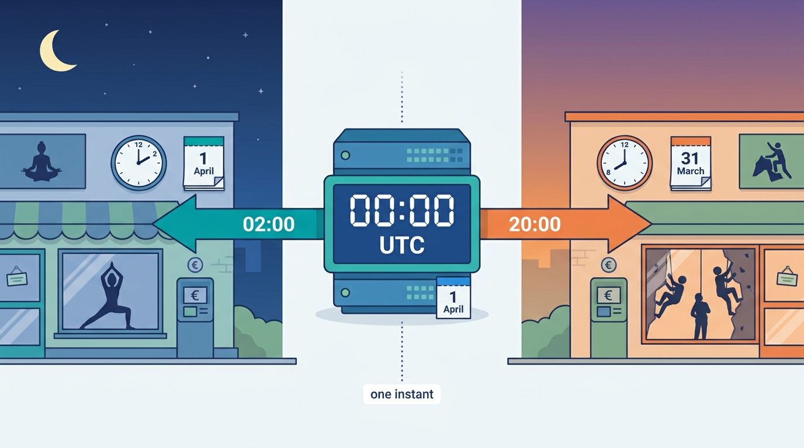
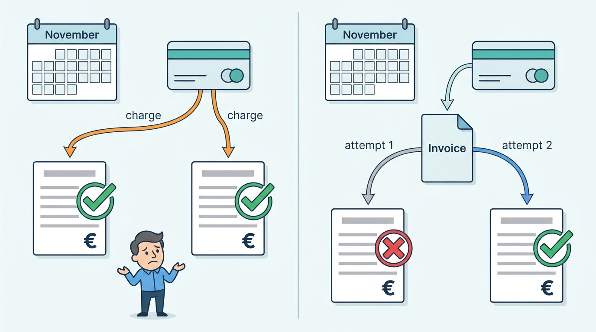
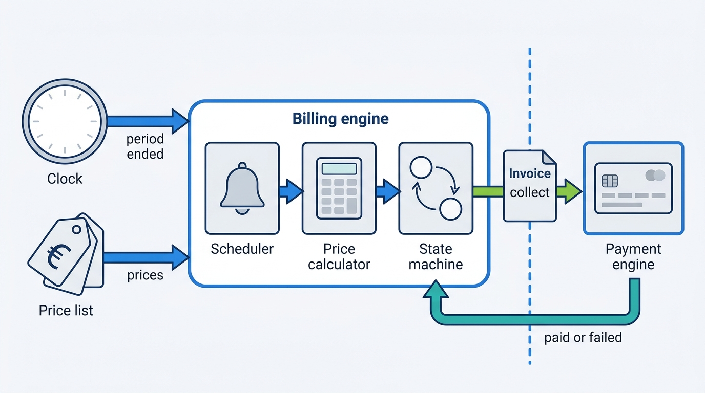
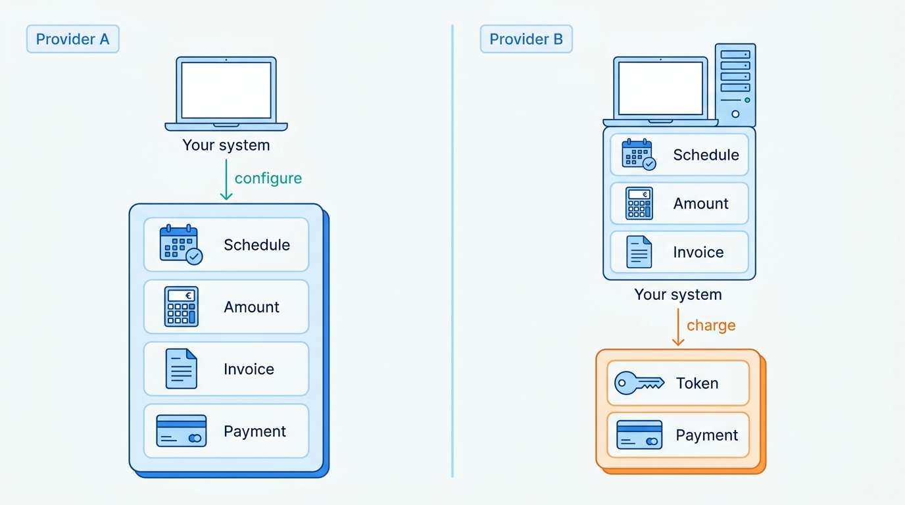

> **IN THIS CHAPTER, YOU WILL:** Learn what a billing engine decides before any payment is made, and where those decisions live on Stripe, on Adyen and in your own code.

> **KEY POINTS:**
>
> * **A subscription is a state machine that produces invoices, not a job that charges a card.** A billing engine is a scheduler, a price calculator and a subscription state machine. Its output is an invoice, the record of one debt for one period, and the payment API executes only the last step.
> * **Stripe keeps the engine in its platform; Adyen's documentation offers a token and a flag.** Stripe documents subscription, invoice and payment as separate objects with a rule for each decision. Adyen documents a stored token charged with a recurring processing model. Orb, which Adyen bought on 1 July 2026, is not documented as part of Adyen's platform as of November 2026.
> * **A billing rule is part of the agreement with the customer.** Stripe now runs two billing modes side by side and lets a subscription move between them in one direction only. Whatever engine you use, store the rule each subscription runs under.

> **[FAILURE PATTERNS THIS CHAPTER ADDRESSES](where-payment-systems-go-wrong.html):**
>
> * **The Double Charge** — a renewal retried without a record of "one debt per period" becomes a second payment for the same month.
> * **The First of the Month** — a scheduler that fires every renewal at one instant turns a calendar date into a load peak and a rate-limit problem.
> * **The Version Cliff** — an API upgrade can change the default billing rules for new subscriptions without any change to billing code.

 
On 1 November 2026 a renewal job at Larkfield, the fictional studio-software platform this book follows ([[meet-larkfield]]), timed out on a provider call and tried again. **1,840 members paid for November twice.** Every one of those 3,680 payments was valid: approved, captured, reported as successful. The fault lay in whatever was supposed to know that a member owes one charge per month.

The system that knows is a **billing engine**. It decides what is owed, for which period and when to ask; the payment API only carries out the asking. Stripe keeps such an engine inside its platform. Adyen's documentation offers a stored card charged with a recurring flag, and leaves the schedule, the amount and the record of the debt to the merchant or to a billing system connected to Adyen. [[part-6]] claimed that something above the payment decides when to ask; this chapter says what it is made of.

**Where we are in the payment's journey.** Mila Janssen started her class pass payment herself: she tapped "pay" for €120.00 on 9 March 2027. This chapter is about the payments nobody starts. Mila also holds a €49.00 monthly membership at Studio Noord, set up on 12 January 2027 and renewed on the 1st of each month. Same payer, same card, but the clock starts the charge.

The chapter starts at Larkfield, which turns out to run two billing engines. It then sets out what a charge on a clock has to decide, and assembles the engine that decides it: a scheduler, a price calculator and a state machine. Next come Stripe Billing's object model as documented, Adyen's recurring model of a token and a flag, the three places an engine can be kept, and the two companies side by side. The chapter ends with one upgrade and one renewal worked at Larkfield, and the ways billing goes wrong.

## Setting the Scene at Larkfield: Two Billing Engines, One of Them Unnoticed

In May 2027 Larkfield's billing integration moved from the growth team to the payments team, and Femke de Graaf, the head of payments engineering, took an inventory of what she had inherited. She found two billing systems where she expected one. The first is **Stripe Billing**, which has billed studios for Larkfield's software plans since 2018. The second had no name. It is the booking app's renewal job, which charges members for their studio memberships through the payment service on both providers.

Sorted by engine, the 2026 incidents show a pattern: the engine Larkfield bought failed once, at the edge where Larkfield's code met it, and the engine Larkfield wrote without calling it one failed twice, in its core.

| | Studio subscriptions | Member memberships |
| --- | --- | --- |
| Who is billed | 6,200 studios, per location | Members of those studios |
| Who is the seller | Larkfield | The studio |
| Typical amount | €89, €189 or €349 a month | €49 a month |
| Volume | €24.5 million in 2026 | About 940,000 renewals and €46 million a month |
| Where the engine runs | Stripe Billing | The booking app's renewal job, on Stripe and Adyen |
| 2026 incident | The Version Cliff (March) | The Renewal Wave (1 October), the Double Charge (1 November) |

So Femke put one question to Tom Hendriks, the senior engineer who built the payment service, for each engine: where do the **schedule**, the **amount** and the **record of what is owed for a period** live? That last record has a name, the invoice, and this chapter defines it shortly. For studio subscriptions the answer was "in Stripe". For member memberships, before Keel, the 2027 program that repairs Larkfield's payments estate, the honest answer was: a cron expression, a price column on the membership row, and nowhere.

## What a Charge on a Clock Has to Decide

A **subscription** is a standing agreement to charge a customer on a schedule. Compare it with Mila's class pass. She tapped "pay" at 19:42 for €120.00, so she supplied both the moment and the amount. At her renewal nobody is present. The card networks call such a charge a merchant-initiated transaction, a payment the business starts from stored card details while the customer is away ([[payment-authorization]]). It has neither a moment nor an amount until a system supplies both, and supplying them takes five decisions.

The first decision is the day. A **billing cycle** is the repeating period a subscription bills for, and its **anchor** is the point in time that fixes where each period starts. Take a membership started on 31 March. Does it renew on 30 April, on 1 May, or "every 30 days"? The first two give 12 periods a year; the third gives about 12.17, because 365 divided by 30 is not 12. "Monthly" is not a duration, so somebody has to choose a rule.

The second decision is the instant. A period is an interval between two points in time, and "the first of the month" is a different instant depending on where you stand. 1 April 2027 at 00:00 Coordinated Universal Time (UTC) is 02:00 on 1 April in Utrecht and 20:00 on 31 March in New York. One stored instant gives two local dates, so the business must decide whose midnight counts.

**Figure 1:** *One renewal instant, 1 April at 00:00 UTC, is 02:00 on 1 April in Utrecht and 20:00 on 31 March in New York.*

The third decision is **proration**: charging or crediting a fraction of a price because the customer changed plan part-way through a period. It is a rule with choices. Is time counted in seconds or in days? Is the difference charged now or added to the next invoice? Is a credit computed from the current price or from what the customer actually paid? Three engines can produce three amounts for the same upgrade, and the customer was promised one of them. That makes the rule part of the agreement.

The fourth decision is what the subscription *is* at any moment, because the product has to decide every day whether the customer still gets the service. Mila's renewal is declined on 1 April 2027 and succeeds on 4 April. On 2 April the front desk has to know whether to let her in, and a paid-or-not flag cannot express "owed, being retried, still welcome". A trial that ends, a pause that ends and a cancellation date that arrives are changes of state too, made by the clock with no request behind them.

The fifth decision is identity. Something must record that one amount is owed for one period, once, before any payment is attempted. That record is the **invoice**: a statement of what a customer owes and for which period. The Double Charge happened because no record said "November for this membership has already been asked for", so the retry was a new payment instead of a second attempt at the same debt. This chapter defines the invoice by that job; [[invoicing-collections-and-dunning]] follows its life from draft to paid.

**Figure 2:** *Without a record of one debt per period a retry is a second payment; with an invoice it is a second attempt at the same debt.*

## The Engine: A Scheduler, a Price Calculator and a State Machine

A billing engine is the system that makes those five decisions, and it has three parts. A **scheduler** decides when. A **price calculator** decides how much. A **subscription state machine** decides what the subscription now is. Their joint output is an invoice, which a payment engine is then asked to collect. What follows is a reference design, not either company's; the figure below shows the layout.

**Figure 3:** *A billing engine is a scheduler, a price calculator and a state machine; the invoice is the only object that crosses to the payment engine, and the payment's result comes back to the state machine.*

The scheduler acts first. It finds every subscription whose period has ended and creates exactly one invoice for that subscription and period. Its hard requirements are about being neither late nor twice:

| Requirement | What a renewal scheduler needs *(reference design)* |
| --- | --- |
| How fast | Minutes to hours after the period boundary is acceptable; days is not |
| How consistent | Exactly one invoice per subscription and period, however often the job runs |
| How available | After a stop, it catches up without skipping a period or doubling one |
| On failure | A rerun finds the existing invoice instead of creating another |

The price calculator then fills the invoice. Its inputs are an entry in the price list (the catalog: what is sold, for how much and how often), a quantity, any trial or discount, and proration lines for mid-period changes. Its output is a set of invoice lines, each with the period it covers. The amount is computed, not stored, so the calculator must give the same answer whenever it is rerun for the same period.

The state machine reacts last. It moves the subscription between statuses on two kinds of event. Some come from invoices: paid, payment failed, retries exhausted. Others come from the clock: trial ended, pause ended, cancellation date reached. Half of its transitions have no request behind them, so the machine cannot live in request handlers. The product reads access (who may use the service today) from its current status.

Between the engine and the money sits an ordinary payment. A card renewal can be declined, or come back months later as a dispute, the cardholder's bank reversing the charge ([[refunds-reversals-and-disputes]]). A direct debit, a pull from the customer's bank account, is accepted today and can be returned days later ([[local-payment-methods]]). So the billing engine inherits the book's central gap between the instant answer and the slow truth: an invoice's "paid" is only as true as the payment record behind it ([[payment-state-machines]], [[payment-webhooks-and-events]]).

## Stripe Billing's Object Model, as Documented

Stripe's documentation (n.d., accessed November 2026) splits the engine's work across objects, and its page on how subscriptions work states who runs the cycle: "When you create a subscription, Stripe automatically generates invoices, attempts payment collection, and manages the subscription status throughout its lifecycle". The invoice is separate from the payment:

| Object | What Stripe's documentation says it is *(n.d., accessed November 2026)* |
| --- | --- |
| Product, Price | "Products define what your business offers"; "Prices define how much and how often to charge for products" (page on products and prices) |
| Subscription | The agreement and its status; "Stripe generates an invoice for every subscription billing period" (page on subscription invoices) |
| Invoice | "statements of amounts owed by a customer" (same page) |
| InvoicePayment | "the mapping between payment objects, such as Payment Intent, and Invoices" (API reference) |
| PaymentIntent | Stripe's object for one payment and its attempts, created with the invoice when a subscription needs a payment (page on how subscriptions work) |

For the first two decisions, the day and the instant, Stripe documents one rule each. On the day: "A monthly subscription with a billing cycle anchor date of January 31 bills the last day of the month closest to the anchor date, so February 28 (or February 29 in a leap year), then March 31, April 30, and so on." On the instant: "Billing cycle anchors are UNIX timestamps in seconds from the current epoch", and "The billing cycle anchor uses Coordinated Universal Time (UTC)" (Stripe's documentation page on the billing renewal date, n.d., accessed November 2026).

For proration Stripe documents a default for each of the three choices. Time: "By default, Stripe calculates prorations down to the second." Timing: "Negative prorations aren’t automatically refunded and positive prorations aren’t immediately billed, although you can do both manually." Its example: a customer who moves from a 10 USD plan to a 20 USD plan halfway through the period gets a 5 USD credit for unused time and a 10 USD debit for the remaining time. A parameter on each change, `proration_behavior`, selects between creating prorations for the next invoice, invoicing at once, and none (Stripe's documentation page on prorations, n.d., accessed November 2026).

What stands out is that there are now two sets of defaults. Stripe's documentation describes two **billing modes**: flexible, which it recommends, and classic, "maintained for backward compatibility with older integrations". The default depends on the API version: "For API version `2025-09-30.clover` and later, the default is `flexible`. For earlier versions, the default is `classic`." Migration goes one way: "You can’t migrate a subscription from flexible billing mode to classic billing mode" (Stripe's documentation page on billing mode, n.d., accessed November 2026). The modes give different money for the same history. In the scenario on Stripe's prorations page a 10 USD plan is upgraded to 20 USD on April 11 without proration, then downgraded on April 21. Classic mode credits "a third of the month for 20 USD (-6.67 USD), even though the customer never paid for" that price; flexible mode credits the 3.33 USD actually billed, and the invoice total is 0 USD.

> **INFERENCE, NOT DOCUMENTED:** Stripe's stated reason for keeping classic mode is backward compatibility; it does not say why existing subscriptions keep the old rule instead of being converted. My reading is that a billing rule cannot be changed under subscriptions that already have invoices: customers were billed under the old credit rule, so new semantics can only arrive as an opt-in mode, per subscription, with no way back. That is public evidence for treating a proration rule as a contract term.

For the fourth decision Stripe documents eight subscription statuses (its page on how subscriptions work, n.d., accessed November 2026). Two details matter to an integrator. First, "`active` doesn’t necessarily indicate that all outstanding invoices associated with the subscription have been paid." Second, the path after failed retries is a setting: failed payment settings "determine whether the subscription remains `past_due` or changes to `unpaid` or `canceled`". Status is a summary under a configurable rule, so code that grants access must know which rule the account uses.

| Status | Documented meaning, condensed |
| --- | --- |
| `incomplete` | The first payment has not succeeded; the customer has 23 hours to pay |
| `incomplete_expired` | The first payment was not made within 23 hours; exists "so you can track customers that failed to activate" |
| `trialing` | In a trial period |
| `active` | "The subscription is in good standing" |
| `past_due` | "Payment on the latest finalized invoice either failed or wasn’t attempted"; "The subscription continues to create invoices" |
| `unpaid` | Set only if the account's settings select it; invoices are still generated but payment is not attempted |
| `canceled` | "This is a terminal state that can’t be updated" |
| `paused` | A trial ended without a payment method, or the subscription was paused; invoices are no longer created |

The changes the clock makes have documented behavior too, and "pause" alone turns out to be two features. Pausing payment collection leaves the subscription `active` while invoices keep being generated and are not collected. Pausing the subscription changes its status to `paused`, and "Stripe pauses invoice generation until you resume the subscription"; this second kind requires flexible billing mode (Stripe's documentation pages on pausing payment collection and on pausing subscriptions, n.d., accessed November 2026). A subscription schedule holds up to ten current or future phases, and "Phase transitions happen automatically after the `end_date` on a phase is reached" (Stripe's documentation page on subscription schedules, n.d., accessed November 2026).

Of the scheduler itself, Stripe's documentation gives only the timing an integrator can observe. At renewal it creates an invoice and "Leaves the invoice in a `draft` status for about an hour" before trying to finalize and pay it (page on subscription invoices, n.d., accessed November 2026). The hour is tied to your webhook endpoint: "We wait 1 hour after receiving a successful response to the `invoice.created` event from all listening webhooks before attempting payment. If we don’t receive a successful response within 72 hours, we attempt to finalize and send the invoice" (page on invoice status transitions, n.d., accessed November 2026). Beyond the documentation, one passage in a 2024 Stripe engineering post on test clocks describes the mechanism: "a scheduling service that looks for database records meeting certain criteria, and which triggers certain events when it finds them". When a month begins, the post says, a subscription is picked up by the part of that service that looks for subscriptions "whose billing periods have just ended, and triggers the creation of a new `Invoice`". Here the record stops. The other Stripe engineering posts on Billing found for this book are a 2017 post on online migrations, which said "Stripe has hundreds of millions of Subscriptions objects" **(Evidence age: 9 years; the current system may differ.)**, and two 2025 posts on usage metering and analytics. None describes how that scan is partitioned, paced or kept from creating two invoices for one period.

> **INFERENCE, NOT DOCUMENTED:** I would expect any scheduler at this scale to key invoice creation on subscription and period, so that a rerun finds the existing invoice. That is a reference-design expectation, not a documented fact about Stripe.

## Adyen's Recurring Model: A Token and a Flag

Adyen's documentation describes a recurring charge as a payment. The merchant stores the shopper's card as a **token**, a stand-in for the card details that Adyen keeps ([[tokenization-vaulting-and-pci]]), and later charges the token under one of three processing models. One of them reads: "**Subscription** (`Subscription`): A payment where you initiate a subscription payment to bill the shopper at regular intervals." The other two cover one-click checkout and charges at irregular intervals, and a payment the merchant starts carries the interaction type `ContAuth` (Adyen's documentation page on making token payments, n.d., accessed November 2026; its tokenization overview describes the same three types). In Adyen's documentation "subscription" names a flag on a payment, and "you" is the one who initiates it.

The pages do not contain the rest of an engine. The Adyen documentation read for this chapter describes no plan, price, subscription object, billing cycle, proration or invoice. I conclude that the schedule, the amount and the invoice sit with the merchant or with a billing system connected to Adyen. That is an inference from absence, and three documented statements support it. Adyen's payment-level retry feature, Auto Rescue, asks the merchant to "provide a unique `merchantOrderReference`. This should represent a specific billing cycle or subscription" (Adyen's documentation page on Auto Rescue for card payments, n.d., accessed November 2026): Adyen asks for the period's identity because it does not hold it. The billing vendor Orb documents that it "integrates with payment gateways like Adyen and Stripe for payment processing" (Orb's documentation page on payments, n.d., accessed November 2026). And Adyen itself wrote, in a knowledge-hub article of 29 September 2026 on why it acquired Orb, that billing by seat and by month "is well-served today, including by partners we work with closely".

In 2026 Adyen bought a billing engine. Its press release of 11 June 2026 announced the acquisition of Orb and said "The total consideration for the transaction is $335 million"; its press release of 1 July 2026 reported that the deal "officially closed on July 1, 2026". The June release describes a separately run product: "Adyen is adopting an incubator model, preserving Orb’s operational continuity during the first phase of the acquisition and continuing to support multi-PSP environments", that is, customers who use other payment service providers. Unification is an intention: "Beyond this first phase, the strategic intent is convergence". The knowledge-hub article of 29 September 2026 still speaks in the future tense: "You'll soon see how we bring this unified Adyen and Orb experience to life across our platform." Acquired is not integrated.

As of 17 November 2026, the searches made for this book of Adyen's documentation (index, sitemap and full text), help center, knowledge hub and technology blog found no page describing a billing product integrated into its platform; that is an absence in public sources, not a statement by Adyen. Stripe has published one passage about its renewal scheduler; Adyen documents no first-party scheduler at all. Orb's own strength is usage-priced software, which [[usage-metering-and-rating]] covers. For now, on Adyen, the engine's place has to be named by the merchant.

## Three Places to Keep the Engine

One provider with an engine and one without point to a general choice. In the first design **the payment provider runs the engine**, as Stripe Billing does. One platform holds the subscription, the invoice and the payment, and the team configures rules instead of writing them. Even here the engine is becoming separable from the payments. In October 2024 Stripe announced "the ability to manage subscriptions with Stripe while processing transactions with other payments providers" (Stripe blog post of 29 October 2024; I did not re-check its current availability). On 14 January 2026 Stripe's newsroom reported that it had completed the acquisition of the usage-billing company Metronome, which its documentation now calls "Stripe’s primary usage-based billing platform" (page on usage-based billing, n.d., accessed November 2026).

In the second design **a dedicated billing system holds the engine** and sends payment requests to one or more providers. Chargebee, Recurly, Zuora and Orb are products of this kind. Such a system makes the same decisions with its own defaults. Chargebee, for example, documents proration as a choice for the whole site: "There are two proration modes: day-based and millisecond-based" (Chargebee's documentation page on proration, n.d., accessed November 2026). Stripe's default is seconds, so the answer depends on the vendor. I could not fetch Zuora's documentation and do not characterize it.

In the third design **your own code is the engine**, and the provider supplies only stored credentials and a payment call. You then make all five decisions yourself. That can be justified when the subscription cannot be separated from the product's own rules. Larkfield's member memberships are such a case: the money goes to the studio with Larkfield's fee split off, the rules belong to each studio, and the members are spread over two providers.

Set side by side, the three designs trade the cost of building against control over the rules and the freedom to change provider. My default is to buy the engine unless the billing rules are the product: the scheduler looks like a cron job and behaves like a distributed system with a calendar inside it.

| Design | Who decides the period and proration rules | Where the invoice lives | Provider independence | What you build | When it is right *(author's judgement)* |
| --- | --- | --- | --- | --- | --- |
| Provider's engine | The provider's documented rules, which you configure | At the payment provider | Low, unless the engine can drive other processors | Catalog set-up, webhook handling, access logic | Standard plans, one provider |
| Dedicated billing system | That system's rules | In the billing system | High: the provider is a gateway below it | The above, plus keeping tokens and payment results in step between two vendors | Complex pricing, several providers, finance-led billing |
| Own engine | You | In your database, if you create it | High | Scheduler, calculator, state machine, a record of each period's debt, and their tests | The billing rules are the product |

## Stripe and Adyen: Where They Differ

The table sets the two companies side by side. Each Stripe and Adyen cell repeats a fact cited above; the last column is my inference.

| Aspect | Stripe | Adyen | What the difference suggests |
| --- | --- | --- | --- |
| Subscription and its status | A Subscription object with eight statuses (docs, n.d., accessed November 2026) | No subscription object in the pages read; `Subscription` is a processing model on a payment (docs, n.d., accessed November 2026) | Stripe took the state machine into the platform; on Adyen it sits above the platform |
| Schedule and amount | Computed by Stripe: UTC anchors, a month-end rule, proration to the second, two billing modes (docs, n.d., accessed November 2026) | The merchant initiates each payment (docs, same) | On Adyen the clock and the calculator are yours or your billing vendor's |
| Who holds the invoice | Stripe: "Stripe generates an invoice for every subscription billing period" (docs, n.d., accessed November 2026) | No invoice object found; Auto Rescue takes a merchant reference that "should represent a specific billing cycle or subscription" (docs, n.d., accessed November 2026) | Stripe can know that two attempts are one debt; Adyen knows it only through your reference |
| Billing company bought in 2026 | Metronome, completed 14 January 2026 (newsroom, 2026); documented as Stripe's primary usage-based billing platform (docs, n.d., accessed November 2026) | Orb, closed 1 July 2026; "incubator model" (press releases, 2026); no Adyen documentation page found as of November 2026 | For an Adyen integrator nothing has changed yet |
| Design of the renewal scheduler | A scheduling service that looks for subscriptions whose billing periods have ended and triggers invoice creation (engineering post, 2024); how it is partitioned, paced and kept from running twice: Not public (nothing found in documentation, support site or engineering posts, November 2026) | Not public; no first-party scheduler is documented | Test against documented timing, never against assumed internals |

On Stripe, your work is to choose the rules on purpose (anchor, proration behavior, billing mode, what follows failed retries) and to read them back per subscription instead of trusting defaults. On Adyen, your work starts earlier: before the first renewal runs, name the system that holds the schedule, the amount and the invoice, and give Adyen a reference per period.

**Figure 4:** *Where the engine lives in each provider's documentation: Provider A (Stripe) holds the schedule, the amount, the invoice and the payment; Provider B (Adyen) holds the token and the payment, and the rest sits in the merchant's system.*

## In Practice at Larkfield: One Upgrade, One Renewal

Start with the engine Larkfield bought. Studio Noord pays €89 a month for Larkfield's software, and its period runs from 1 April to 1 May 2027, 30 days. On 16 April at 00:00 UTC, exactly 15 days in, its owner Ines Bakker moves to the €189 plan. Under Stripe's default proration the unused half of the old plan is a credit of 89 × 15/30 = **€44.50**, and the remaining half of the new plan is a debit of 189 × 15/30 = **€94.50**. The difference is €50.00. By default it is not charged at once; it is added to the next invoice, so the invoice of 1 May comes to 189.00 + 50.00 = **€239.00**, before tax ([[billing-and-payment-tax]]). Larkfield wrote none of this arithmetic. It chose one parameter.

The same subscription shows the instant. Larkfield anchors studio plans at 00:00 UTC on the 1st. For Studio Noord in Utrecht the April period therefore began at 02:00 local time, which nobody notices. For one of Larkfield's 700 studios in the United States, say in New York, it began at 20:00 on 31 March, and the "April invoice" carries a March date on the owner's calendar. The rule is harmless until an invoice date or a usage cut-off has to match a customer's own month.

Now the engine Larkfield wrote. Studio Noord is on Adyen, so for Mila's €49.00 membership every decision is Larkfield's code. The renewal job picks 1 April, reads €49.00, and sends a token payment flagged as a subscription payment. The payment is declined for insufficient funds, and Larkfield's own schedule retries it on 4 April, when it succeeds. Under Keel the booking app writes a **period record** before the first attempt: membership, period, amount due, and a state of `open`, `paid` or `void`. Keel decision K1 derives the idempotency key, the identifier that makes a repeated request safe ([[idempotency-and-retries]]), from that record: membership, billing period and attempt number. Between 1 and 4 April Mila's membership is `past_due` and she keeps access, because the record is open and inside its retry window. The period record is an invoice in all but name. [[journey-failed-renewal]] follows this renewal end to end.

Put in one table, the five decisions and the scheduler's pacing are settings in one engine and code in the other. The Double Charge sits in the fifth row and the Renewal Wave in the sixth: each incident was a decision that had been left unmade.

| Decision | Studio subscriptions (Stripe Billing) | Member memberships before Keel | Member memberships under Keel |
| --- | --- | --- | --- |
| Day | Stripe's anchor and month-end rule | The job's own rule: the 1st or the member's anniversary day | Unchanged, and written down |
| Instant | 00:00 UTC | Whenever the job reached the row | Stored per period; charges paced (K5) |
| Proration | Stripe's default, to the second | None: a plan change waits for the next renewal | Unchanged |
| Status | Stripe's eight statuses | Paid or unpaid, from the latest payment | `past_due` with access inside the retry window |
| One charge per period | Stripe's invoice | Nothing; a new key per call | The period record; K1's key |
| Pacing | Stripe's scheduler; its pacing is not public | 38% of renewals in six hours | Spread over 18 hours (K5) |

## When It Goes Wrong: Late, Twice, the Wrong Rule and the Wrong State

**Late.** A renewal runs late when the scheduler waits on something slow. On Stripe that something can be your own webhook endpoint: while delivery of `invoice.created` is being retried, "we won’t attempt to charge the customer unless we receive a successful response", for up to 72 hours (Stripe's documentation page on invoice status transitions, n.d., accessed November 2026). In a home-built engine the provider's rate limit plays the same part. In Larkfield's Renewal Wave of 1 October 2026 it delayed 7,900 renewals by a day, and members who had done nothing wrong received dunning emails, the reminders sent when a payment is overdue. Measure the time from period boundary to first attempt; Keel decision K5 paces renewals over 18 hours ([[payment-peak-load]]).

**Twice.** A renewal runs twice when the charge is not tied to one record per subscription and period. The Double Charge cost Larkfield €71,300 in refunds, and 212 members disputed the charge anyway. The check is a query: count successful charges grouped by subscription and period, and alert on any count above one. The prevention is the period record and a key derived from it.

**The wrong rule.** A renewal is computed under the wrong rule when a default changes underneath the integration. Stripe's documentation page on billing mode (n.d., accessed November 2026) warns of exactly this: "Upgrading your API version to `2025-09-30.clover` or later changes the default billing mode for new subscriptions from `classic` to `flexible`. Flexible billing mode changes how subscriptions calculate prorations, handle trials, and process cancellations." Femke's audit in May 2027 found Larkfield's studio subscriptions in both modes. The split fell at the library upgrade of March 2026, the Version Cliff ([[payment-api-versioning]]): classic before it, flexible since, and nobody had chosen either. The fix is to set the mode explicitly on every new subscription and to store it per subscription.

**The wrong state.** A status reports the wrong thing when "not yet confirmed" is stored as "unpaid". In the Silent Webhook of Monday 14 September 2026, Larkfield's Stripe webhook receiver failed for 9 hours; 3,200 memberships were shown as unpaid and members were turned away at check-in that Monday morning, though no payment had failed. A state machine needs a state for not knowing, and the access decision needs to read it. Under Keel a membership whose period record is open stays `past_due` with access, and a job confirms pending payments against the provider's own record (K2).

## What to Take Away

**Established.**

- A recurring charge needs a schedule, an amount and a record of one debt per period. A payment API supplies none of the three.
- Stripe documents all three as platform objects: subscription, price and invoice, with eight statuses, UTC anchors, a month-end rule, proration to the second and two billing modes.
- Adyen documents a stored token charged with a recurring processing model. Orb, acquired on 1 July 2026, runs as a stand-alone product, and no integrated Adyen billing product is documented as of November 2026.
- Stripe has published one passage on its renewal scheduler (a service that scans for ended billing periods, 2024). Neither company has published how renewals are paced or kept from running twice.

**Depends on context.**

- Provider's engine, dedicated billing system or your own: buy when your plans are standard; own it when the billing rules are the product, as with Larkfield's memberships.
- UTC anchors suit software plans and fail where an invoice date or a cut-off must match the customer's local month.
- How much to plan around Orb on an Adyen estate depends on dated facts. Today it is a billing system that connects to Adyen, among other providers.

**The author's synthesis.**

- I design recurring revenue around the invoice, not the charge. Scheduler, calculator and state machine are three views of one answer to one question, what is owed for which period, and the invoice is where that answer is written down once. Late, twice and the wrong rule are that answer arriving after its period, existing twice, or computed by a rule the customer never agreed to. The 1,840 members who paid for November twice were missing exactly that record.
- I treat a billing rule as a contract term and store it per subscription, because Stripe's two billing modes show that even the provider cannot change one in place.
- For each recurring product I write one line per decision (day, instant, proration, status, identity, pacing), the system that makes it and where its answer can be read back.

## Questions to Ask

1. For each recurring product, where do the schedule, the amount and the invoice live?
2. On which day does a subscription started on the 31st renew in a 30-day month, and who wrote that rule?
3. At which instant, in which time zone, does a period start, and does any invoice date or cut-off have to match the customer's calendar?
4. What is our proration rule, is it stored per subscription, and can we reproduce last year's proration today?
5. What status does a subscription have while its payment is being retried, and does the customer keep access?
6. What record makes two attempts for one period one debt, and is the idempotency key derived from it?
7. What does our scheduler wait on (a webhook endpoint, a rate limit), and how long after a period boundary is the first attempt made?
8. If we are on Adyen, which system is the billing engine, and what reference per period do we send with each payment?

In this chapter the price was known the moment the period started: €49.00, €89, €189. Much of software is no longer priced that way. When the amount depends on what the customer used, it is not known until the period ends, and the usage events that determine it arrive late and more than once. [[usage-metering-and-rating]] is about counting before charging.

## Sources and Evidence

*Company, product and investor sources*

- [How subscriptions work](https://docs.stripe.com/billing/subscriptions/overview.md), Stripe documentation, n.d., accessed 2026-11 — the eight statuses, the 23-hour rule, status after failed retries, "Stripe automatically generates invoices".
- [How products and prices work](https://docs.stripe.com/products-prices/how-products-and-prices-work.md), Stripe documentation, n.d., accessed 2026-11 — definitions of Product and Price.
- [Set the subscription billing renewal date](https://docs.stripe.com/billing/subscriptions/billing-cycle.md), Stripe documentation, n.d., accessed 2026-11 — anchors, the month-end rule, UTC seconds.
- [Prorations](https://docs.stripe.com/billing/subscriptions/prorations.md), Stripe documentation, n.d., accessed 2026-11 — proration to the second, default timing, the 10 to 20 USD examples in both billing modes.
- [Billing mode](https://docs.stripe.com/billing/subscriptions/billing-mode.md), Stripe documentation, n.d., accessed 2026-11 — classic and flexible, defaults by API version, one-way migration, the upgrade warning (volatile).
- [Subscription invoices](https://docs.stripe.com/billing/invoices/subscription.md), Stripe documentation, n.d., accessed 2026-11 — an invoice per billing period; draft for about an hour at renewal.
- [Status transitions and finalization](https://docs.stripe.com/invoicing/integration/workflow-transitions.md), Stripe documentation, n.d., accessed 2026-11 — the one-hour wait after webhook acknowledgment and the 72-hour limit.
- [Invoice Payments](https://docs.stripe.com/api/invoice-payment.md), Stripe API reference, n.d., accessed 2026-11 — the mapping between payments and invoices.
- [Pause subscriptions](https://docs.stripe.com/billing/subscriptions/pause.md) and [Pause payment collection](https://docs.stripe.com/billing/subscriptions/pause-payment.md), Stripe documentation, n.d., accessed 2026-11 — the two kinds of pause.
- [Subscription schedules](https://docs.stripe.com/billing/subscriptions/subscription-schedules.md), Stripe documentation, n.d., accessed 2026-11 — up to ten current or future phases; automatic transitions.
- [Basic usage-based billing](https://docs.stripe.com/billing/subscriptions/usage-based.md), Stripe documentation, n.d., accessed 2026-11 — Metronome as the primary usage-based billing platform (volatile).
- [Stripe completes Metronome acquisition](https://stripe.com/newsroom/news/stripe-completes-metronome-acquisition), Stripe newsroom, 2026-01-14 — completion date.
- [Our biggest-ever upgrades to Stripe Billing](https://stripe.com/blog/our-biggest-ever-upgrades-to-stripe-billing), Wisam Hirzalla, Stripe, 2024-10-29 — Billing with third-party payment processors (current availability not re-checked).
- [Test clocks: How we made it easier to test Stripe Billing integrations](https://stripe.dev/blog/test-clocks-how-we-made-it-easier-to-test-stripe-billing-integrations), Ji Huang, Stripe, 2024-05-09 — the scheduling service that finds subscriptions whose billing periods have ended and triggers invoice creation.
- [How we built it: Usage-based billing](https://stripe.com/blog/how-we-built-it-usage-based-billing), Taras Mitran and Karan Dhabalia, Stripe, 2025-01-28 — an engineering post on usage metering; no account of renewal scheduling.
- [How we built it: Real-time analytics for Stripe Billing](https://stripe.dev/blog/how-we-built-it-real-time-analytics-for-stripe-billing), Reed Trevelyan, Stripe, 2025-09-16 — an engineering post on Billing analytics; no account of renewal scheduling.
- [Online migrations at scale](https://stripe.com/blog/online-migrations), Jacqueline Xu, Stripe, 2017-02-02 — "hundreds of millions of Subscriptions objects" (evidence age: 9 years).
- [Make token payments](https://docs.adyen.com/online-payments/tokenization/make-token-payments.md), Adyen documentation, n.d., accessed 2026-11 — the three recurring processing models and `ContAuth`.
- [Tokenization](https://docs.adyen.com/online-payments/tokenization.md), Adyen documentation, n.d., accessed 2026-11 — the same three recurring payment types; subscriptions as "recurring transactions you initiate".
- [Auto Rescue for card payments](https://docs.adyen.com/online-payments/auto-rescue/cards.md), Adyen documentation, n.d., accessed 2026-11 — `merchantOrderReference` representing a billing cycle or subscription.
- [Adyen to acquire Orb to unify billing and payments infrastructure for enterprise merchants](https://www.adyen.com/press-and-media/jtrg4qd7j3p4rj), Adyen press release, 2026-06-11 — price, incubator model, multi-PSP support, intent to converge.
- [Adyen Closes Talon.One and Orb Acquisitions; Announces Leadership Updates Across Product and Finance](https://www.adyen.com/press-and-media/adyen-closes-talonone-and-orb-acquisitions-announces-leadership-updates), Adyen press release, 2026-07-01 — closing date.
- [Why billing and payments belong together](https://www.adyen.com/knowledge-hub/why-adyen-acquired-orb), Adyen knowledge hub, 2026-09-29 — partners for seat-based billing; "You'll soon see".
- [Payments](https://docs.withorb.com/invoicing/payments.md), Orb documentation, n.d., accessed 2026-11 — Orb charges through payment gateways such as Adyen and Stripe.
- [Proration](https://www.chargebee.com/docs/billing/2.0/subscriptions/proration), Chargebee documentation, n.d., accessed 2026-11 — day-based and millisecond-based proration modes.

*Standards, regulation and official documentation*

- None.

*Research and practitioner sources*

- None.

Larkfield is fictional; architectural recommendations, labeled inferences and labeled assumptions are the author's judgement.
