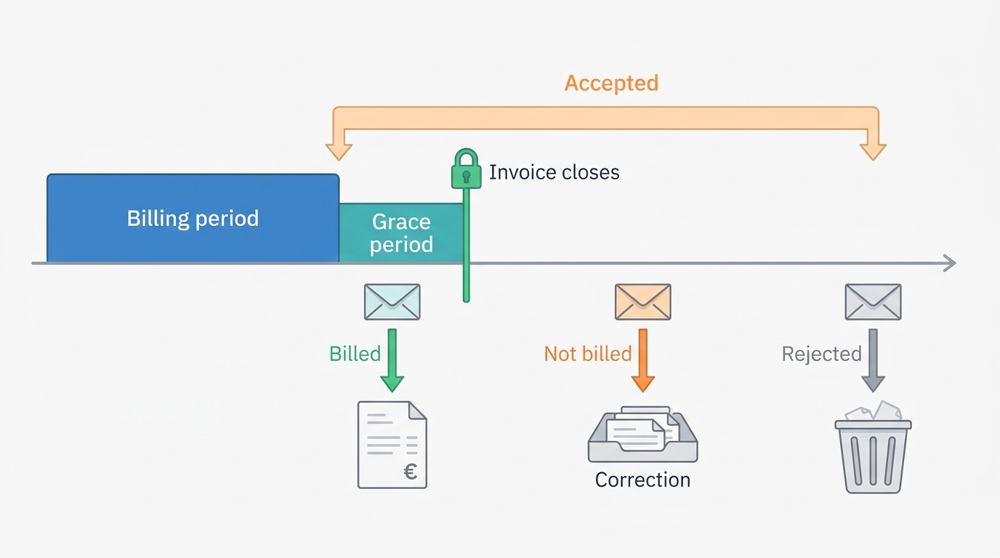
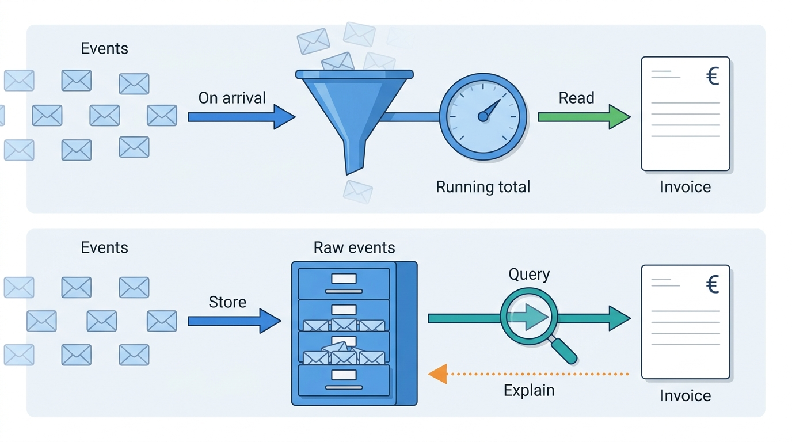
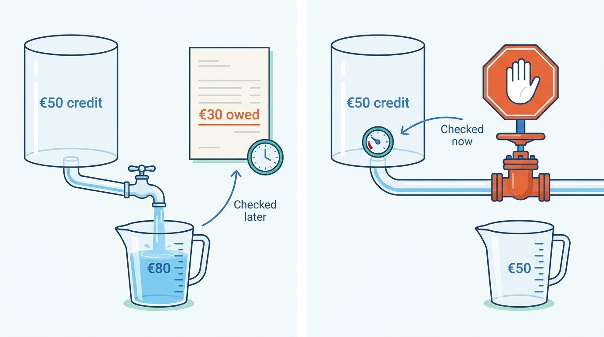

> **IN THIS CHAPTER, YOU WILL:** Learn why an accepted usage event is not yet a billed one, which rules to fix before the first invoice, and how Stripe and Orb document theirs.

> **KEY POINTS:**
>
> * **Three time rules come before the first invoice.** How long an event is accepted, when the period's invoice closes, and how a wrong or late event is corrected. Stripe's meters accept events up to 35 days old and bill them only until the invoice is finalized, after a grace period of one hour by default and at most 72 hours, so an event can be accepted and never billed.
> * **Only the producer can make a duplicate recognizable.** A re-sent event is dropped only if it carries an identifier assigned where the event was created, and only while the receiver still remembers it: “at least 24 hours” in Stripe's API reference.
> * **Volume forces one design choice.** Aggregate events as they arrive, or keep them raw and compute the invoice by query. Stripe's 2025 engineering post documents the first for its meters; Orb, which Adyen bought in July 2026, documents the second about itself. Keep raw events wherever a price may change retroactively or an invoice must be explained.

> **[FAILURE PATTERNS THIS CHAPTER ADDRESSES](where-payment-systems-go-wrong.html):**
>
> * **The Double Charge** — a usage event re-sent after a timeout without an identifier of its own is billed twice, one level above the payment.
> * **The Trusted Doorbell** — usage events are assumed to arrive once, in order and on time, and a meter's rejections arrive as events nobody subscribed to.
> * **The Borrowed Blueprint** — a stream-processing pipeline built for 100,000 events per second is copied by a team whose wrong invoices come from rules it never chose.

 
Studio Noord's plan includes 500 text messages a month. In March 2027 the studio sent **1,240**. Its invoice from Larkfield, the fictional studio-software platform this book follows, charged for **1,324**. Of the 1,240 messages, 180 had been reported twice and 96 had been reported after the invoice closed. That leaves three counts of one month: the 1,240 that were sent, the 1,324 that were billed, and the 1,144 that arrived once and in time. Each is what some reasonable rule would have charged.

A rule has to choose between them, and this chapter's claim is which rules. **A usage invoice can stop changing and still be explained only if three time rules are fixed before the first invoice**: how long an event is accepted, when the period's invoice closes, and how a wrong event is corrected. Duplicates are removed by **an identifier the producer of the event assigns**. Volume then forces one design choice: aggregate events as they arrive, or keep them raw and compute the invoice by query. The public record has one documented example of each, Stripe's 2025 account of its meter pipeline and Orb's documentation.

**Where we are in the payment's journey.** By contrast with everything in this chapter, Mila's class pass costs a fixed €120.00 and never passes through a meter. The amount here is of the other kind: it is counted from events before any payment can be asked for. Larkfield's own charge to its studios for text messages, €0.07 for each message above the plan's allowance, is such an amount. Counting comes first, and its result is what the payment engine is later asked to collect.

The chapter starts with Larkfield's SMS invoice that nobody could explain. It then shows why counting is hard, reads the three rules in Stripe's meter documentation, and compares the two designs for high volume. Next come rating, credits and commitments, the two acquisitions of 2026 with the status of token billing, and the comparison of the two providers. It ends with the rules Larkfield writes and the ways metering goes wrong.

## Setting the Scene at Larkfield: An SMS Invoice Nobody Could Explain

Larkfield charges each studio a monthly subscription, and on top of it a usage charge for text messages: class reminders, waiting-list alerts, payment notices. The plans at €89, €189 and €349 include 500, 2,000 and 5,000 messages a month; every message beyond that is **overage**, usage above the included amount, at €0.07. Larkfield has billed its subscriptions with Stripe Billing since 2018 and counts messages with a Stripe meter. The growth team built that integration, and the payments team took it over in May 2027. Studio Noord's members pay the studio through Adyen, but the studio's own bill from Larkfield is a Stripe invoice.

That same month Ines Bakker, who owns Studio Noord, questioned her March invoice, which had charged the €89 plan plus overage. Her message log in the back office showed 1,240 messages; the invoice showed 1,324. The payments team found two faults. On 17 March a queue consumer timed out and re-sent 180 events, and nothing in them marked them as repeats. On the night of 31 March the same consumer was down from 21:40 to 03:20 UTC, and 96 messages from that evening were reported after the March invoice had been finalized at about 01:00 UTC. The billed count was 1,240 + 180 − 96 = 1,324. The two faults pulled in opposite directions, which is why the total had looked plausible.

Speed had nothing to do with it. Assume Larkfield sends about 9 million messages a month across its 6,200 studios *(an illustrative figure)*: that is three to four events per second, where Stripe's documentation (n.d., accessed November 2026) gives a limit of 1,000 meter-event calls per second per account in live mode. So Femke de Graaf, who leads payments engineering, did not ask how to count faster. She asked **which rules about duplicates, lateness and correction had never been decided**.

## Why Counting Is Hard: The Invoice Must Stop, the Events Do Not

Start with the unit. A **usage event** is one record that a customer consumed something at a given time. To be billable it needs five fields, shown below with Larkfield's example. Stripe's documentation (n.d., accessed November 2026) lists the first four for a meter event, with the timestamp optional, and adds “an identifier that you can specify in your request”. The last two fields are the ones this chapter depends on, and both are optional in the API, which is how they come to be missing.

| Field | Meaning | SMS example |
| --- | --- | --- |
| Customer | Who consumed | Studio Noord |
| Event name | What was consumed | `sms_sent` |
| Value | How much | 1 |
| Timestamp | When it happened, not when it was reported | 31 March 2027, 21:52 UTC |
| Identifier | Which event this is | Larkfield's message id |

Two steps turn such events into money. A **meter** is the rule that turns many usage events into one quantity for a billing period; in Stripe's words, “Meters specify how to aggregate meter events over a billing period”, by sum, by count or by last value, and a configured meter cannot be changed except for its display name. **Rating** is the step that applies a price plan to that quantity. For Studio Noord the meter counts 1,240; rating subtracts the 500 included and multiplies 740 by €0.07 to get €51.80. Counting and pricing have separate inputs, and they fail separately.

That clean picture breaks first on repetition. A producer that retries after a timeout delivers each event at least once, so some arrive twice. The receiver cannot tell a re-send from a second real event by looking at it: two reminders to the same member in the same second are two billable events, and one reminder reported twice is one. The only difference is an identifier created where the message was created, before the first attempt. An identifier generated on receipt is different for every arrival and removes nothing, and that is the documented default: “If you don’t specify an identifier, we auto-generate one for you.” [[idempotency-and-retries]] makes the same argument for payment requests.

Events also arrive late. The time something happened and the time it was reported are different clocks: a batch job, a queue backlog or an offline device reports at 03:20 what happened at 23:50. Meanwhile the invoice for the period has to be **finalized**, the step after which an invoice is a fixed document that may no longer change ([[invoicing-collections-and-dunning]] explains why). Whatever instant is chosen for that, some event for the period can still arrive after it. Lateness can be bounded, not removed, so a faster pipeline is no answer to it.

Three rules therefore have to be chosen before the first invoice, and the seller chooses them, not the provider's defaults. The first two draw different lines in time, and the gap between them is the chapter's main point: **an event can be accepted and never billed**.

| Rule | The question it answers | If nobody decides |
| --- | --- | --- |
| Acceptance window | How old may an event be and still be stored? | Old events are dropped without notice, or accepted forever |
| Billing cut-off | Until when does an event for a period change that period's invoice? | Invoices that keep changing, or usage that is never charged |
| Correction path | What happens to an event that was wrong, or that arrived after the cut-off? | Manual edits that nobody can trace |

**Figure 1:** *The billing cut-off and the acceptance window are different lines in time: an event that lands between them is accepted and never billed unless a correction path exists.*

## The Three Rules as Stripe's Meters Document Them

For instance, take the acceptance window as Stripe documents it for its Billing meters (documentation n.d., accessed November 2026, here and throughout this section). A meter event's timestamp must be “within the past 35 calendar days” and not “more than 5 minutes in the future”. Then: “The 35-day window determines whether Stripe accepts a meter event. It doesn’t guarantee that Stripe can include the usage on an invoice.” Stripe “might accept an event after finalization and include it in meter summaries without updating the finalized invoice or adding the usage to the next invoice”. Acceptance and billing are documented as two rules, and usage that falls between them shows up in the meter's summaries, the aggregated totals Stripe reports per meter, and is never charged.

Next comes the billing cut-off, which is the finalization of the period's invoice. Stripe delays it by a grace period: “All invoices have a default finalization grace period of 1 hour”, during which usage for the period that just ended is still added, and “You can set a delay of up to 72 hours (3 days).” The cut-off is therefore a setting the seller chooses, at the price of invoicing later. It has exceptions. Only invoices at the end of a subscription period (and at certain scheduled plan changes) take usage during the grace period; a threshold invoice, issued mid-period when usage passes a set amount, reflects “only the usage accrued up to the point the invoice is created”.

The third rule, the correction path, is narrow. An event can be canceled by its identifier, but “You can only cancel events sent to Stripe within the last 24 hours.” Usage in a period that is still open can also be offset by recording a negative quantity. Neither reaches a finalized invoice: “If you cancel usage that’s included on a finalized invoice, we won’t update the invoice or issue a corrected invoice for the canceled usage.” After finalization the meter offers nothing, so the correction path has to be built from invoicing tools: a credit note (a document that reduces an issued invoice) or a line on a later invoice.

In addition, the duplicate check has a time limit of its own. Stripe's API reference describes the event's `identifier` as unique, generated if not provided, and says: “Stripe enforces uniqueness within a rolling period of at least 24 hours.” The stated purpose is “accidental retries or other problems occurring within extremely brief time intervals”. So even an identifier the producer assigned protects only against re-sends inside that period. A replay of a three-day-old batch is outside what the documentation promises to catch.

Read as one contract, the same pages make the following promises and withhold the following ones.

| Requirement | What the meter API documents | What it does not promise |
| --- | --- | --- |
| How fast | “The Meter Event limit is 1000 calls per second per Stripe account”, one concurrent call per customer per meter; up to 10,000 events per second on API v2 meter event streams, 200,000 through sales | That limit for a platform calling on behalf of a connected account, which is held to 100 operations per second |
| How consistent | “Stripe processes meter events asynchronously, so aggregated usage in meter event summaries and on upcoming invoices might not immediately reflect recently received meter events” | Reading back what you just wrote |
| On failure | Invalid events are reported afterwards through the events `v1.billing.meter.error_report_triggered` and `v1.billing.meter.no_meter_found`, with codes such as `timestamp_too_far_in_past` | A rejection in the API response |

## By the Billion: Aggregate on Arrival or Compute From Raw Events

Those rules hold at any volume, and Larkfield meets them at a few events per second. At a billion events the rules stay the same and a structural decision is added: **where the aggregation happens**. A system can aggregate at ingestion, updating a counter or a time window as each event arrives, or at query time, storing every event and computing the quantity when an invoice is needed. At 10,000 events per second a 30-day month holds about 26 billion events. Summing them per customer at invoice time is a large query. Keeping a running total per customer is one small write per event, and it discards the event.

Stripe has published its side of that choice. A January 2025 engineering post by Taras Mitran and Karan Dhabalia, “How we built it: Usage-based billing”, describes the meter pipeline. Events go to “an edge router, which does stateless authentication and API validation, then loads them directly onto an event bus”, and are processed asynchronously with Apache Flink, a stream processor chosen in part for its “exactly-once processing guarantees”. For availability Stripe runs it twice: “we process the same event in two geographic regions simultaneously”, and tags each event with “a standardized time stamp, generated before reaching the two Flink applications” so the two streams can be compared. That is aggregation on arrival, made to survive the loss of a region.

The same post also describes how the stream is aggregated. “One is a fast path with a 30-second tumbling window, which we store in memory in real time”, used for alerts. “The second path is slower, with a five-minute window. It’s where we write streaming events to disk, in a kind of transactional ledger”, which “allows us to accommodate any delayed or out-of-order events” and produces the invoicing data. The customer's pricing is itself turned “into a stream of changes” and matched against the events “like two sides of a zipper”; a discount applied retroactively “means opening a lookback window”. The post's capacity figure (100,000 events per second) differs from today's documented limits, so use the documentation for limits. The post does not describe deduplication, the storage behind the durable path, or whether raw events are kept.

Orb's documentation, by contrast, describes the other design, and what follows is Orb's statement about Orb (n.d., accessed November 2026), not a description of Adyen's platform. “Orb's billing engine treats billing as the output of a deterministic query, not a side effect of streaming state mutations.” The mechanism: “Every usage event is stored immutably in a columnar data store. When generating an invoice, Orb executes a fresh query over the raw event data”, so that “The invoice is computed, not retrieved.” Orb states its objection to counters directly: “once an event is processed and the counter is incremented, the original context is lost”. To avoid recomputing everything, “a dependency graph and invalidation system” marks only the affected parts of an invoice as out of date. Orb draws the same lines in time, with its own values: by default events may be reported “up to 12 hours after the `timestamp`”, and a correction keeps the original, since “Orb never overwrites or permanently deletes ingested usage data”.

Likewise, Orb runs a streaming path next to the query. Its documentation describes “running totals in Redis (MemoryDB) as events arrive”, used for alerts, and says: “But the billing logic never touches these counters—invoices are always computed from raw events.” And at the top of the range the raw-event design gives way too. For customers “generally north of 500,000 events per second” who want Orb “to pre-aggregate that data in real time rather than storing every raw event”, Orb offers a separate product, hosted rollups, with a default window of 10 minutes and partial results every 30 seconds. Both documented systems have a fast and a slow path; they differ in which one the invoice comes from.

On the whole, the two accounts differ less in machinery than in what the invoice is derived from. That reading is mine, and its limits matter:

> **INFERENCE, NOT DOCUMENTED:** Stripe's 2025 post derives invoicing data from a durable five-minute aggregation path, and Orb's documentation derives invoices from the stored raw events. Neither Stripe's post nor its documentation, as searched in November 2026, says whether raw meter events are also retained and could be re-aggregated, so the contrast between aggregating and keeping events is a statement about what each has published, not a proven difference in what each stores.

Consequently the choice comes down to what you expect to happen after the events are in. The table is my judgement, except where it cites the two sources above. The rule I use: **keep raw events where a price may change retroactively or an invoice must be traced to its events; aggregate on arrival where volume leaves no alternative.**

| Criterion | Aggregate on arrival | Keep raw events, compute by query |
| --- | --- | --- |
| Cost of producing an invoice | Low: read a stored total | Higher: a query over the period's events, reduced by recomputing only what changed |
| A late event | Counted if its window is still open; otherwise a correction | Stored, and the open invoice is recomputed |
| A retroactive price change | Needs a lookback over retained data (Stripe's 2025 post) | Re-run the query with the new price (Orb: “the historical events are still there”) |
| Explaining a line to a customer | As far as the stored totals go | Down to the events (Orb: “Every line item is traceable to specific events”) |
| Where it strains | When rules change after the fact | Storage and query cost at extreme volume |
| Right when | Volume is extreme and prices are simple and stable | Prices are negotiated or change often, or invoices are audited |

**Figure 2:** *Aggregating on arrival makes the invoice a cheap read and discards the events; keeping raw events makes the invoice a query that can be re-run and traced back.*

## Rating, Credits and Commitments: When the Count Meets the Price

Once there is a quantity per customer per period, rating needs the price plan as it stood when the usage happened. Prices are therefore versioned, and a price that changes in the middle of a period is where an aggregated system shows its sharpest limit. Stripe's documentation (n.d., accessed November 2026) describes one under the heading “Mid-cycle price changes drop grace period usage”: if a subscription's metered price changes during the period, “Stripe skips invoice recomputation during finalization, so any usage reported during the grace period doesn’t appear on current or subsequent invoices.” A price change and a late event, each harmless alone, together produce usage that is not billed at all. Orb's documentation (n.d., accessed November 2026) lists “Versioned pricing objects” among an invoice's inputs.

Furthermore, a rated amount is not always charged; it can be set against a balance or a promise. A **credit balance** is usage paid for or granted in advance and drawn down as usage is rated. Stripe's documentation defines its version: “Billing credits are prepaid or promotional usage credit allocated through credit grants”, distinct from the invoice balance and from a cash balance, with the restriction “You can’t offer billing credits as stored value to your customers.” My reading is that the restriction keeps a billing credit a prepayment for the seller's own service and not a general-purpose balance, which payment regulation treats differently ([[licences-and-safeguarding]]). A **commitment** is a promise of minimum spend over a period. Orb's documentation, where the feature “is in early access”, gives the two forms: a prepaid commitment is invoiced up front as a pool of credits, and with a postpaid one, “if cumulative usage falls short of the commitment, Orb bills the difference as a true-up”.

For example, suppose a customer has bought €50 of prepaid credit. Can the customer use €80 worth before anything stops them? It depends on when the balance is read. If credit is applied only when the invoice is computed, yes: the customer uses €80, the invoice applies €50 and bills €30. If the balance is drawn down as usage is rated, no: something can stop the customer at €50. Stripe's own comparison of its two usage products documents one of each: the basic meters described above and Metronome, the usage engine whose acquisition Stripe completed in January 2026 (next section). On basic meters credit-based pricing is “Supported (invoice time)”, with the footnote “Credits are only reconciled at invoice time. Customers can exceed their balance during the cycle.” On Metronome it is “Supported (real-time)”.

As a result, these are two consistency requirements with two costs. **Invoice-time rating** needs only a count that is correct eventually, and leaves the seller carrying credit risk for whatever was used beyond the balance. A **real-time balance check** puts a read of a nearly current total into the product's request path, and the seller's code must decide what happens when that read is slow or unavailable. It still overshoots. Stripe's 2025 post says its 30-second fast path is what triggers alerts “when someone has spent too much money or is running out of credits”, with a “P95 latency under 30 seconds”. Real time, as documented, bounds the overshoot to a window of seconds; it does not remove it. I would ask for it only when unpaid usage costs real money per unit, as model inference does.

**Figure 3:** *With €50 of prepaid credit, invoice-time rating lets usage run to €80 and bills €30 afterwards; a real-time balance check stops it at €50.*

## Two Acquisitions in 2026: Metronome at Stripe, Orb at Adyen

Metronome and Orb have now appeared as the homes of real-time credits and of raw-event billing. Since 2026 each belongs to one of the two providers. Stripe announced on 14 January 2026 that it “has completed its acquisition of Metronome”. Its documentation (n.d., accessed November 2026) now says: “Metronome is Stripe’s primary usage-based billing platform and the recommended starting point for all new integrations”, while the meters of the earlier sections are “a lower-level primitive that remains fully supported for existing integrations”. The division of work is documented too: “Metronome handles metering, rating, and billing, while Stripe handles payment collection, tax calculation, and revenue recognition.” Metronome pushes finalized invoices into Stripe, and “This invoicing sync is one way, meaning Stripe doesn’t send invoice data back to Metronome.” The same pages list what does not work with Metronome, including Connect, Stripe's product for platforms. As documented, these are two engines joined at the invoice, not one engine.

Similarly, Adyen bought its usage engine in 2026. Its press release of 11 June 2026 announced the acquisition of Orb: “The total consideration for the transaction is $335 million”. A second release says “Both transactions officially closed on July 1, 2026” (the other was the loyalty company Talon.One). The June release repeats Orb's design in one sentence, “Orb stores the full event stream at scale, decoupling ingestion from invoicing”, and gives the operating model: an “incubator model”, “continuing to support multi-PSP environments” (PSP stands for payment service provider), with the stated aim that “the strategic intent is convergence”. On 29 September 2026 Adyen wrote: “You’ll soon see how we bring this unified Adyen and Orb experience to life across our platform.” As of November 2026 I found no meter, usage or billing object in Adyen's documentation. What Adyen documents for recurring charges is a stored token charged on the merchant's schedule ([[subscriptions-and-billing-engines]]).

Moreover, both companies tie these purchases to AI products. Stripe's release of January 2026 quotes its chief executive, Patrick Collison, saying that Metronome's team built a metering engine that “already powers some of the most ambitious AI companies”. The use case is billing for AI model tokens, which needs high volume, prices per model that change and prepaid credits that must run out, all at once. Its status as of November 2026 differs by company. Stripe's documentation says “Billing for LLM tokens is in public preview and available to all users with a Metronome account” (LLM stands for large language model), with Stripe syncing the model providers' token prices and metering by model and token type. Adyen has named the use case and documented no product: its article of 29 September 2026 says “AI models and modern APIs carry significant, variable compute and token costs”. Orb's commitments are in early access. Preview and early-access features change; check their status before designing on them.

The evidence, however, stops at three points. First, the sources used here describe how Metronome connects to Stripe and what it supports, not how it is built, so I place it on neither side of the design choice. Second, both companies state an intent to unify and neither gives a date. A Stripe blog post of 23 January 2026 says “we’ll build a unified roadmap for one monetization platform”, and Adyen's June release says the intent is convergence; no public source found (documentation, company sites and blogs, November 2026) says whether Stripe's meters and Metronome will become one engine, or when Orb joins Adyen's platform. Third, the absence of an Adyen meter is an absence in public documentation as I read it in November 2026, not a statement by Adyen. [[stripe-and-adyen-bets-compared]] takes up what the two purchases say about each company's strategy.

## Stripe and Adyen: Where They Differ

In short, the documented facts above differ on six aspects. The Stripe and Adyen columns repeat what the earlier sections cite, with the year or “n.d.” for documentation accessed in November 2026; the last column is my inference from the difference.

| Aspect | Stripe | Adyen | What the difference suggests |
| --- | --- | --- | --- |
| Own meter primitive | Billing Meters: sum, count or last over a billing period (n.d.) | Not public: no meter or usage object found in Adyen's documentation, index and full text (November 2026) | On Adyen, counting usage is done outside the payment platform |
| Acquired usage engine | Metronome, completed 14 January 2026; documented as the recommended starting point, joined by a one-way invoice push (n.d.) | Orb, closed 1 July 2026; separate product serving several payment providers; integration announced as coming “soon” (29 September 2026) | Stripe's acquisition is documented as a product path; Adyen's is at the stage of stated intent |
| Published pipeline design | 2025 engineering post: Flink in two regions, a 30-second path and a five-minute durable path | Not public for Adyen; Orb's documentation about Orb: immutable raw events, invoices computed by query (n.d.) | One documented example of each design; not evidence about what Adyen's platform will run |
| Time rules | Accept 35 days back; bill until the invoice is finalized, one hour after its creation by default and at most 72; cancel within 24 hours; identifier unique for at least 24 hours (n.d.) | Not public for Adyen; Orb's documentation: events reported up to 12 hours after their timestamp by default, amendments archive events (n.d.) | Both engines draw the same lines with different defaults; the defaults are not a policy |
| Credit balance | Meters: applied at invoice time; Metronome: real-time drawdown (n.d.) | Not public for Adyen; Orb's documentation: a prepaid credit ledger with deductions as events are ingested and, in early access, prepaid commitments (n.d.) | A real-time balance is an acquired-engine feature at both |
| Token billing | Public preview through Metronome (n.d.) | Named in Adyen's rationale for the acquisition (29 September 2026); no Adyen product documented | Announced direction on both sides; released on neither as a finished product |

Therefore an integrator on Stripe chooses between two documented usage products, a basic meter and Metronome, and sets the three rules in configuration, starting with the grace period. An integrator on Adyen chooses a usage engine as a separate system, Orb or another, and connects it to payments itself. On either, the rules exist and have defaults, such as Orb's 12 hours for reporting an event and its amendments in which “Old events are marked as archived”. The integrator's job is to choose them on purpose.

## In Practice at Larkfield: Three Rules for the SMS Meter

To illustrate, lay Studio Noord's March invoice against the documented rules. It has two separate causes. The 180 re-sent events carried no identifier of Larkfield's own, so each arrival received a fresh one and counted as new. The 96 late events were inside the 35-day acceptance window and outside a one-hour grace period, so they were accepted and not billed. Each fault is a rule left at its default.

| | Messages | Overage above 500 | At €0.07 |
| --- | --- | --- | --- |
| Sent (correct) | 1,240 | 740 | €51.80 |
| Counted twice | +180 | | +€12.60 |
| Reported after the cut-off | −96 | | −€6.72 |
| Billed | 1,324 | 824 | €57.68 |

The policy Femke's team wrote in May 2027 answers those causes in four lines. The event identifier is Larkfield's message id, assigned when the message is created. Invoices that contain a metered price get a 24-hour finalization grace period in place of the default hour, which covers an overnight outage and means studios are charged a day later. An error found within a day is canceled at the meter. Anything found after finalization is corrected on paper that a studio can read: a credit note for usage billed in error, a separate line on the next invoice for usage billed late. Studio Noord received a credit note for €12.60, and its 96 late messages became a €6.72 line on its next invoice.

Beyond the policy, Larkfield also keeps the evidence. Its data warehouse holds one row per message with the message id, the studio and the time sent. During the 24-hour grace period a job compares the count per studio with the meter's summary and opens an item for any difference, in the same way the reconciliation job treats an unmatched payment ([[payment-reconciliation-and-reporting]]). That gives Larkfield the property of the raw-event design, an invoice it can explain from its events, without a new pipeline. It did not change products either: it is nowhere near a rate limit, it sells no prepaid credit, and Stripe's documentation (n.d., accessed November 2026) tells existing meter users “you don’t need to migrate”.

## When It Goes Wrong: Replays, Unseen Rejections, Long Outages and Repricing

Even so, a system that has set its rules still fails, and the failure customers notice first is a replay. A batch re-sent after the duplicate window has passed is counted again even though every event carries the right identifier. Both documented guarantees (n.d., accessed November 2026) are bounded: Stripe enforces uniqueness “within a rolling period of at least 24 hours”, and Orb guarantees “that duplicates are never processed within the account grace period”. A three-day-old replay is therefore the producer's problem. Record which events were sent and acknowledged, and replay only the ones that were not.

By contrast, the next failure bills too little and tells only those who listen. An invalid event is rejected after the API call has already returned, and the rejection arrives as an event the integration must subscribe to, with a code such as `meter_event_customer_not_found`. Stripe's 2025 post names the cost of this design: “when processing does fail, developers don’t necessarily know it right away.” An unmonitored meter under-bills in silence. Detection takes a subscription to the error events ([[payment-webhooks-and-events]]) and the count comparison from the Larkfield section, which catches what the subscription misses.

Usage is also lost to time. An outage longer than the grace period puts usage after the cut-off, where Stripe includes it in summaries “but we don’t add that usage to the finalized invoice or the next invoice”. An outage longer than the acceptance window gets it rejected with `timestamp_too_far_in_past`. The rules are nested limits; each one crossed removes an automatic remedy, and the last is the correction path: a manual, traceable line on an invoice.

Finally, the least visible failure starts with a sale. A studio upgrades its plan in the middle of a month, as Studio Noord did on 16 April 2027 ([[subscriptions-and-billing-engines]]). If the metered price changes with the plan, then on Stripe's meters the grace period no longer captures late usage for that subscription: “the grace period doesn’t capture late usage”. A commercial action has changed a metering guarantee. Two remedies exist: let price changes take effect at period boundaries, or run the count comparison before finalization for every subscription whose price changed.

## What to Take Away

**Established.**

- Accepting an event and billing it are separate rules. Stripe's documentation (accessed November 2026) accepts meter events for 35 days and says acceptance “doesn’t guarantee that Stripe can include the usage on an invoice”.
- A duplicate is removed only by a supplied identifier, inside a bounded period: at least 24 hours in Stripe's API reference, the account grace period in Orb's documentation.
- Each design for volume has one documented example: windowed stream aggregation in Stripe's 2025 post, invoices computed from immutable events in Orb's documentation.
- Both providers bought a usage engine in 2026: Stripe completed Metronome on 14 January, Adyen closed Orb on 1 July.

**Depends on context.**

- The grace period: one hour suits producers that report in seconds; a batch producer or one with overnight outages needs 24 hours or more, and pays with a later charge.
- Raw events or aggregation: keep raw events when prices are negotiated, change retroactively or are audited; aggregate when volume is extreme and prices are stable.
- A real-time balance or invoice-time rating: pay for the real-time check when unpaid usage costs you money per unit; otherwise invoice-time rating with an alert is enough.
- Metronome or Orb in place of a basic meter: worth it for prepaid credits, commitments or very high volume; check first which of your provider's other products the engine does not yet work with.

**The author's synthesis.**

- Every mechanism in this chapter is a bounded window: the duplicate check, the acceptance of old events, the grace period, the cancellation, the aggregation behind an alert. Metering is correct inside those windows by construction and outside them only by policy. So I write the policy first: events will fall outside, and the only open question is which window they fall out of.
- I keep my own raw events even when the provider aggregates. Raw or aggregated is a question about the past: how far back the invoice can still be recomputed and explained. Studio Noord's three counts were the same events seen through different windows, and only the stored events could say so.

## Questions to Ask

1. Who assigns the identifier of a usage event, at what point, and for how long does the receiver remember it?
2. Does every event carry the time the usage happened, or the time it was reported?
3. How old may an event be and still be accepted, and what tells us when one is rejected?
4. When does the period's invoice close, and what does a longer grace period cost us in days to cash?
5. What happens, in writing, to usage found after the invoice closed: who decides, and which document carries it?
6. Can we explain one invoice line from our own stored events without asking the provider?
7. If a price changes in the middle of a period, what happens to usage reported late for that period?
8. Does any product promise depend on a balance being checked before usage is served, and what does our code do when that check is unavailable?
9. Which of the features we plan to use are in preview or early access, and which of the provider's other products does its usage engine not support?

Once the count is closed there is an amount owed for a period, fixed by the plan or counted from usage, and a cut-off after which it no longer changes. What happens next is the step from owed to paid: [[invoicing-collections-and-dunning]] follows that amount from a finalized invoice to cash, including what runs when the first payment attempt fails.

## Sources and Evidence

*Company, product and investor sources*

- [Record usage for billing with the API](https://docs.stripe.com/billing/subscriptions/usage-based/recording-usage-api), Stripe, n.d., accessed 2026-11 — meter event fields, identifier default, the 35-day and 5-minute window, “doesn’t guarantee” invoicing, asynchronous processing, rate limits, error events and codes.
- [Configure an invoice finalization grace period](https://docs.stripe.com/billing/subscriptions/usage-based/configure-grace-period), Stripe, n.d., accessed 2026-11 — 1-hour default, 72-hour maximum, which invoices include late usage, threshold invoices, mid-cycle price changes.
- [Create and configure a meter](https://docs.stripe.com/billing/subscriptions/usage-based/meters/configure), Stripe, n.d., accessed 2026-11 — meter definition, sum, count and last, immutability, cancellation within 24 hours, negative quantities.
- [Create a billing meter event](https://docs.stripe.com/api/billing/meter-event/create), Stripe API reference, n.d., accessed 2026-11 — identifier uniqueness “within a rolling period of at least 24 hours”.
- [Basic usage-based billing](https://docs.stripe.com/billing/subscriptions/usage-based), Stripe, n.d., accessed 2026-11 — Metronome as the recommended starting point; meters fully supported; no need to migrate (volatile).
- [Compare basic usage-based billing and Metronome](https://docs.stripe.com/billing/subscriptions/usage-based/compare-metronome), Stripe, n.d., accessed 2026-11 — division of work, credits at invoice time versus real time, products not supported with Metronome (volatile).
- [How Metronome works with Stripe](https://docs.stripe.com/billing/how-metronome-works-with-stripe), Stripe, n.d., accessed 2026-11 — one-way invoice push.
- [Billing credits](https://docs.stripe.com/billing/subscriptions/usage-based/billing-credits), Stripe, n.d., accessed 2026-11 — credit grants, the stored-value restriction, application at finalization.
- [Bill for LLM tokens](https://docs.stripe.com/billing/token-billing), Stripe, n.d., accessed 2026-11 — public preview through Metronome, synced model prices, token types (volatile).
- [How we built it: Usage-based billing](https://stripe.com/blog/how-we-built-it-usage-based-billing), Taras Mitran and Karan Dhabalia, Stripe, 2025-01-28 — edge router and event bus, Flink in two regions, the 30-second and five-minute paths, pricing as a stream, stated capacity.
- [Stripe completes Metronome acquisition](https://stripe.com/newsroom/news/stripe-completes-metronome-acquisition), Stripe newsroom, 2026-01-14 — completion date; Patrick Collison's quoted remark on the metering engine and AI companies.
- [Metronome + Stripe: Building the future of billing](https://stripe.com/blog/metronome-stripe-building-the-future-of-billing), Wisam Hirzalla and Scott Woody, Stripe blog, 2026-01-23 — the stated intent of a unified roadmap for one monetization platform; no date.
- [Adyen to acquire Orb to unify billing and payments infrastructure for enterprise merchants](https://www.adyen.com/press-and-media/jtrg4qd7j3p4rj), Adyen press release, 2026-06-11 — consideration, incubator model, multi-PSP support, stated convergence, one-sentence description of Orb's design.
- [Adyen Closes Talon.One and Orb Acquisitions; Announces Leadership Updates Across Product and Finance](https://www.adyen.com/press-and-media/adyen-closes-talonone-and-orb-acquisitions-announces-leadership-updates), Adyen press release, 2026-07-01 — closing date.
- [Why billing and payments belong together](https://www.adyen.com/knowledge-hub/why-adyen-acquired-orb), Blake Breathitt, Adyen knowledge hub, 2026-09-29 — token costs as rationale; integration announced as coming “soon”.
- [Query-based billing](https://docs.withorb.com/architecture/query-based-billing), Orb, n.d., accessed 2026-11 — immutable events, invoices as queries, invalidation, the separate streaming path for alerts (Orb's statements about Orb).
- [Backfill and amend events](https://docs.withorb.com/events-and-metrics/reporting-errors), Orb, n.d., accessed 2026-11 — 12-hour reporting grace period, archived events in amendments.
- [Ingest events](https://docs.withorb.com/events-and-metrics/event-ingestion), Orb, n.d., accessed 2026-11 — per-event idempotency within the account grace period.
- [Hosted rollups](https://docs.withorb.com/events-and-metrics/high-throughput-ingestion), Orb, n.d., accessed 2026-11 — pre-aggregation above roughly 500,000 events per second, 10-minute window, 30-second partial rollups.
- [Commitments](https://docs.withorb.com/enterprise/commitments), Orb, n.d., accessed 2026-11 — prepaid and postpaid commitments, true-up, early access (volatile).
- [Configure prepaid credits](https://docs.withorb.com/product-catalog/prepurchase), Orb, n.d., accessed 2026-11 — the prepaid credit ledger and deduction from the balance as events are ingested.

*Standards, regulation and official documentation*

- None.

*Research and practitioner sources*

- None.

Larkfield is fictional; architectural recommendations, labeled inferences and labeled assumptions are the author's judgement.
