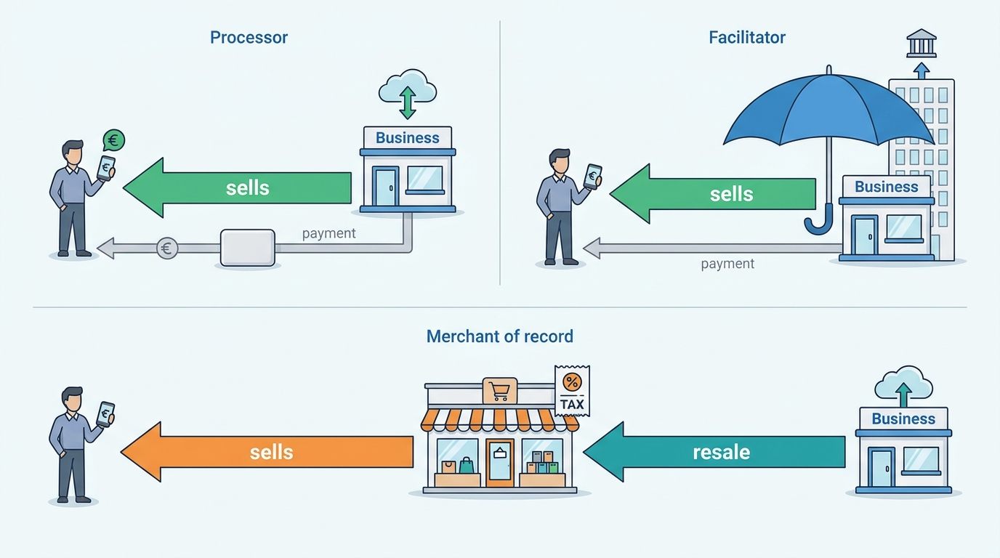
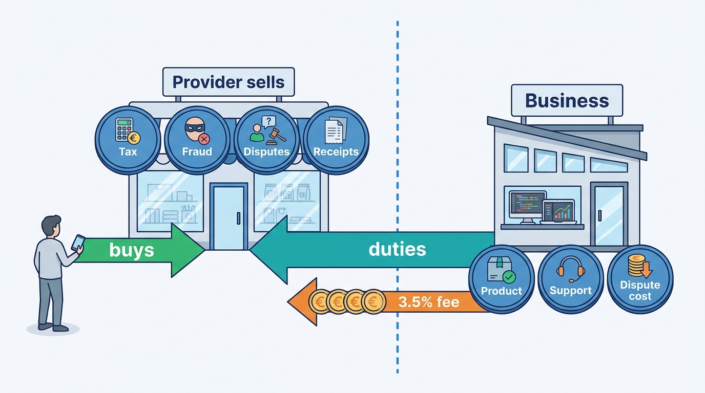
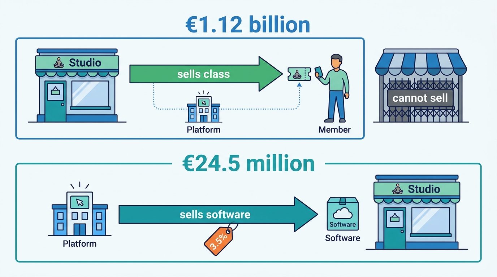

> **IN THIS CHAPTER, YOU WILL:** Learn what a merchant of record is, what Stripe documents for one, what Adyen says instead, and how to tell whether the model fits a business.

> **KEY POINTS:**
>
> * **A liability moves only with the seller's role.** A merchant of record sells your product in its own name. Its name goes on the card statement and the invoice, and it takes over the indirect tax, wherever local rules let the tax transfer, and the handling of fraud and disputes; on Stripe the cost of a lost dispute stays with you. You pay a fee and give up control of the checkout, of refunds and of part of the customer relationship.
> * **The seller must sell the product itself, so platforms are excluded.** Stripe's Managed Payments, in a release version of the API since 22 April 2026, costs 3.5% on top of payment fees, takes fully automated digital products sold directly and does not support Connect platforms.
> * **Adyen says it is not a merchant of record.** Its September 2026 article states that it provides infrastructure for businesses that "act as their own MoR". Why it offers no such product is my inference, not a documented reason.

> **[FAILURE PATTERNS THIS CHAPTER ADDRESSES](where-payment-systems-go-wrong.html):**
>
> * **The Vault Hostage** — under a merchant of record the customers, subscriptions and stored cards sit with the merchant of record, so leaving is a migration on the provider's terms.
> * **The Single Rail** — every sale depends on one provider continuing to act as your seller, and a provider can end that service.

 
On 22 April 2026 a new parameter reached a release version of Stripe's API. Set `managed_payments[enabled]` to `true` on a checkout session and, in the words of Stripe's API changelog for that date, "Stripe handles indirect tax compliance (in more than 80 countries), fraud prevention, dispute management, and transaction-level customer support". The previous five chapters were about obligations a seller cannot hand to its payment provider: running the billing engine, registering for tax, answering disputes, producing the data finance needs. One boolean appears to end most of them. **What the boolean changes is who the seller is.**

That is the whole mechanism, and its whole cost. **A liability can be handed to a provider only by letting the provider become the seller.** The provider then sells your product in its own name: its name goes on the card statement and the invoice, it takes over tax, fraud and disputes to the extent its contract says, and it decides what it is willing to sell and how. So merchant of record is an operating model with a price in money, control and customer data. A platform whose sellers are third parties cannot use it, and Adyen says it does not offer it.

**Where we are in the payment's journey.** This chapter stands beside the path of Mila Janssen's class pass. When Mila paid €120.00 on 9 March 2027, the seller was Studio Noord, a customer of Larkfield, the fictional studio-software platform this book follows ([[meet-larkfield]]). Every step of the journey assumed that seller. This chapter asks whether the seller could have been somebody else.

The chapter starts with a question Larkfield's chief executive asks in May 2027. It then separates the processor, the payment facilitator and the merchant of record by who the seller is, and reads Stripe's Managed Payments documentation for what changes when the provider sells. Next come the three forms the model takes (a layer, a bundle, a store) and the comparison of Stripe with Adyen. The chapter then answers Larkfield's question for its two kinds of sale and ends with the ways the model fails.

## Setting the Scene at Larkfield: Can Somebody Else Be the Seller?

In May 2027 Sofie Vermeer, Larkfield's chief executive, forwards a description of a merchant-of-record product to Femke de Graaf, who leads payments engineering. Her note is one line: "Can we turn this on and stop dealing with disputes and tax?" The wish is reasonable. Larkfield sells in five countries. In February a member's bank reversed a €120.00 class pass at Studio Noord (a **chargeback**, the forced return of a card payment) and added a €15.00 fee, and somebody at Larkfield spent an afternoon on it.

Femke's reply starts by splitting "our payments" in two. In 2026 Larkfield's 6,200 studios sold €1.12 billion of memberships, passes and drop-ins to their members; in each of those sales **a studio is the seller**. Larkfield itself sold €24.5 million of software subscriptions to those studios; there **Larkfield is the seller**. The two differ by a factor of about 46 in volume and, more to the point, in who sells.

So the same test has to be run twice: who is the seller today, and could a provider take that place? Answering it needs three terms that are often used as if they meant the same thing.

## Processor, Payment Facilitator, Merchant of Record: Who Is the Seller?

Tax law and card-network rules both attach their obligations to the seller. The seller owes the **indirect tax** on a sale (value-added tax, sales tax or goods and services tax, which the seller collects from the buyer and pays to the state; [[billing-and-payment-tax]]). The seller's name must be the one the cardholder sees. Stripe's documentation for platforms (n.d., accessed November 2026) puts the test in one sentence: the merchant of record "is the entity that the customer understands they’re buying from". It adds the reason: "card network compliance rules require a brand’s identity to be clear and consistent throughout the transaction". The seller is identified by what the customer understands, not by how the payment is configured.

A **processor** leaves that untouched. It moves the payment, and the business remains the seller, with the tax, the disputes and its own name on the statement. Both anchor companies describe their ordinary product this way. Stripe's guide (last updated 27 January 2026) says that when a business uses Stripe for direct transactions, "the business itself remains the MoR while Stripe acts as a payment processor or payment gateway". Adyen's knowledge-hub article of 15 September 2026 says a payment processor "only handles the technical routing of transaction data between financial institutions".

A **payment facilitator** takes over more, and still not the sale. It lets many businesses accept cards under its own agreement with the card networks, so that none of them needs a contract of its own with an acquirer, the bank or licensed firm that connects merchants to the networks ([[acquiring-and-network-connectivity]]). Each business is still the seller. Stripe's guide says a payment facilitator works by "aggregating multiple merchant accounts under one master account" and "does not assume responsibility for tax collection and remittance". Adyen's article says a payment facilitator provides the technology "while leaving tax and legal liability to the merchant". A merchant of record is therefore not a payment facilitator under another name.

A **merchant of record** replaces the seller. It sells the product to the customer in its own name, commonly as a reseller, and that is what moves the obligations: this chapter calls it **liability transfer**, the move of a legal responsibility (tax, fraud losses, disputes) from the business to the provider. How much of it moves is set by each provider's contract; the next section reads Stripe's. Paddle, a company that sells this role, says it plainly on its help page (n.d., accessed November 2026): "when a buyer purchases your product through Paddle, we act as the seller to them". Adyen's article defines the merchant of record as the entity that "assumes full financial responsibility for compliance, tax collection, and risk. It also appears on the customer's bank statement". The vocabulary is not uniform. **Seller of record** is often used for the same party; Adyen's article reserves it for "the legal owner of the goods at the time of sale" and notes that the two can be one entity. I use merchant of record for the party that is the seller to the buyer.

The table sets the three roles side by side. It is my synthesis of the definitions quoted above; I did not read the card networks' rule texts for it.

| | Processor | Payment facilitator | Merchant of record |
| --- | --- | --- | --- |
| Seller to the buyer | The business | The business | The provider, in its own name |
| Name on the card statement | The business | The business | The provider, usually with the product's name added |
| Who owes the indirect tax | The business | The business | The provider, except where local rules prevent the transfer |
| Who answers a dispute | The business | The business; the facilitator stands behind it toward the networks | The provider; who pays for a lost one depends on its contract |
| What the business gives up | Nothing but the processing fee | Its own acquiring contract | The checkout, the seller's name and part of the customer relationship |

**Figure 1:** *A processor and a payment facilitator leave the business as the seller; a merchant of record takes the seller's place toward the customer and sells the product in its own name.*

## What Changes When the Provider Sells: Stripe Managed Payments

Managed Payments is Stripe's merchant-of-record product for digital goods. Stripe's pricing page (n.d., accessed November 2026) lists "3.5% per successful Managed Payments transaction in addition to Payments fees". It says the tax service covers "more than 75 countries" where the documentation says "more than 80"; I use the documentation's figure. The release history is in Stripe's own pages. Its blog announced on 7 May 2025 that "this summer we’ll launch Managed Payments, our merchant of record offering". The blog of Lemon Squeezy, a merchant-of-record company Stripe acquired in July 2024, called that launch a "private preview" and on 28 January 2026 still described "early access" through a waitlist. Stripe's API changelog introduced the `managed_payments` parameter in the preview version `2026-02-25.preview`; the first release version with it is `2026-04-22.dahlia`. On 29 April 2026 Stripe's blog wrote: "All digital businesses can now use Managed Payments". None of these pages uses the words "generally available". As of November 2026 access still depends on an eligibility review, and Stripe's roadmap page lists three Managed Payments features in private preview.

The first thing that changes is the name. Stripe's documentation page on how the product works (n.d., accessed November 2026) says: "The customer sees Link as the merchant of record, and sees purchases as *Sold through Link*". Link is Stripe's consumer checkout brand, which saves a customer's payment details for reuse. The card statement shows `LINK.COM* [Your statement descriptor]`, where the statement descriptor is the short merchant name a bank prints next to a charge. Receipts and invoices "are sent from Link", and "Custom domains aren’t supported on Managed Payments checkouts". Wherever a customer could look, the seller is Link. Stripe's service terms (last modified 28 September 2026) name the legal entity: the service "is provided by Stripe’s Affiliate, Sold through Link, LLC", which "is the merchant of record"; Lemon Squeezy's site footer reads "Sold through Link, LLC f/k/a Lemon Squeezy LLC", so it is the acquired company's entity renamed. The terms also limit the role. The business agrees that this entity "is not the seller of record" and "will not book the revenue", that it invoices the customer in its own name as the business's undisclosed agent, and that it is treated as making the supply "for Indirect Tax purposes only". On Stripe, then, the provider is the seller toward the customer and the tax authority, while the contract between the two still calls the business the seller.

Because Link is the merchant of record, Stripe carries out the seller's duties. For tax, [[billing-and-payment-tax]] showed that Stripe Tax calculates and collects while the liability stays with the business. Here Stripe documents all four steps as its own: it "Registers and files tax returns with local tax authorities", "Remits collected taxes" and "Issues tax invoices" (tax compliance page, n.d., accessed November 2026). For fraud, "No action is needed from you because Stripe configures the rules and maintains blocklists". For disputes, "Stripe handles disputes for you", including "submitting evidence on your behalf". Payment and subscription questions from customers go to Link's support. These are the obligations the earlier chapters of this part left with the seller.

What the business gives up in return is decision rights, and some money. On support, "If you don’t respond within 48 hours, Stripe might issue a refund without your approval". On disputes, "If we determine that you’re unlikely to win a dispute, we might accept it instead of countering it", and "Received disputes incur a dispute received fee" charged to the business. The service terms state the money rule behind this: "User, as Seller, is liable to SMP and its Affiliates for the full amount of any Disputes, refunds, and Reversals". Stripe takes over the work of a dispute, not its cost. When a sale is refunded in certain jurisdictions, Stripe must still remit the tax, and "your account balance will be reduced by the amount that corresponds to the original sales tax amount". The tax transfer itself has limits: "In countries where local regulations prevent Managed Payments from assuming liability for indirect taxes, you’re responsible for handling tax compliance." Stripe names two domestic cases, Japan for all domestic sales and Singapore for domestic sales to businesses. Product-level support stays with the business throughout.

A seller decides what it sells, and for whom. Stripe's eligibility page (n.d., accessed November 2026) says so in four rules. Access is granted case by case: "Stripe determines access to Managed Payments based on an eligibility review". The business must be based in one of 37 listed countries: the United States, Canada, 31 in Europe, and Australia, Hong Kong, Japan and Singapore. The product must be digital, which excludes "Physical goods", "Professional services" and "Live in-person events", and it must be "a fully automated digital product"; a service that "involves human intervention (such as live 1-1 coaching)" does not qualify. And the business must be the direct seller: "You sell the product directly to customers, not through a platform or marketplace." Accordingly, "Managed Payments supports direct integrations only", and it does not support accounts of Connect, Stripe's product for platforms: "Connect platforms", "Express accounts" or "Accounts controlled by a platform".

The integration is restricted in the same spirit. The parameter is real, and it is set per checkout session; Lemon Squeezy's post of 16 November 2026 says the product "works at the transaction level, so you choose where and when to use a merchant of record". But the session must be one that Stripe runs. Managed Payments works with Checkout and Payment Links, Stripe's hosted payment pages, and not with payment forms the business builds itself: the overview lists "Elements with the Checkout Sessions API" and "advanced integrations with the Payment Intents API" as unsupported, along with "Creating a subscription outside of Checkout or Payment Links" and "Third-party tax integrations". Existing subscriptions cannot be moved under the published documentation: "You can only enable Managed Payments for new subscriptions purchased through a Managed Payments Checkout Session" (the page on updating a Checkout integration, n.d., accessed November 2026) (Stripe's roadmap page lists a migration of existing subscriptions as a private preview). So "switch it on for the integration you have" is true only if that integration already hands the checkout to Stripe.

The customer's data and the money report change hands too. A customer can ask Link to delete their information. Stripe then "Cancels any subscriptions sold to them through Managed Payments" and "Deletes their data from any data objects (including objects in your Stripe account)", and tells the business by email. In the payout and balance reports, "By default, the `fee` column in the following reports includes both Stripe fees and withheld tax"; two optional columns, `withheld_tax` and `fee_net_of_withheld_tax`, separate them. A reconciliation that reads `fee` as the provider's price ([[payment-reconciliation-and-reporting]]) will overstate it by the tax. Both details show that the customer relationship and the money now run through the merchant of record. The figure below sorts what moves and what stays.

**Figure 2:** *With the provider as merchant of record, the indirect tax, the fraud rules, the handling of disputes and the receipts move to it, and it is paid a 3.5% fee; the product, product support and, under Stripe's terms, the cost of disputes and refunds stay with the business.*

## A Layer, a Bundle, a Store: Three Forms of the Same Trade

Stripe sells the seller's role as a layer. The 3.5% is charged "in addition to Payments fees", subscriptions still run on Stripe Billing at its own price, and the role is switched per transaction. Lemon Squeezy's 2025 post put the difference from its own older product this way: "Instead of being tied to your entire account, it’s now applied at the transaction level." A business can be the seller for some of its sales and not for others. That this amounts to a layer on a payment platform is my reading of the price pages.

Paddle sells the same role as a bundle. Its pricing page (n.d., accessed November 2026) lists one price, "5% + 50¢ per Checkout transaction", with "No monthly fees, migration fees, or hidden extras", covering payments, billing, tax and the seller's role together. Its help page gives the reason it can carry the tax: "Paddle is registered in over 100 jurisdictions worldwide". The two prices cannot be compared line for line, because Stripe's 3.5% sits on top of payment and billing fees and Paddle's 5% includes them.

An app store is the oldest form of the model, and the most bundled: the store is the seller and also owns distribution. Apple's developer page (n.d., accessed November 2026) states that "The commission on the sale of digital goods and services through the App Store is 30% (15% if you’re enrolled in the App Store Small Business Program" or one of three other programs "and 15% for qualifying subscriptions". Google's Play Console help page on tax (n.d., accessed November 2026) uses the term itself: "As the merchant of record for transactions with customers in the United Kingdom, Google is responsible for determining, charging, and remitting VAT", while for purchases through an alternative billing system "you are the merchant of record". Apple's public developer agreement (Schedule 2, last updated 13 October 2026) has the developer appoint Apple its “agent” or, in other regions, its “commissionaire”; Apple remits tax in the regions it lists.

The table puts the three forms next to the alternative of staying the seller. Fees are the vendors' published list prices as of November 2026 and are not comparable line for line.

| | Published fee | Who runs the checkout | Name the customer sees | Indirect tax liability | What leaving takes |
| --- | --- | --- | --- | --- | --- |
| Your own seller, with a processor and a tax tool | Payment fees, plus the tax tool | You | Yours | Yours | Moving stored cards ([[tokenization-vaulting-and-pci]]) |
| Layer (Stripe Managed Payments) | 3.5% on top of payment fees | Stripe (Checkout, Payment Links) | Link, with your descriptor | Stripe's, in the countries it covers | New checkout sessions without the flag; taking existing subscriptions back requires notice to their customers (service terms, 2026) |
| Bundle (Paddle) | 5% + 50¢, all-inclusive | The provider | The provider's, as seller | The provider's | Moving customers, subscriptions and billing to another system *(the author's judgement)* |
| App store (Apple) | 30%, or 15% under listed programs | The store | The store's | Apple's, in regions its agreement lists | Leaving the store's distribution |

In every row below the first the fee rises with what is handed over, and control of the checkout falls. My judgement on fit follows from the shape of the two costs. The fee is a percentage of revenue. The cost of registering and filing tax yourself is roughly fixed per jurisdiction *(assumption)*. So **the model fits a small seller of an automated digital product with customers in many tax jurisdictions**, where the fixed cost is large against revenue. It stops fitting as revenue grows in a few countries, and it never fitted a business that needs its own checkout, sells goods or human-delivered services, or pays other sellers.

## Stripe and Adyen: Where They Differ

Stripe sells a merchant-of-record product; Adyen has published that it is not one. The Stripe cells below come from the pages cited above, and the Adyen cells from its article "Merchant of record explained" (15 September 2026). The last column is my inference.

| Aspect | Stripe | Adyen | What the difference suggests |
| --- | --- | --- | --- |
| First-party merchant-of-record product | Managed Payments, in a release version of the API since 22 April 2026 | None: "Adyen doesn't act as a direct, third-party merchant of record" (2026) | Stripe will be the seller for small digital businesses; Adyen expects its merchants to be their own |
| Who the customer buys from | Link: "Sold through Link", statement `LINK.COM* …` (n.d., accessed November 2026) | The business: tools that "let your business act as its own MoR" (2026) | On Adyen your entities, registrations and name are required in every market |
| Price of the seller's role | 3.5% per successful transaction on top of payment fees (n.d., accessed November 2026) | Not applicable | No comparison of prices is possible |
| Handing the liability to someone else | A parameter per Checkout Session or Payment Link | "we integrate with global merchant of record partners" (2026); none named there; its partner directory lists Cleverbridge (n.d.) | On Adyen it means a second vendor and a second contract |
| Platforms | Excluded: no Connect platforms, Express accounts or accounts controlled by a platform (n.d., accessed November 2026) | An Adyen for Platforms customer is described as "allowing event organizers to act as their own merchant of record" (2026) | Neither lets a platform hand over its sellers' obligations |
| Acquired merchant-of-record business | Lemon Squeezy, announced 26 July 2024; it stops processing payments on 31 March 2027 | None found (site, November 2026) | Stripe bought the capability and then rebuilt it on its own platform |

On Stripe the decision is per sale: which checkout sessions carry the flag, for which products, in which countries the tax really transfers. On Adyen there is no such decision. You plan to be the seller everywhere you sell, with the entities and tax registrations that takes, or you add a third party in front of Adyen. Adyen's article gives its side of the trade: "By acting as your own merchant of record, you maintain complete control over your customer journey, checkout branding, and refund policies". It gives no reason.

> **INFERENCE, NOT DOCUMENTED:** I read the absence as a matter of customers, not capability. Adyen's article addresses "enterprises", which typically have legal entities and tax functions in their markets; a product whose value is not needing those would serve a different customer. Stripe had a large base of small self-serve sellers and already owned the tax, fraud and checkout products the role is assembled from. Neither company states this reasoning.

## In Practice at Larkfield: Two Sales, Two Answers

Take the class pass first. When Mila paid €120.00, Studio Noord was the seller, and that sale fails every documented condition. It is sold "through a platform". Larkfield's Stripe account is a Connect platform. A yoga class is a service delivered in person by an instructor, not "a fully automated digital product". And Studio Noord is on Adyen, which carried 56% of Larkfield's 2026 volume (€627 million) and is not a merchant of record at all. Stripe's own documentation describes Larkfield's shape when it gives its example of a connected account as the merchant of record: "a SaaS provider that offers payment processing and scheduling services to independent pet groomers, who are paid directly by their customers". Price does not enter into it, though 3.5% of €120.00 is €4.20, more than Larkfield's whole fee of €2.53 on that pass.

Could Larkfield become the seller instead, and then deal with the burden once, centrally? It could, by reselling every class in its own name. That would not remove the burden; it would collect it. Larkfield would book €1.12 billion of class sales as its own, owe the indirect tax on them in five countries, and answer every dispute itself, with about €156 million of paid-out card volume inside the dispute window at any time. Nothing in tax law forces this on it: the European Union's rules that treat a platform as the "deemed supplier" cover certain goods and, from 1 July 2028, two service sectors, not fitness studios (European Commission pages, n.d., accessed November 2026; [[billing-and-payment-tax]]). This paragraph is my reasoning, not a documented case. The account model that makes a platform or its seller the merchant is the subject of [[platform-payment-models]].

Larkfield's own subscription is a different sale. The product is the kind Managed Payments takes: software as a service, sold directly, by a business based in the Netherlands. Two things still stand in the way. The account that sells it is a Connect platform, which the eligibility page excludes; whether a separate account could qualify is not documented, and I do not assume it. And the arithmetic runs against it: 3.5% of €24.5 million is **€857,500 a year** on top of payment fees, or €66.15 on Ironworks Climbing's €1,890 annual plan, to cover tax in five countries where Larkfield already operates. That is the fit judgement of the previous section applied: large revenue, few jurisdictions.

Femke's answer to Sofie Vermeer is therefore no, twice. For the subscription the model is available in kind and too expensive at Larkfield's size. For the studios it is not available at any price, because **the studios are the sellers**. Their disputes and their tax have to be handled where they sit: in the account model, which decides whose balance a chargeback debits, and in each studio's own tax position.

**Figure 3:** *Larkfield's two sales: studios sell €1.12 billion of classes to members, where no provider can take the seller's place, and Larkfield sells €24.5 million of software to studios, where a provider could at 3.5%.*

## When It Goes Wrong

A business that does adopt the model meets its first failure on the customer's card statement. A customer who does not recognize `LINK.COM*` in front of a product name may dispute the charge, so the model can raise the disputes it was bought to take over. Both anchor companies name this. Adyen's article lists "Customer confusion: Customers might not recognize the name of the MoR on their credit card statement, leading to accidental chargebacks and support tickets". Stripe's platform documentation warns that a mismatch of names can "increase unrecognized transactions and disputes". The signal to watch is the share of disputes filed as unrecognized; the remedy is a descriptor suffix customers know and a purchase email that names the seller they will see.

The second failure arrives with the first refund or dispute that the provider decides alone. Under the 48-hour rule and the right to accept a dispute, money can go back to a customer without the business having done anything. A system that assumes it issued every refund will keep granting access to a product that was refunded and keep counting revenue that is gone. The repair is Larkfield's rule K2, applied to a new case: the provider's record is the truth. Refund and dispute events from the provider ([[payment-webhooks-and-events]]) change entitlement and revenue; the business's own action is only one possible cause of them.

Later the provider can change its mind about a product. The eligibility page says that if Stripe finds a product ineligible, "we’ll notify you that you’re responsible for any indirect tax liability for the product and you must discontinue the use of Managed Payments for that product". The liability comes back, on notice, and the business needs the tax registrations it had hoped to avoid. A team that adopts the model for a product near the edge of the rules (software with a human service attached, for example) should know in advance what it would do on the day of that notice.

Last, a merchant of record can stop selling altogether. On 16 November 2026 Lemon Squeezy announced: "we’ve closed new store sign-ups, and Lemon Squeezy will stop processing payments on March 31, 2027". Its sellers have four and a half months to move customers, subscriptions and stored cards. The post says Managed Payments is not "a like-for-like replacement" and "isn’t available in every country Lemon Squeezy supports". That is the Vault Hostage pattern with the seller's role added to the vault: leaving is a migration, on the provider's date.

The public record stops at five points:

- **General availability.** Stripe's pages show a preview API version in February 2026, a release version on 22 April 2026 and, a week later, the statement that all digital businesses can use the product. None says "generally available", and access still depends on an eligibility review.
- **The legal seller.** Stripe's terms name Sold through Link, LLC as the merchant of record and say it is not the "seller of record". What that distinction means under each country's law I cannot state.
- **Apple.** Its agreement says agent or commissionaire, by region; the legal effect per country I cannot state.
- **Adyen's reason.** Adyen states that it is not a merchant of record; it does not say why.
- **Outcomes.** I found no independent data on dispute rates, win rates or approval rates under a merchant of record. Every such figure in circulation is a vendor's claim.

## What to Take Away

**Established.**

- The merchant of record is the seller to the buyer: its name is on the statement and the invoice, and the indirect tax and the handling of disputes follow it. A processor and a payment facilitator leave the business as the seller (Stripe's and Adyen's own definitions, 2026).
- Stripe documents a merchant-of-record product, in a release version of the API since 22 April 2026: 3.5% on top of payment fees, fully automated digital products sold directly, Checkout and Payment Links only, no Connect platforms, and countries where the tax liability does not transfer. Its terms keep the cost of disputes and refunds with the business.
- Adyen states (15 September 2026) that it "doesn't act as a direct, third-party merchant of record".

**Depends on context.**

- Whether the fee is worth paying depends on revenue against the number of tax jurisdictions: a percentage of revenue against a roughly fixed cost per jurisdiction. Small and global favors the model; large and concentrated does not.
- A business that needs its own checkout or its own payment form cannot keep it; if conversion depends on that page, the cost is more than the fee.
- How much of the customer relationship you can share depends on the product: a deletion request to the merchant of record cancels your subscription.

**The author's synthesis.**

- I decide fit from who the seller is before I read a price list. The boolean from the opening does not add tax handling to an integration; it replaces the seller, and everything else follows from that.
- I treat a merchant of record as a dependency to plan an exit from on the day it is adopted, because the provider that carries my tax liability also holds my customers.

Seen from this chapter, every chapter of Part VI was about one document. The scheduler exists to produce the invoice, metering fills it, dunning collects it, tax and recognition read it, and merchant of record changes whose name is on it. So the question that sorts billing architectures, and the two providers, is where the invoice lives: the party that holds it knows what is owed, for which period, by whom and to whom, and every other party sees only payments with a reference. Larkfield learned this twice in 2026. On 1 October its renewal job hit a rate limit and 7,900 renewals ran a day late; on 1 November a retry under a new idempotency key charged 1,840 members twice, and €71,300 was refunded. Both were failures of the machine that decides when to ask and for which period, and Keel's answers are billing-engine decisions: K1 derives the key for a renewal from the membership, the billing period and the attempt number, and K5 has the renewal job pace itself over 18 hours. For every recurring charge of your own, write down the period it is for, derive its key from that period, and name the one system that holds the invoice. Then check each job of this part (retry, tax, recognition, correction) against that system, not against a provider's feature list.

## Questions to Ask

1. In each kind of sale we make, who does the customer understand they are buying from?
2. Whose name will be on the card statement, the receipt and the invoice, and will our customers recognize it?
3. In which countries does the tax liability really transfer, and where does it stay with us?
4. Who can refund a customer or accept a dispute without us, who pays for it, and how does our system learn of it?
5. Which of our products, account types and payment forms does the provider exclude?
6. What does the fee come to at our revenue, against the cost of registering and filing in the jurisdictions where we sell?
7. If we leave, or the provider does, what do we get back (customers, subscriptions, stored cards, tax history) and on whose timetable?
8. If our provider is not a merchant of record, as Adyen says of itself, who is the seller in each market we plan to enter?

This chapter let a provider sell in its own name and found that a platform cannot do that: Larkfield's studios are the sellers, and they stay the sellers. [[part-7]] takes that arrangement as its subject. A platform stands between the payer and the seller, and the liability, of which a merchant of record takes only part, is divided among three parties by the account model.

## Sources and Evidence

*Company, product and investor sources*

- [Managed Payments](https://docs.stripe.com/payments/managed-payments.md), Stripe documentation, n.d., accessed 2026-11 — what the product is, the comparison with other Stripe products, unsupported integrations (volatile).
- [How Managed Payments works](https://docs.stripe.com/payments/managed-payments/how-it-works.md), Stripe documentation, n.d., accessed 2026-11 — "Sold through Link", statement descriptor, emails, support, refunds, disputes, reports, data deletion (volatile).
- [Managed Payments eligibility](https://docs.stripe.com/payments/managed-payments/eligibility.md), Stripe documentation, n.d., accessed 2026-11 — eligibility review, account types, business locations, product rules (volatile).
- [Tax compliance](https://docs.stripe.com/payments/managed-payments/tax-compliance.md), Stripe documentation, n.d., accessed 2026-11 — what Stripe does for tax, Japan and Singapore, countries without transfer, "Sold through Link, LLC".
- [Update a Stripe Checkout integration to use Managed Payments](https://docs.stripe.com/payments/managed-payments/update-checkout.md), Stripe documentation, n.d., accessed 2026-11 — the parameter; new subscriptions only.
- [Introduces Managed Payments, Stripe's merchant of record solution](https://docs.stripe.com/changelog/clover/2026-02-25/managed-payments.md), Stripe API changelog, 2026-02-25 — the `managed_payments` parameter in the preview API version `2026-02-25.preview`.
- [Adds support for Managed Payments, Stripe's merchant of record solution](https://docs.stripe.com/changelog/dahlia/2026-04-22/managed-payments.md), Stripe API changelog, 2026-04-22 — the parameter in the release version `2026-04-22.dahlia`; the quoted description.
- [Everything we announced at Sessions 2026](https://stripe.com/blog/everything-we-announced-at-sessions-2026), Will Gaybrick, Stripe, 2026-04-29 — "All digital businesses can now use Managed Payments".
- [Stripe roadmap](https://stripe.com/roadmap), Stripe, n.d., accessed 2026-11 — three Managed Payments features in private preview under Q4 2026, including the migration of existing Billing subscriptions (volatile).
- [Stripe Services Agreement, Service Terms: Stripe Managed Payments](https://stripe.com/legal/ssa-service-terms), Stripe, last modified 2026-09-28 — Sold through Link, LLC as provider and merchant of record, "not the seller of record", undisclosed agent, liability of the business for disputes and refunds, notice when subscriptions are taken back (read in the English edition served for the Netherlands).
- [Pricing](https://stripe.com/pricing), Stripe, n.d., accessed 2026-11 — the 3.5% fee; "more than 75 countries" (volatile; read in the English edition served for the Netherlands).
- [What a merchant of record does and why it matters](https://stripe.com/resources/more/merchant-of-record), Stripe, last updated 2026-01-27 — definitions of merchant of record, payment facilitator and processor.
- [Our top product updates from Sessions 2025](https://stripe.com/blog/top-product-updates-sessions-2025), Will Gaybrick, Stripe, 2025-05-07 — the announcement of Managed Payments.
- [Determine and configure the merchant of record (MoR)](https://docs.stripe.com/connect/merchant-of-record.md), Stripe documentation, n.d., accessed 2026-11 — the customer's-perspective test, network rules on identity, the scheduling-platform example.
- [Merchant of record explained: Everything you need to know](https://www.adyen.com/knowledge-hub/merchant-of-record), Adyen, 2026-09-15 — Adyen's definitions, its statement that it is not a merchant of record, partners, customer examples.
- [Stripe acquires Lemon Squeezy](https://www.lemonsqueezy.com/blog/stripe-acquires-lemon-squeezy), JR Farr, Lemon Squeezy, 2024-07-26 — the acquisition; site footer naming Sold through Link, LLC.
- [Stripe + Lemon Squeezy Update: A Big Milestone Reached](https://www.lemonsqueezy.com/blog/stripe-lemon-squeezy-update-2025), JR Farr, Lemon Squeezy, 2025-04-29 as displayed (the post refers to the Stripe Sessions announcement of May 2025) — private preview; transaction-level role.
- [2026 Update: Lemon Squeezy + Stripe Managed Payments](https://www.lemonsqueezy.com/blog/2026-update), JR Farr, Lemon Squeezy, 2026-01-28 — early access by waitlist.
- [Saying goodbye to Lemon Squeezy](https://www.lemonsqueezy.com/blog/saying-goodbye-to-lemon-squeezy), JR Farr, Lemon Squeezy, 2026-11-16 — sign-ups closed; processing stops 31 March 2027; limits of the replacement.
- [How Paddle handles VAT on your behalf](https://www.paddle.com/help/sell/tax/how-paddle-handles-vat-on-your-behalf), Paddle, n.d., accessed 2026-11 — Paddle as seller; registrations.
- [Pricing](https://www.paddle.com/pricing), Paddle, n.d., accessed 2026-11 — the bundled fee (volatile).
- [Cleverbridge](https://www.adyen.com/partners/cleverbridge), Adyen partner directory, n.d., accessed 2026-11 — a merchant-of-record partner processing on Adyen.
- [Apple Developer Program: what's included](https://developer.apple.com/programs/whats-included/), Apple, n.d., accessed 2026-11 — App Store commission rates.
- [Apple Developer Program License Agreement](https://developer.apple.com/support/terms/apple-developer-program-license-agreement/), Apple, Schedule 2 last updated 2026-10-13 — appointment of Apple as agent or commissionaire by region; tax collected and remitted by Apple in the regions of Exhibit B (public convenience copy; the version accepted in a developer account is binding).
- [Tax rates and value-added tax (VAT)](https://support.google.com/googleplay/android-developer/answer/138000), Google Play Console Help, n.d., accessed 2026-11 — Google as merchant of record for United Kingdom customers; alternative billing.

*Standards, regulation and official documentation*

- [VAT e-Commerce: One Stop Shop](https://vat-one-stop-shop.ec.europa.eu/index_en), European Commission, n.d., accessed 2026-11 — platforms as deemed suppliers of certain goods.
- [VAT in the Digital Age (ViDA)](https://taxation-customs.ec.europa.eu/taxation/vat/vat-digital-age-vida_en), European Commission, n.d., accessed 2026-11 — the deemed supplier measure for short-term accommodation rental and passenger transport platforms from 1 July 2028.

The card networks' rule texts on merchant identity were not read for this chapter; the chapter cites Stripe's statement of them.

*Research and practitioner sources*

- None.

Larkfield is fictional; architectural recommendations, labeled inferences and labeled assumptions are the author's judgement.
