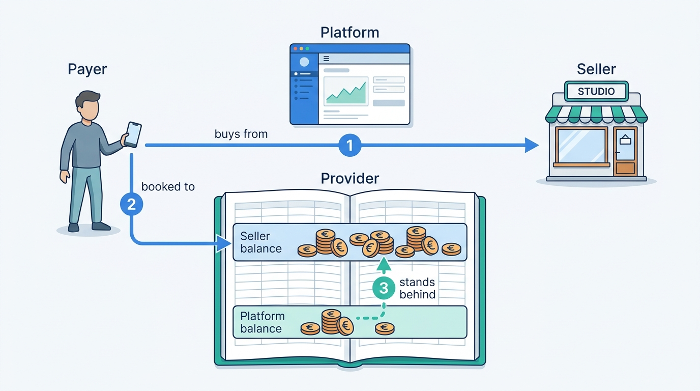
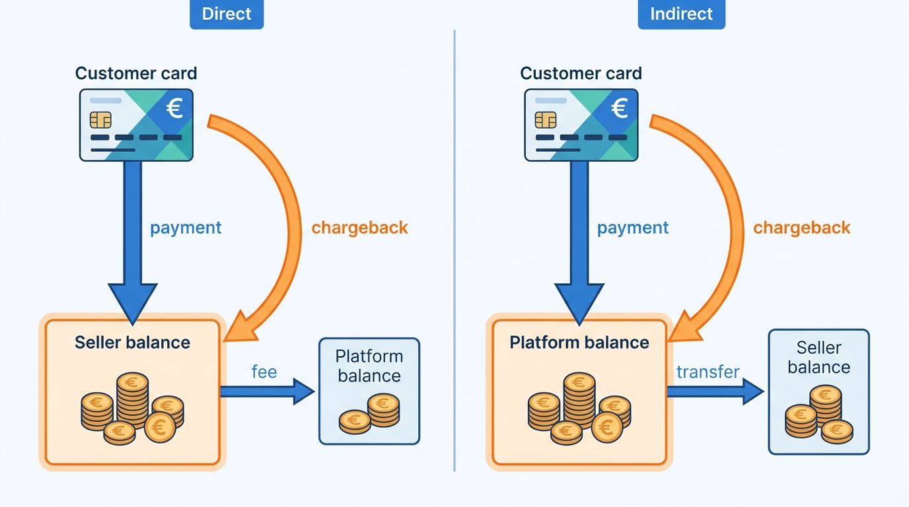
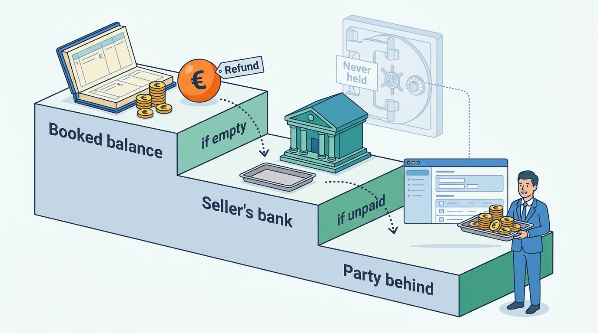

> **IN THIS CHAPTER, YOU WILL:** Answer three questions for any platform payment (who is the merchant, whose balance holds the money, who carries the loss) in Stripe's vocabulary and in Adyen's.

> **KEY POINTS:**
>
> * **The merchant is a fact, and the configuration has to match it.** Card-network rules decide the merchant by who sells, whose name the cardholder sees and who gives recourse. Stripe tells platforms not to base it on the charge type; Adyen asks it as a choice between two integration models.
> * **A loss falls on the booked balance first, then on whoever stands behind it.** Seller money sits in balances at the provider. When a refund or chargeback is larger than the balance it is booked to, the party assigned to cover that balance pays, so a platform that never holds funds can still carry the loss.
> * **Stripe fixes the loss bearer per account, with Stripe as one option; Adyen's default is the platform.** Stripe says of an account's loss and fee responsibilities: "You can't update their values later." Adyen books to the platform's liable balance account unless an instruction says otherwise, and documents Adyen bearing a seller's losses only as a pilot program.

> **[FAILURE PATTERNS THIS CHAPTER ADDRESSES](where-payment-systems-go-wrong.html):**
>
> * **The Accidental Bank** — a platform that never holds its sellers' money still stands behind their refunds and chargebacks when its configuration says so, and often nobody chose that.
> * **The Orphaned Refund** — a refund or chargeback after payout is booked to a balance that no longer holds the sale, and someone else's money has to fund it.
> * **The Borrowed Blueprint** — a charge type or account setup copied from a larger platform carries that platform's answer to who the merchant is, which may not be yours.

 
A member buys a €120 class pass through a booking platform. Two days later the studio is paid. A week after that the member wants €84 back for the classes she will not take. The studio's money has gone to its bank, and the platform never held any of it. **Whose balance pays the member?** At Larkfield, the fictional studio-software platform this book follows, the member is Mila Janssen, the studio is Studio Noord, and the answer may be Larkfield.

Three questions decide every payment of this kind. **The merchant is whoever the customer understands they are buying from. The money sits in balances at the provider. A loss falls first on the balance the payment was booked to, and then on the party assigned to cover that balance when it goes negative.** A platform's configuration has to agree with the first answer and decides the other two. On Stripe the decision is permanent: its documentation says of an account's loss and fee responsibilities, "You can't update their values later." On Adyen the platform's own account is the one from which "Funds can be deducted" when sellers' balances go negative.

So choosing an account model is choosing who pays when a seller cannot. It is the first decision of a platform integration, not a question of how much user interface to build. A Stripe solutions architect put it this way at Stripe Sessions 2026: "liability gates your fund flows. So pick it first, not last." The team that picks it last gets **the Accidental Bank**: it never holds the funds, and it carries the loss on them anyway.

**Where we are in the payment's journey.** Mila bought her ten-class pass for €120.00 on Tuesday 9 March 2027, and Studio Noord's payout arrived on Thursday 11 March. This chapter covers what stays open after that: her refund request of 18 March, and a dispute window that runs to about 7 July. For the dispute itself it borrows a second sale at the same studio: the €120.00 pass that another member, Bram de Wit, bought on 2 February and his bank charged back on 24 February. The chapter gives the rule for who pays; [[splits-balances-and-platform-payouts]] gives the mechanics.

The chapter starts with the question as it reached Larkfield. It then defines the three questions and the card networks' terms for a company in the middle, and shows how Stripe Connect and then Adyen for Platforms answer them. A crosswalk between the vocabularies follows, then three ways of assigning the loss, the two providers side by side, Studio Noord modeled on both, and the ways a platform model goes wrong.

## Setting the Scene at Larkfield: Who Funds Mila's €84.00?

On 18 March 2027 Ines Bakker, who owns Studio Noord, approved Mila's €84.00 refund in Larkfield's back office. The €117.47 the studio had received for the pass, the €120.00 less Larkfield's fee of €2.53, had been paid out a week earlier. Aylin Demir, Head of Studio Support, sent the payments team one line: whose money pays this?

Femke de Graaf, Head of Payments Engineering, collected three answers inside Larkfield, each given with confidence. Product said the studio, citing Larkfield's terms. Finance said Larkfield, citing a ledger account called "to recover from studio". Daniel Osei, the CTO, said the provider, because the provider holds the money. None had read the provider configuration. For the **1,140 studios** that take online payments through Stripe and front-desk payments through Adyen, the answer could also differ by channel.

She reduced the disagreement to three questions that a configuration answers one at a time. **Who is the merchant? Whose balance was the payment booked to? Who covers that balance if it goes negative?**

## Three Parties, Three Questions: Merchant, Balance, Loss

The **merchant** is the party the cardholder buys from, and the card networks decide who that is. Visa's rules (the edition of 24 October 2026; rule 5.3.2.2 of the Visa Product and Service Rules) classify an entity as a merchant if it "is selling the goods or services to the Cardholder", "uses its name primarily to identify its Merchant Outlet to the Cardholder" and "provides recourse to the Cardholder in the event of a dispute". Visa also "reserves the right to determine" the classification. The merchant is therefore a fact about the sale as the customer sees it, not a setting. Mastercard's rulebook could not be read for this book, so the rules here are Visa's.

For an entity that fails this test the same rule lists four classes; two fit a company between cardholder and seller, and they differ in exactly that first question. A **payment facilitator** signs up sellers under an acquirer, the licensed institution that takes card payments in on the merchant's side ([[acquiring-and-network-connectivity]]); its sellers are **sponsored merchants** and remain the merchants. A **marketplace** puts its own name ahead of its sellers, which Visa calls retailers, and carries their disputes.

| Role | Visa's glossary definition (October 2026) | Who the cardholder buys from |
| --- | --- | --- |
| Payment facilitator | "An entity that contracts with an Acquirer to deposit Transactions, receive settlement from, or contract with an Acquirer on behalf of a Sponsored Merchant" | The sponsored merchant |
| Sponsored merchant | "An entity that contracts with a Payment Facilitator and, pursuant to that contract, is able to accept a Card to sell goods or services" | This entity |
| Marketplace | "An entity that brings together Cardholders and retailers on an electronic commerce website or mobile application and processes Transactions and receives Settlement on behalf of those retailers"; it "Is financially liable for Disputes" (rule 5.3.4.1) | A retailer, under the marketplace's more prominent name |

A platform could register as a payment facilitator itself. Most do not, because registration brings an acquirer's sponsorship, validation against PCI DSS (the card industry's data security standard, [[tokenization-vaulting-and-pci]]), systems for underwriting (assessing a seller's risk), payouts and disputes and, where the platform controls the flow of funds, licenses of its own. Stripe's guide to payment facilitators (n.d., accessed November 2026) puts approximate minimums on these: US$50,000 to US$500,000 to validate PCI DSS at Level 1, US$5,000 each to Visa and Mastercard to register, and at least US$450,000 for US money transmitter licenses. These are a vendor's estimates in support of its own product, and the guide cites an industry report of September 2018 **(Evidence age: about 8 years; current costs may differ.)** Some platforms do register: Adyen's documentation (n.d., accessed November 2026) has a separate setup for a platform "already registered with Visa or Mastercard as a payment facilitator".

A provider's platform product is the alternative, and it answers the second question. Each seller becomes an account at the licensed provider with its own **seller balance**, the provider's record of what it owes that seller ([[balances-and-funds-flows]]). Stripe's documentation (n.d., accessed November 2026) says of payouts in Connect, its platform product: "Stripe handles licensing requirements, and your platform isn't part of the payout funds flow." Adyen's says of its equivalent: "Balance account: holds the funds of your user." The money sits in the provider's books and never in the platform's bank account ([[licences-and-safeguarding]]).

The third question arises when money has to go back. A **refund** is a return the seller agrees to; a **chargeback** is a reversal forced by the issuer, the cardholder's bank, after the cardholder disputes a payment ([[refunds-reversals-and-disputes]]). Either is booked to a balance, and if it is larger than that balance, the balance can go negative: the seller owes the provider. The loss then falls in two steps. **First it falls on the balance the payment was booked to. Then, if the seller never fills that balance again, it falls on the party assigned to stand behind it.** Stripe's documentation states the first step: "Stripe first assigns negative transactions to the account the associated charge was made on." Adyen's liable balance account, defined below, is the second.

Set side by side, the three questions are decided by three different things, and only the last two are the platform's to choose.

| Question | What decides it | Who can change it | Where the providers record it |
| --- | --- | --- | --- |
| Who is the merchant? | The sale as the customer sees it: seller, name, recourse | Nobody by configuration; only a change to the business | Stripe: charge type and `on_behalf_of` must match it. Adyen: marketplace or platform model, and the store |
| Whose balance holds the money? | The booking of the payment | The platform, per payment | Stripe: charge type. Adyen: split instructions |
| Who covers a negative balance? | An assignment | The platform, when it configures | Stripe: the account's responsibilities. Adyen: the liable balance account |

**Figure 1:** *Three questions attach to three different things: the sale the customer sees, the booking of the payment, and the party behind the seller's balance.*

## Stripe Connect: The Charge Type Books the Payment, the Account's Responsibilities Assign the Loss

Stripe's platform product is Connect, and its unit is the **connected account**: the record a platform creates at Stripe for each seller, which Stripe defines (n.d., accessed November 2026) as "A person or business accepting payments or receiving payouts on a Connect platform". A connected account has its own balance, and the platform has its own Stripe account and balance next to it. Everything in this section is Stripe's documentation as read in November 2026.

A **charge type** is the choice of which of those two accounts a payment is created on. Stripe's charges page has three. A direct charge is created on the connected account. The two indirect types, destination charges and separate charges and transfers, are created on the platform, which then moves the seller's share to the connected account; Stripe's examples are a software platform for the first kind and a ridesharing app or a multi-seller marketplace for the second. The table shows what follows: the charge type is the booking decision, and the booking decides whose balance a reversal reduces.

| Charge type | Where the payment is booked | Refunds and chargebacks reduce | Stripe debits its fees from |
| --- | --- | --- | --- |
| Direct | "the payment appears in the connected account's balance, not in your platform's balance" | "the connected account's balance" | The connected account or the platform, by configuration |
| Destination | "the payment appears in your platform's balance. A portion of the funds immediately transfers to the connected account's balance" | "your platform's balance" | "your platform's balance" |
| Separate charges and transfers | "on your platform's account first. Create a separate transfer to move funds" | The platform's balance | The platform's balance |

**Figure 2:** *A reversal follows the booking: a direct charge puts it on the seller's balance, an indirect charge on the platform's.*

The charge type is not a free choice, however, because it has to match the merchant. Stripe calls the merchant the **merchant of record** ([[merchant-of-record]]) and tells platforms: "The MoR is the entity that the customer understands they're buying from", and "Don't base it on the charge type or payment configuration." If the platform is the merchant, only indirect charges without `on_behalf_of` are allowed. If the connected account is, the options are a direct charge or an indirect charge with the `on_behalf_of` parameter, which makes "the connected account the business of record for the payment" and puts its name in the statement descriptor, the text on the cardholder's statement. That parameter changes the name and not the booking: for indirect charges a dispute debits the "Platform's balance, with or without `on_behalf_of`".

Who covers a connected account's negative balance is a property of the account. In Accounts v2 it is `losses_collector` (`controller.losses.payments` in v1), one of two responsibilities: "You must define `defaults.responsibilities` properties when you add the Merchant configuration to an account. You can't update their values later." The value `application` makes the platform responsible. The value `stripe` means "Stripe is liable for the connected account's negative balances. Your platform is still liable for negative balances on your platform account." The cover reaches only payments booked on the seller's balance, and Stripe says so: "If you use indirect charges, assign negative balance responsibility to your platform, not to Stripe." The other responsibility, `fees_collector`, says whether Stripe takes its fees from the seller or from the platform; a platform that bears the losses must also collect the fees.

Stripe then documents how a negative connected balance is collected, in order. It offsets the amount against the account's later payments. It tries the seller's bank account: "Stripe first attempts to offset the negative amount by collecting funds from the account's external account." Payouts to the seller stop while the balance is negative. If the platform is responsible, Stripe "holds funds in your platform account in reserve", shown as the platform's `connect_reserved` balance, and "if a connected account's balance remains negative for 180 days, we transfer funds from the platform reserve to cover the negative amount." If Stripe is responsible, Stripe covers the loss. A refund may not get that far: one the booked balance cannot fund waits as `pending` and fails after 45 days. The second step of the loss rule thus has a published timeline.

The same choice fixes much more than the loss, as Stripe's own table of consequences shows. Onboarding, the platform's controls and its product plan all depend on it; verification is the subject of [[platform-onboarding-and-verification]], and the provider's financial products for sellers (accounts and payment cards) of [[embedded-finance]].

| Aspect | Stripe is responsible | The platform is responsible |
| --- | --- | --- |
| Seller risk operations | Stripe's risk teams, through a service called Managed Risk | The platform: "You can't use Managed Risk" |
| Pausing payments or payouts | "You can't pause payments or payouts for your connected accounts" | The platform can pause them |
| Debiting a seller's balance | "You can't directly debit connected account balances" | Possible "In certain regions" |
| Collecting verification data (know your customer, KYC) | Stripe | The platform, unless sellers use Stripe's Express Dashboard |
| Accounts and cards for sellers (Stripe's Treasury and Issuing products) | "Your platform can't use Stripe Treasury or Issuing" | The platform can offer them |

An older integration uses other names for these decisions. Until recently a platform chose an account *type*: Standard, Express or Custom. Each was a bundle. On Stripe's account types page, now marked "Deprecated feature", dispute liability sits with the connected account for direct charges on Standard accounts and with the platform for Express and Custom, and "After you create a connected account, you can't change its type". The Accounts v2 interface unbundles the type into configurations, responsibilities and a dashboard setting. Stripe's changelog for API version 2025-12-15 says it "is now available for new Connect users", and the API reference (n.d., accessed November 2026) says: "The Accounts v2 API is broadly available to Connect platforms, and to other users in preview." Parts of it were still in preview on 17 November 2026: the Connect guide's example request carries the header `Stripe-Version: 2026-10-28.preview`, and Stripe bearing the losses of an account with the Express Dashboard is in public preview. The `treasury` and `card_issuing` capabilities, among others, still require Accounts v1.

> **INFERENCE, NOT DOCUMENTED:** Stripe documents the remedy for one case. Its page on migrating to a supported Connect configuration (n.d., accessed November 2026) says: "you need to create new connected accounts with the desired account configuration and re-onboard your users." That page covers configurations Stripe no longer supports; that the same remedy applies when a platform changes its own commercial model is my reading.

## Adyen for Platforms: The Model Names the Merchant, the Liable Balance Account Stands Behind Every Seller by Default

Adyen asks the merchant question first, as a choice between two integration models. Their names reuse words this chapter has used loosely, so from here "marketplace model" and "platform model" mean Adyen's two products. Its model comparison (n.d., accessed November 2026, as is all Adyen documentation in this section) gives the shopper's interaction as "Directly with you" for a **marketplace** and "Directly with your user" for a **platform**, "user" being Adyen's word for a seller. In a marketplace, "Customers recognize that they are doing business directly with your marketplace." Only the platform model supports in-person payments and registered payment facilitators. The model is Adyen's form of the network's test, asked before any account exists.

Under either model the money is kept in the **balance platform**, which Adyen's account structure page defines in one sentence: "The balance platform is an accounting system that manages the flow of funds within your business." It is separate from the merchant accounts in which Adyen processes the payments, and it is regional: "You must have a separate balance platform for each region in which you acquire payments." A platform that acquires in two of Adyen's regions, such as Europe/EEA (the European Economic Area) and the United States, has two sets of books.

A seller on the balance platform is not one object. It is several resources, each answering one question, so identity, permissions and money are separate. One seller can have several of each: Adyen's worked example asks for at least one account holder per country the seller operates in, and at least one balance account per account holder.

| Resource | Adyen's definition | The question it answers |
| --- | --- | --- |
| Legal entity | "contains information about your user, for example, the legal name, address, and tax information" | Who is the seller? |
| Account holder | "specifies what your user can do in your platform" | What may it do? |
| Balance account | "holds the funds of your user. All financial activities in your platform, such as paying out to a bank account, happen through balance accounts" | Where is its money? |
| Transfer instrument | "your user's verified bank account where they can receive payouts" | Where is it paid? |
| Store | "ensures that the transactions you process for your users correspond to an accurate payer statement" | Whose name does the payer see? |

**Figure 3:** *The same seller in two shapes: Provider A (Stripe) keeps identity, settings and balance in one account; Provider B (Adyen) keeps them as separate resources, with the platform's liable balance account behind the seller's.*

The platform has resources of the same kinds for itself, with a role the seller's do not have. Adyen's account structure page reads: "Liable account holder: represents your business in the balance platform. Liable balance account: the account where your business' funds are held. Funds can be deducted from this account if your users' balance accounts incur negative balances due to refunds and chargebacks. These resources are created by Adyen." The default party behind every seller is therefore part of the account structure itself; the platform does not create it.

Bookings go to that liable balance account unless an instruction says otherwise. Adyen's split documentation starts from the default: "By default, all transaction amounts and fees are booked to your platform's liable balance account". A split instruction, sent with the payment or stored as a profile for a store, books part of a payment to a seller's balance account. Chargebacks work the same way: by default "Adyen withdraws the disputed funds from your platform's liable balance account", and the platform can change this with a `platformChargebackLogic` object, sent with the payment or set as a default through Adyen's support, that names the liable account, one seller's balance account or the payment's split ratio. A refund is split by an instruction too, and "Refunds can only be deducted from the balance accounts to which the payment was credited." Whose balance a reversal reduces is thus an instruction attached to each payment, written before any reversal exists.

When a seller's balance account cannot cover what is booked to it, Adyen documents a period and an account. Its page on liable balance accounts says: "Adyen allows negative balances for up to 30 days. If a balance account has a negative balance for more than 30 days, Adyen compensates this by debiting your reserved compensation account on the first day of the following month." The platform must refill that account if the debit leaves it negative. The recovery tools are the platform's to operate: a top-up "To cover negative balances resulting from refunds or chargebacks", pulled by direct debit from the seller's verified bank account, and internal transfers between the liable balance account and a seller's. A separate reserve account, whose funds Adyen blocks "as collateral", covers negative balances caused by transfers such as payouts. **That is the default, and Adyen documents one exception.** Its Managed Risk page, marked "Limited availability" and "in pilot phase" in November 2026, says Adyen will "assume the responsibility for negative balances on their accounts" and write a balance off once it "has remained negative for 180 days after their last captured payment".

> **INFERENCE, NOT DOCUMENTED:** Because the chargeback instruction travels with each payment, two payments of the same seller can carry different loss assignments. A platform on Adyen therefore has to store the instruction it sent with every payment.

## One Set of Questions, Two Vocabularies

The table asks seven questions: this chapter's three, and four practical ones an integration meets around them. The two providers answer with different words for the same function. The pairing is my own mapping, an inference: neither company publishes a translation to the other. RECONCILED covers both companies from the finance side ([[stripe]], [[adyen]]).

| Question | Stripe term | Adyen term |
| --- | --- | --- |
| What is a seller? | Connected account | Legal entity + account holder + balance account |
| Where is the seller's money? | The connected account's balance | Balance account |
| Where is the platform's own money? | Platform balance, with `connect_reserved` | Liable balance accounts: main, reserved compensation, reserved incorrect splits |
| How is a payment tied to the merchant? | Charge type and `on_behalf_of` | Model, store and merchant account |
| Where is a payment booked? | Charge type | `splits` instructions |
| What is the platform's cut called? | Application fee | `Commission` split |
| Who bears a seller's losses? | `losses_collector` on the account | The platform's liable accounts, with chargeback and refund instructions |

The mapping breaks in three places, where a sentence has to be restated and cannot be translated. One Stripe object stands against several Adyen resources. A loss assignment fixed per account stands against one instructed per payment, so "this seller is platform-liable" is a property on Stripe and a habit of the integration on Adyen. And a loss bearer chosen per account on Stripe stands against a default of the platform on Adyen, with a pilot program as the exception.

## Three Ways to Assign the Loss, and What Each Costs

The answers combine into three realistic models. In the first, **the seller is the merchant and the provider bears the seller's losses**. Stripe documents it as a setting on the account, Adyen as a pilot program. In Stripe's "Stripe-owned pricing model", connected accounts "Are the merchant of record", "Pay Stripe fees", "Assume liability for their negative balances" (they owe Stripe, not the platform) and "Process payments as direct charges", and with Managed Risk "Stripe assumes liability for unrecoverable negative balances on connected accounts". The price is control: the platform cannot pause a seller's payouts or debit its balance. The model is also tied to the booking: direct charges qualify, and destination charges with `on_behalf_of` were in private preview in November 2026.

In the second model the seller is still the merchant, and **the platform stands behind it**. Stripe calls this the "Buy rate model": connected accounts "Don't pay Stripe fees" and "Are liable to the platform, not Stripe, for their negative balances". On Adyen it is the platform model with chargebacks instructed to the seller's balance account: "Use this logic if you want to make your user liable for all chargeback-related events on the payment." The platform gets the pricing, the pause and the debit, and the account risk of every seller it lets in.

In the third model **the platform is the merchant**. Payments are booked to its own balance, and every refund and chargeback reduces that balance first, whatever the seller later repays. Visa's rule, quoted above, makes a marketplace "financially liable for Disputes". Stripe's marketplace guide says "You pay Stripe fees and manage disputes and refunds", and Adyen's marketplace model leaves chargebacks on the liable balance account by default. Here the loss is the platform's by rule as well as by configuration.

Platform revenue follows the same choice. Where the provider prices payments and bears the loss, the platform earns a fee on top or a share of the provider's revenue. Where the platform bears the loss, it buys processing and sets its own price ([[payment-economics]]). Stripe's list prices, as served in the Netherlands in November 2026, show the difference: no fees for the platform when Stripe handles pricing for its users, and €2 per monthly active account plus 0.25% + €0.10 per payout when the platform does. On Adyen the platform's cut is a `Commission` split booked to its liable balance account. Adyen's public pricing page (n.d., accessed November 2026) lists prices per payment method and says "Other Adyen products, besides payment methods, are priced separately"; it gives none for Adyen for Platforms, whose get-started page says to "contact us to register your interest".

The table sets the three models beside the facilitator route. In every row, control and revenue rise with exposure.

| Model | Merchant | A reversal lands first on | Behind the seller | The platform controls | The platform earns | Documented for |
| --- | --- | --- | --- | --- | --- | --- |
| Provider bears seller losses | Seller | The seller's balance | The provider | Little: no pause, no debit | A fee on top, or a revenue share | Stripe; Adyen in pilot |
| Platform bears seller losses | Seller | The seller's balance or the platform's, by booking | The platform | Pricing, pauses, recovery | Its own price less the provider's cost | Stripe and Adyen |
| Platform is the merchant | Platform | The platform's balance | The platform | Everything the customer sees | Its margin on the sale | Stripe and Adyen |
| Register as a facilitator | Seller | As arranged with the acquirer | The facilitator | Everything, with the registration duties | The full processing margin | Visa's rules |

My rule is to decide the loss bearer first and derive the rest. I would take the provider-bears-losses model when sellers are numerous, small and unknown to me, and I do not need to control their payouts. I would take the platform-bears model when I price payments myself or plan to offer accounts and cards, since on Stripe both require it. A platform with no risk function and no capital to absorb a failed seller should not take the second model for the revenue alone.

## Stripe and Adyen: Where They Differ

Seven documented differences separate the two platform products, and the largest is who may stand behind a seller. The Stripe and Adyen columns restate facts cited above; the last column is my reading, an inference.

| Aspect | Stripe | Adyen | What the difference suggests |
| --- | --- | --- | --- |
| How the merchant is expressed | Per payment, by charge type and `on_behalf_of` | By integration model (marketplace or platform) and by store | On Stripe one seller account can be charged either way; on Adyen it is closer to a structural decision |
| What represents a seller | One account with configurations | Legal entity, account holder, balance account, transfer instrument | Adyen separates identity, permissions and money in its API |
| Where a chargeback is booked | By charge type: the connected account's balance for direct charges, the platform's for indirect ones | The liable balance account by default; another account by an instruction on the payment | Stripe decides by the kind of charge, Adyen by an instruction on each payment |
| Who stands behind a seller's negative balance | Stripe or the platform, per account (`losses_collector`) | The platform's liable accounts by default; Adyen under Managed Risk, a pilot with limited availability | Stripe offers the provider as loss bearer as a setting, Adyen as a pilot |
| Can the assignment change? | No: "You can't update their values later" | Instructions are sent per payment | A new model means new accounts on Stripe and new instructions on Adyen |
| Recovery from a negative seller balance | A debit of the seller's bank account, a reserve on the platform, a transfer after 180 days | Top-up by direct debit and internal transfers; a debit of the platform's reserved compensation account after more than 30 days | Both publish a timeline: 180 days on Stripe, one to two months on Adyen |
| Price list for the platform product | Public | Not public; only payment-method prices are | No inference drawn |

On Stripe, decide the loss bearer before you create the first account, and store it per account, because you cannot change it afterwards. On Adyen, send the chargeback instruction with every payment, store what you sent, and expect a seller's negative balance to reach your reserved compensation account within one to two months.

## In Practice at Larkfield: Studio Noord Modeled Twice

Start with the first question, because its answer is the same on either provider. Mila books a class at Studio Noord, sees the studio's name on her card statement, and asks the studio for her refund. By the network's three tests Studio Noord is the merchant, and Larkfield is not the merchant of record for class sales. Both configurations have to say so.

On Adyen, where Studio Noord has been since 2024, Larkfield uses the platform model. The studio is a legal entity with an account holder, a euro balance account, a transfer instrument and a store. Mila's €120.00 is split: €117.47 to the studio's balance account, and €2.53 to Larkfield's liable balance account, which keeps €1.92 after the illustrative processing cost of €0.61 *(assumption)*. Each payment also carries a `platformChargebackLogic` instruction with the documented behavior `deductFromOneBalanceAccount`, naming the studio's balance account for a chargeback and for its fee, which would otherwise go to the liable balance account.

Had Studio Noord been on Stripe, like the studios Larkfield onboarded before 2024, it would be a legacy Custom connected account, with no Stripe dashboard of its own. Its payments would be destination charges with `on_behalf_of` naming the studio, which Stripe's buy rate model allows as "destination on-behalf-of (OBO) charges", and with an application fee equal to Larkfield's fee. On Stripe's migration page a Custom account maps to the platform bearing the losses, paying Stripe's fees and collecting the verification data. Larkfield would stand behind the studio by a setting made when the account was created.

The two configurations treat the ledger's two reversals differently at the first step and identically at the second. The table follows Mila's €84.00 refund and Bram de Wit's €120.00 chargeback with its illustrative €15.00 fee. The Stripe cells rest on the documented behavior of indirect charges: the platform's balance is debited, and the platform "can attempt to recover funds from the connected account by reversing the transfer". How the €84.00 divides between the studio's share and Larkfield's fee is for [[splits-balances-and-platform-payouts]] and [[journey-platform-payment]]; the dispute is followed in [[journey-dispute]].

| Question | Studio Noord on Adyen | Had it been on Stripe |
| --- | --- | --- |
| Who is the merchant? | Studio Noord (platform model; the store) | Studio Noord (`on_behalf_of`) |
| Where is the €120.00 booked? | €117.47 to the studio's balance account, €2.53 to the liable balance account | To Larkfield's platform balance, with €117.47 transferred to the studio's balance |
| What does the €84.00 refund debit first? | The studio's balance account, by the refund's split instruction | Larkfield's platform balance; Larkfield then reverses the transfer |
| What do the €120.00 chargeback and its €15.00 fee debit first? | The studio's balance account, by the chargeback instruction | Larkfield's platform balance; Larkfield then tries to reverse the transfer |
| What if the studio cannot cover it? | The studio's balance account goes negative; after more than 30 days Larkfield's reserved compensation account is debited | Larkfield's balance has already paid; what it cannot pull back stays its loss |

**Figure 4:** *A loss steps down: first the balance the payment was booked to, then the seller's bank account, then the party assigned to stand behind the seller.*

So the answer to Aylin's question is the same name on both providers, reached by two routes. Under Keel, the 2027 program that puts Larkfield's payments on an even keel, the payment service now stores for each studio and provider the merchant, the booking rule, the loss bearer and whether the assignment can still change. Finance reports one exposure figure next to it: about **€156 million** of paid-out online card volume sits inside the 120-day dispute window at any time. That is what can be disputed, not what will be lost. The figure exists because "we never hold the funds" had been read for years as "we never carry the loss".

## When It Goes Wrong

The costliest failure is a seller that stops trading while its customers can still dispute. The chargebacks arrive at a balance nobody refills, and the party behind it pays. Stripe's risk page gives its own case: "During the COVID pandemic, some hotels and short-term accommodation providers represented by connected accounts went out of business. As a result, customers who had pre-paid for future stays submitted chargebacks, which were covered by the platforms that processed those payments." The warning sign is an exposure figure per seller: paid-out volume still inside the dispute window, with prepaid sales weighted most. The documented remedies (pausing payouts, holding part of a balance, debiting the seller's bank account) all need a seller that still exists, so they have to be used early.

A second failure involves no loss at first: the configuration contradicts the merchant. The checkout names the studio, the statement names the platform, and the customer does not recognize the payment. Stripe's merchant-of-record page lists what follows: "Misalignment can confuse customers, increase unrecognized transactions and disputes, require your platform to take remediation actions, and possibly lead to card-network scrutiny or enforcement, including fines." This is the Borrowed Blueprint: a charge type copied from a larger platform whose merchant was different. To detect it, follow one payment from checkout to receipt to statement to provider configuration, and check that all four name the same business.

A third failure is one that nobody notices until the books are compared. On Adyen a wrong balance account in a split or chargeback instruction does not fail the payment. The chargeback page says: "The API request validates only the format of the split instructions, **not** the balance accounts specified in the request", and if the balance account does not exist or belongs to a closed account holder, "the full transaction and its fees are booked to your platform's liable balance account." Its page on liable accounts names a "reserved incorrect splits account" for such funds. A successful payment therefore does not prove that the seller was credited or will be debited. Only reconciling every leg of a split against Adyen's transfer webhooks and accounting report shows it ([[payment-reconciliation-and-reporting]]).

The slowest failure takes years to appear: the commercial model changes on accounts whose responsibilities are fixed. A platform that started on Stripe's pricing and Stripe's cover, and now wants its own pricing and financial products, cannot change the setting on the accounts it has. By Stripe's documented remedy, it has to migrate its sellers to new accounts, and meanwhile it runs two combinations of responsibilities side by side. Treating the account model as something the product team can revisit later is how a platform arrives here.

## What to Take Away

**Established.**

- The card networks decide the merchant by what the cardholder sees: who sells, who is named, who gives recourse (Visa Product and Service Rules, rule 5.3.2.2, October 2026).
- Both providers keep seller money in their own books; the platform is not in the flow of funds.
- A reversal goes to the balance the payment was booked to: by charge type on Stripe, by instruction on Adyen, with the platform's liable balance account as the default.
- Stripe fixes who covers a seller's negative balance per account, Stripe or the platform, and does not let it be updated.

**Depends on context.**

- Which model fits depends on who the customer buys from, whether you price payments yourself, whether you want to offer accounts and cards, and how well you know your sellers.
- Stripe bearing seller losses is available only where payments are booked on the seller's balance; for destination charges it was in private preview in November 2026.
- On Adyen a seller's negative balance may stand for up to 30 days before the platform's reserved compensation account is debited. Adyen bears the loss only under Managed Risk, a pilot with limited availability in November 2026.

**The author's synthesis.**

- The account model is a liability decision. I take it first, before onboarding and checkout, and I record it per account in my own system, because on Stripe it cannot be changed and on Adyen it lives only in what I send.
- I treat "we never hold the funds" as saying nothing about who carries the loss, and I keep one number for it: the paid-out volume that can still come back.

## Questions to Ask

1. From checkout, receipt and statement, who is the merchant? Does our configuration name the same business?
2. For each kind of payment we take, whose balance is it booked to?
3. If a seller's balance goes negative and stays negative, who pays: the provider or us? Where is that written?
4. Can that assignment be changed on an existing account? If not, what would a change of commercial model cost?
5. On Adyen, which chargeback and refund instructions do we send with each payment, and do we store them?
6. How long may a seller's balance stay negative before ours is debited, and is there a reserve? Has the provider said so in writing?
7. How much paid-out volume is still inside the refund and dispute window, per seller and in total?
8. What happens to a payment whose split names an account that is closed or does not exist?

Mila's €84.00 has an answer now. On Adyen, Studio Noord's balance account pays first and Larkfield's liable balance account stands behind it; on Stripe, Larkfield's own balance would pay first. Either way every seller on a platform is an account at a licensed provider, with someone standing behind its losses. It follows that the provider has to know who each seller is before that account may take payments or receive payouts, and has to keep knowing it for as long as the account lives. That makes verification a state with deadlines, which is the subject of [[platform-onboarding-and-verification]].

## Sources and Evidence

*Company, product and investor sources*

- [Determine and configure the merchant of record (MoR)](https://docs.stripe.com/connect/merchant-of-record), Stripe documentation, n.d., accessed 2026-11 — the merchant as the entity the customer understands they are buying from; allowed charge types per merchant; consequences of misalignment.
- [Understand how charges work in a Connect integration](https://docs.stripe.com/connect/charges), Stripe documentation, n.d., accessed 2026-11 — the three charge types, where each is booked, refunds and chargebacks per type, pending refunds, `on_behalf_of`.
- [Risk and liability management with Connect](https://docs.stripe.com/connect/risk-management), Stripe documentation, n.d., accessed 2026-11 — negative balance responsibility, the table of consequences, the 180-day transfer, the public preview of Express Dashboard access with Stripe bearing losses, the pandemic example.
- [Configure the behavior of connected accounts](https://docs.stripe.com/connect/accounts-v2/connected-account-configuration), Stripe documentation, n.d., accessed 2026-11 — `losses_collector`, `fees_collector`, "You can't update their values later".
- [Connect and the Accounts v2 API](https://docs.stripe.com/connect/accounts-v2), Stripe documentation, n.d., accessed 2026-11 — configurations, the preview version header, cases that still need Accounts v1.
- [Connect platforms can now use Accounts v2 to manage connected accounts and customers](https://docs.stripe.com/changelog/clover/2025-12-15/accounts-v2), Stripe API changelog, API version 2025-12-15 — Accounts v2 "is now available for new Connect users".
- [Accounts (API v2 reference)](https://docs.stripe.com/api/v2/core/accounts), Stripe API reference, n.d., accessed 2026-11 — "broadly available to Connect platforms, and to other users in preview".
- [Understanding Connect account balances](https://docs.stripe.com/connect/account-balances), Stripe documentation, n.d., accessed 2026-11 — negative transactions assigned to the account charged, `connect_reserved`, payouts stopped while negative.
- [Disputes on Connect platforms](https://docs.stripe.com/connect/disputes), Stripe documentation, n.d., accessed 2026-11 — the balance debited for a dispute per charge type, with or without `on_behalf_of`.
- [Connected account types](https://docs.stripe.com/connect/accounts), Stripe documentation, n.d., accessed 2026-11 — definition of a connected account; Standard, Express and Custom as deprecated types; liability per type.
- [Migrate to account controller properties](https://docs.stripe.com/connect/migrate-to-controller-properties), Stripe documentation, n.d., accessed 2026-11 — what a Custom account maps to.
- [Migrate to a supported Connect configuration](https://docs.stripe.com/connect/configuration-migration-guide), Stripe documentation, n.d., accessed 2026-11 — no change of an existing account's type; new connected accounts and repeated onboarding, in phases.
- [Build a SaaS platform](https://docs.stripe.com/connect/saas), Stripe documentation, n.d., accessed 2026-11 — the Stripe-owned pricing model and the buy rate model.
- [Build a marketplace](https://docs.stripe.com/connect/marketplace), Stripe documentation, n.d., accessed 2026-11 — the platform as merchant of record paying fees and managing disputes.
- [Managed Risk](https://docs.stripe.com/connect/risk-management/managed-risk), Stripe documentation, n.d., accessed 2026-11 — Stripe's liability for unrecoverable negative balances and the charge types it covers.
- [Understand differences between Global Payouts and Connect cross-border payouts](https://docs.stripe.com/connect/cross-border-payouts-to-recipients/compare-global-payouts), Stripe documentation, n.d., accessed 2026-11 — "Stripe handles licensing requirements, and your platform isn't part of the payout funds flow".
- [Connect pricing](https://stripe.com/en-nl/connect/pricing), Stripe, n.d., accessed 2026-11 — list prices as served in the Netherlands.
- [Introduction to payment facilitation](https://stripe.com/guides/payfacs), Stripe guide, n.d., accessed 2026-11 — obligations and estimated costs of registering as a facilitator (vendor estimates; cites a 2018 report; evidence age: about 8 years; read in the Dutch-language version served).
- [Splitting the check: Architecting multiparty payment flows](https://stripe.com/sessions/2026/splitting-the-check-architecting), Stripe Sessions 2026 talk, 2026 — "liability gates your fund flows. So pick it first, not last."
- [Adyen for Platforms](https://docs.adyen.com/adyen-for-platforms-model), Adyen documentation, n.d., accessed 2026-11 — the marketplace and platform models compared.
- [Account structure](https://docs.adyen.com/platforms/account-structure-resources), Adyen for Platforms documentation, n.d., accessed 2026-11 — the balance platform, account holder, balance account, the liable account holder and liable balance account.
- [Platform account structure](https://docs.adyen.com/platforms/account-structure-resources/platform-structure), Adyen for Platforms documentation, n.d., accessed 2026-11 — the platform relationship, registered payment facilitators, resources per user.
- [Marketplace account structure](https://docs.adyen.com/marketplaces/account-structure-resources/marketplace-structure), Adyen documentation, n.d., accessed 2026-11 — "Customers recognize that they are doing business directly with your marketplace".
- [Legal entity management](https://docs.adyen.com/platforms/account-structure-resources/legal-entity-management), Adyen for Platforms documentation, n.d., accessed 2026-11 — legal entity and transfer instrument.
- [Platforms](https://docs.adyen.com/platforms), Adyen for Platforms documentation, n.d., accessed 2026-11 — the acquiring regions.
- [Split payments automatically](https://docs.adyen.com/platforms/automatic-split-configuration), Adyen for Platforms documentation, n.d., accessed 2026-11 — the default booking to the liable balance account; split profiles.
- [Split chargebacks](https://docs.adyen.com/platforms/online-payments/split-transactions/split-chargebacks), Adyen for Platforms documentation, n.d., accessed 2026-11 — the default chargeback booking, `platformChargebackLogic`, the fallback for a closed or missing balance account.
- [Split refunds](https://docs.adyen.com/platforms/online-payments/split-transactions/split-refunds), Adyen for Platforms documentation, n.d., accessed 2026-11 — refunds only from the accounts the payment was credited to.
- [Top up balance accounts](https://docs.adyen.com/platforms/top-up-balance-account), Adyen for Platforms documentation, n.d., accessed 2026-11 — top-ups to cover negative balances.
- [Transfer funds internally](https://docs.adyen.com/platforms/internal-fund-transfers), Adyen for Platforms documentation, n.d., accessed 2026-11 — transfers between the liable balance account and users' balance accounts.
- [Manage liable balance accounts](https://docs.adyen.com/platforms/manage-liable-accounts), Adyen for Platforms documentation, n.d., accessed 2026-11 — the three liable accounts; negative balances allowed for up to 30 days, then a debit of the reserved compensation account; the reserved incorrect splits account.
- [Manage your reserve account](https://docs.adyen.com/platforms/manage-reserve-account), Adyen for Platforms documentation, n.d., accessed 2026-11 — the reserve account as collateral for negative balances caused by transfers.
- [Adyen Managed Risk](https://docs.adyen.com/platforms/managed-risk), Adyen for Platforms documentation, n.d., accessed 2026-11 — the pilot (limited availability) in which Adyen assumes responsibility for users' negative balances and writes them off after 180 days.
- [Get started with Adyen for Platforms](https://docs.adyen.com/platforms/get-started), Adyen for Platforms documentation, n.d., accessed 2026-11 — contact through sales to register interest.
- [Pricing](https://www.adyen.com/pricing), Adyen, n.d., accessed 2026-11 — prices per payment method; "Other Adyen products, besides payment methods, are priced separately".

*Standards, regulation and official documentation*

- [Visa Core Rules and Visa Product and Service Rules](https://usa.visa.com/dam/VCOM/download/about-visa/visa-rules-public.pdf), Visa, 2026-10-24 — rule 5.3.2.2 on who is the merchant and rule 5.3.4.1 on marketplace qualification (both in the Visa Product and Service Rules, chapter 5); glossary definitions of payment facilitator, sponsored merchant and marketplace.

*Research and practitioner sources*

- None.

Larkfield is fictional; architectural recommendations, labeled inferences and labeled assumptions are the author's judgement.
