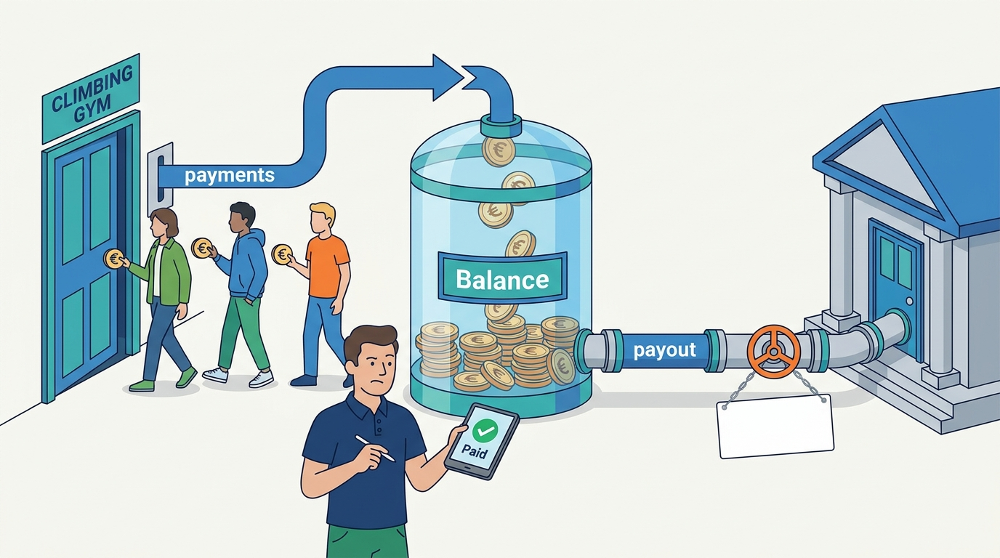
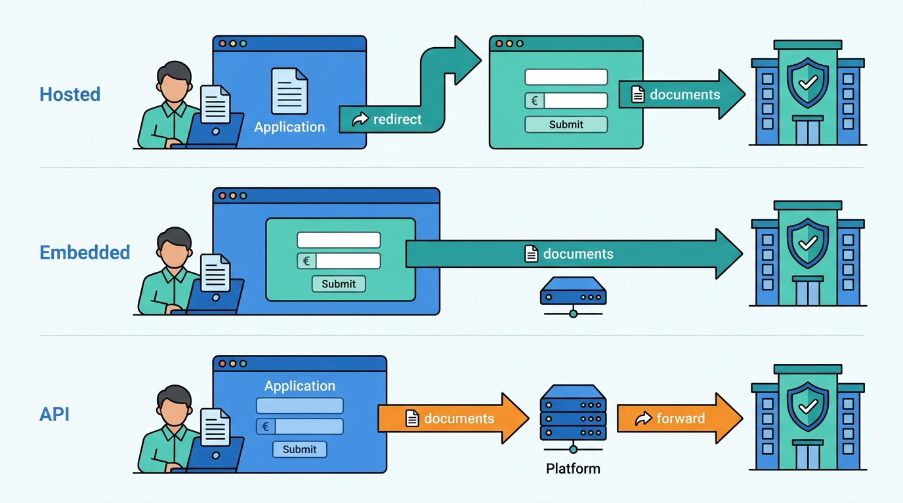
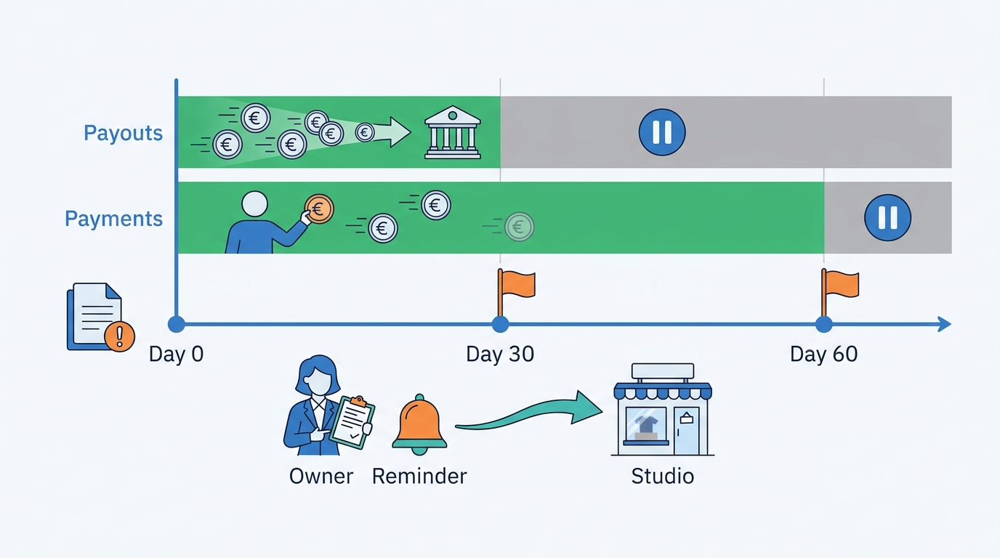
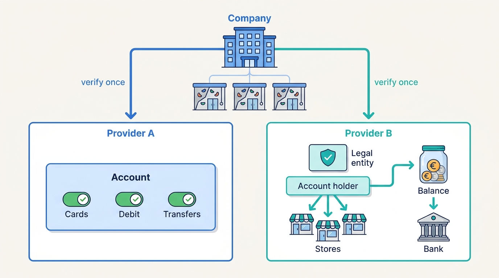

> **IN THIS CHAPTER, YOU WILL:** Learn how a platform collects sellers' verification data, keeps sellers verified afterwards, and explains a stopped payout, on Stripe and on Adyen.

> **KEY POINTS:**
>
> * **Verification is a state with deadlines and an owner, not a sign-up form.** The provider reopens it for the life of every account. Request only the capabilities a seller needs, let the provider's hosted or embedded flow collect the documents, and hold every open requirement and its deadline yourself, with a named owner.
> * **Payouts usually stop first.** Stripe's documentation (accessed November 2026) says it typically disables payouts at a missed deadline and may disable charges if the account stays unresponsive; Adyen's standard deadline is 30 days for payout capabilities and 60 for receiving payments. The seller's first symptom is money coming in and none going out.
> * **Your own forms are a standing cost, and nobody publishes what they gain.** Stripe says API onboarding needs integration changes for each new requirement and a review at least every six months. Neither Stripe nor Adyen publishes a completion rate for any onboarding flow, so measure your own.

> **[FAILURE PATTERNS THIS CHAPTER ADDRESSES](where-payment-systems-go-wrong.html):**
>
> * **The Frozen Seller** — a requirement reopens after sign-up, nobody at the platform owns its deadline, and the seller's payouts stop.
> * **The Black-Box Balance** — the seller's money sits in a provider balance, and the platform's screen cannot say why it is not moving.
> * **The Trusted Doorbell** — a browser returning from the provider's onboarding flow is taken as proof that the seller is verified.

 
On Monday 11 May 2026 the payouts of Ironworks Climbing stopped. Ironworks is a customer of Larkfield, the fictional studio-software platform this book follows ([[meet-larkfield]]). Its three gyms in Manchester were full all week, and every payment showed as paid in Larkfield's back office. For nine days nothing reached the company's bank account. **No screen that its owner, Ravi Shah, could open said why.**

Those nine days follow from the previous chapter's result. Every seller on a platform is an account at a licensed provider, with someone standing behind its losses ([[platform-payment-models]]). The provider's license requires it to know who that seller is, and to keep knowing it ([[payment-compliance-and-regulation]]). So verification is not a step that ends: **it is a state the provider reopens for the life of the account.** A platform gets thousands of small businesses verified by accepting that. To keep sellers, it requests only the capabilities a seller needs and lets the provider's hosted or embedded flow collect the documents. To keep the provider's trust, it holds every open requirement and deadline itself, with a named owner, so that the seller hears of a missing document from the platform first.

**Where we are in the payment's journey.** This chapter comes before the first step of Mila Janssen's class pass. Studio Noord could take her €120.00 on Tuesday 9 March 2027, and be paid its €117.47 on Thursday 11 March, only because its capabilities at Adyen were active, and they stay active only while its verification does.

The chapter starts with the nine days at Ironworks, seen from the seller's side. It then names the two ways a platform loses a seller, shows what decides how much a seller is asked for, and compares the three ways to collect it. Next come the work after sign-up and what can be measured. It ends with Stripe and Adyen side by side, the onboarding of Ironworks, and the failures that remain.

## Setting the Scene at Larkfield: Nine Days Without a Reason

Start with what Ravi Shah could see. The back office listed every payment at his three locations as `paid`, and showed one running total of money held for him, with no dates and no reasons ([[balances-and-funds-flows]]). What he could not see was that Stripe had an open requirement on his account, that its deadline had passed, and what would clear it. Larkfield's back office held none of those facts. Its one message about the change, a batch email, had gone to the address typed at sign-up, a mailbox nobody at Ironworks read. On Thursday 14 May he wrote to support: "Three gyms, full classes, and nothing in our bank since Monday. Your screen says everything is paid." He was one of 230 studios in the incident Larkfield calls the Frozen Studios.

**Figure 1:** *The seller's view of a missed verification deadline: payments keep arriving, the payout is shut, and no sign says why.*

Because of what he could not see, the review that Femke de Graaf ran in 2027 began on his screen. Femke has led payments engineering at Larkfield since January 2027, and she went through the incident with Aylin Demir, the head of studio support. They found three things missing from Ravi's screen: **the reason, the date and a way to fix it.** Behind the screen they found a fourth problem. Studios on Stripe signed up through Larkfield's own forms, which sent the data to Stripe over the API. The forms dated from the 2017 integration and gained fields only when Larkfield launched a country, so they had no field for what Stripe now asked. The incident had two halves, and they are this chapter's two subjects: how verification data is collected, and what the platform does after sign-up.

## Two Ways to Lose a Seller

Two terms carry the rest of the chapter. A **capability** is a named permission on a seller's account, such as taking card payments or receiving payouts. Stripe's documentation (n.d., accessed November 2026) defines it: "Capabilities represent functionality that you can request for your connected accounts, such as accepting card payments or receiving transferred funds from your platform account. A capability must be active for a connected account to perform actions associated with that capability." (A connected account is Stripe's record of a seller.) A **verification requirement** is one fact or document the provider needs before it switches a capability on, or in order to keep it on; Stripe says requirements "describe the account information that Stripe needs in order to enable one or more capabilities for that account". Adyen's documentation (n.d., accessed November 2026) uses the same word and gives the reason: "As required by payment industry regulations, Adyen must verify the users in your platform before you can process payments, pay out their funds, and offer financial products to them." Why a license demands these checks is the subject of [[licences-and-safeguarding]] and [[payment-compliance-and-regulation]]; here they are taken as given.

Because capabilities depend on requirements, the first way to lose a seller is at sign-up. Every capability a platform requests adds information the seller must provide. Stripe says so on the same page: "The capabilities you request for a connected account determine the information you’re required to collect for it. To reduce onboarding effort, only request the capabilities that your accounts need. Requesting more capabilities means the onboarding flow must verify more information." A small business that came for booking software can give up at any of those questions. When it does, the platform has lost a customer and the provider has lost nothing. Product teams commonly treat this as a funnel to be shortened; what each question costs is not public for either provider, as a later section shows.

The second loss comes later, and it is the one Ravi met. After sign-up the provider reopens a requirement, sets a deadline, and switches a capability off when the deadline passes. Stripe's documentation, on the Accounts v1 version of its verification page, says it "typically disables payouts on the account if we don’t receive the information by the `current_deadline`". Adyen's says: "If the user does not resolve the verification issues in a timely manner, their capabilities will be disallowed." [[payment-compliance-and-regulation]] explains the mechanism. What matters here is where the seller meets it. Payouts are a feature of the platform's product, so when they stop the seller calls the platform. **The platform inherits the deadline whether or not it was the one collecting the data.**

## What a Seller Is Asked For, and What Decides It

To reduce the loss at sign-up, a platform first has to know what decides how much is asked. The list is computed, not fixed. Stripe's documentation (n.d., accessed November 2026) says requirements "vary by account, depending on" the country, the capabilities, the business type "(for example, individual, company)", the business structure, the service agreement and "the risk level". Adyen's (n.d., accessed November 2026) says the "legal entity type and operating country determine the required verification information", and gives an example: "in Belgium, a sole proprietorship is required to have a registration number, while this is not required in the United Kingdom". For a company, Adyen's general list is the legal name, the registration number, the registered address, the bank account for payouts, and "the ultimate beneficial owners, controllers, and signatories". A beneficial owner is a person who ultimately owns or controls the business; Adyen's criterion for ownership is "25% or more of the total shares, voting rights or other equity". So a sole trader is asked about one person, and a company about itself and several people.

Since the capabilities requested are one of those inputs, the platform's first control is to request few. Stripe adds a warning to its advice: "For some capabilities, requesting them enables them permanently. Attempting to remove or unrequest a permanent capability returns an error." On Adyen the decision is made once, for everyone: "In the design phase, you set the default capabilities for your platform. These capabilities are requested every time you onboard a new user and create an account holder for them." (An account holder is Adyen's record of a seller.) A seller who needs more gets it later: "you must request the additional capability. In some cases, this requires more verification." A capability in the default set is therefore asked of every seller, including the many who will never use it. I would keep the default set to what the smallest seller needs on day one.

The second control is timing: collect everything before the seller starts, or only what is due now. Stripe leaves the choice to any platform: "Up-front onboarding collects the `eventually_due` requirements for the account, while incremental onboarding only collects the `currently_due` requirements." Up-front collection "Avoids the possibility of payout and processing issues due to missed deadlines"; with incremental collection "Accounts can onboard quickly because they don’t have to provide as much information". Adyen tells platforms to collect first: "As a platform, you should collect verification data from your users upfront because the capability to receive payments is automatically requested for them." Collection in stages exists there as staggered verification, but "Only payment facilitators can use staggered verification"; a payment facilitator is a platform that is itself registered with the card networks to sign up merchants ([[platform-payment-models]]). The price of stages is stated: "When a user is moved to a higher tier, their payouts are temporarily disallowed until they complete additional verification checks." Adyen says there are four tiers and does not give their amounts on that page. Either way a faster start is paid for with an interruption later, and the interruption lands on payouts.

## Three Ways to Collect the Data: Hosted, Embedded, API

Once a platform knows what will be asked and when, it has to decide how to collect it. The three ways differ in whose page the seller types into and whose server first receives the documents. In **hosted onboarding** the seller leaves the platform's application for pages run by the provider. In **embedded onboarding** a form drawn by the provider sits inside the platform's own page. In **API onboarding** the platform builds the forms and sends the data to the provider itself. Stripe's documentation (n.d., accessed November 2026) lists all three under those names. Adyen's (n.d., accessed November 2026) lists "Hosted onboarding" and "API-only onboarding", with components for use inside the platform's interface. The figure below shows where the form and the documents live in each.

**Figure 2:** *Three ways to collect verification data: on the provider's page, in the provider's panel inside the platform's page, or in the platform's own form, whose server then holds the documents first.*

Take hosted first. The platform creates the account and sends the seller to the provider's pages by a link, and both providers guard that link because it opens the seller's personal data. Stripe's version is "a web form hosted by Stripe with your brand’s name, color, and icon", reached by an Account Link, and its instructions are strict: "You can only use each temporary Account Link URL once, because it grants access to the account holder’s personal information", and "Don’t email, text, or otherwise send account link URLs outside of your platform application." Stripe's hosted flow thus assumes a seller who is logged in to the platform. Adyen calls hosted onboarding "our recommended solution" and offers two variants. In "API-initiated" onboarding the platform creates the resources and the link by API. "Onboarding on invite" needs no integration: "All actions are performed in your Customer Area", Adyen's own portal. The seller "can securely access the hosted onboarding link with an SMS authentication", and since a release of 4 May 2026 "you can now choose to automatically send the hosted onboarding link by email instead of copying it manually".

Embedded onboarding keeps the seller inside the platform's application, and here the two providers document different amounts. Stripe documents a whole flow as one component: "You embed the Account onboarding component directly in your application and your connected accounts go through the onboarding flow without leaving your application." The platform's server opens a session for the seller, an AccountSession, which expresses "your intent to delegate API access to your connected account". The component reads the account's requirements itself, so the platform ships no fields and does not "need to update your onboarding integration as compliance requirements change". Adyen's Onboarding components are documented as parts of a flow the platform otherwise builds: "It is important to note that the Onboarding components only cover certain functionality, and you still need to implement API calls for other parts of your API-only onboarding flow."

API onboarding is the opposite case: the platform builds the forms and takes on everything the provider's flow carried. With it, Stripe says, you "build an onboarding flow and handle identity verification, localization, and error handling for each country your connected accounts onboard in", and "You must plan on reviewing and updating onboarding requirements at least every 6 months." Stripe's comparison table has a row for automatic updates when compliance requirements change: "Immediate" for hosted and embedded, "Requires integration changes" for API. A new country works without integration changes in the first two and not in the third. Its verdict: "We don’t recommend this option unless you’re committed to the operational complexity required to build and maintain an API onboarding flow." Adyen names the benefit, "complete control over the user journey within your platform's environment", and publishes no review interval. On either provider, own forms also mean, by my reasoning, that the platform's code handles sellers' identity documents.

On Stripe there is a further rule about who may collect at all. The collector is derived from who bears seller losses, meaning who pays when a seller's refunds and chargebacks (payments a cardholder's bank takes back after a dispute) exceed what the seller can cover ([[platform-payment-models]]). The account configuration page (n.d., accessed November 2026) says: "In most configurations, Stripe is responsible for collecting KYC requirements from your connected accounts. Your platform is responsible only when you set `defaults.responsibilities.losses_collector` to `application` and `dashboard` to `none`." (KYC, know your customer, is the name for these checks.) So a platform collects requirements itself only if it also carries the losses and its sellers have no Stripe dashboard. Even then, own forms do not reach everything: "Stripe risk reviews of a connected account can add extra requirements, which you can’t provide using the API"; the seller provides them "through a Connect embedded component, Stripe-hosted onboarding, or a remediation link". For Adyen I found no such rule: the onboarding pages I read tie the choice between hosted and API-only to no liability setting.

Taken together, the three ways trade the platform's control of the screens against the work of keeping forms current and handling documents. The last column of the table is my judgement; the rest restates the documentation above.

| Way | What the seller sees | Who keeps the fields current | Who first receives the documents | What the platform still builds | When it is right |
| --- | --- | --- | --- | --- | --- |
| Hosted | The provider's pages, with the platform's name and colors | The provider | The provider | Creating the account, the link, the return, and the state afterwards | Little engineering time, or no seller-facing application at all (Adyen's invite flow) |
| Embedded | The provider's form inside the platform's application | The provider | The provider's component | The page around the component, a session per visit, and the state afterwards | Sellers already work inside the platform's application |
| API | The platform's own forms | The platform; on Stripe a review at least every six months and code changes per requirement and country | The platform's own form | Everything: fields per country and business type, validation, document upload, error messages | The platform carries seller losses, can staff the upkeep, and has measured a gain on its own sellers |

From those trade-offs my own choice follows. I would let the provider's flow collect the documents: embedded where the provider offers a complete component, hosted otherwise. I would build own forms only when the platform has already chosen to carry its sellers' losses and can staff the reviews. The cost of own forms is documented. The benefit claimed for them, that fewer sellers drop out of a flow the platform fully controls, has no public figure behind it. The judgement changes when the provider's flow does not cover a platform's sellers, or when the platform has measured a difference on its own sellers.

## After Sign-Up: An Owner for Every Deadline, a Reason for Every Seller

Collection happens once; the account then lives for years, and four kinds of event reopen verification during them. The seller changes its data: Adyen lists "When users change their data" among the events that trigger verification. The provider runs a review: Adyen lists "Periodic data reviews required by Adyen", and a Stripe support article (last updated October 2026) announces the same as "KYC Refresh", in preview and first in Europe. The rules change, in Stripe's words: "Stripe frequently updates KYC requirements, often due to changes implemented by financial regulators, card networks, and other financial institutions." Or a threshold is crossed: "At certain variable thresholds—usually when a specified amount of time has passed or volume of charges have been made—you might need to collect and verify additional information." None of the four is caused by anything the platform does. [[payment-compliance-and-regulation]] gives the state model behind them.

A reopened requirement carries a deadline, and what stops when it passes follows a usual order: payouts first, payments later. Stripe's sentence continues: "However, other consequences might apply in some situations. For example, if payouts are already disabled and the account is unresponsive to our inquiries, Stripe might also disable the ability to process charges." Adyen publishes standard periods per capability: a "30-day period" for `sendToTransferInstrument`, the capability to pay out to a bank account, and a "60-day period" for `receivePayments`. While a deadline runs, "Users are allowed to continue using the capabilities", and Adyen adds that "a standard deadline could be shortened or removed in specific situations". On the standard periods a seller who ignores a requirement loses payouts a month before payments. **The first symptom is the one Ravi saw: money coming in and none going out.**

**Figure 3:** *On Adyen's standard periods a reopened requirement stops payouts after 30 days and payments after 60, so the owner and the reminder have to act in the first 30.*

The platform's answer to that order is to hold the state itself: for each seller the open requirements, their deadlines and the status of each capability, with a named person who owns every open deadline. For a platform that collects requirements, Stripe states this as a duty: "Responsible platforms must also monitor their connected accounts’ requirement statuses and handle any updates in a timely manner." For every other platform it is my recommendation, because the stopped payout arrives at the platform's support desk either way. The fields of that record, and the daily re-read that keeps it honest, are in [[payment-compliance-and-regulation]], which calls the design the mirror. Onboarding adds two points. The record starts at account creation, not at the first problem. And an owner is a person with a list, not a team mailbox.

A record with an owner still has to reach the seller, by a channel someone watches. For a small business that is the product its staff open every day, not the email address somebody typed at sign-up years ago; Larkfield's reminder of 2026 went to such an address, and 230 studios missed the deadline. The reminder also has to reach the person who can act. The provider often needs to hear from an owner or a director, and the person logged in to the back office may be a manager. Adyen's hosted onboarding is built around that gap: a user "can select **Invite decision-maker** to ask the decision-maker to complete their own verification".

When the reminder arrives, the seller needs three things on the screen: the reason, the date, and one action that leads into the provider's own flow. Both providers supply that action, so the platform does not rebuild a form for each requirement. On Stripe a Notification banner component "lists open tasks that can affect a connected account’s status or capabilities". Or the platform sends the seller back into onboarding: "You don’t need to identify the specific requirements, because the onboarding interface knows what information it needs to collect." On Adyen the reason is machine-readable: a capability whose verification failed carries "the `verificationErrors`, `subErrors`, and `remediatingActions` arrays". The action is a fresh hosted link, or Adyen's View Verification Status component, which creates the link and "shows their verification status". A periodic review arrives the same way, as error 3_10 with a deadline, and is closed by a call to `/legalEntities/{id}/confirmDataReview` once the seller has confirmed the data.

## Measuring Onboarding: Where the Evidence Stops

The providers document collection and upkeep in detail. What they do not publish is how many sellers finish. I found no completion or drop-off rate for hosted, embedded or API onboarding, and no comparison between them, in either provider's platform documentation, help center, site or blog (searched November 2026). The one figure I found is old: a Stripe blog post of 24 June 2019 says a redesign of its onboarding flow for Express accounts "drove a 5.3% average increase in conversion rates", and quotes one customer on 17%. **(Evidence age: 7 years; the current system may differ.)** That is a vendor's claim about a redesign, not a completion rate. Adyen's nearest remark is that scanning an identity document in its hosted flow "improves verification pass rates", with no number. **So the cost of a hosted flow in lost sign-ups, and the gain claimed for own forms, cannot be stated from the public record.**

That leaves the platform to measure its own sellers, and each provider documents a dashboard for part of it (both n.d., accessed November 2026). Stripe's onboarding insights show a funnel for hosted and embedded onboarding only: "Accounts onboarded entirely through the API or with platform controls disabled aren’t included". Adyen's KYC verification insights show a "First attempt success rate" and a "Median verification time", which a platform can filter "to see whether hosted or API-only onboarding is more effective for your users". Stripe's leaves out own forms and Adyen's stops at verification, so I would still build the measurement, from seven stages that are each marked by a signal the platform already has. The one rule is never to count a seller as onboarded because a redirect came back. Stripe says of its return URL: "It doesn’t mean that all information has been collected, or that there are no outstanding requirements on the account. It only means the flow was entered and exited properly." It points instead to the account's state and to "the `v2.core.account[requirements].updated` event sent to your webhook endpoint". Adyen likewise "sends all verification-related updates through webhooks".

| Stage | Signal on Stripe | Signal on Adyen | What it tells you |
| --- | --- | --- | --- |
| Account created | Your call that creates the account | Your call, or your request in the Customer Area, that creates the account holder | The seller started |
| Flow opened | You created an Account Link or an AccountSession | You created a hosted onboarding link | The seller reached the first question |
| Flow left | The browser arrives at your return URL | The seller is back in your application | Nothing about completion |
| Information submitted | Nothing currently due; entries pending verification | The capability's `verificationStatus` is `pending` | The seller did their part; the provider is checking |
| Capability active | The capability's `status` is `active` | The capability is `allowed` | The seller may be paid, or may pay out |
| First payment | Your payment record | Your payment record | The seller is using the product |
| First payout | Your payout record | Your payout record | The seller has what they came for |

From those stages I would report three numbers. Two describe sign-up: the share of started sign-ups that reach a first payout, and the days it takes, each split by country, business type and way of collecting. A first payout is the right end point because it is the first moment the seller has what it came for. The split matters because a sole trader in one country and a company in another are asked different things. The third number covers the life after sign-up: sellers with an open requirement, by days left to the deadline. It is the early warning the Frozen Studios lacked. And only a comparison on your own sellers can tell you whether one way of collecting keeps more of them than another.

## Stripe and Adyen: Where They Differ

The two providers offer the same three ways to collect and the same continuing state, and differ in the aspects below. Every Stripe and Adyen cell is a fact cited in this chapter, from documentation accessed in November 2026 unless a year is given, or says "Not public"; the last column is my reading, an inference. Stripe's risk management page says that where the platform is responsible for negative balances "You can pause payments or payouts for your connected accounts", and where Stripe is responsible "You can’t". Adyen gives every capability an `enabled` setting with which the platform manages access, and "The capability can only be used when it is both allowed and enabled".

| Aspect | Stripe | Adyen | What the difference suggests |
| --- | --- | --- | --- |
| Ways to collect | Hosted, embedded (a complete onboarding component) and API | Hosted (on invite or API-initiated) and API-only; components that "only cover certain functionality" | A flow that never leaves your application is a component on Stripe and mostly your own build on Adyen |
| Who may collect | Derived: the platform only when it bears seller losses and accounts have no Stripe dashboard | Not public as a rule; the pages read tie the choice to no liability setting | On Stripe the onboarding design waits for the liability decision |
| How much up front | The platform chooses up-front or incremental collection | Platforms "should collect ... upfront"; staggered tiers only for payment facilitators | Stripe lets a small seller start with less; Adyen asks for it all first |
| Deadlines and what stops first | One deadline per account; for updated requirements on Custom accounts, "typically" 14 days to keep payouts and 28 to keep payments (support article); "typically disables payouts" first | Standard 30 days for payout capabilities, 60 for receiving payments; can be "shortened or removed" | Adyen's can be planned around; Stripe's must be read per account |
| Bringing a seller back | A single-use Account Link, not to be emailed; a notification banner component | A hosted link behind SMS authentication, which the invite flow can email automatically since May 2026; a status component | Stripe assumes a seller logged in to your application; Adyen also serves platforms without one |
| The platform's own switch | Pausing payments or payouts only when the platform bears the losses | An `enabled` flag on every capability | Adyen's switch does not depend on who carries the loss |
| Published conversion figures | No completion rate; one relative figure from 2019; a funnel dashboard for hosted and embedded onboarding only | No completion rate; a dashboard of first-attempt success and verification time | No material difference in the public record; measure your own |

So on Stripe, settle who bears seller losses before you design onboarding, because that decision fixes who collects, and read each account's deadline as data, since its typical periods are not fixed. On Adyen, plan to collect everything up front, build your reminders on the 30- and 60-day periods, which can be shortened, and expect to build more of an in-application flow yourself. On both, the seller's way back to an open requirement is the provider's flow, not a form of yours.

## In Practice at Larkfield: Onboarding Ironworks Climbing, and Keeping It Verified

Take Ironworks Climbing through those choices as Larkfield makes them under Keel, its 2027 program to steady the payments estate. Ironworks has three locations and is one company, a private limited company of which Ravi Shah is the owner and a director. So there is one seller to verify: the company, the people who own and control it, and the bank account that receives its payouts. The three gyms are Larkfield's own records. Treating them as three sellers would ask Ravi the same questions three times and create three sets of deadlines.

That one seller takes a different shape on each provider. Ironworks is on Stripe, where it is one connected account. Larkfield requests three capabilities for it: `card_payments`, `bacs_debit_payments` for Bacs Direct Debit, the British bank-debit scheme that carries UK memberships ([[local-payment-methods]]), and `transfers`, which lets the account receive its share from the platform's account ([[platform-payment-models]]). Payouts need no capability of their own on this account type; Stripe's Accounts v2 API requests them automatically for an account set up to take payments. A UK studio uses nothing else. Had Ironworks been on Adyen, the same company would be several linked records. Adyen's account structure (n.d., accessed November 2026) gives each seller a legal entity "in each country your user operates in", "At least one account holder for each country", "at least one balance account" per account holder with a verified bank account, and "One or more stores ... representing the physical locations of your user's businesses". For Ironworks that is one legal entity, one account holder, one balance account and three stores. On both providers verification attaches to the company, once.

**Figure 4:** *One company with three locations is one seller to verify: one account with three capabilities on Provider A (Stripe), and one legal entity, one account holder, one balance account and three stores on Provider B (Adyen).*

Next comes the question of who collects the data that switches those capabilities on. Under Larkfield's terms a loss that a studio's balance cannot cover falls on Larkfield, and on Stripe Larkfield is the party that collects verification information. So it may build its own forms, and from 2017 it did. Stripe's interval for such forms, as documented today, is a review "at least every 6 months". From 2017 to May 2026 is about nine years, or eighteen reviews; Larkfield had extended the forms when it launched a country and reviewed them on no schedule. Under Keel it keeps the responsibility and gives up the forms: during 2027 the Stripe sign-up moves to Stripe's embedded onboarding component inside the back office. Studios in the Netherlands and Germany have used Adyen's hosted onboarding since 2024. Being allowed to collect did not oblige Larkfield to maintain the fields.

Months after sign-up, a requirement reopens, and Keel decision K6, "verification is state, not a form", governs what happens. Replay May 2026 from Ravi's side. On the day Stripe announces the changed requirement, his back office shows a banner with the reason, the date it becomes due, and one button that opens Stripe's component; Stripe's documentation says to "collect information for future requirements before the `future_requirements.current_deadline`". Jonas Weber, the risk and compliance lead, owns every open deadline, and his list shows Ironworks as open until it clears. Studio support is alerted 14 days and again 3 days before a deadline *(illustrative thresholds, an assumption)*. The scale is one a person can own: Stripe carries 1,100 British, 700 American, 650 Belgian and 1,140 older Dutch and German studios, 3,590 in all, and the 230 frozen ones were 6.4% of them.

Larkfield also measures what it used to assume: sign-ups reaching a first payout and the days that took, by country and business type, and open requirements by days to deadline. Its 50 largest studios hold a verified account at both providers so that their card payments can be switched ([[payment-routing-and-orchestration]]), and so have two verification records each. What Larkfield does not have yet is the comparison nobody publishes: whether the provider's component keeps more studios than its own forms did. I give no figure for it because there is none.

## When It Goes Wrong

Even with a provider-run flow and a record with an owner, three failures remain. The first is **a seller marked as onboarded because the browser came back**. Stripe sends the seller to the return URL "when they complete the onboarding flow or click **Save for later** at any point in the flow", and to a second address, the refresh URL, when "The link is expired (a few minutes went by since the link was created)" or was opened by "a messaging client that attempts to access the URL to preview it". A redirect carries no state. Detect this failure by comparing your "onboarded" flag with the capability status at the provider; recover by deriving the flag from that status and nothing else ([[payment-webhooks-and-events]]).

The second is **a link or a reminder that reaches nobody who can act**. The unread sign-up address was covered above; links fail in their own way. A Stripe Account Link pasted into a chat is used up by the chat client's preview, and Stripe forbids sending these links outside the application at all. Adyen's invite flow can email its link, which the seller opens with a text-message code, and it still depends on the address being right. Detection is the same on both: an open requirement whose seller has not opened the flow within a few days of the reminder goes to a person, who picks up the phone.

The third is **a requirement the platform cannot satisfy for the seller**. On Stripe, risk-review requirements are ones "you can’t provide using the API". On Adyen a capability can reach the status `rejected`, which "is final and any errors cannot be resolved by updating data or uploading documents". A platform whose only tool is a form of its own has no move in either case. It needs a route into the provider's interface and a person who owns the case and tells the seller the truth. One more gap belongs here: Adyen states that "Data changes to the legal entity of the account holder do not trigger webhooks", so the record is re-read after every change the platform submits ([[payment-compliance-and-regulation]]).

## What to Take Away

**Established.**

- A capability is switched on by met requirements, and both providers document that they reopen requirements after sign-up: for changed data, changed rules, thresholds and periodic reviews.
- Payouts usually stop first. Stripe "typically disables payouts" at a missed deadline; Adyen's standard periods are 30 days for payout capabilities and 60 for receiving payments.
- Hosted and embedded flows follow requirement changes; own forms do not. Stripe documents "Immediate" updates for the first two, "Requires integration changes" and a review at least every six months for API onboarding.
- Neither Stripe nor Adyen publishes a completion rate for any onboarding flow, or a comparison of the three ways to collect; each documents a dashboard of the platform's own sellers.

**Depends on context.**

- How much to collect up front depends on the provider and the seller. Stripe lets any platform start small; Adyen tells general platforms to collect first. Starting small moves the interruption to a later payout.
- Embedded fits when sellers already work inside your application; hosted fits when they do not, or when you have little engineering time.
- Own forms are justified only when you carry seller losses, can staff the upkeep, and have measured a gain on your own sellers.

**The author's synthesis.**

- I treat collecting and keeping as one question: where does the current requirement live? A provider-run flow reads it from the provider's record each time it opens. An own form holds a copy made the day it was written. A seller's screen with no requirement on it holds nothing. The Frozen Studios failed on both counts at once.
- So I let the provider hold the form, I hold the deadline myself with a named owner, and I measure my own sign-up, because nobody will give me a benchmark. Run that way, Ravi Shah's nine days become a banner with a date and a task of a few minutes.

## Questions to Ask

1. Which capabilities do we request for every seller by default, and which seller needs each of them on day one?
2. Who keeps our sign-up fields current when a requirement changes: the provider's flow or our code? If ours, when was the last review?
3. On Stripe, who bears seller losses for our accounts, and does that make us or Stripe the collector of requirements?
4. Do we collect everything up front or in stages, and what happens to a seller's payouts at each later stage?
5. Where does a seller see an open requirement, its date and the way to fix it, and does that screen exist before the first deadline?
6. Who, by name, owns every open deadline, and by which channel does a reminder reach a person at the seller who can act?
7. Is our "onboarded" flag derived from the provider's capability status, or from a redirect?
8. What share of started sign-ups reaches a first payout, in how many days, per country and business type, and how would we know whether another way of collecting does better?

Ironworks is now a verified seller, and its capabilities to receive payments and payouts are active. The next thing that happens to it is a payment. [[splits-balances-and-platform-payouts]] follows that first payment: how it is divided among platform, seller and provider, when each is paid, and what a reversal after payout does to the division.

## Sources and Evidence

*Company, product and investor sources*

- [Platforms and financial products (release notes)](https://docs.adyen.com/release-notes/platforms-and-financial-products.md), Adyen, entry of 2026-05-04 — the hosted onboarding link can be emailed automatically in the invite flow.
- [A new and improved onboarding flow for Express accounts](https://stripe.com/blog/connect-express-onboarding), Stripe blog (Ryan Orbuch), 2019-06-24 — the vendor's claim of a 5.3% average increase in conversion after a redesign of Express onboarding, and one customer's 17% (evidence age: 7 years).

*Standards, regulation and official documentation*

- [Choose your onboarding configuration](https://docs.stripe.com/connect/onboarding.md), Stripe documentation, n.d., accessed 2026-11 — the three onboarding options, automatic updates, the six-month review, Stripe's recommendation (volatile).
- [Account capabilities and configurations (Accounts v2)](https://docs.stripe.com/connect/account-capabilities.md?accounts-namespace=v2), Stripe documentation, n.d., accessed 2026-11 — definition of a capability; request only what is needed; permanent capabilities; capability names; payouts requested automatically with the merchant configuration; the transfers capability that destination charges require.
- [Handle verification with the API (Accounts v2)](https://docs.stripe.com/connect/handling-api-verification.md?accounts-namespace=v2), Stripe documentation, n.d., accessed 2026-11 — definition of requirements; the monitoring duty of responsible platforms; risk-review requirements not providable by API.
- [Handle verification with the API (Accounts v1)](https://docs.stripe.com/connect/handling-api-verification.md?accounts-namespace=v1), Stripe documentation, n.d., accessed 2026-11 — payouts typically disabled at the deadline, charges possibly later.
- [Stripe-hosted onboarding](https://docs.stripe.com/connect/hosted-onboarding.md?accounts-namespace=v2), Stripe documentation, n.d., accessed 2026-11 — Account Links, the return and refresh URLs, sending an account back through onboarding.
- [Configure the behavior of connected accounts](https://docs.stripe.com/connect/accounts-v2/connected-account-configuration.md), Stripe documentation, n.d., accessed 2026-11 — who collects requirements is derived from loss responsibility and dashboard.
- [Identity verification for connected accounts](https://docs.stripe.com/connect/identity-verification.md), Stripe documentation, n.d., accessed 2026-11 — what requirements depend on; thresholds; up-front and incremental onboarding.
- [Handle verification updates](https://docs.stripe.com/connect/handle-verification-updates.md?accounts-namespace=v1), Stripe documentation, n.d., accessed 2026-11 — requirement changes and future requirements.
- [Get started with Connect embedded components](https://docs.stripe.com/connect/get-started-connect-embedded-components.md?platform=web), Stripe documentation, n.d., accessed 2026-11 — the AccountSession.
- [Notification banner](https://docs.stripe.com/connect/supported-embedded-components/notification-banner.md), Stripe documentation, n.d., accessed 2026-11 — the component that lists open tasks.
- [Custom connected account onboarding requirements](https://support.stripe.com/questions/custom-connected-account-onboarding-requirements), Stripe support, n.d., accessed 2026-11 — the typical 14 and 28 days after an updated requirement falls due.
- [KYC Refresh: Upcoming periodic confirmation requirements](https://support.stripe.com/questions/kyc-refresh-upcoming-periodic-confirmation-requirements), Stripe support, last updated 2026-10 — periodic attestation requirements announced, first in Europe; private preview in 2026, public preview planned for Q1 2027.
- [Risk and liability management with Connect](https://docs.stripe.com/connect/risk-management.md), Stripe documentation, n.d., accessed 2026-11 — pausing payments or payouts depends on who is responsible for negative balances.
- [View onboarding insights](https://docs.stripe.com/connect/dashboard/onboarding-insights.md), Stripe documentation, n.d., accessed 2026-11 — the platform's own onboarding funnel for hosted and embedded onboarding; API onboarding excluded.
- [Verification process](https://docs.adyen.com/platforms/verification-overview.md), Adyen documentation, n.d., accessed 2026-11 — why Adyen verifies; the events that trigger verification; default capabilities; standard 30- and 60-day deadlines; no webhook for legal-entity data changes (volatile).
- [Capabilities](https://docs.adyen.com/platforms/verification-overview/capabilities.md), Adyen documentation, n.d., accessed 2026-11 — the `allowed` and `enabled` settings; verification statuses; `rejected` is final.
- [Verification types](https://docs.adyen.com/platforms/verification-overview/verification-types.md), Adyen documentation, n.d., accessed 2026-11 — upfront for platforms; staggered verification and four tiers for payment facilitators.
- [Data review process](https://docs.adyen.com/platforms/verification-overview/data-review-process.md), Adyen documentation, n.d., accessed 2026-11 — periodic reviews, error 3_10, the confirmation call.
- [Onboard and verify users](https://docs.adyen.com/platforms/onboard-users.md), Adyen documentation, n.d., accessed 2026-11 — hosted onboarding (on invite, API-initiated), the link and SMS authentication, the View Verification Status component, inviting decision-makers, API-only onboarding.
- [Onboarding components](https://docs.adyen.com/platforms/onboard-users/components.md), Adyen documentation, n.d., accessed 2026-11 — components cover only certain functionality.
- [Verification requirements](https://docs.adyen.com/platforms/verification-requirements.md), Adyen documentation, n.d., accessed 2026-11 — requirements by country and legal entity type; what is collected for an organization; the 25% ownership criterion.
- [Platform account structure](https://docs.adyen.com/platforms/account-structure-resources/platform-structure.md), Adyen documentation, n.d., accessed 2026-11 — legal entity, account holder, balance account and stores per user.
- [KYC verification insights](https://docs.adyen.com/platforms/kyc-insights.md), Adyen documentation, n.d., accessed 2026-11 — the platform's own first-attempt success rate and verification time, filterable by integration type.

*Research and practitioner sources*

- None.

Larkfield is fictional; architectural recommendations, labeled inferences and labeled assumptions are the author's judgement.
