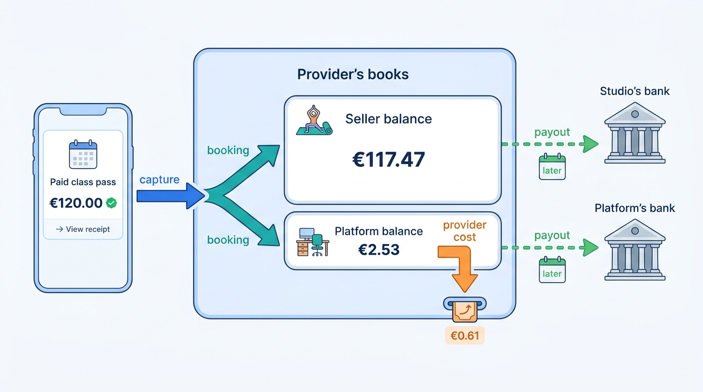
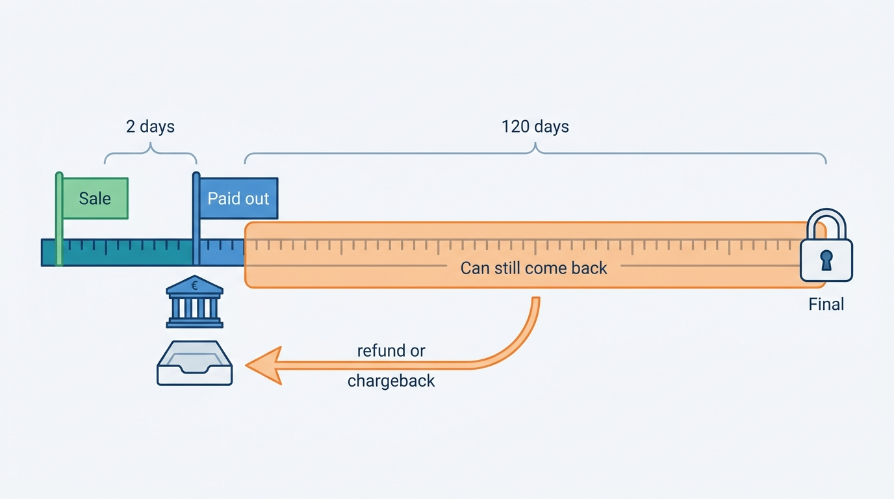
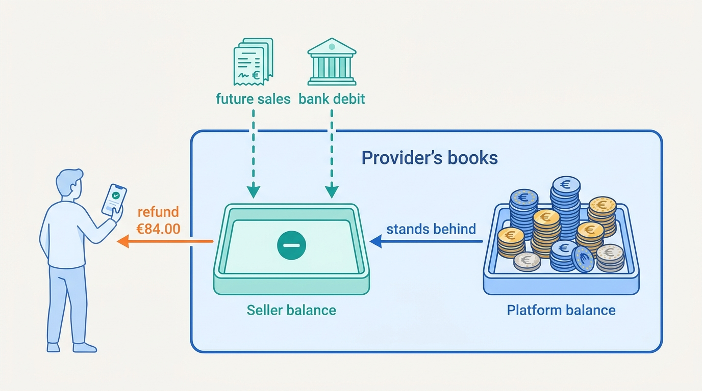

> **IN THIS CHAPTER, YOU WILL:** Follow one payment into three balances, out to a seller's bank and partly back again, and learn which records let a platform unwind it.

> **KEY POINTS:**
>
> * **A split is a set of bookings, not a calculation.** The seller's share and the platform's fee are booked to balances inside the provider, and each party is paid later from its balance. Stripe's documentation (accessed November 2026) derives the bookings from the charge type; Adyen's takes a list of typed split instructions with the payment.
> * **The split is final when the payment can no longer come back, not when the seller is paid.** Sellers are paid within days; a card payment can be disputed for about four months. A refund or chargeback after payout debits the balance the payment was booked through, and the platform recovers the seller's share itself.
> * **“Payment succeeded” does not prove “seller credited”.** Adyen documents that a split naming a missing or closed balance account is booked to the platform's own account without an error. Only a ledger entry per leg, reconciled against the provider's bookings, shows it.

> **[FAILURE PATTERNS THIS CHAPTER ADDRESSES](where-payment-systems-go-wrong.html):**
>
> * **The Orphaned Refund** — a refund reaches a seller's balance a week after the payout, and nothing ties it to the split it partly undoes.
> * **The Black-Box Balance** — the platform's "owed to sellers" figure drifts from the provider's balances because fees, refunds and recoveries were never booked leg by leg.
> * **The Phantom Payment** — the platform treats an approved payment as a credited seller, while the provider booked the whole amount somewhere else.

 
Dividing €120.00 among a studio, a software platform and a payment provider looks like one line of arithmetic: €117.47 for the studio, €2.53 for the platform, and the provider's cost taken out of the €2.53. Larkfield, the fictional studio-software platform this book follows, ran that line 31.4 million times in 2026. A year earlier, at the end of 2025, its books said it owed studios €412,000 more than its two providers were holding for them, and **€317,200 of the difference was refunds made after the studio had been paid**.

The arithmetic was right and the books were wrong because a split is not a calculation done once. It is **a set of bookings to balances inside the provider**, and those balances are emptied on a schedule. The seller is paid within days and the payment can come back for months, so the division stays provisional until the payment can no longer come back. A refund or chargeback that arrives after the payout is taken from the balance the payment was booked to. If that balance is the platform's, the platform pays and then recovers the seller's share itself.

**Where we are in the payment's journey.** Mila Janssen bought a €120.00 class pass from Studio Noord on Tuesday 9 March 2027 at 19:42. This chapter covers two moments of that payment: the one just after capture (the step that claims the approved amount), when the €120.00 becomes three bookings, and the one on 18 March, when €84.00 has to come back out of a balance that was paid out on Thursday 11 March.

The chapter starts with the refunds Larkfield never booked. It then defines a split as bookings and shows why they stay open, and reads how Stripe and Adyen each divide a payment. Refunds and chargebacks against a split payment follow, then seller balances, payout schedules and top-ups. Three places to book a split are compared, then the two providers. The chapter ends with Mila's €120 split on both providers, her €84 refund, and the ways a split goes wrong.

## Setting the Scene at Larkfield: €317,200 Nobody Had Booked

Larkfield ([[meet-larkfield]]) keeps a small ledger of what it owes its studios. At year-end 2025 that ledger's "owed to studios" balance was €412,000 higher than the balances Stripe and Adyen held for those studios. Of it, **€317,200 was refunds made after the studio had been paid**; the rest was chargeback fees and a currency-conversion rounding rule. Larkfield calls the episode the Unexplained €0.4 Million ([[payment-ledgers]]).

The cause was a missing entry. A nightly job posted to the ledger when a payment became paid and again when a payout was created. Nothing was posted when a refund reached a balance that had already been paid out. At the provider the studio's balance fell by the refund; in Larkfield's ledger the studio was still owed its full share.

When Femke de Graaf takes over payments engineering in January 2027, the audit finding gives her three questions, and they are this chapter's. Where is each euro of a payment booked? Whose balance funds a reversal that arrives after the seller was paid? And when does the money leave the provider? Her answers became part of Keel, Larkfield's 2027 program to put its payments on an even keel, whose decision K3 requires a ledger entry for every movement, refunds after payout included.

## A Split Is a Set of Bookings, and the Bookings Stay Open

A **split** is the instruction that divides one customer payment among the seller, the platform and the provider. It does so by booking each part to a **balance**: an amount the provider owes a party, kept in the provider's books ([[balances-and-funds-flows]]). The platform's part is called an **application fee** on Stripe and a **commission** on Adyen. The seller's part lands in the **seller balance**. The provider's own fee is deducted from one of the other two.

| Party | Part of Mila's €120.00 | Booked to | How it leaves the provider |
| --- | --- | --- | --- |
| Seller (Studio Noord) | €117.47 | The seller's balance | A payout to the studio's bank account |
| Platform (Larkfield) | €2.53 fee | The platform's balance | A payout to the platform's bank account |
| Provider | €0.61 processing cost *(assumption)* | Deducted from the platform's fee, leaving €1.92 | It never leaves; the provider keeps it |

Two kinds of movement carry this. A **transfer** moves money between two balances inside the provider; a **payout** moves it from a balance to a bank account outside ([[payouts-and-money-movement]]). Adyen's documentation (n.d., accessed November 2026) draws the line in the same words: an internal funds transfer "moves funds between balance accounts within your platform. For comparison: a payout is an *external* funds transfer". A split consists of transfers; each party is paid later, by a payout from its own balance.

**Figure 1:** *A split books €120.00 to two balances inside the provider, €117.47 for the seller and €2.53 for the platform, takes the provider's €0.61 from the platform's part, and pays nobody until each balance is paid out.*

The bookings look complete, and the clock says otherwise. Studio Noord is paid on Thursday 11 March, two days after the sale. Mila can ask for a refund whenever the studio agrees to one, and her bank can force the payment back through a **chargeback**, the card networks' dispute process ([[refunds-reversals-and-disputes]], which has the networks' 120-day rule and its source), until about 7 July 2027. Stripe's guidance on instant payouts for platforms (n.d., accessed November 2026) names the gap: they "deliver funds before the dispute window closes". Every payout leaves behind **exposure**: an amount that can still come back through a reversal, which in this chapter means a refund or a chargeback.

**Figure 2:** *The seller is paid two days after the sale, and the payment can come back for about 120 days: the split is final at the end of the long band, not at the payout.*

When a reversal does arrive, it debits the balance the payment was booked through. If that is the platform's balance, or if the platform stands behind a seller's balance that has gone negative, the platform has paid, and getting the seller's share back is the platform's job. That liability rule belongs to [[platform-payment-models]], and verifying the seller first to [[platform-onboarding-and-verification]]; this chapter covers the mechanics.

## Stripe: The Charge Type Decides Which Balances Move

Stripe Connect, Stripe's product for platforms, calls a seller a **connected account**. Its documentation (n.d., accessed November 2026) ties the division to one choice: "The type of charge you create determines how the funds are distributed between your platform, the connected account, and Stripe." Each of the three charge types fixes where the payment first lands, how the two shares move, and whose balance pays Stripe's fee.

| Charge type | Payment first lands in | Seller's share | Platform's fee | Stripe's fee debited from |
| --- | --- | --- | --- | --- |
| Direct charge | The connected account's balance | Already there | An application fee moved to the platform | The connected account or the platform, by account configuration |
| Destination charge | The platform's balance | "A portion of the funds immediately transfers to the connected account’s balance" | What stays on, or returns to, the platform | The platform |
| Separate charges and transfers | The platform's balance | One or more transfers the platform creates | What the platform does not transfer | The platform |

Take the direct charge first. "You create a charge on your connected account, so the payment appears in the connected account’s balance, not in your platform’s balance", and the application fee transfers to the platform. Here the provider's fee can fall on either side: "You can choose whether to have Stripe debit fees directly from connected accounts or from your platform account."

A destination charge exchanges the roles of the two balances: the payment lands on the platform. The table's "portion" is the net effect; Stripe's guide to destination charges describes two transfers, not a deduction: "the full charge amount is immediately transferred from the platform to the `transfer_data[destination]` account after the charge is captured. The `application_fee_amount` (capped at the full amount of the charge) is then transferred back to the platform." In its worked example, a 10.00 USD charge carries a 1.23 USD application fee and 0.59 USD of Stripe fees, and "The application fee amount minus the Stripe fees (1.23 USD - 0.59 USD = 0.64 USD) remains in your platform account’s balance." Adding the parameter `on_behalf_of` makes the connected account "the business of record for the payment" without changing which balances move.

With separate charges and transfers, the split is no longer one call. The platform creates a charge, then creates transfers to one or more connected accounts whenever it decides to, and "Transfer and charge amounts don’t have to match." Of the grouping field, Stripe's guide to separate charges and transfers says: "The `transfer_group` only identifies associated objects. It doesn’t affect any standard functionality." A transfer fails by default when it exceeds the platform's available balance, and "Stripe doesn’t automatically retry failed transfer requests." In this design the link between a payment and its transfers, and the check that the money exists, are **the platform's to keep**.

## Adyen: Typed Bookings Declared With the Payment

Adyen for Platforms gives each seller a **balance account** and gives the platform a **liable balance account** for its own funds. A split is a `splits` array on the payment, capture or refund request. Each item has a `type`, an amount where one is known, and an account. Adyen's page on splitting transactions (n.d., accessed November 2026) sets the default: "If you do not specify an `account` in your split instructions, the split amount is booked to your liable balance account." The same logic can live in a split configuration profile attached to a seller's store (the Adyen resource through which that seller's payments are processed), where Adyen's page on automatic splits recommends a catch-all rule because without one "any transaction that doesn't match a specific rule will be booked to your liable balance account by default."

| Split type | What it books | Amount given by the platform? |
| --- | --- | --- |
| `BalanceAccount` | "a part of the transaction to your user's balance account" | Yes |
| `Commission` | "your platform's commission to your liable balance account" | Yes |
| `PaymentFee` | "the aggregated amount of all the transaction fees" to the named account | No |
| `Interchange`, `SchemeFee` | The fee paid to the cardholder's bank; the card network's fee | No |
| `AdyenCommission`, `AdyenMarkup` | Adyen's own fee, under blended pricing or under Interchange++ (both explained below) | No |

The fee items in the table carry no amount. Under blended pricing the provider charges one all-in rate per payment; under Interchange++ pricing the bank's and the network's fees are passed through at cost with Adyen's markup on top ([[payment-economics]]), so the total is known only after the payment. Adyen's page on transaction fees says so: "Transaction fees refer to the costs you incur on a transaction in your platform that are not known at the time of payment. They are calculated by Adyen after we receive the payment request. By default, these costs are deducted from your liable balance account". The split therefore names **who bears each type of fee**, and the amount arrives as a later booking. Some costs never reach a split: processing costs "are aggregated and also applicable to refused and cancelled payments. Therefore, they cannot be allocated to individual payments."

An approved payment does not prove that the seller was credited. Adyen's split pages carry the same troubleshooting note (quoted here from the page on split chargebacks): "The API request validates only the format of the split instructions, **not** the balance accounts specified in the request. This means that even if the transaction is successful, it is possible that the funds are not credited to/deducted from the specified balance account. If the balance account does not exist, or it is linked to an account holder with a **closed** status, the full transaction and its fees are booked to your platform's liable balance account." No error is returned. A separate Adyen page on liable balance accounts names the destination more exactly, as a "reserved incorrect splits account", one of three kinds of liable balance account, and adds suspended accounts and account holders without the capability to receive funds to the cases. The records that show what was booked are the transfer webhooks, sent when funds are credited to or deducted from a balance account, and the Balance Platform Accounting Report, which "tracks all balance changes on all balance accounts in your balance platform, including liable accounts and the accounts of your users." Those are what a platform reconciles, split by split ([[payment-reconciliation-and-reporting]]).

## Refunds and Chargebacks Against a Payment Already Split

Start with a refund on Stripe. Its charges page fixes the debit by charge type, and its guide to destination charges says recovery of the seller's share is off by default: "by default the destination account keeps the funds that were transferred to it, leaving the platform account to cover the negative balance from the refund." The platform must send `reverse_transfer=true` to pull the seller's share back, and `refund_application_fee=true` if it also gives up its own fee.

| Charge type | Refund debits | Recovering the seller's share | If the debited balance is short |
| --- | --- | --- | --- |
| Direct | The connected account's balance | Not needed | Refund is `pending`; fails after 45 days with `insufficient_funds` |
| Destination | The platform's balance | "You can reverse the transfers made to your connected accounts to recover your refund cost" | Same 45-day rule, on the platform's balance |
| Separate charges and transfers | The platform's balance | Reverse the transfers, as separate calls | Same 45-day rule |

A dispute on Stripe follows the same rule. For payments created on the platform, "with or without `on_behalf_of`, your platform balance is automatically debited for the disputed amount and fee." The transfer reversal is again a separate call, and Stripe's guide to disputes on platforms leaves its timing to the platform: "If you challenge the dispute, wait for the dispute outcome before reversing the transfer." Whether to reverse and when are two decisions; the platform's fee is a third, which the guide addresses only under direct charges: "Regardless of a dispute’s outcome, Stripe doesn’t automatically refund the application fee".

On Adyen each refund carries its own split, and the platform uses it to "choose who is liable for the refund." One rule bounds the choice: "Refunds can only be deducted from the balance accounts to which the payment was credited" (Adyen's page on split refunds, n.d., accessed November 2026). A refund sent without a split falls back through the store's profile and a platform default to the capture's ratio, which applies only to a full refund of one capture: "In all other cases, such as for refunds of partial captures, we book the full refund amount to your platform's liable balance account." Adyen's page on how it applies split instructions marks this fallback logic as in pilot and not available for all platforms.

The chargeback is where the two providers differ most. On Adyen its booking is chosen **before any chargeback exists**. By default, "Adyen withdraws the disputed funds from your platform's liable balance account"; the platform "can change this behavior by booking the disputed amount to any of the balance accounts in your platform, or even splitting it between the accounts." It does so in a `platformChargebackLogic` object on the payment or capture request, with one of three behaviors: `deductFromLiableAccount`, `deductFromOneBalanceAccount` with a `targetAccount`, or `deductAccordingToSplitRatio`. A `costAllocationAccount` names who pays the chargeback fees, by default the liable balance account.

All of this assumes the debited balance can pay. When the seller's balance cannot cover its share, the platform stands behind it: by default on Adyen, and on Stripe wherever the account's settings make the platform, not Stripe, responsible for negative balances. Each provider limits recovery in its own way. On Stripe the limit is a condition on the balance: "It’s only possible to reverse a transfer if the connected account’s available balance is greater than the reversal amount or has connected reserves enabled"; a connected reserve is what Stripe holds on the platform's balance against negative balances the platform is responsible for; it is the platform reserve from which Stripe covers a seller's balance still negative after 180 days. On Adyen the limit is time. Its page on liable balance accounts (n.d., accessed November 2026) says: "Adyen allows negative balances for up to 30 days. If a balance account has a negative balance for more than 30 days, Adyen compensates this by debiting your reserved compensation account on the first day of the following month." A warning webhook can announce the debit, by default once a balance has been negative for 20 days. Adyen also documents an arrangement in which it bears the loss: Managed Risk, marked as a pilot with limited availability, under which Adyen says it will "assume the responsibility for negative balances" on users' accounts and write them off after 180 days. Two terms in the table belong to payouts, the next section's subject: Adyen settles a seller's funds **net**, subtracting a day's refunds and chargebacks from that day's sales before they reach the balance, and a **top-up** is bank money added to a balance at the provider that did not come from a customer payment. With those, the table shows the same three ways to recover on both providers under different names (netting against future sales, pulling from the seller's bank account, moving money between balances), and a fourth row for what happens when they fail: the platform pays, after 180 days on Stripe and after more than 30 days on Adyen.

| Recovery | Stripe | Adyen |
| --- | --- | --- |
| Net against future sales | "If at all possible, Stripe automatically offsets negative transactions against future payments" | Settlement is net of the day's refunds and chargebacks |
| Pull from the seller's bank account | `debit_negative_balances`, in listed countries | A top-up by direct debit from the seller's verified bank account |
| Move between balances | Transfer reversal; account debits, which require "legally binding consent" | An internal funds transfer |
| Platform pays | A reserve on the platform's balance; a transfer after 180 days | "Funds can be deducted from this account if your users' balance accounts incur negative balances due to refunds and chargebacks"; after more than 30 days, at the start of the next month |

**Figure 3:** *A refund of €84.00 after the payout meets an empty seller balance: the platform's balance stands behind it until future sales or a debit of the seller's bank account refill it.*

## Seller Balances, Payout Schedules and Top-Ups

A reversal finds a seller's balance empty because a payout schedule emptied it, which is Femke's third question: when does the money leave the provider? On Stripe each connected account has a payout `interval` (manual, daily, weekly or monthly) and a delay. Stripe's page on payout schedules (n.d., accessed November 2026) says `delay_days` "reflects how long it takes for `on_behalf_of` charges (or direct charges performed on the connected account) to become available for payout", and that it can be raised "to a number up to 31" on accounts where the platform owns fraud and dispute liability. The balance also nets reversals before anything is paid: "While an account’s balance is negative, you can’t send payouts to the account’s bank or debit card on their behalf."

On Adyen a seller's funds settle to the balance account (become available in it) per sales day after a settlement delay, the waiting period Adyen applies before a day's sales are made available. They arrive net of that day's costs, refunds and chargebacks, and the timing is Adyen's own: "Adyen settles a settlement batch after its sales day ends and the configured settlement delay has passed. The date when the schemes or payment methods transfer the funds to Adyen does not affect this timing" (Adyen's page on settling funds, n.d., accessed November 2026; [[balances-and-funds-flows]] covers the advance this implies, Adyen paying a seller before the card networks have paid Adyen). The money then leaves by a managed payout schedule, announced in an Adyen release note of 20 May 2026: Standard arrives "two business days after capture", Accelerated after one, on weekdays, weekly or monthly, with minimum, maximum and retained amounts. A platform that wants its own rules creates a **sweep** on the balance account: a schedule, a trigger amount and an amount to leave behind.

The two providers scope top-ups differently. On Stripe a top-up funds the platform: "Platforms can add funds to their balance from a bank account", with "General availability" listed for "USA, UK, Japan" and "Private preview" for "EU, Canada, Australia, New Zealand" as of November 2026. On Adyen it can fund a seller: "A top-up refers to an incoming transfer of funds from an external source that increases the balance in their balance account", with the first use case "To cover negative balances resulting from refunds or chargebacks", and "If needed, you can also top up your liable balance account."

A seller whose bank account is in another country is restricted on both. Stripe's page on cross-border payouts (n.d., accessed November 2026) says "Platforms based in the US, UK, EEA, Canada, or Switzerland can transfer funds to connected accounts in any of those regions", and only for destination charges and separate charges and transfers without `on_behalf_of`, or top-ups and transfers. On Adyen "You must have a separate balance platform for each region in which you acquire payments", and managed payout schedules cover "local payouts (within the same country and currency)" only. The rest go by custom payouts, whose page says cross-border payouts may pass through correspondent banks, so that "The arrival time of the payout cannot be guaranteed". For this chapter the point is the schedule: a seller paid across a border waits longer and less predictably, while the dispute window runs the same. Which countries and currencies are open changes on both providers, so check both pages before designing for one.

## Three Places to Book the Split, and What Each Costs

The first design is **seller-first booking**: the payment lands in the seller's balance and only the platform's fee moves. Reversals debit the seller first, and the platform is exposed only when that balance goes negative. On Stripe this is the direct charge ("Refunds and chargebacks reduce the connected account’s balance"). On Adyen it is a split to the seller's balance account with the chargeback logic `deductFromOneBalanceAccount`.

The second is **platform-first booking**: the payment lands in the platform's balance and the seller's share moves out. Every reversal debits the platform, and recovery is a second step that can fail. This is Stripe's destination charge ("Refunds and chargebacks reduce your platform’s balance") and Adyen's default chargeback booking to the liable balance account. The platform fronts every reversal and controls the refund.

The third is **collect, then distribute**: the payment stays on the platform until the platform decides who gets what. It handles a basket from several sellers or a seller not yet chosen, and it makes the platform's own records the only link between a payment and its transfers. On Stripe this is separate charges and transfers, which Stripe tells platforms to "Use … only if your business use case requires them" and recommends "only when you’re responsible for negative balances of your connected accounts." On Adyen the nearest forms are a split at capture and internal transfers afterwards.

| Design | A reversal debits first | The platform must record | Fits | Main risk |
| --- | --- | --- | --- | --- |
| Seller-first | The seller's balance | Its fee per payment; the seller's negative balance | Software platforms whose sellers own the customer | A seller that stops selling leaves a negative balance |
| Platform-first | The platform's balance | Every transfer, so a refund can reverse it | Marketplaces that are the face of the sale | The platform fronts all reversals and recovers afterwards |
| Collect, then distribute | The platform's balance | The link from each payment to each transfer, and what is still owed | Several sellers per payment; late allocation | Paying out money owed to sellers, or transferring twice |

Who the customer understands they are buying from decides who the merchant is, and the booking must agree with that ([[platform-payment-models]]). Within what that allows, the rule I use is to book to the party that should bear the first loss, and to choose the third design only when a payment really has several recipients.

## Stripe and Adyen: Where They Differ

The three designs exist on both providers; what differs is how each is built and what it leaves the platform to record. The table sets this chapter's documented facts side by side; the last column is my reading and is inference. All cells come from the documentation cited above, accessed in November 2026.

| Aspect | Stripe | Adyen | What the difference suggests |
| --- | --- | --- | --- |
| How a payment is divided | By charge type: an application fee, or transfers created afterwards | By a `splits` array of typed bookings on the payment or capture, or a store's profile | Stripe's split is a set of movements between balances; Adyen's is a set of bookings declared with the payment |
| When the provider's fee is known | Deducted from the balance named by charge type and account configuration; reported in the `fee` field of the balance transaction | "not known at the time of payment"; booked by fee type, by default to the liable balance account | On Adyen the split assigns a fee to a party; it cannot state the amount |
| Refund after payout | Debits the balance fixed by the charge type; transfer reversal on request | Debits the accounts named in the refund's split, "only … the balance accounts to which the payment was credited" | Stripe decides at integration, Adyen at each refund |
| Chargeback booking | Follows the charge type; reversal is a separate call at dispute time | Set in `platformChargebackLogic` when the payment is sent; default is the liable balance account | Adyen asks for the decision before the event, Stripe after it |
| A split that cannot be booked as sent | A transfer that cannot be made, for example for lack of available balance, fails with an error and is not retried | Booked to the liable balance account without an error | On Adyen only reconciliation detects it |
| Basis of payout timing | Availability per charge plus `delay_days`, up to 31 where the platform bears losses | Sales-day batches after a settlement delay, independent of when the networks pay Adyen | Both let the platform slow payouts; Adyen states that it runs on its own clock |

On Stripe, choose the charge type knowing it fixes who is debited by every later refund and dispute, send `reverse_transfer` deliberately, and look every day for transfers that failed and refunds still pending. On Adyen, set the chargeback logic on every payment or as a platform default, send a split with every partial refund, and reconcile bookings per split, because an accepted request is not evidence of a credit. Each company has published a general account of its internal ledger ([[payment-ledgers]]); how either books a platform's splits and transfers in it is not public (engineering posts and documentation, November 2026).

## In Practice at Larkfield: Mila's €120 Split Three Ways, Then €84 Back

Studio Noord is on Adyen. For Mila's pass, Larkfield's payment service sends two split items: `BalanceAccount` for 11747 minor units to Studio Noord's balance account, and `Commission` for 253. It names no fee item, so the fees fall on Larkfield's liable balance account, which keeps €1.92 after an illustrative €0.61 of processing cost *(assumption)*. It also sends a chargeback logic of `deductFromOneBalanceAccount`, with the studio's balance account as the target and as the cost allocation account. Under K3 the ledger records each leg under the payment's reference at Adyen and Larkfield's own event id.

| Leg (9 March) | Debit | Credit | Amount |
| --- | --- | --- | --- |
| Studio's share | Funds at provider | Owed to Studio Noord | €117.47 |
| Larkfield's fee | Funds at provider | Fees owed to Larkfield | €2.53 |
| Provider's cost, when reported | Fees owed to Larkfield | Funds at provider | €0.61 *(assumption)* |

Had Studio Noord been on Stripe, like the studios Larkfield onboarded before 2024, the same division would be a destination charge of €120.00 with `on_behalf_of` set to the studio and an `application_fee_amount` of 253. The full €120.00 would transfer to the studio's balance and €2.53 would come back. The provider's cost would be a different, single figure: at Larkfield's blended rate of 0.6% + €0.15 *(assumption)*, €0.87, read from the balance transaction.

| | Studio Noord | Larkfield's fee | Provider's cost | Larkfield keeps |
| --- | --- | --- | --- | --- |
| On Adyen (as it happened) | €117.47 | €2.53 | €0.61 *(assumption)*, calculated after the payment | €1.92 |
| On Stripe (had it been) | €117.47 | €2.53 | €0.87 *(assumption)*, one fee per payment | €1.66 |

On Thursday 11 March, two days after the sale, the payout moves €117.47 out of Studio Noord's balance account toward the bank account of Ines Bakker, the studio's owner. Larkfield's ledger moves the amount to "payouts in transit" and keeps it there for ten business days, its window for a returned payout *(assumption)*; with no return, it marks the payout arrived and closes the debt on 25 March ([[payouts-and-money-movement]]). From 11 March the €117.47 is exposure, money paid out that can still be reversed.

On 18 March Mila asks for €84.00 back for seven unused classes. By Larkfield's policy *(illustrative)* the studio funds a refund and Larkfield keeps its fee, so the refund goes to Adyen with one split item: `BalanceAccount`, 8400, Studio Noord's balance account. That account now holds €212.40 of sales made since *(assumption)*, which cover the debit, and the studio's next payout is smaller by €84.00. This is the ordinary case, and it is the one that was invisible in 2025. The entry that makes it visible is keyed to the original payment (first row below). Had Studio Noord stopped selling, its balance account would stand at −€84.00 with Larkfield's liable balance account behind it, and "to recover from studio" would hold the debt until a top-up or new sales cleared it (second row).

| Event (18 March) | Debit | Credit | Amount |
| --- | --- | --- | --- |
| Refund, balance covers it | Owed to Studio Noord | Funds at provider | €84.00 |
| Refund, balance empty | To recover from Studio Noord | Funds at provider | €84.00 |

On Stripe the same refund would start on Larkfield's side, and Larkfield would have to handle two outcomes and book the same recovery entry for both. A refund of €84.00 on the destination charge debits Larkfield's platform balance. Sent with `reverse_transfer=true`, it reverses "a proportional amount of the transfer": by my reading 70% of the €120.00 transferred, which is €84.00, while the application fee stays with Larkfield unless it says otherwise. Whether that reversal can fail is where the pages leave a gap. If the studio's balance is short, Stripe's charges page says: "If the refund request also attempts a transfer reversal, but the connected account has an insufficient balance, the refund request returns an error instead of creating a refund with `pending` status." The guide to separate charges and transfers excepts accounts with connected reserves from the balance condition, and by my reading Larkfield's studios are such accounts, because Larkfield bears their losses; the pages do not say which rule governs a reversal sent with a refund. So where the reversal goes through, the studio's balance turns negative; where the call returns the error, Larkfield refunds without the reversal.

That leaves the open half of every payment summed for one studio, Larkfield's per-studio exposure figure. It is the card volume paid out within the last 120 days, less the refunds and disputes already booked against it. For a studio taking €16,000 a month online by card *(assumption)*, that is about four months of sales, roughly €64,000. Across Larkfield the same sum is about €156 million. It measures what can come back, not what will; direct debits have their own windows ([[local-payment-methods]]). A studio whose exposure is large against its weekly sales is one whose balance may not cover its refunds.

## When It Goes Wrong

The €317,200 was the Orphaned Refund: refunds after payout that no entry tied to their splits. Four related failures remain. The first, the Phantom Payment, happens at the split and raises no error at the payment. On Adyen a split that names a closed or mistyped balance account is booked in full to the liable balance account; Adyen's remedy is an internal transfer: "To correct the balances, you can transfer the funds between the balance accounts". On Stripe a transfer can fail for lack of available funds, and "Stripe doesn’t automatically retry failures … You must explicitly attempt the transfer again." Detection is the same on both: compare the legs you intended with the legs the provider booked.

Next, a refund can be accepted and still not reach the customer. On Stripe a refund against a short balance waits as `pending`, and "If your platform’s balance is still insufficient 45 days after you create the refund, the refund fails with a `failure_reason` of `insufficient_funds`." On Adyen, "You get the outcome of the refund request asynchronously, in a REFUND webhook." A refund is a state to follow until it is final ([[payment-webhooks-and-events]]).

Then there is the dispute recovered too early. A platform that reverses the seller's transfer the day a chargeback arrives must send the money back if the dispute is won. Stripe warns that this "can have unexpected results", the first being: "If your platform has an insufficient balance, the transfer fails." On Adyen a chargeback reversal (the chargeback undone when the dispute is won) and a second chargeback (the cardholder's bank disputing again) are booked by the logic set on the payment.

The last failure is only time passing. A seller's negative balance that nobody ages becomes the platform's loss by default. Stripe gives the date: "if a connected account’s balance remains negative for 180 days, we transfer funds from the platform reserve to cover the negative amount." Adyen's is shorter: a balance account that has been negative for more than 30 days is compensated from the platform's liable account at the start of the next month. Both dates move the debt onto the platform's balance; neither collects it from the seller. So the platform ages the debt itself; a recovery account nobody ages is one way into the Black-Box Balance. At Larkfield the "to recover from studio" account is a clearing account that must return to zero; an item open more than five business days goes to the weekly review of Priya Raman, the finance controller, and I would add a written rule for when a debt is written off.

## What to Take Away

**Established.**

- A split is a set of bookings to balances inside the provider. Stripe derives them from the charge type; Adyen takes them as typed instructions with the payment (both as documented, November 2026).
- A refund or chargeback debits the balance the payment was booked through. On Stripe, charges made on the platform debit the platform "with or without `on_behalf_of`"; on Adyen the default for a chargeback is the liable balance account.
- On Adyen the provider's fees are calculated after the payment, and a split naming a missing or closed balance account is booked to the liable balance account without an error.

**Depends on context.**

- Which design to use. Seller-first fits a software platform whose sellers are the merchants; platform-first fits a marketplace; collect-then-distribute only where a payment has several recipients.
- How long to delay payouts. A longer delay shrinks exposure and costs sellers cash flow; it is worth more where refunds are frequent or sellers are new.
- Whether the platform returns its fee on a refund, and when it recovers from the seller during a dispute: commercial decisions to take before the first case.

**The author's synthesis.**

- The charge type, the splits list, the chargeback logic and the payout schedule answer one question in advance: when money comes back, which balance pays first, and how fast was it emptied? Most platforms set all four for other reasons.
- Larkfield's €317,200 was never lost. It was a set of debits to balances already paid out, for which Larkfield wrote no entry. A leg-by-leg ledger and a reconciliation per studio would have shown each one on the day it happened.

## Questions to Ask

1. For one payment, can we list every leg (seller's share, our fee, provider's cost, payout) with the provider's reference for each?
2. Which balance does a refund debit first on each provider we use, and is that the result of a decision or of a default?
3. On Adyen, what chargeback logic do our payments carry, and who chose it?
4. When a refund or chargeback meets an empty seller balance, which account in our ledger holds the debt, and who ages it?
5. Do we keep our fee when a payment is refunded, and do sellers know?
6. What is each seller's exposure today, and what payout delay follows from it?
7. How would we notice a payment whose seller's share was booked to our own balance?
8. Which refunds and transfers are pending or failed right now, and who looks?

The seller balance in this chapter exists only between the split and the payout: the schedule empties it as fast as the platform allows. The next chapter asks what a platform can offer when that money stays in the balance, is spent from it, or is advanced against it — an account, a card, financing — and what each demands of the provider's license and of the platform: [[embedded-finance]].

## Sources and Evidence

*Company, product and investor sources*

- [Understand how charges work in a Connect integration](https://docs.stripe.com/connect/charges), Stripe documentation, n.d., accessed 2026-11 — charge types, who pays Stripe's fee, refunds and disputes by charge type, the 45-day pending refund, `on_behalf_of`.
- [Create destination charges](https://docs.stripe.com/connect/destination-charges), Stripe documentation, n.d., accessed 2026-11 — the application fee flow and worked example, `reverse_transfer`, `refund_application_fee`.
- [Create separate charges and transfers](https://docs.stripe.com/connect/separate-charges-and-transfers), Stripe documentation, n.d., accessed 2026-11 — `transfer_group`, `source_transaction`, failed transfers, when a transfer can be reversed.
- [Disputes on Connect platforms](https://docs.stripe.com/connect/disputes), Stripe documentation, n.d., accessed 2026-11 — timing of the transfer reversal during a dispute.
- [Fee behavior on connected accounts](https://docs.stripe.com/connect/direct-charges-fee-payer-behavior), Stripe documentation, n.d., accessed 2026-11 — who pays Stripe's fees on direct charges, by account configuration; the application fee is not refunded automatically after a dispute.
- [Understanding Connect account balances](https://docs.stripe.com/connect/account-balances), Stripe documentation, n.d., accessed 2026-11 — offsetting negative transactions, whether Stripe or the platform is responsible for a negative balance, connected reserves, no payouts while negative, `debit_negative_balances`, no automatic retry of transfers.
- [Risk and liability management with Connect](https://docs.stripe.com/connect/risk-management), Stripe documentation, n.d., accessed 2026-11 — the platform reserve and the transfer after 180 days.
- [Debit connected accounts](https://docs.stripe.com/connect/account-debits), Stripe documentation, n.d., accessed 2026-11 — account debits and the consent they require.
- [Manage payout schedule](https://docs.stripe.com/connect/manage-payout-schedule), Stripe documentation, n.d., accessed 2026-11 — interval, `delay_days` and its override up to 31.
- [Add funds to your platform balance](https://docs.stripe.com/connect/top-ups), Stripe documentation, n.d., accessed 2026-11 — top-ups and their availability (volatile).
- [Connect cross-border payouts](https://docs.stripe.com/connect/connect-cross-border-payouts), Stripe documentation, n.d., accessed 2026-11 — regions and supported funds flows (volatile).
- [Instant Payouts for Connect](https://docs.stripe.com/connect/instant-payouts), Stripe documentation, n.d., accessed 2026-11 — payouts made before the dispute window closes.
- [The Balance Transaction object](https://docs.stripe.com/api/balance_transactions/object), Stripe API reference, n.d., accessed 2026-11 — the `fee` and `fee_details` fields that report Stripe's fee per transaction.
- [Split specific transactions between balance accounts](https://docs.adyen.com/platforms/online-payments/split-transactions), Adyen documentation, n.d., accessed 2026-11 — the `splits` array, split types, the default to the liable balance account.
- [Transaction fees](https://docs.adyen.com/platforms/online-payments/transaction-fees), Adyen documentation, n.d., accessed 2026-11 — fees calculated after the payment; costs that cannot be allocated.
- [Split refunds](https://docs.adyen.com/platforms/online-payments/split-transactions/split-refunds), Adyen documentation, n.d., accessed 2026-11 — refund splits, the credited-accounts rule, the asynchronous outcome.
- [Split chargebacks](https://docs.adyen.com/platforms/online-payments/split-transactions/split-chargebacks), Adyen documentation, n.d., accessed 2026-11 — default chargeback booking, `platformChargebackLogic`, the format-only validation.
- [How Adyen applies split instructions](https://docs.adyen.com/platforms/how-adyen-applies-split-instructions), Adyen documentation, n.d., accessed 2026-11 — fallback for refunds without a split (pilot).
- [Split payments automatically](https://docs.adyen.com/platforms/automatic-split-configuration), Adyen documentation, n.d., accessed 2026-11 — profiles, the catch-all rule.
- [Account structure](https://docs.adyen.com/platforms/account-structure-resources), Adyen documentation, n.d., accessed 2026-11 — the liable balance account; one balance platform per region.
- [Manage liable balance accounts](https://docs.adyen.com/platforms/manage-liable-accounts), Adyen documentation, n.d., accessed 2026-11 — negative balances allowed for up to 30 days, then compensated from the reserved compensation account; the reserved incorrect splits account.
- [Verify balances](https://docs.adyen.com/platforms/reconciliation-use-cases/verify-balances), Adyen documentation, n.d., accessed 2026-11 — the same 30-day rule stated for the liable account; the warning webhook after 20 days.
- [Adyen Managed Risk](https://docs.adyen.com/platforms/managed-risk), Adyen documentation, n.d., accessed 2026-11 — the pilot in which Adyen assumes responsibility for users' negative balances and writes them off after 180 days.
- [Settle funds](https://docs.adyen.com/platforms/settle-funds), Adyen documentation, n.d., accessed 2026-11 — sales day settlement, net settlement, the settlement delay.
- [Managed payouts](https://docs.adyen.com/platforms/managed-payouts), Adyen documentation, n.d., accessed 2026-11 — Standard and Accelerated schedules, local payouts only.
- [Platforms and financial products (release notes)](https://docs.adyen.com/release-notes/platforms-and-financial-products), Adyen, entry of 20 May 2026 — managed payout schedules announced.
- [Configure custom payout schedules](https://docs.adyen.com/platforms/custom-payouts/scheduled-payouts), Adyen documentation, n.d., accessed 2026-11 — sweeps.
- [Custom payouts](https://docs.adyen.com/platforms/custom-payouts), Adyen documentation, n.d., accessed 2026-11 — local and cross-border payouts and the limits of the latter.
- [Transfer funds internally](https://docs.adyen.com/platforms/internal-fund-transfers), Adyen documentation, n.d., accessed 2026-11 — internal transfer versus payout.
- [Top up balance accounts](https://docs.adyen.com/platforms/top-up-balance-account), Adyen documentation, n.d., accessed 2026-11 — top-ups for user and liable balance accounts.
- [Balance Platform Accounting Report](https://docs.adyen.com/platforms/reports-and-fees/balance-platform-accounting-report), Adyen documentation, n.d., accessed 2026-11 — the report of all balance changes.

*Standards, regulation and official documentation*

- None.

*Research and practitioner sources*

- None.

Larkfield is fictional; architectural recommendations, labeled inferences and labeled assumptions are the author's judgement.
