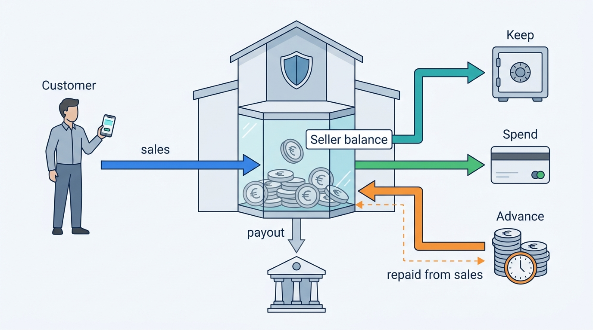
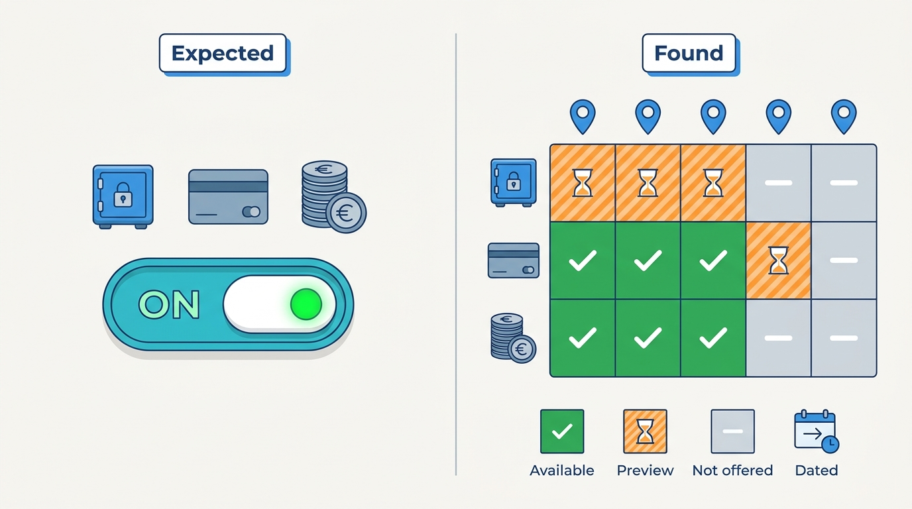

> **IN THIS CHAPTER, YOU WILL:** Learn what an account, a card or financing for your sellers requires of the provider's license and of your platform, and what was available in November 2026.

> **KEY POINTS:**
>
> * **A license stands behind each product, and it does not do your work.** Adyen states that its own banking licenses back its accounts, cards and financing; Stripe states that it is not a bank and names partner banks and lenders. Fraud controls, authentication and support stay with the platform.
> * **Issuing puts you in the card authorization path.** Both providers give your server two seconds to approve or decline each purchase. After that, a default you configured decides.
> * **There is no switch.** As of November 2026, accounts for a platform's sellers are in preview at Stripe and in development at Adyen. Cards and financing exist in named countries only, and Stripe offers accounts and cards only to platforms that bear their sellers' losses.

> **[FAILURE PATTERNS THIS CHAPTER ADDRESSES](where-payment-systems-go-wrong.html):**
>
> * **The Accidental Bank** — a platform that lets sellers keep, spend or borrow money takes on duties of a financial product without having decided to.
> * **The Frozen Seller** — accounts and cards add verification requirements for every seller, each with a deadline that can switch a capability off.

 
At 19:42 on Tuesday 9 March 2027, €117.47 of Mila Janssen's €120.00 class pass is booked to Studio Noord's balance at the provider. Studio Noord's bank shows it on Thursday. A product manager asks the obvious question: why can the studio not have a card that spends that balance on Tuesday night? The money is already there, the provider holds the license, and by the provider's own description the card comes with the same integration.

The card is not one more endpoint. **A licensed institution stands behind each of these products, and its license covers the product, not the platform's operating duties.** And in November 2026 **neither Stripe nor Adyen offers the three products as a switch**: availability differs by product, by country and by release stage.

**Where we are in the payment's journey.** This chapter sits between the split and the payout: the two days in which €117.47 is in Studio Noord's balance ([[splits-balances-and-platform-payouts]]). It asks what changes if that money is kept, spent or advanced instead of paid out. On 18 March Mila asks for €84.00 back; the chapter returns to that refund.

The chapter starts with a card proposal at Larkfield, the fictional studio-software platform this book follows ([[meet-larkfield]]). It then defines the three products built on a seller balance and the license behind each, and shows card issuing from the issuer's side. Next come what each provider offered in November 2026, and the two side by side. It ends with Larkfield's decision and the close of [[part-7]].

## Setting the Scene at Larkfield: A Card for Tuesday's Sales

In May 2027 Larkfield's product team proposed an **instant-payout card** for studios. Studio owners had asked for it: on 10 March Ines Bakker, who owns Studio Noord, had wanted to know why Tuesday's sales were not in her bank account. Sofie Vermeer, the chief executive, asked for an autumn launch in all five markets. That is not one decision: Dutch and German studios onboarded since 2024 are on Adyen, while the United Kingdom, the United States, Belgium and 1,140 older Dutch and German studios are on Stripe.

Femke de Graaf, who leads payments engineering, gave no date. She replaced the proposal with five questions, because a launch date depends on answers Larkfield does not control. Each has a different answer per provider and per country, and the sections below follow them in order:

1. Which licensed institution issues the card and holds the balance?
2. Who answers each card authorization, and what happens when nobody does?
3. In which countries is each product offered, and at which release stage?
4. Does Larkfield's account model qualify?
5. What more must each studio prove?

## Keep, Spend, Advance: Three Products and the License Behind Each

The first question needs vocabulary. **Banking-as-a-service** means a licensed institution's accounts, cards or loans offered through another company's software. On a platform it arrives as three products, each doing one thing with the seller balance. A **financial account** keeps it: Stripe's documentation (n.d., accessed November 2026) says financial accounts "receive your settled Stripe earnings, hold funds, and support capabilities such as physical or virtual cards", and Adyen's business account (n.d.) lets a seller be paid out into it instead of into a bank account elsewhere. **Card issuing** spends it. On Adyen, "Creating a payment instrument issues a card", and a balance account, which holds a seller's funds, "can have one or more payment instruments that can deduct funds from it" (Adyen Issuing, n.d.). On Stripe, a card draws on a balance attached to the seller's account (How Issuing works, n.d.). **Embedded lending** advances money against future sales. Adyen's sellers "repay daily based on a fixed percentage of their processed volume through Adyen" (Adyen Capital, n.d.), and Stripe "withholds a fixed percentage of each transaction until the complete balance is repaid" (Capital for platforms, n.d.). Each product acts on the balance and the payment flow the platform already runs. The table and figure set them side by side; the last column is my reading.

| Product | What the seller can do | The regulated act | What the platform must now run |
| --- | --- | --- | --- |
| Financial account | Keep sales at the provider; send and receive transfers | Holding a customer's money and executing its payments | Authentication for outgoing transfers, fraud controls, statements |
| Issued card | Spend the balance wherever the card network is accepted | Issuing a card and approving each use | Spending rules, an authorization endpoint or a default, cardholder support |
| Financing | Receive an advance, repaid as a share of future sales | Lending, or buying future receivables | Showing the provider's offers; explaining smaller payouts during repayment |

**Figure 1:** *Three products on one balance: an account keeps it, a card spends it, and financing advances money that is repaid from later sales.*

Who performs the regulated act differs between the two companies. Adyen's H1 2026 shareholder letter says: "We also capture post-transaction value through our embedded financial products, enabled by our banking licenses. By offering native business accounts, card issuing, and capital within a single integration..." Its documentation speaks of "business financing offers from Adyen" (Adyen for Platforms, n.d.): Adyen is the lender. Stripe's Treasury page (n.d.) says the opposite about itself: "Stripe is not a bank. Checking accounts are provided exclusively by Fifth Third Bank, National Association, Member FDIC" (the FDIC is the US deposit insurer). For cards it partners "with multiple trusted banks". US loans come from "Celtic Bank or Lead Bank", and other financing from outside lenders: Fundbox in Australia and Canada; YouLend in Germany, France and the United Kingdom, and for US cash advances. One company puts its own licenses behind three products; the other assembles each from partners that change with the country. [[licences-and-safeguarding]] explains the licenses themselves.

Neither arrangement takes the operating work off the platform. The license covers the regulated act only. Stripe's partner bank holds the deposit, yet "Treasury platforms must maintain a fraud risk management process that includes proactive measures to prevent and monitor unauthorized or fraudulent activity" (Treasury for platforms requirements, n.d.). Adyen is the bank, yet its Issuing page says "You will always be the point of contact for your users", and a platform offering business accounts must "Implement Adyen's Authentication SDK to comply with the PSD2 regulations for online transactions" (business accounts, Get started, n.d.). PSD2, the EU's second Payment Services Directive (2015), requires strong customer authentication ([[three-d-secure-and-sca]]).

## Card Issuing From the Issuer's Side: Two Seconds to Answer

One of those duties is new in kind. In [[payment-authorization]] your system sent an authorization request and an **issuer** answered: the licensed institution that gives someone a card and approves or declines each use. With an issued card the roles are reversed. A studio owner taps the card at a wholesaler, and the request travels through the card network to the issuer, which is your provider. The provider checks first (authorization pages, n.d.). On Stripe, "If your Issuing balance has insufficient funds for the incoming authorization, the authorization will be denied and your webhook endpoint won't receive the `issuing_authorization.request` event"; stored spending controls can block merchant categories or countries. On Adyen, internal checks cover "The available balance in your account", then stored transaction rules approve or decline automatically. Only then, if you configured it, does the provider ask your server: Stripe "sends it to your configured endpoint for your approval", and Adyen "sends a webhook to your server", which it calls relayed authorisation. On both, your server comes last, as the figure below shows.

**Figure 2:** *With an issued card the platform's server is asked last and has 2 seconds; when it gives no answer, the default it configured decides.*

Your server then has about two seconds. Stripe: "If Stripe doesn't receive your approve or decline response within 2 seconds, the `Authorization` is automatically approved or declined based on your timeout settings, or Autopilot settings, if configured" (real-time authorizations, n.d.). Adyen: "Your server has up to 2000 milliseconds to respond. If we do not receive a response within this timeframe, we apply your default fallback" (payment authorisation, n.d.). As requirements for your endpoint:

| Requirement | Stripe | Adyen |
| --- | --- | --- |
| How fast | 2 seconds | 2,000 milliseconds |
| No answer in time | Approved or declined by your timeout settings | "Default approval" or "Default refusal" |
| Error response | Recorded as `webhook_error`; the outcome without Autopilot (public preview) is not stated | HTTP 4xx or 5xx: the default fallback applies |
| When you are not asked | Issuing balance too low: denied without the event | Adyen's checks or a transaction rule already refused |

The default therefore applies whenever your endpoint is slow or unreachable, and you decided the outcome of those purchases on the day you set it. Approve by default, and during your outage the cards spend money you may have to cover. Decline by default, and a studio owner stands at a till with a card that fails because your server is down. I choose the default per group of cards, give the endpoint its own availability target ([[payment-reliability-and-availability]]) and keep as many decisions as possible in rules stored at the provider, which do not need my server. Monitor the provider's record, not your own logs: on Stripe, when an authorization's `request_history.reason` is `webhook_error` or `webhook_timeout`, "Stripe isn't receiving your responses".

## What Was Available in November 2026, and at Which Stage

Femke's last three questions are about whether the products can be had at all. Providers release products in stages. Stripe's release-phases page (n.d.) defines **general availability** (feature-complete), **public preview** (open to all, may change) and **private preview** (by invitation); Adyen's pages say pilot and **in development** and define neither. On 17 November 2026 accounts for a platform's sellers were generally available at neither provider. Stripe's requirements page says: "Treasury for platforms is in public preview for platforms and connected accounts in the UK" (connected accounts: Stripe's term for sellers' accounts) and "in private preview for platforms and connected accounts in the US, AU, and the EU". Its overview page lists 21 EU countries, Australia, the United States and Canada, which the requirements page omits. Access goes through sales. The older US-only version is marked "Don't build a new v1 integration" (legacy page, n.d.). Adyen's business-accounts page opens: "This feature is in development phase. Some of the APIs, documentation, and processes may change as the feature evolves." A platform starting today builds on an interface that may still change.

Cards and financing were further along, yet bounded by country and stage. The rows below, from the providers' documentation as of 17 November 2026, do not line up by country: financing reaches Germany on Stripe and not on Adyen, and the Netherlands on Adyen and not on Stripe.

| Product | Stripe | Adyen |
| --- | --- | --- |
| Business cards | Available in 24 countries: US, Canada, UK and 21 in the European Economic Area (EEA). Consumer cards (US): private preview. Cards backed by stablecoins (tokens pegged to a currency): public preview | Supported in the EEA, the UK and the US; debit cards for organizations and sole proprietors |
| Financing | Australia, Canada, Germany, France, UK, US, through partner lenders. US line of credit: private preview | Finland, France, Netherlands, Spain, Sweden, UK, Canada (not Saskatchewan), US, Australia; "invite-only"; repeat grants "in a pilot phase" |

Where a product exists, each provider attaches conditions, and this answers Femke's fourth and fifth questions. Stripe ties accounts and cards to the loss assignment of [[platform-payment-models]]: where Stripe is responsible for a seller's negative balances, "Your platform can't use Stripe Treasury or Issuing" (risk management, n.d.), and "Issuing only supports connected accounts that don't use a Stripe-hosted Dashboard, and where your platform is responsible for requirements collection and loss liability" (Issuing with Connect, n.d.). The same page calls "Enabling Issuing on non-custom connected accounts" a new feature, available on request. The Adyen pages read state no such loss condition; there the platform's own account at Adyen, the liable balance account, already stands behind its sellers. Its conditions are that business accounts be "enabled for your balance platform" (the platform's set of accounts at Adyen), and that sellers prove more: source of funds, a tax classification, "A live selfie photo" and photo ID for each signatory for an account; a value-added tax (VAT) number or tax ID and source of funds for a card. Each is a new requirement with a deadline ([[platform-onboarding-and-verification]]).

The public record stops there. Neither company gives a date for general availability of its account product. Their own pages disagree in places. Adyen's product page lists 20 eurozone countries, the United Kingdom and the United States for business accounts, while its verification page lists "BE, DE, ES, FR, GB, NL and US"; I cannot tell which is current. Stripe's two Treasury pages differ on Canada. Its documentation counts 24 issuing countries, while its annual letter of February 2026, nine months older, said "our Issuing product is available in only 22 countries some 7 years after launch". Every documentation page is undated. Read this section as a snapshot of 17 November 2026, and check each cell again before a plan relies on it. The figure below shows the shape of the answer.

**Figure 3:** *Accounts, cards and financing are not one switch: each product has its own answer per country and release stage, and every answer carries a date.*

## Stripe and Adyen: Where They Differ

The Stripe and Adyen columns restate facts cited above, as of November 2026; the last column is my inference throughout.

| Aspect | Stripe | Adyen | What the difference suggests |
| --- | --- | --- | --- |
| License behind the products | "Not a bank"; a partner bank for US deposits, partner banks for cards and US loans, outside lenders elsewhere (n.d.) | Its own banking licenses; Adyen is the lender (H1 2026 letter; n.d.) | Stripe's reach per country depends on a partner; Adyen's on where its license extends |
| Accounts for a platform's sellers | Public preview in the UK; private preview in the US, Australia, the EU and, on one page, Canada; legacy US version closed to new builds (n.d.) | "In development phase" (n.d.) | No material difference: neither is generally available |
| Business cards | 24 countries; consumer and stablecoin programs in preview (n.d.) | EEA, UK, US; business debit cards (n.d.) | Similar footprint; Stripe is adding program types |
| Time to answer an authorization | 2 seconds, then timeout settings (n.d.) | 2,000 milliseconds, then default fallback (n.d.) | No material difference in the public record |
| Financing | Six countries; lender varies by country (n.d.) | Nine countries; invite-only; Adyen lends (n.d.) | More product variety on Stripe; one product on Adyen |
| Condition on the platform | Bears seller losses, collects requirements, no Stripe-hosted dashboard; other account types on request (n.d.) | Enabled per balance platform; added seller verification (n.d.) | Stripe gates on the account model; Adyen on each seller |

On Stripe, check the configuration of your connected accounts first, because an account model chosen years ago can rule out cards today; then ask which partner stands behind each product in each country. On Adyen, ask your Adyen contact what is enabled for your balance platform and at which stage, because the public pages do not say when that changes. [[stripe-and-adyen-bets-compared]] sets the two license strategies against each other.

## In Practice at Larkfield: Why the Card Waits

Femke's team answered the five questions per provider and per market. On Stripe, Larkfield's studios are Custom connected accounts with no Stripe dashboard, for which Larkfield collects verification data and bears losses ([[platform-payment-models]]), so all three of Stripe's conditions are met. A business card is therefore possible, as documented, in all five markets. But it would be two card programs: two issuers, two authorization endpoints with different fallbacks, and two ways of funding the card.

| Studios | A card, as documented | Funded from | An account product |
| --- | --- | --- | --- |
| Netherlands and Germany on Adyen (2,610) | Adyen Issuing, supported in the EEA | A balance account of the studio | In development |
| Netherlands and Germany still on Stripe (1,140) | Stripe Issuing, offered in both countries | An Issuing balance, filled from the studio's Stripe balance or by bank top-up (How Issuing works, n.d.) | Private preview |
| Belgium, UK and US on Stripe (2,450) | Stripe Issuing, offered in all three | The same | Public preview in the UK; private elsewhere |

What decided the matter was the refund this part opened with. Today Mila's €117.47 leaves Studio Noord's balance on 11 March, and her €84.00 refund on 18 March finds whatever later sales have put there. With the card, the €117.47 could at the earliest be spent on the evening of 9 March; how soon a sale becomes spendable is one more point to confirm with each provider. The card does not create the exposure; it removes, for every payment, the two days in which the balance could still absorb a reversal, and what the balance cannot absorb falls on Larkfield, which bears its studios' losses ([[platform-payment-models]]). Adyen (n.d.) says of the platform's liable balance account: "Funds can be deducted from this account if your users' balance accounts incur negative balances due to refunds and chargebacks" (a chargeback is a card payment reversed by the cardholder's bank). Stripe's says the same of early payouts: "When platforms and marketplaces are liable for losses, you're liable for uncovered negative balances due to refunds or disputes on instantly paid out funds." About €156 million of Larkfield's paid-out online card volume is inside the dispute window, the roughly 120 days in which a cardholder can still dispute a payment, at any time ([[refunds-reversals-and-disputes]]). A card raises it for every studio that uses one, and Larkfield has set no limit on it per studio ([[splits-balances-and-platform-payouts]] defines the per-studio figure).

In June 2027 Larkfield decided not to launch the card yet. Studios had asked for money sooner, and a faster payout answers that with no card program and no authorization endpoint: Stripe's Instant Payouts (n.d.) "typically settle in the associated debit card or bank account within 30 minutes", and an Adyen payout can request an instant route where the studio's bank supports one (on-demand payouts page, n.d.; [[payouts-and-money-movement]]). It carries the same exposure, so it too waits for the first of four conditions. Larkfield returns to the card when every studio's exposure figure has a limit and an owner; when it has decided between two card programs and one on Adyen only, for 2,610 of its 6,200 studios; when an account product is generally available in the Netherlands and Germany, or Larkfield has decided to fund cards from the balance account alone; and when the authorization endpoint has an availability target, an owner and a chosen default. "Not yet" is the result of the assessment.

## What to Take Away

**Established.**

- Each product rests on a licensed institution the provider names: Adyen's own banking licenses (H1 2026 letter); for Stripe, which "is not a bank", partner banks and lenders that change with the country.
- A platform that relays card authorizations has 2 seconds on Stripe and 2,000 milliseconds on Adyen; then a default it configured applies.
- Stripe documents that a platform may offer accounts and cards only if it bears its sellers' losses.

**Depends on context.**

- Whether you can launch depends on the country and the release stage on the day you check; in November 2026 accounts for sellers were in preview or in development.
- Whether your account model qualifies depends on decisions made at onboarding; on Stripe a hosted dashboard rules out cards unless Stripe grants an exception.

**The author's synthesis.**

- I treat each of these products as a financial product my platform operates, whoever holds the license: the card for Tuesday's sales is an authorization service, a fraud process and a larger exposure before it is a feature.
- I plan per product, per country and per stage, with a date on every fact, and I count a reasoned "not yet" as a result.

Seen from here, [[part-7]] described one decision four times. Who stands behind a seller's negative balance decided who the provider lets collect verification data ([[platform-onboarding-and-verification]]), where a refund after payout is booked ([[splits-balances-and-platform-payouts]]), and, in this chapter, whether accounts and cards may be offered at all. A platform that picks its account model for the look of its onboarding has picked its loss exposure, its workload and the limit of its product plan with it. Mila's €84.00 shows it. On Adyen the refund is deducted from Studio Noord's balance account, with Larkfield's liable balance account behind it. Had the studio been on Stripe, with the payment made through the platform, it would debit Larkfield's platform balance, and recovering the studio's share would be Larkfield's job. That was settled long before she asked. So write down, per provider, who is the merchant, who bears negative balances, who collects requirements and where reversals after payout are booked; give every seller requirement an owner; and track exposure per seller. A platform that cannot do this carries a liability it has not measured, and a product that keeps, spends or lends seller money enlarges it.

## Questions to Ask

1. For each product and each country, which licensed institution holds the balance, issues the card or lends?
2. At which release stage is the product in that country today, and what is the date of that information?
3. Does our account model qualify: who bears seller losses, who collects requirements, which dashboard do sellers use?
4. What more must each seller prove, and who owns the new deadlines?
5. Who answers a card authorization, within what time, and what is the default when we do not?
6. Which spending decisions can be rules stored at the provider instead of calls to our server?
7. How much sooner does the product let seller money leave the balance, and what does that do to our exposure per seller?
8. If we build on a preview, what do we do when the interface changes?

From [[part-2]] through [[part-7]], each mechanism was described for one payment at a time, ending with the account model. [[part-8]] puts the same mechanisms under conditions no single payment shows: a dependency that fails, data that outgrows one database, a law on where data may live, a month of renewals in six hours, and constant change.

## Sources and Evidence

*Company, product and investor sources*

- [H1 2026 Shareholder Letter](https://investors.adyen.com/financials/h1-2026-c2a1a), Adyen, 2026-08-13 — embedded financial products "enabled by our banking licenses"; accounts and loans in its statements (46-page PDF linked from the page).
- [Stripe's 2025 annual letter](https://stripe.com/annual-updates/2025), Patrick and John Collison, 2026-02-24 — Issuing "available in only 22 countries".
- [Treasury](https://docs.stripe.com/treasury.md), Stripe documentation, n.d., accessed 2026-11 — financial accounts; "Stripe is not a bank"; the partner bank for deposits (volatile).
- [Treasury for platforms](https://docs.stripe.com/treasury/connect.md) and [its requirements](https://docs.stripe.com/treasury/connect/requirements.md), Stripe documentation, n.d., accessed 2026-11 — preview stages by country (the two pages differ on Canada), access through sales, the fraud-management duty (volatile).
- [Treasury for platforms, legacy version](https://docs.stripe.com/treasury/connect/legacy/v1.md) and [its requirements](https://docs.stripe.com/treasury/connect/legacy/v1/requirements.md), Stripe documentation, n.d., accessed 2026-11 — "Don't build a new v1 integration"; United States only.
- [Issuing](https://docs.stripe.com/issuing.md), [How Issuing works](https://docs.stripe.com/issuing/how-issuing-works.md) and [Issuing in different countries](https://docs.stripe.com/issuing/global.md), Stripe documentation, n.d., accessed 2026-11 — countries, program stages, the Issuing balance, partner banks (volatile).
- [Issuing with Connect](https://docs.stripe.com/issuing/connect.md), Stripe documentation, n.d., accessed 2026-11 — the conditions on connected accounts; Issuing on non-Custom accounts as a new feature on request.
- [Real-time authorizations](https://docs.stripe.com/issuing/controls/real-time-authorizations.md) and [Spending controls](https://docs.stripe.com/issuing/controls/spending-controls.md), Stripe documentation, n.d., accessed 2026-11 — the 2-second window, timeout settings, Autopilot (public preview), the balance check, monitoring by reason.
- [How Capital for platforms works](https://docs.stripe.com/capital/how-capital-for-platforms-works.md), Stripe documentation, n.d., accessed 2026-11 — countries, lenders per country, repayment by withholding (volatile).
- [Product release phases](https://docs.stripe.com/release-phases.md), Stripe documentation, n.d., accessed 2026-11 — what private preview, public preview and general availability mean at Stripe.
- [Risk and liability management with Connect](https://docs.stripe.com/connect/risk-management.md), Stripe documentation, n.d., accessed 2026-11 — no Treasury or Issuing where Stripe bears negative balances.
- [Instant Payouts for Connect](https://docs.stripe.com/connect/instant-payouts.md), Stripe documentation, n.d., accessed 2026-11 — arrival within 30 minutes; the platform's liability for instantly paid out funds.
- [Business accounts](https://docs.adyen.com/business-accounts.md) and [Get started](https://docs.adyen.com/business-accounts/get-started.md), Adyen documentation, n.d., accessed 2026-11 — "in development phase", the country list (20 eurozone countries, the UK, the US), enabling per balance platform, the Authentication SDK (volatile).
- [Adyen Issuing](https://docs.adyen.com/issuing.md), [Authorisation](https://docs.adyen.com/issuing/authorisation.md) and [Relayed authorisation](https://docs.adyen.com/issuing/authorisation/relayed-authorisation.md), Adyen documentation, n.d., accessed 2026-11 — regions, payment instruments, the platform as point of contact, the order of checks, the 2,000-millisecond window and fallback.
- [Capital](https://docs.adyen.com/capital.md) and [How Capital works](https://docs.adyen.com/capital/how-capital-works.md), Adyen documentation, n.d., accessed 2026-11 — countries, repayment from processed volume, repeat grants in pilot (volatile).
- [Adyen for Platforms](https://docs.adyen.com/platforms.md), [Verification requirements](https://docs.adyen.com/platforms/verification-requirements.md) and [Account structure](https://docs.adyen.com/platforms/account-structure-resources.md), Adyen documentation, n.d., accessed 2026-11 — financing "from Adyen", added verification per product, a second and shorter country list for business accounts, "invite-only", the liable balance account.
- [Initiate on-demand payouts](https://docs.adyen.com/platforms/custom-payouts/on-demand-payouts.md), Adyen documentation, n.d., accessed 2026-11 — the instant transfer priority, which some banks do not support.

*Standards, regulation and official documentation*

- [Directive (EU) 2015/2366 on payment services (PSD2)](http://publications.europa.eu/resource/celex/32015L2366), Official Journal, 2015-12-23 — Article 97, strong customer authentication (evidence age: 11 years; in force, replacement pending).

*Research and practitioner sources*

- None.

Larkfield is fictional; architectural recommendations, labeled inferences and labeled assumptions are the author's judgement.
