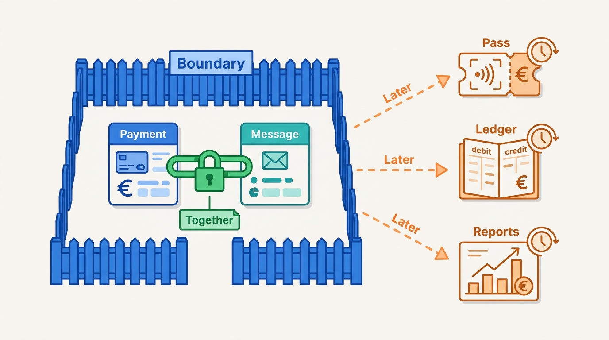
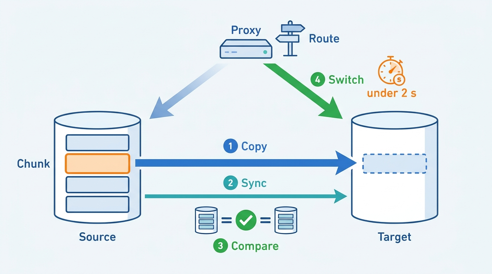
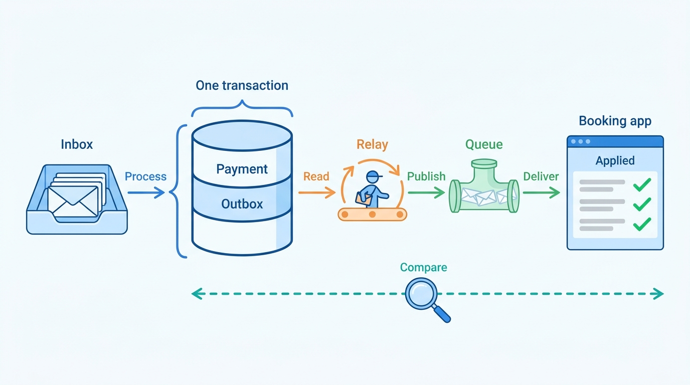

> **IN THIS CHAPTER, YOU WILL:** Learn what Stripe and Adyen have published about their databases, where that record stops, and how to keep two systems consistent without one transaction across both.

> **KEY POINTS:**
>
> * **Draw the boundary before you pick the database.** Stripe scaled a document database (MongoDB Community behind its DocDB platform; 2024) and Adyen a relational one (PostgreSQL; 2018 to 2025). What matters for money is which records change together in one local transaction, and what is allowed to catch up.
> * **In what either has published, no transaction spans the shards.** Stripe moves data between shards with a pause under two seconds that retries absorb, and verifies its ledger afterwards (2024). Adyen fills accounting clusters in rotation, had not built rebalancing, and aligns them with “back and forth messages” (2021). That both rely on repeatable operations and later verification is my inference; which data is replicated synchronously, read consistency and the cross-cluster protocol are not public.
> * **The small-scale version is an outbox.** Write the state change and a row describing the message in one local transaction, let a relay deliver the row at least once, make the consumer ignore repeats, and run a comparison that proves both sides agree.

> **[FAILURE PATTERNS THIS CHAPTER ADDRESSES](where-payment-systems-go-wrong.html):**
>
> * **The Phantom Payment** — a payment marked paid in one system and unknown to the next leaves two records that disagree about the same money.
> * **The Double Charge** — every message that crosses a consistency boundary (the records that change together in one local transaction) can arrive twice, so its effect has to be safe to repeat.
> * **The Borrowed Blueprint** — a 2,000-shard document store or a set of accounting clusters is an answer to a size problem most teams do not have.

 
In 2023 Stripe moved 1.5 petabytes of data from one set of database shards (separate databases that each hold a slice of the same data) to another, while payments kept running. Its 2024 engineering post describes the last step of each move: for a moment, every read and write on the data being moved is rejected. “The entire traffic switch protocol takes less than two seconds to execute, and all failed reads and writes directed to the source shard succeed on retries.” **A platform whose promise is never to lose a cent chose to say no for two seconds.**

The previous chapter explains why that is not a contradiction. [[payment-reliability-and-availability]] separated the path that must answer from the record that must be right: the record may lag, and it may not be wrong. That split has a consequence, which is this chapter's subject. The record has to be kept right on its own terms, in databases that have themselves been divided many times over, and no single transaction covers all of them.

So how is it kept right? Stripe scaled a document database and Adyen a relational one, and **in what either has published no transaction spans the shards**. The published mechanisms point to something more modest: small local transactions, retries that are safe to repeat, messages between stores, and verification afterwards. That these four are how both keep money right is my inference, and the chapter marks it as one. If it holds, the database product matters less for money than **where the consistency boundary is drawn**: the line around the records that change together in one local transaction, and what has to cross it.

**Where we are in the payment's journey.** Mila Janssen's ten-class pass for €120.00 is approved by her bank at 19:42 on Tuesday 9 March 2027. A moment later Larkfield's own record of the payment becomes `paid`, and her pass has to become usable in a different system. This chapter covers that write, and the stores under every later write for the same payment: Larkfield's, and the provider's own databases behind its API.

The chapter starts at Larkfield with a pass that was paid and not activated. It then asks which payment data has to be exact, and what splitting a database into shards keeps and breaks. It reports what Stripe and then Adyen have published, compares the two, and states what both records imply. It ends with the same design at small scale, the outbox, applied to Larkfield's payment record store, with a change to that store's shape made while it runs, and with the ways the design fails.

## Setting the Scene at Larkfield: Paid, and Not Activated

At Larkfield, the fictional studio-software platform this book follows ([[meet-larkfield]]), no consistency boundary had been drawn at all between a payment and what it pays for. Its payment record store is a PostgreSQL database that holds one row per payment, fed by provider webhooks that are first saved in an inbox table ([[payment-webhooks-and-events]]). Before Keel, Larkfield's 2027 program of eight decisions (K1 to K8) that puts its payments in order, the code that processed an inbox message did two things in a row: it committed `paid` to the payment row, and then it called the booking app to activate the pass or membership. Nothing joined the two steps. If the call failed after the commit, nothing tried again. In 2026 that happened to **146 purchases** *(illustrative)*: the member had paid, the record said so, and the app showed nothing until the member wrote to support.

In February 2027 Tom Hendriks, the engineer who built the payment service, proposed the repair most engineers reach for first. Put a message queue between the two systems, and wrap the database write and the publish in **one distributed transaction**, so that either both happen or neither does.

Femke de Graaf, Larkfield's head of payments engineering, replaced the proposal with three questions. **Which records must change together? What is allowed to catch up later? Which check proves afterwards that both sides agree?** Keel already asks the third question of the providers: decision K2 confirms every state against the provider's own record, and K3, a ledger entry for every movement, requires the ledger's clearing accounts, accounts that should return to zero once a flow completes, to return to zero. Her point was that the same discipline applies between Larkfield's own systems.

## What Has to Be Exact: Consistency Boundaries by Kind of Data

The first two questions have a general answer: the data on a money path does not all need the same treatment. Adyen said so in a 2021 engineering post when it compared its payment-accepting edge (“the latter” in the quotation) with its books: “Whereas for the latter the priority was uptime, for the accounting systems we don't mind if they are down for a little bit as long as we can guarantee their reliability and consistency.” **(Evidence age: 5 years; the current system may differ.)** Stripe's 2024 engineering post on its ledger measures verification in days: “99.99% of our dollar volume is fully ingested and verified within four days”. And by Adyen's 2024 post on table partitioning, heavy reporting queries ran against “an aggregated (and summarized) version of the original data from all shards” (the separate databases a large one is split into, described below) in a separate database. The record of a payment must be exact when it is written. Balances shown to people, reports and analytics may run behind, as long as they say so. The table below puts this in a merchant's terms; it is my reference version for a merchant's system such as Larkfield's, not a provider's design.

| Data | Must be exact | May lag by | If its store is unavailable |
| --- | --- | --- | --- |
| Idempotency-key record ([[idempotency-and-retries]]) | Before the request is sent | Nothing | Do not send |
| Payment state and the message that announces it | At commit, together | Nothing | Leave the event in the inbox and retry |
| Ledger entries ([[payment-ledgers]]) | When written; complete once the provider's report is in | Hours to days | Post later; never estimate |
| Balance shown to a studio | Never ahead of the ledger | Minutes to hours, shown with its time | Show the last known value and its time |
| Reports and analytics | Not a system of record | Hours to a day | Wait |

The line between the first two rows and the rest has a name. A **consistency boundary** is the set of records that change together in one local transaction, or not at all. A local transaction is the one atomic mechanism you get without a protocol between separate systems, so in practice a boundary is no larger than one database. Everything outside it is reached by a call or a message that can fail on its own, and is allowed to catch up later.

**Figure 1:** *A consistency boundary is small: the payment row and the row that announces it change together, and everything outside catches up later.*

Why not make the boundary larger, as Tom proposed? A transaction stretched across two systems is commonly avoided for three reasons. Both systems must be up for either to commit, so the path is less available than its weakest part. A participant that fails midway leaves the others holding locks while they wait. And many databases and queues do not support the protocol at all, two-phase commit (2PC), in which every participant first prepares and then all commit together: a widely used practitioner description of the problem, Chris Richardson's pattern page on microservices.io (n.d., accessed November 2026), puts it flatly: “it is not viable to use a traditional distributed transaction (2PC) that spans the database and the message broker”. Payments add a fourth reason, and it is the decisive one. The most important participant, the provider or the bank behind it, offers no transaction to join. An authorization is a message to the cardholder's bank, and neither provider documents a prepare-and-commit step your database could enroll in.

## When One Database Is Not Enough: What a Shard Keeps and What It Breaks

A boundary of one database is comfortable until the data no longer fits in one database. Then it is split. A **shard** is one of many databases that each hold a slice of the same kind of data. Both companies use the word this way. Stripe's 2019 root cause analysis of an outage says: “Stripe splits data by kind into different database clusters and by quantity into different shards. Each cluster has many shards, and each shard has multiple redundant nodes.” **(Evidence age: 7 years; the current system may differ.)** Adyen's 2024 post says “sharding splits a large database into smaller, more manageable shards”. Inside a shard a transaction works as before. Across shards, three things stop being free: a transaction, a query over all the data, and moving data to even out the load, called rebalancing.

Which operations stay inside one shard depends on the **shard key**, the rule that decides where a record goes. No rule keeps everything local. Adyen's 2021 account (evidence age: 5 years) explains why it rejected placement by merchant or by payment method: “every rule we considered would bring its own problems. For example, if we would put each processing merchant in one database, you still need to go to every shard when you need aggregate data to send to our payment method partners.” The realistic choices trade one kind of locality for another.

| Placement | Stays in one transaction | Crosses shards | Rebalancing | Fits when |
| --- | --- | --- | --- | --- |
| By business entity (merchant, account) | Everything about one entity | Totals across entities; transfers between entities | Needed: entities grow unevenly | Most operations concern one entity |
| By rotation or hash | One record and its children | Anything about one entity's total, such as its balance | Avoidable: new data goes where there is room | Writes are many and small; totals can be assembled later |
| By time or by kind of data | One period or one kind | Anything that spans periods or kinds | Old shards stop growing | Data ages out, or kinds rarely meet |

The trade can also be avoided by not sharding the money at all, and two published contrasts do that. Square's 2019 engineering account of Books, its accounting service, bought consistency from a managed distributed database: “we picked Google Cloud Spanner. It is a fully managed, globally distributed SQL database which let us not worry about sharding”. **(Evidence age: 7 years; the current system may differ.)** And the documentation of TigerBeetle (n.d., accessed November 2026), a database built only for debits and credits, argues against sharding money at all: “Unfortunately, business transactions don't shard well.” The first is one company's production account and the second a vendor's design argument. Stripe and Adyen both sharded, and the next two sections report what that cost them.

## What Stripe Has Published: A Document Database and a Platform That Moves Data

The first published account of living with those costs is Stripe's, in the 2024 post quoted at the start of this chapter. “Stripe's DocDB is an extension of MongoDB Community—a popular open-source database—and consists of a set of services that we built in-house. It serves over five million queries per second from Stripe's product applications.” The choice was made early and for a plain reason: “When Stripe launched in 2011, we chose MongoDB as our online database because it offered better developer productivity than standard relational databases.” By 2024 the data was “petabytes of important financial data that lives in 5,000+ collections distributed over 2,000+ database shards”. Applications reach the shards through proxy servers “developed in-house in Go”, which find the right shard through “a chunk metadata service that maps chunks to database shards”; a chunk is a slice of a collection's data that is placed, and moved, as one unit. Each shard is a replica set with “a primary node and several secondary nodes with replication and automated failover”. A 2026 Stripe engineering post confirms the store and the order of magnitude: “A MongoDB shard—one of 2,000 that collectively processed $1.9 trillion in payments in 2025”.

That map from chunks to shards is what makes it possible to move a chunk while it is in use, and the 2024 post describes the Data Movement Platform that does it in six steps: registration, bulk import, asynchronous replication, a correctness check, the traffic switch and deregistration. The check is made “by comparing point-in-time snapshots” of the source and the target. Only the switch is visible to an application. It rests on what Stripe calls versioned gating, a version number attached to each chunk's route: “We added a custom patch to MongoDB that allows a shard to enforce that the version token number it receives on requests from the proxy servers is newer than the version token number it knows of”. In short, a shard refuses requests that carry an older version. The platform raises the version on the source shard, and from then “all reads and writes on the chunk on the source shard are rejected”. It waits for outstanding writes to replicate, and then points the route at the target. This is the two-second step from the opening of this chapter.

**Figure 2:** *An online move as Stripe described it in 2024: copy, keep in sync, compare, then switch the route, with reads and writes on the chunk rejected for under 2 seconds.*

What the move gives up is therefore availability, for one chunk, for a time Stripe chose on purpose. The post says the pause was kept “shorter than the duration of a planned database primary failover—typically lasting a few seconds, and in line with the retry budget of our product applications”. What it does not give up is the data. The copy is compared before the switch, and the version check exists so that the source shard stops serving the chunk once the route has moved. The post stops short of one thing: it does not say who retries, or how a retried write is made safe. A conference talk by one of its authors (QCon San Francisco, November 2025; transcript published by InfoQ in 2026) answers the first half. The shard's “stale version error” is “forwarded back to the client application”, and the retry happens in some cases in the proxy and otherwise in the database client: “we also have an SDK on top of MongoDB, which is used to talk to the proxy servers, and we have retry logic even there”.

> **INFERENCE, NOT DOCUMENTED:** A design in which rejected writes “succeed on retries” works only if the callers' writes can be repeated without doing the work twice. I read the post as implying that Stripe's product applications are written that way. Stripe does not say so: the 2025 talk places the retry in its database client and proxy, and says nothing about what the applications above them do.

Stripe has published a second kind of move, the one Larkfield's own migration follows at the end of this chapter. Moving data between shards is one kind of **online migration**: changing where or how live data is stored while the system keeps serving requests. Stripe's 2017 engineering post describes the other kind, changing the shape of the data, as a “4 step dual writing pattern”: “Dual writing to the existing and new tables to keep them in sync”, “Changing all read paths in our codebase to read from the new table”, “Changing all write paths in our codebase to only write to the new table”, and “Removing old data that relies on the outdated data model”. The example moved “hundreds of millions of Subscriptions objects”, and reads from the old and the new store were compared in production with a library, GitHub's Scientist, before any switch. The habit is the same as in the shard move: copy, compare, then switch. **(Evidence age: 9 years; the current system may differ.)** The 2024 post covers a different problem and does not replace this one; whether the same tooling is used today is not public.

Stripe has also published a comparison that never stops running. Its 2024 post on Ledger describes “an immutable and auditable log” built “as a trustworthy system of record for all of our financial data”. “Each day, Ledger sees five billion events and 99.99% of our dollar volume is fully ingested and verified within four days.” An error shows up as money stuck in a clearing account, an account that should return to zero once a flow completes, and is found with a query the post gives as “Find the clearing Accounts with nonzero balance.” [[payment-ledgers]] covers the design. Here it matters that the published check comes after the writes, which is why I call it detection: it finds an error after it happened, where prevention would stop it being written. The post names no storage engine for Ledger.

The record stops short of what a consistency argument would most like to know. No first-party source I found says which data lives outside DocDB: whether the ledger, the stored card data or the idempotency keys are held there. None gives transaction boundaries across collections, the consistency of a read, the number of replicas that must acknowledge a write, or whether replication is synchronous. The 2026 post mentions “quorum writes” only when it explains what a MongoDB node's voting right controls; it does not give Stripe's setting. The 2024 database post does not contain the word “transaction”. The nearest Stripe comes to describing money moving between its own accounts is an April 2026 post on fee credits: a transfer between Stripe's internal financial accounts follows “a three-phase lifecycle through the ledger: submitted → prepared → disbursed”. It does not say where the accounts are stored or whether a transfer crosses shards. For Stripe, the rest is **not public**: not found in its documentation, support site or engineering posts as of November 2026.

## What Adyen Has Published: PostgreSQL, Accounting Clusters and Partitions

Adyen started from the opposite kind of store. Its 2018 engineering post says PostgreSQL was chosen because “having a transactional database was key as it ensures we don't lose track of records”, and gives the shape of a cluster: “Our PostgreSQL database clusters consist of one primary and at least three replica servers, spread over multiple data centers.” The figures it gave then were “5,000+ PostgreSQL transactions per second across multiple clusters” and a largest cluster of “74 terabytes”. **(Evidence age: 8 years; the current system may differ.)** Later posts supersede the sizes: “transactional databases of hundreds of terabytes” in 2021, and “Some of our tables are already over 20TB in size” in 2023. **(Evidence age: 5 and 3 years; the current sizes may differ.)** The one-primary shape is not restated in any newer post.

By 2021 the accounting data had outgrown one database. That year's account says “about 50 rows have to be inserted into the accounting database” over the lifetime of one payment. “Now we have several accounting databases, or clusters, processing side-by-side.” The shard key is deliberately not a business key: Adyen “eventually decided to go for a simple round-robin strategy with some parameters we can adjust”, that is, new work goes to the clusters in rotation. The stated gain is freedom of routing: “At the moment we can just add a new cluster whenever we need more capacity or remove one from the routing when we see strange behavior we want to investigate.” Rebalancing, the post adds, “has not been implemented yet for this setup”. **(Evidence age: 5 years; the current system may differ.)** No newer Adyen account of the accounting system was found. The nearest is a remark by an Adyen database engineer on a podcast panel in June 2024, in the show's published transcript: “at the moment we are actually reaching the limits of our sharding solution again. So we basically start redesigning the entire system again.” He gave no details and did not say which databases he meant.

The cost of that key falls on any operation that needs one account's money in one place. Adyen's example is a payout, the transfer of a merchant's balance to its bank account: “This needs to come from one account. However, because you processed these transactions on different clusters, the money needs to be transferred from one cluster to the other in order to end up in the same account. To do this without compromising on the strict correctness requirement was quite difficult. In the end, we created several jobs and processes that use back and forth messages between the clusters to keep everything aligned.” The post calls the migration “quite painful”. As I read it, sharding the books replaced what one database could do in one transaction with messages. The post does not describe them, but any such message can fail or arrive twice, so, by my reading, each must be safe to apply twice and must be checked afterwards, the two needs this chapter returns to below.

Two published mechanisms keep the books right despite the split. The first works at write time: “The only way to add new records to the accounting system is by means of templates”, and the templates are verified so that “if at any time, we sum up all the records in the accounting system, the result will always be 0”. The second is the hand-off from the edge. The acceptance layer at Adyen's edge, PAL, “saves the payment in a local database and a separate process picks it up when possible. This process will run behind if we have doubt about whether we can guarantee consistency in the accounting or if an accounting database is not available but that will not impact the availability of the PAL itself.” And if the layer crashes, “no payments are lost because the queue is stored in a database and not in memory”. That is a state change and a pending message kept in one local database, with a separate process to deliver it: the shape this chapter later calls an outbox, though Adyen does not use the word. (The series expands PAL as “Payments Acceptance Layer” in part one and “Payment Processing Layer” in part two.)

The same edge holds one more store, and it serves the other half of keeping money right: recognizing a repeated request. For API idempotency at its stateless edge, part one of the 2021 series says: “The information needs to be available locally, so we eventually decided on integrating Cockroach, a distributed database, with our PALs.” No later Adyen publication that I could find says whether this is still so. **(Evidence age: 5 years; the current system may differ.)** The one later account is a secondary source: a customer story by the database's vendor, Cockroach Labs, of February 2023, since removed from its site and read in an archived copy. It names the product CockroachDB, dates the move from PostgreSQL to 2019, and says the store holds the key a client provides and the response to that request.

Adyen's newer posts are about a different division. A **partition** is a slice of one table inside one database, so a transaction still covers all of it. “As a rule of thumb, we partition tables that might exceed the size of 100GB”, the 2023 post says, and a 2024 post in the same series gives the constraint on every maintenance task: “In most cases, it is not possible to lock the table for more than a few seconds.” The 2025 post in the series records a near miss: “I still have nightmares about incident number 2016. We were preparing for one of the most critical seasons for our merchants – December shopping– when the CPU unexpectedly spiked.” (“2016” is an incident number, not a year.) Adding one more partition would have overloaded one of its most critical databases. So dividing data inside one database keeps the transaction whole, but it still has an operational cost, and on a critical store that cost came close to an outage.

For Adyen the record stops at the protocol. The number of accounting clusters, how a transfer between clusters is made atomic, whether rebalancing now exists, which data is replicated synchronously, and how long a failover takes are **not public**. On replication there is one remark, from the same 2024 podcast panel: asked whether Adyen's replicas were asynchronous only or also semi-synchronous or quorum commit, the engineer answered “We have both.”

## Stripe and Adyen: Where They Differ

Seven aspects of the two records can be set side by side, all cited above. The last column is my reading of each difference, an inference and not a statement by either company.

| Aspect | Stripe | Adyen | What the difference suggests |
| --- | --- | --- | --- |
| Primary online store | MongoDB Community behind an in-house platform, DocDB (2024, 2026) | PostgreSQL (2018 to 2025) | Each started from a different kind of store and built what its choice lacked |
| How data is placed and scaled | 2,000+ shards; chunks mapped by a metadata service and moved online (2024) | Several accounting clusters filled in rotation; rebalancing “has not been implemented yet” (2021) | Stripe invested in moving data; Adyen in not needing to |
| What gives way | Reads and writes on a moving chunk are rejected for under two seconds and “succeed on retries” (2024) | Accounting “will run behind” while the edge queues payments in a local database (2021) | Both let availability or freshness give way, never the record |
| Where money correctness is checked | Ledger verifies after the fact; 99.99% of dollar volume within four days (2024) | Templates verified so that all records sum to zero, at write time (2021) | Detection at Stripe, prevention at Adyen, as far as each has published; each may also do the other |
| Moving money across shards | Not public; a transfer between internal accounts passes “submitted → prepared → disbursed” in the ledger (2026), shards not mentioned | “back and forth messages between the clusters”; the protocol is not public (2021) | Only Adyen has said that sharding broke a transaction |
| Replication and read consistency | Replica sets with a primary and several secondaries (2024); mode and read consistency not public | One primary and at least three replicas across data centers (2018); asynchronous and synchronous replicas both in use, by an engineer's podcast remark (2024); which data uses which not public | No material difference in the public record |
| Published scale | Over five million queries per second; petabytes (2024) | 5,000+ transactions per second (2018); hundreds of terabytes (2021) | Not comparable: different years and different units |

For an integrator, little of this shows at the API. On both providers a brief refusal is answered by sending the same request again under the same idempotency key, the key by which a provider recognizes a repeat ([[idempotency-and-retries]]), and the books are confirmed from the provider's later record: the object or the report on Stripe, the settlement report (the provider's file of what it actually settled) on Adyen ([[payment-reconciliation-and-reporting]]). The difference matters more to a team designing its own stores. Stripe's design takes a platform team that builds proxies, a chunk map and a migration system; Adyen's took rewriting accounting logic that had assumed one database, and adding jobs that exchange messages between clusters. A team with one PostgreSQL database needs neither. **What is worth copying is the constraint each company accepted, not its database.**

## What Both Records Imply: No Transaction Spans the Money Path

Neither column of the table describes a transaction that covers more than one shard or cluster, not even in the row on moving money across shards, and no post of either company mentions one. In its place the two records contain four things. There are small local writes. There are retries: Stripe's switch works because rejected requests “succeed on retries”. There are messages between stores: Adyen's clusters are fed from a database queue and aligned by “back and forth messages”. And there is a check, afterwards at Stripe and at write time at Adyen. From this I conclude that both companies keep money consistent without a global transaction.

> **INFERENCE, NOT DOCUMENTED:** Neither Stripe nor Adyen states that it uses no transaction spanning its money path, and neither describes how its stores stay aligned in enough detail to prove it. The conclusion that both rely on local transactions, repeatable operations, messages and later verification is my reading of the mechanisms they have published.

The first idea this reading depends on is how an effect comes to happen exactly once when its message may arrive several times. The receiver records, in the same local transaction as the effect, that it has applied this message; a repeat finds the record and changes nothing. It is the idempotency key again, applied between two internal stores instead of between a merchant and a provider. Neither Stripe nor Adyen states the principle for its internals. Uber did, in a 2018 engineering account of its payments platform, listing among its design goals “exactly-once payment processing by the means of idempotency and strong consistency”. **(Evidence age: 8 years; the current system may differ.)**

The second idea is the limit of the first. Idempotency makes a repeat harmless. It cannot notice a message that was never sent. Only a comparison made afterwards can do that, and both companies describe one: Stripe's clearing accounts that must return to zero, and Adyen's matching of partner reports, which the same 2021 account says became after sharding “a two-step framework that would first parse a file and then split it into the relevant parts for each cluster”. A merchant's version is reconciliation against the provider's reports. A design with the retries and without the comparison is unfinished.

## The Same Design at Small Scale: A Local Transaction, an Outbox and an Idempotent Consumer

For a team with one database and one other system to inform, those four parts have a common name. An **outbox** is a table in the same database as the business data. The state change and a row describing the message are written in one local transaction, so there is never one without the other. A separate process, the relay, reads the rows and publishes them, repeating until each is acknowledged. The practitioner description cited earlier states the requirement as “The command must atomically update the database and send messages”, and the outbox meets it without any protocol between the database and the queue.

**Figure 3:** *The outbox design: the payment row and the outbox row are written in one transaction, a relay publishes the row until it is acknowledged, the consumer ignores repeats, and a comparison checks both ends.*

The outbox is one of four ways to connect a state change to a message. The others are writing and then publishing, which is what Larkfield had; a distributed transaction, which is what Tom proposed; and change data capture, in which a process reads the database's own log of writes and turns it into messages. Stripe documented the last at its scale in 2024: “We transport the oplog from every DocDB shard to Kafka”, where the oplog is the database's log of operations. The four differ in what a crash between the two steps leaves behind.

| Design | If a process dies between the steps | What it requires | Right when |
| --- | --- | --- | --- |
| Write, then publish | A state change with no message, silently | Nothing | Losing the message costs nothing |
| Distributed transaction | Participants blocked until the coordinator recovers | A database and a queue that both support it, and both up | Rarely on a money path |
| Outbox with a relay | A row waiting to be published; delivery is late | One extra table, a relay, a consumer that ignores repeats | One database, a few consumers |
| Change data capture | Log entries waiting to be read; delivery is late | A platform that reads the log; consumers that ignore repeats | Many consumers, or a team that already runs such a platform |

Choosing the outbox moves the problem to two places. The consumer must expect each message more than once, because the relay repeats, and out of order, because relays usually run in parallel. Recording applied message identifiers answers the first, and a state machine that ignores backward moves answers the second ([[payment-state-machines]]). The other place is between the systems: a bug that changes state without writing an outbox row is invisible to relay and consumer alike, and only a periodic comparison finds it.

## In Practice at Larkfield: The Payment Record Store and Its Outbox

Femke's three questions led Larkfield to an outbox in place of Tom's distributed transaction, and it has been live since 1 March 2027. Take Mila's pass. At 19:42 on 9 March, Adyen's notification that the €120.00 payment was approved lands in the inbox table. One local transaction then does three things: it marks the inbox message processed, moves the payment row to `paid`, and inserts an outbox row that says “payment paid” with the payment's Larkfield identifier and an event identifier. The relay publishes that row to a queue the booking app reads. The booking app activates the ten-class pass and stores the event identifier in the same transaction of its own. If the row arrives again, the identifier is already there and Mila still has ten classes.

Everything outside that first transaction is allowed to lag, by an amount Larkfield has written down, and each item has a check. The reconciliation job and its five-day rule come from [[payment-reconciliation-and-reporting]]; the five-minute alert is Larkfield's own setting.

| Record | Relation to the boundary | Allowed lag | What proves it caught up |
| --- | --- | --- | --- |
| Inbox mark, payment row, outbox row | Inside: together or not at all | None | The transaction itself |
| Mila's pass in the booking app | Outside | Seconds; alert when the oldest unpublished outbox row is older than 5 minutes *(assumption)* | A nightly comparison of `paid` payments against activated passes and paid membership periods |
| Ledger entries for the €120.00 | Outside | Until the provider's settlement report arrives | The reconciliation job; an item open more than five business days goes to review |
| Data warehouse | Outside | Until the next day | Row counts and totals against the record store |

The outbox changed how the store announces a payment; Keel also changed the store's own shape, and that had to happen without a maintenance window. Keel replaces amount columns on the payment row with child rows for attempts, captures, refunds and disputes ([[payment-state-machines]]). The table holds tens of millions of rows and is written to all day, so Tom ran it as an online migration, following Stripe's 2017 pattern with one addition for money: a reconciliation of counts and amounts before each switch.

1. Create the child tables and write to both shapes in the same local transaction. Old and new live in one database here, so the dual write is atomic.
2. Backfill existing payments in small batches, keyed on the payment and the provider's reference, so that a batch run twice changes nothing.
3. Compare. Read both shapes on live requests and log any difference; each day, check that the count and the sum of refunds, captures and disputes agree between old and new.
4. Switch reads to the child rows once the differences have stayed at zero for a full first-of-month renewal run, the day member renewals are charged.
5. Stop writing the old columns, and drop them in a later release. Until this step every earlier step can be undone.

## When It Goes Wrong: A Stalled Relay, a Repeated Message and a Row That Was Never Written

The most frequent failure is that the relay stops. Payments still become `paid`, and their outbox rows wait. Passes are activated late. This failure is visible and cheap: the age of the oldest unpublished row is the alarm, and when the relay resumes it delivers the backlog and nothing has to be repaired. **The design fails late, not wrong.**

The second failure is a message that arrives twice, or after a newer one. The consumer's stored event identifiers absorb the repeat and its state rules absorb the disorder, on one condition: the identifier is written in the same transaction as the effect. If the booking app activated the pass and recorded the identifier in two steps, a crash between them would recreate the original fault one system further along, and a redelivery would turn Mila's ten classes into twenty. The consumer needs a consistency boundary of its own.

The failure that matters most is silent. Somewhere a code path changes a payment's state without writing an outbox row: a support tool, say, that sets a payment to `paid` with a direct update. The transaction commits, the relay has nothing to send, and the consumer has nothing to deduplicate. Only the nightly comparison finds a `paid` payment with no activated pass. It lists it as an open item with an age and an owner. This is why I keep the comparison even where the relay has never lost a message.

## What to Take Away

**Established.**

- Both companies have published sharded stores with dates: Stripe a MongoDB-based document platform with more than 2,000 shards (2024, 2026), Adyen PostgreSQL clusters (2018) with accounting sharded in rotation (2021).
- A local transaction is atomic inside one database and no further; a shard is one such database.
- Each company has published what it lets give way: under two seconds of rejected requests during a move at Stripe (2024), books that run behind the edge at Adyen (2021).
- Neither has published which data it replicates synchronously, its read consistency or a protocol for moving money across shards.

**Depends on context.**

- Whether to shard at all: only when the data or the write load has outgrown one database. Until then a single database gives a larger boundary at no cost.
- Which shard key: by entity when most operations concern one merchant or account; by rotation or hash when writes are many and small and totals can be assembled later.
- Outbox or change data capture: an outbox for one database and a few consumers; log-based capture when many consumers need the same changes and someone already runs the platform.
- How much lag to allow: it depends on who is waiting. A member at a studio door needs seconds; a finance report can wait a day.

**The author's synthesis.**

- I think the database product matters less for money than the boundary. Two very large providers reached scale on stores few engineers would have predicted for payments, and what their accounts share is the discipline around the store.
- That neither uses a transaction across its money path is my inference from published mechanisms, and I would hold it as that.
- I treat “consistent” as an incomplete claim until it names the check that would show otherwise, and who looks at it.

## Questions to Ask

1. For this money-moving write, which records are inside one local transaction, and is anything that must agree with them outside it?
2. For each thing outside, how far may it lag, and who decided?
3. Does every consumer record the messages it has applied in the same transaction as their effect?
4. Which comparison would find a state change that produced no message, how often does it run, and who owns its open items?
5. If we shard, which operations will cross shards under the chosen key, and what replaces the transaction they have today?
6. Can data be moved between shards later, or have we chosen a key, as Adyen described in 2021, that avoids the need?
7. For a schema change on a payment table, what are the steps, what is compared before each switch, and until which step can we go back?
8. When someone says how a provider's database works, is there a dated source, and does it cover replication and read consistency or stop short of them?

The shards and clusters of this chapter divide data for reasons engineers choose, size and load, in designs both companies have described at length. Data is also divided for reasons engineers do not choose, by country and by law, and there both companies have published very little. [[payment-multi-region-and-data-residency]] asks where the systems and the data are allowed to live, and says exactly where that shorter record stops.

## Sources and Evidence

*Company, product and investor sources*

- [How we built Stripe Credits: A programmable, auditable way to pay your Stripe fees](https://stripe.dev/blog/how-we-built-stripe-credits-a-programmable-auditable-way-to-pay-your-stripe-fees), Pratik Gupta and Sai Samant, Stripe, 2026-04-16 — the three-phase lifecycle of a transfer through the ledger; no storage or shard detail.
- [How Stripe's document databases supported 99.999% uptime with zero-downtime data migrations](https://stripe.dev/blog/how-stripes-document-databases-supported-99.999-uptime-with-zero-downtime-data-migrations), Stripe engineering blog, Jimmy Morzaria and Suraj Narkhede, 2024-06-06 — DocDB on MongoDB Community, scale figures, proxies and chunk metadata, the six-step Data Movement Platform, versioned gating, the two-second switch, the 2023 consolidation, the oplog to Kafka.
- [Stripe's DocDB: How Zero-Downtime Data Movement Powers Trillion-Dollar Payment Processing](https://www.infoq.com/presentations/docdb-online-database/), Jimmy Morzaria (Stripe), talk at QCon San Francisco, November 2025; video and transcript published by InfoQ, 2026-04-30 — the stale-version error returned to the client, and retries in the proxy and in the database client.
- [How Stripe uses graph search and state machines to auto-remediate a global database fleet](https://stripe.dev/blog/how-stripe-uses-graph-search-and-state-machines-to-auto-remediate-a-global-database-fleet), Stripe engineering blog, Pragya Mehta and Sai Samant, 2026-07-16 — confirms MongoDB shards and the count of about 2,000; mentions quorum writes only as a property of MongoDB voting nodes.
- [Online migrations at scale](https://stripe.com/blog/online-migrations), Stripe engineering blog, Jacqueline Xu, 2017-02-02 — the four-step dual-writing pattern and comparison of reads (evidence age: 9 years).
- [Ledger: Stripe's system for tracking and validating money movement](https://stripe.dev/blog/ledger-stripe-system-for-tracking-and-validating-money-movement), Stripe engineering blog, Ilya Ganelin, 2024-02-16 — the immutable log, five billion events a day, verification within four days, the clearing-account query.
- [Root cause analysis: significantly elevated error rates on 2019-07-10](https://stripe.com/rcas/2019-07-10), Stripe, David Singleton, 2019-07-12 — Stripe's own definition of clusters and shards (evidence age: 7 years).
- [Design to Duty: The Accounting and Reporting Systems at Adyen](https://www.adyen.com/knowledge-hub/design-to-duty-adyen-architecture-part2), Adyen, Willem Pino, 2021-08-23 — edge and accounting priorities, 50 rows per payment, round-robin clusters, no rebalancing, messages between clusters, templates, the database queue, report matching per cluster (evidence age: 5 years).
- [Design to Duty: How we make architecture decisions at Adyen](https://www.adyen.com/knowledge-hub/design-to-duty-adyen-architecture), Adyen, 2021-07-28 (the page says “Updated June 2022”) — the acceptance layer and “Cockroach, a distributed database” for idempotency (evidence age: 5 years).
- [The Price of Payments: How Adyen Guarantees Idempotency & Eliminates Downtime](https://web.archive.org/web/20230215205456/https://www.cockroachlabs.com/blog/adyen-guarantees-idempotency/), Cockroach Labs, Cassie McAllister, 2023-02-14; the original URL returns 404, archived copy of 2023-02-15 — a vendor's customer story on Adyen's use of CockroachDB for idempotency keys since 2019 (secondary source; evidence age: 3 years).
- [To 100TB, and beyond!](https://postgres.fm/episodes/to-100tb-and-beyond), Postgres FM podcast, episode 100, 2024-06-07, with Derk van Veen of Adyen on a panel — remarks that Adyen uses both asynchronous and synchronous replicas and was redesigning its sharding (a spoken remark in the show's transcript, not an Adyen publication).
- [Updating a 50 terabyte PostgreSQL database](https://www.adyen.com/knowledge-hub/updating-a-50-terabyte-postgresql-database), Adyen, Reinier Haasjes, 2018-03-14 — why PostgreSQL, cluster shape, 2018 scale figures (evidence age: 8 years).
- [A Deep Dive into Table Partitioning, Part 2: Partitioning at Adyen](https://www.adyen.com/knowledge-hub/partitioning-at-adyen), Adyen, Derk van Veen and Cosmin Octavian Pene, 2023-10-06 — table sizes and the 100GB rule of thumb (evidence age: 3 years).
- [A Deep Dive into Table Partitioning, Part 3: Maintenance Under Pressure](https://www.adyen.com/knowledge-hub/maintenance-under-pressure), Adyen, Derk van Veen and Cosmin Octavian Pene, 2024-01-19 — tables cannot be locked for more than a few seconds.
- [A Deep Dive into Table Partitioning, Part 4: How the default partition saved the day](https://www.adyen.com/knowledge-hub/how-the-default-partition-saved-the-day), Adyen, Derk van Veen, 2024-12-06 — Adyen's description of sharding and the aggregated reporting database.
- [A Deep Dive into Table Partitioning, Part 5: Partitioning an environment, not individual tables](https://www.adyen.com/knowledge-hub/partitioning-an-environment-not-individual-tables), Adyen, Derk van Veen, 2025-09-16 — the near miss before a December peak.
- [Books, an immutable double-entry accounting database service](https://developer.squareup.com/blog/books-an-immutable-double-entry-accounting-database-service/), Square developer blog, Łukasz Strzałkowski, 2019-10-16 — contrast: a managed distributed database instead of sharding (evidence age: 7 years).
- [Engineering Uber's next-gen payments platform](https://www.uber.com/blog/payments-platform/), Uber engineering blog, Dmitry Chornyi, 2018-12-05 — contrast: exactly-once processing by idempotency stated as a design goal (evidence age: 8 years).

*Standards, regulation and official documentation*

- [Online Transaction Processing (OLTP)](https://docs.tigerbeetle.com/concepts/oltp/), TigerBeetle documentation, n.d., accessed 2026-11 — contrast: a database vendor's argument that business transactions do not shard well.

*Research and practitioner sources*

- [Pattern: Transactional outbox](https://microservices.io/patterns/data/transactional-outbox.html), Chris Richardson, microservices.io, n.d., accessed 2026-11 — the outbox pattern and the common position on two-phase commit between a database and a broker (practitioner source).

Larkfield is fictional; architectural recommendations, labeled inferences and labeled assumptions are the author's judgement.
