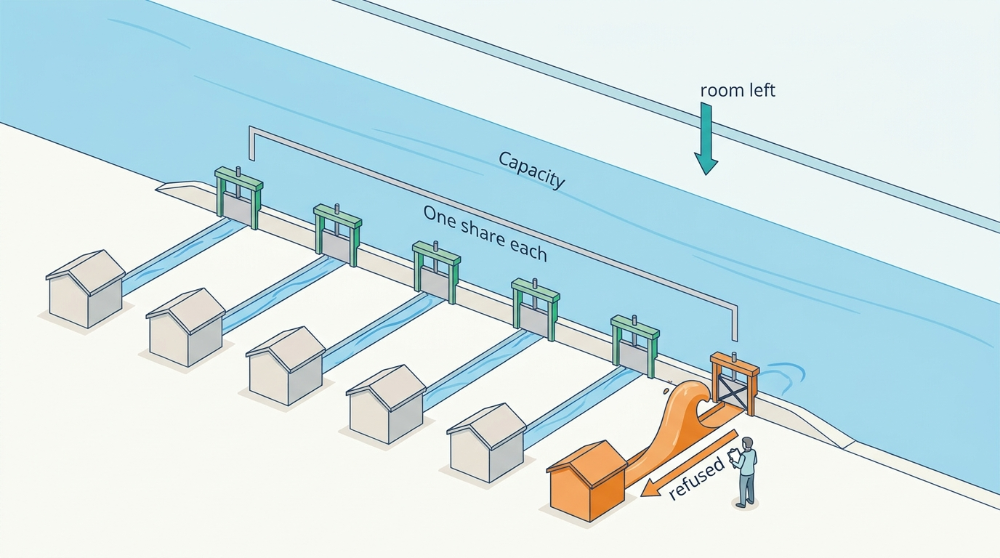
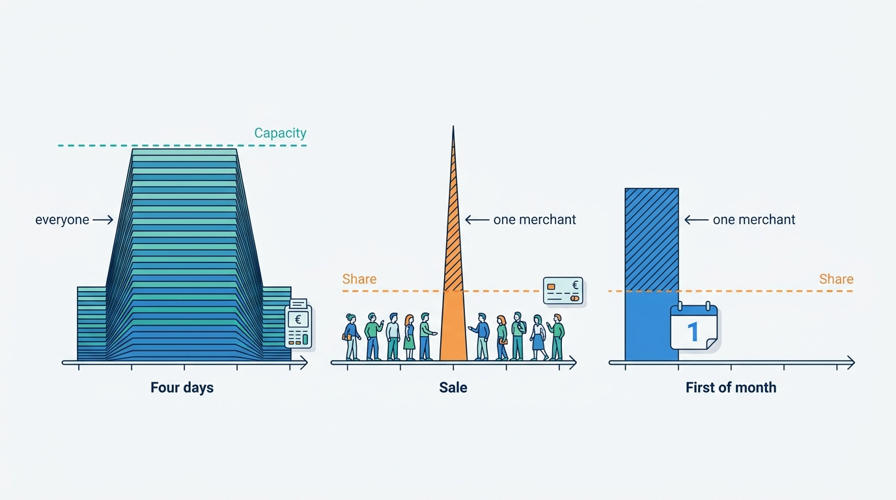
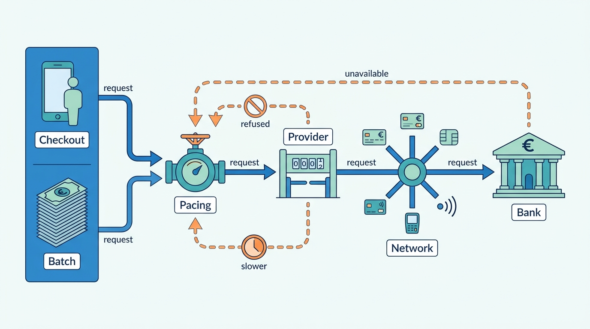
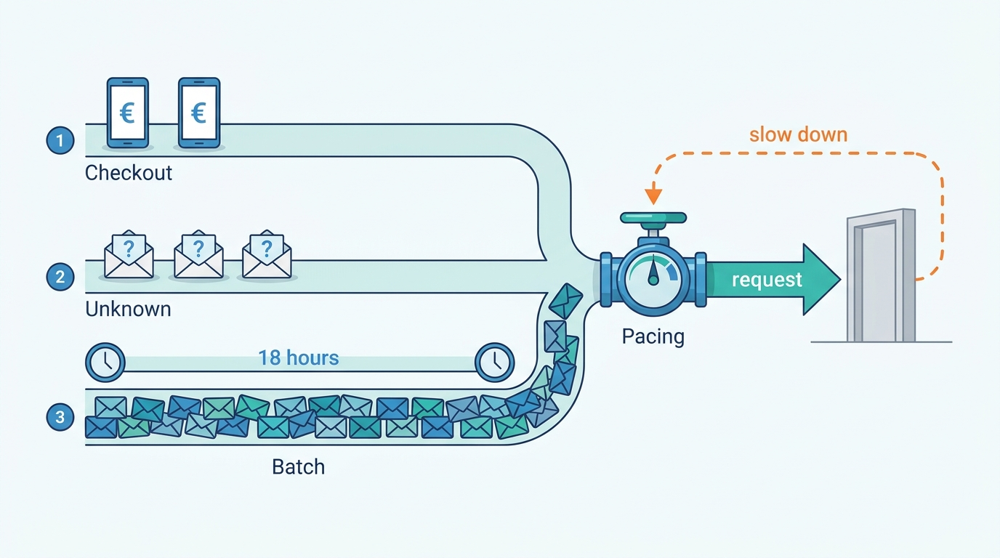

> **IN THIS CHAPTER, YOU WILL:** Learn what published peak figures count, where your own predictable peak fails at Stripe and Adyen, and how to pace it.

> **KEY POINTS:**
>
> * **Your peak meets your share, not the provider's capacity.** Stripe documents 100 requests a second per account and 25 per endpoint (accessed November 2026). Adyen publishes no limit for payments, so there the figure has to be agreed in advance.
> * **Published peak figures are load, not capacity.** Stripe (2023 to 2025) and Adyen (2024, 2025) report Black Friday weekends in "transactions" that neither defines. The figures cannot be ranked, and neither is a promise to any one customer.
> * **Late is the design goal.** A refusal for volume or a timeout means a payment is late or unknown, not failed. Pace a predictable peak yourself, and accept a longer run so that no customer hears about a payment that was never attempted.

> **[FAILURE PATTERNS THIS CHAPTER ADDRESSES](where-payment-systems-go-wrong.html):**
>
> * **The First of the Month** — a renewal run far smaller than any published peak met a per-customer limit nobody had sized it against.
> * **The Borrowed Blueprint** — a provider's Black Friday figure is borrowed as if it were the capacity available to one merchant.
> * **The Double Charge** — on a peak day a slow answer is treated as a failure and sent again as a new payment.

 
Over the Black Friday weekend of 2025, Stripe reported in a press release (December 2025) "More than 152,000 transactions per minute at peak volume", and Adyen reported in an article on its website (December 2025) "handling up to 199,000 transactions per minute without disruption". Ten months later, on 1 October 2026, Larkfield, the fictional studio-software platform this book follows ([[meet-larkfield]]), sent its first-of-month membership renewals at about a thousand a minute across its two providers, and 7,900 of them were refused. **The run was more than a hundred times smaller than either published peak, and it still failed.** The refusal came from the share that one customer is given, not from the provider's capacity.

[[payment-multi-region-and-data-residency]] ended on a documented difference in hosting: Stripe runs on rented cloud capacity, Adyen on infrastructure it owns. That difference decides how each company gets capacity for a peak: scaled on demand on one side, bought ahead on the other. For an integrator it decides less than it seems. **A merchant's own predictable peak meets the provider's per-customer limit before it meets the provider's capacity.** Stripe publishes that limit, 100 requests per second per account; Adyen publishes none for payments. So preparing for your peak means spreading and pacing the load on your side, not trusting anyone's Black Friday figures.

**Where we are in the payment's journey.** This chapter is off the path of Mila Janssen's €120.00 class pass, the payment this book follows, and on the path of her membership. Her €49.00 renewal at Studio Noord on the 1st of each month is one of the roughly 357,000 payments in Larkfield's first-of-month wave. Nobody waits for it as Mila waited for her pass, and the design of the wave decides at what hour of the 1st her card is charged.

The chapter starts from an objection raised at Larkfield. It then sorts payment peaks into three profiles, reads the published peak figures for what they count, and says how each provider gets its capacity. Next come the share one customer is given, with fairness and backpressure, and the limits downstream of the provider. Four designs for a predictable peak follow, then Stripe and Adyen side by side, Larkfield's wave run over eighteen hours, and the ways a paced peak still fails.

## Setting the Scene at Larkfield: The Black Friday Objection

In April 2027 a review of Keel, Larkfield's 2027 program to put its payments estate in order, reached decision K5: renewals are spread and rate-limited by Larkfield, not by the provider, and the renewal job paces itself over 18 hours. Daniel Osei, the CTO, who wrote the original Stripe integration in 2017, objected. The wave is 38% of the month's membership renewals, about 357,000 payments, and until Keel it ran in the first six hours of the 1st, which is about a thousand a minute. "Stripe did 152,000 a minute on Black Friday," he said. "We are under one percent of that. Why are we planning to take eighteen hours over something they would not notice?"

Femke de Graaf, head of payments engineering since January 2027, accepted his arithmetic and disputed what it compared. The 152,000 is what the provider carried for all its customers together on its busiest minute. What one customer may send is a different number, and [[payment-developer-platform]] gave it: Stripe's documentation (n.d., accessed November 2026) allows an account 100 requests a second, and 25 a second to one endpoint unless noted otherwise; Adyen publishes no figure for payments. Her answer left two questions, and they are this chapter's: what do the published figures count, and where does a merchant's own peak fail? The figure below shows the distinction she drew.

**Figure 1:** *A merchant's burst is stopped at its own small gate while the provider's capacity has room left.*

## Peak Profiles: Who Creates the Peak and Who Is Waiting

A **peak profile** describes a peak by three things: its shape over time, who creates it, and whether a customer is waiting for the answer. Payments have three recurring ones, set out in the table below. The first is Black Friday through Cyber Monday (BFCM), which both providers report as a four-day period. The second is a ticket sale or flash sale; Stripe's rate-limit page (n.d., accessed November 2026) names it as a cause of refusals: "A sudden increase in charge volume, such as a flash sale, might result in rate limiting." The third is the first of the month, when subscription businesses renew: at Larkfield, 38% of the month's renewals in six hours.

| Profile | Shape | Who creates it | Who is waiting | Where it is felt first |
| --- | --- | --- | --- | --- |
| Black Friday to Cyber Monday | Four days, high all day | Every merchant at once | Shoppers at checkout | The provider's total capacity; each merchant's own systems |
| Ticket or flash sale | Minutes, from a known instant | One merchant | Every buyer | That merchant's limit at the provider; its own checkout |
| First of the month | Hours, from a batch job | One merchant's billing system | Nobody | That merchant's limit at the provider |

Those three properties decide what can be done. A shared peak is the provider's to carry: the provider plans for the sum of every merchant's rise, and a merchant can only prepare its own systems ([[peak-load-and-reliability]] covers that side for retail). A merchant's own peak arrives alone. On the first of the month one merchant's traffic rises many times over while the provider's total barely moves, so the only limit in play is the per-customer one. And whether anyone is waiting decides whether the load may be late: a renewal can be charged at 14:00 instead of 02:00 without anyone noticing, while a ticket buyer cannot be asked to come back in the afternoon. The figure below shows the three shapes and the line each one meets.

**Figure 2:** *The shared retail peak is measured against the provider's capacity; a sale or a first-of-month run by one merchant is measured against that merchant's share.*

## What the Published Peak Figures Count

Only the shared profile comes with published numbers. Stripe has issued a press release after each Black Friday weekend from 2023 to 2025, and Adyen published an article for 2024 and for 2025, with further 2025 figures in its results release of February 2026.

| Weekend | Company | Volume | Transactions | Peak rate | Uptime wording |
| --- | --- | --- | --- | --- | --- |
| 2023 | Stripe (28 November 2023) | "more than $18.6 billion" | "more than 300 million" | "93,304 transactions per minute"; "a peak of 27,395 requests per second" | "API uptime greater than 99.999%" |
| 2024 | Stripe (3 December 2024) | "more than $31 billion" | 465 million | "137,000 transactions per minute" | "greater than 99.9999%" |
| 2025 | Stripe (2 December 2025) | "more than $40 billion" | "more than 578 million" | "More than 152,000 transactions per minute at peak volume" | "more than 99.9999%" |
| 2024 | Adyen (article, 9 December 2024) | "$34 billion" | "670 million" | Not given | Not given |
| 2025 | Adyen (article, 9 December 2025; results release, 12 February 2026) | "$43 billion" | "837 million" | "up to 199,000 transactions per minute" | "99.9999% uptime" |

These figures cannot be ranked. None of the six documents defines "transaction": it could mean authorization attempts, successful payments or every payment event. The methodology note of Adyen's 2024 article says only "transactions processed on the Adyen platform". None defines how uptime was measured over the four days. Adyen's articles separately count "nearly 100 million in-person payments" for 2024 and "over 127M in-person payment transactions" for 2025, so its totals very likely include store terminals; Stripe's releases do not say what share of its count is in person. And every figure reports the load that arrived, not the capacity that was available. A peak of 199,000 a minute against 152,000 shows at most that more arrived at one provider than at the other in its busiest minute. It would show more capacity only if both had been driven to their limit, and both report that they stayed up.

What the figures do support is an order of magnitude. By my arithmetic, 152,000 a minute is about 2,500 transactions a second and 199,000 is about 3,300. Stripe's 2023 release is the only one that also gives a request rate: 27,395 requests a second at peak. Set beside it the 100 requests a second that Stripe's documentation allows one account today, and one account's share is about 0.4% of the requests Stripe reported in its busiest second of that weekend. The comparison is rough: the two numbers are three years apart, and the 2023 peaks of requests and of transactions need not have fallen in the same minute. It is enough to answer Daniel: a per-account limit sits far below the load the provider reports.

## How Each Provider Gets Its Capacity

The capacity behind those figures is obtained differently at each company. A **load test** is the deliberate sending of artificial traffic to a system to find its weakest part before real customers do. Stripe has described renting, reshaping and testing. A Stripe press release of January 2023 calls Amazon Web Services "Stripe's long-standing cloud infrastructure provider" **(Evidence age: 3 years; Stripe's 2024 database post still names Amazon S3.)** That 2024 post says its platform "can split database shards during traffic surges and consolidate thousands of databases through bin packing when traffic is low" (a shard is one of many databases that each hold a slice of the data; [[payment-data-stores-and-consistency]]), and adds that shard autoscaling was then still an investment in progress. At Stripe Sessions 2024, Rahul Patil described the testing: "We use massive synthetic traffic to punish our systems at 20x the worst-case scenario", and then "we repeat this in production, load testing our systems farther and farther". A 2026 Stripe engineering post on its internal proxy adds one dated remark on headroom: better balancing "gives us 15–20% more headroom before traffic bursts overwhelm the machines".

Adyen, by contrast, has described running its own hardware and designing a multiple into it. Its 2021 architecture post says: "We manage our own infrastructure in several data centers around the world and have bare metal available", and adds that "because we now need dynamic scaling, we are moving towards running our system on an internal cloud." The second part of that post, also from 2021, gives the design rule: "The 20x scaling factor is a rule of thumb we often use internally when designing a solution or determining whether we are still satisfied with it." **(Evidence age: 5 years; the current system may differ.)** Adyen's H1 2026 results release (13 August 2026) says: "We are proactively pulling investment from 2027 into H2 2026 to secure compute and storage availability, and lock in pricing amid ongoing supply chain challenges." Its documentation page on peak season readiness (n.d., accessed November 2026) adds: "The utilization rate of those resources is low, generally less than 30%". Note that the two companies' "20x" are different things: a test load at Stripe, a design margin for growth at Adyen.

> **INFERENCE, NOT DOCUMENTED:** A company that owns its hardware has to plan peak capacity in purchase lead times, and one that rents plans in provisioning time. Neither Stripe nor Adyen gives a lead time: Adyen's documentation says only that peak preparation is "an ongoing project that we work on throughout the year".

Capacity was not the weak point in the one peak-season near miss I found from either company. In a 2025 post on table partitioning, Adyen's Derk van Veen writes: "I still have nightmares about incident number 2016. We were preparing for one of the most critical seasons for our merchants – December shopping– when the CPU unexpectedly spiked. We realized that automatically adding one more partition to an already partitioned table would bring one of our most critical databases to its knees". The post calls 2016 an incident number, not a year. Before a peak, the danger on record was a routine change meeting a busy database, and more hardware would not have removed it.

The record stops short of a figure. Adyen's peak season page describes testing, "We periodically load test this system with merchants who hold transactions and then release the transactions in bulk", and a freeze: "We therefore freeze our code deployment around the following peak season days", among them Black Friday and Cyber Monday, critical bug fixes excepted. It poses the question "How many transactions per second (TPS) can your system handle?" and answers without a number. On Stripe's side, Patil's remark in the same 2024 talk, "today's Sessions, there's no code freeze", was about a conference day, not about Black Friday, and I found no Stripe statement about changes during that weekend. Neither company publishes its capacity as a figure a customer could plan with.

## The Share You Are Given: Fairness and Backpressure

Since capacity is not published, what a merchant meets is how it is divided. **Fairness**, in a shared API, means that no customer's traffic can take capacity another customer needs. The per-customer rate limit is how it is enforced. Stripe's 2017 engineering post on its limiters, which [[payment-developer-platform]] covers in full, puts it plainly: "every Stripe user has a bucket, and every time they make a request we remove a token from that bucket". The same post allowed for interactive peaks: "we added the ability to briefly burst above the cap for sudden spikes in usage during real-time events (e.g. a flash sale.)" **(Evidence age: 9 years; the current system may differ.)** The current rate-limit page states the intent behind the numbers: "We try to set our rates high enough that legitimate payment traffic never exceeds the limits".

Because the share is per customer, a merchant's own peak fails at the share and not at the provider's capacity. At Stripe the share is documented (n.d., accessed November 2026): 100 requests a second per account in live mode, 25 a second to one endpoint, and 50 requests in progress at once. At Adyen I found no description of rate limits for payment requests: the documentation index lists no such page, although the response-handling page documents HTTP 429, "You have sent too many requests in a short period". That is a difference in what is published. It is not evidence about Adyen's capacity or about how Adyen divides it.

**Backpressure** is a slow part of a system making the faster part upstream slow down. Over an HTTP API it reaches you in three forms: a refusal for volume (429), a shed request (Stripe's 2017 design answered lower-priority requests with 503 when the whole system was overloaded), and slower answers. A refusal for volume means the provider did not attempt the payment. Stripe's documentation says so for its own API: "Errors that occur before execution begins, such as invalid parameters, an invalid API key, or rate limiting, don’t cache a result." No bank was asked, so a refusal is lateness and never a decline. Any other error or a timeout is an unknown outcome until the provider's record says otherwise. The third form is quieter, because a cap on requests in progress turns slowness into a lower rate. Assume a call takes half a second: 50 slots carry 100 requests a second. If calls slow to two seconds, the same 50 slots carry 25 *(latencies are assumptions)*. No limit changed, and your rate fell by three quarters. The figure below shows the path and the signals that come back along it.

**Figure 3:** *Slowness anywhere past your own pacing comes back as a refusal, a slower answer or an issuer-unavailable decline, and the pacing is where you respond to it.*

What you may do with those signals depends on who is waiting. Where a customer is waiting, a queue can absorb only seconds before a late answer becomes an abandoned payment or a second press of the pay button. Where nobody is waiting, it can absorb hours. So the requirement on each path is written separately, as in the table below; the time budgets are my assumptions. Adyen has described using a queue this way on a path where nobody waits: after moving an Adyen for Platforms API from synchronous to asynchronous processing, its 2020 engineering post says, "we have better control over how and when the requests are executed". **(Evidence age: 6 years; about a platform API, not card authorization.)** In every row, the thing that may not give way is the record of the payment.

| Path | Who waits | How long an answer may take | At the limit or a slowdown | What must not happen |
| --- | --- | --- | --- | --- |
| Interactive checkout (Mila's pass) | The customer | Seconds *(assumption)* | Served first; a short bounded wait, then "we are still confirming your payment" | A second charge from a retry under a new key ([[idempotency-and-retries]]) |
| Batch renewal (Mila's membership) | Nobody | Hours | Slow down, queue, carry over | A failure message for a payment never attempted |
| Processing provider events | Nobody at first | Minutes *(assumption)* | Persist first, process behind ([[payment-webhooks-and-events]]) | A lost event, or a state set without the provider's record |

## Downstream Limits: Issuers and Networks

The provider is not the last system in the path. A card payment is answered by the **issuer**, the cardholder's bank, reached through the card network ([[payment-authorization]]). When an issuer is slow or unreachable, the network may answer for it. Visa's rules of 24 October 2026 define Stand-In Processing in their glossary as the component "that provides Authorization services on behalf of an Issuer when the Issuer, its VisaNet Processor, or a Visa Scheme Processor is unavailable, when Issuer responses exceed the maximum response time, or when the Issuer has instructed Visa to process a Transaction on behalf of the Issuer." When nothing stands in, you receive a decline. Stripe's decline code `issuer_not_available` reads "The card issuer couldn’t be reached, so the payment couldn’t be authorized." Adyen's refusal reason 9, "Issuer Unavailable", reads "It is not possible to contact the shopper's bank to authorize the transaction." Visa's rules put the underlying response code 91 in the category where a later reattempt is permitted, up to 20 attempts in 30 days (Adyen's documentation, n.d., accessed November 2026, still gives 15; [[authorization-optimization]] has the detail).

Past those definitions I found no Stripe or Adyen document on how either paces traffic toward networks and issuers at a peak, none that tells a merchant whether an approval came from the issuer or from the network standing in, and no published issuer response times. What you can do is count issuer-unavailable declines per hour of your own run, per provider; a rise during a wave is the only view of the downstream limit you will get.

There is one more limit downstream, and it is yours. Every payment you send comes back as events and state changes, so your own receivers and stores see the same peak you created. After a failure they see it compressed. Adyen's webhook troubleshooting page (n.d., accessed November 2026) says of a 429 returned by the merchant's own server: "This can happen after you fix a failing endpoint, as the queued webhooks are sent in a short timeframe. Ensure your server can handle the load."

## Four Ways to Meet a Predictable Peak

With a share per customer, backpressure and downstream limits in view, the party that creates the load has four designs. [[payment-developer-platform]] compared how to respond to a limit (react, pace, agree); the table here is about where to put the peak, and each row names what gives way. Two rows are attested. At Larkfield 62% of renewals already fall on each member's own anniversary day and only 38% on the 1st. And Stripe's documentation says of raising a limit: "If you request a large increase, contact Stripe Support at least 6 weeks in advance."

| Design | What gives way | What it costs | When it is right |
| --- | --- | --- | --- |
| **Spread across the calendar**: bill each customer on their own anniversary | The common billing date | A change to what customers were told; reports no longer align to the month | New subscriptions; any batch whose date is your choice |
| **Pace within the day**: a token bucket (a counter refilled at a fixed rate) below the limit | The hour of the charge | A longer run; a state for "not attempted yet" | A batch with a fixed date and nobody waiting |
| **Agree a higher ceiling** | Lead time; independence from the provider's answer | Weeks of notice; the burst and the downstream limits remain | A peak above the documented limit, or no documented limit |
| **Admit at your own door**: a waiting room in front of checkout | The customer's wait before paying | A queue page to build and explain | An interactive peak with a fixed start |

For a batch nobody is waiting on, my order is calendar first, pacing second and a higher ceiling last, because the first two are yours to change and the third is someone else's answer. Moving dates removes the peak but changes what customers were promised; pacing keeps the date and costs hours that nobody notices; a raised limit removes neither the burst nor the limits downstream. For an interactive peak the order reverses. A ticket sale has a fixed start, so the load cannot be moved: you ask the provider ahead of time and meter entry to checkout, so that every buyer you admit gets an answer in seconds.

Whichever design you choose, you can test only half of it. Your own side can be load tested against a mock of the provider, and Stripe's documentation recommends exactly that in place of its sandbox, the test environment: "We generally discourage this practice because API limits are lower in a sandbox", and integrations should have "a configurable system for mocking out requests to the Stripe API" that simulates latency "by sleeping for a time that you determine by sampling the durations of real live mode Stripe API calls". Adyen's peak season page asks customers to plan and test well in advance; I found no Adyen advice on load testing an integration. Its batch processing page (n.d., accessed November 2026) offers bulk requests "by uploading an input file" and gives no rate. The provider's side (its live limits, its latency under your load) can only be learned in production, so the first paced peak is run with people watching it.

## Stripe and Adyen: Where They Differ

Set side by side, the two providers differ in how they obtain capacity and in what they publish about limits and about changes at a peak; on peak figures they are alike, and neither gives a capacity figure. The last column of the table is my inference; every other cell is a fact cited above or a statement of what was not found.

| Aspect | Stripe | Adyen | What the difference suggests |
| --- | --- | --- | --- |
| Published peak figures | Press release each year, 2023 to 2025: volume, transactions, peak rate, uptime | 2024: volume and transactions; 2025: volume and peak rate (article), transactions and uptime (results, 2026) | No material difference; units are undefined at both, so no ranking |
| How capacity is obtained | Rented from Amazon Web Services (2023); shards split in surges and merged when quiet (2024) | Own infrastructure in data centers (2021); a 20x design rule (2020, 2021); investment pulled forward "to secure compute and storage availability" (2026); utilization "generally less than 30%" (n.d., accessed November 2026) | Provisioning time on one side, purchase lead time on the other (inference) |
| Per-customer limit for payment requests | 100 a second per account, 25 per endpoint, 50 in progress (n.d., accessed November 2026) | None published; HTTP 429 documented (n.d., accessed November 2026) | A difference in publication, not in capacity: read it at Stripe, ask at Adyen |
| Load testing by the provider | Synthetic traffic "at 20x the worst-case scenario", repeated in production (2024) | Periodic load tests "with merchants who hold transactions and then release the transactions in bulk" (n.d., accessed November 2026) | Both describe load tests on the live system; neither publishes a result |
| Changes during a peak | Not found for Black Friday (documentation, support site, newsroom, web search; November 2026); "no code freeze" was said of a conference day (2024) | Code deployment frozen around Black Friday, Cyber Monday and other peak days, except critical fixes (n.d., accessed November 2026); one near miss from a partition change before a December season (2025) | Adyen documents a freeze; none found for Stripe, so no comparison |
| Guidance for a customer's own peak | Contact support before an event; large increases "at least 6 weeks in advance"; mock the API for load tests (n.d., accessed November 2026) | Backoff with jitter on 429; a peak season page (test early); bulk requests by uploaded file (n.d., accessed November 2026); no rate figure | At Adyen the guidance is published and the figure is not: ask for it |

So on Stripe, size a batch from the published page, and ask six weeks ahead only when your computed rate exceeds it. On Adyen, ask for a figure in writing before the first large run, and pace conservatively until you have it. On both, plan against the limit and never against the Black Friday figure, which commits the provider to nothing for any one customer.

## In Practice at Larkfield: Eighteen Hours on Purpose

Larkfield's wave is 38% of the month's renewals: about 357,000 payments worth €17.5 million, attempted until Keel in the first six hours of the 1st. Its average, about 17 requests a second across both providers, was below every documented limit. Its bursts were not. As [[payment-developer-platform]] tells it, 48 workers sent requests as fast as answers came back, the part of the job that charges through Stripe crossed the limit of 25 requests a second to one endpoint, and on 1 October 2026 7,900 renewals were refused and delayed to the next day. K5 replaced the worker pool with pacing: the run takes 18 hours and passes through one token bucket per provider, set to 10 requests a second on Stripe and 5 on Adyen *(Larkfield's settings, assumptions)*.

Where do the eighteen hours come from? From the Adyen side. Assume the wave splits as volume does *(assumption)*: about 157,000 renewals on Stripe and 200,000 on Adyen. At 10 a second the Stripe part could finish in 15,700 seconds, or 4.4 hours. At the 5 a second Larkfield allows itself on Adyen until Adyen confirms a figure, 200,000 renewals need 40,000 seconds, or 11.1 hours, and that is with no refusal, no slowdown and no checkout traffic ahead of them. Eighteen hours puts that floor at 62% of the window and leaves 38% as slack. Before Keel the job sent about 9 a second to Adyen without a refusal, which shows that 9 was under the limit on those days and not what the limit is. **The unpublished limit, not the published one, sets the length of the run.**

Inside the run Larkfield is the one dividing a share. The payment service serves three lanes in strict order: members at checkout first, then confirmations and retries of requests whose outcome is unknown, then the batch. The batch is ordered by a hash of membership and billing period, so the order changes every month and no studio's members are always charged last. And the batch responds to backpressure: on a 429, or when the slowest 5% of calls take twice as long as usual, its bucket rate is halved, then restored in steps.

**Figure 4:** *Checkout goes first, unknown outcomes second and the shuffled batch last, through one paced valve, over 18 hours.*

The long run costs a later charge and nothing else. A member charged at 17:00 instead of 02:00 keeps access all day, because her membership's record for the period is open and not failed ([[subscriptions-and-billing-engines]]). No message goes out for a renewal not yet attempted; the dunning email, the reminder sent after a failed payment, now follows only a real decline ([[invoicing-collections-and-dunning]]). The slower pace also protects Larkfield's own side. Assume three provider events per renewal *(assumption)*: the six-hour wave produced about 50 events a second for the webhook receivers, and the paced one about 17. The team rehearsed that side against a mock with sampled latencies, then watched the first paced wave in production.

## When It Goes Wrong

A paced peak still fails in three ways. The first is the one that produces wrong payments: **the provider slows during the run and requests time out**. A timeout is an unknown outcome and not a failure. Larkfield learned that on a peak day: on 1 November 2026 a provider call timed out during the renewals, the job retried with a new idempotency key (the identifier that lets a provider recognize a repeated request as the same one), and 1,840 members were charged twice. €71,300 was refunded and 212 disputes (charges contested through the cardholder's bank) followed anyway. The recovery is to slow the run, resend under the same key, and confirm against the provider's record before anything is marked failed; K1 now derives the key from the membership, the billing period and the attempt number ([[idempotency-and-retries]]).

The second failure only produces late payments: **the run does not finish in its window**. What matters then is whether your record can say so. The renewals not attempted by the deadline are carried to the next morning in a state that means "not attempted yet", and no member hears about it. That state is what 1 October 2026 lacked: the old job could not tell a declined card from one not yet charged, so 7,900 members who had done nothing wrong got a failed-payment email.

The third follows either of the first two: **everything held back returns at once**. Your batch's retries, every other customer's retries at the provider and the provider's queued events to you all arrive after the same pause. Stripe's documentation asks callers to "add randomness to the backoff schedule to avoid a thundering herd effect". In the other direction, Adyen's sentence about queued webhooks "sent in a short timeframe" applies to you. Spread your retries with random delay, and size your receivers for the burst after an outage, not for the average of a normal day ([[payment-reliability-and-availability]]).

## What to Take Away

**Established.**

- Published peak figures are reported load in undefined units. Stripe (2023 to 2025) and Adyen (2024, 2025) each report a Black Friday weekend in "transactions" that neither defines; the figures support an order of magnitude and no ranking.
- Stripe documents a per-account share (100 requests a second, 25 per endpoint, 50 in progress; accessed November 2026). Adyen publishes none for payments. A refusal for volume means the payment was not attempted; it is not a decline.
- As published, Stripe rents capacity and reshapes its data tier (2023, 2024) and load tests in production (2024); Adyen runs its own hardware, has described a 20x design rule (2020, 2021), buys ahead (2026) and documents utilization "generally less than 30%", periodic load tests and a code freeze around peak days (n.d., accessed November 2026). Neither publishes a capacity figure.

**Depends on context.**

- Whether to move a peak across the calendar, pace it within the day, agree a higher ceiling or admit customers at your door depends on whether anyone is waiting and whether the date is yours to choose.
- Pacing against a documented limit is arithmetic. Where no limit is published, pace conservatively and expect the run to be longer until a figure is agreed in writing.
- How much slack a window needs depends on what shares the endpoint with the batch; interactive traffic on the same endpoint argues for a rate well under the limit.

**The author's synthesis.**

- I plan against my share and never against the provider's Black Friday figure. Daniel's 152,000 a minute was everyone's traffic; the first of the month is yours alone.
- I accept a longer run as the price of sending no wrong message. The 7,900 renewals of October were late; the 1,840 of November were wrong, and only the second cost refunds and disputes.
- I treat a peak as finished when the records agree, not when the queue is empty, because that is the same test this book applies to a single payment.

## Questions to Ask

1. For each predictable peak of our own, how many requests a second does it need on average, and how many in its worst burst?
2. Which limit does it meet first at each provider, and is that limit documented or agreed in writing?
3. When a provider publishes a peak figure, what does it count, over what period, and does it include in-person payments?
4. When we are refused or the provider slows, what gives way: which work waits, and for how long?
5. Does our payment record have a state for "not attempted yet" that sends no customer message?
6. Who is served first when checkout and a batch share an endpoint, and is the batch's order fair to every seller on our platform?
7. How many events a second come back to our receivers at peak and after an outage, and have we tested that against a mock with real latencies?
8. Which signals do we watch during the first paced run: refusals by reason, call latency, issuer-unavailable declines, time to finish?

Pacing leaves one problem open. A payment system cannot be stopped for its peaks, and the one peak-season near miss on record, Adyen's partition change before a December season, was set off by a change and not by load. A system that carries the peak has to be changed while it runs. How that is done, with bounded exposure, automatic withdrawal and a way back, is the subject of [[payment-safe-change]].

## Sources and Evidence

*Company, product and investor sources*

- [Businesses process more than $18.6 billion on Stripe over Black Friday and Cyber Monday](https://stripe.com/newsroom/news/bfcm2023), Stripe, 2023-11-28 — 2023 volume, transactions, peak transactions per minute, peak requests per second, uptime wording.
- [Stripe's Black Friday and Cyber Monday 2024 release](https://stripe.com/newsroom/news/bfcm2024), Stripe, 2024-12-03 — 2024 volume, 465 million transactions, 137,000 per minute, uptime wording.
- [Businesses on Stripe processed more than $40 billion from Black Friday through Cyber Monday](https://stripe.com/newsroom/news/bfcm2025), Stripe, 2025-12-02 — 2025 volume, transactions, 152,000 per minute, uptime wording.
- [Turn our Black Friday/Cyber Monday insights into your 2025 retail opportunities](https://www.adyen.com/knowledge-hub/black-friday-cyber-monday-payment-insights), Adyen, 2024-12-09 — $34 billion, 670 million transactions, nearly 100 million in person; methodology note.
- [Black Friday/Cyber Monday weekend 2025: Three learnings](https://www.adyen.com/knowledge-hub/bfcm), Adyen, 2025-12-09 — $43 billion, up to 199,000 transactions per minute, over 127 million in-person transactions.
- [Adyen publishes H2 2025 financial results](https://www.adyen.com/press-and-media/adyen-publishes-h2-2025-financial-results-3pgu2), Adyen, 2026-02-12 — 837 million transactions and 99.9999% uptime over the 2025 weekend.
- [Adyen publishes H1 2026 financial results](https://www.adyen.com/press-and-media/adyen-publishes-h1-2026-financial-results-3wjne), Adyen, 2026-08-13 — investment pulled forward to secure compute and storage.
- [Amazon-Stripe partnership accelerates ecommerce and streamlines online payments](https://stripe.com/newsroom/news/amazon-and-stripe), Stripe, 2023-01-23 — Amazon Web Services as Stripe's cloud infrastructure provider (evidence age: 3 years).
- [How Stripe's document databases supported 99.999% uptime with zero-downtime data migrations](https://stripe.dev/blog/how-stripes-document-databases-supported-99.999-uptime-with-zero-downtime-data-migrations), Jimmy Morzaria and Suraj Narkhede, Stripe, 2024-06-06 — shards split in surges and merged when quiet; shard autoscaling in progress; Amazon S3 as storage.
- [Building a culture of system reliability](https://stripe.com/sessions/2024/building-a-culture-of-system-reliability), Rahul Patil with Farhan Thawar, Stripe Sessions, 2024-04-25 — synthetic load at 20x the worst case, repeated in production; "no code freeze" on the conference day.
- [Building a data plane from scratch: Stripe's own high-performance distributed proxy](https://stripe.dev/blog/building-a-data-plane-from-scratch-stripes-own-high-performance-distributed-proxy), Jack Loughran and Cara Mecozzi, Stripe, 2026-08-26 — 15–20% more headroom before bursts.
- [Scaling your API with rate limiters](https://stripe.com/blog/rate-limiters), Paul Tarjan, Stripe, 2017-03-30 — a bucket per user; burst allowance for flash sales (evidence age: 9 years).
- [Design to Duty: How we make architecture decisions at Adyen](https://www.adyen.com/knowledge-hub/design-to-duty-adyen-architecture), Adyen, 2021-07-28 (the page says "Updated June 2022") — own infrastructure in data centers; move toward an internal cloud (evidence age: 5 years).
- [Design to Duty: The Accounting and Reporting Systems at Adyen](https://www.adyen.com/knowledge-hub/design-to-duty-adyen-architecture-part2), Willem Pino, Adyen, 2021-08-23 — the 20x rule of thumb (evidence age: 5 years).
- [The Adyen way of engineering: we design for 20x](https://www.adyen.com/knowledge-hub/the-adyen-way-of-engineering--we-design-for-20x), Miguel Gonzalez, Adyen, 2020-10-22 — asynchronous processing as control over when requests run, on Adyen for Platforms (evidence age: 6 years).
- [A Deep Dive into Table Partitioning, Part 5: Partitioning an environment, not individual tables](https://www.adyen.com/knowledge-hub/partitioning-an-environment-not-individual-tables), Derk van Veen, Adyen, 2025-09-16 — the near miss before a December season.

*Standards, regulation and official documentation*

- [Rate limits](https://docs.stripe.com/rate-limits.md), Stripe documentation, n.d., accessed 2026-11 — account, endpoint and concurrency limits; flash sales; backoff with randomness; load testing advice; six weeks' notice for large increases (volatile).
- [Advanced error handling](https://docs.stripe.com/error-low-level.md), Stripe documentation, n.d., accessed 2026-11 — a rate-limited request does not begin execution.
- [Decline codes](https://docs.stripe.com/declines/codes.md), Stripe documentation, n.d., accessed 2026-11 — `issuer_not_available`.
- [Refusal reasons](https://docs.adyen.com/development-resources/refusal-reasons.md), Adyen documentation, n.d., accessed 2026-11 — refusal reason 9, Issuer Unavailable.
- [HTTP status codes](https://docs.adyen.com/development-resources/response-handling.md), Adyen documentation, n.d., accessed 2026-11 — HTTP 429 and backoff with jitter.
- [Adyen documentation index](https://docs.adyen.com/llms.txt), Adyen documentation, n.d., accessed 2026-11 — no page on API rate limits for payments; none either in the documentation sitemap, the help center or a web search of Adyen's domains (17 November 2026). The error-code page lists "705 - Rate limited" without a figure.
- [Troubleshoot webhooks](https://docs.adyen.com/development-resources/webhooks/troubleshoot.md), Adyen documentation, n.d., accessed 2026-11 — queued webhooks sent in a short timeframe after an endpoint recovers.
- [Peak season readiness](https://docs.adyen.com/industries/peak-season.md), Adyen documentation, n.d., accessed 2026-11 — utilization under 30%; load tests with merchants; code freeze on peak days; no capacity figure; plan and test in advance.
- [Batch processing](https://docs.adyen.com/development-resources/batch-processing.md), Adyen documentation, n.d., accessed 2026-11 — bulk payment and modification requests by uploaded file.
- [Mapping to Visa system integrity fee categories](https://docs.adyen.com/development-resources/raw-acquirer-responses/visa-integrity-fees.md), Adyen documentation, n.d., accessed 2026-11 — the "15 times in a 30-day period" retry statement.
- [Visa Core Rules and Visa Product and Service Rules](https://usa.visa.com/dam/VCOM/download/about-visa/visa-rules-public.pdf), Visa, 2026-10-24 — glossary definition of Stand-In Processing; Table 7-2, reattempts up to 20 in 30 days.

*Research and practitioner sources*

- None.

Larkfield is fictional; architectural recommendations, labeled inferences and labeled assumptions are the author's judgement.
