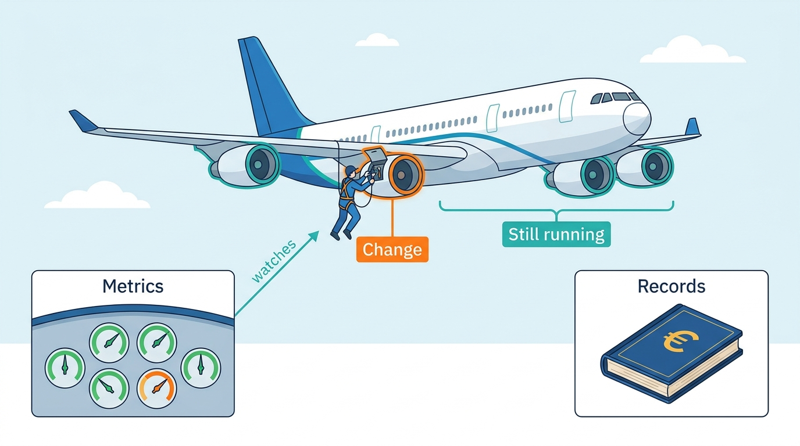
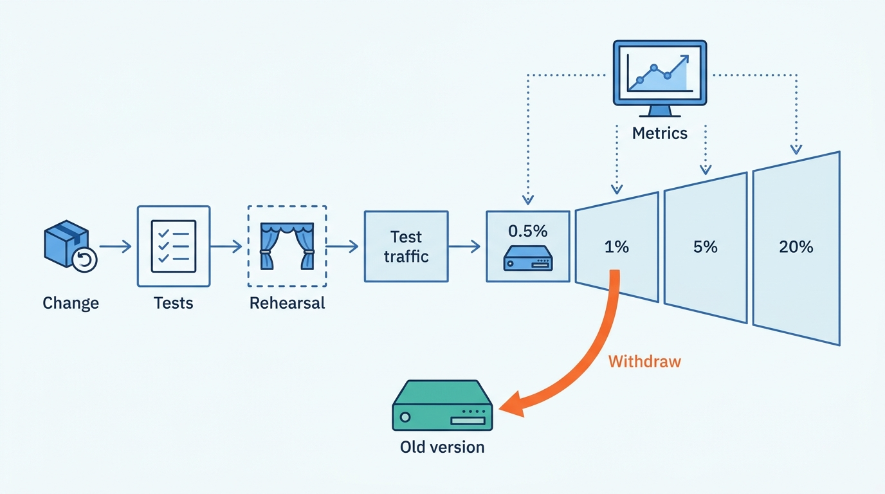
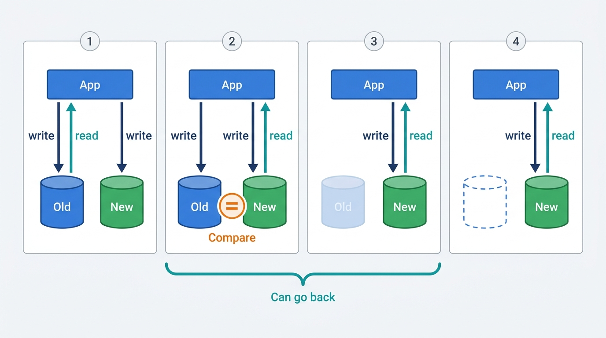
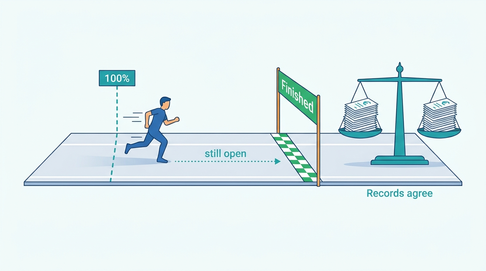

> **IN THIS CHAPTER, YOU WILL:** Learn how Stripe and Adyen say they change running payment systems, where that record stops, and how to stage, reverse and reconcile your own changes.

> **KEY POINTS:**
>
> * **Bound the exposure, automate the withdrawal, test the way back.** Stripe's 2023 annual letter (published March 2024) describes about 400 deployments a day to one core API service, each sent to rising shares of live traffic and withdrawn automatically when metrics deviate. Adyen's 2018 account, now eight years old, describes switching features on one by one after a release.
> * **One percent is still real payments, and a rollback is still a change.** On 8 February 2024 a change that reached 1% of Stripe's critical traffic failed payments for six minutes. On 10 July 2019 a revert caused Stripe's second outage of the day.
> * **A change is finished when the records agree.** Error metrics cannot see a change that writes wrong records without failing a request. Neither company has published a check of money correctness tied to a deployment; the rule is my recommendation.

> **[FAILURE PATTERNS THIS CHAPTER ADDRESSES](where-payment-systems-go-wrong.html):**
>
> * **The Version Cliff** — an upgrade that reaches all traffic in one step, with no comparison and no check of the records afterwards, is this chapter's opening case read as a deployment.
> * **The Phantom Payment** — a rollout withdrawn in mid-request leaves payments whose outcome nobody has confirmed against the provider's record.
> * **The Borrowed Blueprint** — a provider's 55,000 metrics and 400 deployments a day answer a scale that a team of eleven does not have; the stages and the comparison are what transfer.

 
[[payment-peak-load]] ended with a system that cannot be stopped for its peaks, and with a near miss that was set off by a change and not by load: in a 2025 post, an Adyen database engineer described how "automatically adding one more partition to an already partitioned table" nearly failed a critical database before a December season. Stripe has reported the same kind of event with numbers. On 8 February 2024, between 21:46 and 21:52 UTC, a change reached 1% of what Stripe calls its critical tier of traffic. It went no further. In those six minutes, according to Stripe's 2023 annual letter (published March 2024), "the three most impacted users had 39, 15, and 12 payments fail". **A change that got no further than one percent still failed real payments.**

Against that, the usual defense of a system that must not break is to change it rarely. Larkfield, the fictional studio-software platform this book follows ([[meet-larkfield]]), shows where that leads. Its billing integration was left untouched on a three-year-old API version until March 2026, when a forced library upgrade moved it across every postponed change in one deploy, and subscription revenue reports were wrong for six days. Larkfield calls it the Version Cliff.

So change hurts in two ways: a small one still costs payments, and an avoided one arrives all at once. This chapter's claim addresses both. A money path, meaning any code path that can charge, refund, pay out or record money, can take hundreds of changes a day when each one is **first exposed to a bounded share of live traffic, withdrawn automatically when its metrics deviate, and given a way back that has itself been tested**. Because even 1% of traffic is real payments, I add a rule of my own: **a change is finished only when the records agree after it**, not when the rollout reaches everyone.

**Where we are in the payment's journey.** This chapter is not a step on the payment's path; it concerns the code under every step. When Mila Janssen bought her €120.00 class pass from Studio Noord on Tuesday 9 March 2027 at 19:42, her request was handled by whichever build of each system was live that minute, at Larkfield and at Adyen. Had either been in the first stage of a rollout, her payment could have been one of the few that met the new code.

The chapter starts with Larkfield's March 2026 upgrade, read as a deployment. It then explains why a money path cannot stop changing and what a bad change costs, how a progressive rollout bounds a mistake, and how a migration keeps two paths alive until a comparison passes. Four ways to limit a change are compared, followed by what each company has published about incidents and about the engineering choices behind its changes. The comparison of the two providers comes next, then Larkfield's May 2027 upgrade as a staged change, and last what to do after a rollout is withdrawn.

## Setting the Scene at Larkfield: An Upgrade That Was Finished When It Deployed

[[payment-api-versioning]] tells the Version Cliff as a versioning story; here it is a deployment story. In March 2026 the growth team upgraded one Stripe client library in the billing integration, the code that bills studios for their Larkfield subscriptions. The upgrade went to every request in one deploy. The new library carried a newer API version, in which a field the finance export read no longer existed. No request failed and no alert fired. The export found nothing where the field had been and filed subscription invoices as one-off sales. Six days later Priya Raman, the finance controller, noticed that subscription revenue did not add up. The first detector was a person reading a report.

In 2027 Femke de Graaf, who leads Larkfield's Keel program for its payments estate, reviewed that deploy and asked four questions of it. **What share of traffic did it reach first? Which signal would have withdrawn it? What was the way back, and had anyone tried it? Which check showed afterwards that the records were right?** The deploy had an answer to none of them: it reached everything at once, no error existed for a signal to see, the way back was an untested revert, and the change was called finished when it deployed. The chapter takes the four questions in order.

## Why a Money Path Cannot Stop Changing, and What a Bad Change Costs

The four questions matter because change is the usual trigger of the outages this part has cited. Stripe's 2023 letter says so in general: "many outages at internet companies are in some way triggered by a change gone wrong". Its own cases fit. The outage of 10 July 2019 began, in the words of Stripe's root-cause analysis, when "two different database bugs and a configuration change interacted in an unforeseen way", and one of those bugs had arrived with a database version installed three months earlier. **(Evidence age: 7 years; the current system may differ.)** The February 2024 incident was "an erroneous change". Adyen's near miss was an automated schema change.

The tempting defense is to change rarely, through release windows (fixed times at which changes may go out) and freezes (periods in which none may). It does not remove the risk, for two reasons. The first is that a payment system has no quiet hour to change in. Stripe wrote in 2017: "We perform all infrastructure upgrades online, rather than relying on planned maintenance windows." **(Evidence age: 9 years.)** Adyen wrote in 2024 that "Our tables are being used 24/7", so that no maintenance can wait for a time outside office hours. Adyen's documentation (n.d., accessed November 2026) says the same of the present: "Releases, patches and upgrades are continuously applied without interruption of service to the payment functions." On freezes the two have said different things. Rahul Patil of Stripe said on stage at the company's 2024 conference that for the day of the event "there's no code freeze." Adyen's page says "We therefore freeze our code deployment" around named peak days, Black Friday and Cyber Monday among them, and admits only a critical fix approved by its operational leads. That is a short pause around a known peak, not a policy of changing rarely. The second reason is that a rarer release is a larger one. Adyen's 2018 account of its release practice names the risk: many developers committing code "brings an element of risk to each deployment as all of this new functionality is activated at once." **(Evidence age: 8 years.)** A release that carries a month of changes makes the cause of a failure hard to find, and rolling it back takes the other changes with it. That is my reasoning for preferring small and frequent to large and rare.

Since change cannot be avoided, it helps to sort what a bad one costs by what monitoring can see. A bad change on a money path does **three kinds of damage**. Some payments fail: the request returns an error and the error is counted. Some payments are left with an **unknown outcome**: a request was in flight when the code handling it was withdrawn, and it may have reached the provider without the answer being stored ([[idempotency-and-retries]]). And some records are written wrong while every request succeeds, as in the Version Cliff. Error metrics see only the first kind. The figure below pictures it: the gauges watch the engines, not the logbook.

**Figure 1:** *A change is made to one small part while the rest keeps running; the metrics watch the engines and do not watch the records.*

## Progressive Rollout: Bounding How Much Traffic a Mistake Reaches

The mechanism that bounds the first two kinds of damage has two parts. A **progressive rollout**, also called a canary release, sends a change to a small share of live traffic and widens the share only while metrics stay healthy. A **feature flag**, or toggle, is a switch that turns a behavior on or off in production without a new deployment, which separates deploying code from activating it. A rollout is built from stages because each stage has a blind spot that the next one covers. The table uses the stages Stripe's 2023 letter names; the cells are my analysis.

| Stage | Who is exposed | What it can catch | What it cannot |
| --- | --- | --- | --- |
| Automated tests | Nobody | Faults somebody thought to test for | Everything else |
| Pre-production with synthetic traffic | Nobody | Failures under realistic request patterns; a rollback that does not work | Behavior only real integrations show |
| Test-mode traffic (requests to the provider's test environment, where no money moves; see [[payment-developer-platform]]) | Integrators' tests | Failures on real integration patterns | Anything that depends on live payments |
| One machine, then rising shares of live traffic | A bounded share of real payments | Crashes, error rates, latency, effects that appear only at volume | Faults that move no metric |
| Full traffic | Everyone | Nothing new | Records that are wrong without an error |

Stripe has published one account of these stages at work, in the section "How we engineer for reliability" of its 2023 annual letter (published March 2024). New code is deployed "to one of our core API services approximately 400 times in a typical day." Each change first meets "a battery of around 1.4 million tests". It then goes to pre-production, "a mock production environment with synthetic API traffic designed to mimic realistic integration patterns", where "we check that the change can not only be safely rolled out to production, but also that it can be safely undone if required." Then it reaches "a single production machine with a small sliver of traffic, before gradually advancing to 0.5%, then 1%, then 5%, then 20%, and so on", and the letter adds: "We roll all changes out to test-mode API traffic before hitting live-mode traffic." The withdrawal is automatic: "Each progressive rollout is inspected against 55,000 different metrics. If at any moment the system detects anomalous telemetry, the machines running the new code are automatically withdrawn from the pool and traffic is redirected to machines running an older, known-good version." Those are the claim's three properties: bounded exposure, automatic withdrawal, a rehearsed undo. It is also the only detailed public description of Stripe's deployment system that I found; the 2024 conference talk mentions automated tests, staged rollout and rollback in one sentence.

**Figure 2:** *A progressive rollout as Stripe described it in 2024: exposure rises from 0.5% to 1%, 5% and 20% while metrics are watched, and a deviation sends traffic back to the old version.*

The same letter reports what this mechanism let through. On 8 February 2024, between 21:46 and 21:52 UTC, "an erroneous change rolled out all the way to 1% of the critical tier of traffic." The letter calls it "the most significant recent issue", gives the three largest counts of failed payments (39, 15 and 12) and says that "multiple problems had to coincide for users to be impacted." It does not define the critical tier or say what stopped the change. It points to Stripe's status page for the times, and I found no separate root-cause analysis; that paragraph is the public account. **A stage bounds the damage and does not remove it.**

Adyen has described a different gate, in an account that is much older. A 2018 post by Michiel Toneman, then its senior vice president of system architecture, says that "everybody develops on the main line", and that "When we want to do a new release, we create a new branch, which we stabilize, and once it gets pushed to production, the old branch is terminated." The safety comes afterwards, from "a centralized and systematic approach to the separation of code deployment and activation": "we toggle features one-by-one on production, and then canary them". **(Evidence age: 8 years; the current system may differ.)** Stripe's letter describes gating the deployed code by share of traffic; Adyen's post describes gating the feature after a batched release. The record does not support a comparison of how often the two deploy. I found three Adyen cadences. One team's, from 2021: "Our team has weekly release cycles". **(Evidence age: 5 years.)** And payment terminals, whose software Adyen's documentation (n.d., accessed November 2026) says is released "every four weeks": "We roll out releases gradually and monitor the performance." For the platform, Adyen's infrastructure page (n.d., accessed November 2026) says "we publish new releases of our core system every week". That counts releases of a system, and Stripe's 400 a day counts deployments to one service.

> **INFERENCE, NOT DOCUMENTED:** Each company may well use both gates. Neither describes how it combines them.

Both accounts rely on a way back, and the way back is itself a change that can fail. Stripe's 2019 root-cause analysis is the documented case. The API was severely degraded twice on 10 July 2019, from 16:35 to 17:02 UTC and from 21:14 to 22:47 UTC. The first window came from a database fault. The second, longer one came from the fix: "our revert to a known stable version interacted poorly with a recently-introduced configuration change to the production shards." Among the remedies Stripe listed were "further procedures and tooling to increase the safety with which operators can make rapid configuration changes during incident response". **(Evidence age: 7 years; Stripe's 2024 post describes its database platform five years later, see [[payment-data-stores-and-consistency]].)** An untested rollback is an untested deployment, made under pressure.

> **INFERENCE, NOT DOCUMENTED:** Read beside the 2019 analysis, the 2023 letter's pre-production check that a change "can be safely undone" looks like the lesson applied. Stripe does not connect the two.

## Migrations Without Downtime: Two Paths Until a Comparison Passes

A code change can be withdrawn by routing traffic back to machines that run the old version. A change to stored data cannot. A **zero-downtime migration** changes a schema or moves data while requests continue, and it is harder than a code rollout for one reason: rows written by the new code remain after the new code is gone, and the old code must still be able to read them. A reversible migration therefore keeps every intermediate state readable by both versions.

Stripe's 2017 engineering post "Online migrations at scale" gives the published pattern for this, using its move of "hundreds of millions of Subscriptions objects" to a new table. It calls it the "4 step dual writing pattern": "Dual writing to the existing and new tables to keep them in sync"; "Changing all read paths in our codebase to read from the new table"; "Changing all write paths in our codebase to only write to the new table"; "Removing old data that relies on the outdated data model". Before trusting the new reads, Stripe ran both read paths in production and compared them with GitHub's Scientist library, which works by "alerting you if two expressions ever yield different results in production." **(Evidence age: 9 years; whether Stripe uses the same tooling today is not public.)** The comparison is what licenses each next step, and every step but the last can be undone. The figure below shows the four steps.

**Figure 3:** *The dual-writing pattern Stripe described in 2017: write to both stores, move the reads after a comparison, move the writes, and only then remove the old data.*

Stripe's 2024 account of moving data between database shards has the same shape one level down. A **shard** is one of many databases that each hold a slice of the same kind of data; [[payment-data-stores-and-consistency]] covers the system in detail. During a move, changes "get replicated bidirectionally", and the post gives the reason: "We made this design choice to provide the flexibility to revert traffic to the source shards if any issues emerge". Before the switch comes "a comprehensive check for data completeness and correctness by comparing point-in-time snapshots". The switch itself is brief: "The entire traffic switch protocol takes less than two seconds to execute, and all failed reads and writes directed to the source shard succeed on retries." The same three properties are designed in: two live paths, a comparison, and a way back.

The comparison step is also a technique of its own. A **dark launch**, or shadowing, runs new code on real traffic without letting its result reach the customer. Stripe's 2017 post on rate limiters advises: "Dark launch each rate limiter to watch the traffic they would block." **(Evidence age: 9 years.)** The Scientist experiment above is a dark read. On a money path the restriction to observing is essential: a shadow copy of a "create payment" call that reached a provider would charge the customer a second time. So shadowing of payment code is commonly run against recorded traffic, or in the provider's test environment, or it stops before the provider call. That is industry practice and my judgement; neither company has documented shadowing of payment calls.

Adyen's published cases of change without downtime sit at the database level. A 2018 post on upgrading PostgreSQL, the relational database its platform runs on, says: "we built our software architecture in such a way that we can stop traffic to our PostgreSQL databases, queue the transactions, and run a PostgreSQL update without affecting payments acceptance." **(Evidence age: 8 years.)** The books wait behind a queue while the edge keeps answering ([[payment-reliability-and-availability]]). A 2024 post gives the working rule for table maintenance: "In most cases, it is not possible to lock the table for more than a few seconds." And the 2025 post quoted at the start of this chapter reports the near miss and its cause: "We partitioned individual tables, not the environment." I found no Adyen account of an application-level migration pattern like Stripe's dual writing, and I draw nothing from the absence.

## Four Ways to Limit a Change, and What Each Costs

Set side by side, the mechanisms above are four designs, and each bounds a different thing: when a change happens, how much traffic it reaches, which behavior is on, or whether the result counts. The table is my analysis. Its second column of gaps ends the same way in every row. **None of the four detects a record that is wrong without an error.** That takes a fifth step after the change: a **reconciliation**, a comparison of your own records with the provider's and with the ledger ([[payment-reconciliation-and-reporting]]).

| Design | What it bounds | What it cannot catch | What it costs | When it is right |
| --- | --- | --- | --- | --- |
| Release window or freeze | When a change happens | Anything; it moves the date and enlarges the release | Postponed changes that arrive together | A step that cannot be staged or undone; a short pause of risky changes around a known peak |
| Rollout by traffic share | How much traffic meets the new code | Faults that move no metric; the payments inside the exposed share | Two versions live at once; metrics good enough to judge by | Any change to code that handles requests |
| Flag-gated activation | Which behavior is on, and for whom | Faults in code that runs whatever the flag says; wrong records | Flags to track and remove | A behavior whose exposure should follow customers, not machines |
| Dark launch | Whether the new result counts | What happens when the code really acts; wrong records downstream of the comparison | Double work, a comparison to build, and care that nothing moves money twice | Changes to reads, calculations, exports and reports |

## Incidents, Postmortems and the Engineering Choices Behind Them

When a change gets through, the written account of it is a **postmortem**, or root-cause analysis: what failed, why, and what will change. Both companies describe reviewing incidents internally. Stripe's 2023 letter says "we inspect every incident manually" and that "On average, 520 calls per day go out to our staff"; a 2024 Stripe conference talk says "Incident reviews are not done by some central SRE team. They're done by the service-owning engineering team." Public postmortems are rare at both. Stripe's website has two root-cause analyses that I found, of the July 2019 outage and of a January 2020 data exposure at a vendor **(evidence age: 6 years)**, and the one paragraph of 2024. Adyen has published one incident update and a follow-up six months later, both about a denial-of-service attack on 21 April 2025 on payment services hosted in its European region. Its update ends: "A detailed post-incident review, including root cause analysis and long term prevention measures, will be made available to our customers." I found no standing practice of public postmortems at either (both run status pages, whose incident entries render in the browser and were not read), so an integrator who wants one has to ask.

The teams that do those reviews change a shared code base, and both companies have said what it looks like. Stripe wrote in April 2026 that "our monorepo is the order of 50 million lines of Ruby code, backed by a correspondingly huge test suite—roughly 100,000 Ruby test files and approximately 1.2 million test units"; other posts (2024, 2026) describe proxies written in Go beside it. Adyen wrote in 2021: "We do all of this on a single platform, in a single repository (monorepo), almost exclusively written in Java." **(Evidence age: 5 years.)** A 2026 Adyen post updates the picture: "Our monorepo alone runs to hundreds of thousands of files, and it's far from the only one." Both have also published the same remedy for the same cost: running only the tests that a change can affect (Adyen in 2024, Stripe in 2026).

> **INFERENCE, NOT DOCUMENTED:** One dominant language in one large repository means that most changes pass through one pipeline. Neither company states this.

On what to build and what to buy, the two say similar things about software and made opposite choices about hardware. Adyen's 2021 post says that for core flows "we never choose a proprietary solution because we want to have full control", and a 2023 post puts it more broadly: "At Adyen, we use open-source software or we build in-house." **(Evidence age: 3 years.)** Stripe's 2026 post on replacing an open-source proxy with its own admits the oddity: "It's a little counterintuitive that building something in-house would be more reliable than operating a battle-tested open-source project." The machines are another matter. Stripe's 2023 announcement with Amazon says that "Stripe has long relied on AWS to provide the core compute infrastructure on which Stripe is built." **(Evidence age: 3 years.)** Adyen's 2021 post says "We manage our own infrastructure in several data centers around the world", and its results for the first half of 2026 say "The majority of our CapEx is invested in data centers." [[payment-multi-region-and-data-residency]] covers what follows from that difference; [[case-stripe]] and [[case-adyen]] place it in each company's history.

## Stripe and Adyen: Where They Differ

Side by side, the two companies are documented to different depths and at different dates. The Stripe and Adyen columns repeat facts cited in the three preceding sections; the last column is my inference from the difference.

| Aspect | Stripe | Adyen | What the difference suggests |
| --- | --- | --- | --- |
| Deployment frequency and freezes | About 400 a day to one core API service (2023 letter, published 2024); no freeze on its conference day (2024) | New releases of the core system "every week"; releases "continuously applied", frozen around named peak days; terminal software every four weeks (n.d., accessed November 2026); one team weekly (2021) | Different units, so no comparison; only Adyen documents a freeze |
| What is gated | Deployed code, by share of traffic, with automatic withdrawal on 55,000 metrics (2024) | Features, toggled one by one after a release and then canaried (2018) | Stripe describes gating the code and Adyen the feature; each may do both |
| Data change without downtime | Dual writing with comparison (2017); reversible moves between shards (2024) | Database upgrade behind a queue (2018); table maintenance without long locks (2024) | Stripe has published an application-level pattern; Adyen's accounts are at the database level |
| Public incident accounts | Two root-cause analyses (outage, 2019; data exposure at a vendor, 2020); one paragraph (2024) | One incident update and a follow-up (2025); detailed review for customers | Rare at both; ask for reviews under contract |
| Language and repository | Ruby monorepo of about 50 million lines, plus Go proxies (2026) | Java monorepo (2021), not the only repository (2026) | No material difference in the public record |
| Software and hardware | Builds or adopts open source for core systems (2024, 2026); rents cloud capacity (2023) | Open source or in-house for core flows (2021, 2023); own infrastructure in data centers (2021, 2026) | The same instinct about software, the opposite about machines |
| Check of money correctness tied to a deployment | Not found in documentation, support site, posts or a web search (November 2026) | Not found in documentation, help center, posts or a web search (November 2026) | Do not assume either runs one for you |

Whichever provider you use, you cannot see or schedule its changes. Three things follow. Measure payment success on your own side, since a rollout at the provider that touches one percent of traffic may touch yours. Ask, under contract, for the incident reviews neither company publishes as a matter of course. And treat reconciliation after your own changes as your own job. That last point is my recommendation, drawn from this book's test for a single payment; neither company documents such a gate for its deployments.

## In Practice at Larkfield: The May 2027 Upgrade as a Staged Change

Larkfield's payments team has 11 engineers. A provider's 55,000 metrics and 400 deployments a day answer a scale that team does not have, and copying them would be the Borrowed Blueprint. What transfers, in my judgement, is four smaller things: a first stage small enough to count by hand, one signal that withdraws the change, a way back that somebody has tried, and a comparison of records. Under Keel decision K7, which puts API upgrades on a calendar and tests them against recorded traffic, Larkfield's Stripe upgrade of May 2027 is planned as exactly those four.

The first of them, the comparison, runs dark. Tom Hendriks, the senior engineer who runs the upgrades, replays recorded requests at the new API version in a Stripe sandbox, as [[payment-api-versioning]] describes. This chapter adds one step. The finance export is built twice from the recorded responses of one closed month, April 2027, once in the old shape and once in the new, and the two are compared line by line. They must agree in invoice count and in total, about €2.04 million for a month of the €24.5 million a year that studio subscriptions bring in. This step would have shown the Version Cliff's missing field within a day instead of six, because it compares the record a person reads.

Once the dark run passes, the live change is staged by studio. The pull request adds the new version beside the old one and changes nothing else, and a flag chooses per studio which version a request carries; Stripe's documentation (n.d., accessed November 2026) says its Ruby and Python libraries accept a version per request ([[payment-api-versioning]]). The flag goes first to 62 of the 6,200 studios the integration bills (1%), then to 10%, to 50% and to all, with a day between stages *(Larkfield's settings; assumptions)*. Two signals withdraw it: the error rate of Stripe calls for flagged studios, and any difference in a nightly comparison of their export lines. Before the first stage, the flag is switched off and on again once in the sandbox, so that the way back has been used before it is needed.

When the flag reaches every studio, the change is still open. It has an owner, and it closes only when two checks have passed: the reconciliation job, run when each provider's reports are ready ([[payment-reconciliation-and-reporting]]), has shown no new open item that traces to the change, and the May close ties the finance export to Stripe's own report for the month. Only then are the old version and the flag deleted, in June. That is my rule applied: finished means that the records agree for a full reporting period.

**Figure 4:** *The rollout reaching 100% of traffic is not the finish; a change is finished when the records agree.*

## When It Goes Wrong: After a Rollout Is Withdrawn

Suppose instead that a change to Larkfield's payment service goes to 1% of live traffic, error rates rise, and after ten minutes the rollout is withdrawn automatically. The mechanism worked, and the incident is still open. Ten minutes at 1% is a small number of real payments. By my arithmetic from Larkfield's figures, 27.6 million online payments a year is about 52.5 a minute, so 525 in ten minutes and about 5 at 1%. During the first-of-month renewal run the number is larger. Larkfield paces that run itself, at 10 requests a second on Stripe and 5 on Adyen *(its own settings; assumptions)*, so while both are sending, 15 a second is 9,000 renewals in ten minutes and about 90 at 1%. Each of those payments is in one of the three states from earlier in the chapter: failed, unknown, or recorded wrong.

Recovery settles each one, in four steps. **List** the payments the withdrawn build handled; under Keel the payment record store writes the build's identifier and the flag state on every attempt row, so the list is one query. **Confirm** each against the provider's own record. On Stripe that means retrieving the payment object again (API reference, n.d., accessed November 2026). Adyen's Checkout API (version 71, n.d., accessed November 2026) has no call that returns an online payment by its identifier, so there the confirming record is the webhook and then the settlement report ([[payment-webhooks-and-events]]). **Compare** each with the ledger. Larkfield writes ledger entries only from the provider's report lines ([[payment-reconciliation-and-reporting]]), so a payment the provider confirms and the ledger lacks after the next report is an open item with an owner. **Repair** the differences: correct the row's state from the provider's record, and where an attempt is confirmed never to have reached the provider, resend it under its stored idempotency key, the identifier that lets a provider recognize a repeated request, so that a resend cannot charge twice ([[idempotency-and-retries]]). Then close the change.

Three further failures belong to the mechanisms themselves, and each has a documented counterpart. The first is a way back that was never tried: Stripe's 2019 revert caused its second outage, which is why Larkfield flips its flag once before the first stage. The second is a data change the old code cannot read, which turns a rollback into a second incident; Stripe's four-step pattern avoids it by keeping both stores in sync until the reads have moved. The third is a flag left in place after its change is done, a branch nobody exercises until it is switched by accident. Adyen's 2018 post, eight years old, describes its answer: "By maintaining ownership over toggling, we automate the process of alerting our developers about cleaning up old code paths".

## What to Take Away

**Established.**

- Staged rollout with automatic withdrawal is documented at Stripe (2023 annual letter, published March 2024), and feature-by-feature activation after a release at Adyen (2018, eight years old).
- Bounded exposure still costs payments: Stripe reported that a change at 1% of its critical traffic failed payments for six minutes on 8 February 2024.
- A rollback can cause an outage: Stripe's 2019 root-cause analysis attributes the second degradation of 10 July 2019 to its revert.
- The published pattern for changing data without downtime is two live paths and a comparison before the old one is removed (Stripe 2017 and 2024).

**Depends on context.**

- How many stages you need depends on volume. At Larkfield's size a first stage of 62 studios can be read by a person; at a provider's size it takes thousands of metrics.
- Gate by traffic share when the risk is in request-handling code, and by flag per customer when the risk is in a behavior whose effects you want to trace to named accounts.
- How long to keep the old path depends on the reporting period of the records the change touches: for a finance export, one full close.
- A short freeze of risky changes before a known peak can be reasonable; Adyen documents one around named peak days. A standing policy of changing rarely is not, because the postponed changes arrive together.

**The author's synthesis.**

- I call a change to a money path finished when the records agree after it, not when the rollout reaches 100%. Neither Stripe nor Adyen has published such a gate. The rule is this book's test for a single payment, applied to a deployment: an answer is a promise until a later record confirms it.
- I take the stages and the comparison from the providers' accounts, and leave the scale. Deployment frequency is the one figure here that cannot even be compared.

Read together, the five chapters of this part show an asymmetry that none shows alone. Each chapter named something that gives way so that the record of money does not, and what the two providers have documented is exactly that list: books that lag behind the edge (Adyen, 2021, five years old; [[payment-reliability-and-availability]]), a write pause of under two seconds (Stripe, 2024), features cut in one country (Stripe's India page, updated May 2023, three years old; [[payment-multi-region-and-data-residency]]), a limit per account (Stripe's documentation, n.d., accessed November 2026; [[payment-peak-load]]), and a rollout that got no further than one percent (Stripe, 2024). What neither has documented, the topology and timing of a failover, cells and which data is replicated synchronously, is the part a merchant cannot verify. Your own reliability therefore rests on three things you can check: the contract, the documented limits, and your own measurement and reconciliation. The part opened with two first-of-month runs at Larkfield. On 1 October 2026 the renewal job hit a rate limit and 7,900 renewals were a day late. On 1 November 2026 a retry under a new idempotency key charged 1,840 members twice, and €71,300 was refunded with 212 disputes anyway. The first month was late and the second was wrong. Keel chooses late on purpose: decision K5 paces renewals over 18 hours, and decision K1 removes the wrong outcome by deriving each key from the business event. So for each path in your system that moves money, write one line: when the provider is slow, at peak, and during a deploy, what gives way, and which check proves afterwards that the record did not.

## Questions to Ask

1. For our last change to a money path, what share of traffic did it reach first, and how many payments was that?
2. Which signal withdraws a rollout automatically, and would it have fired for a change that returned no errors?
3. When did we last use the way back, in a rehearsal and not in an incident?
4. Can we list the payments a given build handled, and how long does the list take to produce?
5. Which of our migrations keep the old path working, and at which step does going back stop being possible?
6. Where do we run new code dark, and what stops the shadow from moving money?
7. Which reconciliation must pass before a change is closed, who owns it, and after which reporting period is the old path deleted?
8. Which flags are still in the code for changes that are finished?
9. What has the provider published about its own rollouts and incidents, how old is it, and which incident reviews does our contract entitle us to?

Parts II to VIII taught the mechanisms one chapter at a time, and this part ended them with two rules: a money path must be correct before it is available, and a change is verified by reconciliation. No payment meets the mechanisms one at a time. [[part-9]] follows four single payments at Larkfield through all of them at once, in the order each payment meets them, to show what passes from one mechanism to the next.

## Sources and Evidence

*Company, product and investor sources*

- [Stripe's annual letter 2023](https://stripe.com/annual-updates/2023), Patrick Collison and John Collison, Stripe, 2024-03-13 — section "How we engineer for reliability": about 400 deployments a day to one core API service, the tests, pre-production with the undo check, the rollout stages, test-mode traffic first, 55,000 metrics, automatic withdrawal, incident handling, and the incident of 8 February 2024 (quotations from the US-English PDF linked on the page).
- [Root cause analysis: significantly elevated error rates on 2019-07-10](https://stripe.com/rcas/2019-07-10), David Singleton, Stripe, 2019-07-12 — the two degradation windows, the database version and configuration change, the revert that caused the second window, the remedies (evidence age: 7 years).
- [Root cause analysis: Stripe Atlas founder data potentially accessible](https://stripe.com/rcas/2020-01-06), Alex Kehayias, Stripe, 2020-01-06 — the second root-cause analysis on Stripe's website, about customer data exposed at a vendor (evidence age: 6 years).
- [Online migrations at scale](https://stripe.com/blog/online-migrations), Jacqueline Xu, Stripe, 2017-02-02 — the four-step dual writing pattern, the Subscriptions migration, comparison of read paths with Scientist, upgrades without maintenance windows (evidence age: 9 years).
- [How Stripe's document databases supported 99.999% uptime with zero-downtime data migrations](https://stripe.dev/blog/how-stripes-document-databases-supported-99.999-uptime-with-zero-downtime-data-migrations), Jimmy Morzaria and Suraj Narkhede, Stripe, 2024-06-06 — bidirectional replication, the snapshot comparison, the traffic switch of under two seconds; Go proxies.
- [Scaling your API with rate limiters](https://stripe.com/blog/rate-limiters), Paul Tarjan, Stripe, 2017-03-30 — the advice to dark launch each rate limiter (evidence age: 9 years).
- [Building a culture of system reliability](https://stripe.com/sessions/2024/building-a-culture-of-system-reliability), Rahul Patil with Farhan Thawar, Stripe Sessions 2024, 2024-04 (the page displays no date) — incident reviews by the owning team; "no code freeze", said of the conference day.
- [Selective Test Execution at Stripe: Fast CI for a 50M-line Ruby monorepo](https://stripe.dev/blog/selective-test-execution-at-stripe-fast-ci-for-a-50m-line-ruby-monorepo), Aditya Anchuri, Stripe, 2026-04-09 — size of the Ruby monorepo and its test suite; test selection.
- [Building a data plane from scratch: Stripe's own high-performance distributed proxy](https://stripe.dev/blog/building-a-data-plane-from-scratch-stripes-own-high-performance-distributed-proxy), Jack Loughran and Cara Mecozzi, Stripe, 2026-08-26 — replacing an open-source proxy with one built in-house, in Go.
- [Amazon-Stripe partnership accelerates ecommerce and streamlines online payments](https://stripe.com/newsroom/news/amazon-and-stripe), Stripe, 2023-01-23 — reliance on AWS for core compute (evidence age: 3 years).
- [From 0 — $100 billion: Scaling infrastructure and workflow at Adyen](https://www.adyen.com/knowledge-hub/from-0-100-billion-scaling-infrastructure-and-workflow-at-adyen), Michiel Toneman, Adyen, 2018-01-03 — main-line development, release branches, separation of deployment and activation, toggles and canaries, cleaning up old code paths (evidence age: 8 years).
- [Payments platform infrastructure](https://www.adyen.com/infrastructure), Adyen, n.d., accessed 2026-11 — "we publish new releases of our core system every week – without downtime and without the active involvement of our customers".
- [The Adyen way of engineering: engineers as designers, architects, coders and testers](https://www.adyen.com/knowledge-hub/the-adyen-way-of-engineering--engineers-as-designers-architects-coders-and-testers), Laurens de Gilde, Adyen, 2021-02-24 — one team's weekly release cycle (evidence age: 5 years).
- [Design to Duty: How we make architecture decisions at Adyen](https://www.adyen.com/knowledge-hub/design-to-duty-adyen-architecture), Adyen, 2021-07-28 (updated June 2022) — the Java monorepo, no proprietary solutions for core flows, own infrastructure in data centers (evidence age: 5 years).
- [Design to Duty: The Accounting and Reporting Systems at Adyen](https://www.adyen.com/knowledge-hub/design-to-duty-adyen-architecture-part2), Willem Pino, Adyen, 2021-08-23 — the accounting process that runs behind the edge, cited in the part's closing paragraph (evidence age: 5 years).
- [Updating a 50 terabyte PostgreSQL database](https://www.adyen.com/knowledge-hub/updating-a-50-terabyte-postgresql-database), Reinier Haasjes, Adyen, 2018-03-14 — queueing transactions during a database upgrade without affecting payment acceptance (evidence age: 8 years).
- [A Deep Dive into Table Partitioning, Part 3: Maintenance Under Pressure](https://www.adyen.com/knowledge-hub/maintenance-under-pressure), Derk van Veen and Cosmin Octavian Pene, Adyen, 2024-01-19 — tables in use around the clock; no locks longer than a few seconds.
- [A Deep Dive into Table Partitioning, Part 5: Partitioning an environment, not individual tables](https://www.adyen.com/knowledge-hub/partitioning-an-environment-not-individual-tables), Derk van Veen, Adyen, 2025-09-16 — the near miss before a December season, caused by an automatically added partition.
- [Incident update: Mitigating a DDoS attack on April 21, 2025](https://www.adyen.com/knowledge-hub/mitigating-a-ddos-april-2025), Adyen, 2025-04-21 — the incident and the statement that the detailed review goes to customers.
- [Strengthening Our Platform Resilience: An Update](https://www.adyen.com/knowledge-hub/strengthening-our-platform-resilience), Tom Adams, Adyen, 2025-10-31 — the follow-up to the April 2025 attack.
- [Observability: Implementing Service Level Objectives](https://www.adyen.com/knowledge-hub/implementing-service-level-objectives), Alessandro Niciforo, Adyen, 2023-10-30 — "we use open-source software or we build in-house" (evidence age: 3 years).
- [Test selection at Adyen: saving time and resources](https://www.adyen.com/knowledge-hub/test-selection-at-adyen), Mauricio Aniche, Adyen, 2024-09-23 — test selection for merge requests.
- [We built Architect for humans. Agents made it transformative.](https://www.adyen.com/knowledge-hub/architect-blog-1), Mat Jones, Omar Hommos and Micaela Stump, Adyen, 2026-08-23 — the monorepo's size and the existence of other repositories.
- [Adyen publishes H1 2026 financial results](https://www.adyen.com/press-and-media/adyen-publishes-h1-2026-financial-results-3wjne), Adyen, 2026-08-13 — capital expenditure mostly in data centers.
- [Important updates on Stripe data storage migration in India](https://stripe.com/india-data-storage-faq), Stripe, last updated 2023-05-16 — features changed or disabled when India data moved into the country, cited in the part's closing paragraph (evidence age: 3 years).

*Standards, regulation and official documentation*

- [Set a Stripe API version](https://docs.stripe.com/sdks/set-version), Stripe documentation, n.d., accessed 2026-11 — a version per request in the Ruby and Python libraries.
- [Retrieve a PaymentIntent](https://docs.stripe.com/api/payment_intents/retrieve), Stripe API reference, n.d., accessed 2026-11 — reading a payment object by its identifier.
- [Rate limits](https://docs.stripe.com/rate-limits), Stripe documentation, n.d., accessed 2026-11 — the limit per account cited in the part's closing paragraph.
- [Peak season readiness](https://docs.adyen.com/industries/peak-season), Adyen documentation, n.d., accessed 2026-11 — releases applied continuously without maintenance windows; the code freeze around named peak days.
- [Update to a new release](https://docs.adyen.com/point-of-sale/release-updating), Adyen documentation, n.d., accessed 2026-11 — terminal software every four weeks, rolled out gradually and monitored.
- [Checkout API v71](https://docs.adyen.com/api-explorer/Checkout/71/overview), Adyen API reference, n.d., accessed 2026-11 — the list of endpoints, which has none that returns a payment by its identifier.

*Research and practitioner sources*

- None.

Larkfield is fictional; architectural recommendations, labeled inferences and labeled assumptions are the author's judgement.
