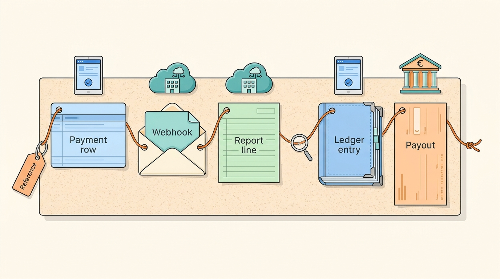
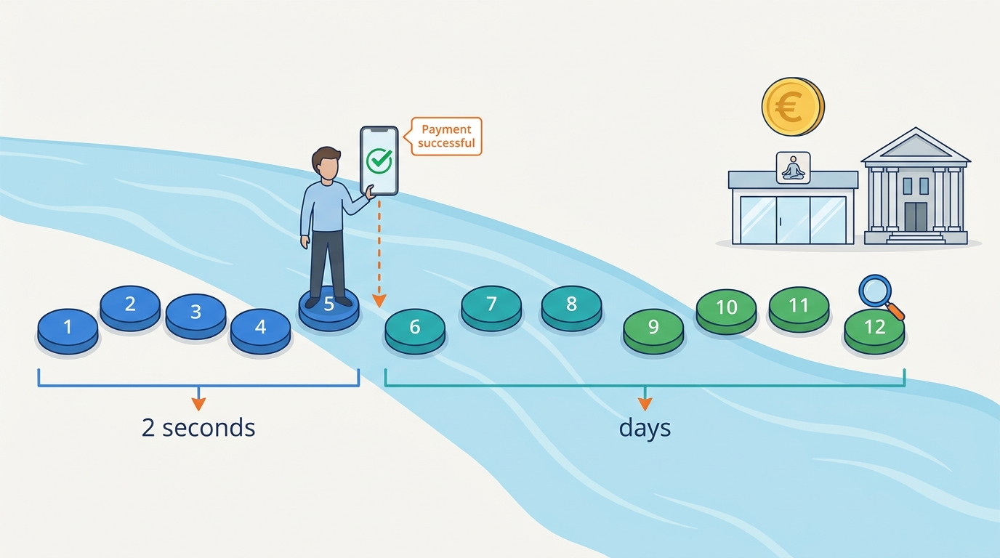
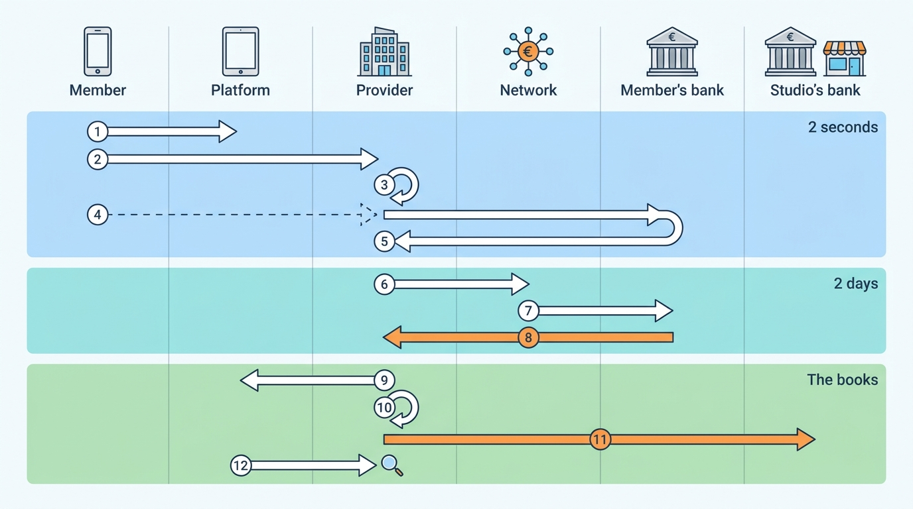

> **IN THIS CHAPTER, YOU WILL:** Follow Mila's €120 class pass through twelve steps on Adyen and on Stripe, and name the record that confirms each one.

> **KEY POINTS:**
>
> * **Twelve steps, eleven promises, one check.** Checkout, tokenization, risk scoring, authentication, authorization, capture, clearing, settlement, ledger entries, split and payout each end in a promise by the party that ran them. Only the twelfth, matching the payout to the provider's settlement record, establishes that the studio's €117.47 arrived.
> * **“Payment successful” reports step five.** It is the promise of the cardholder's bank to honor a claim. The losses on this path are the ones no success message can report: an approval that expires before the claim, a claim the card network rejects days later, a payout the bank returns.
> * **The record to wait for differs by provider.** Adyen gives a result code, then webhooks keyed by a reference, then report lines, and no call in its Checkout API that returns an online payment. Stripe gives an object whose status can be read again, a balance transaction with a date, and a payout object.

> **[FAILURE PATTERNS THIS CHAPTER ADDRESSES](where-payment-systems-go-wrong.html):**
>
> * **The Phantom Payment** — a record says `paid` on the fifth step's promise while seven later steps can still withdraw it.
> * **The Black-Box Balance** — the split and the payout are bookings inside the provider that only its reports itemize.
> * **The Stranded Payout** — the eleventh step reports "sent", and nothing reports "arrived" unless someone matches it.

 
[[part-9]] claimed that payments go wrong at hand-offs, and this first journey shows every hand-off working. At 19:42 on Tuesday 9 March 2027, Mila Janssen buys a ten-class pass for €120.00 from Studio Noord in the app of Larkfield, the fictional studio-software platform this book follows, and her phone says **Payment successful**. The message is true. It reports the fifth of twelve steps her €120 has to pass, and the other seven take from one second to two weeks.

**The €120 passes through twelve steps** between the tap and the studio's payout on Thursday 11 March. The first eleven each end in a promise by the party that ran them. The message on the screen reports the fifth, the approval by Mila's bank. **Only the twelfth**, in which Larkfield matches the payout against the provider's settlement record, establishes that the studio's €117.47 arrived.

This journey teaches no new mechanism. [[journey-of-a-payment]] gave the same payment as six steps seen from the banks' side. Here the steps inside the provider's and Larkfield's systems are added (checkout, tokenization, risk scoring, authentication, ledger entries, the split, reconciliation), and every step is shown with **the record it leaves and the reference that ties it to the next**. A payment on which nothing fails is the right first case, because each hand-off can be seen doing its job.

**Where we are in the payment's journey.** All of it. This chapter follows Mila's class pass from the tap at 19:42 on Tuesday 9 March 2027 to the payout of Thursday 11 March and on to Thursday 25 March, the day Larkfield marks that payout as arrived.

The chapter starts at Larkfield, with every record of the payment on one page. It then walks the payment in three stretches: two seconds, two days, and the books. After that it sets the twelve steps in one table, replays the pass on Stripe, and ends with the places where an approved payment is lost without an error.

## Setting the Scene at Larkfield: One Payment, Every Record

In late March 2027 Femke de Graaf, Larkfield's head of payments engineering, reviews the payment record store with Tom Hendriks, the engineer who built the payment service. For that review they pull everything that exists about one ordinary payment, Mila's pass. It takes an afternoon. The pass is a row in the payment record store, a stored webhook, lines in two of Adyen's reports, three ledger entries and a payout record. **No single system holds the payment**; each holds what one party told it at one moment.

So the walkthrough reads every record with one question: **which later record confirms this one?** The answer depends on references that survive from one system to the next. The table lists the ones on Mila's pass, and what Larkfield would hold had the studio been on Stripe. Each row comes from a decision of Keel, Larkfield's 2027 payments program ([[meet-larkfield]]).

| Reference | On Adyen (Studio Noord's provider) | On Stripe | Ties together |
| --- | --- | --- | --- |
| Larkfield's payment ID | Sent as the request's `reference` | Sent in the object's metadata | Larkfield's row and everything the provider reports |
| Idempotency key | Derived from the purchase, stored before the first send | The same | A request and its retries ([[idempotency-and-retries]]) |
| The provider's payment identifier | The PSP reference, on the response, every webhook and every report line | The PaymentIntent ID and its latest Charge | The approval, the capture and the report lines |
| The funding unit | Merchant account and batch number of the sales day | The balance transaction | The payment and the money that became payable |
| The payout | The transfer from the studio's balance account | The payout ID | The payable money and the bank credit |

**Figure 1:** *One payment is several records in several systems; a reference that survives every hop is what lets a later record confirm an earlier one.*

## 19:42, Two Seconds: Five Steps End in One Answer

**Step 1, checkout.** Before any provider is called, Larkfield's payment service writes a row to the payment record store: Larkfield's own payment ID, an idempotency key, a fingerprint of the request and the state `pending`. Only then does the request leave for Adyen. It carries the payment ID as `reference`, the key, and the instruction for dividing the €120.00 that step 10 will act on. The hand-off is the point of the order: if the answer is lost, Larkfield already holds a key to ask again with. That key is itself a promise with an expiry. Adyen's documentation (n.d., accessed November 2026) says idempotency keys "are valid for a period of 7 to 14 days after first submission"; Stripe's API reference (n.d., accessed November 2026) says keys can be removed once they are at least 24 hours old.

**Step 2, tokenization.** What the request carries next is not a card number. Mila's phone wallet hands over a **device token**, a stand-in for her card number issued by the card network for that one device ([[network-tokens]]), with a **cryptogram**, a one-time value that proves this token is being used by its holder for this purchase. The scenario does not say which wallet Mila uses, and both large ones are documented this way. Adyen's page (n.d., accessed November 2026) says "Apple Pay uses network tokenization, stores payment information securely in the shopper's Apple Pay eligible device, and confirms the payment through Touch ID or Face ID authentication." Google's developer guide (n.d., accessed November 2026) describes "a device token on an Android-powered device authenticated with a 3-D Secure cryptogram". Nothing that reaches Larkfield could charge Mila again, which is Keel decision K4 kept without effort. The stored card behind her membership is a different token, from 12 January ([[tokenization-vaulting-and-pci]]).

**Step 3, risk scoring.** Once the token arrives, Adyen decides something of its own before it asks anyone else. Its documentation (n.d., accessed November 2026) places the check: "Pre-authorization: the risk rule conditions are assessed before the payment is authorized. This saves issuer and scheme fees compared to blocking after authorization." A payment that fails it is refused with reason 20, FRAUD, and the bank never hears of it. Stripe's documentation (n.d., accessed November 2026) shows the same placement: a charge blocked for risk carries the network status `not_sent_to_network`. Mila's payment passes. What is handed on is thin: a pass means the payment did not cross a block threshold, **not that anyone found it genuine**. Whether it was genuine is learned weeks later, if a dispute arrives ([[payment-fraud-and-risk]]).

**Step 4, authentication.** This step, unlike the third, finished before the request began. Mila's fingerprint unlocked the wallet, and the proof travels inside the request as the cryptogram. European law requires **strong customer authentication** (SCA), two independent factors, for most online card payments, and a typed card meets it through 3-D Secure, the card networks' protocol for letting the bank check the payer ([[three-d-secure-and-sca]]). A wallet meets it on the device. Adyen's Apple Pay page (n.d., accessed November 2026) says "If you are implementing in Europe, Apple Pay is PSD2 SCA-compliant" and "Apple Pay supports liability shift for American Express, Discover, JCB, Mastercard, and Visa cards"; its Google Pay page says that wallet guarantees the liability shift for Visa cards issued in the EU or UK when the card is presented as a device token. A **liability shift** moves the loss from a fraud dispute to the cardholder's bank. Larkfield never sees this step. It records the result in three fields: no 3-D Secure outcome, no exemption requested, liability shift expected.

**Step 5, authorization.** With the token, the risk pass and the proof of authentication, Adyen sends the request through Visa to Mila's bank, the **issuer**, and the bank approves. Two records come back. The API response carries the result code `Authorised` and a PSP reference, and the app shows Mila her message. Larkfield's row does not move yet: it stays `pending`, **its state for "promised, not yet confirmed"**, until the `AUTHORISATION` webhook arrives seconds later and moves it to `paid`. Adyen's documentation (n.d., accessed November 2026) asks for that order: "Although you can use the payment result from the API, we recommend that you rely on the webhook to trigger any business logic", and "The status of a payment can sometimes change after you get the result code". The approval is a promise with an end date. Visa's rules (edition of 24 October 2026) give the merchant's side 10 calendar days to process an online payment the cardholder started ([[payment-authorization]]).

So the **Payment successful** on Mila's screen reports step five alone. A bank has promised to honor a claim, €120 is reserved in Mila's own account, and no money has moved. Of the five records so far, Larkfield holds one row and one stored webhook. The token is the wallet's, the risk result is the provider's, and the approval and the hold are the bank's. The message covers one promise out of eleven.

**Figure 2:** *The customer's success message stands on the fifth of twelve steps; the studio's money is established only at the twelfth, seven steps later.*

## Tuesday Night to Thursday: Capture, Clearing and Settlement Send No Message

**Step 6, capture.** The capture is the merchant's claim on the approved amount, and Adyen submits it within the same second as the approval: "By default, payments are captured automatically without a delay, immediately after authorization of the payment request" (n.d., accessed November 2026). No event marks it, because "A payment that is automatically captured does *not* trigger a separate CAPTURE webhook." That is why Larkfield's `paid` is set on the approval's webhook and means "the provider has confirmed the capture", never "settled". Whether the claim holds is known only later. Where a capture event is sent, its success means the request "is valid (for example, the authorization has not expired, and the balance is available) and has been submitted", and the same page warns that "In rare cases, a capture fails even after you received a **CAPTURE** webhook with `success`: **true**", which "can even happen a few days after". If that event, `CAPTURE_FAILED`, arrives, Larkfield's row goes back from `paid` to `authorized` ([[payment-state-machines]]).

**Step 7, clearing.** The submitted claim then becomes a record. The **acquirer**, the institution that collects card money for the merchant, presents it to Mila's bank through Visa; Visa's rules call it a presentment, "A Clearing Record that an Acquirer presents to an Issuer through Interchange". The record fixes the final amount and the **interchange**, the fee Mila's bank keeps, which the EU's Interchange Fee Regulation of 2015 caps at 0.2% for a consumer debit card **(evidence age: 11 years; the regulation is in force)**: at most €0.24 here ([[payment-economics]]). Two cautions. That Adyen N.V. is the acquirer of record for this payment is my inference, with two supports: Adyen's license page (n.d., accessed November 2026) says its credit-institution authorisation "includes the ability to provide cross-border acquiring, payment and banking services in all EEA countries", and its documentation lists the European Union among the regions where it has its own acquiring connection. Adyen's license pages (n.d., accessed November 2026) name an acquiring entity for some markets, Japan and Singapore among them; no page I found gives a complete list per country. And nothing about this step reaches Larkfield: no event, no status, no line.

**Step 8, settlement.** Money follows the record, and not payment by payment. Visa's rules define settlement amounts as "The daily net amounts expressed in a Member’s Settlement Currency resulting from Clearing", so Mila's €120, less the interchange, moves between banks inside one total ([[clearing-and-settlement]]). Again Larkfield is told nothing. Adyen's webhook documentation (n.d., accessed November 2026) says so: "Adyen does not send a webhook message when a payment settles successfully." The only trace of a settlement that never happens comes a month later; for platforms, "If Adyen does not receive the funds within 30 days after a payment's capture, we subtract those funds from the current settlement batch." The same webhook page names an optional event, `SETTLED_REVERSED`, that reports such a reversal under Sales day payout.

The sequence of steps seven and eight is documented, but their timing is not, and **here the public record stops**. Visa's rule text defines a settlement date, a settlement bank and a settlement currency, and I found no cut-off times and no number of settlement cycles per day in it. When this walkthrough says the record went out on Tuesday night and the banks settled on Wednesday, that is industry practice and an assumption, not a rule I can cite.

## Wednesday to Thursday 25 March: Entries, the Split, the Payout and the Match

**Step 9, ledger entries.** The first record to reach Larkfield after the approval is a report. Studio Noord's sales day closes at midnight, and Adyen's documentation (n.d., accessed November 2026) says "the payable batch always closes two hours after your sales day closing time": 02:00 on Wednesday 10 March. Because Larkfield is a platform, the report that counts most is another one, the Balance Platform Accounting Report, "a daily report that tracks all balance changes on all balance accounts in your balance platform". Adyen's platform documentation marks it as required for full financial reconciliation and the settlement details report of the batch as optional. Larkfield's reconciliation job, the one that does the matching at step 12, has no fixed hour. It starts on Adyen's signal that a report is ready: the `REPORT_AVAILABLE` webhook for a merchant account's reports, `balancePlatform.report.created` for the balance platform's. It writes Mila's payment into Larkfield's ledger from the report lines, under the PSP reference and Larkfield's own event ID: €117.47 owed to Studio Noord, €2.53 of fees owed to Larkfield and, once reported, €0.61 of provider cost *(assumption)*. Keel decision K3 is the rule: **entries come from the provider's statement, never from the webhook** ([[payment-ledgers]]). The ledger now holds claims. It does not hold cash.

**Step 10, the split.** Those entries mirror bookings at the provider. The instruction travelled with the payment at 19:42: the studio's share to Studio Noord's balance account, Larkfield's fee as commission ([[splits-balances-and-platform-payouts]]). It becomes payable funds two business days later. Adyen's platform documentation (n.d., accessed November 2026) says "Adyen settles a settlement batch after its sales day ends and the configured settlement delay has passed. The date when the schemes or payment methods transfer the funds to Adyen does not affect this timing." Its accounting report gives each booking two dates: "The booking date is when the event (like a payment) took place, and the value date is when the actual balance is credited or debited to a balance account." On Thursday 11 March the report shows €117.47 in the studio's balance account and €1.92 in Larkfield's, the €2.53 less the provider's cost. The report is the proof, because the approval was not: "The API request validates only the format of the split instructions, **not** the balance accounts specified in the request. This means that even if the transaction is successful, it is possible that the funds are not credited".

**Step 11, the payout.** The same Thursday the funds leave. Adyen's transfer webhook reports the €117.47 to Studio Noord's bank as `booked`, and Larkfield's payout record moves from instructed to **sent**. It goes no further, because Adyen's own page for platforms (n.d., accessed November 2026) says of `booked`: "This status is not final. Instant payouts may be rejected by the counterparty's bank and thus fail, and regular and wire transfers may be returned by the counterparty's bank." The provider has promised that it sent the money. Whether Ines Bakker, the studio's owner, has it is a fact at her bank; in the best case the money is there the same day, and no record at Larkfield says so ([[payouts-and-money-movement]]).

**Step 12, reconciliation.** Every step so far was reported by the party that performed it. The twelfth is different: Larkfield's job matches the payout against the provider's settlement record, by merchant account and batch number and by the balance platform's daily report for the studio. A match clears the ledger's "payouts in transit" account; an amount that does not match becomes an open item with an age and an owner ([[payment-reconciliation-and-reporting]]). On Thursday 25 March, when Larkfield's return window of ten business days *(its own policy, an assumption)* has passed with no return, the payout is marked **arrived**. The word names a state of Larkfield's record, not the day the money landed, which in the best case was 11 March. It is still an inference from silence: for a transfer that is not instant, Adyen's page gives an estimated arrival time and no confirmation of the credit. But it is the first time an earlier promise is tested against **a record from another party**.

After the twelfth step the payment is finished, and it is not final. Mila can dispute it through her bank until about 7 July 2027, which is 120 days from the purchase by my arithmetic. On 18 March she will in fact ask for €84.00 back, a week after the studio was paid; [[journey-platform-payment]] follows that. The row and its ledger entries have to stay correctable for months after the payout that seemed to close them.

## The Twelve Steps in One Table

Set side by side, the twelve steps look like this on Adyen. For each: who acts, the record left behind, what that record promises, and the failure that can occur there with the chapter that owns the mechanism. The figure after the table shows the same steps as arrows between the parties.

| Step | Party or system | Message or record | Promise made | What can fail here → chapter |
| --- | --- | --- | --- | --- |
| 1. Checkout | Booking app, payment service | `pending` row; payment ID; idempotency key | Larkfield: one purchase, one payment | A timeout retried under a new key charges twice → [[idempotency-and-retries]] |
| 2. Tokenization | Mila's wallet; Adyen's client library | Device token and cryptogram | Network: this stand-in is Mila's card, used once | A card number reaches a system not meant to see it → [[tokenization-vaulting-and-pci]], [[network-tokens]] |
| 3. Risk scoring | Adyen | Risk result; refusal reason 20 if blocked | Provider: below the block threshold | A good customer refused, or an open endpoint used to test cards → [[payment-fraud-and-risk]] |
| 4. Authentication | The wallet, on the device | Cryptogram inside the request | Issuer bears a fraud dispute | On a typed card: an abandoned challenge, or an exemption with no liability shift → [[three-d-secure-and-sca]] |
| 5. Authorization | Mila's bank, through Visa | `Authorised`, PSP reference; `AUTHORISATION` webhook | Issuer: will honor a claim for 10 days | No answer comes back and the outcome is unknown → [[payment-authorization]] |
| 6. Capture | Adyen, for Studio Noord | None of its own when automatic | Provider: claim valid and submitted | Approval expires first; `CAPTURE_FAILED` days later → [[clearing-and-settlement]], [[payment-state-machines]] |
| 7. Clearing | Acquirer, through Visa | Presentment; none at Larkfield | Acquirer: final amount and data | A late record costs more or can be disputed → [[clearing-and-settlement]] |
| 8. Settlement | Visa and the banks | A daily net amount; no webhook | Network: its members pay each other | Funds not received in 30 days are reversed from a batch → [[balances-and-funds-flows]] |
| 9. Ledger entries | Larkfield's reconciliation job | Report lines; entries per leg | Larkfield: studio owed €117.47, fee €2.53 | A later movement with no entry → [[payment-ledgers]] |
| 10. Split | Adyen's balance platform | Bookings with a value date | Provider: €117.47 payable to the studio | A wrong account booked to the platform, no error → [[splits-balances-and-platform-payouts]] |
| 11. Payout | Adyen, then the banks | Transfer `booked`; payout `sent` | Provider: the money was sent | The receiving bank returns it → [[payouts-and-money-movement]] |
| 12. Reconciliation | Larkfield's reconciliation job | Match to batch and report; `arrived` | None: this step checks the others | A total forced to tie; an open item nobody owns → [[payment-reconciliation-and-reporting]] |

**Figure 3:** *The twelve steps as a sequence: five within two seconds, three over two days that send the platform nothing, and four in the books, of which only the twelfth checks the others.*

Now read the table downward and ask the scene's question of each row. **The record that confirms a row is always in a later row, and usually on another channel.** The approval, an API response and a webhook, is confirmed by the capture surviving and by the report line. The capture is confirmed by the absence of `CAPTURE_FAILED` and by the same line. The split is confirmed by the accounting report. The payout is confirmed by the match and the passing of the return window. Clearing and settlement have no confirming record on the merchant's side at all. A step table of your own system is this exercise: for each row, name the record that confirms the row before it.

## Had Studio Noord Been on Stripe: The Same Steps, Other Records

On Stripe the twelve steps and the parties stay the same; the wallet, the risk check before the bank, Visa and Mila's bank do what they did. What changes is the form of the record. Where Adyen gave a result code, webhooks and report lines, Stripe gives objects, each with an identifier and a status. The table lists the steps where the record differs, from Stripe's documentation (n.d., accessed November 2026).

| Step | On Adyen (as it happened) | On Stripe (had it been) |
| --- | --- | --- |
| 1. Checkout | Request with Larkfield's `reference` | A PaymentIntent created by the payment service, confirmed in the app |
| 5. Authorization | `Authorised`, then the `AUTHORISATION` webhook; no Checkout API call reads the payment back | Status `succeeded`; the `payment_intent.succeeded` event is a prompt to read the object |
| 6. Capture | No event; `CAPTURE_FAILED` possible days later | Part of `succeeded`; a later rejection is not mentioned |
| 9. Ledger entries | Lines of the batch and accounting reports | A balance transaction with `amount`, `fee` and `net` |
| 10. Split | Bookings to two balance accounts, with a value date | A destination charge: funds transferred to the studio's account, an application fee back |
| 10. Funds payable | The sales day's batch, after the settlement delay | Each transaction, `pending` until its `available_on` |
| 11. Payout | Transfer `booked`, "not final" | Payout `paid`, which can become `failed` |
| 12. Reconciliation | Merchant account, batch number, daily report | The payout reconciliation report, by payout ID |

For example, replay the pass. Larkfield's Stripe studios are legacy Custom connected accounts, so the payment service creates a destination charge of €120.00 with `on_behalf_of` naming the studio and an application fee of €2.53 ([[platform-payment-models]]). At 19:42 the PaymentIntent reads `succeeded`. Larkfield's row still waits: under K2 the payment service reads the object back and only then writes `paid`. The date changes more than the amounts. Stripe's clock is per transaction and counts from the capture: "Stripe uses “T” to refer to the transaction time, which indicates the time of the original payment confirmation or capture", and funds "transition from `pending` to `available` at the corresponding available_on time for each balance transaction". For a Dutch account the default is 3 business days, so the €117.47 becomes available on Friday 12 March and is paid out from then on. Larkfield's cost differs too: at its blended Stripe rate *(assumption)* €0.87, leaving €1.66 of the fee.

As a result, the record an integration waits for differs at three hand-offs.

- **The outcome.** A PaymentIntent can be retrieved by its ID at any time (Stripe's API reference, n.d., accessed November 2026). Version 72 of Adyen's published Checkout API specification (accessed November 2026) has three GET operations, and none returns a payment, so for an online payment on Adyen the stored webhook is the working record.
- **The capture.** Adyen documents a failure after success. Stripe's pages do not say whether one can occur.
- **The funds.** Stripe ages each transaction from its capture. Adyen ages a sales day, pays it after a fixed delay and sends no event when the network settles.

On two points this journey depends on, Stripe's documentation, its support site and a web search (November 2026) left a gap. Its pages do not say whether the network can reject a capture after the status reads `succeeded`. For the standard payout schedule, its services terms (last modified 28 September 2026) count "a delay or failure of a Financial Provider to settle a Transaction to Stripe" as a "Payout Delay", so a network that does not pay can hold a payout back; whether funds otherwise become available before Stripe has received them is stated in neither the terms, the documentation nor the support site. Stripe documents paying ahead in one product only: its Instant Payouts page says "Card payment funds are available immediately, including pending funds within your payout schedule window". Two sentences of Stripe's own show the gap. Its lifecycle page says of `succeeded`: "The funds are now in your account and you can confidently fulfill the order." Its payment methods page says a `succeeded` status means success "according to the payment method’s processing flow, but funds can still be refunded, disputed, returned, or reversed". My reading is that "your account" is the Stripe balance, where the amount is still `pending`. For Adyen the second point is documented: its Sales Day Payout terms (last update 17 June 2024) say it pays "irrespective of whether the funds are actually received by Adyen from the Acquirer or Scheme Owner", although Adyen's Annual Report 2025 calls paying "only after funds have been received" its "default setup", and public text does not reconcile the two ([[balances-and-funds-flows]]). I do not fill Stripe's silence with a guess.

## Where an Approved Payment Is Lost Without an Error

Everything above went right. The same hand-offs can also fail **with no error on the day**, in four places, and in each the step's own success message was true when it was sent. The first row does not threaten Mila's pass, which was captured at once; it applies wherever the claim is sent later. In the third row a **deposit** (Adyen) or **reserve** (Stripe) is money the provider holds back against risk, as each provider's own pages describe it (n.d., accessed November 2026).

| Where | What happens | Why nothing fails on the day | The record that shows it |
| --- | --- | --- | --- |
| Before a delayed capture | The approval expires: 10 days under Visa's rule for an online payment; Stripe's page lists 7 days for the same case | The approval was valid when given | Stripe: the payment becomes `canceled`. Adyen: an `EXPIRE` webhook when Adyen expires the authorization, by default after 28 days; a capture after the network's window is possible and carries risks Adyen's page lists |
| After the capture | The card network rejects a claim the provider accepted | The capture was valid and had been submitted | Adyen: `CAPTURE_FAILED`, and a CaptureFailed entry in the settlement details report. Stripe: not public |
| At funding | The amount is set off against refunds, held in a deposit or reserve, or absorbed by a negative balance | The split was booked as instructed | Adyen: the accounting and settlement details reports. Stripe: balance transactions |
| At payout | The receiving bank returns the transfer | The payout was sent | Adyen: a returned transfer. Stripe: a payout that "might initially show as `paid`, then change to `failed`" |

To catch these, Larkfield changes no mechanism and adds no provider. It keeps a state that means "promised, not yet confirmed" (`pending` for a payment, `sent` for a payout) and puts two checks behind it. Under K2 a job sweeps every payment still in that state against the provider's own record. Under K3 the reconciliation job, run once per provider when its reports are ready, compares the reports with the ledger, and what is still open after five business days goes to Priya Raman, the finance controller. I would build these two before anything else in a payment system, because they stand at the hand-offs, which is where all four losses are.

## What to Take Away

**Established.**

- The provider's synchronous answer is not the record to act on: Adyen's documentation says to rely on the webhook, and Stripe's says a `succeeded` payment can still be refunded, disputed, returned or reversed (both n.d., accessed November 2026).
- A payout reported as sent can still fail on both providers, and on Adyen a capture can be rejected by the network days after it was accepted.
- Funding runs on the provider's own schedule: Adyen settles a sales day after a fixed delay whatever the network's timing, and Stripe counts from the capture.

**Depends on context.**

- *Which record justifies a state* depends on the provider: a re-read object on Stripe; a stored webhook and then a report line on Adyen.
- *When funds reach the seller* depends on the account's settlement delay or availability schedule, not on the card.
- *How much a silent loss can cost* depends on what you release on the fifth step: a class seat costs little, shipped goods a great deal.

**The author's synthesis.**

- The three stretches are three kinds of evidence. In the first two seconds every party answers, and each answer is a promise. In the next two days nobody answers. In the last stretch the answers are bookings and a transfer marked sent. No step among the first eleven checks an earlier one, so the truth of a payment is in the comparison at the twelfth.
- A card payment is finished at the twelfth step and final only when the dispute window closes. I would spend first at the hand-offs: one reference that survives every hop, one unconfirmed state, a sweep, a daily match.

## Questions to Ask

Fill in the twelve-row table for one card payment of your own, then ask:

1. For each row, which later record confirms it, and which rows have none?
2. Which reference lets us find the provider's record from ours, and ours from a report line?
3. For each state in our vocabulary, which provider record justifies entering it, on each provider we use?
4. What do we release or book on step five, and what would it cost if step six failed two days later?
5. What is our state for "promised, not yet confirmed", and what sweeps it?
6. Can a capture fail after our provider accepted it, and which event or report line would tell us?
7. Does "paid out" in our records mean sent or arrived, and for how long does a payout stay open?
8. How long after the payout can a payment row and its ledger entries still be corrected?

At 19:42 the screen said the payment had succeeded. You can now say that it reported the fifth of twelve steps, name the seven that followed, and say which record at Larkfield confirmed each, up to a payout marked arrived on 25 March and a window open until July. Mila was present for this payment and her bank said yes. The next journey keeps the member and her card and removes both: [[journey-failed-renewal]] follows the €49 renewal that Larkfield starts alone on 1 April, and that her bank declines.

## Sources and Evidence

*Company, product and investor sources*

- [Capture](https://docs.adyen.com/online-payments/capture), Adyen documentation, n.d., accessed 2026-11 — automatic capture, no separate CAPTURE webhook, what a successful capture means, failure after success.
- [Webhook structure and types](https://docs.adyen.com/development-resources/webhooks/webhook-types), Adyen documentation, n.d., accessed 2026-11 — the AUTHORISATION advice, no webhook when a payment settles, the optional SETTLED_REVERSED event, the EXPIRE event.
- [Result codes](https://docs.adyen.com/online-payments/build-your-integration/payment-result-codes), Adyen documentation, n.d., accessed 2026-11 — the result code is not the record to update an order system from.
- [API idempotency](https://docs.adyen.com/development-resources/api-idempotency), Adyen documentation, n.d., accessed 2026-11 — key validity of 7 to 14 days.
- [Apple Pay](https://docs.adyen.com/payment-methods/apple-pay), Adyen documentation, n.d., accessed 2026-11 — network tokenization, device authentication, SCA compliance, liability shift by card brand.
- [Google Pay](https://docs.adyen.com/payment-methods/google-pay), Adyen documentation, n.d., accessed 2026-11 — liability shift for device tokens on Visa cards issued in the EU or UK.
- [Configure your risk profile](https://docs.adyen.com/risk-management/configure-your-risk-profile), Adyen documentation, n.d., accessed 2026-11 — pre-authorization risk rules.
- [Refusal reasons](https://docs.adyen.com/development-resources/refusal-reasons), Adyen documentation, n.d., accessed 2026-11 — reason 20, FRAUD.
- [Sales day payout](https://docs.adyen.com/account/sales-day-payout), Adyen documentation, n.d., accessed 2026-11 — batch closing two hours after the sales day.
- [Upgrade to Sales day payout](https://docs.adyen.com/account/sales-day-payout/upgrade-to-sdp), Adyen documentation, n.d., accessed 2026-11 — CaptureFailed entries in the settlement details report.
- [Settle funds](https://docs.adyen.com/platforms/settle-funds), Adyen for Platforms documentation, n.d., accessed 2026-11 — settlement after the sales day and the settlement delay; reversal after 30 days.
- [Balance Platform Accounting Report](https://docs.adyen.com/platforms/reports-and-fees/balance-platform-accounting-report), Adyen documentation, n.d., accessed 2026-11 — daily report of balance changes; booking date and value date.
- [Split chargebacks](https://docs.adyen.com/platforms/online-payments/split-transactions/split-chargebacks), Adyen documentation, n.d., accessed 2026-11 — the request validates only the format of split instructions.
- [Payout transfer webhooks](https://docs.adyen.com/platforms/payout-webhooks), Adyen for Platforms documentation, n.d., accessed 2026-11 — `booked` is not final; returned transfers; the estimated arrival time on transfers that are not instant.
- [Deposit](https://docs.adyen.com/account/balances/deposit), Adyen documentation, n.d., accessed 2026-11 — sales booked to a deposit when the requirement rises.
- [Automatically get reports](https://docs.adyen.com/reporting/automatically-get-reports), Adyen documentation, n.d., accessed 2026-11 — the `REPORT_AVAILABLE` webhook.
- [Get platform reports](https://docs.adyen.com/platforms/prepare-reports/generate-download-reports), Adyen documentation, n.d., accessed 2026-11 — the `balancePlatform.report.created` webhook.
- [Reports and fee types](https://docs.adyen.com/platforms/reports-and-fees), Adyen documentation, n.d., accessed 2026-11 — reports required and optional for a platform's reconciliation.
- [Licenses and disclosures: EMEA](https://www.adyen.com/licenses/emea), Adyen, n.d., accessed 2026-11 — Adyen N.V.'s authorisation as a credit institution, including cross-border acquiring in all EEA countries.
- [Supported payout currencies](https://docs.adyen.com/account/supported-currencies), Adyen documentation, n.d., accessed 2026-11 — the countries and regions with an Adyen acquiring connection; no list of acquiring entities per country.
- [Licenses and disclosures: Japan](https://www.adyen.com/licenses/japan) and [Singapore](https://www.adyen.com/licenses/singapore), Adyen, n.d., accessed 2026-11 — Adyen Japan KK's registration as merchant acquirer; Adyen Singapore's license for merchant acquisition.
- [Authorization adjustment](https://docs.adyen.com/online-payments/adjust-authorisation), Adyen documentation, n.d., accessed 2026-11 — the 28-day expiry; capture after the network's window and its risks.
- [Sales Day Payout Terms of Service](https://www.adyen.com/legal/sales-day-payout-terms-of-service), Adyen, last update 2024-06-17 — payout irrespective of receipt of funds.
- [Annual Report 2025](https://investors.adyen.com/financials/2025), Adyen N.V., signed 2026-03-05 — the risk section: paying "only after funds have been received" as the "default setup" (audited; read in the PDF this page offers for download).
- [Stripe Services Agreement: Services Terms](https://stripe.com/legal/ssa-service-terms), Stripe, last modified 2026-09-28 — the definition of Payout Delay (a financial provider's failure to settle to Stripe).
- [Adyen OpenAPI definitions](https://github.com/Adyen/adyen-openapi), Adyen, Checkout API version 72, accessed 2026-11 — three GET operations, none returning a payment.
- [How Payment Intents and Setup Intents work](https://docs.stripe.com/payments/paymentintents/lifecycle), Stripe documentation, n.d., accessed 2026-11 — the meaning Stripe gives `succeeded`.
- [Payment Methods API](https://docs.stripe.com/payments/payment-methods), Stripe documentation, n.d., accessed 2026-11 — what a `succeeded` status leaves open.
- [Place a hold on a payment method](https://docs.stripe.com/payments/place-a-hold-on-a-payment-method), Stripe documentation, n.d., accessed 2026-11 — an expired authorization becomes `canceled`; the 7-day window for a customer-initiated Visa payment.
- [Transaction risk prevention](https://docs.stripe.com/radar/transaction-risk-prevention), Stripe documentation, n.d., accessed 2026-11 — a risk block recorded as not sent to the network.
- [Retrieve a PaymentIntent](https://docs.stripe.com/api/payment_intents/retrieve), Stripe API reference, n.d., accessed 2026-11 — a payment can be read back by its identifier.
- [Instant Payouts for Stripe Dashboard users](https://docs.stripe.com/payouts/instant-payouts), Stripe documentation, n.d., accessed 2026-11 — card funds paid out before they are available.
- [Reserves - Frequently Asked Questions](https://support.stripe.com/questions/reserves-frequently-asked-questions), Stripe support, n.d., accessed 2026-11 — what a reserve is.
- [Idempotent requests](https://docs.stripe.com/api/idempotent_requests), Stripe API reference, n.d., accessed 2026-11 — keys kept at least 24 hours.
- [Create destination charges](https://docs.stripe.com/connect/destination-charges), Stripe documentation, n.d., accessed 2026-11 — the charge type, `on_behalf_of`, the application fee.
- [Balances and settlement time](https://docs.stripe.com/payments/balances), Stripe documentation, n.d., accessed 2026-11 — pending to available at `available_on`; the Dutch timing (volatile).
- [The Balance Transaction object](https://docs.stripe.com/api/balance_transactions/object), Stripe API reference, n.d., accessed 2026-11 — `amount`, `fee`, `net`, `available_on`.
- [Receive payouts from Stripe](https://docs.stripe.com/payouts), Stripe documentation, n.d., accessed 2026-11 — what "T" counts from.
- [The Payout object](https://docs.stripe.com/api/payouts/object), Stripe API reference, n.d., accessed 2026-11 — `paid` can change to `failed`.
- [Payout reconciliation report](https://docs.stripe.com/reports/payout-reconciliation), Stripe documentation, n.d., accessed 2026-11 — itemization by payout.
- [Google Pay API tutorial](https://developers.google.com/pay/api/web/guides/tutorial), Google, n.d., accessed 2026-11 — the device token with a cryptogram.

*Standards, regulation and official documentation*

- [Visa Core Rules and Visa Product and Service Rules](https://usa.visa.com/dam/VCOM/download/about-visa/visa-rules-public.pdf), Visa, 2026-10-24 — Table 5-11 (10 calendar days), the definitions of presentment and settlement amount, the 120-day dispute time limit; no settlement cut-off times found.
- [Regulation (EU) 2015/751 on interchange fees for card-based payment transactions](http://publications.europa.eu/resource/celex/32015R0751), Official Journal of the European Union, 2015-05-19 — the 0.2% cap on consumer debit interchange (evidence age: 11 years; in force).

*Research and practitioner sources*

- [[payments-fundamentals]] in RECONCILED — the same payment as a finance architect sees it, from report to ledger.

Larkfield is fictional; architectural recommendations, labeled inferences and labeled assumptions are the author's judgement.
