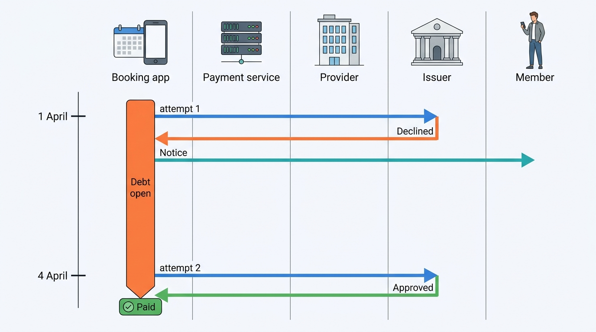
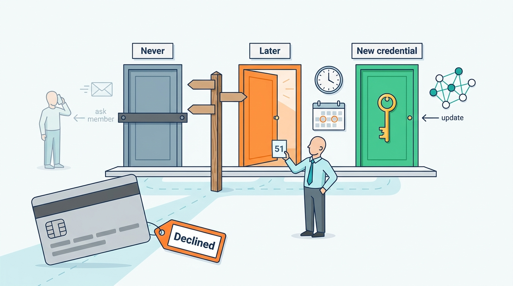
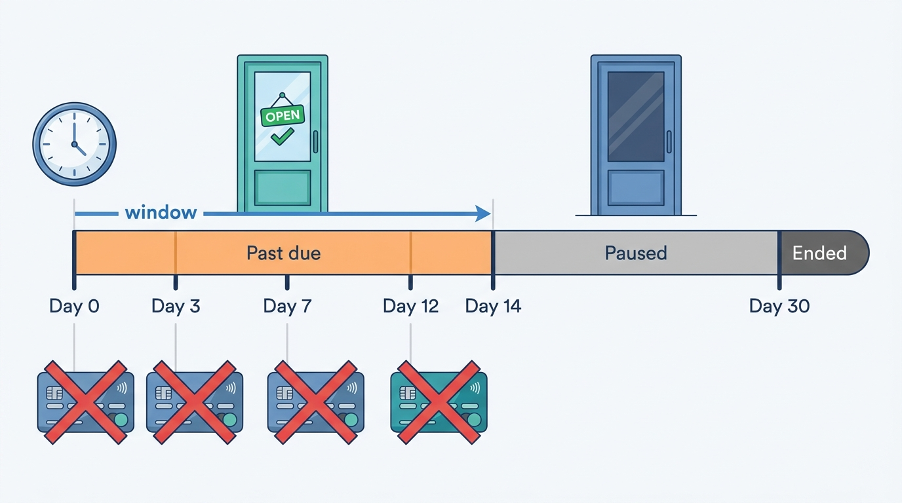

> **IN THIS CHAPTER, YOU WILL:** Follow one declined membership renewal through every hand-off to its recovery, on Adyen and on Stripe Billing, and through the branch where it lapses.

> **KEY POINTS:**
>
> * **A decline is an instruction, not an ending.** Visa's rules of 24 October 2026 separate codes a merchant must never resubmit from codes it may reattempt, up to 20 times in 30 days. Insufficient funds is a matter of timing; a replaced card is a credential problem that a retry does not solve.
> * **The debt and the attempts against it are two records.** Between the decline on 1 April and the approval on 4 April no payment record says what the member is. A record of April's debt does, and every attempt is counted against it.
> * **Where the debt lives depends on the provider.** Stripe Billing retries an invoice it holds. On Adyen the provider can retry a payment, and the schedule, the membership state and the notice are the integrator's. Each company has one blog post on its retry model (2024, 2020); neither documents the model now running, or a recovery rate with a stated basis.

> **[FAILURE PATTERNS THIS CHAPTER ADDRESSES](where-payment-systems-go-wrong.html):**
>
> * **The First of the Month** — a renewal that is late, declined or not yet attempted needs a defined state, or the peak turns into wrong emails and wrong retries.
> * **The Phantom Payment** — a membership shown as “unpaid” or “failed” from the latest payment alone states something no confirmed record says.
> * **The Double Charge** — a scheduled retry and the member's own payment through a link can both succeed unless one record of the debt accepts only one.

 
At some hour on Thursday 1 April 2027 the renewal job at Larkfield, the fictional studio-software platform this book follows, charges Mila Janssen's stored card €49.00 for her April membership at Studio Noord. Her bank refuses: not enough money in the account. Mila is not there. She sees no screen, and no screen can ask her anything. Three days later the money arrives. In between she walks into the studio and is let in. **Which system decided that, and which decided to try again?**

The answer is this chapter's claim. **A declined renewal is an open debt with a clock, not a failed payment.** The decline code decides whether a retry is allowed at all, and the card network caps how many. The state of Mila's membership in between has to be held on the billing side, because no payment record contains it. Where that debt lives **depends on the provider**: Stripe Billing retries an invoice it holds, while on Adyen, Studio Noord's provider, the provider can retry a payment and Larkfield's renewal job owns the schedule, the membership state and the notice to Mila.

**Where we are in the payment's journey.** [[journey-card-payment]] followed Mila's €120.00 class pass of 9 March 2027 through twelve steps. She started that payment herself, and her bank approved it the first time. This journey keeps the member and the stored card and removes both of those things: Mila is absent when the charge is made, and the issuer, the bank that gave her the card, says no. A decline code, a schedule and a notice take the place of authentication and approval. Like every journey in [[part-9]], this one teaches no new mechanism. It leads each step with the hand-off and points to the chapter that owns what happens inside.

The chapter sets the scene on 1 April, then lays the renewal out as eleven steps in one table. It walks those steps in three groups: the charge, the decision after the decline, and the recovery on 4 April. It then reads the same renewal on Stripe Billing, follows the branch where the money never comes, and ends with what to take away.

## Setting the Scene at Larkfield: Thursday 1 April 2027

Take the day itself. Mila's membership was set up on 12 January 2027, when she typed in her Dutch Visa debit card and passed a challenge in her banking app. It renews on the 1st, with about 940,000 other memberships a month, and 38% of them fall into the wave on the first of the month. Under decision K5 of Keel, Larkfield's 2027 program for its payments estate, the renewal job spreads that wave over 18 hours. Studio Noord is on Adyen, and a stored-card renewal stays with the provider that holds the card, so Mila's charge goes to Adyen. Three parties matter from here: Larkfield's job, which acts as the billing engine; Adyen; and a member who is somewhere else.

Six months earlier, by contrast, the same decline would have left nothing behind but a flag. Before Keel the booking app kept a paid-or-unpaid flag taken from the latest payment, and no record of what was owed for a period. On 1 October 2026 the renewal job hit a provider's rate limit: the provider turned 7,900 renewal requests away before any card was charged, and the job marked them failed and put them off to the next day. That evening those members received a failure email. The email job selected memberships that were due and had no successful payment, and the flag could not tell a declined card from a card nobody had charged yet. So a state that nothing defined was read as a failure by the next job that looked at it.

From that incident Femke de Graaf, who has led payments engineering since January 2027, takes two questions and reads every renewal by them. **Who decides whether and when to try again? And which system holds the membership until the money arrives?** The first is answered by a code, a network rule and a schedule. The second is answered by a record that Keel added. Each belongs to a different group of steps below.

## The Renewal in Eleven Steps

To answer both questions the whole path is needed first. Set against Journey 1's twelve steps, the renewal loses three and gains three. There is no checkout, no authentication, and no first-time approval. In their place stand a classification of the decline, a state held for the member, and a notice. The steps after an approval (capture, clearing, settlement, payout, reconciliation) are Journey 1's, and here they get one row.

The table below gives all eleven in the form Journey 1 set up: who acts, what record the step produces, what that record promises, and what fails where it is handed on. Read the last column closely. Every failure in it sits between two rows, and each points to the chapter that owns the mechanism.

| Step | Party or system | Message or record | Promise made | What can fail here → chapter |
| --- | --- | --- | --- | --- |
| 1. The period opens | Booking app (the billing clock) | Period record for April 2027: €49.00, `open` | “€49.00 is owed once for April” | No record, or two for one period → [[subscriptions-and-billing-engines]] |
| 2. An attempt is recorded | Payment service | Attempt row `pending`; idempotency key ending `:2027-04:1`; Larkfield's payment ID | “This request can be repeated without a second charge” | A timeout resent under a new key → [[idempotency-and-retries]] |
| 3. The request is flagged, the credential swapped | Payment service, Adyen | Payment request marked `ContAuth` and `Subscription`; provider token swapped for a network token | “The merchant is asking, under the agreement of 12 January, with a current credential” | A wrong flag; a replaced card with no token → [[payment-authorization]], [[network-tokens]] |
| 4. The issuer answers | Mila's bank, through Visa and Adyen | `Refused`; reason 12 “Not enough balance”; raw code 51 | None: no hold, no money | A timeout filed as a decline → [[payment-authorization]] |
| 5. The decline is classified | Payment service, renewal job | Code 51 stored as Visa Category 2 | “A reattempt is permitted, within the network's limit” | Every decline retried alike → [[authorization-optimization]] |
| 6. The state is held | Booking app | Period record still `open`, one declined attempt; membership `past_due` with access | “Mila is a member until the window closes” | An unpaid flag turns her away at the door → [[invoicing-collections-and-dunning]] |
| 7. The member is told | Booking app | One email on 1 April: what failed, the next attempt, a link to pay another way | “You have time, and another way to pay” | A notice for a payment nobody attempted → [[invoicing-collections-and-dunning]] |
| 8. A second attempt | Renewal job, payment service | New attempt row; key ending `:2027-04:2`; a new request on 4 April | “This is a new question to the bank” | The old key replays the old refusal; two schedulers → [[idempotency-and-retries]], [[authorization-optimization]] |
| 9. The approval is confirmed | Mila's bank; Adyen | `Authorised`; `AUTHORISATION` webhook, success | The bank will honor a €49.00 claim | A webhook that never arrives → [[payment-webhooks-and-events]] |
| 10. The debt is closed | Booking app, ledger | Period record `paid`; membership active; from the report lines, ledger entries of €47.82 owed to the studio and a €1.18 fee | “April is paid, once” | The member also paid by the link → [[invoicing-collections-and-dunning]] |
| 11. The money moves | Adyen, the networks, the bank | Journey 1's rows: settlement, payout, reconciliation | The studio's €47.82 arrives | A payout that returns; an unmatched report line → [[journey-card-payment]] |

The same eleven rows look different on a time axis, as the figure below shows. The renewal runs on two clocks. The debt for April is open for three days without a break. The two payment attempts are events of a few seconds each, and between them the payment lanes are empty. On 2 and 3 April only the billing lane holds anything.

**Figure 1:** *Two attempts of a few seconds each, on 1 April and 4 April, and one debt that stays open for the three days between them; only the billing side holds anything in that time.*

## From the Billing Clock to the Issuer: A Charge With Nobody Present

The first four steps run within seconds of each other on 1 April. The first hand-off is from the calendar to a record. Before any charge is sent, the booking app writes a **period record**: this membership, April 2027, €49.00 due, state `open`. It is an invoice in all but name, a statement of what is owed for which period ([[subscriptions-and-billing-engines]]). Because it exists before the payment and apart from it, a later attempt can be a second attempt at the same thing.

Next, the debt becomes a request that can be repeated safely. The payment service stores an attempt row in the state `pending` and an **idempotency key**, the identifier that lets a provider recognize a repeated request. Under decision K1 the key is built from the membership, the billing period and the attempt number, so this one ends in `:2027-04:1`. All of this is written before anything is sent. If the call times out, the outcome is unknown, and the service resends under the stored key. On 1 November 2026 the job sent a new key instead, and 1,840 members paid twice ([[idempotency-and-retries]]).

Then the request is labeled before it leaves. A **merchant-initiated transaction** is a card payment the merchant starts from stored details while the cardholder is away. On Adyen, Larkfield declares it with two fields that the documentation names (n.d., accessed November 2026): `shopperInteraction` set to `ContAuth` and a `recurringProcessingModel` of `Subscription`. Stripe's documentation (n.d., accessed November 2026) defines the same thing as a transaction “that you initiate without direct participation of your customer, based on a prior agreement with that customer authorizing you to store and use their credentials”. The prior agreement is Mila's authenticated set-up of 12 January. The label has a price. Such a payment falls outside strong customer authentication, the European rule that the bank must verify its customer, so there is no challenge and no liability shift: a fraud dispute on a renewal stays with the studio ([[three-d-secure-and-sca]]). Nothing can be asked of Mila at this moment.

In addition, the credential changes on the way out. Larkfield sends a **provider token**, an identifier that means something only inside Adyen's vault. Adyen's documentation (n.d., accessed November 2026) says that for such a token “we automatically swap that for a network token”, the card network's own stand-in for the card number, and that “if the shopper receives a new card because the old one expired or was lost, the network token remains the same.” Adyen has managed these tokens for Larkfield's stored cards since 2024 *(illustration)*. So one cause of failure is removed before the bank is asked. On 1 March 2027 another Studio Noord member, Lotte Smit, was charged without trouble weeks after her bank had replaced her card ([[network-tokens]]).

What comes back is a refusal with a code. Mila's bank answers with Visa response code 51, “Not sufficient funds”. Adyen reports the result `Refused` with its own reason 12, “Not enough balance”, and, once raw responses are enabled for the account (Adyen's documentation, n.d., accessed November 2026), the network's code beside it. Those are two facts, and the network's retry rule for that code is a third ([[payment-authorization]]). No hold is placed and no money moves. A decline is an answer, and that separates it from a timeout, which says nothing at all. The attempt row closes as declined, and the next step has one code to act on.

## The Decline as an Instruction: Classify, Hold the State, Tell the Member

Because the refusal carries a code, the first decision can be made by rule. The code sorts the decline into one of three kinds, and Visa's rules (Product and Service Rules, edition of 24 October 2026, Table 7-2) attach a limit to the kinds that may be tried again. Adyen's page on these categories (n.d., accessed November 2026) still says “up to 15 times in a 30-day period” and names the penalty, an “excessive retry fee”; I cite the rule and note the difference. The usual words, hard and soft decline, are industry shorthand and not network terms. Mila's code 51 is in the second row: time can change the answer. A job that retries every decline the same way pays fees on the first row and wastes attempts on the third.

| What the decline calls for | Visa category and example codes | Visa's reattempt rule | What the renewal job does |
| --- | --- | --- | --- |
| Never try this card again | 1: 41 (lost card), 43 (stolen card), 46 (closed account) | “a Merchant must never resubmit” for the same credential | Stop; ask the member for a new payment method |
| Try again later | 2: 51 (not sufficient funds), 91 (issuer or switch inoperative) | “Reattempt permitted (up to 20 attempts in 30 days)” | Schedule a few attempts on chosen days |
| Get a current credential | 3: 54 (expired card) | The same limit, once the data is corrected | Let an updater or a token repair it, or ask the member |

**Figure 2:** *A decline code points to one of three doors: never try this card again, try later, or get a current credential; code 51 points to the second.*

The third row, by contrast, is not cured by waiting. A card that has expired or been replaced needs a new credential, and that repair comes from the network or from the member. Adyen's Real Time Account Updater (documentation, n.d., accessed November 2026) does it inside the failing call: “When you submit a payment that is refused, our Real Time Account Updater instantly checks for updated card details. If there is an update, we immediately retry the payment with the updated card details.” Stripe's documentation (n.d., accessed November 2026) says Stripe “automatically attempts to update saved card details whenever a customer receives a new card”, and adds: “It isn’t possible to identify cards that support automatic updates.” A network token stays valid through a reissue. None of the three can be counted on for a given card, so the fallback is always a request to the member.

With a retry allowed, someone has to pick its day. A provider could do that, as a later section shows, but here it is Larkfield. Its collection policy for member renewals *(illustrative)* retries a soft card decline on days 3, 7 and 12 after the first failure, inside a window of 14 days. Day 3 is Sunday 4 April. The providers' own scheduled retries are not used for member renewals, because Larkfield's job holds the debt on both providers and **one debt gets one scheduler** ([[authorization-optimization]]). So the choice of 4 April is a business rule that Larkfield can test, and nothing inside a provider made it.

That leaves three days in which Mila is something. The only record that says what is the period record: `open`, one declined attempt, inside its retry window. The booking app reads that as `past_due` **with access**, so when Mila checks in at Studio Noord before the retry, the front desk lets her in. No payment record could have said so. The payment record store holds one row for April, closed as declined, and a closed refusal says nothing about tomorrow. This is why the state has to be owned by the billing side ([[invoicing-collections-and-dunning]]).

Finally, Mila is told, once and in writing. Larkfield emails her on 1 April: the payment did not go through, the next attempt is on 4 April, and here is a link to pay another way. The trigger is the declined attempt row on an open record, never the mere absence of a payment, which was the fault in the October emails. The notice is also a network requirement. Visa's stored-credential rules say: “If an Authorization Request for a Merchant-initiated Transaction with a Stored Credential is declined, the Merchant must notify the Cardholder in writing and allow the Cardholder at least 7 calendar days to pay by other means.” One notice with a date and a way to pay does that. A failure email after every attempt does not add to it.

## Sunday 4 April: A Second Attempt, Not a Retried Payment

On day 3 the schedule fires, and what it sends is a new business event. The second attempt has its own row and its own key, ending in `:2027-04:2`. The reason is in Adyen's idempotency page (n.d., accessed November 2026): “If the Adyen payments platform already processed the request, the response to the first attempt will be returned without duplication”, and keys “are valid for a period of 7 to 14 days after first submission.” [[idempotency-and-retries]] reads that sentence as covering a refusal. Under the old key, then, the request of 4 April would have come back with the answer of 1 April, and the bank would not have been asked again. The key has to be fine enough to let a deliberate new attempt through and coarse enough to stop a repeat of the same one.

This time Mila's bank approves, and the approval reaches Larkfield twice. The payment service gets the result code `Authorised` in the response. The webhook receiver gets an `AUTHORISATION` event marked successful, and on that event the payment record moves to `paid`, since renewals are captured automatically (a capture is the merchant's claim on an approved amount). Adyen's Checkout API has no call that returns a payment by its identifier ([[payment-state-machines]]), so the webhook, and later the settlement report, are the confirming records (decision K2). The approval itself is the same fifth step as in Journey 1. It is the bank's promise to honor a €49.00 claim, and it promises no more here than it did there.

As a result, the debt closes. The period record becomes `paid` and the membership active. The ledger follows when Adyen's report lines arrive, because decision K3 writes entries only from the provider's reports and never from a webhook: Larkfield's fee of 1.9% + €0.25, which is €1.18, and €47.82 owed to Studio Noord. The date of the money and the period it pays for are different facts. The €49.00 collected on 4 April pays for the period that began on 1 April, and the next renewal stays on 1 May. A system that moved the membership's anchor to the 4th would have changed what Mila bought. For the studio it is April's membership income, collected three days late; how income is spread over a service period is the subject of [[billing-revenue-recognition]].

From here the €49.00 is an ordinary card payment on Journey 1's path. Studio Noord's Adyen account pays out two business days after the sales day, so a Sunday sale is in the payout of Tuesday 6 April *(illustration)*, and the reconciliation job matches it to the provider's report. The payment also stays open to a dispute, a claim through the cardholder's bank, for about 120 days: until about 2 August 2027 *(my arithmetic)*. With no liability shift, a fraud dispute would fall on the studio. So the debt record is closed on 4 April, and the payment record has to stay open for months ([[refunds-reversals-and-disputes]]).

The closing hand-off of 4 April, however, can break in two ways. First, Mila may pay through the link in the email while the scheduled attempt is in flight, and both succeed. The guard belongs on the period record, which accepts one successful attempt and has a second one refunded automatically. Second, the webhook may never arrive. Then the attempt stays `pending`, and the sweep of decision K2 resolves it from Adyen's later records ([[payment-webhooks-and-events]]). Both failures sit between the payment and the billing record, and the record of the debt catches both.

## The Same Renewal on Stripe Billing: An Invoice the Provider Owns

Everything above had Larkfield holding the debt. Now suppose Mila's membership were a subscription in Stripe Billing, Stripe's billing engine. Larkfield does not bill members this way; it uses Stripe Billing for its own studio plans, so this is a second reading of the same steps, not a second story. Stripe's documentation (n.d., accessed November 2026) says “Stripe generates an invoice for every subscription billing period”, and that “a failed renewal payment makes the subscription `past_due`”. The invoice stays `open`. An `invoice.payment_failed` event reports the failure with an `attempt_count`, and the invoice's `next_payment_attempt` gives the date of the next try. Steps 1, 6 and 10 of the table are then Stripe's records, and the integrator mirrors them instead of writing them.

Stripe's retries, in turn, run against that invoice. Its retry documentation (n.d., accessed November 2026) says: “For new Stripe accounts, Stripe enables Smart Retries by default and configures it for up to 8 retries within 2 weeks.” An insufficient-funds decline is not on the page's list of hard declines, so it is retried. For a listed set of hard decline codes, among them `lost_card`, `stolen_card`, `pickup_card` and `incorrect_number`, the page says: “Retries continue to be scheduled, and attempt_count continues to increment, but retries only execute after detecting a new payment method.” Because the retry belongs to the invoice, a new card saved in the right place pays the same debt. Stripe can also send the failure email, which the documentation says includes “a link to a page where the customer can update their payment method”. Classification, schedule and notice are settings here. The integrator's work is to choose them and to listen for the invoice events.

Adyen, by contrast, has a retry feature that works on a payment, and it is the arrangement closest to “the provider will handle it”. Adyen's overview page (n.d., accessed November 2026) says Auto Rescue “automatically retries refused or charged back shopper-not-present transactions such as subscription renewals”. By its page for card payments (n.d., accessed November 2026), Adyen's support team or account manager has to switch it on; at account level “a rescue window of one calendar month is used”, and per payment the window is between 1 and 48 days. The merchant supplies a `merchantOrderReference` that “should represent a specific billing cycle or subscription”, and results arrive by webhook. The page also says that when a shopper provides a new payment method or cancels, “you should cancel the Auto Rescue process for the refused payment.” So the provider retries what it can see, which is a payment. The tie to the period, and the knowledge that the debt has been settled another way, stay with the merchant.

That makes three arrangements: Larkfield's own job, Stripe Billing and Auto Rescue. The table sets them side by side; the Stripe and Adyen cells repeat documentation cited in this chapter, and the first column is Larkfield's design *(illustration)*.

| Question | Adyen with your own renewal job (Larkfield) | Adyen with Auto Rescue | Stripe Billing |
| --- | --- | --- | --- |
| What records that €49.00 is still owed? | Your period record | Your own record | Stripe's invoice, `open` |
| What is the member's state read from? | Your period record | Your own record | The subscription, `past_due` |
| Who schedules the next attempt? | Your job | Adyen, inside the rescue window | Stripe, inside the retry window you set |
| What is retried? | Nothing: a new payment is made | The refused payment | The invoice |
| What ties an attempt to the period? | Your key and reference | Your `merchantOrderReference` | The invoice |
| Who tells the member? | You | You; Adyen can supply a payment link at the end | Stripe's emails, if enabled, or you |
| What do you build? | The record, the schedule, the notice | The record, the reference scheme, webhook handling, cancellation | A mirror of invoice and subscription state; access |

In the two columns where a provider runs the schedule, though, the public record stops at the timing. Stripe names two example signals: “The number of different devices that have presented a given payment method in the last N hours” and “The best time to pay (payments made for debit cards in certain countries might be slightly more successful at 12:01 am in local time zones)”. Adyen's overview says it “uses smart logic to decide which payments can succeed when retried later, and performs these retries at optimal times”. Each has one blog post on its model: Stripe on 23 January 2024 (it “predicts the optimal time to retry a failed payment” from “more than 500 attributes”), Adyen on 3 December 2020 (a contextual multi-armed bandit that, in one experiment, converted “about 6% more orders than the baseline”) **(Evidence age: 2 and 6 years; the current systems may differ.)**. Neither documents the model now running. The other recovery figures are marketing figures without a stated basis. Adyen's knowledge-hub guide to recurring payments (16 June 2026) says of Auto Rescue that “Pinterest saw a 4% improvement in recovery rate on retried transactions, with expectation of reaching 10% over time”: one customer and no baseline. Stripe's own figure is not one for Smart Retries alone ([[invoicing-collections-and-dunning]] reads it). A provider-run schedule therefore cannot be inspected or compared from public sources. That is why this walkthrough attributes 4 April to Larkfield's own calendar.

## The Branch Where the Money Never Comes

Now replay April with every attempt refused for the same reason. Under Larkfield's policy *(illustrative)* that is four attempts in thirteen days, then two dated decisions. Four attempts is far inside Visa's 20 in 30 days. The limit is a ceiling, and the policy stops well below it because more attempts on an empty account mostly earn more refusals.

| Date | Day | What happens | Period record | Membership |
| --- | --- | --- | --- | --- |
| 1 April | 0 | Attempt 1 declined (code 51); email to Mila | `open` | `past_due`, access kept |
| 4 April | 3 | Attempt 2 declined | `open` | `past_due`, access kept |
| 8 April | 7 | Attempt 3 declined | `open` | `past_due`, access kept |
| 13 April | 12 | Attempt 4 declined | `open` | `past_due`, access kept |
| 15 April | 14 | Window closes; no further attempts on this card | `open` | Paused; access ends |
| 1 May | 30 | Debt given up | `uncollectible` | Ended |

**Figure 3:** *The clock on an unpaid period under Larkfield's illustrative policy: four attempts by day 12, a pause on day 14 and an end on day 30, with access kept only to day 14.*

Consequently, the end of the window forces three decisions. What does the membership become? Does the €49.00 stay owed? From which day does Mila lose access? On an Adyen integration all three are the platform's own rules in its own records, because I found no invoice and no subscription object in Adyen's documentation (accessed November 2026). Orb, the billing company Adyen bought on 1 July 2026 (press release of that date), has its own documentation, which lists Adyen as a payment gateway; Adyen's documentation has no page on Orb (sitemap searched, November 2026) ([[subscriptions-and-billing-engines]]). Larkfield's answers are in the table: paused on day 14, written off and ended on day 30, access for fourteen days. Meanwhile the payment record store holds four attempt rows, each closed as declined. A payment record can say that an attempt failed. It cannot say that a customer has left or that a debt has been given up.

On Stripe Billing, by contrast, the same three decisions are settings. Stripe's retry page says: “If recovery fails, the subscription transitions according to your settings”, and lists the options: cancel the subscription, mark it `unpaid`, leave it `past_due`, or pause it. The invoice stays open or is marked uncollectible; the subscription overview speaks of “An invoice that Stripe marks uncollectible after ending payment retries”. Access is still the integrator's code, and Stripe says where it expects the line: “Revoke access to your product when the subscription is `unpaid`”. Stripe supplies the states. Someone still has to choose among them, and a default nobody chose is a decision made by accident.

## What to Take Away

**Established.**

- Visa's rules of 24 October 2026 separate decline codes a merchant must never resubmit from codes it may reattempt up to 20 times in 30 days, and require written notice and at least 7 calendar days to pay by other means after a declined merchant-initiated charge on a stored credential. Mastercard's rules could not be read for this book.
- A merchant-initiated renewal carries no challenge and no liability shift (Stripe documentation, accessed November 2026; [[three-d-secure-and-sca]] gives Adyen's equivalent).
- Stripe Billing holds an invoice per period and retries it; a failed renewal leaves the invoice open and the subscription past due (documentation accessed November 2026).
- Adyen documents a payment-level retry feature, Auto Rescue, tied to a billing cycle by the merchant's reference; I found no invoice or subscription object in its documentation (accessed November 2026).

**Depends on context.**

- Who schedules: your own job when you hold the debt, as Larkfield does on both providers; the provider when it holds the invoice or when you have no billing system and accept its timing.
- How long to try: Larkfield's 14 days and four attempts suit a monthly membership; a longer window makes sense only while the next period has not started.
- Whether the member keeps access while the debt is open: it depends on what a visit costs the seller and on how many declines recover. For a studio a few classes are cheap next to a lost member.

**The author's synthesis.**

- Every record the payment side produced in this journey was finished within seconds: a refusal, then an approval. What lasted three days, or thirty, was the record of April's debt, and each hand-off worked because the next step read that record and not the last payment's result. So the debt record is the first thing I would build and the first I would review.
- I classify before I schedule. A team that treats a decline as a failed request builds a loop; a team that treats it as an open debt builds a record with a state, a clock and an end.
- For each provider I write down which system holds “still owed for this period”. If the answer is “the provider's retry feature”, the answer is wrong: on Adyen that feature holds a payment, and only on Stripe Billing does the provider hold the debt.

## Questions to Ask

1. When a renewal is declined, which record says that the period is still owed, and was it written before the first attempt?
2. Does our retry logic read the network's code and separate never, later and new credential, and how many attempts in 30 days can it send for one card?
3. How many systems can schedule an attempt against the same debt, counting the provider's features?
4. What is a member's state between a decline and its recovery, who reads it, and does the front desk see it?
5. What triggers the notice, does it say when we will try again and how to pay otherwise, and is it sent once?
6. When every retry fails, what do the membership, the debt and the member's access become, on which day, and who chose that?

On 1 April nobody was present at the charge except a record. It held Mila's membership for three days while no payment record held anything, and it would have held it to day 14 had the money never come. This journey had two parties to the money, and none of it went backward. The next one returns to Mila's class pass, adds the platform as a third party to every euro, and then reverses part of the payment a week after the studio has been paid: [[journey-platform-payment]].

## Sources and Evidence

*Company, product and investor sources*

- [How we built it: Smart Retries](https://stripe.com/blog/how-we-built-it-smart-retries), Kiran Chandran, Stripe blog, 2024-01-23 — the Smart Retries model: prediction of retry time, more than 500 attributes, the 2023 ensemble replacing XGBoost (vendor post; evidence age 2 years).
- [Rescuing failed subscription payments using contextual multi-armed bandits](https://www.adyen.com/knowledge-hub/rescuing-failed-subscription-payments-using-contextual-multi-armed-bandits), Ralph Myers and Richard Price, Adyen, 2020-12-03 — the Auto Rescue model (contextual bandit on a random forest) and one experiment against a four-day fixed schedule (vendor post; evidence age 6 years).
- [Adyen](https://docs.withorb.com/integrations-and-exports/adyen), Orb documentation, n.d., accessed 2026-11 — "Orb supports Adyen as a payment gateway".
- [Automate payment retries](https://docs.stripe.com/billing/revenue-recovery/smart-retries), Stripe documentation, n.d., accessed 2026-11 — the Smart Retries default, the two example signals, hard decline codes, `attempt_count` and `next_payment_attempt`, the end-state settings.
- [How subscriptions work](https://docs.stripe.com/billing/subscriptions/overview), Stripe documentation, n.d., accessed 2026-11 — `past_due` after a failed renewal, `unpaid`, invoices marked uncollectible after retries, revoking access.
- [Subscription invoices](https://docs.stripe.com/billing/invoices/subscription), Stripe documentation, n.d., accessed 2026-11 — an invoice for every subscription billing period.
- [Automate customer emails](https://docs.stripe.com/billing/revenue-recovery/customer-emails), Stripe documentation, n.d., accessed 2026-11 — failed-payment emails with a link to update the payment method.
- [Customer-Initiated Transactions (CIT) and Merchant-Initiated Transactions (MIT)](https://docs.stripe.com/payments/cits-and-mits), Stripe documentation, n.d., accessed 2026-11 — the definition of a merchant-initiated transaction.
- [Strong Customer Authentication (SCA) exemptions](https://docs.stripe.com/payments/3d-secure/strong-customer-authentication-exemptions), Stripe documentation, n.d., accessed 2026-11 — merchant-initiated payments outside the scope of SCA, with no challenge and no liability shift.
- [Cards](https://docs.stripe.com/payments/cards/overview), Stripe documentation, n.d., accessed 2026-11 — automatic updates of saved cards and their limits.
- [Make token payments](https://docs.adyen.com/online-payments/tokenization/make-token-payments), Adyen documentation, n.d., accessed 2026-11 — `ContAuth` and the recurring processing models.
- [Network tokenization](https://docs.adyen.com/online-payments/network-tokenization), Adyen documentation, n.d., accessed 2026-11 — the swap of a stored token for a network token; the token surviving a reissue.
- [Refusal reasons](https://docs.adyen.com/development-resources/refusal-reasons), Adyen documentation, n.d., accessed 2026-11 — reason 12, “Not enough balance”.
- [Mapping to Visa system integrity fee categories](https://docs.adyen.com/development-resources/raw-acquirer-responses/visa-integrity-fees), Adyen documentation, n.d., accessed 2026-11 — the categories as Adyen renders them, the “15 times” statement, the excessive retry fee.
- [Real Time Account Updater](https://docs.adyen.com/online-payments/account-updater/real-time-account-updater), Adyen documentation, n.d., accessed 2026-11 — the update and retry inside a refused payment.
- [API idempotency](https://docs.adyen.com/development-resources/api-idempotency), Adyen documentation, n.d., accessed 2026-11 — the response to the first attempt returned for a repeated key; key validity of 7 to 14 days.
- [Auto Rescue](https://docs.adyen.com/online-payments/auto-rescue), Adyen documentation, n.d., accessed 2026-11 — what Auto Rescue retries and the wording on its logic.
- [Auto Rescue for card payments](https://docs.adyen.com/online-payments/auto-rescue/cards), Adyen documentation, n.d., accessed 2026-11 — enablement, the rescue window, `merchantOrderReference`, webhooks, the payment link, cancellation.
- [Raw acquirer responses](https://docs.adyen.com/development-resources/raw-acquirer-responses), Adyen documentation, n.d., accessed 2026-11 — the network's raw response code, returned once enabled for the account.
- [Recurring payments: A guide for enterprise businesses](https://www.adyen.com/knowledge-hub/recurring-payments), Adyen knowledge hub, 2026-06-16 — one customer's Auto Rescue recovery figure (vendor marketing article).
- [Adyen Closes Talon.One and Orb Acquisitions; Announces Leadership Updates Across Product and Finance](https://www.adyen.com/press-and-media/adyen-closes-talonone-and-orb-acquisitions-announces-leadership-updates), Adyen press release, 2026-07-01 — the closing date of the Orb acquisition.

*Standards, regulation and official documentation*

- [Visa Core Rules and Visa Product and Service Rules](https://usa.visa.com/dam/VCOM/download/about-visa/visa-rules-public.pdf), Visa, 2026-10-24 — Table 7-2 (decline categories and reattempt limits); the stored-credential rule on notice after a declined merchant-initiated authorization.
- Mastercard's rule documents — not reachable for this book; no Mastercard rule is cited in this chapter.

*Research and practitioner sources*

- None.

Larkfield is fictional; architectural recommendations, labeled inferences and labeled assumptions are the author's judgement.
