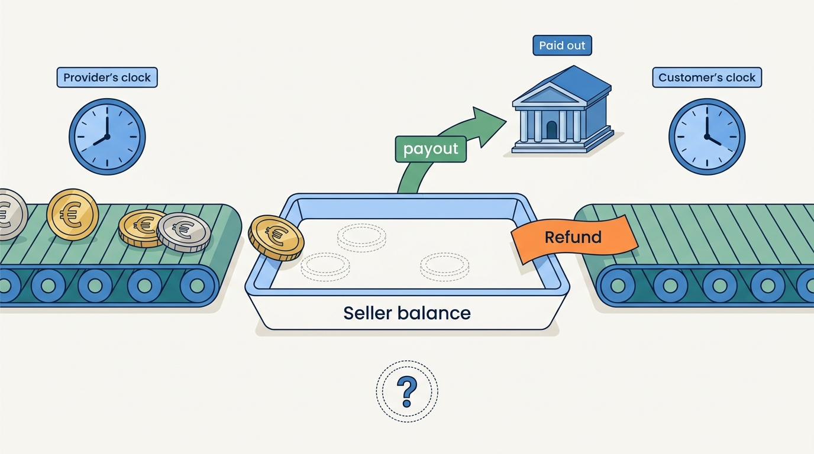

> **IN THIS CHAPTER, YOU WILL:** Follow Mila's €120 class pass into three parties' balances, out to the studio's bank, and €84 of it back, on Adyen and on Stripe.

> **KEY POINTS:**
>
> * **The split is an instruction attached to the payment, and the approval does not confirm it.** €120.00 becomes €117.47 for the studio and €2.53 for the platform by bookings the platform wrote in advance. The provider's cost is not one of them: it is booked later, an illustrative €0.61 out of the platform's share.
> * **A refund after payout is debited from a balance the payout emptied.** On Adyen (documentation accessed November 2026) a refund can be deducted only from the balance accounts the payment credited, with the platform's liable balance account behind them; on Stripe the charge type decides whether the seller's or the platform's balance is debited first.
> * **Every failure on this journey sits at a hand-off, and the platform decides four things beforehand.** The refund split, the fate of its own fee, who bears the processing cost and how a seller's shortfall is recovered each have a provider default, and each default points at the platform.

> **[FAILURE PATTERNS THIS CHAPTER ADDRESSES](where-payment-systems-go-wrong.html):**
>
> * **The Orphaned Refund** — €84.00 comes back nine days after the sale, against a balance that no longer holds the payment it belongs to.
> * **The Accidental Bank** — a platform that never holds its studios' money still stands behind their refunds, by a setting made at integration.
> * **The Black-Box Balance** — a refund netted against later sales shows up only as a smaller payout unless it has an entry of its own.

 
On Thursday 18 March 2027 Ines Bakker, who owns the yoga studio Studio Noord, approves an €84.00 refund for one of her members, Mila Janssen. The €117.47 the studio received for Mila's class pass was paid out to its bank account a week earlier. Larkfield, the fictional studio-software platform this book follows, sits between the two of them and never held any of the money. **Whose money goes back to Mila?**

The first two journeys prepared this one. [[journey-card-payment]] followed the same pass from Mila's tap to the studio's reconciled payout, and gave the split and the payout one row each. [[journey-failed-renewal]] showed a payment whose state stayed open after the first answer. This journey opens those two rows from the platform's side, where every payment has a third party, and then follows the first money in this part of the book that goes backward.

The answer has three parts. **Mila's €120 is divided by an instruction attached to the payment. The €84 refund is debited from a balance that the payout already emptied. And the platform's account model, chosen years before either date, decides whose balance goes short and who stands behind it.** A platform that never holds the money therefore still carries the risk that the money comes back.

**Where we are in the payment's journey.** Mila bought her ten-class pass for €120.00 on Tuesday 9 March 2027 at 19:42. This chapter covers three moments of that payment: the split at 19:42, the payout to Studio Noord on Thursday 11 March, and the refund of 18 March. All three fall inside the dispute window, the period in which Mila's bank can still force the payment back, which stays open until about 7 July 2027 (my arithmetic: 120 calendar days from the sale).

A journey teaches no new mechanism. Each step below is told as a hand-off, the point where one mechanism's answer is passed to the next, and names the chapter that explains the mechanism. Studio Noord takes its payments through Adyen, so each step appears in Adyen's vocabulary as it happened and in Stripe's as it would have happened. The pairing of the two vocabularies is this book's own mapping and an inference: neither company publishes a translation into the other's terms. Both providers' documentation quoted in this chapter is undated and was read in November 2026.

The chapter starts with the question as it was asked at Larkfield. It then walks the payment in order: the state before the sale, the split of 9 March, the studio's claim and its payout, the refund of 18 March, and the shortfall that did not happen. Larkfield's ledger entries follow, then the eleven steps in one table, and last the decisions a platform takes before its first late refund.

## Setting the Scene at Larkfield: Three Answers, Each True of One Step

When Ines approved the refund in Larkfield's back office, Aylin Demir, Head of Studio Support, sent the payments team one line: whose money pays this? Three colleagues answered. Product said the studio, because Larkfield's terms say a studio funds its refunds. Finance said Larkfield, because the ledger has an account called "to recover from studio". Daniel Osei, the CTO, said the provider, because the provider holds the money. Each answer was true of one step of the payment: the refund policy, the record of a studio's debt, and the balance. None of the three had read the provider configuration, and none described what happens between the steps.

Femke de Graaf, Head of Payments Engineering, answered by walking this one payment through every system in order. The walk has **eleven steps on five dates**, and it starts before the sale. The figure below shows it as a sequence; the sections after it take the steps one by one.

**Figure 1:** *One payment in sequence: €120.00 is split into €117.47 and €2.53 on 9 March, the €117.47 is paid out on 11 March, and on 18 March €84.00 goes back through a balance the payout emptied.*

## Before the Sale: Studio Noord May Take Payments and Be Paid

**Step 1** is a state, not an event. Studio Noord could take Mila's payment, and be paid for it, because of two **capabilities**: named permissions on a seller's account that the provider switches on once it has verified the seller ([[platform-onboarding-and-verification]]). In Adyen's documentation (n.d., accessed November 2026) the two are `receivePayments`, which "Allows users to receive payments using a payment method", and `sendToTransferInstrument`, which "Allows users to transfer funds to verified bank accounts". Each has one switch that Adyen sets and one that the platform sets: "The capability can only be used when it is both allowed and enabled." On Stripe the same state is a status on the studio's account: "A capability must be active for a connected account to perform actions associated with that capability."

The hand-off from this state to a payment fails quietly, in two ways. First, the two capabilities do not lapse together. Where Adyen sets a deadline for a missed requirement, its verification page lists a standard "30-day period" for the payout capability and a "60-day period" for receiving payments, and says of users who do not resolve the issues in time that "their capabilities will be disallowed". A studio that ignores a request for a month keeps selling and stops being paid; Larkfield met this in May 2026, when 230 studios on Stripe went up to 12 days without payouts ([[payment-compliance-and-regulation]]). Second, the instruction that divides a payment (the split, told in the next step) names the studio's account at the provider, its balance account in Adyen's terms. Adyen's pages on splitting a payment at authorization and on split refunds say that if it names a balance account that does not exist or one "linked to an account holder with a **closed** status, the full transaction and its fees are booked to your platform's liable balance account", the platform's own account in Adyen's books. The payment is approved either way.

## 9 March, 19:42: One Instruction, Two Bookings and a Cost That Arrives Later

**Step 2.** The division of Mila's €120.00 is written before she pays, by Larkfield's payment service, as an instruction inside the payment request. A **split** is that instruction: it books parts of one payment to **balances**, the amounts the provider's books say it owes each party ([[splits-balances-and-platform-payouts]]). Adyen's split page says a `BalanceAccount` item "Books a part of the transaction to your user's balance account". **Step 3**, the platform's fee, travels in the same instruction: a `Commission` item "Books your platform's commission to your liable balance account", the **liable balance account** being the platform's own account in Adyen's books. On Stripe, where a studio is a **connected account**, Larkfield's studios are charged by **destination charges**: payments created on the platform's account that name the studio as destination. Stripe's guide says of the platform's cut, the application fee: "the full charge amount is immediately transferred from the platform to the `transfer_data[destination]` account after the charge is captured. The `application_fee_amount` (capped at the full amount of the charge) is then transferred back to the platform." The same request also carries the instruction for a later chargeback, a reversal forced by the cardholder's bank, which [[journey-dispute]] follows.

| | On Adyen (as it happened) | On Stripe (had Studio Noord been there) |
| --- | --- | --- |
| Carried by | A `splits` array on the payment request | A destination charge of €120.00 |
| The studio's €117.47 | Item `BalanceAccount`, 11747, the studio's balance account | `transfer_data[destination]` and `on_behalf_of` name the studio's connected account |
| Larkfield's €2.53 | Item `Commission`, 253, to the liable balance account | `application_fee_amount` of 253 |
| Written by | The payment service, before the request | The payment service, before the request |

At 19:42 Adyen answers "Authorised". That answer reports the approval of the issuer, Mila's bank, and that the instruction was well formed. It does not report that €117.47 reached Studio Noord's balance account. Adyen's page on splitting a payment at authorization is explicit: "The API request validates only the format of the split instructions, **not** the balance accounts specified in the request. This means that even if the transaction is successful, it is possible that the funds are not credited to/deducted from the specified balance account." The promise of step 2 is confirmed by other records on another channel: the transfer webhooks, and the Balance Platform Accounting Report, which "tracks all balance changes on all balance accounts in your balance platform, including liable accounts and the accounts of your users".

**Step 4.** The provider's cost is the one amount Larkfield cannot write into the split. Adyen's fees page says: "Transaction fees refer to the costs you incur on a transaction in your platform that are not known at the time of payment. They are calculated by Adyen after we receive the payment request. By default, these costs are deducted from your liable balance account". A split can therefore name who bears each type of fee, never how much. Larkfield names nobody, and for that case the page says "Adyen automatically updates the request to include the **PaymentFee** split type, deducting all transaction fees from your platform's liable balance account." On Mila's pass the cost is an illustrative €0.61 *(assumption; [[payment-economics]] breaks it down)*, which leaves Larkfield €1.92.

On Stripe the payer of the provider's fee follows from the charge type and the account's fee configuration, not from a line in the request. Stripe's charges page says of destination charges that "Stripe debits fees from your platform’s balance", and of direct charges, which are created on the seller's account, that "You can choose whether to have Stripe debit fees directly from connected accounts or from your platform account." The amount is read afterwards from the `fee` field of the balance transaction, Stripe's record of one change to a balance. Larkfield's assumed Stripe price is a blended rate, one percentage plus a fixed amount whatever the card costs, while its assumed Adyen price passes the card costs through, so the same payment would cost €0.87 on Stripe instead of €0.61.

| | Studio Noord | Larkfield's fee | Provider's cost | Larkfield keeps |
| --- | --- | --- | --- | --- |
| On Adyen | €117.47 | €2.53 | €0.61 *(assumption)*, booked after the payment | €1.92 |
| On Stripe | €117.47 | €2.53 | €0.87 *(assumption)*, on the balance transaction | €1.66 |

The hand-off from payment to cost is therefore a matter of time. Larkfield's ledger records its €2.53 at the payment and the provider's cost when the provider reports it, and until the two are matched the margin on the payment is an estimate. Some of it stays one: Adyen says its processing costs "are aggregated and also applicable to refused and cancelled payments. Therefore, they cannot be allocated to individual payments."

## 10 and 11 March: A Claim Becomes a Payout, and the Balance Is Empty

**Step 5.** On Wednesday 10 March the €117.47 is a claim on Adyen, not money in an account of Ines's ([[balances-and-funds-flows]]). Her support ticket that morning reads: "It says paid. Paid to whom?" The hand-off from the booking to a payable amount is a date, and the provider sets it. Adyen's settlement page says: "Adyen settles a settlement batch after its sales day ends and the configured settlement delay has passed. The date when the schemes or payment methods transfer the funds to Adyen does not affect this timing." (Scheme is Adyen's word for a card network.) Studio Noord's delay is two business days, so Tuesday's sales become payable on Thursday; Adyen's accounting report shows both dates, a booking date and a value date. On Stripe's documented Dutch schedule of three business days, the same amount would have become available on Friday 12 March.

**Step 6.** On Thursday 11 March the **payout**, the provider's transfer of a balance to a bank account, leaves for Studio Noord's bank ([[payouts-and-money-movement]]). What the provider reports is that it sent the money. Adyen's payout webhooks page says of the status `booked`: "This status is not final." Stripe's API reference says of its equivalent: "Some payouts that fail might initially show as `paid`, then change to `failed`." In the best case the money reaches the studio's bank that same Thursday. Larkfield's payment record store therefore marks the payout `sent` on 11 March and sets the state `arrived` only on Thursday 25 March, when ten business days have passed without a return *(Larkfield's policy, an assumption)*. `arrived` is a state of Larkfield's record, the day it stops expecting a return, not the date of the credit.

The payout closes nothing about the payment. **Money moves forward on the provider's schedule and backward on the customer's**, and the two meet in the same balance at different times. From 11 March Studio Noord's balance account no longer contains Mila's money. Yet the studio can agree to a refund on any later day, and Mila's bank can force the payment back until about 7 July. Whatever comes back will be asked of a balance that holds something else, or nothing.

**Figure 2:** *Money goes forward on the provider's schedule and comes back on the customer's, so a refund arrives at a balance that the payout has already emptied.*

## 18 March: €84 Goes Back Through a Balance the Payout Emptied

**Step 7.** Mila asks for the seven classes she will not take, Ines approves, and the payment service sends a **refund**: a new transaction that the merchant starts, not an undo of the first ([[refunds-reversals-and-disputes]]). On a platform the refund carries its own division, and Adyen says what that division is for: splitting a refund "allows you to choose who is liable for the refund." Larkfield chose beforehand. Its policy *(illustrative)* is that the studio funds a refund and Larkfield keeps its fee, and the request is written from that policy.

| | On Adyen (as it happened) | On Stripe (had Studio Noord been there) |
| --- | --- | --- |
| Request | A refund of 8400 on the payment's PSP reference, Adyen's identifier for the payment | A refund of 8400 on the charge |
| Who funds it | One `splits` item: `BalanceAccount`, 8400, the studio's balance account | `reverse_transfer=true` |
| Larkfield's fee | No `Commission` item: Larkfield keeps it | No `refund_application_fee`: Larkfield keeps it |

The hand-off that fails here is a refund sent without its instruction, and on both providers the default then puts the whole amount on the platform. Stripe's guide says: "by default the destination account keeps the funds that were transferred to it, leaving the platform account to cover the negative balance from the refund." On Adyen the answer depends on a logic that Adyen marks as in pilot and not available for all platforms. Under it, a refund without an instruction is first checked against a split configuration profile on the store, then against a default refund logic on the platform. Where neither exists, as at Larkfield *(illustration)*, Adyen reuses the split ratio of the capture (the step that takes the approved amount) only when the refund covers a whole capture: "In all other cases, such as for refunds of partial captures, we book the full refund amount to your platform's liable balance account." So a partial refund like Mila's, sent bare, would have been Larkfield's €84.00 on Stripe, and on Adyen under the pilot. For a platform outside the pilot, Adyen's split-refund page describes its earlier logic only for refunds of the full amount, and does not say where a bare partial refund is booked.

**Step 8.** The debit lands on a balance, not on the payment. Adyen's rule bounds the choice: "Refunds can only be deducted from the balance accounts to which the payment was credited." For Mila's pass those are Studio Noord's balance account and Larkfield's liable balance account, and the instruction named the first. On Stripe a refund of a destination charge starts on the other side: "Stripe debits your platform balance for the refund amount. You can reverse the transfers made to your connected accounts to recover your refund cost." With `reverse_transfer`, "a proportional amount of the transfer is reversed". A destination charge transferred the full €120.00 to the studio, and the €2.53 application fee came back to Larkfield separately. The refund is 70% of the charge, so 70% of that €120.00 transfer is reversed, which is the same €84.00 *(my arithmetic)*. Had Larkfield used direct charges instead, "Stripe debits the refund amount from the connected account’s balance directly".

What paid Mila on 18 March was other members' money. Studio Noord's balance account held €212.40 from sales made since the payout *(assumption)*, the €84.00 was deducted from it, and the studio's next payout was €84.00 smaller. This is the ordinary case. It is also invisible unless someone records it: no payment failed, no balance went negative, and the only trace at the studio is a payout that is lower than its sales.

The fate of the platform's fee is a separate decision inside the same refund. A ten-class pass at €120.00 is €12.00 a class, so Mila keeps three classes worth €36.00. Studio Noord received €117.47 and gave back €84.00: it keeps €33.47, while Larkfield keeps the full €2.53 it charged on a €120.00 sale *(my arithmetic on the ledger's figures)*. Each provider has a parameter that would change this. On Stripe, "by default the platform account keeps the funds from the application fee", and with `refund_application_fee` set on a partial refund "you refund a proportional amount of the application fee", here about €1.77 *(my arithmetic: 70% of €2.53)*. On Adyen a `Commission` item in the refund's split "deducts the amount of your platform's commission for the original payment from your liable balance account". The provider's own cost does not come back on Stripe, which says its "processing fees from the original transaction aren’t returned". Adyen's split-refund page does not say that the original fees are returned; it lists fee items for the refund itself, by default deducted from the liable balance account.

An accepted refund is again a promise. Adyen: "You get the outcome of the refund request asynchronously, in a REFUND webhook", and a successful one means "we sent the refund request to the card scheme. However, the card scheme can still reject the refund. This can happen even a few days after you submit the refund request." Stripe's Refund object has a status, and a refund against a short balance (on Larkfield's destination charges the platform's own balance, on a direct charge the studio's) stays `pending` and "fails with a `failure_reason` of `insufficient_funds`" after 45 days. So the refund's row in Larkfield's payment record store stays open until a later record confirms it. On Stripe that record is the Refund object, read again. On Adyen, whose Checkout API for online payments has no call that returns a payment by its identifier, it is the webhook and then the report ([[payment-webhooks-and-events]]).

## Had the Balance Been Empty: Who Goes Short, and How the Money Is Recovered

**Step 9** did not happen to Studio Noord, and it is the step Aylin was really asking about. Suppose the studio had stopped selling after 11 March. Mila would still have been refunded. On Adyen the studio's balance account would then stand at −€84.00, and the account behind it is named in Adyen's account structure: "Liable balance account: the account where your business' funds are held. Funds can be deducted from this account if your users' balance accounts incur negative balances due to refunds and chargebacks." The party behind a seller is part of the structure; Larkfield did not choose it per studio.

On Stripe the charge type decides who is short ([[platform-payment-models]]). With Larkfield's destination charges the platform's balance pays first, and the recovery can fail: "If the refund request also attempts a transfer reversal, but the connected account has an insufficient balance, the refund request returns an error instead of creating a refund with `pending` status." Larkfield would then refund without the reversal and carry the €84.00 itself. With a direct charge the studio's connected account is debited, and a short balance holds the refund as `pending` under the same 45-day rule. A connected account's balance can still go negative, after a chargeback for example, and Stripe's risk page gives the order that follows: "Stripe first attempts to offset the negative amount by collecting funds from the account’s external account", its bank account. After that the loss falls on whoever is responsible for that account's negative balances, Stripe or the platform. Where it is the platform, Stripe holds a reserve on the platform's balance, and "if a connected account’s balance remains negative for 180 days, we transfer funds from the platform reserve to cover the negative amount." The table answers the section's question for the three configurations: which balance the refund debits first, what happens when the studio's balance is empty, and who stands behind it.

| Configuration | The refund debits first | If the studio's balance is empty | Who stands behind it |
| --- | --- | --- | --- |
| Adyen, refund split to the studio | The studio's balance account | It goes negative | The platform's liable balance account |
| Stripe, destination charge | The platform's balance | A refund sent with the transfer reversal returns an error; sent without it, the refund stands | The platform, which has paid and cannot reverse the transfer (if the platform's own balance is short, the refund waits as `pending` for up to 45 days) |
| Stripe, direct charge | The studio's connected account | The refund waits as `pending` for up to 45 days | For a balance that does go negative: Stripe or the platform, as set on the account |

**Figure 3:** *When the seller's balance is empty, the platform pays the €84.00 by two routes: at Provider A (Adyen) it stands behind the seller's negative balance; at Provider B (Stripe, destination charge) its own balance is debited first and the reversal fails.*

For a balance that stays negative, Stripe publishes an order of collection (the studio's bank account first) and a number of days (180, where the platform is responsible, before its reserve pays). **Adyen publishes a shorter period and names the account.** Its page on liable balance accounts says: "Adyen allows negative balances for up to 30 days. If a balance account has a negative balance for more than 30 days, Adyen compensates this by debiting your reserved compensation account on the first day of the following month." That account is one of the platform's own liable accounts, and the platform must refill it. Adyen also documents one arrangement in which it takes a seller's loss: Managed Risk, marked as in pilot with limited availability, under which Adyen says it will "assume the responsibility for negative balances" on users' accounts. What I did not find is a price list for platforms: Adyen's pricing page lists prices per payment method and says "Other Adyen products, besides payment methods, are priced separately." Whether the pilot is open to a given platform, and at what price, is a question to put to Adyen in writing.

**Step 10** is getting the money back from the studio, whoever paid in the meantime, and there are three routes. Later sales fill the balance again: Adyen settles net of the day's refunds, and Stripe says "If at all possible, Stripe automatically offsets negative transactions against future payments." The platform can move money between balances, by an internal transfer on Adyen or a transfer reversal on Stripe once the studio's balance allows it. Or the studio's bank account is debited. On Adyen that is a **top-up**, an incoming transfer whose first listed use is "To cover negative balances resulting from refunds or chargebacks". It runs as a direct debit, so for bank accounts in the SEPA zone (the Single Euro Payments Area) "your users must first accept a mandate that authorizes you to debit their accounts". On Stripe the debit of the bank account is Stripe's own collection, described in step 9; what the platform can start is an Account Debit of the studio's Stripe balance, which requires "legally binding consent". That consent has to exist before the shortfall. And the bank debit is itself reversible: the mandate text Adyen recommends tells the payer "You must claim a refund within 8 weeks from the date your account was debited" ([[local-payment-methods]]).

Every one of those routes needs a studio that still sells or still has an account to debit, so Larkfield keeps a figure of its own for how large step 9 can get. A studio's **exposure** is the online card volume paid out to it in the last 120 days, less the refunds and disputes already booked. For Studio Noord, at an assumed €16,000 a month, that is about €64,000; across Larkfield it is about €156 million. It measures what can come back, not what will. A studio whose exposure is large against its weekly sales is one whose balance may not cover its next refund.

## What Larkfield's Ledger Records, Leg by Leg

**Step 11** is Larkfield's own record. Under K3, the decision of its 2027 repair program Keel that every movement of money gets a ledger entry, each leg of this journey is an entry of its own, keyed by Adyen's reference for the payment and Larkfield's id for the business event ([[payment-ledgers]]). The refund after payout is an entry, not a changed status on the payment. The rows are in date order, and the second 18 March row is the counterfactual of step 9.

| Date | Leg | Debit | Credit | Amount |
| --- | --- | --- | --- | --- |
| 9 March | Studio's share | Funds at provider | Owed to Studio Noord | €117.47 |
| 9 March | Larkfield's fee | Funds at provider | Fees owed to Larkfield | €2.53 |
| When reported | Provider's cost | Fees owed to Larkfield | Funds at provider | €0.61 *(assumption)* |
| 11 March | Payout sent | Payouts in transit | Funds at provider | €117.47 |
| 18 March | Refund, balance covers it | Owed to Studio Noord | Funds at provider | €84.00 |
| 18 March | Refund, had the balance been empty | To recover from Studio Noord | Funds at provider | €84.00 |
| 25 March | Payout marked arrived | Owed to Studio Noord | Payouts in transit | €117.47 |

The entries are written from the provider's report lines, not from webhooks, and that is what makes them a check ([[payment-reconciliation-and-reporting]]). Larkfield's reconciliation job runs once per provider, when that provider signals that its reports are ready, and matches each leg against the provider's own bookings. On Adyen that is the Balance Platform Accounting Report, the daily report per balance account that Adyen's platform reporting page marks as "**Required** for full financial reconciliation", announced by a `balancePlatform.report.created` webhook. On Stripe it is the balance transactions behind each payout. A split booked to the liable balance account, a refund sent without its instruction and a top-up that the studio's bank took back would each appear there as an amount with no matching entry. Such an item gets an owner, and after five business days it goes to the weekly review of Priya Raman, the finance controller.

The refund row of 18 March is the entry Larkfield did not have in 2025. At the end of that year its books said it owed studios €412,000 more than the providers held for them, and **€317,200 of the difference was refunds made after payout**: debits like Mila's, each visible at a provider, none with an entry at Larkfield.

## The Journey in One Table: Eleven Steps and What Each Promises

The table sets the eleven steps side by side in the form this part of the book uses: the party or system that acts, the record it produces on each provider, the promise that record makes, and the failure that can occur there with the chapter that owns the mechanism.

| Step | Party or system | Message or record | Promise made | What can fail here → chapter |
| --- | --- | --- | --- | --- |
| 1. Capability state (before the sale) | The provider's verification; the platform's switch | Adyen: `receivePayments` and `sendToTransferInstrument`, allowed and enabled. Stripe: capabilities with status `active` | The studio may take payments and be paid | A deadline passes and payouts stop while sales continue → [[platform-onboarding-and-verification]] |
| 2. Split instruction (9 March, 19:42) | Larkfield's payment service | Adyen: `splits` on the payment request. Stripe: a destination charge naming the studio | €117.47 will be booked to the studio | The request is approved and the amount is booked to the platform → [[splits-balances-and-platform-payouts]] |
| 3. Platform's fee | The provider's books | Adyen: a `Commission` booking to the liable balance account. Stripe: the application fee transferred back | €2.53 is Larkfield's | The fee is counted as margin before the cost is known → [[payment-economics]] |
| 4. Provider's cost | The provider | Adyen: fee bookings by type, after the payment. Stripe: `fee` on the balance transaction | The cost of this payment, once reported | A cost never matched to the payment → [[payment-reconciliation-and-reporting]] |
| 5. Studio's balance (10 March) | The provider | Adyen: a booking with a booking date and a value date. Stripe: a pending balance transaction with `available_on` | Payable on Thursday | "Paid" is read as "in the bank" → [[balances-and-funds-flows]] |
| 6. Payout (11 March) | The provider, then the bank network | Adyen: transfer `booked`. Stripe: payout `paid` | The money was sent | The bank returns it days later → [[payouts-and-money-movement]] |
| 7. Refund request (18 March) | Mila, Ines, the payment service | Adyen: a refund with a `splits` item. Stripe: a refund with `reverse_transfer` | The request was accepted | Sent without its instruction, the platform pays → [[splits-balances-and-platform-payouts]] |
| 8. Debit of the paid-out balance | The provider | Adyen: a deduction from the studio's balance account, then the REFUND webhook. Stripe: a debit of the platform's balance, a transfer reversal, the Refund's status | €84.00 is on its way to Mila | The card network rejects the refund days later; the debit has no entry → [[refunds-reversals-and-disputes]] |
| 9. Shortfall (had the balance been empty) | The provider; the party behind the seller | Adyen: a negative balance account, the liable balance account behind it. Stripe: an error on the reversal, or on a direct charge a refund held as `pending` | Someone stands behind the refund | Nobody chose who → [[platform-payment-models]] |
| 10. Recovery | Larkfield; the studio's bank | Adyen: net settlement, a top-up, an internal transfer. Stripe: offsetting, Stripe's debit of the bank account, a transfer reversal | The studio will repay | No consent to debit; the debit is refunded; the studio is gone → [[splits-balances-and-platform-payouts]] |
| 11. Ledger and reconciliation | Larkfield's ledger and reconciliation job | An entry per leg, matched to Adyen's accounting report or Stripe's balance transactions | Larkfield's books equal the provider's | A movement with no entry → [[payment-ledgers]] |

Read down the last column. None of the failures is a mechanism breaking: verification, the split, the payout and the refund each do what they document. Each failure is one step's answer taken as final by the next step, and each is caught by a later record on another channel: the accounting report for the split, the fee booking for the cost, the closed return window for the payout, the REFUND webhook for the refund, the sign of a balance for the shortfall, the reconciliation for all of them. The two providers put that later record in different places. On Adyen it is an event or a report line keyed by the payment's reference; on Stripe it is an object with a status that can be read again.

## Four Decisions to Take Before the First Late Refund

Four decisions cover the backward half of this journey, and on both providers each is a parameter or an agreement with a name. Larkfield's answers are in the second column. The fourth decision has three parts that are easy to forget: the studio's consent to a bank debit, the exposure figure, and the ledger account that holds the debt.

| Decision | Larkfield's answer | Where it is set on Adyen | Where it is set on Stripe |
| --- | --- | --- | --- |
| Who funds a refund | The studio | The `splits` item on the refund | `reverse_transfer` on the refund |
| What happens to the platform's fee | Larkfield keeps it | A `Commission` item on the refund, or none | `refund_application_fee` |
| Who bears the processing cost | Larkfield | Fee split types on the payment; default the liable balance account | The charge type and the account's fee configuration |
| How a shortfall is recovered and recorded | Later sales, then a bank debit; booked to "to recover from studio" | Net settlement, a top-up under a mandate, an internal transfer | Offsetting, Stripe's debit of the bank account, an account debit with consent, a transfer reversal |

Left undecided, each of the four still has an answer, and on both providers the default answer is the platform. The steps showed it four times, three on Adyen and one on Stripe: Adyen books a split amount with no account, the fees of step 4 and, under its pilot logic, the bare partial refund of step 7 to the liable balance account, and Stripe leaves the transferred funds with the studio and debits the platform. That is why I treat the account model as the decision about who pays, and why I would write the four answers down before the first seller is onboarded. Where the studio is meant to fund its refunds, the default has to be overridden on every refund.

## What to Take Away

**Established.**

- A split is an instruction on the payment request, and its approval does not confirm the bookings: Adyen documents that it validates only the format of split instructions (accessed November 2026).
- The provider's cost arrives after the payment. Adyen calculates it after the request and by default deducts it from the liable balance account; Stripe reports it on the balance transaction.
- A refund after payout debits a balance, not the payment: on Adyen only the balance accounts the payment credited, on Stripe the balance fixed by the charge type.
- A sent payout and an accepted refund are promises. Both providers document that each can fail days later.

**Depends on context.**

- Who funds a refund, and whether the platform gives back its fee, are commercial decisions. Larkfield's answer suits studios that sell every week; a platform whose sellers come and go should expect to fund more refunds itself.
- How hard to pursue a shortfall depends on its size and on whether the seller is still selling. A bank debit needs consent given beforehand and can be reversed.
- On Adyen the platform stands behind a seller's negative balance by default, and is debited for it after more than 30 days. Whether Adyen can bear the loss instead depends on access to its Managed Risk pilot and on terms and prices that are not published.

**The author's synthesis.**

- The account model is the answer to "who pays" for every later refund, whether or not anyone read it that way. I decide it as a liability question, first, and store it per studio and provider.
- Aylin's question had one answer only once the payment was walked through every hand-off. Product, finance and the CTO each knew a step; the €84.00 came from other members' payments in Studio Noord's balance account, with Larkfield's liable balance account behind them.

## Questions to Ask

1. For one refund made after payout, which balance was debited, and what did that balance hold on the day?
2. What do we send with a partial refund on each provider, and what happens if we send nothing?
3. Do we keep our fee when a payment is refunded, and do our sellers know?
4. Which record tells us that a split booked the seller's share where we said, and who reads it?
5. When a seller's balance cannot cover a refund, who stands behind it, after how long, and where is that written?
6. Have our sellers consented to a debit of their bank account, and what do we do when that debit comes back?
7. What is each seller's exposure today, and which ledger account holds what a seller owes us?

Mila's €84.00 went back because she asked and Studio Noord agreed. The balances it passed through, and the question of who covers a gap in them, stay the same in the next journey; everything else changes. There the money goes back because the cardholder's bank says so, nobody on the merchant side has agreed, and the reversal brings a fee, a deadline and a count that the refund did not have: [[journey-dispute]].

## Sources and Evidence

*Company, product and investor sources*

- [Split specific transactions between balance accounts](https://docs.adyen.com/platforms/online-payments/split-transactions), Adyen documentation, n.d., accessed 2026-11 — the `splits` array, the `BalanceAccount` and `Commission` split types.
- [Transaction fees](https://docs.adyen.com/platforms/online-payments/transaction-fees), Adyen documentation, n.d., accessed 2026-11 — fees not known at the time of payment, the automatic `PaymentFee` split to the liable balance account, costs that cannot be allocated.
- [Split payments at authorization](https://docs.adyen.com/platforms/online-payments/split-transactions/split-payments-at-authorization), Adyen documentation, n.d., accessed 2026-11 — format-only validation of split instructions; a missing balance account or closed account holder books the transaction to the liable balance account.
- [Split refunds](https://docs.adyen.com/platforms/online-payments/split-transactions/split-refunds), Adyen documentation, n.d., accessed 2026-11 — the refund split, the credited-accounts rule, the `Commission` and fee refund types, the asynchronous outcome, the same format-only validation, the earlier logic for refunds without instructions.
- [How Adyen applies split instructions](https://docs.adyen.com/platforms/how-adyen-applies-split-instructions), Adyen documentation, n.d., accessed 2026-11 — the order of precedence and the fallback for a refund without instructions (marked as in pilot).
- [Account structure](https://docs.adyen.com/platforms/account-structure-resources), Adyen documentation, n.d., accessed 2026-11 — the liable balance account and what can be deducted from it.
- [Manage liable balance accounts](https://docs.adyen.com/platforms/manage-liable-accounts), Adyen documentation, n.d., accessed 2026-11 — negative balances allowed for up to 30 days, then compensated from the reserved compensation account.
- [Adyen Managed Risk](https://docs.adyen.com/platforms/managed-risk), Adyen documentation, n.d., accessed 2026-11 — the pilot in which Adyen assumes responsibility for users' negative balances.
- [Capabilities](https://docs.adyen.com/platforms/verification-overview/capabilities), Adyen documentation, n.d., accessed 2026-11 — `receivePayments`, `sendToTransferInstrument`, allowed and enabled.
- [Verification process](https://docs.adyen.com/platforms/verification-overview), Adyen documentation, n.d., accessed 2026-11 — the standard 30-day and 60-day deadlines per capability (volatile).
- [Settle funds](https://docs.adyen.com/platforms/settle-funds), Adyen documentation, n.d., accessed 2026-11 — sales day settlement, the settlement delay, net settlement.
- [Payout transfer webhooks](https://docs.adyen.com/platforms/payout-webhooks), Adyen documentation, n.d., accessed 2026-11 — `booked`: "This status is not final."
- [Refund](https://docs.adyen.com/online-payments/refund), Adyen documentation, n.d., accessed 2026-11 — what a successful REFUND webhook means and the late rejection by the card scheme.
- [Top up balance accounts](https://docs.adyen.com/platforms/top-up-balance-account), Adyen documentation, n.d., accessed 2026-11 — top-ups to cover negative balances.
- [Top up on demand](https://docs.adyen.com/platforms/top-up-balance-account/on-demand-top-ups), Adyen documentation, n.d., accessed 2026-11 — the SEPA mandate users must accept and its recommended text.
- [Transfer funds internally](https://docs.adyen.com/platforms/internal-fund-transfers), Adyen documentation, n.d., accessed 2026-11 — transfers between the liable balance account and a user's balance account.
- [Balance Platform Accounting Report](https://docs.adyen.com/platforms/reports-and-fees/balance-platform-accounting-report), Adyen documentation, n.d., accessed 2026-11 — the report of all balance changes; booking date and value date.
- [Reports and fee types](https://docs.adyen.com/platforms/reports-and-fees), Adyen documentation, n.d., accessed 2026-11 — the Balance Platform Accounting Report marked as required for full financial reconciliation.
- [Get platform reports](https://docs.adyen.com/platforms/prepare-reports/generate-download-reports), Adyen documentation, n.d., accessed 2026-11 — the `balancePlatform.report.created` webhook.
- [Pricing](https://www.adyen.com/pricing), Adyen, n.d., accessed 2026-11 — prices per payment method; other products "are priced separately".
- [Understand how charges work in a Connect integration](https://docs.stripe.com/connect/charges), Stripe documentation, n.d., accessed 2026-11 — fees and refunds by charge type, the 45-day pending refund on the debited balance, the error on a reversal against a short balance.
- [Create destination charges](https://docs.stripe.com/connect/destination-charges), Stripe documentation, n.d., accessed 2026-11 — the application fee flow, `reverse_transfer`, the proportional reversal, `refund_application_fee`.
- [Account capabilities and configurations](https://docs.stripe.com/connect/account-capabilities), Stripe documentation, n.d., accessed 2026-11 — a capability must be active.
- [Understanding Connect account balances](https://docs.stripe.com/connect/account-balances), Stripe documentation, n.d., accessed 2026-11 — offsetting negative transactions against future payments.
- [Risk and liability management with Connect](https://docs.stripe.com/connect/risk-management), Stripe documentation, n.d., accessed 2026-11 — collection from the external account first, the platform reserve, the transfer after 180 days.
- [Debit connected accounts](https://docs.stripe.com/connect/account-debits), Stripe documentation, n.d., accessed 2026-11 — debits of a connected account's Stripe balance and the consent they require.
- [Refund and cancel payments](https://docs.stripe.com/refunds), Stripe documentation, n.d., accessed 2026-11 — processing fees of the original transaction are not returned.
- [Balances and settlement time](https://docs.stripe.com/payments/balances), Stripe documentation, n.d., accessed 2026-11 — the Dutch schedule of three business days.
- [The Payout object](https://docs.stripe.com/api/payouts/object), Stripe API reference, n.d., accessed 2026-11 — `paid` may change to `failed`.
- [The Balance Transaction object](https://docs.stripe.com/api/balance_transactions/object), Stripe API reference, n.d., accessed 2026-11 — the `fee` field and `available_on`.

*Standards, regulation and official documentation*

- None.

*Research and practitioner sources*

- None.

Larkfield is fictional; architectural recommendations, labeled inferences and labeled assumptions are the author's judgement.
