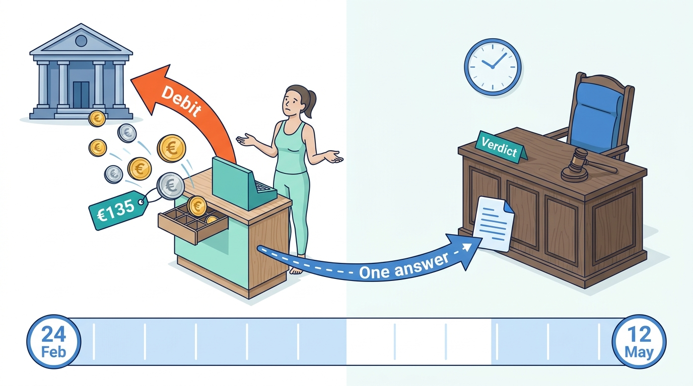
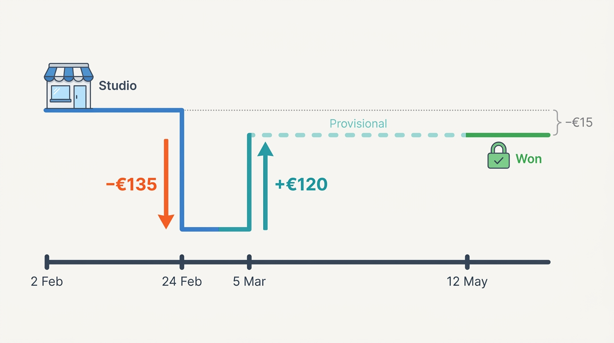
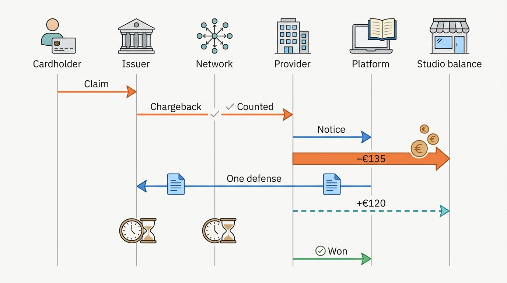
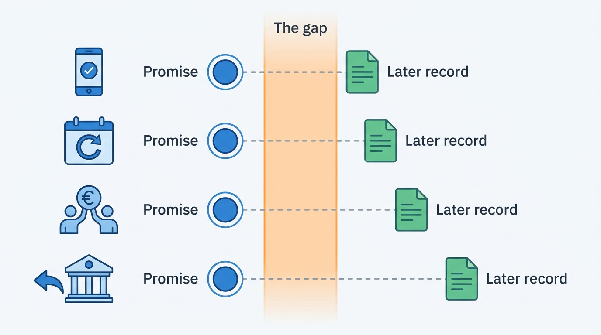

> **IN THIS CHAPTER, YOU WILL:** Follow one €120 chargeback from the cardholder's claim to the ledger, on Adyen and on Stripe, and see what was decided at the sale.

> **KEY POINTS:**
>
> * **A chargeback debits first and judges later.** On 24 February 2027, €120.00 and an illustrative €15.00 fee left Studio Noord's balance before anyone had read any evidence. The merchant side answers once, within 40 days for a Mastercard at Adyen and 18 for a Visa payment processed outside the United States and Canada, and the card networks count the dispute whether it is won or lost.
> * **Who pays was decided at the sale.** Adyen requested an exemption from authentication, so the fraud loss stayed on the merchant side. Larkfield's chargeback logic on the payment named the studio's balance, where Adyen's default is the platform's own. On Stripe the charge type decides, and Larkfield's balance would have paid first.
> * **A favorable event is not the outcome.** Adyen returned the €120.00 on 5 March while the cardholder's bank was still reviewing, and the dispute was won only on 12 May, when Adyen reported that the bank had accepted the defense or let its time run out. Stripe returns money only on a win, and its status `lost` can still become `won`.

> **[FAILURE PATTERNS THIS CHAPTER ADDRESSES](where-payment-systems-go-wrong.html):**
>
> * **The Orphaned Refund** — a chargeback and its fee arrive three weeks after a sale that every record had closed, and only a shared reference ties the debit to the payment.
> * **The Trusted Doorbell** — one webhook starts a deadline counted in days, and a later one announces a credit that is not yet an outcome.
> * **The Accidental Bank** — a platform that never holds its studios' money stands behind the balance a chargeback debits.

 
On Wednesday 24 February 2027, **Studio Noord's balance at Adyen fell by €135.00**. The ten-class pass behind it had been sold three weeks earlier for €120.00, paid out to the studio two days after the sale, and used for two classes. No one at the studio, at Larkfield or at Adyen had decided anything. No one had yet looked at any evidence.

That order is the rule and not an accident. **A chargeback debits first and judges later.** A chargeback is a card payment taken back by the issuer, the cardholder's bank, after the cardholder disputes it. Adyen's documentation (n.d., accessed November 2026) says it "debits the payment amount and the chargeback processing fee from your account" when the dispute starts, and Stripe's says that on creating a dispute it "Debits the disputed amount, plus a dispute fee, from your Stripe account." The merchant side may then answer once, against a deadline. The card network counts the dispute whatever the answer achieves. And **who carries the loss was decided when the payment was made**.

This journey teaches no new mechanism. It follows one dispute through mechanisms that earlier chapters own, and at each step it says what one mechanism hands to the next. It is told on Adyen, because Studio Noord is on Adyen, with the Stripe record for the same step beside it; pairing the two vocabularies is this book's own mapping, since neither company publishes one. The sale, the chargeback date and the two check-ins come from the scenario of Larkfield, the fictional studio-software platform this book follows ([[meet-larkfield]]). Later dates and the €15.00 fee are illustrations. The card is a Mastercard, and Mastercard's own rule documents could not be read for this book, so its deadlines appear as Adyen and Stripe render them.

**Where we are in the payment's journey.** This is the last and slowest step a card payment can take, shown on a second sale at the studio where Mila bought her pass: the €120.00 pass that another member, Bram de Wit, bought on 2 February 2027. [[journey-platform-payment]] ended with Mila's €84.00 refund, money that went back because she asked and the studio agreed. Here money goes back because a bank says so. The balances are the same and so is the question of who covers the gap, but nobody on the merchant side agreed to anything, and the chargeback brings three things the refund did not have: **a fee, a deadline and a count**.

The chapter goes through the dispute in date order. It starts on 2 February with three things settled before anyone disputed anything, moves to 24 February, when the claim arrives as a debit, and to 3 March, when Larkfield sends its one answer. It follows the money back on 5 March and the wait until 12 May, then says what winning did not change. The whole dispute is then laid out as a table of twelve rows and read once more as Stripe would record it. The last pages close Part IX.

## 2 February: Three Things Settled Before Anyone Disputed Anything

On Tuesday 2 February 2027 Bram de Wit bought a ten-class pass at Studio Noord with a Dutch Mastercard credit card, typed into the booking widget. It was his first purchase as a member. The payment was approved and captured, and its €120.00 was divided into €117.47 for the studio and €2.53 for Larkfield, of which Larkfield kept €1.80 after an illustrative €0.73 of processing cost ([[payment-economics]]). Larkfield's payment record store showed `paid`. The studio's payout arrived on Thursday 4 February, and the ledger's clearing accounts for the payment returned to zero. Every record Larkfield kept of this sale was closed.

Inside that closed record sat three settings, and the first was made by Adyen. European law requires strong customer authentication for most online card payments: a check by the issuer, carried by the 3-D Secure protocol, that the cardholder is the one paying. A payment that passes it gets a **liability shift**, the networks' rule that a later fraud dispute is the issuer's loss. A provider may instead ask the issuer to skip the check for a low-risk payment, which is called an exemption. Adyen asked for Bram's payment, his bank agreed, and he was challenged for nothing. Adyen's documentation (n.d., accessed November 2026) states the price: "If the exemption is granted, the chargeback liability stays with you." The payment response reported the request in a field, `additionalData.scaExemptionRequested`. Nobody at the studio or at Larkfield chose this, and in February Larkfield did not store the field ([[three-d-secure-and-sca]]).

The second setting was Larkfield's own, and it traveled in the same request. On Adyen for Platforms a payment carries a split, the instruction that books each part of the amount to a **balance account**, the provider-side account that holds one party's money until payout. The same request can carry a `platformChargebackLogic` object. Without one, Adyen's documentation says, it "withdraws the disputed funds from your platform's liable balance account", which is Larkfield's own account. Larkfield sends the behavior `deductFromOneBalanceAccount`, which "Deducts the full amount from the balance account specified in `targetAccount`", and names Studio Noord's balance account there and as the `costAllocationAccount` for the fee. Adyen describes that choice in one line: "Use this logic if you want to make your user liable for all chargeback-related events on the payment." On Stripe the same decision is the charge type. Larkfield's Stripe studios are charged by destination charges, created on the platform's account with `on_behalf_of` naming the studio, and for a charge created on the platform a dispute debits the "Platform’s balance, with or without `on_behalf_of`" ([[platform-payment-models]]).

The third thing was not a setting at all, and it was not in the payment system. The booking app recorded that Bram bought the pass from a logged-in session, and then that he checked in to two classes with it, on 4 and 11 February. Those rows were written for scheduling and for the front desk. They share two identifiers with the payment: the member id and the Larkfield payment ID that the payment service writes before any provider call ([[payment-api-design]]). On 11 February nobody thought of them as evidence.

## 24 February: The Claim Arrives as a Debit

Three weeks after the sale Bram told his bank that he did not recognize the charge. Larkfield saw none of what followed. The bank filed a chargeback with Mastercard under a fraud reason, which Adyen's list of Mastercard codes gives as 4837, No Cardholder Authorization, and Mastercard passed it to Adyen, which had collected the payment for the studio. The bank needed nobody's agreement on the merchant side, and it was well inside its time: Adyen's timeframes table (n.d., accessed November 2026) gives a bank 120 calendar days from the transaction to start a chargeback on Mastercard and on Visa, and Visa's own rules (edition of 24 October 2026) say "120 calendar days from the Transaction Processing Date" for most conditions ([[refunds-reversals-and-disputes]]).

The first record to reach Larkfield was a webhook, and a deadline hangs on it. Adyen sent `NOTIFICATION_OF_CHARGEBACK`, of which its documentation says: "This webhook message marks the start of the defense period." For Mastercard that period is fixed: "You must provide your defense documents within **40 days**." Forty days from 24 February is Monday 5 April. So the one delivered message had to become, that day, a record of Larkfield's own with a date and an owner. Larkfield's webhook receiver stored the event, the payment row moved from `paid` to `disputed`, and a dispute row was created under it with both of Adyen's references, the deadline and Jonas Weber, the risk and compliance lead, as owner ([[payment-state-machines]]). On Stripe the same moment is a Dispute object whose deadline is a field, `evidence_details.due_by`, that can be read again at any time. On Adyen there is nothing to read again: the pages read for this book describe no call that returns a dispute's state. Adyen's own record of disputes is a daily file, the Dispute transaction details report, with one line per dispute event, so a missed notification is found by comparing open dispute rows with that report ([[payment-webhooks-and-events]]).

With the notification came the money movement. Adyen booked the chargeback, and **€120.00 and the €15.00 fee left Studio Noord's balance account**, as the logic sent on 2 February had instructed. Nobody had read any evidence, because none had been asked for yet. Adyen's Mastercard page says "The chargeback debit usually occurs a few days after you receive the NoC", its abbreviation for the notification; in this scenario both fall on the same day. The fee is the scenario's figure: Adyen's terms (last updated 1 November 2023) leave the amount to the merchant agreement, and the only amount I found on its site is CAD 24.00, in its standard fee disclosure for Canada (n.d., accessed November 2026). The account held that week's sales, so nothing went negative: the studio's next payout was €135.00 smaller. The studio had received €117.47 for the pass and gave back €120.00, since the logic debits the full amount from one account and Larkfield kept its €2.53.

**Figure 1:** *The €135 left the studio's balance on 24 February; the verdict came on 12 May.*

Larkfield's ledger, its own double-entry record of what the provider holds and what each studio is owed, booked the debit from a different record than the one that opened the dispute. Under Keel, the 2027 program that puts Larkfield's payments on an even keel, decision K3 gives every movement of money a ledger entry, and the reconciliation job writes those entries only from the provider's report lines, never from webhooks. For a platform that report is Adyen's Balance Platform Accounting Report, which "tracks all balance changes on all balance accounts in your balance platform" and has line types for a chargeback, a chargeback reversal and a second chargeback. The next morning's report produced two entries dated 24 February: the amount, +120.00 on "owed to Studio Noord" and −120.00 on "funds at provider", and the fee, +15.00 and −15.00 on the same two accounts. The signs are those of [[payment-ledgers]]: a positive line on an account of what Larkfield owes pays that debt down, so +120.00 on "owed to Studio Noord" means Larkfield owes the studio €120.00 less, and −120.00 on "funds at provider" means the provider holds €120.00 less. Both carry the dispute's reference and the payment's, and the dispute row says they can still be reversed. In 2025 a fee like this had no entry at all, and 4,900 of them made up €73,500 of a difference nobody could explain ([[payment-ledgers]], [[payment-reconciliation-and-reporting]]).

The debit and its two entries landed where the instruction of 2 February said, and that booking is the only confirmation that the instruction was right. The booking can also be wrong without any error. Adyen's split documentation warns: "The API request validates only the format of the split instructions, **not** the balance accounts specified in the request." If the named account does not exist or belongs to a closed account holder, "the full transaction and its fees are booked to your platform's liable balance account." A studio whose account identifier was mistyped in Larkfield's configuration would have sold for months without anyone noticing, and its first chargeback would have landed on Larkfield. The other quiet failure is a studio with an empty balance. Its account goes negative, and Adyen says of the liable balance account that "Funds can be deducted from this account if your users' balance accounts incur negative balances due to refunds and chargebacks." Its page on liable balance accounts (n.d., accessed November 2026) gives the wait: "Adyen allows negative balances for up to 30 days", after which it debits the platform's reserved compensation account "on the first day of the following month" ([[splits-balances-and-platform-payouts]]).

## 3 March: One Answer, Sent Once

Jonas had two choices, and a refund was not a third. He could accept the chargeback, which ends the case, or defend it. Refunding Bram would have paid him twice, since his bank had already taken the money, and Stripe forbids it outright: "You can’t issue a refund outside the dispute process while the dispute is open." Defending has a price of its own on Adyen. Its documentation says "A chargeback fee is charged for every booked chargeback", and lists among the reasons to accept that the amount "does not outweigh the risk of losing the chargeback fee for the second booked chargeback". Larkfield's policy, written in advance as [[refunds-reversals-and-disputes]] recommends, is to defend when the evidence already exists and the amount is worth a second fee. Both held. Had the payment carried a liability shift, the step would probably not have been his: Adyen lists "Chargebacks with a fraud reason code for which there was a liability shift" among those it can defend automatically.

On Wednesday 3 March Larkfield submitted its defense, 33 days before the deadline. It contained what the booking app held: the logged-in session of 2 February and the check-ins of 4 and 11 February, joined to the payment by the member id. It could be sent once. Adyen: "Submitting the defense documents is irreversible", and "There is no opportunity later in the process to provide information or to update information you provided." Stripe says the same of its own form: "You’ve only one opportunity to submit your response." Adyen confirmed with an `INFORMATION_SUPPLIED` event. The deadline is the provider's and differs by network. Adyen gives 40 days for Mastercard and 18 for Visa, or 9 for Visa disputes opened since 21 July 2025 on payments processed locally in the United States and Canada. Stripe gives "usually 7-21 days, depending on the card network". Visa's rules give the acquirer, the bank or provider on the merchant's side, 30 calendar days for its step, and the provider's 18 days for a Visa answer fall inside them. The deadline that binds the merchant is therefore the provider's shorter figure, not the network's.

A team without those rows, or without the notification, loses at this step by default. Evidence of a login and of attendance cannot be produced afterwards; it exists or it does not. And the deadline runs whether or not the message arrived. Adyen records the lapse as an event, `DISPUTE_DEFENSE_PERIOD_ENDED`: "You have not defended the dispute within the timeframe, or the defense period ended because you accepted liability for the chargeback and will not defend the dispute." Larkfield has dropped provider events before: in the Silent Webhook of 14 September 2026 its Stripe receiver lost 9 hours of them. Under Keel decision K2, which treats the provider's own record as the truth and the webhook only as a doorbell, open disputes are therefore checked against the provider's own record every day, and a dispute row within three days of its deadline raises an alert.

## 5 March to 12 May: The Money Returns Before the Verdict

Two days after the defense, on Friday 5 March, Adyen sent `CHARGEBACK_REVERSED` and credited €120.00 to Studio Noord's balance account. It looks like a win and is not one. Adyen's page on the Mastercard flow says of this stage: "The issuer is still reviewing the defense. If they accept, this is the final status." Its description of the event is plainer: "This stage is not final and a second chargeback can be presented by the issuing bank, resulting in losing the chargeback case". The ledger booked the credit as a third entry and left the dispute row open, in a state that marks the credit as provisional. The table shows all the entries the dispute produced.

| Date (2027) | Report line | Owed to Studio Noord | Funds at provider | Dispute row |
| --- | --- | --- | --- | --- |
| 24 February | Chargeback | +120.00 | −120.00 | Open, deadline 5 April |
| 24 February | Chargeback fee | +15.00 | −15.00 | Open |
| 5 March | Chargeback reversal | −120.00 | +120.00 | Answered, credit provisional |
| 12 May | None | No entry | No entry | Won |

Until Bram's bank ran out of time, it could have taken the money again. For Mastercard, Adyen says an issuer that rejects a defense escalates "by filing a Pre-Arbitration case within **45 days** of the date that the defense was uploaded", which here is 17 April. Pre-arbitration is a last exchange between the two sides before the network is asked to rule. Unless the merchant has arranged to contest it, "The Pre-Arbitration case is accepted when the response time expires", and then "the dispute is lost, and you receive a second chargeback." A second chargeback is final. Going further, to arbitration by Mastercard, risks "a fee of up to USD 600", which no one pays to defend €120.00. In that branch the studio would have lost €135.00, the €120.00 plus the €15.00 fee, which [[three-d-secure-and-sca]] gave as its loss if the dispute were lost, and, by Adyen's sentence about every booked chargeback, possibly a second fee on top: €150.00 at the illustrative €15.00.

That branch did not happen. On Wednesday 12 May 2027 Adyen sent `ISSUER_RESPONSE_TIMEFRAME_EXPIRED`, and **the dispute was won**. The date is the scenario's: Adyen's timeframes table gives 70 days from the defense for the final decision on a Mastercard dispute, which is longer than the 45 days its Mastercard page gives the issuer to file pre-arbitration. Neither page explains the difference, so Larkfield waits for Adyen's event instead of counting days itself. Stripe's documentation (n.d., accessed November 2026) gives the issuer "usually 60-75 days, depending on the card network" for the same decision. The event moved no money, since the €120.00 had been back since 5 March. It also carried no reasons. Adyen describes it in one sentence: "The issuer either accepted your defense of the dispute, or did not respond in time." Larkfield does not know which. The dispute row was closed as won, the payment row returned to `paid`, and no ledger entry was touched.

## What Winning Did Not Change: The Fee, the Count and the Open Window

In money, Studio Noord carried €135.00 for nine days and **€15.00 for good**. It was debited on 24 February and credited €120.00 on 5 March, and the fee stayed, because under Larkfield's terms the studio carries the fee of every dispute on its payments and Adyen does not return it: its terms (clause 8.2) call the chargeback fee "non-refundable". Its accounting report lists a fee type for a chargeback, for a second chargeback and for a chargeback reversal. That shows such fees can exist, not that they are charged: no page read says whether a fee is charged on a reversal, and the amounts are set in the contract. As an illustration at €15.00 a fee, this won defense cost €15.00, and a lost one would have cost €135.00 or €150.00. Larkfield kept its €2.53. So the answer to "who carried the loss" is the studio, by an instruction Larkfield sent with the payment on 2 February, with Larkfield's liable balance account behind it had the studio's balance been short. The figure below draws the studio's balance over those weeks.

**Figure 2:** *Studio Noord's balance through the dispute: €135 out on 24 February, €120 back on 5 March but provisional until 12 May, and €15 gone for good.*

In the network's count, by contrast, nothing came back. Card networks run monitoring programs that count a merchant's disputes against its sales each month and fine or restrict those above a threshold. Stripe's documentation (n.d., accessed November 2026) describes what they count: "Both networks assign a dispute or fraud report to the month in which they received it, regardless of when the original payment occurred", "Mastercard calculates the ratio of disputes or fraud to the total number of payments in the previous month", and "monitoring programs don’t consider dispute outcomes". Bram's chargeback therefore sits in February's count, against January's payments, and the win of 12 May did not remove it. It counts in two Mastercard programs. The first is the Excessive Chargeback Program, whose first level, Excessive Chargeback Merchant, needs 100 to 299 chargebacks in a month and a rate of 1.5 to 2.99%, as both providers render it without an effective date. The second, by Stripe's description, takes fraud chargebacks under code 4837: the Excessive Fraud Merchant program, whose thresholds as both providers render them include a fraud chargeback rate of 0.50% and USD 50,000 of fraud chargebacks in a month. Against the first, counted as one merchant, Larkfield is far from the line. Its 4,900 disputes of 2025 are about 408 a month against roughly 1.2 million online card payments a month *(assumption)*, about 0.03%. That mixes a 2025 count on all networks with a later volume, so it is an order of magnitude and no more.

What would have changed the loss is authentication at the sale, and what would have changed the count is a dispute that never arrived. Had Bram's payment been authenticated, the €135.00 would, by the liability shift, have been his bank's problem, yet Stripe notes that Mastercard counts a chargeback "regardless of whether it was hidden due to a refund" and regardless of liability shift. Only prevention lowers a count. Visa's 2025 fact sheet says its ratio "Excludes disputes resolved through pre-dispute solutions", services that refund a complaint before it becomes a dispute, and Stripe's Dutch price list (n.d., accessed November 2026) charges €40.00 for one such resolution on Mastercard. That is more than the €20.00 dispute fee it avoids on the same price list, so it is bought for the count. Larkfield acted on the loss: since April 2027 it requests 3-D Secure on a new member's first typed-card purchase of €100 or more, which Bram's pass was.

Counting also raises a question the public record does not settle: which entity the networks count for a studio on a platform. Adyen says Visa applies its thresholds "for both your merchant account(s) and Adyen" and shows program standing "only on your company account", and Stripe says Visa "identifies an account by the static component of its statement descriptor and its acquiring bank". For Mastercard neither names the unit beyond the account.

> **INFERENCE, NOT DOCUMENTED:** Members see Studio Noord's name on their statements, so I would expect a network to be able to count the studio on its own as well as Larkfield's account as a whole. Neither company's pages say so for a platform. Larkfield therefore computes the ratio per network twice, per studio and for the platform, and treats neither as the networks' own figure.

The win did not close the payment either. A card payment stays disputable for 120 days, which for the sale of 2 February is until **2 June 2027**, three weeks after the dispute was won. A second dispute on the same payment is unusual and possible: Stripe's documentation says "In extremely rare cases, you might receive more than one dispute per payment", and Adyen's notes that American Express "can reopen a dispute that was previously closed in your favor". So the dispute row is closed and the payment row is not final. It is `paid` and still inside the window, one small part of the roughly €64,000 of Studio Noord's paid-out card sales *(assumption)* that can still come back on any given day.

## The Whole Dispute in Twelve Rows

The table sets the dispute out in the form Part IX uses for every journey. Each row names the party that acts, the record it produces, the promise that record makes and the failure that can occur there, with the chapter that owns the mechanism. The records are Adyen's, as documented in November 2026; the dates are the scenario's.

| Step | Party or system | Message or record | Promise made | What can fail here → chapter |
| --- | --- | --- | --- | --- |
| 1. Sale and authentication, 2 Feb | Booking app, Adyen, Bram's bank | Approval; `scaExemptionRequested` on the response; row `paid` | The bank will pay. Nothing about a later fraud claim | The exemption leaves a fraud loss with the merchant side and nobody stores it → [[three-d-secure-and-sca]] |
| 2. Split and chargeback logic, 2 Feb | Payment service, Adyen | `splits` and `platformChargebackLogic` on the request | €117.47 to the studio, paid out 4 Feb; a chargeback will debit the studio | The account is not checked; a wrong one books to the liable balance account → [[splits-balances-and-platform-payouts]] |
| 3. Evidence, 2 to 11 Feb | Booking app | Session log; check-ins of 4 and 11 Feb | None to the payment system | Not kept, or not linkable to the payment → [[refunds-reversals-and-disputes]] |
| 4. Claim, before 24 Feb | Bram, his bank | None on the merchant side | To Bram: his bank will act | A different reason needs different evidence → [[refunds-reversals-and-disputes]] |
| 5. Chargeback | Bram's bank, Mastercard, Adyen | The chargeback, reason 4837; counted for February | The network will count it, whatever follows | Many of them reach a program threshold → [[refunds-reversals-and-disputes]] |
| 6. Notification, 24 Feb | Adyen, webhook receiver | `NOTIFICATION_OF_CHARGEBACK`; dispute row, deadline 5 April | You may answer until the deadline | The message is missed and the deadline runs → [[payment-webhooks-and-events]] |
| 7. Debit and fee, 24 Feb | Adyen | `CHARGEBACK`; −€120.00 and −€15.00 on the studio's balance account | The money is gone unless a defense succeeds | The studio's balance is short and Larkfield stands behind it → [[platform-payment-models]] |
| 8. Ledger entries | Reconciliation job, ledger | Two entries from the accounting report | The books match the provider that day | A fee with no entry, as in the €412,000 → [[payment-ledgers]] |
| 9. Defense, 3 March | Jonas Weber, Adyen | One submission; `INFORMATION_SUPPLIED` | The issuer will receive it. No more can be added | The evidence is thin, or late → [[refunds-reversals-and-disputes]] |
| 10. Reversal, 5 March | Adyen | `CHARGEBACK_REVERSED`; +€120.00 | The money is back for now | Booked as final; a second chargeback takes it again → [[payment-state-machines]] |
| 11. Outcome, 12 May | Bram's bank by silence or consent, Adyen | `ISSUER_RESPONSE_TIMEFRAME_EXPIRED`; dispute row won | This dispute is over | A second chargeback instead, with a second fee → [[refunds-reversals-and-disputes]] |
| 12. Count and window, to 2 June | Mastercard; payment record store | No message; row `paid`, still disputable | None | The payment is treated as final and cannot reopen → [[payment-reconciliation-and-reporting]] |

Read down the promise column, the table shows four records that were easy to take for facts. The `paid` of row 1 promised the bank's money and said nothing about a claim three weeks later. The request of row 2 was accepted without anyone checking the account it named, and only the debit of row 7 confirmed it. The notification of row 6 was delivered once, and nothing else would have started Larkfield's clock. The credit of row 10 looked like the verdict of row 11 and arrived 68 days before it. After the claim, Larkfield decided one thing, in row 9. Everything else was reading another party's record and booking it as provisional. The figure below shows the same steps as messages between the parties.

**Figure 3:** *The dispute as messages between six parties: the €135 debit comes before the one defense, and the €120 credit comes long before the dispute is won.*

## The Same Dispute on Stripe: One Object, and the Platform Pays First

Had Studio Noord been one of the studios Larkfield still runs on Stripe, five of those rows would hold a different record. Stripe gives a dispute one Dispute object with a status. The money moves when the object is created and, if the dispute is won, again when it ends, and in between "These funds are held for the entire duration of the dispute." The last status is no safer than Adyen's reversal: Stripe documents that "in rare cases the status can change from `lost` to `won`", when an issuer credits it outside the usual sequence. The table pairs the rows; the Stripe cells are its documentation and Dutch price list, n.d., accessed November 2026.

| Row | On Adyen | On Stripe | Wait for |
| --- | --- | --- | --- |
| The record (6) | Events keyed by the payment's and the dispute's references | A Dispute object with a `status` | Adyen: each event. Stripe: the object, read again |
| The deadline (6, 9) | 40 days for Mastercard, 18 for Visa | `evidence_details.due_by`; "usually 7-21 days" | The provider's figure, never your own count |
| The fee (7) | A "non-refundable" fee per booked chargeback; amount set in the contract (CAD 24.00 in Canada's standard disclosure) | €20.00 received, €20.00 countered, the second returned on a win | Adyen: the contract. Stripe: the price page |
| The money back (10, 11) | On the reversal, provisionally | Only on a win | Adyen: the timeframe-expired event. Stripe: `won` |
| What is not final (11) | `CHARGEBACK_REVERSED` | `lost`, which can become `won` | Neither; keep the row reopenable |

The largest difference is in row 7 of the twelve-row table, and it is not in the comparison above because it follows from Larkfield's own setup. Its Stripe studios are older connected accounts charged by destination charges with `on_behalf_of`, a charge created on the platform that names the studio as the business. For those, Stripe's Connect documentation says the balance debited for a dispute is the "Platform’s balance, with or without `on_behalf_of`". So the €120.00 and a €20.00 fee at list price would have left **Larkfield's balance, not the studio's**. The terms that make the studio carry the loss are the same on both providers. On Stripe they have to be enforced by a second step, a reversal of the transfer that paid the studio, and Stripe advises on its timing: "If you challenge the dispute, wait for the dispute outcome before reversing the transfer." It adds that "Regardless of a dispute’s outcome, Stripe doesn’t automatically refund the application fee", so Larkfield's own fee is a third decision.

The comparison stops where the public record does. Adyen's terms call the chargeback fee "non-refundable" and leave its amount to the merchant agreement; outside its Canadian fee disclosure (CAD 24.00) I found no amount on its pricing page, documentation or help center (November 2026), and no statement on whether a fee is charged again on a reversal, so only Stripe's cost can be computed from a price page. Mastercard's rule documents were not readable, so every Mastercard deadline above is a provider's rendering of them. The Adyen pages read describe actions on a dispute and a daily report of dispute events, and no call that returns a dispute's state. And the pairing of rows is mine: the two companies describe the same network process in different words, and neither maps its terms to the other's.

## What to Take Away

**Established.**

* The debit precedes the ruling on both providers: Adyen "debits the payment amount and the chargeback processing fee" when the dispute starts, and Stripe debits the amount and a fee when the Dispute object is created (documentation, n.d., accessed November 2026).
* The merchant side answers once, against the provider's deadline: 40 days for Mastercard and 18 for Visa at Adyen; "usually 7-21 days" at Stripe.
* The networks count a dispute in the month it is received, whatever its outcome (Stripe's documentation; Visa's 2025 fact sheet excludes only disputes resolved before they exist).
* A chargeback is booked by the logic set on the payment on Adyen, by default to the platform's liable balance account, and by the charge type on Stripe.

**Depends on context.**

* Whether to defend depends on the amount against the fees and on evidence that already exists. On Adyen a lost defense can mean a second fee; near a monitoring threshold the count matters more than the money.
* Whose balance should be debited first depends on the sellers. Booking to the seller suits established studios with steady sales; a platform with new or seasonal sellers pays either way when the balance is empty.
* How much authentication to request depends on the fraud a payment type attracts. An exemption saves a challenge and keeps the loss; Larkfield now pays that price only below €100 on a first purchase.

**The author's synthesis.**

* A dispute is prepared at the sale and only recorded afterwards. The €135.00 that left Studio Noord's balance on 24 February, with nobody deciding anything that day, had been decided on 2 February, by Adyen's exemption request and Larkfield's chargeback logic. Of it, €120.00 came back on 5 March and was final on 12 May, €15.00 stayed gone, and the chargeback stays in February's count. Everything Larkfield could do about Bram's claim, it had done by 11 February; after that it read other parties' records in the right order.
* I would never let an event edit a ledger entry. Every movement is a new entry, and "provisional", "won" and "lost" are states of the dispute row, because both providers document an outcome that changes after it looked final.

## Questions to Ask

1. On each provider, which balance does a chargeback debit, and where is that written: on the payment, on the account, or nowhere we can find?
2. Do we store, per payment, whether a liability shift is expected, and can we say why for one made ten weeks ago?
3. What evidence does our product create at the sale and at delivery, and which identifier links it to the payment?
4. Which message starts our dispute deadline, and what finds the dispute if that message is lost?
5. Is the debit booked the day it arrives, from the provider's report, as an entry that a later event can reverse?
6. Which event or status do we treat as the end of a dispute on each provider, and what happens in our books if another follows it?
7. What is our own count of disputes per network this month, per seller and in total, and at what level do we act?

## What the Four Journeys Have in Common

This was the fourth journey of [[part-9]], and the four end in the same place by different roads. In each, the first success message came from the step that made a promise. The news of whether the promise was kept came later, from a different party, on a different channel, into a different system. In [[journey-card-payment]] it was the approval on Mila's screen on 9 March against the settlement report two days on. In [[journey-failed-renewal]] it was the decline of 1 April against a membership whose state no payment record holds. In [[journey-platform-payment]] it was the split made on 9 March against a refund debited on 18 March from a balance already paid out. Here it was a payment closed in early February against a chargeback three weeks later. No component failed in any of them.

**Figure 4:** *Four journeys, one shape: a promise from the step that ran first, a gap, and a later record from another party that confirms or corrects it.*

Together the four set one number that no single journey states, and it explains the difference that opened the part. At year-end 2025 Larkfield's ledger and its two providers disagreed by €412,000 about what studios were owed: €317,200 of refunds made after payout, €73,500 of chargeback fees and €21,300 of rounding. None was a payment that failed. Each was a later record that corrected an earlier promise, reached the provider's balance and never reached Larkfield's books. Journey 3 produced the first kind as a ledger entry and this journey the second. So the number the four journeys set is not an amount but a duration: a payment's record has to stay open, and its entries correctable, until the slowest of those later records can no longer arrive. For a card payment that is the dispute window and not the payout date: 2 June for Bram's pass, about 7 July for Mila's.

The cheapest improvements to a payment system are therefore at its hand-offs: a reference that survives every hop, a state for "promised but not yet confirmed", a sweep for whatever stays in that state, and a daily match of the provider's records against the ledger. Keel is mostly these. One key per business event (K1), the provider's record over the webhook (K2), an entry for every movement (K3), renewals retried by decline code (K5) and verification kept as state (K6) are all work between mechanisms, and Keel adds no provider and no orchestration product (K8). You can find your own next incident the same way. Take one ordinary payment, one failed renewal, one refund made after payout and one dispute from your own system, and fill in a step table for each. For every row, write the record that confirms the row before it. Start work at the rows where that cell is empty.

The four journeys also showed every step twice: a fetchable object on Stripe and a reference with events on Adyen, a charge type against an instruction on the payment, one status against a provisional credit. They did not say where those differences come from. That takes the two companies themselves as the subject, with their histories, licenses and published figures, and it is what [[part-10]] does next.

## Sources and Evidence

*Company, product and investor sources*

- [Dispute flow](https://docs.adyen.com/risk-management/understanding-disputes/dispute-process-and-flow), Adyen documentation, n.d., accessed 2026-11 — the debit of amount and fee, the notification as start of the defense period, the event codes, the provisional reversal, the timeframe-expired event.
- [Mastercard chargebacks](https://docs.adyen.com/risk-management/chargeback-guidelines/mastercard-chargebacks), Adyen documentation, n.d., accessed 2026-11 — Adyen's rendering of the Mastercard flow: the 40-day deadline, the irreversible submission, the reversal, pre-arbitration within 45 days, the second chargeback, the arbitration fee.
- [Dispute timeframes](https://docs.adyen.com/risk-management/understanding-disputes/dispute-timeframes), Adyen documentation, n.d., accessed 2026-11 — 120 days to initiate, response deadlines by network, 70 days to a final decision for Mastercard, the American Express reopening.
- [Manage disputes](https://docs.adyen.com/risk-management/manage-disputes), Adyen documentation, n.d., accessed 2026-11 — a fee for every booked chargeback, reasons to accept, automatic defense where there was a liability shift.
- [Dispute reason codes](https://docs.adyen.com/risk-management/understanding-disputes/dispute-reason-codes), Adyen documentation, n.d., accessed 2026-11 — Mastercard code 4837 as Adyen lists it.
- [Disputes API](https://docs.adyen.com/risk-management/disputes-api), Adyen documentation, n.d., accessed 2026-11 — the action endpoints and the dispute reference; no read call on the pages read.
- [Disputed transactions](https://docs.adyen.com/reporting/disputed-transactions), Adyen documentation, n.d., accessed 2026-11 — the daily Dispute transaction details report and its record types.
- [Dispute and fraud monitoring](https://docs.adyen.com/risk-management/dispute-and-fraud-monitoring), Adyen documentation, n.d., accessed 2026-11 — Adyen's rendering of Mastercard's chargeback and fraud program thresholds; Visa's thresholds applied to merchant accounts and to Adyen; program standing shown only on the company account.
- [SCA exemptions](https://docs.adyen.com/online-payments/psd2-sca-compliance-and-implementation-guide/sca-exemptions), Adyen documentation, n.d., accessed 2026-11 — liability under a requested exemption; `scaExemptionRequested`.
- [Split chargebacks](https://docs.adyen.com/platforms/online-payments/split-transactions/split-chargebacks), Adyen for Platforms documentation, n.d., accessed 2026-11 — the default booking, `platformChargebackLogic`, the cost allocation account, the format-only validation.
- [Account structure](https://docs.adyen.com/platforms/account-structure-resources), Adyen for Platforms documentation, n.d., accessed 2026-11 — the liable balance account behind users' negative balances.
- [Balance Platform Accounting Report](https://docs.adyen.com/platforms/reports-and-fees/balance-platform-accounting-report), Adyen for Platforms documentation, n.d., accessed 2026-11 — the report of all balance changes, its chargeback line types and its fee types.
- [Pricing](https://www.adyen.com/pricing), Adyen, n.d., accessed 2026-11 — lists chargebacks as a feature of payment methods; no chargeback fee amount on this page.
- [Adyen Terms and Conditions](https://www.adyen.com/legal/adyen-terms-and-conditions), Adyen, last updated 2023-11-01 — clause 8.2: "For every Chargeback, a non-refundable Chargeback Fee will be charged to Merchant as set out in the Agreement."
- [Information summary and fee disclosure box](https://www.adyen.com/licenses/canada-information-summary-box), Adyen Canada, n.d., accessed 2026-11 — standard template terms for Canada: chargeback fee CAD 24.00 per transaction.
- [Manage liable balance accounts](https://docs.adyen.com/platforms/manage-liable-accounts), Adyen documentation, n.d., accessed 2026-11 — negative balances allowed for up to 30 days, then the reserved compensation account is debited.
- [How disputes work](https://docs.stripe.com/disputes/how-disputes-work), Stripe documentation, n.d., accessed 2026-11 — the debit at creation, funds held, the response window, the issuer's 60-75 days, money returned on a win, no refund during a dispute, late wins, more than one dispute per payment.
- [Respond to disputes](https://docs.stripe.com/disputes/responding), Stripe documentation, n.d., accessed 2026-11 — the single submission.
- [The Dispute object](https://docs.stripe.com/api/disputes/object), Stripe API reference, n.d., accessed 2026-11 — `status` and `evidence_details.due_by`.
- [Disputes on Connect platforms](https://docs.stripe.com/connect/disputes), Stripe documentation, n.d., accessed 2026-11 — the balance debited per charge type, timing of the transfer reversal, the application fee.
- [Card monitoring programs](https://docs.stripe.com/disputes/monitoring-programs), Stripe documentation, n.d., accessed 2026-11 — what the programs count and when; Stripe's rendering of Mastercard's chargeback and fraud program thresholds; how Visa identifies an account.
- [Pricing (Netherlands)](https://stripe.com/en-nl/pricing), Stripe, n.d., accessed 2026-11 — dispute received and countered fees; the Mastercard resolution fee.

*Standards, regulation and official documentation*

- [Visa Core Rules and Visa Product and Service Rules](https://usa.visa.com/dam/VCOM/download/about-visa/visa-rules-public.pdf), Visa, 24 October 2026 — the 120-day limit and the acquirer's 30 calendar days.
- [Visa Acquirer Monitoring Program Overview](https://corporate.visa.com/content/dam/VCOM/corporate/visa-perspectives/security-and-trust/documents/visa-acquirer-monitoring-program-fact-sheet-2025.pdf), Visa, 2025 — the exclusion of disputes resolved through pre-dispute solutions.
- Mastercard's Chargeback Guide and Transaction Processing Rules could not be retrieved (HTTP 403); no Mastercard rule is cited from Mastercard's own text.

*Research and practitioner sources*

- None.

Larkfield is fictional; architectural recommendations, labeled inferences and labeled assumptions are the author's judgement.
