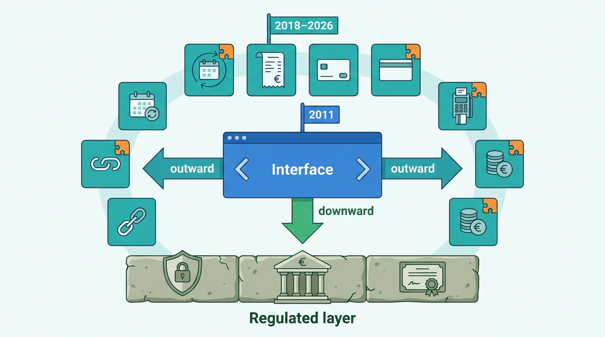
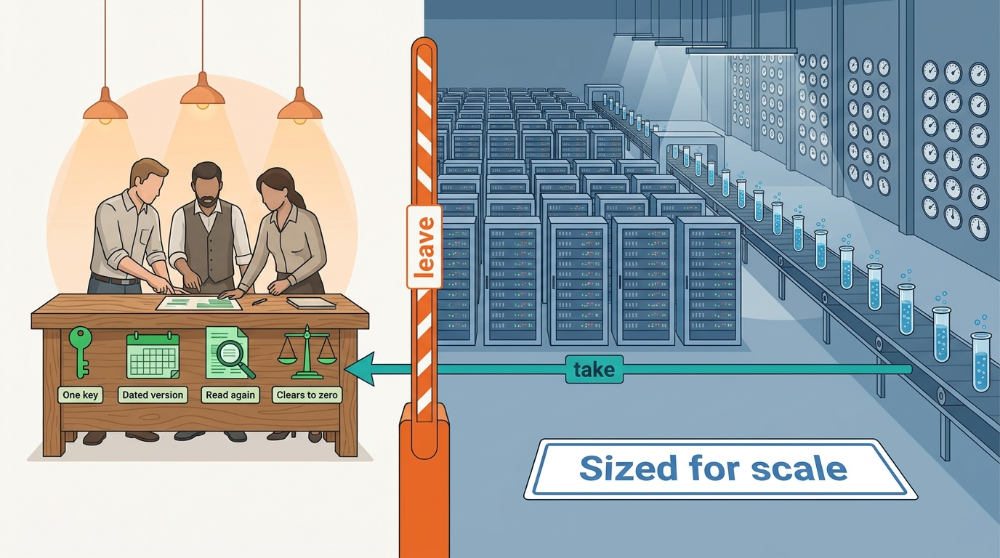

> **IN THIS CHAPTER, YOU WILL:** Read Stripe's dated public record, see who acquires and holds funds in each region, and separate the practices worth adopting from machinery sized for Stripe.

> **KEY POINTS:**
>
> * **The interface came first, and Stripe widened from it in two directions.** An API for developers in 2011; outward into billing, tax and finance products from 2018, several of them bought; downward into the regulated layer, market by market.
> * **Stripe is not a thin layer over banks everywhere, and not a bank anywhere.** Its own disclosure names Stripe companies as the card acquirer in the European Economic Area, the United Kingdom and much of Asia-Pacific, and other named acquirers, mostly banks, in the United States, Canada, Japan, India, Thailand and the United Arab Emirates. Its published $1.9 trillion for 2025 is payment volume, not revenue; it has never published revenue.
> * **Take the interface discipline and leave the machinery.** Idempotency keys, dated versions, a payment object whose state can be read again and a ledger whose clearing accounts must empty work at any size. About 2,000 database shards and about 400 deploys a day answer Stripe's load.

> **[FAILURE PATTERNS THIS CHAPTER ADDRESSES](where-payment-systems-go-wrong.html):**
>
> * **The Borrowed Blueprint** — Stripe's sharded database platform, test fleet and deploy rate are the machinery a small team is most tempted to copy and least able to justify.
> * **The Black-Box Balance** — a Stripe balance is a claim on a different regulated entity in each region, and a team that has not looked up which one cannot say what stands behind it.

 
Two sentences from Stripe's own pages were both current in November 2026. Its treasury documentation says: "Stripe is not a bank." Its acquirer disclosure says, for the European Economic Area (EEA): "Payment Method Acquirer is Stripe Technology Europe, Ltd." An engineer who has heard that Stripe is software on top of other people's banks has to explain the second. An engineer who wants to "build like Stripe" has to say which Stripe.

Both sentences fit one reading. **Stripe made the developer's interface its first product and then widened from it in two directions**: outward into a suite of billing, tax and finance products, several of them bought, and downward into the regulated layer, which it holds as a non-bank assembled per market from e-money licenses, named acquirers, most of them partner banks, and, since 2025, narrow charters. A builder can use four practices Stripe has documented: three at the interface (idempotency keys, dated versions, a payment object whose state can be read again) and, behind it, a ledger whose clearing accounts must empty. A builder **should not copy** its sharded data platform, its deploy rate or its product count.

**Where we are in the payment's journey.** Mila Janssen's ten-class pass (€120.00, Tuesday 9 March 2027) was sold by Studio Noord, which is on Adyen. But Larkfield, the fictional studio-software platform this book follows ([[meet-larkfield]]), ran 44% of its 2026 member payment volume, €493 million, through Stripe: the United Kingdom, the United States, Belgium and 1,140 older Dutch and German studios. Had the same pass been sold by a studio in Manchester or in New York, a different regulated entity would have been the acquirer (the card-network member that submits the payment and receives the money for it) and a different one would have held the funds, and this chapter shows how to look up which.

The chapter first says how the evidence is labeled and which sources could not be reached. It then gives the history and the acquisitions by date, the interface as the first product, and the suite built and bought around it. Next come licenses, partner banks and charters by region, the published figures, and the engineering record with the age of each source. It closes with what transfers to a builder and where the evidence stops.

## How to Read This Case

Every statement about Stripe below is one of three kinds. A **documented fact** comes from a Stripe publication and carries its year, or "n.d., accessed November 2026" for an undated legal or documentation page. A **trade-press report** is named as a secondary source in the sentence. The **author's reading** sits in a block marked INFERENCE, NOT DOCUMENTED at the end of a section. The research cut-off is 17 November 2026, and a source older than about three years carries an evidence-age mark. Stripe is a private company and files no public accounts, so every number here comes from its annual letters and press releases, which the company writes and nobody audits.

Some sources could not be reached, and the case leaves those gaps open. Stripe's page of European licenses returned an error, so the license facts come from the legal pages of the two regulated entities. The dates of Stripe's Georgia bank charter come from the state regulator's monthly bulletin and from Stripe's own terms for the bank; a trade association's news item is used only for what such a charter permits. The launch dates of Radar (fraud scoring), Treasury (stored balances), Link (a consumer wallet) and Atlas (company incorporation) are left out of the dated table: the first three could not be confirmed from a dated Stripe page, and none bears on the argument. Stripe's newsroom was served in a Netherlands edition, so quotations follow its British spelling. No official headcount exists after November 2022.

## The History in Dated Steps: 2010 to 2026

Stripe launched in 2011 with a payments API. In October 2012 it added Connect, its product for platforms that take payments on behalf of many sellers. Most other product names arrived in two clusters, 2018 and 2021. The table gives each step with its source. The releases are old, which does not weaken a launch date.

| Date | Step | Source |
| --- | --- | --- |
| 2010 | First venture backing | Investor quotes in Stripe releases of February 2024 ("When we first partnered with Stripe in 2010") and February 2026 ("partners since 2010") |
| 2011 | Public launch | 2023 annual letter: "when Stripe launched in 2011" |
| October 2012 | Connect, for platforms | Stripe blog post of 23 March 2015 **(Evidence age: 11 years.)** |
| April to September 2018 | Billing (subscriptions), Issuing (creating payment cards), Terminal (in-person payments) | Releases of 5 April, 26 July and 17 September 2018; Billing is "built on top of its core payments infrastructure" |
| September 2019 | Capital, financing for businesses | Release of 5 September 2019 |
| June to September 2021 | Tax, Identity (verifying people), Revenue Recognition | Releases of 10 June, 14 July and 21 September 2021 |
| September 2025 | Tempo, a blockchain, unveiled | 2025 annual letter: "incubated together with Paradigm" |
| 18 March 2026 | Tempo mainnet live | Tempo's announcement of that date |

From 2020 Stripe also bought companies, and a purchase has two dates that must not be confused: the day an agreement is announced and the day the deal completes. For the older rows the table gives what Stripe announced; the case's doubt is limited to the two most recent, OpenRouter and Parafin, which on 17 November 2026 were announced and not confirmed closed. Stripe's newsroom list, re-read that day, shows no completion release for either. The table is a selection: the newsroom also carries, for example, OpenChannel (6 December 2021).

| Target | What it does | Status on 17 November 2026 |
| --- | --- | --- |
| Paystack | Payments in Africa | Agreement announced 15 October 2020 |
| TaxJar | US sales-tax tools | "Stripe will acquire TaxJar", 27 April 2021 |
| Bouncer | Card scanning against fraud | Announced as acquired, 14 May 2021 |
| Recko | Payments reconciliation | "Stripe will acquire Recko", 20 October 2021 |
| Lemon Squeezy | Merchant of record for digital goods | Announced by Lemon Squeezy, 26 July 2024; its site says it "will shut down on March 31, 2027" |
| Bridge | Stablecoin orchestration | Announced October 2024; **completed 4 February 2025** |
| Privy | Crypto wallets | "In July, Stripe acquired Privy" (release of February 2026, about 2025) |
| Metronome | Usage-based billing | **Completed 14 January 2026** |
| OpenRouter | Routing requests among AI models | **Agreement announced 19 August 2026; not confirmed closed** |
| Parafin | Credit for platforms' small businesses | **Agreement announced 30 September 2026**; "expected to close in the coming months" |

While the products multiplied, the first line of Stripe's press releases changed. In 2021 Stripe was the company "which builds economic infrastructure for the internet". In February 2024 it was "a financial infrastructure platform for businesses". The wording changed in spring 2025: a release of 22 April 2025 says "programmable financial services company Stripe", and releases from September 2025 open with "the programmable financial services company" (the earliest I found of each). The OpenRouter agreement stretches even that: the release calls OpenRouter "a leading AI model gateway and routing platform", which is not a payments business, and quotes Patrick Collison, Stripe's chief executive: "Stripe is building the economic infrastructure for AI".

> **INFERENCE, NOT DOCUMENTED:** The dates give an order of construction. Payments for developers came first, platforms second, and the products around the payment seven years after launch. The purchases fill gaps near the payment (tax, reconciliation, usage billing, credit), until OpenRouter, which sits outside payments. Stripe has not described this as a strategy; the order is my reading of the dates, drawn in the figure below.

**Figure 1:** *Stripe's order of construction: the interface in 2011, products added outward around it from 2018 to 2026, some of them bought, and a regulated layer assembled beneath it from different kinds of permission.*

## The Interface Was the First Product

Stripe's first customers were technology companies and the developers who worked at them. The company says as much. Its 2022 annual letter (published April 2023) states that "Stripe grew up with companies in the technology sector", and lists, among four ways it pursues its mission, "providing simple, reliable, secure, and developer-friendly APIs and services". **(Evidence age: 3.5 years.)** Large enterprises came second: a March 2023 release says its "enterprise user base has compounded since 2019". Small customers stayed central: the February 2026 release about the annual letter says "the 'long tail' is much of the dog". Pricing still shows the origin. The pricing page (n.d., accessed November 2026, Netherlands edition) leads with published rates (1.5% + €0.25 for standard EEA cards) and offers "a custom package" to large businesses, with "IC+ pricing" among its options. IC+ is interchange-plus: the fee owed to the cardholder's bank (interchange) and the card network's fee are passed through with a visible markup ([[payment-economics]]).

What those first customers were given was rebuilt once, and Stripe published the story. Michelle Bu's "Stripe's payments APIs: The first 10 years" (December 2020) dates the stages: a card token and a synchronous charge in 2011, other payment methods from 2015 (bank debits and Bitcoin that year, then a second API, Sources, built between 2015 and 2017), and in 2018 the PaymentIntent, an object that represents one attempt to collect a payment and moves through explicit states. The post names the error: "Charges and Tokens were foundational in the API because they were the first APIs we had, not because they were the right abstraction for global payments." It names the price too: "rolling out this change took almost two years", and the new design "is also objectively a harder integration for users who only care about accepting card payments in the US and Canada." **(Evidence age: almost 6 years; current documentation confirms the end state and says the older APIs get no further development.)** [[payment-api-design]] and [[payment-state-machines]] own the mechanism.

Two older posts describe practices that surround every call to that object. In February 2017 Brandur Leach described the idempotency key: "a client generates a unique ID to identify just that operation", so that a request retried after a timeout is recognized and not executed twice. In August 2017 the same author described versioning "with rolling versions that are named with the date they're released", each account pinned to the version it first used, after "almost a hundred backwards-incompatible upgrades over the past six years". **(Evidence age: 9 years for both.)** Both still hold in part. The current API reference keeps keys for at least 24 hours ([[idempotency-and-retries]]). Dated versions and pinning remain, but an October 2024 post replaced the release cadence with "twice-yearly major updates" plus monthly additions ([[payment-api-versioning]]).

Since 2024 Stripe has said a little more about how the interface is governed. A June 2026 engineering post says: "we've codified a set of design patterns that all APIs must follow", checked by automated tests before a change can merge. The same post dates a second namespace, v2, to 2024. It runs beside the original: the documentation (n.d., accessed November 2026) says "You can use any combination of APIs in the `/v1` or `/v2` namespace in the same integration." As of the changelog of 28 October 2026, payment objects were not among the v2 resources; payments are still made through v1. No engineering post I found describes how Stripe delivers events to its customers' servers; [[payment-webhooks-and-events]] and [[payment-developer-platform]] cover what the documentation states.

> **INFERENCE, NOT DOCUMENTED:** Stripe treats its interface as a product with a history of its own: it was designed, found wrong, corrected at a stated cost, and extended by addition instead of replacement. In that sense "the developer's abstraction" describes where Stripe started.

## The Suite: Built, Bought and Sold Together

Around the payment, Stripe sells products with their own names and prices, and reports that its largest customers buy several. The March 2023 release says of the one hundred businesses that handle more than $1 billion a year on Stripe: "Seventy-five percent of these global winners use Stripe for more than just payments". **(Evidence age: 3.5 years.)** One group of products gets a number of its own. The 2024 annual letter says the "Revenue and Finance Automation Suite, with Billing at its core, has now passed a $500 million revenue run rate" and that Billing "is being used by more than 300,000 companies". The 2025 letter says the suite "is on track to hit an annual run rate of $1 billion this year". With Billing, Stripe holds the customer's subscription and invoice, which a pure processor does not ([[subscriptions-and-billing-engines]]).

Several parts of the suite pair something Stripe built with something it bought, and the documentation shows where they meet. Usage billing is the clearest case. The documentation (n.d., accessed November 2026) says "Metronome is Stripe’s primary usage-based billing platform and the recommended starting point for all new integrations", and divides the work: "Metronome handles metering, rating, and billing, while Stripe handles payment collection, tax calculation, and revenue recognition." The older Meters API stays supported beside it. The table lists the other pairs.

| Area | Built by Stripe | Bought | State in November 2026 |
| --- | --- | --- | --- |
| Tax | Stripe Tax (launched June 2021) | TaxJar (agreement announced April 2021) | Both dated 2021 ([[billing-and-payment-tax]]) |
| Usage billing | Meters API | Metronome (completed January 2026) | Two documented paths ([[usage-metering-and-rating]]) |
| Merchant of record (the party that sells to the customer in its own name and takes over the indirect tax; on Stripe the cost of a lost dispute stays with the business) | Managed Payments (announced May 2025; in a release version of the API since 22 April 2026) | Lemon Squeezy (2024) | Lemon Squeezy closing on 31 March 2027 ([[merchant-of-record]]) |
| Stablecoins (tokens redeemable one-for-one for a currency) | Stablecoin balances, in preview | Bridge (2025), Privy (2025) | Preview |
| Credit for platforms | Capital (2019) | Parafin (announced) | Not confirmed closed ([[embedded-finance]]) |

Not every product is tied to Stripe's own payment processing. The Radar documentation (n.d., accessed November 2026) says its fraud models "can evaluate payments from any processor in real time and return risk signals" ([[payment-fraud-and-risk]]). An October 2024 post announced "the ability to manage subscriptions with Stripe while processing transactions with other payments providers". In the other direction, Terminal, the in-person product, uses the same payment object as online payments ([[in-person-payments]]), and Connect serves platforms: a September 2026 release says "More than 18,000 platforms build on Stripe" ([[platform-payment-models]]). The four annual letters give a payment volume for none of these: no figure for in-person payments, for platform payments or for any product's share.

The newest additions are furthest from card payments. Stripe completed the purchase of Bridge on 4 February 2025 and bought Privy in July 2025. Its 2025 letter says: "In September, we unveiled Tempo, a blockchain purpose-built for payments, incubated together with Paradigm"; Tempo's main network went live on 18 March 2026. Stripe's documentation (n.d., accessed November 2026) says "In the United States, stablecoin balances are in public preview". Preview is not general availability; [[payments-what-is-moving]] follows these products.

> **INFERENCE, NOT DOCUMENTED:** "Suite" describes how Stripe packages and sells; it says nothing about how the parts are built. Where two products came from different companies, such as Meters and Metronome, I would test the join (identifiers, events, reports, the invoice) before relying on it, and I would read Lemon Squeezy's closure as evidence that a bought product may be replaced and not merged.

## The Regulated Layer: A Non-Bank Assembled per Market

The products are visible in releases; the permissions under them are visible only in legal pages, and the annual letters do not explain them. Four terms decide whether "Stripe is software on top of banks" is true. The **acquirer** is the card-network member that submits a merchant's card transactions and receives the money for them from the network. An **e-money institution** is a licensed non-bank: it may hold customers' balances, but only apart from its own funds, in accounts at banks (this is called safeguarding), and it may not lend them out. A **partner bank**, also called a sponsor bank, is a licensed bank that lends a non-bank its network membership or its deposit accounts. A **payment facilitator** signs up merchants under such a bank's membership. [[acquiring-and-network-connectivity]] and [[licences-and-safeguarding]] own these ideas.

In Europe and much of Asia-Pacific, the acquirer is Stripe. Stripe publishes a page, "Acquirer Disclosure & Acquirer Terms" (n.d., accessed November 2026), that names the acquirer for Visa and Mastercard payments country by country. The page is undated and its list of banks can change; I re-read it on 17 November 2026. Its US list includes "Stripe MALPB", Stripe's own Georgia bank (a Merchant Acquirer Limited Purpose Bank, a narrow charter described below). The two European entities state their licenses on their own legal pages. Stripe Technology Europe "is authorised as an electronic money institution by the Central Bank of Ireland (reference number: C187865)" with permission to "acquire payment transactions" (page dated April 2019). Stripe Payments UK "is authorised as an electronic money institution by the U.K. Financial Conduct Authority (reference number: 900461)" (page dated January 2017). **(Evidence age: 7.5 and almost 10 years; both entities are named as acquirers in the current disclosure.)**

| Region | Who acquires, per Stripe's disclosure | Regulated entity behind a balance, per Stripe |
| --- | --- | --- |
| European Economic Area | "Stripe Technology Europe, Ltd." | The same company, an e-money institution (Ireland) |
| United Kingdom, Gibraltar, Switzerland | "Stripe Payments UK, Ltd." | For the UK, the same company, an e-money institution |
| Australia, New Zealand, Singapore, Malaysia, Hong Kong, Brazil | A Stripe entity in each | Not examined here |
| United States | "Stripe, LLC is a Payment Facilitator of" Cross River Bank, Deutsche Bank Trust Company Americas, Fifth Third Bank, Pathward N.A., PNC Bank, N.A. and "Stripe MALPB" | A state-licensed money transmitter; stored balances at partner banks |
| Canada, Japan, India, Thailand, United Arab Emirates | Named local acquirers (banks; card companies in Japan; Network International in the United Arab Emirates); Stripe is a payment facilitator, aggregator or sales organization under them | Not examined here |
| Mexico | Stripe's Mexican company "is both a Payment Method Acquirer and a Payment Facilitator" of two named acquirers | Not examined here |

In the United States, Canada, Japan, India, Thailand and the United Arab Emirates the picture is the reverse: a named company that is not Stripe's, usually a bank, is the acquirer, and Stripe works under it. Mexico is mixed, as the table shows. Each US function has its own permission or partner. For moving money, a second US company, Stripe Payments Company, "is a U.S. state-licensed money transmitter and federally registered money services business" (terms updated November 2025). For stored balances, the treasury documentation says: "Stripe is not a bank. Checking accounts are provided exclusively by Fifth Third Bank, National Association, Member FDIC." For one US card program, the terms (updated August 2025) name Celtic Bank as the issuing bank. So what the opening's engineer had heard, that Stripe is software on top of other people's banks, is **wrong for Europe and roughly right for the United States**.

One distinction keeps this from being overread. In April 2020 Stripe announced that it "now processes card transactions through direct integrations with all six major card networks in North America, Latin America, Europe and Asia Pacific". **(Evidence age: 6.5 years; the list of six has not been republished.)** That sentence is about who exchanges messages with the network, not about who the member is. A company can send transactions straight to a network while a partner bank holds the membership, and the US row of the disclosure shows that arrangement.

In 2025 and 2026 Stripe added two narrow charters. The first is the sixth name in the US list above, "Stripe MALPB, 505 N Angier Avenue NE, Atlanta, GA". The May 2026 bulletin of the Georgia Department of Banking and Finance gives its approval date as 30 June 2025 and its begin-business date as 28 May 2026, and Stripe's own terms for it (last updated 28 May 2026) call it "a Georgia Merchant Acquirer Limited Purpose Bank" that is "a member of the Networks, and a Payment Method Acquirer for Visa and Mastercard Transactions". What the charter permits comes from a banking trade association's news item of 8 July 2025 (a secondary source): it "will allow the financial services company to obtain direct membership with Visa and Mastercard and to process payments without a sponsoring bank", and such banks "may not solicit or accept deposits from the general public". Second, a February 2026 letter from the Office of the Comptroller of the Currency, the US regulator of national banks, to Stripe's stablecoin subsidiary grants "preliminary conditional approval" for Bridge National Trust Bank and adds: "The OCC has granted preliminary conditional approval only." A trust bank holds assets for others and is not a deposit-taking bank either. I could not verify a final approval.

What no page states is why, or how much. The four annual letters and the newsroom do not explain the partner-bank model. The disclosure gives no share of volume per acquirer and does not say which merchants the Georgia bank, in business since May 2026, acquires for. The safeguarding pages name no banks. The nearest thing to a reason is a remark reported by trade press in April 2025 (a secondary source), in which a Stripe spokesperson described the Georgia application as an extension of the company's work to expand the number of banking and other partners it works with.

> **INFERENCE, NOT DOCUMENTED:** Read together, the pages suggest that Stripe took the smallest permission sufficient for each market and each function: an e-money license where one license covers acquiring and balances, partner banks where membership in practice requires a bank, and from 2025 narrow charters where a partner was the constraint. Stripe has not said so, and nothing public shows whether the motive was speed, cost or regulation. The figure below shows the two positions.

**Figure 2:** *One provider, two positions: in Region A (for Stripe, the EEA and the United Kingdom) the provider's own entity is the acquirer; in Region B (for Stripe, the United States with five of its six named acquirers) a partner bank is, even where the provider exchanges messages with the network directly.*

## The Figures, and What Each One Is

Stripe publishes no volume per acquirer, but its annual letters give figures for the whole company, which the engineering record below borrows. The one most often misused is volume. Stripe's 2025 letter says: "businesses running on Stripe generated $1.9 trillion in total volume, up 34% from 2024". That is the value of the payments its customers took, not Stripe's revenue. A provider keeps a small fraction of what it moves: Adyen's Annual Report 2025 gives a take rate of 17.0 basis points, 0.17%: net revenue of €2,364.2 million, a measure Adyen defines itself, over processed volume of €1,394.3 billion. That is Adyen's ratio and cannot be applied to Stripe; it shows only the size of the mistake in reading volume as revenue. Stripe's letters never define the metric, and its name changes.

| Letter for | Wording | Growth stated |
| --- | --- | --- |
| 2022 | "more than $817 billion in total volume" | 26% |
| 2023 | "$1 trillion in total payment volume" | 25% |
| 2024 | "$1.4 trillion in total payment volume" | 38% |
| 2025 | "$1.9 trillion in total volume" | 34% |

The other figures in the letters are each narrower than they sound. The 2025 letter counts "more than 5 million businesses directly or via platforms", so the count includes sellers who reach Stripe through a platform and never signed up with Stripe themselves. The Revenue suite is "on track to hit an annual run rate of $1 billion this year": a run rate is a recent period's revenue multiplied up to a year, a statement of pace about one product group, not a year's total and not company revenue. On profit the wording moves from "robustly cash flow positive in 2023" to "profitable in 2024" to "remained robustly profitable" for 2025, and no letter names the measure. **Stripe has never published revenue or a margin.**

Two more numbers circulate. A valuation of Stripe is the price at which shares changed hands in a funding round or a tender offer, in which investors or the company buy employees' existing shares. Stripe's own releases give $95 billion in March 2021, $50 billion in March 2023, $65 billion in February 2024, $91.5 billion in February 2025 and $159 billion in February 2026. None is a market capitalization: Stripe's shares are not publicly traded. The headcount usually quoted is from Patrick Collison's email to employees of 3 November 2022, which announced a cut of "around 14%" that "will return us to our February headcount of almost 7,000 people". **(Evidence age: 4 years; no later official figure exists.)**

So the figures support few uses. They cannot be ranked against Adyen's processed volume or the volume measures of the listed companies in [[payment-contrast-cases]], because each has its own rules about refunds, wallets and what counts ([[stripe-and-adyen-bets-compared]]). Nor can they support a cost or capacity plan: a team that needs numbers from Stripe needs them in its contract.

> **INFERENCE, NOT DOCUMENTED:** Every Stripe figure is selected by Stripe, and the selection is itself information: volume and customer counts are published, revenue and margin are not, and one product group gets a run rate in the years it crosses a round number.

## The Engineering Record, and How Old It Is

Stripe's engineering blog listed 128 posts on 17 November 2026, 28 tagged Engineering and 7 Infrastructure, and most of them are integration guidance for customers. First-party accounts of Stripe's own systems are few. The table pairs each with the later document that confirms or updates it; hosting, documented in a single release, follows at the end of the section. It omits four smaller items the mechanism chapters use: two root-cause analyses (12 July 2019 and 6 January 2020; [[payment-safe-change]]), a May 2024 post on the scheduling service behind renewals ([[subscriptions-and-billing-engines]]), and a Stripe engineer's talk on the database at QCon San Francisco in November 2025.

| Source | Date | What it documents | Later confirmation |
| --- | --- | --- | --- |
| Idempotency post | February 2017 | Idempotency keys, retries with backoff | Current API reference (n.d.) |
| Versioning post | August 2017 | Dated versions, pinning, compatibility layers | Release process of October 2024; API-changes post of June 2026 |
| Payments API history | December 2020 | Charges to PaymentIntents | Current documentation (n.d.) |
| 2023 annual letter | March 2024 | Deploys, tests, rollout; "99.999% available last year" | Proxy post of August 2026 gives a reliability target |
| Ledger post | February 2024 | Ledger and data-quality checks | Fee-credits post of April 2026 |
| Document database post | June 2024 | Database platform, shard moves | Database-fleet post of July 2026 |

The Ledger is the system that records money movement. Ilya Ganelin's February 2024 post describes "an immutable and auditable log, as a trustworthy system of record for all of our financial data", built on double-entry bookkeeping and fed by many product systems. Its control is the clearing account, a holding account that money should only pass through: at steady state "intermediate (clearing) pipes are empty", so a balance that stays is an error to investigate. The scale is Stripe's: "Each day, Ledger sees five billion events and 99.99% of our dollar volume is fully ingested and verified within four days." An April 2026 post on fee credits shows the design in use: ordinary financial accounts are each "backed by a real bank account", the credits sit in purely logical accounts that are not, and transfers move through the ledger as "submitted → prepared → disbursed". [[payment-ledgers]] owns the mechanism.

Under the product systems is a document database platform. A June 2024 post says Stripe's DocDB "is an extension of MongoDB Community" that "serves over five million queries per second" across "5,000+ collections distributed over 2,000+ database shards", reached through proxies Stripe wrote, with a platform that moves data between shards without downtime. A July 2026 post opens with "A MongoDB shard—one of 2,000 that collectively processed $1.9 trillion in payments in 2025", so the 2024 account still held two years later. Neither post says which data lives outside this platform. The QCon talk adds that each shard's nodes are "distributed across availability zones and regions" and that retries sit in the proxy and a client library ([[payment-data-stores-and-consistency]]).

The figures usually quoted about how Stripe changes its systems come from one place, the 2023 annual letter (March 2024). New code reaches one core API service "approximately 400 times in a typical day", after "a battery of around 1.4 million tests", and "Each progressive rollout is inspected against 55,000 different metrics." Two 2026 posts add that "our monorepo is the order of 50 million lines of Ruby code" (no post I found says which products, built or bought, live in it) and that "we target 99.9995% reliability". The formula behind that target is not given. [[payment-safe-change]] and [[payment-reliability-and-availability]] take the practices apart.

Where all of this runs is documented in one release. In January 2023 Stripe wrote that it "has long relied on AWS to provide the core compute infrastructure on which Stripe is built" (AWS is Amazon Web Services, Amazon's cloud business), and quoted David Singleton, then its chief technology officer: "We couldn't run without AWS—and we wouldn't want to". **(Evidence age: almost 4 years; an October 2024 AWS post written with Stripe staff is consistent with it.)** One two-region design is on record, for a different system: a January 2025 post says usage events for billing are processed "in two geographic regions simultaneously", so that "if one region is down, we can use a failover mechanism to automatically route traffic to the other". For payments, beyond the provider's name and replicas that span regions, no first-party source I read names an AWS region, a number of regions or a failover design ([[payment-multi-region-and-data-residency]]).

> **INFERENCE, NOT DOCUMENTED:** The record has two kinds of content. One kind states a rule about correctness: a retried request must not execute twice, a client's version must not change under it, a clearing account must return to zero. The other describes machinery whose size follows from load: thousands of shards, millions of tests, tens of thousands of metrics. Stripe does not draw this line; I draw it because only the first kind can be judged without knowing Stripe's volume.

## What Transfers to a Builder, and What Does Not

Set side by side, each lesson from the record concerns either correctness at an interface or capacity, and only the first kind transfers to a team without Stripe's volume.

| Lesson | Evidence | Transfers? |
| --- | --- | --- |
| An idempotency key on every money-moving request | 2017 post; current API reference | Yes, at any size |
| Dated versions that a client pins and upgrades on a schedule | 2017 post; 2024 release process | Yes, both as a provider's customer and for your own API |
| A payment object with explicit states that can be read again after a timeout | 2020 post; current documentation | Yes |
| An immutable double-entry ledger whose clearing accounts are checked for zero | 2024 Ledger post | Yes, in a far smaller form |
| A sharded document database with a platform for moving data | 2024 and 2026 posts | No: it answers five million queries a second |
| About 400 deploys a day behind 1.4 million tests and 55,000 metrics | 2023 annual letter | The machinery, no; staged rollout with a way back, yes |
| A suite of a dozen or more named products | Releases, 2012 to 2026 | No: it is a company's product strategy, not an architecture |
| A regulated layer assembled per market | Legal pages | Not to copy; to ask about, country by country |

A small payments team should take the first four rows. Each protects a money movement, and none needs volume to justify it. An idempotency key stops a retried timeout from charging a customer twice. A pinned, dated version stops a field from changing meaning under a running integration. A payment object that can be read again turns an unknown outcome into a known one. A ledger whose clearing accounts must empty exposes a movement that is missing or late. A team of about a dozen engineers, an illustrative size, can build all four in one service and one database.

The same team should leave the rest. Two thousand shards exist because of five million queries a second. The test fleet guards a code base of about 50 million lines. Four hundred deploys a day of one service presuppose an engineering organization far larger than a dozen people (the last official headcount, almost 7,000, is four years old). Copying the machinery buys its operating cost without the load that justifies it. There is a second reason for caution: the 2017 and 2020 posts may describe mechanisms since replaced, and only the later documents in the table say which parts still stand.

Larkfield took the practices and none of the machinery. Its Keel program, described in [[meet-larkfield]], reads like the first four rows at the size of one payment service: K1 derives one idempotency key from each business event; K7 upgrades each provider's API version on a calendar; K2 confirms a state change against the provider's own record; K3 writes a ledger entry for every movement and requires clearing accounts to return to zero. On the regulated layer Larkfield copied nothing and asked. Its acquirer inventory, started in [[acquiring-and-network-connectivity]], records, as data with a date, Stripe Technology Europe, Ltd. for its Dutch, German and Belgian studios on Stripe, Stripe Payments UK, Ltd. for the United Kingdom, and for the United States an open question it has put to Stripe: which of the six named acquirers applies. Larkfield is fictional; the entity names are from Stripe's disclosure. The figure below sums up the sorting.

**Figure 3:** *What transfers from Stripe's record is four practices a small team can hold in one service; the machinery around them is sized for five million queries a second and stays where it is.*

## Where the Evidence Stops

As of 17 November 2026 the public record does not contain the following, and the case concludes nothing that depends on them.

- **Revenue, margin and headcount.** Revenue and margin were never published; "profitable" has no stated measure; the last headcount is from November 2022.
- **What "total volume" counts.** Whether it is gross or net of refunds, and whether stablecoin flows or transfers between businesses are included, is not stated.
- **Shares and banks behind the regulated layer.** No share of volume per acquirer, nothing on which merchants the Georgia bank acquires for or how much it processes, and no names for the banks that hold safeguarded funds.
- **Stripe's reasons.** No published statement explains the partner-bank model or the move to narrow charters.
- **Whether three things are final.** The OpenRouter and Parafin purchases and the national trust charter for Bridge were announced or conditionally approved, and not confirmed complete.
- **The internals behind most products.** How idempotency keys are stored, how events are delivered to customers and how bought products are joined to built ones were not found in Stripe's documentation, engineering posts or support site as of November 2026. On how the customer-facing balance relates to the Ledger there is one post (April 2026): merchant payment balances are "financial accounts" on a platform it calls Money Movement and Storage, and a transfer passes through the ledger as "submitted → prepared → disbursed". It says no more.
- **Regions.** Which AWS regions Stripe uses, how many, and whether its API is served from more than one at a time; the 2025 talk says only that database replicas span regions.

## What to Take Away

**Established.**

- Stripe's products arrived in a datable order: an API in 2011, Connect in 2012, Billing, Issuing and Terminal in 2018, Tax and Revenue Recognition in 2021, and, among its purchases from 2020, the ten in the history table (a selection), two of them not confirmed closed on 17 November 2026.
- By its own disclosure, a Stripe company is the card acquirer in the EEA, the United Kingdom and much of Asia-Pacific, and those European companies are e-money institutions; in the United States, Canada, Japan, India, Thailand and the United Arab Emirates Stripe works under named acquirers, most of them banks, and since 28 May 2026 its own Georgia limited-purpose bank is one of six named US acquirers; "Stripe is not a bank".
- Stripe publishes volume ($1.9 trillion for 2025, undefined) and customer counts, and has never published revenue or margin; its valuations are prices from funding rounds and tender offers.
- Stripe documented the four practices itself, in 2017, 2020 and 2024, and a later document confirms each.

**Depends on context.**

- How much the per-market structure matters depends on where you sell. A business in one EEA country deals with one Stripe entity; a platform in the United States and Europe deals with several, and at least one partner bank.
- How far to rely on two Stripe products working together depends on their origin: where one was bought, test the join.
- How much of the ledger design a small team needs depends on how many kinds of money movement it has. With payments only, a payment table and a provider report may do; with fees, splits, refunds after payout and disputes, the clearing-account rule is worth its cost.

**The author's synthesis.**

- I read Stripe's record as an order of construction, not a position. "The developer's abstraction" describes 2011. By 2026 the same company acquires under its own licenses in Europe and sells billing, tax and stablecoin products, so the opening's two sentences are both true: which applies depends on the country and the function.
- The part of Stripe worth imitating is the cheapest part. The practices cost careful work; the machinery costs an organization. I would spend on the first and nothing on the second.

## Questions to Ask

1. For each country we sell in, which entity does Stripe name as the acquirer, and when did we last read the page?
2. Which regulated entity holds our balance, or our sellers' balances, in each region, and under what kind of license?
3. If a named partner bank changed tomorrow, what in our code, contracts or customer disclosures would have to change?
4. Which Stripe products in our integration were built by Stripe and which arrived by purchase, and have we tested the joins between them?
5. Which figure are we quoting when we talk about Stripe's size, what does it measure, and what are we comparing it with?
6. Does every money-moving request we send carry an idempotency key derived from the business event?
7. Where is our API version set, who owns the upgrade, and when is the next one scheduled?
8. Which part of our own design did we adopt because it is correct, and which because a large provider described it?

Stripe built the interface first and the regulated layer afterward, as a non-bank, and its only public numbers are volume and customer counts. [[case-adyen]] turns to a company that built in the other order: the acquiring license and the platform first, the bank next, adjacent software last and by purchase, with audited figures for each year.

## Sources and Evidence

*Company, product and investor sources*

- [Stripe annual letter 2022](https://stripe.com/annual-updates/2022), Patrick and John Collison, 2023-04-05 — "total volume" for 2022, the mission and its four ways, "grew up with companies in the technology sector" (evidence age: 3.5 years).
- [Stripe's annual letter 2023](https://stripe.com/annual-updates/2023), Patrick and John Collison, 2024-03-13 — launch in 2011, $1 trillion, "cashflow positive", deploy, test and rollout figures.
- [Stripe annual letter 2024](https://stripe.com/annual-updates/2024), Patrick and John Collison, 2025-02-27 — $1.4 trillion, "profitable in 2024", the suite's $500 million run rate, Billing customer count, Bridge announced in October 2024.
- [Stripe's 2025 annual letter](https://stripe.com/annual-updates/2025), Patrick and John Collison, 2026-02-24 — $1.9 trillion, 5 million businesses, "robustly profitable", the Revenue suite run rate, Privy, Tempo.
- [Stripe's 2025 annual letter and tender offer](https://stripe.com/newsroom/news/stripe-2025-update), Stripe newsroom, 2026-02-24 — $159 billion tender offer, "partners since 2010", "the 'long tail' is much of the dog", self-description.
- [Stripe announces tender offer (February 2025)](https://stripe.com/newsroom/news/employee-liquidity-feb-2025), Stripe newsroom, 2025-02-27 — $91.5 billion tender offer.
- [Stripe announces tender offer (February 2024)](https://stripe.com/newsroom/news/employee-liquidity-feb-2024), Stripe newsroom, 2024-02-28 — $65 billion tender offer; "a financial infrastructure platform for businesses"; an investor's "first partnered with Stripe in 2010".
- [Stripe Series I](https://stripe.com/newsroom/news/stripe-series-i-employee-liquidity), Stripe newsroom, 2023-03-15 — $50 billion valuation; enterprise base "compounded since 2019"; seventy-five percent use more than payments (evidence age: 3.5 years).
- [Stripe Series H](https://stripe.com/newsroom/news/stripe-series-h), Stripe newsroom, 2021-03-14 — $95 billion valuation; "economic infrastructure for the internet" (evidence age: 5 years).
- [CEO Patrick Collison's email to Stripe employees](https://stripe.com/newsroom/news/ceo-patrick-collisons-email-to-stripe-employees), Stripe newsroom, 2022-11-03 — the 14% reduction and "almost 7,000 people" (evidence age: 4 years).
- [The new Connect](https://stripe.com/blog/the-new-connect), Stripe blog, 2015-03-23 — Connect launched in October 2012 (evidence age: 11 years).
- [Stripe launches Billing](https://stripe.com/newsroom/news/stripe-launches-billing), Stripe newsroom, 2018-04-05 — launch date and description (evidence age: 8 years).
- [Stripe launches Issuing](https://stripe.com/newsroom/news/stripe-launches-issuing), Stripe newsroom, 2018-07-26 — launch date (evidence age: 8 years).
- [Stripe announces Stripe Terminal, a programmable point of sale for in-person payments](https://stripe.com/newsroom/news/stripe-launches-terminal), Stripe newsroom, 2018-09-17 — launch date (evidence age: 8 years).
- [Stripe Capital](https://stripe.com/newsroom/news/stripe-capital), Stripe newsroom, 2019-09-05 — launch date (evidence age: 7 years).
- [Stripe launches Stripe Tax](https://stripe.com/newsroom/news/stripe-launches-stripe-tax), Stripe newsroom, 2021-06-10 — launch date (evidence age: 5 years).
- [Stripe launches Identity](https://stripe.com/newsroom/news/stripe-launches-identity), Stripe newsroom, 2021-07-14 — launch date (evidence age: 5 years).
- [Revenue Recognition](https://stripe.com/newsroom/news/revenue-recognition), Stripe newsroom, 2021-09-21 — launch date (evidence age: 5 years).
- [Paystack joining Stripe](https://stripe.com/newsroom/news/paystack-joining-stripe), Stripe newsroom, 2020-10-15 — agreement to acquire (evidence age: 6 years).
- [Stripe will acquire TaxJar](https://stripe.com/newsroom/news/taxjar), Stripe newsroom, 2021-04-27 — announcement (evidence age: 5 years).
- [Stripe acquires Bouncer](https://stripe.com/newsroom/news/bouncer), Stripe newsroom, 2021-05-14 — announcement (evidence age: 5 years).
- [Stripe will acquire Recko](https://stripe.com/newsroom/news/recko), Stripe newsroom, 2021-10-20 — announcement (evidence age: 5 years).
- [Stripe acquires Lemon Squeezy](https://www.lemonsqueezy.com/blog/stripe-acquires-lemon-squeezy), Lemon Squeezy, 2024-07-26, banner accessed 2026-11 — the acquisition and the shutdown date.
- [Stripe completes Bridge acquisition](https://stripe.com/newsroom/news/stripe-completes-bridge-acquisition), Stripe newsroom, 2025-02-04 — completion.
- [Stripe completes Metronome acquisition](https://stripe.com/newsroom/news/stripe-completes-metronome-acquisition), Stripe newsroom, 2026-01-14 — completion.
- [Stripe agrees to acquire OpenRouter](https://stripe.com/newsroom/news/stripe-agrees-to-acquire-openrouter), Stripe newsroom, 2026-08-19 — agreement; "economic infrastructure for AI".
- [Stripe agrees to acquire Parafin](https://stripe.com/newsroom/news/stripe-agrees-to-acquire-parafin), Stripe newsroom, 2026-09-30 — agreement, expected closing, "More than 18,000 platforms".
- [Stripe newsroom](https://stripe.com/newsroom/news), Stripe, list read 2026-11-17 — no completion release for OpenRouter or Parafin; the OpenChannel purchase of 6 December 2021.
- [Stripe launches new features for businesses in Japan](https://stripe.com/newsroom/news/japan-payments-moment-2025), Stripe newsroom, 2025-04-22 — earliest release found with "programmable financial services company Stripe".
- [Stripe to launch Capital in Australia](https://stripe.com/newsroom/news/tour-sydney-2025), Stripe newsroom, 2025-09-11 — earliest release found that opens with "the programmable financial services company".
- [Tempo mainnet](https://tempo.xyz/blog/mainnet), Tempo, 2026-03-18 — mainnet date.
- [Pricing](https://stripe.com/en-nl/pricing), Stripe, n.d., accessed 2026-11 (Netherlands edition) — standard rate, custom packages, "IC+ pricing" (volatile).
- [Acquirer Disclosure & Acquirer Terms](https://stripe.com/legal/acquirer-disclosure), Stripe, n.d., accessed 2026-11-17 — the acquirer named per country (volatile).
- [Stripe MALPB Acquirer Terms](https://stripe.com/legal/stripe-malpb-acquirer-terms), Stripe, last updated 2026-05-28 — Stripe's Georgia bank as a network member and acquirer.
- [Stripe Technology Europe, Limited: legal information](https://stripe.com/legal/stel), Stripe, 2019-04-05 — e-money authorization by the Central Bank of Ireland (evidence age: 7.5 years).
- [Stripe Payments UK Ltd: legal information](https://stripe.com/legal/spukl), Stripe, 2017-01-26 — e-money authorization by the FCA (evidence age: almost 10 years).
- [Stripe Payments Company Terms](https://stripe.com/legal/spc), Stripe, last updated 2025-11-18 — "state-licensed money transmitter".
- [Issuing Bank Terms: Spend Card](https://stripe.com/legal/celtic-spend-card), Stripe, last updated 2025-08-29 — Celtic Bank as issuing bank of one US card program.
- [Treasury](https://docs.stripe.com/treasury.md), Stripe documentation, n.d., accessed 2026-11 — "Stripe is not a bank"; Fifth Third Bank (volatile).
- [Major updates to Stripe's payments platform increase revenue and reliability for businesses](https://stripe.com/newsroom/news/direct-platform), Stripe newsroom, 2020-04-23 — direct integrations with card networks (evidence age: 6.5 years).
- [Stripe's payments APIs: The first 10 years](https://stripe.dev/blog/payment-api-design), Michelle Bu, Stripe, 2020-12-15 — the API's history and the cost of the redesign (evidence age: almost 6 years).
- [Designing robust and predictable APIs with idempotency](https://stripe.com/blog/idempotency), Brandur Leach, Stripe, 2017-02-22 — idempotency keys (evidence age: 9 years).
- [APIs as infrastructure: future-proofing Stripe with versioning](https://stripe.com/blog/api-versioning), Brandur Leach, Stripe, 2017-08-05 — dated versions and pinning (evidence age: 9 years).
- [Introducing Stripe's new API release process](https://stripe.com/blog/introducing-stripes-new-api-release-process), Stripe, 2024-10-01 — twice-yearly major releases.
- [How API changes flow into Stripe's developer products](https://stripe.dev/blog/how-api-changes-flow-into-stripes-developer-products), Mikael Mello and Anna Mason, Stripe, 2026-06-15 — automated design-pattern checks; v2 introduced in 2024.
- [API v2 overview](https://docs.stripe.com/api-v2-overview.md), Stripe documentation, n.d., accessed 2026-11 — the two namespaces.
- [Changelog](https://docs.stripe.com/changelog.md), Stripe documentation, 2026-10-28 — v2 resources listed; no payment objects among them.
- [Idempotent requests](https://docs.stripe.com/api/idempotent_requests.md), Stripe API reference, n.d., accessed 2026-11 — keys kept at least 24 hours.
- [Older payment APIs](https://docs.stripe.com/payments/older-apis.md), Stripe documentation, n.d., accessed 2026-11 — status of Charges, Tokens and Sources.
- [Basic usage-based billing](https://docs.stripe.com/billing/subscriptions/usage-based.md), Stripe documentation, n.d., accessed 2026-11 — the Meters API stays supported for existing integrations.
- [Compare basic usage-based billing and Metronome](https://docs.stripe.com/billing/subscriptions/usage-based/compare-metronome.md), Stripe documentation, n.d., accessed 2026-11 — Metronome as the recommended path; division of work.
- [Adds support for Managed Payments, Stripe's merchant of record solution](https://docs.stripe.com/changelog/dahlia/2026-04-22/managed-payments.md), Stripe documentation, 2026-04-22 — the merchant-of-record product in the API.
- [Radar for multiple processors](https://docs.stripe.com/radar/multiprocessor.md), Stripe documentation, n.d., accessed 2026-11 — evaluating payments from any processor.
- [Our biggest-ever upgrades to Stripe Billing](https://stripe.com/blog/our-biggest-ever-upgrades-to-stripe-billing), Stripe, 2024-10-29 — Billing with other payment providers.
- [Stablecoins in Treasury](https://docs.stripe.com/treasury/stablecoins.md), Stripe documentation, n.d., accessed 2026-11 — public preview in the United States, private preview elsewhere (volatile).
- [Collect card payments](https://docs.stripe.com/terminal/payments/collect-card-payment.md), Stripe documentation, n.d., accessed 2026-11 — Terminal payments use the PaymentIntent object.
- [Ledger: Stripe's system for tracking and validating money movement](https://stripe.dev/blog/ledger-stripe-system-for-tracking-and-validating-money-movement), Ilya Ganelin, Stripe, 2024-02-16 — the Ledger, clearing accounts, scale.
- [How we built Stripe Credits: A programmable, auditable way to pay your Stripe fees](https://stripe.dev/blog/how-we-built-stripe-credits-a-programmable-auditable-way-to-pay-your-stripe-fees), Pratik Gupta and Sai Samant, Stripe, 2026-04-16 — financial accounts and the transfer lifecycle.
- [How Stripe's document databases supported 99.999% uptime with zero-downtime data migrations](https://stripe.dev/blog/how-stripes-document-databases-supported-99.999-uptime-with-zero-downtime-data-migrations), Jimmy Morzaria and Suraj Narkhede, Stripe, 2024-06-06 — the database platform and its scale.
- [How Stripe uses graph search and state machines to auto-remediate a global database fleet](https://stripe.dev/blog/how-stripe-uses-graph-search-and-state-machines-to-auto-remediate-a-global-database-fleet), Pragya Mehta and Sai Samant, Stripe, 2026-07-16 — 2,000 shards in 2026.
- [How we built it: Usage-based billing](https://stripe.com/blog/how-we-built-it-usage-based-billing), Taras Mitran and Karan Dhabalia, Stripe, 2025-01-28 — usage events processed in two regions at once, with automatic failover; not about payments.
- [How we built Stripe Credits: A programmable, auditable way to pay your Stripe fees](https://stripe.dev/blog/how-we-built-stripe-credits-a-programmable-auditable-way-to-pay-your-stripe-fees), Pratik Gupta and Sai Samant, Stripe, 2026-04-16 — the Money Movement and Storage platform, financial accounts, the three phases of a transfer through the ledger.
- [Selective Test Execution at Stripe: Fast CI for a 50M-line Ruby monorepo](https://stripe.dev/blog/selective-test-execution-at-stripe-fast-ci-for-a-50m-line-ruby-monorepo), Aditya Anchuri, Stripe, 2026-04-09 — monorepo size.
- [Building a data plane from scratch: Stripe's own high-performance distributed proxy](https://stripe.dev/blog/building-a-data-plane-from-scratch-stripes-own-high-performance-distributed-proxy), Jack Loughran and Cara Mecozzi, Stripe, 2026-08-26 — the 99.9995% target.
- [Root cause analysis: significantly elevated error rates on 2019-07-10](https://stripe.com/rcas/2019-07-10), David Singleton, Stripe, 2019-07-12 — the first published root-cause analysis (evidence age: 7 years).
- [Root cause analysis: Stripe Atlas founder data potentially accessible](https://stripe.com/rcas/2020-01-06), Stripe, 2020-01-06 — the second (evidence age: almost 7 years).
- [Test clocks: How we made it easier to test Stripe Billing integrations](https://stripe.dev/blog/test-clocks-how-we-made-it-easier-to-test-stripe-billing-integrations), Ji Huang, Stripe, 2024-05-09 — "a scheduling service that looks for database records meeting certain criteria".
- [Stripe's DocDB: How Zero-Downtime Data Movement Powers Trillion-Dollar Payment Processing](https://www.infoq.com/presentations/docdb-online-database/), Jimmy Morzaria (Stripe), talk at QCon San Francisco, November 2025; transcript published by InfoQ, 2026-04-30 — replicas across zones and regions; where retries sit.
- [Amazon-Stripe partnership accelerates ecommerce and streamlines online payments](https://stripe.com/newsroom/news/amazon-and-stripe), Stripe newsroom, 2023-01-23 — hosting on AWS (evidence age: almost 4 years).
- [How Stripe architected massive scale observability solution on AWS](https://aws.amazon.com/blogs/mt/how-stripe-architected-massive-scale-observability-solution-on-aws/), AWS, co-written with two Stripe staff engineers, 2024-10-24 — "a sophisticated microservice environment built on top of AWS", consistent with the 2023 hosting statement.
- [Stripe engineering blog index](https://stripe.dev/blog), Stripe, n.d., accessed 2026-11-17 — post counts.
- [Annual Report 2025](https://investors.adyen.com/financials/2025), Adyen N.V., signed 2026-03-05 — take rate of 17.0 basis points, net revenue and processed volume.

*Standards, regulation and official documentation*

- [Corporate Decision #1365, Bridge National Trust Bank](https://www.occ.treas.gov/topics/charters-and-licensing/interpretations-and-decisions/2026/cd1365.pdf), Office of the Comptroller of the Currency, 2026-02-12 — preliminary conditional approval of the trust bank charter.
- [Financial Institutions Bulletin, May 2026](https://dbf.georgia.gov/financial-institutions-bulletin-2026), Georgia Department of Banking and Finance, May 2026 — Stripe MALPB approved 30 June 2025, in business since 28 May 2026.

*Research and practitioner sources*

- [Georgia approves Stripe application to form MALPB](https://www.icba.org/w/georgia-approves-stripe-application-to-form-malpb), Independent Community Bankers of America, 2025-07-08 — what the Georgia charter permits and its limits (secondary source).
- [Stripe seeks special banking charter in Georgia](https://www.bankingdive.com/news/stripe-georgia-special-banking-charter-credit-card-payments/744921/), Banking Dive, 2025-04-07 — the spokesperson's remark (secondary source).

Larkfield is fictional; architectural recommendations, labeled inferences and labeled assumptions are the author's judgement.
