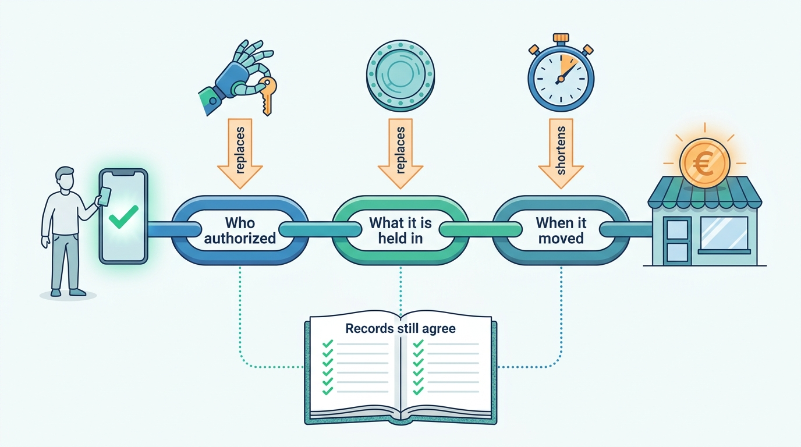
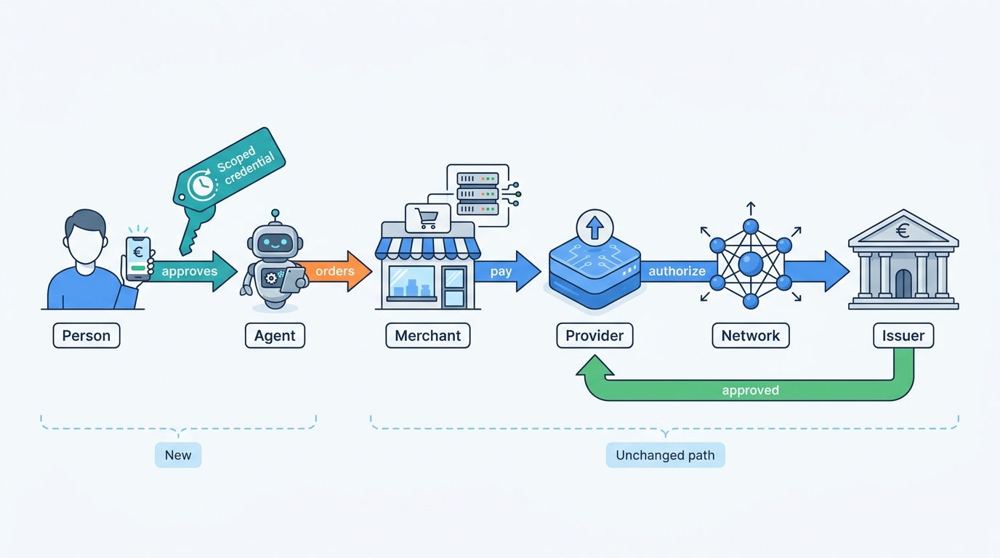
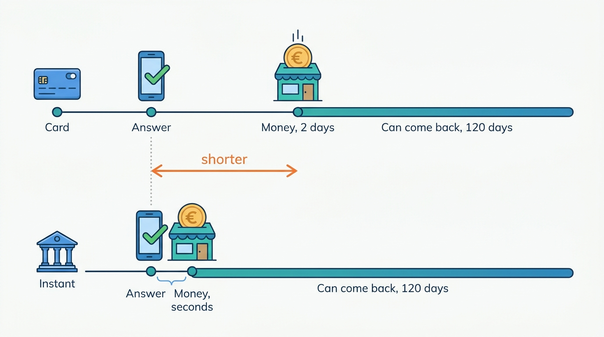

> **IN THIS CHAPTER, YOU WILL:** Sort agent payments, stablecoins, instant payments and new EU rules into build, prepare and watch by the promise each one moves, then close the book.

> **KEY POINTS:**
>
> * **Each change moves one promise.** Agents change who authorized the purchase, stablecoins change what the money is held and settled in, and instant payments change when it has moved. As documented on 17 November 2026, each still ends in an authorization, a balance and a reversal process that someone must track.
> * **A date and a release phase are part of every claim.** Several agent protocols coexist. Adyen's agent product was released in limited availability for US enterprise merchants, Stripe's stablecoin balances are in preview, and the EU's new payment rules were agreed and not yet law. Neither company has published a volume for any of it.
> * **Build what every variant assumes, and watch the rest.** A checkout a machine can call, one ledger abstraction for every balance and per-method rules for finality and reversal pay off whichever protocol, blockchain or date prevails. Each company meets the changes from the side it built first; that reading is my inference.

> **[FAILURE PATTERNS THIS CHAPTER ADDRESSES](where-payment-systems-go-wrong.html):**
>
> * **A Card by Any Other Name** — a new rail is assumed to behave like a card, or to have none of a card's reversals, when its finality and dispute rules are its own and still changing.
> * **The Phantom Payment** — an agent's “bought” or a rail's “instant” is taken for the provider's confirmed record that money moved.
> * **The Borrowed Blueprint** — an architecture is rebuilt around a provider's announcement without the provider's reasons or its release phase.

 
[[payment-contrast-cases]] left five companies' positions fixed as of November 2026. Under all of them, three things are moving, and each can be put as one change to the payment this book began with. On Tuesday 9 March 2027 Mila Janssen buys a ten-class pass for €120 at Studio Noord, a customer of Larkfield, the fictional studio-software platform this book follows ([[meet-larkfield]]). Change one thing. An assistant buys the pass for her. Or she pays from a stablecoin wallet. Or she pays by Wero, the instant bank transfer that is replacing the Dutch method iDEAL. In each case the app still says "Payment successful" about two seconds later. **What has that answer promised now, and who made the promise?**

This chapter's answer is that each change moves one promise and leaves the rest of the chain in place. **Agent-initiated payments change who authorized the purchase. Stablecoins change what the money is held and settled in. Instant account-to-account payments change when the money has moved.** As of November 2026, none removes the need to know who promised what and to prove that the records agree. An architect should therefore build now only what every variant assumes, and watch, not build to, anything tied to one agent protocol, one blockchain or a regulatory date that is not yet law.

Two other reactions are common, and they point in opposite directions. One says the existing architecture is obsolete: agents will replace checkout, stablecoins will replace card settlement, and instant payments will end chargebacks (the reversals a payer's bank can force), so a team should rebuild around whichever arrives first. The other says all three are vendor announcements that a team taking card payments can ignore. Both skip one question: which promise changes, and who carries it?

**Where we are in the payment's journey.** Mila's pass crossed three promises. Her bank approved it at 19:42, which was a promise to pay. Studio Noord received its money on Thursday 11 March, two days later. And the payment stays reversible through a card dispute until about 7 July ([[journey-of-a-payment]]). This chapter asks what happens to each of the three intervals when the buyer is software, the asset is a token, or the rail is instant.

The chapter starts with three proposals at Larkfield, then says how to read its four status labels and its three promises. Agents, stablecoins and instant payments follow in turn, each with dates, labels and both companies' positions. Then come the EU's new rules and the year's acquisitions, and a reading of all of it against what Stripe and Adyen each built first. From there it says what to build now, prepare and watch, sorts Larkfield's folder, shows how building to an announcement fails, says where the evidence stops, and closes Part X and the book.

## Setting the Scene at Larkfield: Three Proposals in a Folder

In January 2027 Femke de Graaf starts as Larkfield's Head of Payments Engineering and finds a folder of three proposals that the product team wrote in November 2026. The first: let AI assistants book classes and pay for them. The second: pay the 700 United States studios out in stablecoins. The third: replace iDEAL with Wero at once, since iDEAL carried 14% of Larkfield's online volume in 2026, €127.4 million of €910 million, and is being retired. Clipped to it is a question from Jonas Weber, who leads risk and compliance: should the authentication flows be rebuilt now for the new EU rules?

Each proposal quotes a press release as though it described something Larkfield could switch on. So before she judges any of them, Femke writes three notes beside each: **the date of the source, the release phase of the product, and the promise in the payment chain that the change would alter.**

## How to Read This Chapter: Four Labels, One Date, Three Promises

Four labels are used throughout. **Announced** means a press release and nothing a customer can use yet. **Preview** means usable by invitation (private) or by anyone who accepts that it may change (public). **Limited availability** means released to a named group of customers or countries. **Generally available** means open to any eligible customer. The words are the vendors' own: Stripe's documentation (n.d., accessed November 2026) labels its stablecoin balances "public preview" in the United States, and Adyen's June 2026 release puts its agent product "in limited availability for enterprise merchants operating in the U.S." Every status below was read on the vendor's or regulator's own page or release on **17 November 2026**.

The second reading aid is the frame: the table says which promise each change moves, from what to what, and what stays. I read every row with the same three questions, which return at the end of the book: which promise does it change, who now carries it, and how will I know the money arrived?

| Change | Promise it moves | From, to | What stays |
| --- | --- | --- | --- |
| Agents that pay | Who authorized the purchase | A cardholder at a checkout, to software holding a scoped credential | An issuer's authorization, a capture, a dispute window |
| Stablecoins | What the money is held and settled in | A bank balance, to a token redeemable for dollars | A balance to record and reconcile; a refund path |
| Instant payments | When the money has moved | Days, to seconds | Two records of the same money; a refund or dispute process with its own states |

**Figure 1:** *Each of the three changes replaces or shortens one link of the payment chain; the chain, and the records that must agree about it, remain.*

## Agents That Pay: Who Authorized the Purchase

**Agentic commerce** means software agents that find, choose and pay for goods on a person's behalf. The sibling book's [[ai-and-agentic-commerce]] covers the protocols; this section covers only the payment. What changes is who presses the button, so the promise that moves is the first one in this book: authorization, the promise to pay made by the issuer, the cardholder's bank ([[payment-authorization]]). The issuer is asked to approve a payment the cardholder did not key in, on the strength of a credential delegated to an agent. Stripe's documentation (n.d., accessed November 2026) calls its version Shared Payment Tokens: "scoped grants that let an agent use a customer's payment method, such as a card", each with "usage and expiration limits". Google's 2025 announcement of its Agent Payments Protocol names the open problems as "Authorization", "Authenticity" and "Accountability".

**Several protocols coexist, one launch surface has already been pulled back, and no item is generally available everywhere.** Mastercard's Agent Pay has no row: I know it only through a quotation in Adyen's release.

| Date | Item | Label on 17 November 2026 |
| --- | --- | --- |
| 30 Apr 2025 | Visa Intelligent Commerce | Announced as an "initiative"; current phase not stated |
| 16 Sep 2025 | Agent Payments Protocol (AP2), Google | Open protocol, announced with "more than 60 organizations", Adyen among them |
| 29 Sep 2025 | Instant Checkout in ChatGPT and the Agentic Commerce Protocol (ACP), Stripe and OpenAI | Protocol "currently in `beta`" (its repository); the checkout surface reported sidelined in March 2026 (trade press) |
| 11 Dec 2025 | Agentic Commerce Suite, Stripe | Launched; managed checkout "available in the US, Canada, and select European countries" |
| 11 Jan 2026 | Universal Commerce Protocol (UCP), Google with retailers | Published open standard; endorsed by Adyen and Stripe among others |
| 18 Mar 2026 | Machine Payments Protocol (MPP), with Tempo, a blockchain Stripe helped start | "an open standard for machine payments co-authored by Stripe and Tempo" |
| 2 Apr 2026 | x402 Foundation, part of the Linux Foundation | Adyen "a founding member"; Stripe also accepts x402 payments |
| 29 Apr 2026 | Link wallet for agents, Stripe | Agent payments for "US and Canadian customers" |
| 16 Jun 2026 | Adyen Agentic | Limited availability for US enterprise merchants at announcement; product page now: available in the US, no phase named |
| 21 Oct 2026 | Stripe Treasury for agents | Announced; no phase stated; spending limits "in the coming weeks" |

Read what each product does underneath, and familiar mechanisms appear. Stripe's April 2026 release on Link for agents says "a one-time-use card is issued per task, and you approve each payment." A single-use card is still a card: an issuer authorizes it and the cardholder can dispute. Stripe's machine payments documentation (n.d., accessed November 2026) says "Payments land directly in your Stripe balance and settle in fiat", with refunds "through the Refunds API". Adyen's April 2026 article on x402 describes "machine-to-machine transactions where agents pay autonomously for the tools, data, and services they consume": a payment embedded in a web request, not a new kind of money. **The authorization promise has a new addressee. It still has to be made, kept and recorded.**

**Figure 2:** *In an agent purchase the new part is the delegation from person to agent; from the merchant onward the payment is still an authorization that an issuer approves.*

On this record the two companies stand differently. Stripe co-authored ACP with OpenAI and MPP with Tempo, sells a suite that connects a business to several agents, and runs Link, which a September 2026 release calls "Stripe's consumer network with over 300 million users globally". Adyen authored none of the protocols. It is a founding member of the x402 Foundation, calls itself an early endorser of UCP, AP2 and ACP, and sells one integration across them, in the words of its June 2026 release: "we intentionally designed Adyen Agentic to help retailers integrate once and participate across evolving platforms, protocols, and experiences — without having to bet on which ecosystems ultimately win". Stripe's chief executive said in April 2026 that "in the not-too-distant future agents will account for most transactions online"; neither company has published how many do today.

## Stablecoins: What the Money Is Held and Settled In

A **stablecoin** is a token on a blockchain (a shared ledger that no single bank keeps) which its issuer promises to redeem one for one for a currency such as the US dollar, and backs with reserves. It changes what the money *is*: a claim on the issuer's reserves instead of a balance at a bank. For a merchant that only accepts it, less changes than that suggests. Stripe's documentation for stablecoin payments (n.d., accessed November 2026) says "completed payments settle in your Stripe balance in your local currency". The same page lists "Dispute support: No" and offers the method to US businesses, with a private preview in the EU and three other markets. The payer's asset is new. The merchant still has a balance to reconcile and refunds to run.

Stripe's own record is a chain of purchases and launches. It completed its acquisition of Bridge, a company that moves money into and out of stablecoins, on 4 February 2025. Its February 2026 release says "In July, Stripe acquired Privy", a maker of programmable wallets, and that in September 2025 it unveiled Tempo, "a blockchain purpose-built for payments, incubated together with Paradigm". Tempo's public network went live on 18 March 2026. On 30 September 2026 Stripe made a further dollar stablecoin available: OUSD, "created by Open Standard, an independent company founded by Coinbase, Mastercard, Shopify, Stripe, and Visa". The balance a customer can hold is less far along: public preview in the United States and "private preview" elsewhere. The $400 billion of stablecoin payments that Stripe's release cites for 2025 is an unsourced figure for the whole industry, not Stripe's own volume.

Adyen's record is one clause. Its release on the first half of 2026 lists among the half's highlights: "Joined the x402 Foundation and Open Standard, driving open protocols for HTTP payments in agentic commerce and shaping stablecoin infrastructure via OpenUSD for global merchants." The one stablecoin Adyen names, then, comes from the company Stripe co-founded. A trade publication reported the membership on 1 July 2026, with a statement from Adyen's chief technology officer about "an open, merchant-first foundation for stablecoin utility". Adyen's release on the third quarter of 2026 does not contain the word "stablecoin"; it reports that Adyen "Joined the European Central Bank's digital euro pilot as an acquiring payment service provider". I found no Adyen product page for accepting or settling in stablecoins.

The labels are early partly because the law is. In the United States the GENIUS Act, which sets who may issue a payment stablecoin, was approved on 18 July 2025. The bank regulator's bulletin of 21 October 2026, issued with its final rule, states: "The GENIUS Act's effective date is January 18, 2027". In the EU, the Markets in Crypto-Assets Regulation (MiCA) "entered into force in June 2023", by the securities regulator's page, and firms operating under national law could continue "until 1 July 2026". On rules that young, preview is the honest label.

## Instant Payments: When the Payment Is Final

An **instant payment** is a transfer the payer pushes from a bank account, which reaches the payee's account within seconds, at any hour, on any day. The EU's Instant Payments Regulation of 2024 gives the number: the payee's provider must make the amount available "within 10 seconds of the time of receipt of the payment order". Banks in the euro area had to offer sending "by 9 October 2025". The promise that moves is settlement, the actual movement of the money, which for a card takes days ([[clearing-and-settlement]]). The gap between the answer and the money shrinks to seconds.

How much runs on such rails depends on the country. The Federal Reserve's statistics for FedNow, its instant service, show an average payment far above any checkout basket, which points to transfers between businesses; that reading is mine. In Europe the retail scheme, Wero, is still arriving: both providers offer it ahead of general availability, and Stripe also sells its own Pay by Bank method.

| Rail | Figure or status | Source |
| --- | --- | --- |
| FedNow (United States) | 2025: 8,413,402 payments, $853.4 billion, average $101,435. Third quarter of 2026: 6,376,467 payments, average $58,161 | Federal Reserve, accessed 17 November 2026 |
| Pix (Brazil) and UPI (India) | 2025: 79.7 billion and 228.3 billion transactions | A research firm (secondary source); not checked against the central banks' tables |
| Wero (EU) | "live for P2P payments in Belgium, France, and Germany since 2024, currently serving 56 million users"; retail payments in Germany "since the end of 2025"; iDEAL to migrate "by 2027" | European Payments Initiative, n.d. |
| iDEAL (Netherlands) | "By the end of 2027 at the latest, all iDEAL merchants will have transitioned to Wero" | iDEAL, n.d. |
| Wero at the two providers | Stripe: public preview. Adyen: "currently in development". Stripe's Pay by Bank: generally available for bank accounts in Finland, Ireland and the UK; Belgium, France and Germany in private preview | Documentation, 17 November 2026 |

Adyen's Wero documentation (n.d., accessed 17 November 2026) describes an authorization that is a bank's guarantee: "The payment guarantee is the shopper's bank's commitment to pay Adyen. It is not the receipt of funds." The funds follow in a capture over the instant rail, which can fail and produce a `CAPTURE_FAILED` event. And the page announces: "Dispute support starts in February 2027." It says "Wero payments can be disputed by the shopper after they settle", beginning with a pre-dispute "within 120 calendar days of the transaction date" and ending, if it goes that far, in arbitration by the scheme. Shoppers whose account "is based in the Netherlands" cannot raise one "until 1 January 2028". Stripe's page for the same scheme says "Dispute support: No". **An answer, then the money, then a window in which it can come back: the instant rail has all three.**

**Figure 3:** *An instant rail shortens the interval between the answer and the money from 2 days to seconds; the 120 days in which the payment can come back are a rule of each scheme, and the newest one has them too.*

What instant payments do to card economics can be reasoned but not cited. A card payment pays **interchange**, a fee that passes from the merchant's side to the cardholder's bank ([[payment-economics]]); an account-to-account payment has none. On Mila's €120 card payment the illustrative provider cost was €0.61, of which €0.24 was interchange and €0.31 was Adyen's own *(assumptions from the ledger)*. Larkfield's price list already shows the consequence one level up: it charges studios €2.53 on that card payment and a flat €0.35 on an iDEAL payment.

> **INFERENCE, NOT DOCUMENTED:** A provider priced as a markup over cost, as Adyen's Interchange++ pricing is, earns the same markup when the interchange disappears. A provider priced as one blended rate loses the spread between that rate and a card's cost on every payment that moves to a bank transfer. Neither company has published the effect of instant payments on its revenue.

## The Rules and the Map: PSD3, the PSR and Who Bought Whom

Two further changes move no single promise. The first is law. **PSD3** and the **Payment Services Regulation (PSR)** are the EU directive and regulation that will replace PSD2, the current payment services law. By law-firm briefings, the Council published the final compromise texts on 23 April 2026. On 17 November 2026 the European Parliament's procedure files for both showed the status "Awaiting Parliament 2nd reading" and an indicative plenary date of 14 December 2026. Neither text was in the Official Journal, so neither had an application date. The forecasts I read agree on the shape: Adyen's explainer (updated 12 October 2026) expects general application "21 months after entry into force", with Verification of Payee, a name check before a bank transfer, at 27 months, and warns that "These dates will move if publication slips." Only the published text will settle the period.

On content there is one provider's reading, not the legal text. Adyen's explainer says that strong customer authentication (SCA, the EU's two-factor rule for payments, [[three-d-secure-and-sca]]) stays: "SCA isn't going anywhere". It says liability moves along the chain: "Issuing banks can seek to recoup losses from acquirers, which increases the likelihood of chargebacks reaching businesses further down the chain". And it leaves the newest method open: "Whether a specific passkey flow qualifies as SCA will depend on the EBA's technical standards", which it places in 2027 and 2028. A **passkey** is a credential bound to a device and unlocked by a fingerprint or a face; Adyen announced Visa's version on 29 October 2026, "initially" in the United Kingdom, and its documentation says "Scheme passkeys are currently in pilot phase". Stripe's material is older or general: a PSD3 guide for platforms last updated on 24 December 2025, before the final texts, and a July 2026 article on passkeys; I found no Stripe page on card-scheme passkeys. Who answers for fraud is being rewritten, and the terms are not final.

The second change is ownership. In 2026 the map moved at both ends: two of the largest processors merged in January, and **Stripe and Adyen each bought a usage-billing company within six months of each other** ([[usage-metering-and-rating]]). The table keeps completed and announced apart.

| Date | Deal | Status on 17 November 2026 |
| --- | --- | --- |
| 9 Jan 2026 | Global Payments acquires Worldpay | Completed (regulatory filing) |
| 14 Jan 2026 | Stripe acquires Metronome (usage billing) | Completed |
| 1 Jul 2026 | Adyen acquires Talon.One (loyalty) and Orb (usage billing) | Completed; Orb run under "an incubator model", "continuing to support multi-PSP environments" |
| 19 Aug 2026 | Stripe to acquire OpenRouter (AI model routing) | Agreement announced; no completion release in Stripe's newsroom list. Trade press reports a closing on 10 November 2026 (secondary source, unconfirmed) |
| 30 Sep 2026 | Stripe to acquire Parafin (credit for platforms' sellers) | Agreement announced; "expected to close in the coming months". One secondary source reports a closing on 11 November 2026 (unconfirmed) |
| 31 Mar 2027 | Lemon Squeezy, a merchant of record that Stripe bought in 2024 | "will shut down" |

## Each Change Read Against the Two Bets

Stripe began with an interface that developers adopt and assembled the regulated layer afterward; in Europe it is an e-money institution, which must place its users' funds at banks ([[licences-and-safeguarding]]). Adyen began with acquiring for enterprises and became a bank, with branches in the United States and the United Kingdom ([[acquiring-and-network-connectivity]]). Every cell of the table but the last column is a fact cited here or in those chapters; the last column is my inference.

| Change | Promise that moves | Stripe: built first, has now | Adyen: built first, has now | Positioned to carry it *(inference)* |
| --- | --- | --- | --- | --- |
| Agents | Who authorized | An API and a consumer wallet; now co-author of ACP and MPP, a suite launched, Link issuing the agent's credential | Acquiring for enterprises; now Adyen Agentic in limited availability and membership of the foundations | Stripe for the credential; Adyen for processing whichever credential arrives |
| Stablecoins | Settlement asset | A non-bank with users' funds at banks; now Bridge, Privy, Tempo, OUSD and balances in preview | A bank with "balances at central and commercial banks" (H1 2026 letter); now one clause and the digital euro pilot | Stripe |
| Instant payments | When the money has moved | Named acquirers and its own entities per market; now Pay by Bank, and Wero in public preview | Banking licenses; "direct access to France's domestic interbank clearing system" (2026); "the earliest adopters of the US FedNow service" (n.d.); Wero in development | Adyen, by license |

The last column follows one rule, and the rule is my reading of the record, not either company's statement: each promise runs through something one of them built first.

> **INFERENCE, NOT DOCUMENTED:** Delegated authorization runs through an interface and a wallet. The party that already operates the payer's wallet and the merchant's API can issue the scoped credential, and that is Stripe. Settlement in seconds runs through membership of bank payment systems, which Adyen's license gives it without a partner. A settlement asset that needs no bank is worth most to the company that is not one: a non-bank that must place users' funds at banks gains an asset it can hold and move through its own subsidiary, while a bank already holds central-bank and commercial-bank balances. Adyen has not said why it has published so little on stablecoins.

Positioned is not the same as ahead, and the same record puts each company on the other's side of every row. Adyen sells an agent product and has joined the stablecoin company that Stripe co-founded. Stripe sells bank payments in two forms, and the US acquirer list of the company whose site says "Stripe is not a bank" names a bank of its own ([[stripe-and-adyen-bets-compared]]). Both bought a usage-billing company in the same year. And since neither company publishes a volume for agent payments, stablecoin balances or instant payments, no reading of who is ahead can be tested yet.

## What to Build Now, What to Prepare, What to Watch

None of this is final, so the rule I use is to sort every proposal by two facts: **its release phase in my market, and the promise it changes.** That gives three piles: build now what every variant assumes, prepare for a dated change to a method you already use, and watch the rest. Each pile has an event that moves an item out of it.

| Pile | What goes in it | Examples in November 2026 | What moves it |
| --- | --- | --- | --- |
| Build now | What every variant assumes | Structured product data and an idempotent order endpoint; one ledger abstraction for every balance; per-method rules for finality and reversal | Nothing: these pay off without any of the changes |
| Prepare | A dated change to a method you already use | The iDEAL to Wero migration; Wero disputes from February 2027 | The provider's migration deadline |
| Watch | Anything tied to one protocol, one blockchain or an unpublished date | An end-to-end integration of one agent protocol; stablecoin balances in preview; flows rebuilt to PSD3 dates | General availability in your market; a published volume; publication in the Official Journal |

Three things belong in the first pile, because every variant of one of the changes assumes them and an earlier chapter already justified each:

- **A checkout a machine can call.** Structured product data, an order-creation endpoint that tolerates a repeated call ([[idempotency-and-retries]]), and the logic that makes you the seller kept on your side ([[merchant-of-record]]). Every agent protocol I read creates an order from software, and Google's January 2026 post on UCP says "you remain the Merchant of Record".
- **Every balance behind one ledger abstraction.** A stablecoin balance is one more balance type. A ledger that already separates balances by type and currency can add it, and can remove it again if a preview is withdrawn ([[payment-ledgers]], [[balances-and-funds-flows]]).
- **Finality and reversal set per payment method.** A card payment, a direct debit and a Wero payment become final and reversible at different moments, so the state machine reads those rules from a table per method ([[payment-state-machines]], [[local-payment-methods]]).

The third pile holds whatever is tied to one agent protocol, one blockchain or a date that is not yet law. Waiting costs little, because the three builds above are what any later integration plugs into. An item moves when the provider labels the product generally available in your market, when someone publishes a volume, or when the Official Journal prints the text; until then I keep it on a list with the date I last checked. A company whose product *is* an agent or a wallet has a different first pile.

## In Practice at Larkfield: Sorting the Folder

Back at Larkfield, Femke sorts the folder in an afternoon. **The assistant proposal becomes a build without a protocol.** The booking app gets a structured class catalog and an order endpoint keyed by the business event, as Keel decision K1 already requires. Integrating one protocol end to end goes on the watch list: Adyen's product was released in limited availability for US enterprise merchants, and Larkfield's 700 US studios are on Stripe. **The stablecoin payout is watched.** The US law takes effect on 18 January 2027, the balances are previews, and Larkfield holds no studio funds to convert. **Wero is prepared, with a date.** It gets a row in the method table of [[local-payment-methods]] and a slot in the upgrade calendar (K7). Memberships stay on direct debit, since both providers list Wero without recurring payments. Jonas gets the shortest answer: not until the text is published.

The Wero row is filled in with the three questions this book ends on, asked of a €120 pass paid by Wero at a studio on Adyen. *Which promise does it change?* Settlement: seconds instead of two days, behind a bank's guarantee that Adyen's page says "is not the receipt of funds". *Who now carries it?* Adyen pursues an unpaid guarantee ("You don't have to pursue the shopper's bank yourself"), and by the same page a payer with a Dutch account cannot open a dispute before 1 January 2028; after that a 120-day window opens, as it does for a card. *How will I know the money arrived?* As for every payment: from the provider's settlement report (K2, K3), with a late `CAPTURE_FAILED` moving the record from `paid` back to `authorized` ([[payment-state-machines]]). One row changes. The architecture does not.

## When It Goes Wrong: Building to an Announcement

The typical failure here is to build to a status that then changes. Its first form is a surface that disappears. Stripe's release of 29 September 2025 announced that "ChatGPT users in the United States can buy from Etsy merchants (and, soon, from Shopify merchants)" through Instant Checkout. On 6 March 2026 a trade publication reported that the feature "is reportedly being sidelined" in favor of merchants' own apps, and quoted OpenAI: "We're evolving how we approach commerce in ChatGPT". The protocol went on; the surface did not last six months. A team with an adapter over its own order endpoint kept what it built; a team that built for that one surface did not.

The second form is a documented property that changes between two readings. On 17 November 2026 Adyen's Wero page showed no chargebacks in its feature table and, further down, a dispute process that "starts in February 2027". Stripe's page said "Dispute support: No". A rule coded as "this method has no disputes" will be false within months. The remedy: store each method's reversal rule with the date it was read, and re-read it on the upgrade calendar.

## Where the Evidence Stops

Six things could not be read on 17 November 2026, and each limits a statement above:

- **Volumes.** Neither company has published a count or a value of agent-initiated payments, stablecoin balances or instant payments.
- **Phases.** Visa Intelligent Commerce, Mastercard Agent Pay and Stripe Treasury for agents carry no release phase on the pages read.
- **Closings.** Stripe's newsroom list shows no completion of the OpenRouter or Parafin purchases. Secondary sources report both closed in November 2026.
- **Adyen on stablecoins.** One clause and a quotation in the trade press; no product, and no stated reason.
- **PSD3 and PSR dates.** Forecasts only, until publication in the Official Journal.
- **Pix and UPI.** Figures from a research firm, not from the central banks' own tables.

## What to Take Away

**Established.**

- On 17 November 2026, by the vendors' own pages and releases: Adyen Agentic released in limited availability for US enterprise merchants, Stripe's stablecoin balances in preview, Wero pre-release at both.
- Several agent protocols coexist (ACP, UCP, AP2, MPP, x402), and one launch surface was withdrawn within six months.
- The US stablecoin law takes effect on 18 January 2027 by the regulator's bulletin; PSD3 and the PSR were agreed and not published.
- Stripe and Adyen each bought a usage-billing company in 2026.

**Depends on context.**

- Wero is a preparation if iDEAL carries real volume for you, as it does for Larkfield, and a watch item otherwise.
- An agent channel is worth an integration when its release phase covers your market and you can keep it behind an adapter; if either fails, wait.
- A stablecoin balance can be useful where you pay across borders into places a bank transfer serves badly. Whether you may hold one depends on your regulator and on rules that start in 2027.

**The author's synthesis.**

- Each change moves one promise and none removes the work of tracking it. I build what every variant assumes and put a date on everything else.
- Which company is positioned to carry each promise follows from what it built first: Stripe the credential and the new asset, Adyen the instant rail. That is an inference from the order of construction, not a forecast of who wins.

## Questions to Ask

1. Which promise does this change: who authorized, what the money is held in, or when it has moved?
2. Who carries that promise now, and who carries a fraud or a mistaken payment?
3. How will we know the money arrived, and from whose record?
4. What is the release phase in our market, on which page, read on what date?
5. If the product is withdrawn, what did we build that keeps its value?
6. Does our order endpoint tolerate a repeated call from software we did not write?
7. Can our ledger add and remove a balance type without a migration?
8. Where does our state machine keep each method's rule for finality and reversal, and when was it last re-read?

## Closing Part X and the Book

Read together, the two cases, the comparison, the three contrasts and this chapter say something none says alone. What looks like a provider's architecture is the trace of where it started, whom it served first and which permission it could get, and the trace keeps being redrawn. [[part-10]] opened with two facts from 2026. On 9 April an Adyen release set the company apart from providers that rely on "a patchwork of acquired technologies"; by 1 July Adyen had closed two acquisitions. And the US acquirer list of the company that "is not a bank" names "Stripe MALPB", a bank of Stripe's own. Both slogans were out of date within a year; integrations last longer. So treat a provider choice as a dated decision about specific promises: who acquires, who holds the funds, who answers for a loss. Write it on the provider comparison card, per country and with a source for every row, and keep the provider exit plan card beside it.

A payment is a chain of promises, and each of the book's ten parts answered the same question for a different one: **what do we do between the instant answer and the slow truth?** For the issuer's approval, a state machine that does not mistake it for money. For the unknown outcome, an idempotency key. For money in motion, a ledger entry per movement and a reconciliation against records the provider did not write. For fraud, controls that move liability without removing it. For other people's money, an account model that is also a liability model. The changes of 2026 shorten the gap or move it to another party. None of them removes the need to know who promised what, and to prove that the records agree.

Go back to Mila. Her €120 was successful at 19:42 on Tuesday, paid to the studio on Thursday, and still reversible in June. Had an assistant bought the pass, an issuer would still have approved a card, single-use or not, and the dispute window would still have run. Had she paid in a stablecoin, the studio's provider would still have credited a balance that someone must reconcile, with a refund as the only way back. Had she paid by Wero, her bank's guarantee would still have come before the funds, and from 2028 a dispute could still follow them. An answer first, the money later, a period in which it can return: the intervals change, and so does the party exposed during each. The need to track them does not.

So the book ends with a test instead of a forecast. Before any feature comparison of a new payment technology or a provider, ask three things: **which promise does it change, who now carries it, and how will I know the money arrived?** Then start where your own integration is, with the payment state card, the idempotency key card and the reconciliation card. They are in the [[toolkit]] with the other cards; [[domain-coverage]], the [[glossary]] and the [[bibliography]] hold the map, the terms and every source.

## Sources and Evidence

All pages were fetched on 17 November 2026; undated documentation is cited as accessed 2026-11.

*Company, product and investor sources*

- [Stripe powers Instant Checkout in ChatGPT and releases Agentic Commerce Protocol co-developed with OpenAI](https://stripe.com/newsroom/news/stripe-openai-instant-checkout), Stripe, 2025-09-29 — the launch for US ChatGPT users and Etsy sellers.
- [Stripe launches the Agentic Commerce Suite](https://stripe.com/newsroom/news/agentic-commerce-suite), Stripe, 2025-12-11 — the suite and Shared Payment Tokens.
- [Stripe builds out the economic infrastructure for AI with 288 launches](https://stripe.com/newsroom/news/sessions-2026), Stripe, 2026-04-29 — Link wallet for agents, the one-time-use card, the chief executive's statement on agents.
- [Stripe helps Muse, Meta's new personal AI agent, shop across the internet with Link](https://stripe.com/newsroom/news/stripe-helps-meta-muse-shop-with-link), Stripe, 2026-09-08 — Link's user count and the single-use virtual card.
- [Introducing Stripe Treasury for agents](https://stripe.com/newsroom/news/treasury-for-agents), Stripe, 2026-10-21 — what agents can do, what is still to come, "Stripe is not a bank".
- [Agentic commerce](https://docs.stripe.com/agentic-commerce), Stripe documentation, n.d., accessed 2026-11 — launch stage varies by integration (volatile).
- [Sell products through agents](https://docs.stripe.com/agentic-commerce/sellers/use-cases/retail), Stripe documentation, n.d., accessed 2026-11 — countries of Stripe-managed checkout; the private preview option (volatile).
- [Machine payments](https://docs.stripe.com/payments/machine), Stripe documentation, n.d., accessed 2026-11 — Shared Payment Tokens as scoped grants, settlement to the Stripe balance, MPP and x402 (volatile).
- [Link Agent Wallet](https://docs.stripe.com/agentic-commerce/agents/link-agent-wallet), Stripe documentation, n.d., accessed 2026-11 — agent payments for US and Canadian customers (volatile).
- [Stripe completes Bridge acquisition](https://stripe.com/newsroom/news/stripe-completes-bridge-acquisition), Stripe, 2025-02-04 — completion date.
- [Stripe's 2025 annual letter and tender offer](https://stripe.com/newsroom/news/stripe-2025-update), Stripe, 2026-02-24 — Privy, Tempo, the industry estimate of stablecoin volume.
- [OUSD is now available on Stripe](https://stripe.com/newsroom/news/ousd-is-now-available-on-stripe), Stripe, 2026-09-30 — Open Standard and its five founders.
- [Stablecoins in Treasury](https://docs.stripe.com/treasury/stablecoins), Stripe documentation, n.d., accessed 2026-11 — public and private preview of stablecoin balances (volatile).
- [Stablecoin payments](https://docs.stripe.com/payments/stablecoin-payments), Stripe documentation, n.d., accessed 2026-11 — settlement in local currency, no dispute support, business locations (volatile).
- [Wero payments](https://docs.stripe.com/payments/wero), Stripe documentation, n.d., accessed 2026-11 — public preview, no dispute support, no recurring payments (volatile).
- [Pay by Bank](https://docs.stripe.com/payments/pay-by-bank), Stripe documentation, n.d., accessed 2026-11 — the generally available and private preview customer countries (volatile).
- [Stripe completes Metronome acquisition](https://stripe.com/newsroom/news/stripe-completes-metronome-acquisition), Stripe, 2026-01-14 — completion.
- [Stripe agrees to acquire OpenRouter](https://stripe.com/newsroom/news/stripe-agrees-to-acquire-openrouter), Stripe, 2026-08-19 — agreement announced.
- [Stripe agrees to acquire Parafin](https://stripe.com/newsroom/news/stripe-agrees-to-acquire-parafin), Stripe, 2026-09-30 — agreement announced; expected closing.
- [Stripe newsroom](https://stripe.com/newsroom/news), Stripe, accessed 2026-11 — no completion release for OpenRouter or Parafin in the list.
- [What platforms and marketplaces can expect from PSD3](https://stripe.com/guides/what-platforms-and-marketplaces-can-expect-from-psd3), Stripe, last updated 2025-12-24 — Stripe's guide, older than the final texts.
- [Tokenization and passkeys: How Italian companies can reduce cart abandonment](https://stripe.com/resources/more/tokenization-and-passkeys-italy), Stripe, last updated 2026-07-13 — a general article on passkeys.
- [Stripe documentation index](https://docs.stripe.com/llms.txt), Stripe, n.d., accessed 2026-11 — no page on card-scheme passkeys listed; none either in the documentation and support sitemaps or a web search of Stripe's domains, where passkey pages concern Dashboard sign-in (17 November 2026; volatile).
- [Acquirer Disclosure & Acquirer Terms](https://stripe.com/legal/acquirer-disclosure), Stripe, n.d., accessed 2026-11 — "Stripe MALPB" among the US acquirers.
- [Stripe acquires Lemon Squeezy](https://www.lemonsqueezy.com/blog/stripe-acquires-lemon-squeezy), Lemon Squeezy, 2024-07-26, banner accessed 2026-11 — shutdown on 31 March 2027.
- [Tempo Mainnet Is Live](https://tempo.xyz/blog/mainnet), Tempo, 2026-03-18 — mainnet and the Machine Payments Protocol.
- [Adyen Announces Adyen Agentic](https://www.adyen.com/press-and-media/adyen-agentic), Adyen, 2026-06-16 — limited availability at announcement, early endorsement of UCP, AP2 and ACP, the Mastercard quotation.
- [Adyen Agentic](https://www.adyen.com/agentic-commerce), Adyen, n.d., accessed 2026-11 — product page: available in the US, no release phase named (volatile).
- [Adyen joins the x402 Foundation](https://www.adyen.com/knowledge-hub/adyen-joins-x402-foundation), Tom Adams, Adyen, 2026-04-02 — founding membership; consumer-direct against machine-to-machine payments.
- [Agentic commerce for merchants](https://docs.adyen.com/online-payments/agentic-commerce/merchant), Adyen documentation, n.d., accessed 2026-11 — integrations for ACP and UCP (volatile).
- [Adyen publishes H1 2026 financial results](https://www.adyen.com/press-and-media/adyen-publishes-h1-2026-financial-results-3wjne), Adyen, 2026-08-13 — the clause on Open Standard and OpenUSD; France's clearing system.
- [H1 2026 Shareholder Letter](https://investors.adyen.com/financials/h1-2026-c2a1a), Adyen, 2026-08-13 — finance income from "balances at central and commercial banks".
- [Adyen publishes Q3 2026 business update](https://www.adyen.com/press-and-media/adyen-publishes-q3-2026-business-update-6r9vz0), Adyen, 2026-10-28 — Personal Agent Protocol; the digital euro pilot.
- [About Adyen](https://www.adyen.com/about), Adyen, n.d., accessed 2026-11 — FedNow adoption.
- [Wero](https://docs.adyen.com/payment-methods/wero), Adyen documentation, n.d., accessed 2026-11-17 — in development; the payment guarantee, capture failure, the dispute process from February 2027 (volatile).
- [PSD3 and PSR Explained](https://www.adyen.com/knowledge-hub/psd3), Adyen, updated 2026-10-12 — expected timeline and a provider's reading of the texts.
- [Adyen Rolls Out Visa Payment Passkey](https://www.adyen.com/press-and-media/adyen-visa-payment-passkey), Adyen, 2026-10-29 — UK first, expansion planned for 2027.
- [Scheme passkeys](https://docs.adyen.com/online-payments/authentication/scheme-passkeys), Adyen documentation, n.d., accessed 2026-11 — pilot phase (volatile).
- [Adyen Closes Talon.One and Orb Acquisitions; Announces Leadership Updates Across Product and Finance](https://www.adyen.com/press-and-media/adyen-closes-talonone-and-orb-acquisitions-announces-leadership-updates), Adyen, 2026-07-01 — closing date.
- [Adyen to acquire Orb to unify billing and payments infrastructure for enterprise merchants](https://www.adyen.com/press-and-media/jtrg4qd7j3p4rj), Adyen, 2026-06-11 — the incubator model and continued support for other providers.
- [Adyen launches Intelligent Money Movement](https://www.adyen.com/press-and-media/adyen-launches-intelligent-money-movement), Adyen, 2026-04-09 — "a patchwork of acquired technologies".
- [Find and Buy with AI: Visa Unveils New Era of Commerce](https://usa.visa.com/about-visa/newsroom/press-releases.releaseId.21361.html), Visa, 2025-04-30 — Visa Intelligent Commerce.
- [Announcing Agent Payments Protocol (AP2)](https://cloud.google.com/blog/products/ai-machine-learning/announcing-agents-to-payments-ap2-protocol), Google Cloud, 2025-09-16 — the protocol and its supporters.
- [Under the Hood: Universal Commerce Protocol (UCP)](https://developers.googleblog.com/under-the-hood-universal-commerce-protocol-ucp/), Google Developers Blog, 2026-01-11 — endorsers; the merchant remains merchant of record.
- [Agentic Commerce Protocol repository](https://github.com/agentic-commerce-protocol/agentic-commerce-protocol), OpenAI and Stripe, n.d., accessed 2026-11 — beta status and maintainers (volatile).
- [Form 8-K](https://www.sec.gov/Archives/edgar/data/1123360/000110465926002705/tm262856d1_8k.htm), Global Payments Inc., filed 2026-01-12 — completion of the Worldpay acquisition on 9 January 2026.

*Standards, regulation and official documentation*

- [GENIUS Act, Public Law 119-27](https://www.govinfo.gov/content/pkg/PLAW-119publ27/html/PLAW-119publ27.htm), United States Congress, 2025-07-18 — the effective-date section.
- [OCC Bulletin 2026-50, GENIUS Act Regulations: Final Rule](https://occ.gov/news-issuances/bulletins/2026/bulletin-2026-50.html), Office of the Comptroller of the Currency, 2026-10-21 — effective date of 18 January 2027.
- [Markets in Crypto-Assets Regulation (MiCA)](https://www.esma.europa.eu/esmas-activities/digital-finance-and-innovation/markets-crypto-assets-regulation-mica), European Securities and Markets Authority, n.d., accessed 2026-11 — entry into force and the transition period.
- [Regulation (EU) 2024/886 (instant payments)](http://publications.europa.eu/resource/celex/32024R0886), Official Journal of the European Union, 2024-03-19 (adopted 2024-03-13) — the 10 seconds and the deadlines by kind of institution.
- [FedNow Service Volume and Value Statistics](https://www.frbservices.org/resources/financial-services/fednow-service-resources/fednow-service-volume-value-statistics/), Federal Reserve Financial Services, accessed 2026-11 — annual and quarterly figures.
- [Procedure file 2023/0210(COD), Payment Services Regulation](https://oeil.europarl.europa.eu/oeil/en/procedure-file?reference=2023/0210%28COD%29) and [procedure file 2023/0209(COD), PSD3](https://oeil.europarl.europa.eu/oeil/en/procedure-file?reference=2023/0209%28COD%29), European Parliament Legislative Observatory, accessed 2026-11-17 — status and the indicative plenary date, the same in both files.
- [Wero key figures](https://epicompany.eu/key-figures/), European Payments Initiative, n.d., accessed 2026-11 — users, rollout and planned migrations.
- [To Wero](https://ideal.nl/en/naar-wero), iDEAL, n.d., accessed 2026-11 — the end-of-2027 transition.

*Research and practitioner sources*

- [OpenAI shifts checkout plans in its agentic commerce strategy](https://www.digitalcommerce360.com/2026/03/06/openai-shifts-checkout-plans-agentic-commerce-strategy/), Digital Commerce 360, 2026-03-06 — Instant Checkout sidelined (secondary source).
- [Card networks, banks, fintechs partner on ‘low-cost’ stablecoin](https://www.paymentsdive.com/news/stablecoin-open-standard-bridge-abrams-bny-stripe-mastercard-visa-coinbase-adyen/824223/), Payments Dive, 2026-07-01 — Adyen in the Open Standard consortium (secondary source).
- [UPI and Pix's 2025 growth and cross-border opportunities](https://www.fxcintel.com/research/analysis/upi-pix-2025-growth), FXC Intelligence, 2026-04-10 — Pix and UPI transaction counts (secondary source).
- [PSD3 and PSR published: what's changing for EU payment services?](https://www.matheson.com/insights/psd3-and-psr-published-whats-changing-for-eu-payment-services/), Matheson, 2026-04-29 — publication of the compromise texts (secondary source).
- [Stripe Closes $7.5 Billion OpenRouter Acquisition as AI Token Traffic Hits Record](https://glitchwire.com/news/stripe-closes-75-billion-openrouter-acquisition-as-ai-token-traffic-hits-record/), Glitchwire, 2026-11-11 — reported closing of the OpenRouter purchase on 10 November 2026 (secondary source; not confirmed on a first-party page).
- [Stripe Closed Its Acquisition of Parafin After It Crossed $100M ARR](https://www.arr.club/signal/stripe-closed-its-acquisition-of-parafin-after-it-crossed-100m-arr), ARR Club, 2026-11-12 — reported closing of the Parafin purchase on 11 November 2026 (secondary source; not confirmed on a first-party page).
- [PSD3: A new era for EU Payment Services Regulation](https://www.addleshawgoddard.com/en/insights/insights-briefings/2026/financial-regulation/financial-regulation-in-the-know-payments-september-2026/psd3-new-era-eu-payment-services-regulation/), Addleshaw Goddard, 2026-09-15 — expected publication and the 21-month period (secondary source).

Larkfield is fictional; architectural recommendations, labeled inferences and labeled assumptions are the author's judgement.
