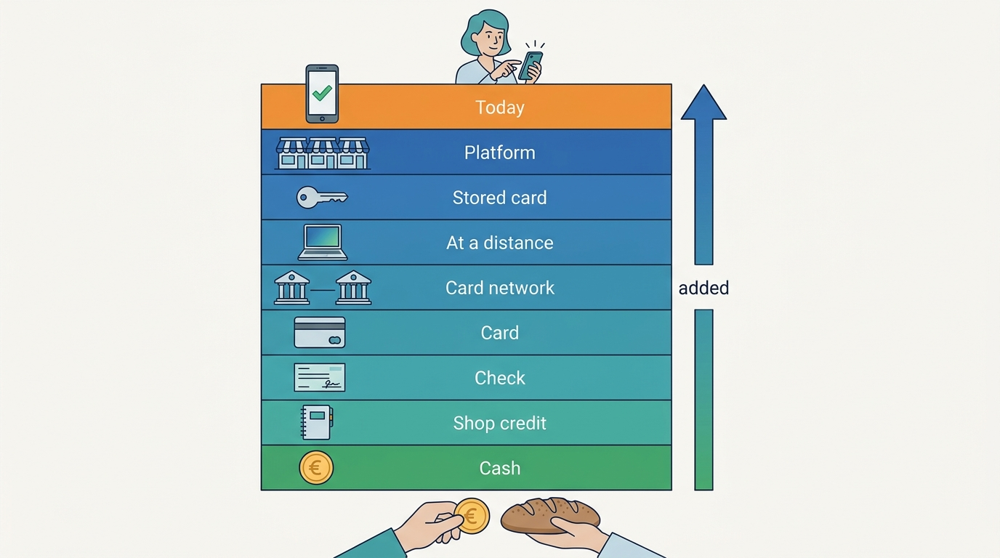
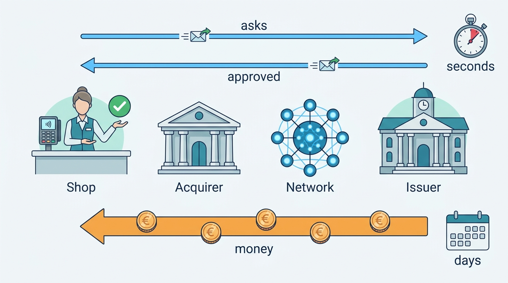

> **IN THIS SECTION, YOU WILL:** Follow paying from a coin on a counter to a tap in an app, and meet each payments concept at the step that first needed it.

> **KEY POINTS:**
>
> * **Every new way of paying let someone buy who could not buy before.** The shopkeeper's notebook fed a family before payday. The check paid a seller in another town. The card let a shop sell to a stranger, and a typed card number let it sell to a buyer at home.
> * **The price each time was a promise and a wait for the money.** Someone had to keep the promise, someone had to write it down, and the seller waited: until payday, until the check cleared, until the banks had paid each other. None of these ways of paying was ever retired, so one tap in an app today rests on all of them.
> * **Payments fail where the promise and the money are apart.** A promise can be forgotten, made twice, broken or mistaken for the money itself. The sixteen patterns of the next page are those cases, named.

 
Hand a baker a coin and take the bread. The payment is over before you reach the door. Now take the payment the [[introduction]] opened with, from the book's fictional example: Mila Janssen taps “Pay” for a €120 class pass in a studio's app, and two seconds later the screen says “Payment successful”. No money has moved. The studio is paid two days later, and for months the payment can still be undone.

Between the coin and the tap lie seven other ways of paying, and this page walks through them in the order they arrived. **Each was a good bargain: it let someone buy or sell who could not before, at the price of a promise and a wait for the money. None was ever retired.** The account is simplified. It follows the ideas, not the full history, which was messier and differed by country. “Retired” is meant of what each step introduced: where the paper check has fallen out of use, clearing and settlement remain. The shops and shopkeepers are illustrations of common practice, the few dates are anchors with sources listed at the end, and the chapters carry the detail.

The walk has nine steps: cash; a village shop that sells on a promise; the check; the card; the card network; paying at a distance; the stored card; the platform; and today's payment, where Mila's pass returns. Each step says what stopped working, what was added and what the book calls it, what it made possible for buyer and seller, and what it cost. The figure below draws the result as a stack. Each then answers one question: **when is it really paid, and who is on the hook until then?**

**Figure 1:** *Nine steps, one stack: each way of paying was added on top of the one before, and none was removed, so a tap in an app today rests on all of them.*

## Cash: Paid on the Spot

Start at a baker's counter. A customer puts down a coin and takes a loaf. In that moment the baker has the money and the customer has the bread. Nobody has promised anything, nobody needs to write anything down, and no third person is involved. The payment is complete, and it cannot come back.

Cash asks for no trust. The baker needs to know nothing about the customer, not even a name, and the customer walks out owing nothing. Two strangers can trade and never meet again.

It is that simple only under three conditions. Both people stand in the same place. The buyer has the money now. And someone carries the coins and guards them, because cash can be lost, stolen or forged. **The steps that follow begin where one of these conditions did not hold**: the buyer had no money yet, or was a stranger, or was somewhere else.

**When is it really paid?** At once. **Who is on the hook until then?** Nobody, because there is no “until then”.

## The Village Shop: A Promise in a Notebook

Picture a village shop, as an illustration of a common practice. A customer is paid at the end of the month and needs bread in the middle of it. The shopkeeper knows the family, hands over the bread and says: pay me on payday. Goods and money have come apart for the first time, and what bridges the gap is a promise.

A promise has to be remembered, so the shopkeeper writes in a notebook who took what and what they owe, and adds a line when the customer pays. Such a list of who owes whom is a **ledger**, and every payment system in this book keeps one ([[payment-ledgers]]).

Both sides gain. The family eats in the middle of the month, when it could otherwise buy nothing until payday. The shopkeeper makes a sale today and keeps a customer who might have gone without, or gone to the shop across the street that does sell on a promise.

The price is the shopkeeper's, and it has two parts. The customer may never pay. And the notebook may be wrong: a line forgotten, a line written twice, a sum the customer remembers differently. Then two accounts of one debt have to be compared, line by line, until they agree. The book calls that comparison **reconciliation** ([[payment-reconciliation-and-reporting]]).

**When is it really paid?** On payday, if the customer comes. **Who is on the hook until then?** The shopkeeper, whose only proof is the notebook.

## The Check: A Promise on Paper, Carried Between Banks

The notebook works between people who know each other. It does not help a seller in the next town, and carrying a large sum in cash there is a risk. People who kept their money in a bank had another way: a signed paper that tells their bank to pay a named person a stated amount. That paper is a check.

The seller cannot spend the paper. The seller's bank has to collect the money from the buyer's bank. Banks commonly exchange such papers in batches and work out who owes whom, which is called **clearing**, and then pay one another only the difference, which is called **settlement** ([[clearing-and-settlement]]). For the United States, the Federal Reserve's history essay on check payments (2023) says banks exchanged checks locally “through institutions known as clearinghouses”, and The Clearing House, a banking association owned by large commercial banks there, dates itself to 1853.

Both sides gain again. The buyer can trade with someone in another town without carrying a bag of coins along the road. The seller wins a sale from a buyer who could never have brought the money in person, and the sum can be as large as the account behind it.

The price is that the check put two banks between buyer and seller, and commonly days between handing over the goods and having the money. The same essay describes how, at times, “a check wound its way through a series of banks” in several cities before it was collected. At the end of the route the buyer's bank could still refuse, because the account was empty, and the check came back unpaid. **The paper was a claim on money, not money.**

**When is it really paid?** When the buyer's bank has honored the check, days later. **Who is on the hook until then?** The seller, who has given up the goods and holds a piece of paper.

## The Card: Someone Else Guarantees the Shop Is Paid

A seller cannot tell a good check from a bad one until days after the goods are gone. So shops commonly took checks from people they knew and were wary of strangers.

The card puts a third party's promise between them. A company gives its customer a card. A shop that has an agreement with that company accepts the card; in the usual arrangement the company pays the shop and collects from the customer afterwards. The bank or company that gives out the card and stands behind it is the **issuer** ([[journey-of-a-payment]]). Diners Club's history page dates its charge card, a card whose bill is paid in full, to 1950. Visa's history page dates BankAmericard to 1958 and describes it as the first card with a “revolving credit” feature, a bill that can be paid off over time.

Now the shop can sell to a stranger and still count on being paid, so it no longer turns away the traveler or the newcomer. The customer can buy without cash in the pocket, and pay later, in one bill.

The guarantee has a price. The shop receives a little less than the price on the tag, and the difference is its fee for the card company's promise ([[payment-economics]]). The card company now carries the customers who do not pay their bill. And the promise holds only if the shop follows the company's rules, and only in shops that have signed up with that one company.

**When is it really paid?** For the shop, when the card company pays it, which no longer depends on the customer if the shop kept to the rules. **Who is on the hook until then?** The card company carries the customer until the bill is paid; the shop has to trust only the card company.

## The Network: Two Banks, Shared Rules and an Answer in Seconds

A card from one bank was of little use in a town where that bank had signed up no shops. One bank can sign up only so many shops and customers. A card network ([[journey-of-a-payment]]) is a way for banks to accept each other's cards.

In a card network many banks join one system and follow its rules, so the customer's bank and the shop's bank can be different banks that have never dealt with each other. The shop's bank, which signs up the shop and collects its card payments, is the **acquirer** ([[acquiring-and-network-connectivity]]). Customer, issuer, shop and acquirer are what Visa's annual report for fiscal 2026 calls the “four-party” model. The network is a fifth party, and it is not a bank. The program that one bank began in 1958 took the name Visa in 1976, and the same report says: “Visa is not a financial institution.”

The shop now knows neither the customer nor the customer's bank. So before it hands over the goods it asks, through its acquirer and the network: will the customer's bank stand behind this payment? The issuer answers yes or no within seconds. That answer is the **authorization** ([[payment-authorization]]). It commonly travels as an electronic message in a shared format, ISO 8583, which Stripe's explainer on the standard (updated 2026) says was published in 1987 and “defines the structure of messages between acquirers and card issuers”.

The authorization moves no money. It is the issuer's promise to pay if the shop claims the amount in time. The money follows a day or more later, by the route the check introduced: the claims are cleared, and the banks settle the difference. On the way, part of the shop's fee is passed to the issuer; that part is called **interchange** ([[payment-economics]]).

The gain is reach. The customer carries one card that works in any shop of any member bank, at home or abroad. The shop can take a card from a bank it has never heard of. And because the answer comes in seconds, a complete stranger can walk out with the goods.

The price is that this step separates the answer from the money. They now travel days apart, between parties that cannot see each other. A shop can take the approval for the money. An answer can be lost on the way, and then the shop does not know whether the issuer said yes. And the banks settle in daily totals, in which a single payment cannot be seen.

**Figure 2:** *The card network separated the answer from the money: the approval arrives in seconds as a message, and the money follows a day or more later by clearing and settlement.*

**When is it really paid?** Promised in seconds, moved between the banks a day or more later, and paid to the shop after that. **Who is on the hook until then?** The issuer owes the acquirer and the acquirer owes the shop, which holds a promise in the meantime.

## Paying at a Distance: A Number Instead of a Card

All of this assumes a customer at the counter, card in hand. A customer who orders from home, by mail or telephone and later on the internet, cannot hand one over. Only the number printed on it travels. The shop sees neither the card nor the person, so it cannot check that the one who pays is the one the card belongs to.

That is worth a great deal to both sides. For shops, the customer is no longer whoever walks past the door: a shop can sell to anyone, anywhere, at any hour. Customers can buy from home, from shops they will never visit.

The price begins with the number itself. A number can be copied, so the cardholder needs a remedy. They tell their bank “that was not me”, and the bank takes the money back from the shop through the network. The complaint is called a dispute, and the forced return of the money is a **chargeback** ([[refunds-reversals-and-disputes]]). It can come long after the sale: Visa's rules (Product and Service Rules, edition of 24 October 2026) give the cardholder's bank 120 days for most disputes. And the guarantee of the card step does not help here: with no card and no person checked, a payment the cardholder denies is commonly the shop's loss.

Because the number alone can pay, everyone who stores it or passes it on has to protect it. A security standard of the card industry says how, and the council that maintains it was founded in 2006 by five card brands, according to the council's own page ([[tokenization-vaulting-and-pci]]). In Europe a directive of 2015, still in force in November 2026, adds a second check of the payer for online payments, with exemptions: an authentication built on “two or more elements”, such as something the payer knows and something the payer has ([[three-d-secure-and-sca]]).

An online shop is software, and connecting it to an acquirer is specialized work. A new kind of company took the place between the two: it accepts a request over the internet, handles the card number and passes the payment on. That company is a **payment provider** ([[journey-of-a-payment]]). The two this book follows date from this step: Adyen's company page gives 2006 as its founding year, and Stripe's annual letter for 2023 says Stripe “launched in 2011”. With such a provider, a small online shop can often begin taking payments without arranging anything with a bank itself.

Distance made new failures possible too. A thief can try a list of stolen numbers against any shop's checkout page. Money can be taken back weeks after the goods were shipped. Card numbers end up in logs never meant to hold them. Every payment now depends on the provider being reachable. And software does not behave like a clerk: **a program that gets no answer sends the request again**. The first request may have been approved all the same, and then the customer has paid twice. With a coin on a counter that cannot happen.

**When is it really paid?** As in the network step, and then only provisionally: for about 120 days the cardholder's bank can take it back. **Who is on the hook until then?** Mostly the shop, which commonly carries a payment the cardholder denies having made.

## The Stored Card: Charging When the Customer Is Not There

Even at a distance, the customer starts every payment by typing the number. That does not suit a membership paid month by month: the customer would have to come back every month, and many would forget.

So the card is kept on file. A stored card number is exactly what a thief looks for, so the shop commonly does not keep it. The provider keeps the number and gives the shop a stand-in, a reference that only the provider can turn back into the card. The stand-in is a **token** ([[tokenization-vaulting-and-pci]]). The shop's software then charges the token on a schedule with no customer present, which is the recurring charge behind every subscription ([[subscriptions-and-billing-engines]]).

The customer no longer retypes anything or has to remember to pay, and the next purchase is a single tap. The seller gets income that returns every month without asking, which makes the subscription possible as a way of selling.

The cost is the customer's absence. Cards expire and accounts run empty, and when a renewal is refused nobody is at the checkout to try another card, so the shop has to retry and send reminders ([[invoicing-collections-and-dunning]]). The stored cards exist only as one provider's tokens, which mean nothing to another provider. And a shop that renews every customer on the first of the month sends a month of payments within an hour.

**When is it really paid?** As before, but a program now asks for the promise, on a date. **Who is on the hook until then?** When the answer is no, the shop: it goes on serving a customer who has not paid, and it has to collect.

## The Platform: Someone Stands Between Payer and Seller

So far every shop has had its own agreement with an acquirer or a provider. Now picture a yoga teacher or a small studio, an illustration again, that takes bookings through someone else's software. Such a seller commonly has neither the time nor the standing to arrange card acceptance alone.

Card network rules have a role for that case. One company may sign up many small sellers under a single agreement with an acquirer. Visa's rules (edition of 24 October 2026) define it as “An entity that contracts with an Acquirer to deposit Transactions, receive settlement from, or contract with an Acquirer on behalf of a Sponsored Merchant” and call it a **payment facilitator** ([[platform-payment-models]]). A software platform can take that role itself; commonly it builds on a provider that signs up the sellers for it.

The sellers' money now arrives together. Whoever stands in the middle keeps a running amount for each seller, the seller's balance ([[balances-and-funds-flows]]), takes a fee from it, and sends the rest to the seller's bank account on a schedule. That last transfer is a **payout** ([[payouts-and-money-movement]]).

The gain is for the smallest sellers. A yoga teacher can take card payments after filling in a form, with no visit to a bank, and is paid into an ordinary bank account. Buyers can pay such a seller exactly as they pay a large shop.

Standing in the middle also brings duties. Someone must know who each seller is, and must keep checking, because the requirements change ([[platform-onboarding-and-verification]]). Holding other people's money is a regulated activity: under the European directive of 2015, a licensed payment company has to keep such funds apart and protected, or insure them ([[licences-and-safeguarding]]). And the payout is one more transfer that can fail. So a seller can be paid late, frozen or not paid at all while every card payment succeeded.

**When is it really paid?** For the payer, at the approval. For the seller, only when the payout reaches the bank account. **Who is on the hook until then?** Whoever holds the balance owes it to the seller.

## Today: Every Step at Once, and One More Record

None of these ways of paying was retired when the next one arrived. A payment in an app today rests on all of them: a debt and a ledger, clearing and settlement, an issuer's promise, a network and an acquirer, a chargeback right, a provider, a token and often a platform. Each is still there because the limit it answered is still there.

Mila's class pass shows all of them together. It comes from Larkfield, the fictional studio-software platform this book follows ([[meet-larkfield]]). At 19:42 on Tuesday 9 March 2027 Mila's bank approves €120. Seven parties have a part in it: Mila, her phone's wallet, her bank, the card network, the provider (Adyen for this studio), Studio Noord, and Larkfield, whose software sent the request. Five promises are made in turn, by her bank, the studio, the acquirer, the network and the provider. The studio receives €117.47 on Thursday 11 March, after Larkfield's fee of €2.53, and Mila can dispute the payment until about 7 July. [[journey-of-a-payment]] follows it party by party.

What the present adds is the software that started the payment, here Larkfield's, which has to decide whether to hand over the goods. It learns what happened to a payment in three installments: the provider's answer to its request, notifications the provider sends later as things change ([[payment-webhooks-and-events]]), and reports that list what actually moved ([[payment-reconciliation-and-reporting]]). From these it keeps its own record of every payment ([[payment-state-machines]]). And not every payment is a card: bank debits and transfers, which behave more like the check, arrive through the same interface ([[local-payment-methods]]).

Together the steps make this possible: almost anyone can buy from almost anyone, anywhere, at any hour. A studio with three instructors sells a pass to a member it may never have met, at 19:42 on a Tuesday, with nobody at the desk, and has the money two days later.

The price is that the software's record is one more copy, and it can disagree with all the others, which is the shopkeeper's notebook problem again: it has to be reconciled. A notification can arrive late, twice or not at all. The provider's interface changes from one version to the next. A bank debit does not follow a card's steps. A design copied from a far larger company brings its machinery without its reasons. And a record marked “paid” at the approval is a copy of a promise.

**When is it really paid?** In installments: promised in seconds, moved between banks in a day or two, paid out after that, and final only when the dispute window has closed. **Who is on the hook until then?** A different party at each stage: the issuer, the acquirer, the provider or platform, and for months the seller.

## What the Steps Add Up To

Here are the nine steps side by side, each with what it made possible and what it added. The last column uses the names the next page gives to these failures, in bold, and plain words where it has none.

| Step | What it made possible | What it added | New party or delay | What can now go wrong |
| --- | --- | --- | --- | --- |
| Cash | Two strangers trade with no trust | A payment that is complete on the spot | None | Loss, theft, forgery |
| Shop credit | The family eats before payday; the shop keeps its customer | A promise, a ledger, reconciliation | A wait until payday | The debt is never paid; two records disagree |
| Check | Trade with another town without carrying cash | Clearing and settlement | Two banks; days | The check comes back unpaid after the goods are gone |
| Card | The shop sells to a stranger; the customer pays later | The issuer and its guarantee, for a fee | The card company | The shop breaks a rule and the guarantee does not hold |
| Card network | One card for any shop; any bank's card for the shop | The acquirer, authorization, interchange | A second bank and a network; money a day or more after the answer | **The Phantom Payment**, **The Black-Box Balance** |
| Paying at a distance | Shops sell anywhere; customers buy from home | The chargeback, rules for card data, the payment provider | The provider; about 120 days in which money can be taken back | **The Double Charge**, **The Orphaned Refund**, **The Card in the Log**, **The Open Till**, **The Single Rail** |
| Stored card | No retyping; income that returns every month | The token and the recurring charge | A schedule in place of the customer | **The Vault Hostage**, **The First of the Month** |
| Platform | The smallest seller takes cards | The payment facilitator, the balance, the payout | A party in the middle; a wait for the payout | **The Frozen Seller**, **The Stranded Payout**, **The Accidental Bank** |
| Today | Anyone buys from anyone, anywhere, at any hour | The business's own record, built from answers, notifications and reports | Your own software | **The Trusted Doorbell**, **The Version Cliff**, **A Card by Any Other Name**, **The Borrowed Blueprint** |

The table is in the order of the ideas. The dates this page has given place the same steps in time, and they show how recent most of them are: the clearing of checks is about 170 years old, the card about 75, and the payment provider about 20. Cash and credit at the shop carry no date, because they are common practice and not events.

| Year | What its source dates to that year | Step |
| --- | --- | --- |
| 1853 | The banking association now called The Clearing House, by its own account | Check |
| 1950 | Diners Club's charge card, by the company's account | Card |
| 1958 | BankAmericard, by Visa's history page | Card |
| 1976 | The program takes the name Visa | Card network |
| 1987 | The message standard ISO 8583, according to Stripe's explainer | Card network |
| 2006 | The card industry's security standards council; Adyen | Paying at a distance |
| 2011 | Stripe | Paying at a distance |
| 2015 | The European directive that adds a second check of the payer and protects funds held for others | Paying at a distance; platform |

Count what stands behind Mila's tap that did not stand behind the baker's coin. There are seven parties, five promises made in turn, and about 120 days before the usual time limit for a dispute has passed. **Every step moved the keeping of a promise further from the making of it**: farther away, later, through more hands. The answer to “when is it really paid?” grew from “now” to four installments.

It is tempting to read the result as bad design that a clean start or a new technology would sweep away. It is the opposite: **the complexity is the price of all that trade, not a mistake**. Each step was a bargain that buyers and sellers wanted, and each answers a limit that has not gone away. Sellers still deal with strangers, buyers are still far away or absent, and small sellers still cannot arrange it all alone. A new way to pay has to answer the same limits or hand them to someone else. So expect every one of these steps to stay, and **expect a failure wherever a promise and its keeping are apart**.

The next page names those failures. [[where-payment-systems-go-wrong]] describes sixteen recurring patterns, and after this walk none of them should come as a surprise: each is a promise from one of these steps (an approval, a notification, a balance, a payout marked as sent) that some system recorded as the truth.

## Sources and Evidence

Each date was read on its source's page on 17 November 2026. Mastercard's history pages could not be read, so no date is given for the second large bank-card association. The quotations from Visa's annual report and rules are reused from [[journey-of-a-payment]], [[refunds-reversals-and-disputes]] and [[platform-payment-models]], and were checked against the filing and the rules on the same day.

*Company, product and investor sources*

- [About Visa](https://corporate.visa.com/en/about-visa.html), Visa, n.d., accessed 2026-11 — the history timeline: BankAmericard in 1958, described by Visa as the first card with a “revolving credit” feature; renamed Visa in 1976 (the former “History of Visa” address redirects to this page).
- [History and Legacy](https://www.dinersclub.com/about-us/history/), Diners Club International, n.d., accessed 2026-11 — the charge card dated to 1950 (the company's own account).
- [Form 10-K for fiscal 2026](https://www.sec.gov/Archives/edgar/data/1403161/000140316126000134/v-20260930.htm), Visa Inc., 2026-11-05 — the “four-party” model; “Visa is not a financial institution”.
- [ISO 8583: The message standard behind card authorisations](https://stripe.com/resources/more/iso-8583), Stripe, updated 2026-09-18 — published in 1987; what the message standard defines (a company's explainer of a paid standard; ISO's own catalogue page could not be read).
- [About Adyen](https://www.adyen.com/about), Adyen, n.d., accessed 2026-11 — founded in Amsterdam in 2006.
- [Stripe's annual letter 2023](https://stripe.com/annual-updates/2023), Patrick and John Collison, 2024-03-13 — “when Stripe launched in 2011” (in the letter's PDF, linked from this page).

*Standards, regulation and official documentation*

- [Check Payments](https://www.federalreservehistory.org/essays/check-payments), Federal Reserve History, 2023-09-28 — clearinghouses, correspondent banks and the routing of checks before the Federal Reserve (United States; evidence age: 3 years, a history essay).
- [Our History](https://www.theclearinghouse.org/about/history), The Clearing House, n.d., accessed 2026-11 — “a banking association and payments company that is owned by the largest commercial banks and dates back to 1853”.
- [Visa Core Rules and Visa Product and Service Rules](https://usa.visa.com/dam/VCOM/download/about-visa/visa-rules-public.pdf), Visa, 2026-10-24 — the definition of a payment facilitator (Glossary) and the 120-day dispute time limit (Product and Service Rules), as cited in the linked chapters.
- [About us](https://www.pcisecuritystandards.org/about_us/), PCI Security Standards Council, n.d., accessed 2026-11 — founded in 2006 by American Express, Discover, JCB International, MasterCard and Visa Inc.
- [Directive (EU) 2015/2366 on payment services (PSD2)](http://publications.europa.eu/resource/celex/32015L2366), Official Journal, 2015-12-23 — Article 4(30), strong customer authentication “based on the use of two or more elements”; Article 97, when it is required; Article 10, safeguarding (evidence age: 11 years; in force, replacement pending).

*Research and practitioner sources*

- None.

Larkfield is fictional; architectural recommendations, labeled inferences and labeled assumptions are the author's judgement.
