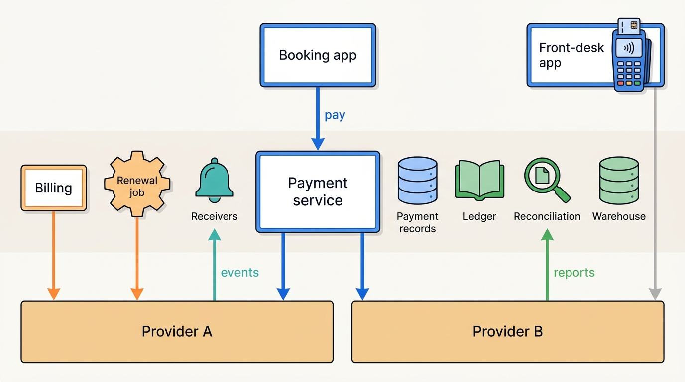
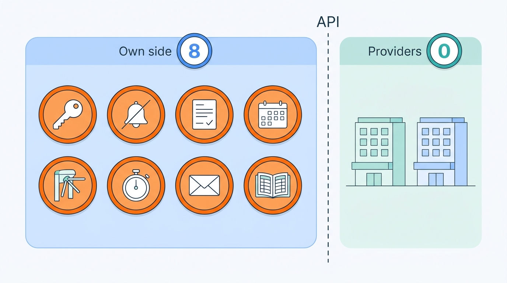
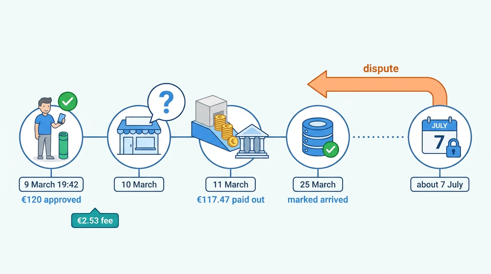

> **IN THIS SECTION, YOU WILL:** Meet Larkfield, the fictional studio-software platform this book follows: its business, its two providers, its systems and people, its eight incidents, the Keel program and the recurring payments.

> **KEY POINTS:**
>
> * **Larkfield is a fictional composite, not a disguised company.** Every figure, person and event is invented, and nothing that happens to Larkfield is evidence about Stripe or Adyen.
> * **Two providers, nine systems, eight incidents, one cause.** A studio is on Stripe (since 2017) or Adyen (since 2024). In every incident, Larkfield's own code, form or process treated a provider's answer, event or deadline as settled.
> * **Keel changes Larkfield's side of the API.** The 2027 program changes keys, records, pacing and ownership in eight decisions, K1 to K8. It keeps both providers and adds no orchestration product.

 
The previous page used Larkfield's incidents one at a time, each to illustrate one failure pattern ([[where-payment-systems-go-wrong]]). This page gives the platform whole. Larkfield is a composite of patterns common among software platforms that embed payments, **not a disguised version of a real company**. It uses Stripe and Adyen by name because the book compares the two; everything it does with them is illustration, never a statement about how either treats a real customer.

In 2026 Larkfield moved **€1.12 billion in 31.4 million payments** through two providers, split by studio. Its eight incidents look unrelated, and they share one cause. **Each time, Larkfield's own code, form or process treated a provider's answer, event or deadline as settled.** Its 2027 program, Keel, therefore changes Larkfield's own keys, records, pacing and ownership, keeps both providers and adds no orchestration product (software that routes each payment among several providers).

The page is a reference, laid out in the order that claim needs: the company and its business lines; why there are two providers; the nine systems as the new head of payments engineering found them in January 2027, and the people; the eight incidents; the Keel program; the recurring worked examples, first among them Mila's €120 class pass; and how the chapters use all of it. The invented figures are in tables, and each payments term is explained at first use.

## Larkfield at a Glance

**Larkfield B.V.** is a software platform for independent fitness and wellness studios: yoga, pilates, climbing, martial arts and boutique gyms. It was founded in **Rotterdam in 2017** by **Sofie Vermeer** (CEO) and **Daniel Osei** (CTO), is privately held and raised a Series B round in 2023. Studios use it for scheduling and booking, memberships, a member app, front-desk check-in and sales, and **payments**: members pay studios through Larkfield.

In 2026 Larkfield serves **6,200 studios** and **2.9 million active members** in five countries, in euros, pounds and US dollars. It has **340 employees**, of whom **96** work in engineering and **11** in the payments team.

| Market | Studios | Currency |
| --- | --- | --- |
| Netherlands (home) | 2,300 | EUR |
| Germany | 1,450 | EUR |
| United Kingdom | 1,100 | GBP |
| United States (since 2025) | 700 | USD |
| Belgium | 650 | EUR |

Two sums describe the company, and they must not be confused. **€1.12 billion** is what members paid studios through Larkfield in 2026; that money belongs to the studios. **€46.0 million** is Larkfield's own revenue: €24.5 million of software subscriptions, €19.8 million of payments revenue and €1.7 million of other income. The payments revenue is the fees Larkfield charges on member payments, about 1.77% of the volume. Its two providers charged it **€12.6 million** to process that volume, leaving a payments margin of **€7.2 million**: a small error rate on the volume is a large one against the margin.

## Three Business Lines and One Fee

Those two sums come from three business lines, which differ in who the seller is. In the first, Larkfield sells software to studios. In the other two, studios sell to their members and Larkfield carries the payment.

| Line | What is sold | 2026 volume | Notes |
| --- | --- | --- | --- |
| **Studio subscriptions** | Plans at **€89**, **€189** and **€349** a month per location; annual plans at ten times that, paid up front; SMS messages beyond the plan's allowance at **€0.07** each | €24.5M | Billed with Stripe Billing, Stripe's subscription product, since 2018 |
| **Member payments, online** | Monthly memberships (typical **€49**), ten-class passes (typical **€120**), drop-ins (typical **€16**) | €910M in 27.6M payments | 61% recurring memberships, 39% one-off |
| **Member payments, front desk** | Drop-ins, passes and retail at the studio | €210M in 3.8M payments | Card terminals at **2,100 studios** |

On each member payment Larkfield charges the studio a **platform fee**, and the fee depends on how the member pays. The provider's processing cost comes out of that fee. On a €120 pass paid by card online the fee is 1.9% + €0.25 = **€2.53**, and the studio receives €117.47.

| Payment | Larkfield's fee to the studio |
| --- | --- |
| Online card payment | 1.9% + €0.25 |
| Direct debit | 0.8% + €0.25 |
| iDEAL payment | €0.35 flat |
| In-person payment | 1.4% + €0.10 |

Barely half of online volume is paid by card. A **direct debit** pulls money from the member's bank account under a standing permission and can be returned weeks later; SEPA Direct Debit is the euro-area scheme and Bacs Direct Debit the British one. With **iDEAL**, a Dutch method, the payer approves a bank transfer in their own banking app; Bancontact is Belgium's domestic method. With 48% of online volume off cards, the pattern *A Card by Any Other Name* is a live risk here ([[local-payment-methods]]).

| Method, online, 2026 | Share of volume | Used for |
| --- | --- | --- |
| Cards | 52% | About 70% debit; includes Apple Pay and Google Pay |
| SEPA Direct Debit | 21% | Memberships in the Netherlands and Germany |
| iDEAL | 14% | Passes and first payments in the Netherlands |
| Bacs Direct Debit | 5% | Memberships in the United Kingdom |
| Bancontact | 4% | |
| Other | 4% | |

## Why Larkfield Runs on Two Providers

All of those payments are processed by a payment provider, and Larkfield has two. **Stripe** came first, in **2017**. Larkfield bills its own subscriptions with Stripe Billing and takes member payments with Stripe Connect, Stripe's product for platforms whose customers are the sellers. Today Stripe carries the United Kingdom, the United States and Belgium, and every studio onboarded before 2024 that has not been migrated: 3,590 studios and **44% of 2026 member payment volume (€493 million)**.

**Adyen** followed in **2024**, through its product Adyen for Platforms, for two reasons. The first was in-person payments on the same platform as online ones. The second was **local acquiring** in the Netherlands and Germany: having an acquirer (the licensed institution that takes a merchant's card payments into the card networks) process studios' payments in their own region. Adyen now carries every front-desk terminal and the online payments of the Dutch and German studios onboarded or migrated since 2024: **56% of volume (€627 million)**. Larkfield has never measured the effect of the second reason: no before-and-after comparison of approval rates isolates the acquirer ([[acquiring-and-network-connectivity]]).

The split is **by studio, not by payment**: a studio's online payments are on one provider. One group straddles the line: **1,140 studios** in the Netherlands and Germany, onboarded before 2024, still take online payments on Stripe while their front-desk terminals are on Adyen. For their members, the only identifier the two channels share is Larkfield's own member id.

| Provider | Since | Carries | Studios (online) | 2026 volume |
| --- | --- | --- | --- | --- |
| Stripe | 2017 | Studio subscriptions; online payments in the UK, the US and Belgium and at 1,140 older Dutch and German studios | 3,590 | 44% (€493M) |
| Adyen | 2024 | Online payments at the other Dutch and German studios; all front-desk terminals | 2,610 | 56% (€627M) |

On both providers three things hold. **The studio is the seller**: members see its name on their card statement, and Larkfield is not the merchant of record (the legal seller on a payment). **The provider holds the money** until payout, the transfer to the studio's bank account, so Larkfield never holds member funds and is not a payment institution (a company licensed to hold or move other people's money). And **Larkfield stands behind the studio**: the studio carries a lost dispute and its fee, and if its balance cannot cover them, the loss falls on Larkfield. On Stripe the studios are legacy Custom connected accounts (seller accounts Larkfield creates and controls, with no Stripe dashboard of their own), paid through destination charges that name the studio as the business behind the payment. On Adyen each studio has a balance account, and Larkfield's fee goes to one of its own ([[platform-payment-models]]).

## The Systems Landscape in January 2027

Between its product and those two providers Larkfield runs nine systems of its own, shown here as Femke de Graaf finds them in January 2027. Every one works.

| System | Role | Notes |
| --- | --- | --- |
| **The booking app** | Member-facing web and mobile app, and the studios' back office | Creates the business events (purchase, renewal, refund request) |
| **The payment service** | One internal API for "take a payment", "refund" and "pay out", with an adapter per provider | Built in 2024 for the Adyen launch; routes by studio; holds the idempotency keys (the identifiers that let a provider recognize a repeated request as the same one) |
| **The payment record store** | Larkfield's own record of every payment attempt, in five states (`pending`, `authorized`, `paid`, `refunded`, `disputed`), with both providers' references | PostgreSQL; fed by webhooks through an inbox table |
| **The ledger** | A small double-entry ledger of what Larkfield and the studios are owed, per provider and currency | Introduced in 2025 |
| **The billing integration** | The Stripe Billing objects for studio subscriptions, and a meter for SMS usage | Owned by the growth team, not the payments team, until 2027 |
| **The webhook receivers** | One endpoint per provider | The Stripe receiver predates the payment service |
| **The reconciliation job** | Nightly: provider reports against the payment record store and the ledger | Covered only Adyen until Keel |
| **The data warehouse** | Reporting for finance and for studios | Provider exports land here |
| **The front-desk app** | Tablet app that drives the card terminal | Adyen terminals only |

Each of the nine was added for the need of its year, so the landscape records several moments and no single design. In 2017 Daniel Osei wrote the Stripe integration, with its webhook receiver and one secret key. Stripe Billing followed in 2018 for the studio plans. In 2024 Tom Hendriks built the payment service for the Adyen launch. The ledger arrived in 2025 after a first unexplained difference, and the reconciliation job after the audit finding described below. No addition revisited what was already there, so the older paths kept working beside the newer ones.

**Figure 1:** *Larkfield's landscape in January 2027: nine systems, two providers (Provider A is Stripe, since 2017; Provider B is Adyen, since 2024), two paths that reach a provider beside the payment service, and a reconciliation job that reads one provider's reports.*

What the new head of payments engineering finds between the systems is four missing joins. **Money-moving calls have more than one writer.** One unrestricted Stripe secret key from 2017 is shared by five systems, and the booking app's renewal job generates a fresh idempotency key at each network call. **The record's `paid` rests on events nobody confirms.** The payment service's only read call returns Larkfield's own row. **Reconciliation covers one provider**, and the ledger has no entries for refunds made after payout, chargeback fees or currency conversion. **Billing sits outside the payments team.** Each gap is the mechanism of an incident below.

Two other things are absent by choice. There is **no orchestration product**: the payment service's routing rule is "the studio's provider", with a manual per-studio override. And the front desk has **no second provider and no offline mode**: the front-desk app reaches the Adyen terminals over a cloud connection, so a studio without internet cannot take cards ([[in-person-payments]]).

## The People

The people who built and own these systems are a small cast, all fictional, each defined by what they own or by the payment they make.

| Person | Role | Pronouns | Owns, or part in the book |
| --- | --- | --- | --- |
| **Femke de Graaf** | Head of Payments Engineering since January 2027 | she/her | Leads Keel; the reader's stand-in |
| **Daniel Osei** | CTO and co-founder | he/him | Wrote the original Stripe integration in 2017 |
| **Sofie Vermeer** | CEO and co-founder | she/her | |
| **Priya Raman** | Finance Controller | she/her | The monthly close and the audit finding |
| **Jonas Weber** | Risk and Compliance Lead | he/him | Verification, disputes and the fraud rules |
| **Aylin Demir** | Head of Studio Support | she/her | Hears about every payout problem first |
| **Tom Hendriks** | Senior engineer, payments team | he/him | Built the payment service in 2024 |
| **Ines Bakker** | Owner of **Studio Noord**, a yoga studio in Utrecht | she/her | On Adyen since 2024; three instructors, 410 members |
| **Ravi Shah** | Owner of **Ironworks Climbing**, three locations in Manchester | he/him | One UK company on Stripe Connect; the onboarding example |
| **Mila Janssen** | Member at Studio Noord | she/her | The payer in the recurring payment |
| **Bram de Wit** | Member at Studio Noord | he/him | The cardholder in the €120 dispute |
| **Daan Peters** | Member at Studio Noord | he/him | Pays his membership by direct debit |
| **Lotte Smit** | Member at Studio Noord | she/her | Her bank replaces her stored card |

One of them holds the reader's position. **Femke de Graaf** is an experienced engineer who is new to payments; she joined in January 2027 and leads Keel. When a Larkfield scene says "you", it usually means her: asked to decide about payment systems she did not build. In her first months she reviews each incident with its owner.

## The Eight Incidents

Femke starts from eight incidents, found between the year-end close of 2025 and November 2026, which the book cites by these names. Each is an instance of a pattern from the previous page, given in italics, and is worked in full by the chapter linked.

* **The Unexplained €0.4 Million** (year-end 2025). The ledger's "owed to studios" balance was **€412,000** higher than the two providers' balances. Three weeks of work traced it to refunds after payout (€317,200), chargeback fees (€73,500) and Larkfield's own currency-conversion rounding (€21,300). It became an audit finding and the origin of the reconciliation job. *The Black-Box Balance*, with *The Orphaned Refund*; [[payment-ledgers]], [[payment-reconciliation-and-reporting]].
* **The Version Cliff** (March 2026). The billing integration had run for three years on a Stripe API version nobody owned: it sent none, so it used the account's default. A library upgrade for another feature moved it across a breaking release that removed a field the finance export read. Subscription revenue reports were silently wrong for **6 days**. *The Version Cliff*; [[payment-api-versioning]].
* **The Frozen Studios** (May 2026). A verification requirement changed for studios on Stripe Connect, with a deadline announced in advance. Larkfield sent one batch email to each studio's sign-up address, and nobody owned the deadline. **230 studios** missed it and went up to 12 days without payouts, Ironworks Climbing among them. *The Frozen Seller*; [[payment-compliance-and-regulation]], [[platform-onboarding-and-verification]].
* **The Payout That Bounced** (June 2026). A back-office form let studio owners change bank details with no check of the account holder. Banks returned **412 payouts** worth **€386,000** over three weeks, and the returns sat unreconciled: 19 days to pay every studio, and two studios left. *The Stranded Payout*; [[payouts-and-money-movement]].
* **The Card-Testing Weekend** (8–9 August 2026). Bots used one studio's public booking widget, which sold €1 trial drop-ins to guests, to test **61,000** stolen card numbers. It cost **€4,100** in fees and refunds, and an engineer switched the studio's online payments off for 31 hours. *The Open Till*; [[payment-fraud-and-risk]].
* **The Silent Webhook** (Monday 14 September 2026). The TLS certificate of the Stripe webhook receiver expired shortly after midnight, and events failed for **9 hours**. **3,200 memberships** were shown as unpaid, and members were turned away at check-in that morning. No money was lost; 460 support tickets. *The Trusted Doorbell*, noticed as *The Phantom Payment*; [[payment-webhooks-and-events]].
* **The Renewal Wave** (1 October 2026). On the 1st of every month, 38% of membership renewals are attempted in six hours. That morning the unpaced renewal job met Stripe's rate limit and treated each refusal as a failed payment. **7,900** renewals were delayed to the next day, and dunning emails (payment-failure reminders) went to members who had done nothing wrong. *The First of the Month*; [[payment-developer-platform]], [[payment-peak-load]].
* **The Double Charge** (1 November 2026). During the next first-of-month run a provider call timed out, and the renewal job retried it with a **new** idempotency key. Each first request had in fact been approved, so the retry created a second payment. **1,840 members** paid twice; **€71,300** was refunded, and 212 disputes were filed with members' banks anyway. *The Double Charge*; [[idempotency-and-retries]], [[payment-authorization]].

Set side by side, the eight have one cause. In each, what decided the outcome was a piece of Larkfield's own code, a form or a process that treated a provider's answer, event or deadline as settled. Most sit at one of the landscape's missing joins. All four pattern families appear, so the common cause is not one kind of bug, and in no row is the deciding item inside a provider.

| Incident | Pattern (family) | What on Larkfield's side decided it |
| --- | --- | --- |
| The Unexplained €0.4 Million | The Black-Box Balance (money truth) | A ledger never reconciled to the providers' balances |
| The Version Cliff | The Version Cliff (integration) | An API version nobody owned, and an export that failed silently |
| The Frozen Studios | The Frozen Seller (trust) | One reminder to an unread address, and no owner for the deadline |
| The Payout That Bounced | The Stranded Payout (money truth) | A bank-details form with no check of the account holder |
| The Card-Testing Weekend | The Open Till (trust) | A public widget with no limit on payment attempts |
| The Silent Webhook | The Trusted Doorbell (integration) | An expired certificate, and no way to ask the provider instead |
| The Renewal Wave | The First of the Month (platform and scale) | An unpaced job that read a refusal as a failed payment |
| The Double Charge | The Double Charge (money truth) | A retry sent with a new key |

**Figure 2:** *All eight incidents were decided on Larkfield's own side of the provider's API: a key, a receiver, a form, a version, a widget, a job, a reminder and a ledger.*

None of this tells you anything about Stripe or Adyen. A provider's behavior is established only by a dated source in the chapter that discusses it. Stripe appears in four of the eight (the Version Cliff, the Frozen Studios, the Silent Webhook and the Renewal Wave) because Larkfield's Stripe integration is seven years older than its Adyen one, which is no judgement of either company. In the Double Charge and the Card-Testing Weekend the provider is deliberately left unnamed.

## The Keel Program

**Keel** is Larkfield's answer: the 2027 program, led by Femke, that puts the payments estate on an even keel. Its eight decisions, **K1 to K8**, are fixed: chapters explain them and never change them. The table gives each decision with the patterns it answers and, through them, the incidents.

| Decision | What changes on Larkfield's side | Pattern it answers | Worked in |
| --- | --- | --- | --- |
| **K1 — One writer, one key** | Every money-moving call goes through the payment service, the only system that holds a credential able to move money. The idempotency key is derived from the business event, never generated per network call. For a renewal it is membership id plus billing period plus the number of the scheduled attempt: a timeout retry reuses the key, the next scheduled attempt gets a new one. | The Double Charge | [[idempotency-and-retries]] |
| **K2 — The provider's record is the truth; the webhook is the doorbell** | Receivers verify, persist and acknowledge. A state change is confirmed against the provider's own record: the payment object where the API lets Larkfield read it, the settlement report where it does not. A job sweeps everything still pending. | The Trusted Doorbell, The Phantom Payment | [[payment-webhooks-and-events]], [[payment-state-machines]] |
| **K3 — A ledger entry for every movement** | Fees, splits, refunds, disputes, payouts and returns are entries; clearing accounts must return to zero. The reconciliation job covers both providers (one run per provider, started when its reports are ready), writes ledger entries only from report lines, and leaves every unmatched amount as an open item with an owner. | The Black-Box Balance, The Orphaned Refund, The Stranded Payout | [[payment-ledgers]], [[payment-reconciliation-and-reporting]] |
| **K4 — Card numbers never touch Larkfield** | Hosted fields (card inputs served by the provider inside Larkfield's page) and provider tokens only; network tokens (card-network stand-ins for a card number that stay valid when the card is reissued) for stored cards; a script inventory for the booking widget. | The Card in the Log, The Vault Hostage | [[tokenization-vaulting-and-pci]], [[network-tokens]] |
| **K5 — Renewals are spread and rate-limited by Larkfield, not by the provider** | The renewal job paces itself over 18 hours and retries on a schedule tied to decline codes. | The First of the Month | [[payment-peak-load]], [[invoicing-collections-and-dunning]] |
| **K6 — Verification is state, not a form** | Each studio's requirements, deadlines and capability status are mirrored and shown in the back office, with an owner for every deadline. | The Frozen Seller | [[payment-compliance-and-regulation]], [[platform-onboarding-and-verification]] |
| **K7 — Versions are upgraded on a calendar** | One planned API upgrade per provider per half-year, tested against recorded traffic. | The Version Cliff | [[payment-api-versioning]], [[payment-safe-change]] |
| **K8 — Two providers, one rehearsed switch** | The payment service can move a studio's online card payments to the other provider. The switch is rehearsed quarterly for the 50 largest studios. No orchestration product is added. | The Single Rail | [[payment-routing-and-orchestration]], [[payment-reliability-and-availability]] |

Read as a set, the decisions change four things, and no provider is one of them. K1 is about **keys**. K2, K3 and K4 are about **records**. K5 is about **pacing**. K6 and K7 are about **ownership**. One incident has no K number. The Card-Testing Weekend was answered at once in 2026, with a CAPTCHA on guest checkout, a cap on payment attempts per studio and an alert on unusual declines.

K8 is the one decision that concerns the providers, and it adds little. Each of the 50 largest studios keeps a verified account at both providers. The switch is a failover for payments that bring their own credential, a phone wallet or a typed card; Mila's pass would move. Renewals on stored cards stay with the provider that holds the card, and the front desk has no second provider. Each rehearsal sends real payments through the second provider and follows them to payout, a refund and reconciliation.

The same reasoning shows in what Larkfield declines while Keel runs. Each proposal in the table would have added a product, a role or a mechanism before the records behind it existed; the refund buffer and the card would have been the pattern *The Accidental Bank*.

| When (2027) | Proposal | From | Answer | Chapter |
| --- | --- | --- | --- | --- |
| February | An orchestration product with per-payment routing | Daniel Osei | Declined; K8 instead | [[payment-routing-and-orchestration]] |
| February | Offline card acceptance at the front desk | A studio | Declined | [[in-person-payments]] |
| February | A message queue with a distributed transaction | Tom Hendriks | An outbox instead, live since 1 March | [[payment-data-stores-and-consistency]] |
| April | A refund buffer: member payments held in a Larkfield bank account for 14 days, about €43 million | The product team | Rejected by Jonas Weber: Larkfield would hold studio funds. Built as a longer payout schedule at the provider | [[licences-and-safeguarding]] |
| May | Make the provider the merchant of record | Sofie Vermeer | No, for class sales and for Larkfield's own subscriptions | [[merchant-of-record]] |
| May–June | An instant-payout card for studios | The product team | Not launched until four conditions hold | [[embedded-finance]] |

## The Recurring Worked Examples

Chapters show their mechanisms, and test Keel, on a small set of payments from early 2027 whose facts never change: six recurring examples and two further members.

**Mila's class pass, the recurring payment.** On **Tuesday 9 March 2027 at 19:42** Mila Janssen buys a **ten-class pass for €120.00** from Studio Noord in the member app. She pays with a Dutch Visa debit card in her phone's wallet, which authenticates her on the device, so there is no challenge from 3-D Secure, the protocol by which the cardholder's bank checks who is paying. Studio Noord is on Adyen. Her bank approves the payment at 19:42, and it is captured (claimed) automatically. On Wednesday Ines Bakker writes to support: "It says paid. Paid to whom?" The payout that includes the pass is sent on **Thursday 11 March**. Larkfield's record marks it as arrived on Thursday 25 March, when its ten-business-day window for a returned payout closes, and the payment can be disputed until **about 7 July**. [[journey-of-a-payment]] walks the payment party by party.

| Part of Mila's €120.00 | Amount | Note |
| --- | --- | --- |
| Studio Noord receives | **€117.47** | |
| Larkfield's fee | **€2.53** | 1.9% + €0.25 |
| of which the provider's cost on Adyen | €0.61 | *(assumption)*: €0.24 interchange for the cardholder's bank, €0.06 card-network fees, €0.31 for Adyen |
| leaving Larkfield | €1.92 | |
| Had Studio Noord been on Stripe | €0.87 cost, €1.66 left | *(assumption)*: one blended rate of 0.6% + €0.15 |

**Figure 3:** *Mila's €120.00 is approved at 19:42 on 9 March 2027, pays Studio Noord €117.47 on 11 March, is marked arrived on 25 March and can be disputed until about 7 July.*

**Mila's membership renewal, the recurring failure.** Mila also holds a **€49.00 monthly membership** at Studio Noord. She set it up on **12 January 2027** by typing in the same card and passing a 3-D Secure challenge in her banking app. It renews on the 1st of each month as a merchant-initiated payment, one the merchant starts without the cardholder present. On **1 April 2027** the renewal is declined for insufficient funds, and Larkfield emails her the same day. The retry on **4 April** succeeds. It is scheduled attempt 2 and carries its own idempotency key (K1), and she keeps access to classes in between. ([[journey-failed-renewal]]).

**The first of the month, the recurring peak.** Multiply that one renewal by all of them. Recurring memberships are 61% of online volume. The peak is predictable to the hour, yet the Renewal Wave and the Double Charge both happened on a 1st. Under K5 the wave runs over 18 hours.

| Measure | Value |
| --- | --- |
| Recurring membership volume | About **€555 million** a year, **€46 million** a month |
| Renewals a month | About **940,000**, about 540,000 of them by card *(assumption)* |
| Attempted in the first six hours of the 1st | 38%: about **357,000 renewals**, **€17.5 million** |

**The refund after payout, money flowing back.** So far money has moved forward. On **18 March 2027** Mila asks for a refund of the seven unused classes of her pass, **€84.00**, a week after Studio Noord was paid. Under Larkfield's policy the studio funds a refund and Larkfield keeps its fee. Studio Noord's balance at Adyen held €212.40 of later sales that day *(assumption)*, so the refund was taken from it and the studio's next payout was €84.00 smaller. Aylin Demir asked that day: "whose money pays this?" ([[splits-balances-and-platform-payouts]], [[journey-platform-payment]]).

**The €120 dispute, the reversal nobody at Larkfield started.** Mila asked Larkfield for her refund; Bram de Wit asks his bank. On **2 February 2027** a €120.00 pass is bought at Studio Noord with his Dutch Mastercard credit card. On **24 February** a **chargeback** arrives, the bank's forced reversal of a card payment: he has disputed the charge as "not recognized", and a **€15.00** dispute fee *(illustrative)* comes with it. The booking app holds his logged-in purchase and check-ins to two classes, on 4 and 11 February. The studio stands to lose €135.00, and Larkfield submits its one defense on 3 March. [[journey-dispute]] tells the outcome ([[refunds-reversals-and-disputes]]).

**Two further members.** Those examples are all card payments by Mila or Bram, so chapters add two members of the same studio with the same €49 membership. **Daan Peters** pays by SEPA Direct Debit. His debit is collected on 1 April 2027 (fee €0.64, €48.36 for the studio), and he can have it returned without giving a reason until 27 May ([[local-payment-methods]]). **Lotte Smit** pays with a Mastercard debit card stored in 2025. Her bank replaces the card in February 2027, and the renewal of 1 March is still approved at the first attempt through a network token ([[network-tokens]]).

**Larkfield's own subscriptions.** In the last two examples the seller changes: Larkfield sells and the studio pays. **Ironworks Climbing** pays **€1,890** up front on **1 February 2027** for an annual €189 plan at one location; the cash arrives in one day and the revenue is earned over 365 ([[billing-revenue-recognition]]). **Studio Noord** is on the €89 plan and moves to €189 on 16 April 2027 ([[subscriptions-and-billing-engines]]). In March 2027 it sent 1,240 SMS messages and was billed for 1,324 ([[usage-metering-and-rating]]).

## How the Chapters Use Larkfield

Because these facts are fixed, every chapter uses Larkfield in the same way. It opens with a 2027 scene at Larkfield that poses its question, and says where on the path of Mila's class pass it sits. It answers the question from dated public evidence about real companies, standards and rules, then returns to Larkfield for a worked example with the numbers on this page. The journeys of [[part-9]] follow the recurring payments end to end.

Three conventions govern every appearance. **Larkfield is labeled fictional** the first time it appears in a chapter. **Its systems are named by role**, never by product. **What it experiences with a provider is illustration, never evidence**: a provider behavior shown in a Larkfield scene must also be documented and cited in that chapter.

## What to Take Away

Read together, the three pages of this preface are one argument at three sizes: a claim about every payment, sixteen patterns, and one platform. Larkfield's eight incidents are instances of the patterns. Each pattern is a promise recorded as the truth or a dependency left untested. The Keel decisions are the book's claim written as one company's program. The same discipline applies to the providers themselves: what Larkfield experiences is illustration, and only a dated source is evidence. The book opened on Mila's €120. It has returned here with its fixed figures (approved at 19:42 on Tuesday 9 March 2027, a €2.53 fee, €117.47 for Studio Noord, paid out on Thursday 11 March), and you can now name the systems and people behind each step. Ask of each Keel decision what the equivalent change would be in your own integration before you ask whether your provider is the right one.

Part I now turns to the slow truth itself, before any software: who the parties behind the API are, what each one promises and when, and how long the promises stay open. Begin it by following Mila's €120 through every party it touches, asking at each step who has promised what, who holds the money and which record says so. Continue with [[part-1]].

## Sources and Evidence

Larkfield, Studio Noord, Ironworks Climbing and every person named here are fictional, and all figures are illustrative; what Larkfield experiences with Stripe or Adyen is illustration, never evidence about either provider. This page cites no external source: each statement about a provider's product is documented, with its dated source, in the chapter linked beside it.

*Company, product and investor sources*

- None on this page; see the linked chapters.

*Standards, regulation and official documentation*

- None on this page; see the linked chapters.

*Research and practitioner sources*

- None.

Larkfield is fictional; architectural recommendations, labeled inferences and labeled assumptions are the author's judgement.
