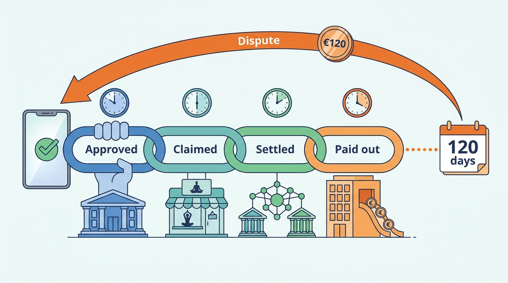
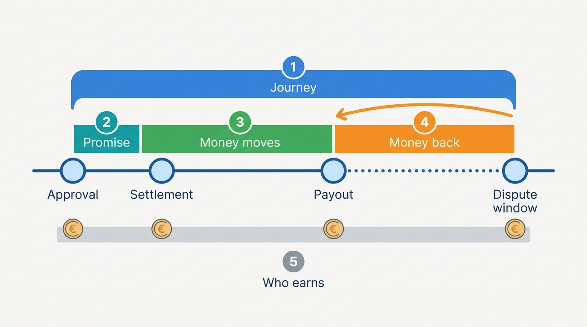

> **KEY POINTS:**
>
> * **“Payment successful” is one bank's promise, not money.** The cardholder's bank reserves the amount in seconds; money moves a day or more later, as net amounts between banks.
> * **No step makes a payment final.** The cardholder can dispute it for about 120 days, which outlasts the approval, the settlement and the payout.
> * **Every promise has an owner, a clock and a price.** Store which promise you hold, from whom and until when, and read a card fee as three payments.

 
On 2 February 2027 a ten-class pass for €120.00 is bought with Bram de Wit's card at Studio Noord, a yoga studio that sells through **Larkfield, the fictional studio-software platform this book follows**. The payment is approved, and within days the studio has its money. On 24 February a **chargeback** arrives: Bram has told his bank he does not recognize the charge, the bank takes the €120 back, and a €15.00 dispute fee *(illustrative)* comes with it. No step of the payment had failed.

Yet the money came back. To an engineer, a payment is a request that returned success. Behind the API, it was one bank's promise: **a card payment is a chain of separate promises made by different parties on different clocks**. The cardholder's bank, the **issuer**, approves in seconds and moves no money. The merchant claims the amount (the capture), the banks settle through the card network (Visa is one) a day or more later, and the provider pays the merchant on its own schedule. None of these four makes the payment final: Visa's public rules (edition of 24 October 2026) give the issuer 120 calendar days for most kinds of dispute ([[journey-of-a-payment]]), and that right outlasts them all.

**Figure 1:** *One payment is four promises held by four parties on four clocks, and for about 120 days a dispute can still pull the €120 back.*

No single status can hold these promises: each is made by a different party with its own record and clock, and only the payout is the provider's own; the others it can only report as they arrive. So “approved”, “captured”, “settled” and “paid out” are four facts held by four parties, and **a system that stores one status word for them is wrong for days at a time**.

Part I follows the payment in the order it happens, and on the way overturns three integrator beliefs: that approved means paid, that paid out means final, that the fee is one charge. Chapter one lays out the whole journey; the next three take its stretches: the authorization, the first promise; capture, clearing (the sale's record) and settlement, where money moves; refunds, reversals and disputes, where it moves back. The last says who earns what at each step. Below, each chapter gets a paragraph: its question in bold, its argument, its Larkfield case.

**Figure 2:** *The five chapters of Part I on one payment's timeline: the whole journey, the first promise, the money moving forward, the money moving back, and who earns what at each step.*

## Chapters in this part

[[journey-of-a-payment]] asks **what has to happen, between which parties, for one card payment to be approved, collected, moved, paid out and possibly taken back**. Its answer is six steps over days and at least five parties: five promises, made in turn by the issuer, the merchant, the acquirer, the network and the provider, then the dispute window. The chain above gains the **acquirer**, the institution that accepts card payments on the merchant's behalf and sends the clearing record through the network. A message moves first, then a record, then money. The provider answering the API call controls none of the three steps that decide the outcome: approval, settlement between banks, dispute. The case is a second €120.00 pass, Mila Janssen's, bought at 19:42 on Tuesday 9 March 2027 and paid out to Studio Noord on Thursday 11 March, with the studio owner's question in between: “It says paid. Paid to whom?” No status word answers that. The chapter's first question for any provider is which legal entity is the acquirer in this country.

[[payment-authorization]] opens the first step and asks **what exactly an authorization promises, who decides, and what can change before the money moves**. The promise is the issuer's: to honor a claim for up to an approved amount inside a window that Visa's general table sets at 5 to 30 days. It moves no money and can lapse, and an unanswered request has an unknown outcome, not a failed one. The case is the Double Charge of 1 November 2026, when Larkfield's renewal job read a timeout as a refusal and sent each charge again: 1,840 members paid twice, and €71,300 had to be refunded.

[[clearing-and-settlement]] turns to the steps that do move money, and asks **how an approved payment becomes money in the acquirer's account, and why it takes days**. After the merchant's capture, the acquirer presents the clearing record, the network moves one net amount per member bank per day, and the provider pays on its own schedule. So “settled” names a different event at the network, the provider and the merchant's bank. Stripe counts its settlement timing from the capture; Adyen pays a whole sales day on a fixed delay, whether or not it has received the funds (its terms of 17 June 2024). The case is Wednesday 10 March 2027: Larkfield's record shows Mila's €120 as paid, the provider's balance as not yet paid out, and the studio's bank nothing. All three are right; €117.47 arrives on Thursday.

[[refunds-reversals-and-disputes]] begins after the payout and asks **how money goes back, who decides, and why a payment can be undone months later**. There are three routes with three owners: a cancel or reversal withdraws the issuer's promise before any money moves; a refund is a new transaction the merchant starts, and it can fail; a dispute is the issuer taking the money back under the network's rules, with the merchant allowed one answer. Visa's rules stretch the 120 days to as many as 540 where a service is delivered later. The case is Bram's €120, whose financial effect stays open until at least 2 June 2027, 120 days after the sale.

[[payment-economics]] comes last: a fee can be assigned to a party and a step only once you know both. It asks **where the fee on a payment goes, and how the way a provider earns its share shapes what it builds**. The fee is three payments: **interchange** to the issuer, **scheme fees** to the card network and a markup to the provider. EU law caps only the first, at 0.2% for consumer debit and 0.3% for consumer credit cards. As of November 2026 Stripe's published standard price blends the three into one rate, and Adyen's passes the first two through at cost; that choice decides which costs you can see. The case is Larkfield's fee on Mila's €120, in illustrative figures: of the €2.53, €0.61 is provider cost (€0.24 to her bank, €0.06 to the network, €0.31 to the provider).

## Where to Begin

Read in order, the five chapters turn Bram's €120 from a surprise into a sequence. By the end you can name each party that said yes on 2 February, what each was paid for saying it, and why none of those yeses stopped the chargeback of 24 February. With one question, about a status, a delay, a reversal or a fee, open the chapter that answers it. Otherwise begin with [[journey-of-a-payment]] and follow Mila's class pass.

## Sources and Evidence

Every public claim in this part is sourced and dated in the chapter that makes it, under that chapter's Sources and Evidence. Larkfield is fictional; architectural recommendations, labeled inferences and labeled assumptions are the author's judgement.
