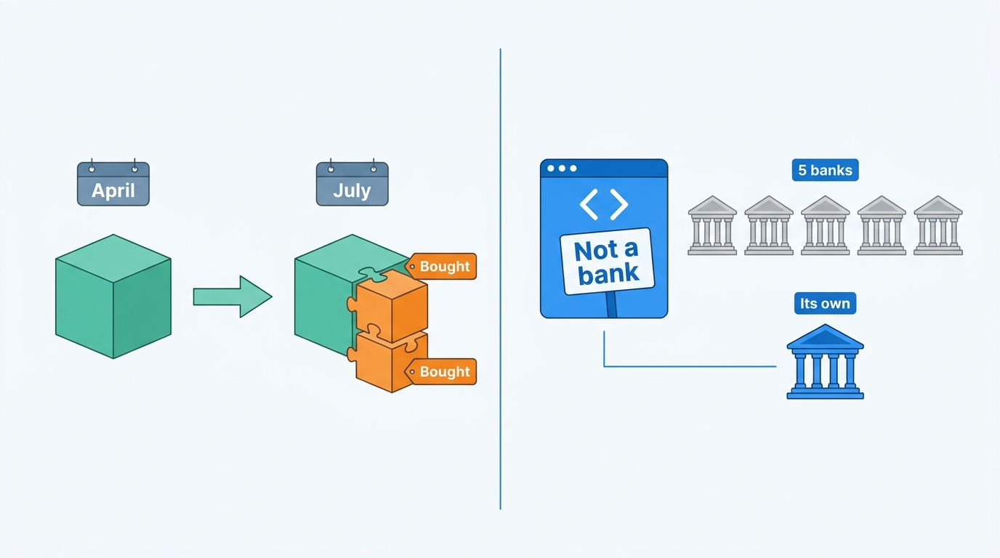
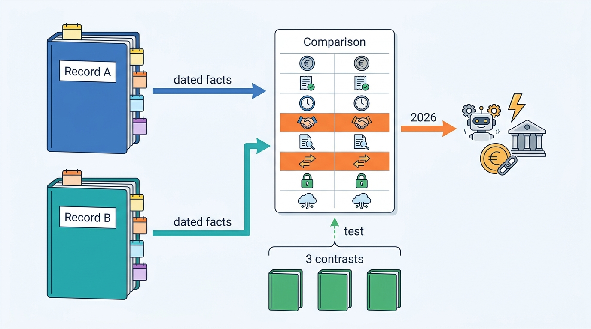

> **KEY POINTS:**
>
> * **The shorthand is the claim under test.** "Adyen owns the regulated money path, Stripe owns the developer's abstraction over it" is checked against each company's own dated documents.
> * **The records show an order of construction, not a division of territory.** The reading holds for banking and hosting, fails for card acquiring in Europe, and cannot be tested on Stripe's motives. By 2026 each company was moving toward the other's position.
> * **A sentence about a provider is worth its source.** Every claim carries a date and a label: documented, widely reported, inferred or not public. Stripe is private and Adyen files audited accounts, so their figures are not alike.

 
On 9 April 2026 an Adyen press release said: "Unlike many providers that rely on a patchwork of acquired technologies and third-party integrations, Adyen has built its entire financial technology stack on a single platform." Fourteen days later Adyen announced that it would buy Talon.One, a loyalty platform, for €750 million, and on 11 June that it would buy Orb, a usage-billing platform, for $335 million. Both deals closed on 1 July. Stripe's treasury documentation says "Stripe is not a bank." In November 2026 Stripe's list of US acquirers (the card-network members that submit a merchant's payments and receive the money for them) named, next to five banks, "Stripe MALPB, 505 N Angier Avenue NE, Atlanta": **a limited-purpose bank of Stripe's own**, in business since 28 May 2026. In each, a company's sentence about itself meets its own later act: Adyen's purchases, Stripe's bank.

**Figure 1:** *Two facts from 2026: Adyen's April sentence about building its whole stack on a single platform was followed by two purchases closed on 1 July, and the US acquirer list of the company that is not a bank names five banks and one of its own.*

Neither fact fits the usual shorthand for the two companies: the bank and the API, the enterprise one and the startup one. The earlier parts could not test it: the "Stripe and Adyen: Where They Differ" tables of Parts I to VIII and the two vocabularies of [[part-9]] gave documented differences and **no account of where they come from**. For Larkfield, the fictional studio-software platform this book follows, the question is practical: in 2026 it ran 44% of its member payment volume on Stripe and 56% on Adyen.

So Part X tests one reading: **Adyen owns the regulated money path, and Stripe owns the developer's abstraction over it.** It holds for banking and hosting. It fails for card acquiring in Europe and much of Asia-Pacific, where Stripe's own companies are the acquirer. It cannot be tested on Stripe's motives or its volume per acquirer, which Stripe has not published. The records show **an order of construction, not a division of territory**: Adyen built on an acquiring license and became a bank, and Stripe launched with an API and assembled the regulated layer afterward, market by market. By 2026 each was moving toward the other's position: Stripe holds a bank charter, and Adyen buys products, as Stripe has done.

The verdict rests on rules of evidence. The sources are company documents up to 17 November 2026, each claim dated. Documented facts are kept apart from named secondary reports, and my own reading appears only in blocks marked INFERENCE, NOT DOCUMENTED. "Not public" marks a silent record: not found by that date, not proof of absence. The two companies' numbers differ in kind: private Stripe publishes volume and customer counts in unaudited letters; listed Adyen files audited accounts. Each case ends with what the record cannot establish.

Five chapters carry the test, in this order: Stripe as a case; Adyen as a case; the bets compared one by one (a bet: a lasting choice to hold, build or buy); three other answers; and what is moving in November 2026, which also closes the book. **The cases come before the comparison** so that every row has a dated record behind it.

**Figure 2:** *The shape of Part X: two records (Record A is Stripe, Record B is Adyen), one comparison built from them, three contrast cases that test it, and the changes of 2026 that set it in motion.*

## Chapters in this part

[[case-stripe]] asks **what Stripe's dated record shows about how a developer platform became financial infrastructure, and what a builder can use**. An API came in 2011, then a suite of products, several of them bought, then a regulated layer held per market. Stripe's European companies are e-money institutions (licensed non-banks that may hold customers' balances) and acquire there; in the United States it works under six named acquirers. It publishes volume ($1.9 trillion for 2025), never revenue. A small team can copy its interface practices, such as idempotency keys, but not its machinery, such as about 2,000 database shards. Larkfield records, per market, which Stripe entity acquires.

[[case-adyen]] turns to a company that built in the other order and asks **what Adyen's record shows about one platform under its own banking license**. An acquiring license came first, a banking license in 2017, extended to the United States in 2021 and the United Kingdom in 2023. The 2025 figures are audited: €1,394.3 billion processed, €2,364.2 million of net revenue. Adyen marks the platform's edges itself: 84% of that volume was "full-stack" (undefined; read there, as inference, as volume Adyen also acquires), and it names banking partners where it has no acquiring license. On 1 July 2026 it closed the purchases of Talon.One and Orb. The practices transfer and the assets do not: Larkfield's payments team of 11 keeps a small ledger and seeks no license.

[[stripe-and-adyen-bets-compared]] sets the records side by side and asks **on which bets the two demonstrably differ in November 2026, and what a customer does with each**. It adds no new fact. Of eight bets, two are differences of kind: who holds the money (a licensed bank against e-money institutions with partner banks) and who runs the machines (infrastructure Adyen manages itself against Amazon Web Services). The rest are differences of default, sequence or degree that narrowed in 2025 and 2026, and some questions the public record cannot decide. I trace the defaults, as inference, to each company's first customers. Larkfield's chief executive asks which provider to keep and gets a dated card, not a slogan.

[[payment-contrast-cases]] tests that first-customer reading on three companies with other first customers, and asks **what PayPal and Braintree, Checkout.com and Block each show that the two alone cannot**. PayPal's filing describes a network of 439 million active accounts; Checkout.com reports ten acquiring licenses; Block rents most of its acquiring and owns a Utah industrial bank that lends to its sellers. Each holds what neither anchor holds, which supports my inference that a provider holds the permissions its first customers required; three cases cannot prove it. The cases add one row, who owns the payer and who the seller; Larkfield owns both, the member and the studio, so it can move a studio's card payments between providers (decision K8).

[[payments-what-is-moving]] takes the positions as fixed in November 2026 and asks **which of the changes under way should alter what you build, and which you should only watch**. Agents change who authorized a purchase, stablecoins what the money is held in, instant payments when it has moved. Each claim carries a release phase: Adyen's agent product was released in limited availability, Stripe's stablecoin balances are in preview, and the EU's new payment rules were agreed and not yet law. Larkfield's new head of payments engineering sorts a folder of three proposals. The chapter also closes the book.

## Where to Begin

The five chapters are one test, best read in order because the comparison rests on the two records; a reader with one question can enter at its chapter and find the same rule there. By the end the two opening facts read as steps in one direction. Before choosing on a sentence about a provider, ask who documented it, when, under which definition, and what the record does not say. Begin with [[case-stripe]].

## Sources and Evidence

Every fact here repeats a chapter of this part, which cites its source. Larkfield is fictional; its figures match every chapter.
