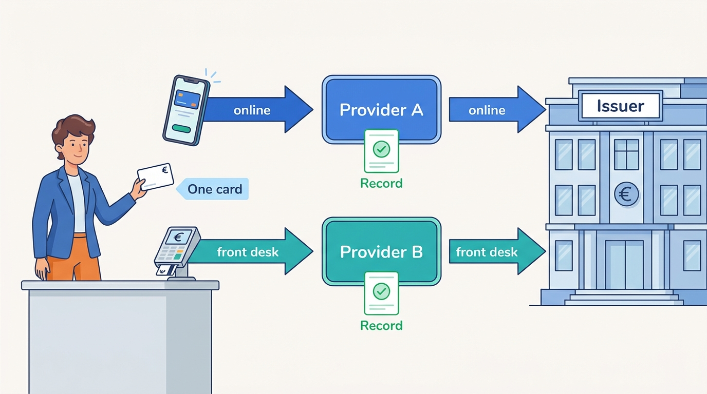
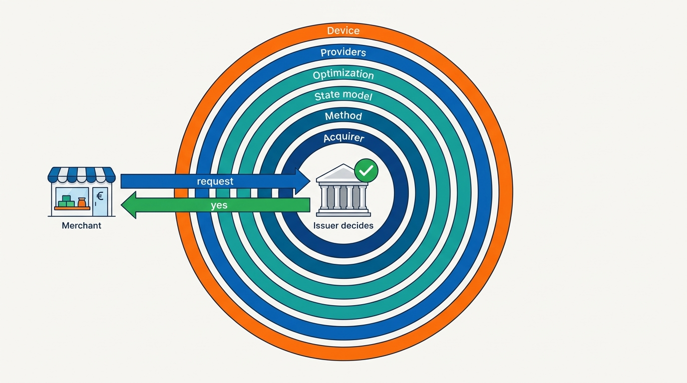

> **KEY POINTS:**
>
> * **A “yes” is produced in layers around the issuer's decision.** The acquirer and its license, the payment method, the provider's model of the payment, its actions inside the authorization call, the choice of providers and the terminal each change how often the answer is yes, or whether it can be taken back.
> * **The provider and the merchant both help produce it.** The provider holds the license and reformats, retries or blocks inside the call; the merchant chooses the methods, the providers and the devices.
> * **An approval rate belongs to a setup.** It cannot be compared between providers until the acquirer, the method mix, the metric and its denominator are held equal.

 
At 1,140 studios in the Netherlands and Germany that run on **Larkfield, the fictional studio-software platform this book follows**, a member who renews her membership online is charged through Stripe. When she taps the same card at the front desk, she is charged through Adyen. One card, one studio, one bank deciding; two providers, two routes to that bank, and two records of what “approved” meant. Even the sender differs: by Stripe's public pages the online request comes from an Irish e-money institution (a licensed non-bank), and by my reading of Adyen's license page the counter request comes from a Dutch bank ([[acquiring-and-network-connectivity]]).

**Figure 1:** *At 1,140 Larkfield studios the same card reaches the same bank through Provider A (Stripe) online and Provider B (Adyen) at the front desk, and each keeps its own record of the approval.*

Those two routes are what [[part-1]] left out. It treated the authorization as a message that goes to the issuer (the cardholder's bank) and comes back with an answer, the first of several promises, for which the parties are paid only when it is a yes. Part II turns to **the provider's side of that message**: who is allowed to send it, in what form, how many times, and what the answer is recorded as.

Seen from that side, **a “yes” is produced in six layers that sit around the issuer's decision**. Figure 2 draws them as rings; from the issuer outward they are the acquirer, the licensed entity that acquires the payment; the method and what its scheme (its body of rules) lets “yes” mean; the state model, the provider's model of the payment between request and outcome; optimization, the changes and retries the provider makes inside the authorization call; routing, the choice among providers; and the device, the terminal, when the card is in the room. Each layer changes how often the answer is yes, or whether that yes can later be taken back.

**Figure 2:** *The shape of Part II: six layers sit around the issuer's decision, and a “yes” is what comes back through all of them.*

The layers also have two holders. The provider holds the license, models the payment and makes the changes inside the call. The merchant chooses the methods it offers, the providers it uses and the devices it deploys. So an approval is **an outcome both help produce**, not a verdict the network hands back, and an approval rate describes a setup more than the customers. I would not compare two providers' rates before lining up the acquirer, the method mix, the metric and its denominator.

The six chapters take the layers in the order a “yes” is constrained, each resting on the last: the acquirer decides which networks are reachable, methods are what those networks carry, the state model holds the answers those methods give, some at once and some days later, and optimization, routing and the terminal build on all three. Each opens on a Larkfield case and asks, in order: who acquires the payment and under which license; what “yes” means for methods that are not cards; how a payment is modeled as states; why issuers decline and what providers do inside the call; when a second provider helps and what it costs; and what changes when the card is in the room.

The chapters rest on what Stripe and Adyen publish, and that public record stops short in places. They document different arrangements at most layers, but neither lists its network memberships by network and country or publishes its volume per acquirer, and the approval gains each states for its optimization product are its own figures, on different metrics, audited by no third party. Each chapter says where its evidence stops, and each has a paragraph below.

## Chapters in this part

[[acquiring-and-network-connectivity]] answers **who acquires the payment, and under which license**. Reaching a card network takes a membership that only a licensed entity can hold, so every payment has an acquirer of record, which differs by country. Adyen holds one banking license (2017) extended by branches; Stripe names its own e-money institutions as acquirer in the EEA and the UK, and five banks plus a limited-purpose bank of its own in the United States. Larkfield's inventory finds four acquiring arrangements behind its two providers.

[[local-payment-methods]] turns from the card networks, which answer in seconds, to **what “yes” means when the method is not a card**. One API unifies how a payment is started and reported, not what success promises: an iDEAL payment cannot be disputed through the payer's bank, while a SEPA direct debit can be refunded without a reason for eight weeks. Larkfield treated direct debits, 21% of its online volume, like cards, and granted access and paid out on money that could still leave.

[[payment-state-machines]] answers **how to model a payment whose outcome arrives late or needs the customer to act**: as one long-lived record with explicit states, in which the API response is one transition. Stripe exposes it as a PaymentIntent (2018) you can retrieve; Adyen's Checkout API has no endpoint that returns a payment by its identifier, so the merchant assembles the payment's record from results and webhooks. The case is Mila Janssen's membership set-up of 12 January 2027, which waited for her banking app.

[[authorization-optimization]] takes up the state machine's failed attempt and asks **why issuers decline genuine payments, and what providers do about it**. Both providers document reformatting, retrying and blocking inside the authorization call, so the approval rate is partly their product. Larkfield's two December rates, 82.0% on Stripe and 95.5% on Adyen *(illustrative)*, stand 13.5 points apart; counted the same way, at the first attempt, the gap is 0.8 points.

[[payment-routing-and-orchestration]] weighs the usual answer to one provider's limits, a second provider, and asks **when it helps and what it costs**. A routing layer unifies the authorization request and nothing after it: disputes, settlement, balances and stored cards stay one set per provider. Larkfield keeps its rule, “the studio's provider”, with a rehearsed switch (Keel decision K8) and buys no orchestration product.

[[in-person-payments]] leaves the payment made at a distance, which the first five assume, and asks **what changes when the card is in the room**. A terminal joins the payment path, and a payment it stores while offline is credit the merchant extends: Stripe and Adyen both document that the loss is the merchant's. A counter refund at one of the opening's 1,140 studios, each on both providers, shows that “one payment across channels” is three properties, each checked separately.

## Where to Begin

Together the chapters let you place a decline, a late outcome or a provider question in one layer before you change anything, and by the end the two routes of the opening card read as two stacks of the same six layers. The first layer is the box Part I labeled “acquirer”. Begin with [[acquiring-and-network-connectivity]].

## Sources and Evidence

Sources are cited in each chapter; this introduction states no fact that a chapter does not make and cite. Larkfield is fictional, and its figures are the same in every chapter.
