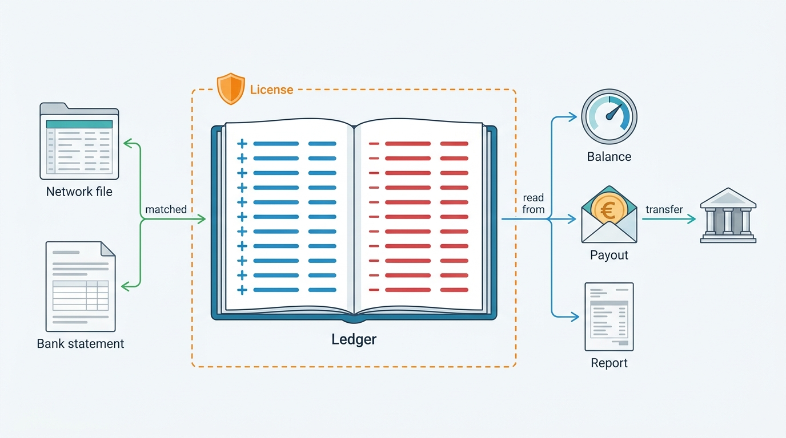
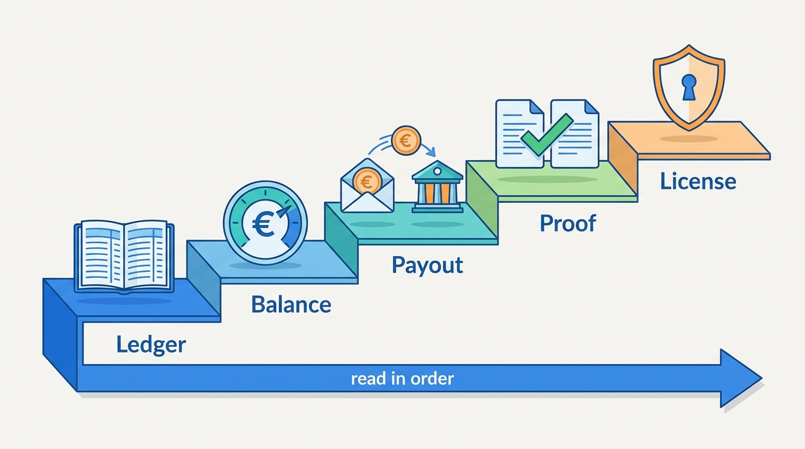

> **KEY POINTS:**
>
> * **A balance is a record of a debt, not a count of cash.** The cash is in transit or pooled at banks; what a provider holds is a double-entry ledger of who owes whom.
> * **The record is knowledge only while someone else's record agrees.** Network files and bank statements prove the provider's entries; the provider's reports prove yours.
> * **“Available”, “paid” and “settled” are one party's statement at one moment.** A later entry can reverse each, so keep an entry of your own for every movement.

 
At the end of 2025, every payment at **Larkfield, the fictional studio-software platform this book follows**, had the right status. Yet Larkfield's books said it owed its studios **€412,000 more** than the balances at its two providers, Stripe and Adyen, showed. It took three weeks to trace the difference to three things: refunds made after the payout (the provider's transfer of a studio's money to its bank account), fees on chargebacks (card payments reversed by the cardholder's bank after a dispute) and a currency-conversion rounding rule.

The record that [[part-2]] ended with could not have contained that difference. Part II left an approved payment in a state machine that says what happened to it: authorized, captured, refunded. But every approval also creates debts. The card network owes the provider, the provider owes the merchant, and both are paid over days. **A payment's state does not say who owes whom.** That takes a second record, and a way to prove it.

Part III argues that a provider knows where money is, and whose it is, only from a **double-entry ledger** it keeps itself: an append-only record in which every movement is written as lines that balance, so that a missing movement shows up as an account that does not empty. And that record counts as knowledge only while it is **matched against records the provider did not write**, the networks' files and the banks' statements. The rest of the part is that ledger seen from one side at a time. A balance and a report are the ledger read at a given moment, a payout is one of its entries becoming a bank transfer, and the provider's license decides which accounts it must contain. The view to give up is that the money is simply “at the provider” and that a dashboard balance counts cash the way a bank balance does.

**Figure 1:** *The shape of Part III: the balance, the payout and the report are read from one ledger, records written by others prove it, and the license decides what it must contain.*

Five chapters take five questions, and each needs the one before. They ask how a provider builds the ledger that records every movement twice; what a merchant's balance says and does not say; how money leaves the provider, and what happens when it does not arrive; how the provider proves its books against networks and banks, and what it gives customers to prove theirs; and who is legally allowed to hold the money. **The ledger comes first because balances, payouts and reports are all read from it.** Licenses come last because safeguarding, the legal duty to keep customers' money apart from the firm's own, is by then one more comparison between a ledger and a bank account, this time required by law.

**Figure 2:** *Five chapters in the order each needs the one before: the ledger, the balance read from it, the payout that leaves it, the proof against outside records, and the license.*

## Chapters in this part

[[payment-ledgers]] answers **how a payment company knows whose money it holds and where it is**: from balanced entries that are never edited, and from clearing accounts, which hold an amount in flight and must return to zero. Two published designs enforce the rule at different points. Adyen's 2021 engineering post describes refusing an unbalanced entry at the write; Stripe's 2024 post describes many systems writing into a log that is checked afterwards, with 99.99% of dollar volume verified within four days. The chapter replays Larkfield's €412,000 through six accounts and one posting function.

[[balances-and-funds-flows]] then narrows to one merchant and asks **where the money is, and whose, between the customer paying and the merchant being paid**. A balance is the merchant's claim on the provider, and “pending”, “available” and “reserved” are the provider's decisions about when and how much of that debt it will pay. Adyen documents that it pays whether or not the card network has paid it, and takes back what has not settled within 30 days; Stripe publishes a schedule and, for standard payouts, does not say, beyond terms that let a payout wait when a network fails to pay Stripe. The case is Mila's €120.00 class pass, the book's recurring payment, which becomes three figures in the provider's books, €117.47 of them owed to her studio.

[[payouts-and-money-movement]] follows that amount out of the ledger and asks **how money leaves the provider and reaches a bank account, and what happens when it does not arrive**. “Paid” means sent: a bank network delivers the transfer on its own schedule, and one that fails comes back days later as a new credit. In Larkfield's Payout That Bounced, 412 payouts worth €386,000 were returned in June 2026 to a record that had already closed them, and paying every studio took 19 days.

[[payment-reconciliation-and-reporting]] turns that case, two records of the same money that disagree, into the general question: **how a provider proves its own books against the networks and banks, and what it gives customers to prove theirs**. The proof is reconciliation, matching each movement the ledger expects against a record someone else wrote. Customers get it one level down as scheduled reports, itemized per payout at Stripe and per payable batch at Adyen, and the chapter argues for writing your books from those reports and not from webhooks. It closes one Larkfield day, Tuesday 9 March 2027, on both providers.

[[licences-and-safeguarding]] asks last **who is legally allowed to hold customer money, and where it sits**. Only a licensed institution may. Stripe states that it is an e-money institution in Europe and “not a bank” in the United States; Adyen states that it is a Dutch credit institution, which is a bank. Neither names the banks that hold the money. The case is a Larkfield proposal to hold studio payouts in its own account for 14 days, about €43 million of other people's money, stopped in review.

## Where to Begin

If you arrive with a problem, open its chapter. An unexplained difference belongs to [[payment-ledgers]], and a balance that moved without a payout to [[balances-and-funds-flows]]. A payout marked paid that has not arrived belongs to [[payouts-and-money-movement]], and a close that will not tie to [[payment-reconciliation-and-reporting]]. A funds flow that passes through your own bank account belongs to [[licences-and-safeguarding]].

Otherwise read in order. The five chapters ask one question five times: what does this record say is owed, and whose independent record agrees? That question explains the opening. Every payment status at Larkfield was right, and the €412,000 sat in movements that came after the payment and in a rounding rule, which a record of payments has no place for. Begin with [[payment-ledgers]].

## Sources and Evidence

Sources are cited in each chapter; this introduction makes no factual claim of its own. Larkfield is fictional, and its figures are the same in every chapter.
