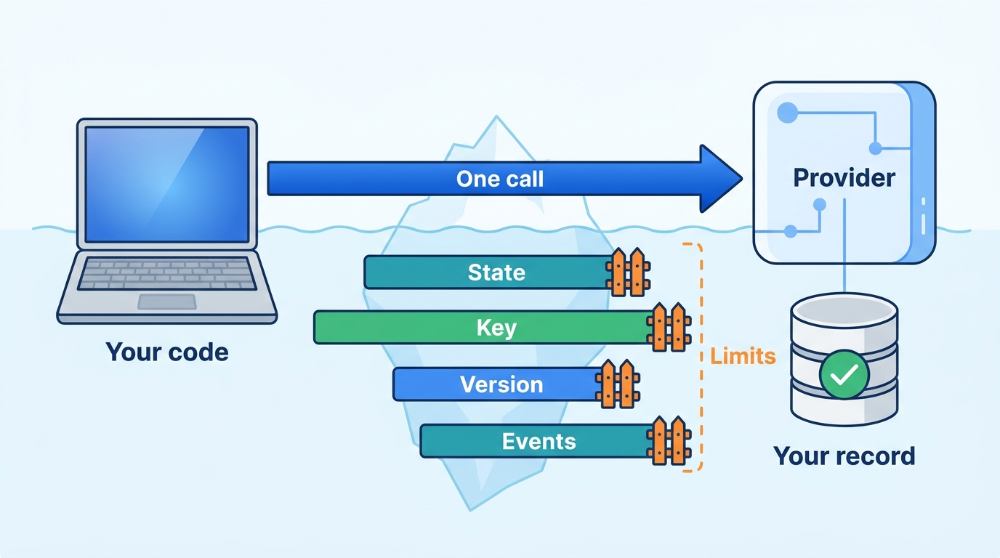
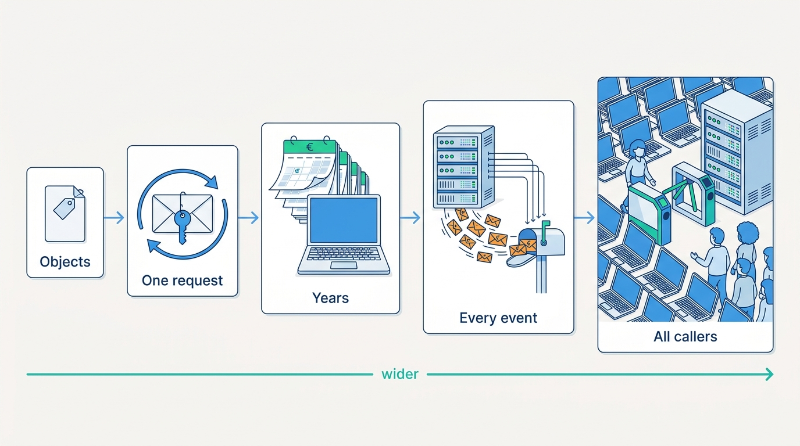

> **KEY POINTS:**
>
> * **One call hides four cases, and each needs a contract.** The response can be lost, the API can change, the outcome can arrive later, and the request can be refused. The API answers with a readable state, an idempotency key, a pinned version and events.
> * **Every contract has a limit, and the limit is part of the interface.** A key is remembered, an event retried and a version served only for a stated time, and requests are accepted only up to a rate. Stripe and Adyen document different limits.
> * **Your own record covers what lies beyond the limits.** Once the provider has stopped remembering for you, only your record of each payment, checked against the provider's, says what happened.

 
Four of the eight incidents this book keeps returning to happened in 2026 at the provider's API, and not in the money. They happened at **Larkfield, the fictional studio-software platform this book follows**. In March a forced library upgrade moved the billing integration across a breaking release, and subscription revenue reports were wrong for 6 days. On Monday 14 September a webhook receiver's certificate expired shortly after midnight, events failed for 9 hours, and 3,200 memberships were shown as unpaid when members arrived that morning. On 1 October the renewal job hit a provider's rate limit, and 7,900 renewals were delayed to the next day. On 1 November a provider call timed out, the job retried under a new idempotency key, and 1,840 members were charged twice.

The four have one cause. [[part-3]] showed the provider from inside, where every movement of money is recorded twice and proven against networks and banks over days. A developer sees the same provider from outside and gets an answer in seconds, so the code treats a payment API as a request and a response. In each incident **the response was not the whole exchange**. After the upgrade its shape had changed. Behind the expired certificate the outcome was waiting in another channel. On 1 October the request was refused for volume, and on 1 November the response never arrived.

This part's answer is that an API can make a slow payment with several parties look like one call only on two conditions. It must give the developer **a contract for each case the call hides**: an identity and a state for each payment, a key that makes a request safe to repeat, a pinned version, and events for outcomes that arrive after the response. And it must **state the limit within which each contract holds**. The limits are concrete, and they differ. By documentation read in November 2026, Stripe's API v1 keeps a key for at least 24 hours and retries an undelivered event for up to three days; Adyen keeps a key for 7 to 14 days and retries for up to 30 days. An integration is therefore built to its provider's terms, with its own record for whatever falls outside them.

**Figure 1:** *The shape of Part IV: one call hides four contracts, each contract ends at a limit, and beyond the limits only your own record of the payment remains.*

Five chapters take these contracts in the order each depends on the last: what the API exposes (objects, identifiers, errors); how a request is made safe to repeat; how the API changes without breaking integrations; how the provider reports what happens after the response; and the keys, test environments and limits around all of it. Each sets Stripe's and Adyen's documented terms side by side. Each also says where the public record of their implementation stops, which is early: much of it is Stripe engineering posts from 2017.

**Figure 2:** *The five chapters widen in scope: the objects, one request, one integration over years, every event the provider sends, and all callers of the API at once.*

## Chapters in this part

[[payment-api-design]] answers **what makes a payment API usable for ten years**. An integration lasts when it depends on a stable identifier, a normalized vocabulary of states and refusal reasons, and an explicit line between what the response answers and what arrives later. Stripe and Adyen differ in where the current state lives: Stripe returns objects you can fetch again by identifier, while Adyen's Checkout API returns a reference and a result code and has no call that returns a payment. Larkfield's payment service has a call named “get payment” that has never asked either provider anything.

[[idempotency-and-retries]] takes the question that chapter leaves open, the response that never arrives, and asks **how to make “charge this card” safe to send twice**. Both sends must carry the same key, derived from the business event and stored before the first attempt, and the second must arrive while the provider still remembers it: at least 24 hours on Stripe's API v1, 7 to 14 days on Adyen. In the Double Charge, Larkfield's job generated a key at each network call, so every retry was a new payment, and €71,300 was refunded.

[[payment-api-versioning]] turns to a second thing the provider remembers for you, for years instead of hours, and asks **how an API changes when its customers integrated long ago**. Each integration keeps the version it was built against, which moves the cost of change without removing it. Stripe pins one dated version by account default, header or library release, with two named breaking releases a year since October 2024. Adyen puts a number in each API's URL and gives a deprecated Checkout API version two years before end-of-life. The Version Cliff was one library upgrade that crossed three years of changes in a single step.

[[payment-webhooks-and-events]] reverses the direction, because here the provider calls you, in a shape the pinned version fixes, and the lost response gains a twin: the event that never arrives. The chapter asks **what a receiver may assume**. A receiver may assume only that an event it has not acknowledged is sent again while a retry window is open: up to three days at Stripe, up to 30 days in a queue at Adyen. An event is therefore a notice to store and then confirm against the provider's record, which is the payment object at Stripe and the settlement report at Adyen. The Silent Webhook lasted nine hours, well inside the window, so every event came again; the harm was that Larkfield read a missing event as “unpaid”.

[[payment-developer-platform]] follows from the traffic those four chapters create (stored keys, a read after every event, sweeps, upgrade rehearsals) and asks **what else must exist around an API before you can build on it**. Its answer is credentials that limit what each caller can do, a test environment whose gaps are stated, and request limits you can plan for. Stripe documents 100 requests a second per account in live mode and 25 per endpoint; Adyen publishes no rate limit for its payments APIs. In the Renewal Wave, refusals for volume were recorded as failed payments, and 7,900 members got an email ([[invoicing-collections-and-dunning]]) about a payment no bank had declined.

## Where to Begin

Each of the opening's four shortfalls now has a chapter: the lost response in [[idempotency-and-retries]], the changed shape in [[payment-api-versioning]], the missing event in [[payment-webhooks-and-events]] and the refused request in [[payment-developer-platform]]. If one of them is in front of you, start there. All four rest on the first contract, a stable identity and state for each payment, because what you can do after any of them depends on what you can read back. Begin with [[payment-api-design]].

## Sources and Evidence

Sources are cited in each chapter; this introduction makes no factual claim of its own. Larkfield is fictional, and its figures are the same in every chapter.
