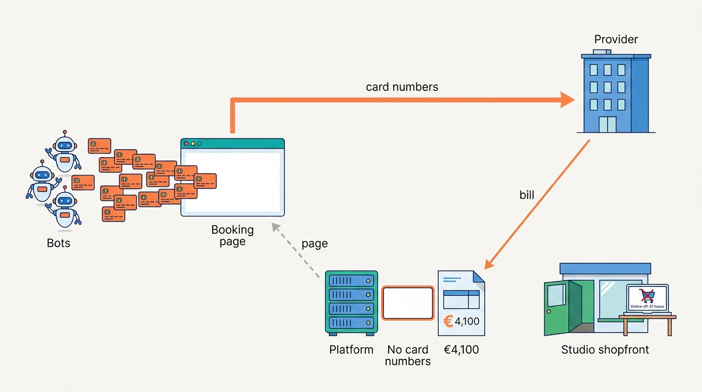
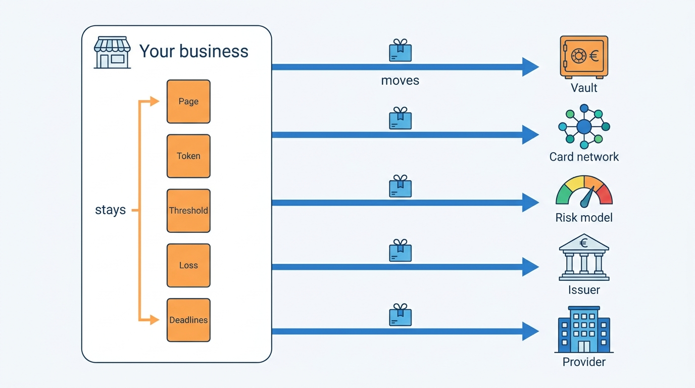

> **KEY POINTS:**
>
> * **A trust control relocates; it does not remove.** Card numbers move to a provider's vault, the stored card to the card network, the block-or-allow decision to a model, the fraud loss to the cardholder's bank, and the duty to know a seller to the provider.
> * **Each one leaves a remainder with the business.** A payment page, a token behind which the card can change, a threshold, the loss on every payment not authenticated, and deadlines that can stop a seller's payouts.
> * **The controls are linked, and what stays needs an owner.** How a card is collected decides what the fraud model sees, so the question to ask is what moved, to whom, and what came back.

 
On the weekend of 8–9 August 2026, bots tested 61,000 stolen card numbers with €1 payments for a trial drop-in class through the public booking widget of one studio on **Larkfield, the fictional studio-software platform this book follows**. Larkfield stored none of those numbers, because a frame served by its provider collected them, and nothing was stolen from it. It still paid €4,100 in provider fees and refunds, and the studio could not sell online for 31 hours.

**Figure 1:** *The Card-Testing Weekend: the 61,000 card numbers went to the provider and none reached Larkfield, which still paid €4,100 while one studio could not sell online for 31 hours.*

That weekend contradicts a habit most engineers bring to payments: security is something you add and then have. Encrypt the data, put it behind a provider, pass the audit. Payments works differently. **Every control names who holds the data and who pays when it fails**, and that assignment is what [[part-4]] said an API cannot hide.

Part V's claim is that **each of five controls relocates something and leaves something behind**. Tokenization moves card numbers to the provider's vault and leaves you the page around the card fields. A network token, a substitute card number the card network issues, moves the stored card to the network and leaves you a provider token (a reference that only your provider can turn back into a card) behind which the card can change. A risk score moves the allow-or-block decision to the provider's model and leaves you the loss on what you accept. 3-D Secure moves a fraud loss to the issuer, the cardholder's bank, only when the payer is authenticated, and leaves it with you on every payment that is merchant-initiated or exempted at the request of your side. Verification moves the duty to know a seller to the regulated provider and leaves the platform the deadlines. In the figure below, Threshold stands for the loss on what you accept, and Loss for the loss on payments not authenticated.

**Figure 2:** *The shape of Part V: each of the five controls moves something to another party, and each leaves a remainder with the business.*

The controls have this shape because each is defined by **a rule that assigns responsibility**, not by a technology that destroys risk. The card industry's security standard, PCI DSS (the Payment Card Industry Data Security Standard), binds every system a card number passes through or can affect. Stripe's documentation calls the merchant "ultimately responsible for payments you choose to accept". European law puts the loss on the side that avoids strong authentication. The controls are also linked, so a choice about one is a choice about another: Stripe's PCI guide says its fraud tool is available only when its own client-side code collects the card. So I would stop asking "are we compliant?" and ask, for each control, what moved, to whom, what came back, and who owns it.

The claim rests on what Stripe and Adyen publish, and that record is uneven. Neither publishes a vault design. Adyen has published little about its fraud-risk model, and both companies say that they monitor transactions but not how. The gains reported for network tokens are the vendors' own comparisons. Each chapter says where its evidence stops.

The five chapters go from the credential, to the person using it, to the business being paid: card numbers into a vault, the stored card to the network, the fraud decision to a model, the fraud loss to the issuer, and the duty to know the seller. Each opens on a case at Larkfield.

## Chapters in this part

[[tokenization-vaulting-and-pci]] opens on the weekend's 61,000 numbers, none of which reached a Larkfield system, and answers **how providers keep card numbers out of everyone's systems, including most of their own**. A frame the provider serves, a token and an isolated vault move the numbers and most of PCI DSS's scope to the provider. Stripe documents a vault that shares no credentials with its other services; Adyen publishes less. The page and the stored cards stay: in January 2027 Larkfield cannot sign the script line of the shortest PCI form, with 17 third-party scripts on its payment step.

[[network-tokens]] turns from the provider's token, which means something only inside one vault, to **what a network token is and why the card networks push every stored card toward one**. The network keeps it pointing at the customer's current card. Lotte Smit's €49.00 membership renews on 1 March 2027 although her bank replaced the card in February. Visa says six basis points of approval gain, Adyen 3%, Stripe 3.8% for a bundle; the figures cannot be compared.

[[payment-fraud-and-risk]] takes up what a vault and a token leave open, a number stolen elsewhere and typed into a checkout, and asks **how a provider decides during an authorization whether a payment is fraud**. It cannot know. It estimates the chance of a later fraud dispute and blocks above a threshold, and a merchant's own risk rule can allow, block or, between the two, request 3-D Secure; Stripe's 2026 figures show 41% of fraud disputes reported by day 14 and 86% by day 60. The threshold is a price the merchant pays. The chapter returns to the Card-Testing Weekend, which no threshold covers.

[[three-d-secure-and-sca]] explains that third action, the request for 3-D Secure, and asks **how the card's bank checks who is paying, and how providers decide when to ask**. The loss moves to the bank only when that check happens; a requested exemption or a merchant-initiated renewal leaves it with the merchant. Bram de Wit's €120.00 pass, bought unchallenged, costs Studio Noord €135.00 when it is disputed.

[[payment-compliance-and-regulation]] leaves the payer for the other end of the payment and asks **what a payment company must know about the businesses it pays, and how that becomes software**. Both providers hold verification as requirements with deadlines that switch payouts on and off, and neither publishes how it monitors transactions. In May 2026, 230 Larkfield studios went without payouts for up to 12 days after a rule changed; its answer is Keel decision K6, "verification is state, not a form". This chapter also closes the part.

## Where to Begin

Each chapter answers a question you may arrive with: where card numbers may go, why a stored card kept working, why a payment was blocked, who carries a fraud loss, why a seller's payouts stopped. The opening weekend returns in two of them, first as the control that worked and then as the attack that control was never about. Whichever you read, ask what stayed with the business and who owns it before you count the risk as handled. The first and oldest relocation is the card number itself. Begin with [[tokenization-vaulting-and-pci]].

## Sources and Evidence

Sources are cited in each chapter; every fact on this page is repeated from the chapter that states and cites it. Larkfield is fictional, and its figures are the same in every chapter.
