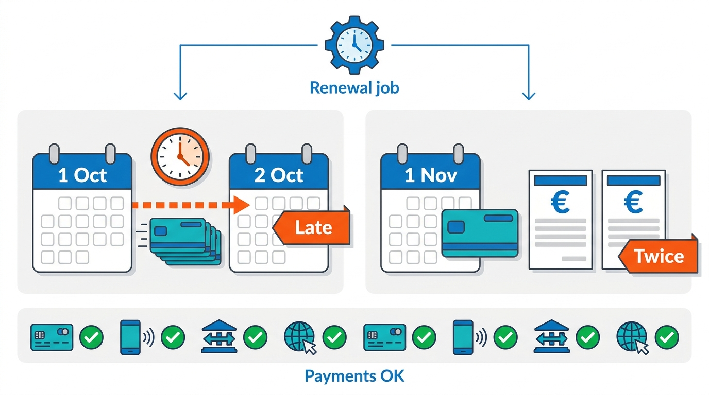
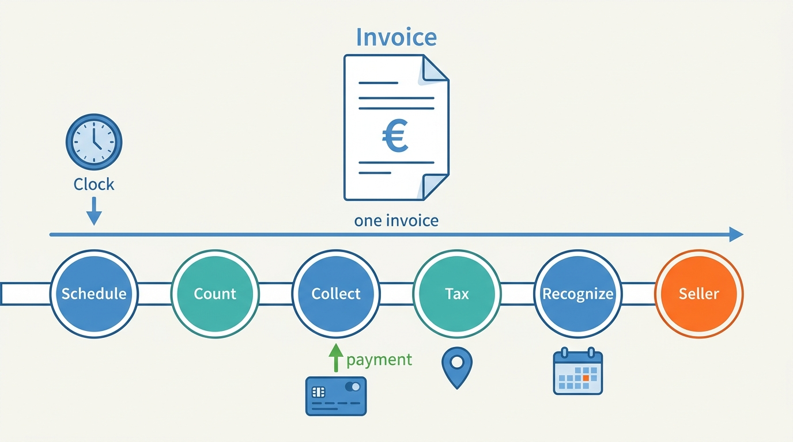

> **KEY POINTS:**
>
> * **Revenue needs a second state machine, driven by the clock.** It decides what is owed, for which period and when to ask, and hands the payment engine an invoice.
> * **It fails in time.** A charge arrives late, is taken twice, or is counted in the wrong period.
> * **Whoever holds the invoice can collect, tax and recognize it.** As of November 2026 Stripe documents it inside its platform; Adyen documents none, which leaves it with the merchant.

 
On 1 October 2026 the renewal job at **Larkfield, the fictional studio-software platform this book follows**, hit its provider's rate limit, and 7,900 membership renewals slipped to the next day. The job marked them failed with no card charged, and an email job that could not tell a decline from a card never charged sent failure notices. On 1 November a provider call timed out, the job retried with a new idempotency key (the identifier meant to make a repeat harmless), and 1,840 members were charged twice. €71,300 was refunded, and 212 members disputed anyway. Every card payment in those two months did what it was asked. **The fault was in the thing that decides when to ask, and for which month.**

**Figure 1:** *Larkfield's two renewal incidents of 2026: 7,900 renewals a day late on 1 October and 1,840 members charged twice on 1 November, while every payment did what it was asked.*

In Parts I to V a customer starts each payment, and the questions are whether it was approved, recorded and safe. Part VI is about **payments nobody present starts**: a clock starts them, for a billing period, from a stored card. You know them as the subscription that renewed unnoticed.

Something has to supply what the click supplied. The part's claim is that **revenue needs a second state machine above the payment**. It decides what is owed, for which period and when to ask, and it hands the payment engine an invoice: the record of one debt for one period. Its failures are failures of time: October's renewals were late, November's were taken twice. The third kind is quieter: a studio chain pays €1,890 on 1 February 2027 for a year of software, and a dashboard shows €1,890 of February revenue where the books carry €144.99. That is a charge counted **in the wrong period**.

**Figure 2:** *The shape of Part VI: a clock starts the path, one invoice travels through six chapters, and the payment is a single step below it.*

The invoice also settles who can do the rest of the work: only a party that knows what is owed, for which period and by whom can collect the debt, tax it and count it as revenue. So before comparing providers' billing features, I ask one question: **where does the invoice live?** Where the provider holds none, your billing system or a third party's has to.

For Stripe and Adyen, the public record as of November 2026 gives two answers, and the Adyen one is uneven. Stripe documents subscriptions, invoices, usage meters, tax calculation and revenue recognition on one platform. Adyen documents a stored card charged with a recurring flag, retries of refused payments and automatic card updates, all at payment level. It closed its acquisition of the billing company Orb on 1 July 2026, and Adyen documents no integrated billing product yet. For invoicing, tax calculation and revenue recognition no first-party Adyen product was found, which is **an absence in public sources, not a statement by Adyen**. On merchant of record, the model in which the provider sells in its own name, there is a statement: Adyen says it does not act as one. Several chapters therefore compare Stripe's product with what a merchant must supply.

The six chapters follow one billing period, and each opens on a case at Larkfield: the engine that produces the invoice; the usage count that fills it; its collection when the first attempt fails; the tax on it; the period in which it counts as revenue; and the model in which the provider sells in its own name.

## Chapters in this part

[[subscriptions-and-billing-engines]] answers **what a billing engine does that a payment API does not**. It is a scheduler, a price calculator and a subscription state machine, and its output is the invoice. Stripe keeps that engine in its platform; in Adyen's documentation “Subscription” is a flag on a payment the merchant starts. An inventory by Femke de Graaf, Larkfield's head of payments engineering, finds two engines, and the one that failed twice in 2026 was a renewal job nobody had called an engine.

[[usage-metering-and-rating]] drops the assumption that the price is known in advance and asks **how to bill for usage when events arrive late and twice**. Three time rules have to be fixed before the first invoice: how long an event is accepted, when the invoice closes, and how a wrong event is corrected. Stripe's meters can accept an event and never bill it. Studio Noord sent 1,240 text messages in March 2027 and was billed for 1,324.

[[invoicing-collections-and-dunning]] takes the amount owed and follows **what happens between “owed” and “paid” when the first attempt fails**. A finalized invoice is frozen and then collected as one debt through as many attempts as it takes (dunning). Stripe's Smart Retries retry an invoice Stripe holds. Adyen's Auto Rescue retries a payment, tied to the billing cycle by a reference the merchant supplies. The case is Mila Janssen's €49.00 membership renewal, declined on 1 April 2027 and paid on 4 April.

[[billing-and-payment-tax]] reads one line of that frozen invoice and asks **how much of indirect tax a payment provider can do**. A provider can calculate VAT or sales tax, because its invoice holds the facts, but calculating is one of four steps and the liability for all four stays with the seller. Stripe Tax returns zero where the seller has recorded no registration, so two Larkfield invoices show the same €0.00 for different reasons. No first-party Adyen tax engine was found.

[[billing-revenue-recognition]] reads the same lines again, by period, and asks **how invoices become revenue and where a billing system should stop**. Each line gets a service period, and its amount is deferred and released as the service is delivered. That is how Ironworks Climbing's €1,890 annual plan becomes €144.99 of February revenue. Stripe documents a recognition ledger over its own invoices; none was found for Adyen. Billing should stop where contracts stop matching invoices.

[[merchant-of-record]] answers the obligations those five chapters leave with the seller by asking **what changes when the provider is the merchant of record**. It sells your product in its own name and takes over the indirect tax and the handling of fraud and disputes, for a fee and control of the checkout. It is an operating model that a platform cannot use: its sellers are third parties. Stripe's Managed Payments costs 3.5% on top of payment fees, leaves the cost of disputes with you and excludes platform accounts; Adyen states that it is not a merchant of record. Asked for it at Larkfield, Femke answers no, twice.

## Where to Begin

The chapters follow one invoice from the scheduler that produces it to the name printed on it. With them you can place a billing fault at one step and name it as late, twice or in the wrong period, then ask which system holds its invoice. The first chapter starts from November's 1,840 doubled renewals and names the record that was missing. Begin with [[subscriptions-and-billing-engines]].

## Sources and Evidence

Sources are cited in each chapter; this introduction makes no factual claim of its own. Larkfield is fictional, and its figures are the same in every chapter.
