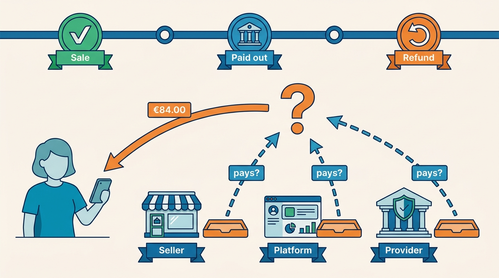
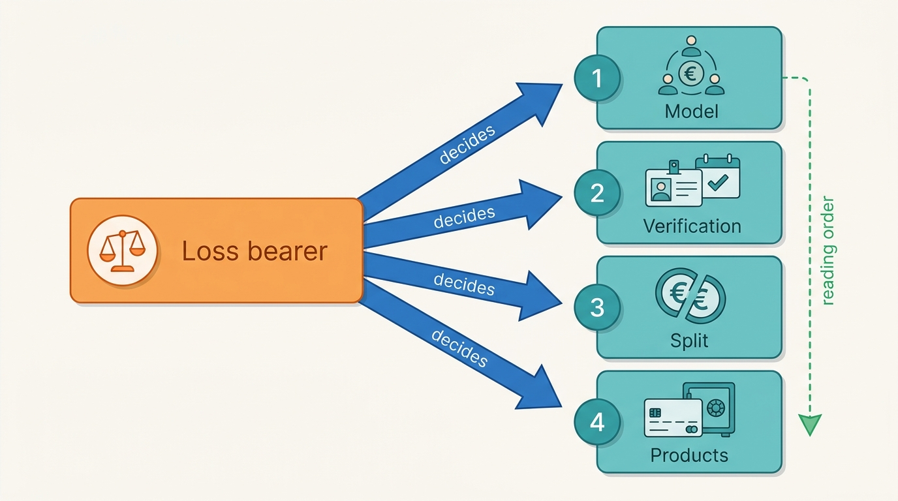

> **KEY POINTS:**
>
> * **The account model assigns the loss.** A platform takes on its sellers' unpaid refunds, chargebacks and negative balances, and the work of keeping those sellers verified, to the extent its configuration assigns them to it.
> * **Not holding the funds does not undo it.** The assignment is made when accounts and payments are configured, long before the first loss. On Stripe it is permanent for each account.
> * **It is one decision, seen four times.** Who stands behind a seller also decides who collects verification data, where a refund after payout is booked, and whether accounts and cards may be offered.

 
On 18 March 2027 Mila Janssen asks for €84.00 back: the seven classes she has not used on a €120.00 pass. She bought the pass from Studio Noord through **Larkfield, the fictional studio-software platform this book follows**. The studio was paid its €117.47 a week earlier, on Thursday 11 March, and Larkfield never held any of the money. Mila will get her €84.00. The open question is **whose balance it comes out of today**, and that was decided long before she asked.

**Figure 1:** *The seller was paid a week before the member asked for €84.00 back, and three parties could be the one whose balance funds it.*

Parts I to VI never had to ask that question. The business that took the payment was the business that owed the refund. [[part-6]] ended on the one arrangement that moves the seller's role, the merchant of record, in which a provider sells in its own name and takes over the indirect tax and the handling of fraud and disputes ([[merchant-of-record]]). Part VII takes the opposite arrangement. The seller stays the seller, a platform stands between it and the payer, and the liability is **divided among three parties by the account model**: the way the platform sets up its sellers' accounts and payments at the provider.

That division is the part's claim. **A platform takes on its sellers' unpaid refunds, chargebacks and negative balances, and the work of keeping those sellers verified, to the extent its account model assigns them to it.** It makes the assignment when it configures accounts and payments, long before the first loss, and not holding the funds does not undo it. Each provider records the assignment in a different place. Stripe's documentation says of an account's loss and fee responsibilities, "You can't update their values later." Adyen's says of the platform's own account, the liable balance account, that funds can be deducted from it when sellers' balances go negative ([[platform-payment-models]]).

The same assignment settles three more things: who the provider lets collect sellers' verification data, where a refund after payout is booked, and whether the platform may offer its sellers accounts and cards at all. So the part describes **one decision seen four times**, and I would decide who bears seller losses first and derive the rest. Larkfield's figure for what that decision exposes it to is about €156 million: the online card volume that, at any time, has been paid out and can still be disputed.

**Figure 2:** *The shape of Part VII: who bears seller losses is one decision, and the four chapters follow it into the account model, verification, the split and the products a platform may offer.*

The claim rests on what Stripe and Adyen publish, and the comparison stops in named places. Stripe documents the provider as a standing option for the loss bearer. Adyen's default is the platform, and it documents bearing a seller's losses itself only as a pilot program. Neither company publishes a completion rate for seller sign-up. Accounts for a platform's sellers were in preview at Stripe and in development at Adyen in November 2026, on documentation pages that carry no date. Each chapter says where its evidence stops.

The four chapters come in the order a platform meets the questions, and each opens on a case at Larkfield: who is the merchant and who carries the loss; how sellers are verified and kept verified; how one payment is divided, paid out and reversed; and what it takes to offer sellers accounts, cards and financing.

## Chapters in this part

[[platform-payment-models]] answers **who is the merchant, whose balance holds the money and who carries the loss**. The merchant is whoever the customer understands they are buying from, and the configuration has to agree with that; it then books the payment and assigns the loss. Stripe lets the loss bearer be Stripe or the platform and fixes it per account, while Adyen's default is the platform and it documents bearing a seller's losses itself only as a pilot program. At Larkfield, product, finance and the CTO give three confident and different answers to Mila's €84.00, and none has read the provider configuration.

[[platform-onboarding-and-verification]] follows from every seller being an account at a licensed provider, and asks **how a platform gets thousands of small businesses verified and keeps them verified**. Verification is a state the provider reopens for the life of the account, and payouts usually stop first: Adyen's standard deadline is 30 days for payout capabilities and 60 for receiving payments. On Stripe, who collects the data follows from who bears the losses. Ironworks Climbing, one of Larkfield's 230 Frozen Studios, went nine days in May 2026 with every payment marked paid and nothing reaching its bank.

[[splits-balances-and-platform-payouts]] takes the verified seller's first payment and asks **how it is divided among platform, seller and provider, and how each is paid**. A split is a set of bookings to balances inside the provider, derived from the charge type on Stripe and sent as typed instructions on Adyen. Sellers are paid within days and a card payment can be disputed for about four months, so the division is provisional. Larkfield's books were off by €412,000 at the end of 2025, and €317,200 of it was refunds made after the studio had been paid.

[[embedded-finance]] starts from the seller balance that exists between the split and the payout, and asks **what it takes to offer sellers accounts, cards and financing**. A licensed institution stands behind each product: Adyen's own banking licenses, and for Stripe partner banks and lenders. Both providers give the platform's server two seconds to answer a card authorization, and Stripe offers accounts and cards only to platforms that bear their sellers' losses. Larkfield's proposed card for Tuesday's sales ends as a reasoned "not yet".

## Where to Begin

A reader with one platform decision in hand can enter at its chapter; the later three all reuse the loss assignment that the first one explains. By the end of the part you can say which balance funds Mila's €84.00 on each provider, and why. The first chapter answers her question in general form. Begin with [[platform-payment-models]].

## Sources and Evidence

Sources are cited in each chapter; this introduction makes no factual claim of its own. Larkfield is fictional, and its figures are the same in every chapter.
