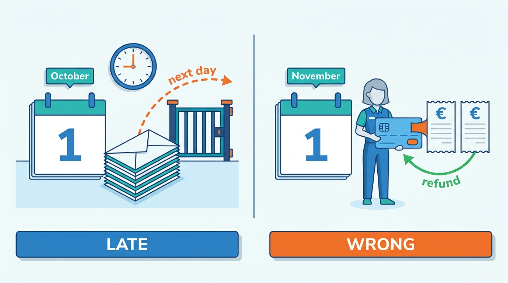
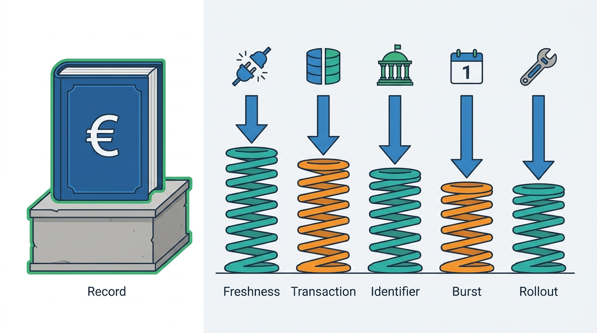

> **KEY POINTS:**
>
> * **Something must give way, and it is decided in advance.** Under failure, growth, a localization law, a peak and a change, a payment platform lets the books lag, a transaction shrink, an identifier stop at a border, a burst wait or a rollout stop short.
> * **The record of money is not on the list.** In every design Stripe or Adyen has published, a payment may be late and may not be recorded twice or lost. Late is cheaper than wrong.
> * **Much of the rest is not public.** Both have documented outages, data stores, limits and rollouts. Neither has published the topology or timing of a failover between regions, and an uptime figure does not fill the gap.

 
On 1 October 2026 the renewal job at **Larkfield, the fictional studio-software platform this book follows**, hit its provider's rate limit. 7,900 membership renewals were turned away before any card was charged and ran a day late. The job marked them failed, and an email job that could not tell a decline from a card never charged sent those members dunning emails, the reminders sent after a failed payment. On 1 November 2026 a provider call timed out during the same monthly run. The job retried with a new idempotency key (the identifier by which a provider recognizes a repeated request), and 1,840 members were charged twice: €71,300 refunded, and 212 disputes anyway. **The first month was late. The second was wrong.**

**Figure 1:** *Two first-of-month runs at Larkfield: in October 2026, 7,900 renewals were a day late; in November 2026, 1,840 members were charged twice.*

That is not the order most engineers would give them. Parts II to VII described each mechanism for one payment at a time ending in [[part-7]] with the account model. Part VIII puts the same mechanisms under conditions no single payment shows: a dependency that fails, data that outgrows one database, a law on where data may sit, a month of renewals in six hours, and several hundred deployments a day. Engineers usually count the cost of failure in minutes of downtime. Larkfield's two months point the other way. The late run cost emails; the wrong run cost refunds and disputes. In a money path the order of priorities is **the reverse of a content site's**.

So the part's claim is about what is given up. **A payment platform is run at scale by deciding in advance what gives way**: the freshness of the books under failure, a system-wide transaction under growth, a global identifier under a localization law (one that fixes the country where data is stored), a caller's burst at peak, the reach of a rollout under change. Larkfield's October was the fourth of these, met without a plan: a burst that had to wait. In every design Stripe or Adyen has published, the record of money is not among the things relaxed. That is my reading of their accounts; neither company states it as a principle ([[payment-reliability-and-availability]]).

**Figure 2:** *The shape of Part VIII: under failure, growth, law, peak and change, five things give way, one per chapter, and the record of money is not one of them.*

That reading has less to stand on here than anywhere in the book. The two companies have documented their choices on outages, data stores, limits and rollouts. **Neither has published a cell design, the topology or timing of a failover between regions or which data is replicated synchronously**, or how its webhook sender is built ([[payment-webhooks-and-events]]). A sentence about either provider's regions that carries no source is a guess, and an uptime figure does not replace one: the published figures measure five different things and cannot rank the two.

Each of the five chapters names what gives way so that the record does not and opens on a case at Larkfield: how a payment path stays up and what an outage leaves behind; which databases hold the money and how they stay consistent when split; where the systems and the data are allowed to live; how a predictable peak is met; and how a system that cannot stop is changed.

## Chapters in this part

[[payment-reliability-and-availability]] answers **how a payment path stays up, and what an outage leaves behind**. It stays up because something else gives way: Adyen described in 2021 an edge that keeps answering while accounting runs behind, and Stripe in 2017 shedding non-critical requests first. What a merchant repairs afterwards is the payments whose outcome nobody knows, which no uptime figure reports. Larkfield's CEO asks which provider is more reliable, and the answer is a scripted 44-minute outage drill that ends when no payment's outcome is unknown.

[[payment-data-stores-and-consistency]] follows from that split between the path that answers and the record that must be right, and asks **which databases hold the money and how they stay consistent once divided**. Stripe scaled a document database to more than 2,000 shards (2024) and Adyen a relational one, PostgreSQL, with accounting clusters filled in rotation (2021) (a shard is one database holding a slice of the data). In what either has published, no transaction spans them. At small scale the design is an outbox, a table that stores a state change and the message announcing it in one local transaction. Larkfield builds one after 146 purchases *(illustrative)* were paid and never activated.

[[payment-multi-region-and-data-residency]] turns from data divided by engineers to data divided by law, and asks **where the systems and the data are allowed to live**. It is short: little is public. A localization law decides first: Stripe's page on India (updated 2023) lists the features cut to keep data in the country. Elsewhere hosting decides. Stripe runs on Amazon Web Services and names no AWS region; Adyen runs its own data centers and names them by continent or country, no finer. A Hamburg studio chain's questionnaire asks Larkfield where its members' payment data is stored.

[[payment-peak-load]] takes that hosting difference to the day load arrives at once, and asks **how a predictable peak is met**. A merchant's own peak meets the provider's per-customer limit long before the provider's capacity: Stripe documents 100 requests a second per account, and Adyen publishes no limit for payments. So the party that creates the load paces it. Larkfield's first-of-month wave of about 357,000 renewals, once sent in six hours, takes 18 on purpose under decision K5 of Keel, its 2027 repair program.

[[payment-safe-change]] takes up the problem the peak leaves open, a system that cannot be stopped, and asks **how it is changed while it runs**. Stripe's 2023 annual letter (published 2024) describes about 400 deployments a day, each sent to rising shares of live traffic and withdrawn automatically; a change that reached 1% still failed payments for six minutes on 8 February 2024. Adyen's 2018 account switches features on one by one after a release. Larkfield's March 2026 library upgrade reached every request at once and left revenue reports wrong for six days; its May 2027 upgrade starts with 62 of 6,200 studios. My rule there is that a change is finished when the records agree.

## Where to Begin

The chapters run from what must hold, the record, to what threatens it: growth, law, load and change. Read them in order, or start at the chapter for your operational question. By the end of the part the two first-of-month runs read as one choice, late before wrong, made by accident in 2026 and on purpose under Keel. The first thing that gives way, under failure, is the freshness of the books. Begin with [[payment-reliability-and-availability]].

## Sources and Evidence

Sources are cited in each chapter; this introduction makes no factual claim of its own. Larkfield is fictional, and its figures are the same in every chapter.
