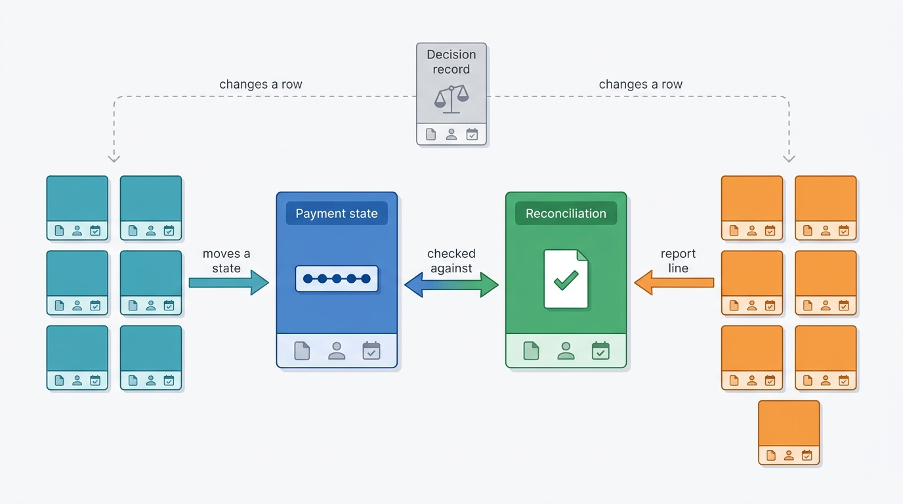

> **IN THIS SECTION, YOU WILL:** Find the card that fits the question on your desk, copy its fields, and see it filled in once for Larkfield, with the chapter that explains every field.

> **KEY POINTS:**
>
> * **Every card asks for the same three things:** the record that counts as the truth, an owner for the exception, and a date or deadline. A team that cannot write those down has not decided the question yet.
> * **The cards cite each other.** The payment state card says what you believe about a payment, and the reconciliation card says how that belief is checked against the provider's report.
> * **Start with three cards**, for one call of your own that moves money: the payment state card, the idempotency key card and the reconciliation card. On any card, a blank owner or a blank deadline is work to do now.

 
A team that cannot write down, for a recurring payment question, the record that counts as the truth, an owner for the exception and a date has not decided that question. Code and dashboards record what a system does when the answer arrives; they do not record who acts when it does not. This page gathers sixteen cards that put the missing decision in writing, each built from the chapter that raises its question. Grouped by the book's parts, they include the payment state card, the idempotency key card and the reconciliation card, and run to a provider exit plan card and an architecture decision record. Each card states the decision it records, gives a blank template, says when to fill it and who owns it, shows one filled example and links its chapter.

The filled examples use **Larkfield, the fictional studio-software platform this book follows** ([[meet-larkfield]]). Its 6,200 studios take member payments through two providers, Stripe since 2017 and Adyen since 2024, and each studio is on one of them. **Keel** is Larkfield's 2027 program of eight decisions, K1 to K8; a card names the decision it carries out. Femke de Graaf leads payments engineering, Tom Hendriks built the payment service, Jonas Weber leads risk and compliance and Priya Raman is the finance controller. Mila Janssen is a member of Studio Noord, a yoga studio on Adyen; Ironworks Climbing is on Stripe. Larkfield's systems are named by role, such as the payment service and the payment record store. Nothing Larkfield does is evidence about either provider, and figures marked *(assumption)* are invented for teaching. Replace every name, date and figure with your own.

Three conventions hold for every card.

- **Three fields are never left out.** The record that counts as the truth is the one that wins when two records disagree. The owner of the exception is a named person, not a system. The date is a deadline, a review date or both.
- **A provider's behavior is written with its source and date, or as "Not public".** In the examples such a cell repeats the wording of the chapter that owns the fact, which cites the provider's documentation as accessed in November 2026.
- **A blank is work to do now.** Write "not decided" instead of a guess; where a chapter leaves a field open for Larkfield, the example says so.

Start with three of the cards, as [[payments-what-is-moving]] advises: the payment state card (Tool 2), the idempotency key card (Tool 7) and the reconciliation card (Tool 6). Fill them first, for one call of your own that moves money.

## Find the Card for the Question on Your Desk

The cards are numbered in the order of the book's parts.

| The question in front of you | Tool | Part | Chapter that teaches it |
| --- | --- | --- | --- |
| A chargeback arrived. What do we send, by when, and who sends it? | [Tool 1](#tool-1): Dispute evidence card | I | [[refunds-reversals-and-disputes]] |
| What state is this payment in, and what does "paid" promise? | [Tool 2](#tool-2): Payment state card | II | [[payment-state-machines]] |
| Which provider does a payment go to, and what can we switch? | [Tool 3](#tool-3): Routing rule card | II | [[payment-routing-and-orchestration]] |
| Whose money is this amount, and when can it be paid out? | [Tool 4](#tool-4): Funds-flow diagram template | III | [[balances-and-funds-flows]] |
| A payout is marked paid and the money did not arrive | [Tool 5](#tool-5): Payout exception card | III | [[payouts-and-money-movement]] |
| How do we know the money arrived, and who owns a difference? | [Tool 6](#tool-6): Reconciliation card | III | [[payment-reconciliation-and-reporting]] |
| A call timed out. May we send it again? | [Tool 7](#tool-7): Idempotency key card | IV | [[idempotency-and-retries]] |
| An event did not arrive, or arrived twice | [Tool 8](#tool-8): Webhook consumer contract | IV | [[payment-webhooks-and-events]] |
| Which compliance form do we file, and what on our page is still ours? | [Tool 9](#tool-9): PCI scope card | V | [[tokenization-vaulting-and-pci]] |
| A renewal failed. What is tried again, when, and when do we stop? | [Tool 10](#tool-10): Billing retry schedule card | VI | [[invoicing-collections-and-dunning]] |
| A seller cannot cover a refund or a chargeback. Who pays? | [Tool 11](#tool-11): Platform liability card | VII | [[platform-payment-models]] |
| A seller's payouts stopped over a verification deadline | [Tool 12](#tool-12): Onboarding requirement tracker | VII | [[platform-onboarding-and-verification]] |
| The first of the month, or a sale, is coming | [Tool 13](#tool-13): Peak plan | VIII | [[payment-peak-load]] |
| Which provider do we choose, keep or drop? | [Tool 14](#tool-14): Provider comparison card | X | [[stripe-and-adyen-bets-compared]] |
| How would we leave this provider? | [Tool 15](#tool-15): Provider exit plan card | X | [[tokenization-vaulting-and-pci]] |
| A decision changes a rule, a provider or an owner | [Tool 16](#tool-16): Architecture decision record | all | [[acquiring-and-network-connectivity]] |

The chapters mostly teach these records as a Larkfield section and a list of questions; only the provider comparison card is called a card in its chapter. Each card below therefore says which section and questions it is built from, and has no field its chapter does not raise. Six further working records stay in their chapters: the acquirer inventory ([[acquiring-and-network-connectivity]]), the method-family table ([[local-payment-methods]]), the version register ([[payment-api-versioning]]), the authentication loss table ([[three-d-secure-and-sca]]), the period record ([[subscriptions-and-billing-engines]]) and the data-location page ([[payment-multi-region-and-data-residency]]).

## How the Cards Connect

Most changes touch several cards, and the cards meet at two of them. The payment state card says what you believe about a payment. The reconciliation card says how that belief is checked against the provider's report.

**Figure 1:** *The sixteen cards meet at two: the payment state card records what you believe about a payment, and the reconciliation card checks that belief against the provider's report. A decision record changes a row on one of the others, and every card names a record, an owner and a date.*

In plain words: a change to what moves a payment into a state, or to which report line proves it, changes those two cards whatever card it started on. The idempotency key card and the webhook contract move states, the funds-flow template and the platform liability card say whose balance a report line belongs to, and a decision record (Tool 16) names the cards it changes.

## Tool 1: Dispute Evidence Card

**What it records.** The decision, taken before any dispute arrives, about which evidence a sale leaves behind, which message starts the deadline, who answers and by what policy in amounts. Built from the Larkfield section and questions 5 to 7 of [[refunds-reversals-and-disputes]] and questions 3 to 6 of [[journey-dispute]].

**The template.** One card per provider for the policy rows; one per dispute for the rest.

| Field | What to record |
| --- | --- |
| **Deadline starts with** | The message or field that starts the clock, and what finds the dispute if that message is lost |
| **Deadline** | The provider's figure for this network, never your own count |
| **Owner** | One named person, and the alert that fires before the deadline |
| **Evidence** | What the product records at the sale and at delivery, and the identifier that links it to the payment |
| **Policy in amounts** | When you refund first, resolve early, accept or contest |
| **Record that is the truth** | The provider's record an open dispute is checked against, and the report the ledger is written from |
| **End state** | The event or status that closes the dispute, and what the books do if another follows |

**When and who.** Fill the policy rows once per provider, in a calm month. Fill the case rows on the day the dispute record is created. The person who owns disputes owns the card.

**Larkfield example** (fictional; Bram de Wit's €120.00 class pass at Studio Noord, on Adyen; dates after 24 February are illustrative):

| Field | Value |
| --- | --- |
| Deadline starts with | The chargeback notification of Wednesday 24 February 2027; a lost notification is found by comparing open dispute rows with Adyen's daily dispute report |
| Deadline | Monday 5 April 2027: the 40 days Adyen documents for Mastercard (accessed November 2026) |
| Owner | Jonas Weber; a dispute row within three days of its deadline raises an alert |
| Evidence | The logged-in purchase session of 2 February and check-ins to two classes on 4 and 11 February, joined to the payment by the member id |
| Policy in amounts | Defend when the evidence already exists and the amount is worth a second fee; one submission, sent on 3 March |
| Record that is the truth | The provider's own record, checked daily for open disputes (K2); ledger entries only from the provider's report lines (K3) |
| End state | Reversed on 5 March, +€120.00, provisional; won when the issuer's time ran out on 12 May 2027 |

The evidence existed only because the booking app had written it for scheduling, under an identifier it shares with the payment. It could not have been produced after the notification. Winning still cost Studio Noord the €15.00 fee.

**Taught in:** [[refunds-reversals-and-disputes]].

## Tool 2: Payment State Card

**What it records.** What each state of your own payment record promises, and which provider message or read may move a row into it. Built from the Larkfield section and questions 1, 3, 4, 5, 7 and 8 of [[payment-state-machines]].

**The template.** The first two rows repeat per state; the rest are answered once for the record.

| Field | What to record |
| --- | --- |
| **State and promise** | Each state of your record and what it promises |
| **Moved into it by** | Per provider, the message or read that may move a row into the state |
| **Waiting on** | Whether a pending payment waits for the customer or the provider, each with its timeout |
| **Stored beside it** | The provider's status as received; attempts, captures, refunds and disputes as child rows |
| **Sweep** | What is read at each provider when an event never arrives |
| **Record that is the truth** | What "paid" promises, and which system establishes that the money settled |
| **Owner of an unknown status** | Who reviews a provider status the mapping does not know |
| **Date** | When the mapping was last reviewed |

**When and who.** Fill it before the first integration. Read it again whenever a provider, a payment method or an API version is added. The owner of the payment record owns the card.

**Larkfield example** (fictional; the payment record store under Keel, reviewed by Femke de Graaf with Tom Hendriks in late March 2027; the mapping is Larkfield's, and the provider behavior in it is documented in the chapter):

| Larkfield state | What it promises | Moved into it on Stripe by | Moved into it on Adyen by |
| --- | --- | --- | --- |
| `pending` | No provider has confirmed an authorization | `requires_payment_method`, `requires_confirmation`, `requires_action` (customer) or `processing` (provider) | Request made; no `AUTHORISATION` webhook yet |
| `authorized` | A confirmed hold to capture or release | Intent read back as `requires_capture` | `AUTHORISATION` webhook, `success` true, where capture is manual |
| `paid` | The provider confirms the capture | Intent read back as `succeeded` | `AUTHORISATION` webhook, `success` true, where capture is automatic; or `CAPTURE` webhook, `success` true |
| `refunded` | At least one refund is confirmed | Refund object with status `succeeded` | `REFUND` webhook, `success` true |
| `disputed` | A dispute is open or lost | A Dispute object on the charge | `NOTIFICATION_OF_CHARGEBACK` or `CHARGEBACK` webhook |

None of the five words means *settled*. `paid` promises only that the provider has confirmed the capture, so the card names the ledger and the reconciliation job (Tool 6) as the place where the arrival of the money is established. Each row also stores the provider's status as received, a `waiting_on` field (`customer`, `provider` or empty), a `closed_reason` for a pending payment that ended without money, and child rows for attempts, captures, refunds and disputes. An unknown provider status is stored and raised for review, never mapped to a default.

**Taught in:** [[payment-state-machines]].

## Tool 3: Routing Rule Card

**What it records.** What decides which provider a payment goes to, what a switch to the other provider moves, and what it leaves behind. Built from the Larkfield section and questions 6, 7 and 8 of [[payment-routing-and-orchestration]].

**The template.**

| Field | What to record |
| --- | --- |
| **Rule** | What decides the provider, and what the rule looks at: the seller, the country or the payment |
| **The switch moves** | Which payments can go to the other provider at once |
| **The switch leaves** | Which payments stay, and why |
| **Unknown outcome** | How the outcome of a timed-out attempt is learned before another provider is tried |
| **Record that is the truth** | The last time real payments went through the second route, through to payout and refund, and the date of the next rehearsal |
| **Owner** | Who throws the switch, and who works disputes, refunds and reconciliation on the second provider |

**When and who.** Fill it when a second provider is added, and update it after every rehearsal. The owner of the service that routes owns the card.

**Larkfield example** (fictional; the payment service under Keel decision K8, 2027):

| Field | Value |
| --- | --- |
| Rule | "The studio's provider", with a manual override per studio: each studio's money sits in a balance at one provider, so the rule never looks at the payment |
| The switch moves | Online card payments that bring their own credential (a wallet or a typed card), for the 50 largest studios, each with a verified account at both providers |
| The switch leaves | Stored-card renewals, which stay with, or wait for, the provider that holds the card; the front desk, which has Adyen terminals only |
| Unknown outcome | A payment whose first attempt is unknown is never sent to the second provider |
| Record that is the truth | Every quarter: real payments through the second provider, followed to the payout, a refund and the reconciliation of both providers |
| Owner | The payments team, led by Femke de Graaf; the chapter names no single person |

The switch is a failover and not a migration. It would move Mila's €120.00 pass, paid from her phone's wallet. Her €49.00 membership renews against a card stored at Adyen and would stay there.

**Taught in:** [[payment-routing-and-orchestration]].

## Tool 4: Funds-Flow Diagram Template

**What it records.** For one payment: every place the money sits, whose claim each amount is, the date it becomes payable and what can still take it back. Built from the Larkfield section and questions 1, 2 and 6 of [[balances-and-funds-flows]].

**The template.** One row per place the money sits. Then draw one box per row and one arrow per movement, with the date on the arrow.

| Column | What to record |
| --- | --- |
| **Where it sits** | A figure in the provider's books, a bank account, or a clearing account of your own |
| **Whose claim** | The seller's, yours, the provider's, or nobody's |
| **Amount** | With the split, fee or cost that produced it |
| **Payable on** | The date stored on the entry, never an assumed number of days |
| **What can take it back** | A refund, a chargeback, a payout return or a negative balance: who is debited, and after how long |
| **Record that is the truth** | The report line or entry that shows the amount |

**When and who.** Fill one template per charge type and provider before the first seller is paid. Fill it again when a split, a fee or a payout schedule changes. The owner of the ledger owns the template.

**Larkfield example** (fictional; Mila's €120.00 pass at Studio Noord, on Adyen, bought on Tuesday 9 March 2027):

| Where it sits | Whose claim | Amount | Payable on | What can take it back |
| --- | --- | --- | --- | --- |
| Studio Noord's balance account | Studio Noord's | €117.47 | Thursday 11 March, two business days later | A refund or a chargeback debits this account first |
| Larkfield's liable balance account | Larkfield's: its fee of €2.53 less the processing cost | €1.92 | — | It stands behind the studio's balance |
| The processing cost | Nobody's claim; the provider keeps it and passes part on | €0.61 *(assumption)* | — | — |
| The refund of Thursday 18 March | Debits Studio Noord's balance account, which held €212.40 of later sales *(assumption)* | −€84.00 | Booked on 18 March | The next payout is €84.00 smaller |

None of the three figures is a bank account of the studio's, and Larkfield holds none of them. The refund row shows the date problem: an entry that belongs to a sale of 9 March debits a balance that no longer contains that sale.

**Taught in:** [[balances-and-funds-flows]].

## Tool 5: Payout Exception Card

**What it records.** What you call a payout between the provider's "paid" and the money landing, how long it stays open, and who works a return. Built from the Larkfield section and questions 1 to 4 and 6 of [[payouts-and-money-movement]].

**The template.**

| Field | What to record |
| --- | --- |
| **States** | Your payout states and the provider signal that sets each |
| **Open window** | How long a sent payout stays open, and who chose the number |
| **Record that is the truth** | The clearing account for payouts in transit, and who reads its balance by age |
| **Owner of a return** | A named team or person, and the day by which a return is paid again or explained |

**When and who.** Fill it before the first payout is sent, and read it again when a payout route or a provider is added. It belongs to whoever answers a seller who says the money did not arrive.

**Larkfield example** (fictional; the payout record under Keel, and the payout that carries Mila's €117.47):

| Field | Value |
| --- | --- |
| States | `instructed`; `sent` (Adyen's transfer webhook reports `booked`; Stripe sends `payout.paid`); `arrived`; `returned` (on Stripe, a later `payout.failed`) |
| Open window | 10 business days on both providers *(Larkfield's choice, an assumption)*: sent on Thursday 11 March 2027, marked arrived on Thursday 25 March |
| Record that is the truth | "Payouts in transit" must return to zero, and what stays in it beyond the window is the list of stranded payouts. Webhooks move the state; ledger entries come from report lines |
| Owner of a return | A named team's queue from the first day (the chapter names neither the team nor a deadline); an unmatched item open more than five business days goes to Priya Raman's weekly review (Tool 6) |

Replay the Payout That Bounced against the card. Each of the 412 returns of June 2026 would have matched a payout that was still open. The €386,000 would have been a queue on the first day and not a discovery over 19 days. Since then a change of bank details triggers a check of the account holder's name and holds the studio's next payout.

**Taught in:** [[payouts-and-money-movement]].

## Tool 6: Reconciliation Card

**What it records.** Which provider report the books are written from, which signal says it is ready, which key ties a bank credit to its lines, and who owns what does not match. Built from the Larkfield section and questions 1 to 3 and 5 of [[payment-reconciliation-and-reporting]].

**The template.** One card per provider.

| Field | What to record |
| --- | --- |
| **Report** | The report the books are written from, and what one line of it is |
| **Ready signal** | What says the report is ready; the close waits for it |
| **Matching key** | What ties a bank credit to its report lines |
| **Record that is the truth** | The report line; what may never write the books |
| **Owner and deadline** | For every unmatched amount: its age, its owner, and the age at which it is escalated and to whom |

**When and who.** Fill one card per provider before the first close. Read it again at every close that ends with an item nobody owns. Finance and the payments team own it together.

**Larkfield example** (fictional; the reconciliation job under Keel decision K3, at the close of Tuesday 9 March 2027):

| Field | On Stripe | On Adyen |
| --- | --- | --- |
| Report | The itemized payout report: each row holds the payout's ID and the balance transaction's ID | The Balance Platform Accounting Report: a split payment appears as separate lines that share the PSP reference |
| Ready signal | Stripe's report-ready signal, not a fixed hour | Adyen's report-ready signal, not a fixed hour |
| Matching key | The payout ID | Merchant account plus batch number, and the daily report per studio |
| Record that is the truth | A ledger entry is written only from a report line, never from a webhook | The same |
| Owner and deadline | Every open item has an amount, an age and an owner; open more than five business days, it goes to Priya Raman's weekly review | The same |

After that close the job held three open items *(illustrative assumptions)*: a €16.00 drop-in captured after the sales day closed, a €49.00 refund made by hand in the provider's console, and £0.03 of currency rounding. They are the same kinds of line as the three causes of the Unexplained €0.4 Million.

**Taught in:** [[payment-reconciliation-and-reporting]].

## Tool 7: Idempotency Key Card

**What it records.** For one call that moves money: the business event its key is derived from, how long a repeat is safe, and what you do when the outcome is unknown. An idempotency key is an identifier sent with a request so that the provider can recognize a repeat and not perform it twice. Built from the Larkfield section and questions 1 to 6 of [[idempotency-and-retries]].

**The template.** One card per call that moves money.

| Field | What to record |
| --- | --- |
| **Business event** | The event the call carries out, and its identity in your own system |
| **Key built from** | The event's identifiers, so that every attempt for the event sends the same key |
| **Never built from** | A random value generated per network call, per attempt or per click |
| **Written before the first send** | The key, a fingerprint of the request, the time of the first send and a pending state, in your own record |
| **Provider's key window** | How long each provider keeps a key, and where your code states it |
| **After a timeout** | The outcome is unknown: read the provider's record, or resend with the same key |
| **Record that is the truth** | The provider's record that settles an unknown attempt |
| **Owner and deadline** | When retrying stops, and who owns an attempt that is still unknown then |

**When and who.** Fill one card per call before it ships. Derive the key from the business event, so that every attempt for that event sends the same key. For a refund, that is the order and the refund request's own identity, so a second click sends the key of the first; never generate it per attempt or per click. After a timeout the outcome is unknown: read the provider's record or resend with the same key, and never send a new one.

**Larkfield example** (fictional; the renewal of a €49.00 membership under Keel decision K1):

| Field | Value |
| --- | --- |
| Business event | One scheduled attempt for one membership and billing period; only the payment service sends the call |
| Key built from | `renewal:<membership id>:<billing period>:<attempt number>`, for example `renewal:M-204817:2026-11:1` (an invented membership) |
| Never built from | The HTTP layer's own value at each network call, which is what the renewal job did on 1 November 2026 |
| Written before the first send | A row in the payment record store: the key, a fingerprint of the request, the time of the first send and the state `pending` |
| Provider's key window | Stripe API v1: at least 24 hours. Adyen: 7 to 14 days after first submission (both as documented, accessed November 2026). Larkfield resends for at most 20 hours on Stripe and 6 days on Adyen, so a queue redelivery after 36 hours is refused on Stripe |
| After a timeout | Wait with backoff and jitter, then resend the stored key |
| Record that is the truth | On Stripe the payment object, found by the Larkfield identifier in its metadata. On Adyen, where the Checkout API has no call that returns an online payment, the webhook and, failing that, the settlement report |
| Owner and deadline | Past the limit nothing is sent and the attempt goes to the sweep of decision K2; the chapter names no person |

Under this card none of the 1,840 duplicates of the Double Charge is created, and none of the €71,300 is refunded. Mila's keys end in `:2027-04:1` (1 April, declined) and `:2027-04:2` (4 April, approved); a key that stopped at the billing period would have made the second request a repeat of the first.

**Taught in:** [[idempotency-and-retries]].

## Tool 8: Webhook Consumer Contract

**What it records.** What a receiver may assume about a provider's events, and what it does when an event never arrives. Built from the section on the receiver's contract, the Larkfield section and questions 1, 2, 4, 5, 6 and 8 of [[payment-webhooks-and-events]].

**The template.** One contract per provider endpoint.

| Field | What to record |
| --- | --- |
| **Acknowledgement** | What counts as one, and how many seconds you have |
| **Retry window** | How long an unacknowledged event is retried, and what can be read back afterwards |
| **Record that is the truth** | What a state change is confirmed against before the business acts on it |
| **Sweep** | The job that finds a payment whose event never came, and the longest a payment may stay pending |
| **While unknown** | What the payment looks like to staff and to other systems |
| **Owner of silence** | Who is alerted when events stop, when the provider marks the endpoint as failing, and before the certificate expires |

**When and who.** Fill one contract per endpoint before it receives live events, and test it by switching the endpoint off. The team that owns the receiver owns the contract.

**Larkfield example** (fictional; the two webhook receivers under Keel decision K2; the provider terms are the chapter's, from documentation accessed in November 2026):

| Field | Stripe receiver | Adyen receiver |
| --- | --- | --- |
| Acknowledgement | Any 2xx, returned quickly; no number of seconds is published | A 2xx within 10 seconds |
| Retry window | Up to three days; events can be read back for 30 days | Up to 30 days, from a queue per endpoint; no call in the Checkout API returns an online payment |
| Record that is the truth | The PaymentIntent, re-read before any state is written | The stored message is the working record until the settlement report confirms it |
| Sweep | Every 15 minutes over renewals pending more than 30 minutes *(assumption)*; it reads the object | It waits for the report and raises what the report does not explain |
| While unknown | The check-in screen shows "being checked" and lets the member in | The same |
| Owner of silence | The chapter names no one; on your card this cell may not stay blank | The same |

Replay the Silent Webhook under the contract. The expired certificate of Monday 14 September 2026 would leave rows wrong for about half an hour and not for nine hours, because the sweep reads Stripe's record with or without an event.

**Taught in:** [[payment-webhooks-and-events]].

## Tool 9: PCI Scope Card

**What it records.** The path a card number takes from the keyboard to the provider, the questionnaire that path leads to, and what stays yours. PCI (Payment Card Industry) scope is every system a card number passes through. Built from the Larkfield section and questions 1 to 4 of [[tokenization-vaulting-and-pci]].

**The template.**

| Field | What to record |
| --- | --- |
| **Collection design** | A redirect, hosted fields, your own encrypted form or the raw API, per provider |
| **Path of the number** | Each of your systems it passes through, readable or encrypted |
| **Questionnaire** | Which one each provider asks of you, and whether the integration has changed since you last filed |
| **Scripts on the payment step** | Each script, its reason and its owner: the inventory, not the signed form, is the record that is the truth |
| **Script line** | Met by your own controls, or by the provider's written confirmation |
| **Owners and date** | Who signs the questionnaire, who owns the inventory, and the next filing |

**When and who.** Fill it before the first design mock-up of a payment form. Read it again before every yearly filing and after any change to the payment step.

**Larkfield example** (fictional and illustrative; Keel decision K4, January and February 2027):

| Field | Value |
| --- | --- |
| Collection design | The providers' hosted card fields, on both providers, since 2017 |
| Path of the number | Mila's card on 12 January 2027: typed into Adyen's card fields and encrypted in her browser; what crossed Larkfield's server was ciphertext |
| Questionnaire | SAQ A, the shortest form, with both providers, each January |
| Scripts on the payment step | Before: 17 third-party scripts from 9 domains, 4 with no known owner. After K4: 3 scripts from 2 domains, on a page of its own |
| Script line | Larkfield's own controls: a content security policy run report-only for two weeks, then enforced |
| Owners and date | Jonas Weber signs the form, each January; Tom Hendriks owns the script inventory |

The card numbers moved to the two providers. The page around the fields stayed, with its scripts. The stored cards stayed too, as tokens that mean something only at the provider that issued them, which is why Tool 15 exists.

**Taught in:** [[tokenization-vaulting-and-pci]].

## Tool 10: Billing Retry Schedule Card

**What it records.** What is tried again after a failed charge, on which days, which one system schedules it, and in what state the debt ends. Built from the Larkfield section and questions 1 to 6 of [[invoicing-collections-and-dunning]].

**The template.**

| Field | What to record |
| --- | --- |
| **Record that is the truth** | Where each amount owed lives, and what freezes it |
| **Scheduler** | The one system that may schedule a retry of a debt, and the others that are switched off |
| **Per failure** | For each kind of decline and payment method: the action, the days and the limit |
| **Message trigger** | A failed attempt, never the absence of a payment |
| **Deadline** | The day on which collection ends, and the state the debt, the access and the next invoice are then in |
| **Owner** | Who owns the policy and the debts that reach its last day |

**When and who.** Fill it before the first recurring charge. Read it again when a payment method is added or a provider's own retry product is switched on. The team that owns the record of the debt owns the card.

**Larkfield example** (fictional; member renewals under Keel decision K5; the policy is Larkfield's and the days are illustrative; "soft" and "hard" decline are industry shorthand, not network terms):

| Situation | Action | Limit |
| --- | --- | --- |
| Card, soft decline | Email on the first failure; retry on days 3, 7 and 12 | 3 retries in 14 days |
| Card, hard decline | No retry; email and in-app request for a new card; attempt as soon as one is saved | None on the old card |
| Direct debit, insufficient funds | One new collection after 7 days | Two retries at most, as the providers allow |
| Direct debit, any other failure | Ask for a new mandate or another payment method | No retry |
| Still unpaid on day 14 | Membership paused; the period record stays open | — |
| Still unpaid on day 30 | Period record marked uncollectible; membership ended | — |

The record that is the truth is the period record: one row per membership and billing period, written before the first attempt, with a child row per attempt. Larkfield runs the only schedule. The chapter names no owner for the debts that reach day 30. The message trigger carries the lesson of 1 October 2026: a failure message follows only a declined attempt on an open period record, so the 7,900 renewals that had merely been delayed would have stayed silent.

**Taught in:** [[invoicing-collections-and-dunning]].

## Tool 11: Platform Liability Card

**What it records.** Per seller and provider: who the merchant is, whose balance a payment is booked to, and who pays a refund or a chargeback the seller cannot cover. Built from the Larkfield section and questions 1 to 7 of [[platform-payment-models]].

**The template.** One card per provider and account configuration.

| Field | What to record |
| --- | --- |
| **Merchant** | Who the customer sees at checkout, on the receipt and on the statement, and whether the configuration names the same business |
| **Booking rule** | Whose balance each kind of payment is booked to |
| **Refund and chargeback debit first** | Which balance takes the amount and the fee, by which instruction |
| **If the seller cannot cover it** | Who pays, after how long, and where that is written |
| **Exposure** | Paid-out volume still inside the refund and dispute window, per seller and in total |
| **Record that is the truth** | The provider's account setting or payment instruction, stored per seller |
| **Owner and date** | Who owns the exposure figure and its limit, and when it was last computed |

**When and who.** Fill one card per provider and account configuration before the first seller is onboarded. Finance refreshes the exposure row every month.

**Larkfield example** (fictional; Studio Noord, which is on Adyen, modeled on both providers; the provider behavior is documented in the chapter):

| Question | Studio Noord on Adyen | Had it been on Stripe |
| --- | --- | --- |
| Who is the merchant? | Studio Noord (platform model; the store) | Studio Noord (`on_behalf_of`) |
| Where is the €120.00 booked? | €117.47 to the studio's balance account, €2.53 to the liable balance account | To Larkfield's platform balance, with €117.47 transferred to the studio's balance |
| What does the €84.00 refund debit first? | The studio's balance account, by the refund's split instruction | Larkfield's platform balance; Larkfield then reverses the transfer |
| What do the €120.00 chargeback and its €15.00 fee debit first? | The studio's balance account, by the chargeback instruction | Larkfield's platform balance; Larkfield then tries to reverse the transfer |
| What if the studio cannot cover it? | The studio's balance account goes negative; after more than 30 days Larkfield's reserved compensation account is debited | Larkfield's balance has already paid; what it cannot pull back stays its loss |
| What is the record that is the truth? | Stored per studio and provider: the merchant, the booking rule, the loss bearer and whether the assignment can still change | The same |
| Exposure, owner and date | About €156 million of paid-out online card volume is inside the 120-day dispute window at any time; about €64,000 for Studio Noord *(assumption; [[splits-balances-and-platform-payouts]])*. Finance reports the figure; in June 2027 ([[embedded-finance]]) a limit and an owner per studio were still to be set | The same |

The card exists because "we never hold the funds" had been read for years as "we never carry the loss".

**Taught in:** [[platform-payment-models]].

## Tool 12: Onboarding Requirement Tracker

**What it records.** Per seller: every open verification requirement with its due date, the capability at risk, an owner, and when the seller was last told. Its fields are the verification record of the Larkfield section of [[payment-compliance-and-regulation]]; the rest comes from the Larkfield section and questions 1, 5, 6 and 7 of [[platform-onboarding-and-verification]].

**The template.** One row per seller and open requirement.

| Column | What to record |
| --- | --- |
| **Seller** | The legal entity that is verified, not its locations |
| **Provider and capabilities** | The capabilities requested, and which of them the seller needs on day one |
| **Requirement** | In your own vocabulary, with the provider's field it came from |
| **Due date** | The provider's deadline |
| **Capability at risk** | What stops if the date passes: payments or payouts |
| **Owner** | One named person for every open deadline |
| **Seller last told** | When, by which channel, and whether a person who can act reads it |
| **Record that is the truth** | The provider's capability status, and when the row was last re-read from it |

**When and who.** Start the tracker before the first seller signs up. Read every row again from the provider's record each day. One named person owns every open deadline; a team does not.

**Larkfield example** (fictional; one row for Ironworks Climbing, with May 2026 beside Keel decision K6):

| Column | Value |
| --- | --- |
| Seller | Ironworks Climbing: one UK private limited company with three locations, so one seller to verify |
| Provider and capabilities | Stripe, a legacy Custom connected account: card payments, Bacs debit payments and transfers |
| Requirement | The requirement that changed in May 2026, announced in advance with a deadline; the book does not name it |
| Due date | The provider's deadline, missed in 2026 and learned from support tickets; Ravi Shah's is dated Thursday 14 May |
| Capability at risk | Payouts: paused from Monday 11 May to Wednesday 20 May 2026 |
| Owner | 2026: nobody. Under K6: Jonas Weber, for every open deadline |
| Seller last told | 2026: one batch email to the sign-up address. Under K6: a banner in the back office with the reason, the date and one button; studio support is alerted 14 and 3 days before *(assumption)* |
| Record that is the truth | The provider's record: once a day a job re-reads every studio's state from the provider's API and compares it with the tracker (K2) |

The owner and the daily re-read are what was missing when 230 studios missed the deadline and became the Frozen Studios.

**Taught in:** [[platform-onboarding-and-verification]] and [[payment-compliance-and-regulation]].

## Tool 13: Peak Plan

**What it records.** For a peak you can predict: the rate it needs, the limit it meets first at each provider, what gives way, and what no customer is told. Built from the Larkfield section and questions 1, 2, 4, 5 and 8 of [[payment-peak-load]].

**The template.**

| Field | What to record |
| --- | --- |
| **Peak** | What it is, when, how many payments and how much money |
| **First limit per provider** | The limit the peak meets first, and whether it is documented or agreed in writing |
| **Pacing** | The window, and the rate you allow yourself per provider and endpoint |
| **What gives way** | The order in which work is served when you are refused or the provider slows |
| **Not attempted yet** | The state of a charge that has not been tried, and the message it does not send |
| **Record that is the truth** | The signals watched in the first paced run: refusals by reason, call latency, issuer-unavailable declines, time to finish |
| **Owner and date** | Who may slow or stop the run, and the date of the last rehearsal |

**When and who.** Fill it a calm month before each predictable peak, and rehearse it before you trust it. The owner of the job that causes the peak owns the plan.

**Larkfield example** (fictional; the renewal wave under Keel decision K5; the settings are Larkfield's and are assumptions):

| Field | Value |
| --- | --- |
| Peak | The 1st of each month: about 357,000 renewals worth €17.5 million, 38% of the month's renewals |
| First limit per provider | On Stripe, the limit of 25 requests a second to one endpoint, as [[payment-developer-platform]] gives it. Adyen publishes no rate limit for payments (both from documentation accessed November 2026); Larkfield allows itself 5 a second until a figure is agreed |
| Pacing | 18 hours from midnight; one token bucket per provider and endpoint, 10 requests a second on Stripe and 5 on Adyen |
| What gives way | Three lanes in strict order: members at checkout, then confirmations and retries of unknown outcomes, then the batch. |
| Not attempted yet | The period record stays open and no message goes out; renewals not attempted by the end of the window carry to the next morning |
| Record that is the truth | The first paced wave, watched in production |
| Owner and date | Femke de Graaf leads Keel; the chapter names no owner of the run |

The eighteen hours come from the Adyen side. At 5 requests a second, about 200,000 renewals need 11.1 hours with no refusal and no checkout traffic ahead of them, which is 62% of the window. The unpublished limit, not the published one, sets the length of the run.

**Taught in:** [[payment-peak-load]].

## Tool 14: Provider Comparison Card

**What it records.** Per bet and per country: what each provider has documented, with a date and a source or the words "Not public", and what your own system does about the difference. This is the one card its chapter calls a card: [[stripe-and-adyen-bets-compared]] fills it for the two companies and then for Larkfield.

**The template.** One row per bet and, where it matters, per country.

| Column | What to record |
| --- | --- |
| **Bet and country** | Who acquires, who holds the funds, the price model, where payment state is read, payout and reconciliation, billing, the platform model |
| **Provider A** | A dated fact with its source, or "Not public" with whom you asked and when |
| **Provider B** | The same |
| **Kind of difference** | Of kind; of default, sequence or degree; or not decidable from the public record |
| **What our system does** | The software or process that absorbs the difference |
| **Record that is the truth** | The provider's dated page or its written answer, never a slogan or a memory |
| **Owner and date** | Who reads the row again, when it was last read and when it is read next |

**When and who.** Fill it before a provider is chosen, kept or dropped, and read it again every half-year. "Not public" means not found in the provider's documentation, help center, site or filings by a stated date, which does not prove absence. The person who would have to defend the choice owns the card.

**Larkfield example** (fictional; Femke de Graaf's card of October 2027, in answer to "which provider do we keep?"; amounts marked *(assumption)* are illustrative, and nothing in the table is evidence about either provider):

| Row | Larkfield on Stripe | Larkfield on Adyen | What the payment service does |
| --- | --- | --- | --- |
| Acquirer and holder of funds | Stripe Technology Europe, Ltd. (Netherlands, Germany, Belgium); Stripe Payments UK, Ltd.; in the US one of six named acquirers, a question put to Stripe and still open | Adyen N.V. (Netherlands, Germany), Larkfield's reading of Adyen's license page | Keeps the acquirer inventory, one dated row per market |
| Price | Negotiated blended rate of 0.6% + €0.15 *(assumption)* | Negotiated Interchange++; €0.61 on Mila's €120.00 pass *(assumption)* | Books the provider's cost per payment when it is reported |
| Payment state | Reads the payment object | Webhook, then the settlement report | Feeds one five-state record two ways (K2) |
| Payout and reconciliation | Funds per transaction; keyed on the payout | Funds per sales day; keyed on the batch | Runs one reconciliation per provider (K3) |
| Billing | Stripe Billing for studio plans since 2018 | None; the booking app's renewal job charges stored cards | Writes one period record per membership on both |
| Platform model | Legacy Custom accounts, destination charges; Larkfield bears losses | Platform model; a chargeback instruction on every payment | Stores merchant, loss bearer and booking rule per studio |

From that card Larkfield decided to keep both providers. The card fails in one way: it goes stale. Four events of 2026 alone changed cells of the two companies' map, so every row carries its date and its source. Larkfield reads the card again in the half-yearly slot it already keeps for API upgrades (K7).

**Taught in:** [[stripe-and-adyen-bets-compared]].

## Tool 15: Provider Exit Plan Card

**What it records.** How stored cards and running payments would leave a provider: by what procedure, in how many weeks, and what does not travel. The chapters call it the exit sheet. Built from the Larkfield section and question 7 of [[tokenization-vaulting-and-pci]] and from the exit answers and questions 2 to 4 of [[payment-routing-and-orchestration]].

**The template.** One card per provider.

| Field | What to record |
| --- | --- |
| **Vault** | Who holds the stored cards, and what you hold |
| **Network tokens** | Under whose identifier they are issued, and what happens to them if you leave |
| **How cards leave** | By what procedure, and to whom |
| **Weeks and fee** | How many weeks, at what cost, and what does not travel |
| **Record that is the truth** | The provider's written answer with its date, or "Not public" |
| **Owner and date** | Who owns the sheet, and when its answers were last checked |

**When and who.** Write one card per provider while you do not need it, and check it at every rehearsal of the switch. The owner of the provider relationship owns it.

**Larkfield example** (fictional; Larkfield's exit answers in 2027, one sheet per provider):

| Field | Value |
| --- | --- |
| Vault | Each provider holds the cards saved through it; Larkfield holds only provider tokens (K4) |
| Network tokens | Issued under each provider's own identifier, as far as Larkfield has been told; treated as not portable |
| How cards leave | By transfer from provider to provider. For the 1,140 Dutch and German studios still on Stripe online, that is an export from Stripe's vault and an import into Adyen's |
| Weeks and fee | Planned in weeks; the chapters state no fee |
| Record that is the truth | What each provider has told Larkfield, kept current by the quarterly rehearsal |
| Owner and date | Femke de Graaf owns one sheet per provider; the answers are checked every quarter |

The switch of Tool 3 moves no stored card, and about 940,000 membership renewals a month are charged against payment details stored at one of the two providers.

**Taught in:** [[tokenization-vaulting-and-pci]] and [[payment-routing-and-orchestration]].

## Tool 16: Architecture Decision Record

**What it records.** A decision with its reasons, the option that was declined, the record that will show whether it worked, an owner and a review date. No chapter gives a form for it. The fields are the least that two passages call for: the opening scene of [[acquiring-and-network-connectivity]] and the Larkfield section of [[payment-routing-and-orchestration]].

**The template.**

| Field | What to record |
| --- | --- |
| **Decision** | One sentence that starts "We will" |
| **Status and date** | Proposed, accepted or superseded, and the day it was taken |
| **Options** | At least two, with the one declined and why |
| **Cards it changes** | The rows of other cards that this decision changes |
| **Record that is the truth** | The measure or rehearsal that will show whether it worked, or "not measured" |
| **Owner** | One named person |
| **Review** | A date, or the event that reopens the decision |

**When and who.** Write one for every decision that changes a row on another card, on the day it is taken. A later decision supersedes the record and does not edit it.

**Larkfield example** (fictional; Keel decision K8 written as a record):

| Field | Value |
| --- | --- |
| Decision | K8, two providers and one rehearsed switch: the payment service can move a studio's online card payments to the other provider, and no orchestration product is added |
| Status and date | Accepted as part of Keel, 2027; it answers a proposal of February 2027, when the routing rule was "the studio's provider" with a manual override |
| Options | Declined: an orchestration product that sends each card payment to whichever provider approves more, proposed by Daniel Osei. A studio's money sits at one provider, and a test needing 115,000 payments in one segment would take a tenth of a month's card traffic. Chosen: keep the rule and rehearse a switch |
| Cards it changes | The routing rule card (Tool 3), the provider exit plan card (Tool 15) and the onboarding tracker (Tool 12) |
| Record that is the truth | The quarterly rehearsal: real payments through the second provider, followed to the payout, a refund and reconciliation |
| Owner | Femke de Graaf |
| Review | Every quarter with the rehearsal; in October 2027 the provider comparison card (Tool 14) confirmed keeping both providers |

The row that earns its place is the record that is the truth. Larkfield's 2024 record that added Adyen gave two reasons, and for one of them, "local acquiring in the Netherlands and Germany", it named no measure. In 2027 nobody on the team could say what the reason had changed, and it now stands in the acquirer inventory as "effect not measured".

**Taught in:** [[acquiring-and-network-connectivity]] and [[payment-routing-and-orchestration]].

## Keeping the Cards True

The sixteen cards ask one question sixteen times: which record counts as the truth, who acts when it disagrees with what you believed, and by when. A card that no longer matches the system answers all three wrongly, and people still trust its owner and its date. A stale card is the undecided question again. Three habits keep the set current.

- **Review on a calendar.** The reconciliation card at every close; the routing rule and exit plan cards at every rehearsal; the comparison card every half-year; the PCI scope card before each filing; the state, key and webhook cards at every API upgrade.
- **Let incidents add fields.** When a review asks a question no card answers, add a field. Larkfield's "seller last told" column came from one batch email to mailboxes nobody read.
- **Keep the set small.** A field filled by habit and read by nobody should go.

The cards use terms such as idempotency key, clearing account, payout return and PCI scope with little or no definition. The [[glossary]] defines each one, names the chapter that owns it and gives the word Stripe and Adyen each use for it; the [[bibliography]] lists the sources behind the chapters.

## Sources and Evidence

The cards and their fields are the author's recommendations. The filled examples are fiction: Larkfield, its people, figures, dates and decisions are invented for teaching, and nothing in them is evidence about Stripe or Adyen. Where an example names a provider's behavior, it repeats the chapter that owns the fact, which cites the provider's documentation with its date. This page quotes no external source.

The chapters each card is built from are linked in its "What it records" and "Taught in" lines.

Larkfield is fictional; architectural recommendations, labeled inferences and labeled assumptions are the author's judgement.
