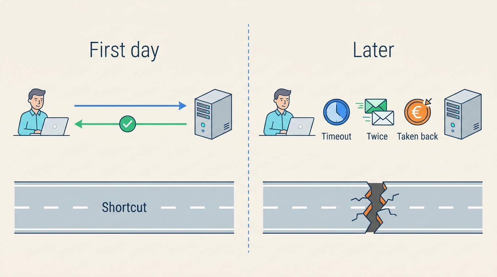
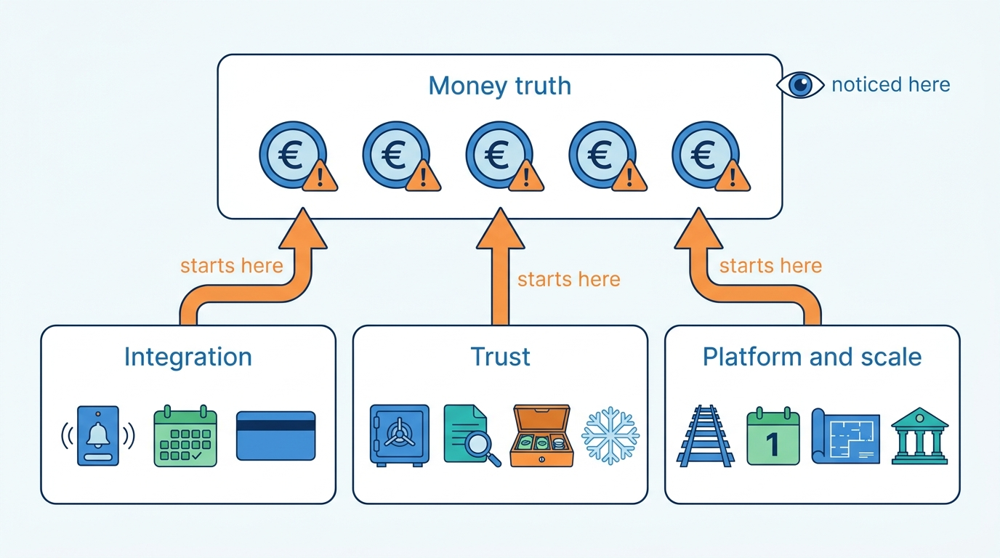
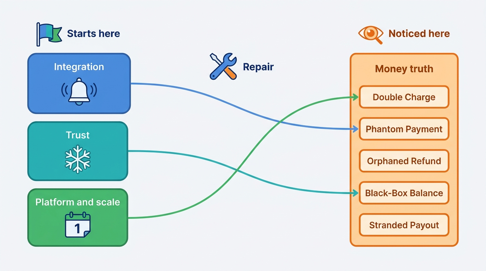
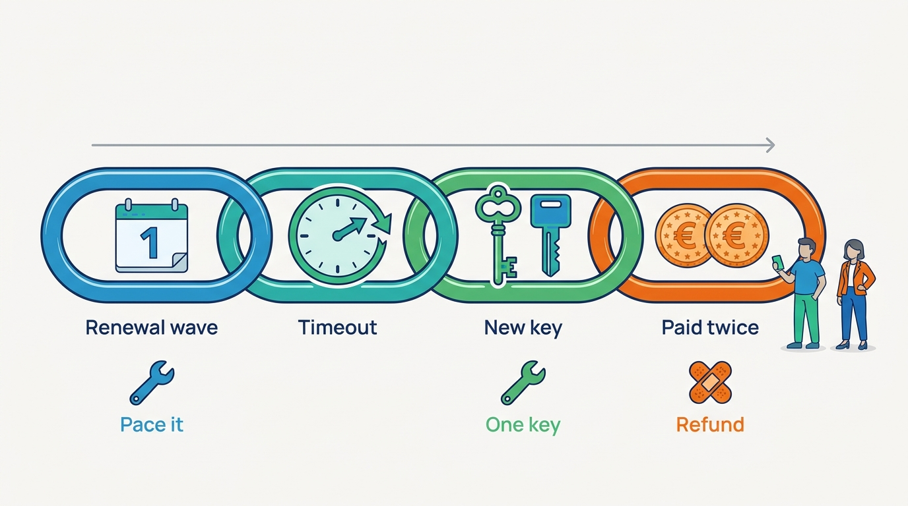

> **IN THIS SECTION, YOU WILL:** Learn sixteen named ways payment systems fail, recognize each by its warning sign, see what it costs at the book's fictional platform, and find the chapters that address it.

> **KEY POINTS:**
>
> * **Each pattern records a promise as the truth, or leaves a dependency untested.** Each began as a shortcut that matched how the provider's API behaved on the first day: a call returns success, a webhook arrives once, a card behaves like every other method. The slow parts of a payment contradict the shortcut only later.
> * **Four families say where to look.** Money truth: a record of money that nothing outside the system has confirmed. Integration: an assumption about the provider's interface that was never tested. Trust: a control over card data, fraud or verification handed to the provider and then not watched. Platform and scale: a dependency, a peak or a regulated role nobody rehearsed or named.
> * **The patterns chain, and the repair that holds is at the start.** A failure is usually noticed at a money-truth pattern and started at one of the other eleven. A refund repairs this month; a changed retry rule, webhook assumption or deadline owner repairs the next, and that change is rarely a new provider.

 
A customer is charged twice for one month of a membership. Another has paid and is turned away at the door, because the system says she has not. In both cases the provider was up and answered every call the way its documentation says it does. The [[introduction]] argued that the answer a payment API returns is the first of several promises, kept over days by parties that cannot see each other. Both failures have that shape: **a system recorded a promise, or a silence, as the truth**.

**Figure 1:** *Every pattern began as a shortcut that matched the provider's API on the first day and was contradicted only later, by a timeout, a repeated event or money taken back.*

Failures of this kind recur often enough to be named, and they share an origin. **Each began as a shortcut that matched how the provider's API behaved on the first day**: a call returns success, a webhook arrives once and in order, a card behaves like every other method, verification is a form filled in at sign-up. The slow parts of a payment contradict each shortcut only later and only sometimes, so it survives testing and fails under a timeout, a peak or a rule change. Each decision behind a pattern was reasonable when it was made, so finding a pattern is not finding someone to blame. The patterns also chain: the money error that a customer or an accountant notices is usually the last link, and the repair that holds is at the first.

This page names sixteen patterns in four families: money truth, integration, trust, and platform and scale. Each entry has the same shape: a typical quote, what the pattern looks like, why it happens, what it costs, an illustration, a remedy direction and the chapters that address it. The illustrations come from **Larkfield, the fictional studio-software platform this book follows** ([[meet-larkfield]]). Larkfield sells booking and membership software to fitness studios, and members pay the studios through it, on Stripe for some studios and on Adyen for others. The entries draw on its eight incidents (seven in 2026, one found in its 2025 year-end books) and on Keel, its 2027 repair program, whose decisions are numbered K1 to K8. The incidents and the opening quotes are invented, and they are evidence about no provider. Where an entry says how Stripe or Adyen behaves, it repeats what the linked chapter documents from the provider's own dated publications. After the sixteen entries come the chains the patterns form and three ways to use them: in a design review, an incident review and a provider evaluation.

## Sixteen Patterns to Recognize

The four families say where to look. **Money truth** is a record of money that nothing outside the system has confirmed. **Integration** is an assumption about the provider's interface (delivery, versions, payment-method behavior) that was never tested. **Trust** is a control over card data, fraud or verification that was handed to the provider and then not watched. **Platform and scale** is a dependency, a peak or a regulated role that nobody rehearsed or named. Money truth comes first because its symptoms are the ones customers and finance see; the other three are where those symptoms usually start.

| Pattern | Warning sign | Family |
| --- | --- | --- |
| **The Double Charge** | A timeout is retried as a new request, and the customer pays twice. | Money truth |
| **The Phantom Payment** | A system believes a payment succeeded, or failed, without the provider's confirmed record saying so. | Money truth |
| **The Orphaned Refund** | Refunds, reversals and chargebacks arrive weeks later and nobody can tie them to the original payment. | Money truth |
| **The Black-Box Balance** | Money sits in a provider balance that nobody can break down into payments, fees, refunds and reserves. | Money truth |
| **The Stranded Payout** | A payout is marked sent, never arrives or comes back, and no one owns the difference. | Money truth |
| **The Trusted Doorbell** | Webhooks are treated as complete, ordered and delivered once. | Integration |
| **The Version Cliff** | An integration is pinned to an old API version until an upgrade is forced, all at once. | Integration |
| **A Card by Any Other Name** | Every payment method is assumed to behave like a card: instant, capturable, refundable, disputable the same way. | Integration |
| **The Vault Hostage** | Stored cards exist only as one provider's tokens, so the business cannot move. | Trust |
| **The Card in the Log** | Card data reaches a system that was never meant to see it, and compliance scope grows silently. | Trust |
| **The Open Till** | An endpoint that can start a payment has no limit, so attackers use it to test stolen cards. | Trust |
| **The Frozen Seller** | Verification is treated as a one-time form; a requirement changes and payouts stop. | Trust |
| **The Single Rail** | Every payment depends on one provider, one acquirer or one region, and nobody has rehearsed the switch. | Platform and scale |
| **The First of the Month** | A peak everyone could predict (renewals, a sale, a launch) meets limits nobody tested. | Platform and scale |
| **The Borrowed Blueprint** | An architecture is copied from a provider a thousand times larger without its reasons. | Platform and scale |
| **The Accidental Bank** | A platform holds, moves or lends other people's money without knowing which license and liability that takes. | Platform and scale |

**Figure 2:** *The sixteen patterns fall into four families: failures are usually noticed in money truth and started in integration, trust, or platform and scale.*

A warning sign is a prompt to look, not a verdict: **ask for the number or the record that would confirm it**. For a Black-Box Balance, that is the provider balance on one date, broken down into payments, fees, refunds, disputes and reserves (amounts a provider holds back against losses), set against your own ledger for the same date, with the size and age of the difference nobody can explain.

### The Double Charge

*“It timed out, so we sent it again. Both went through.”*

**What it looks like.** Two payments for one purchase, minutes apart, each approved by the customer's bank. The duplicates cluster on busy days, when timeouts do.

**Why it happens.** On the first day every call returns an answer, so “no answer” gets coded as “failed” and the request is sent again. But a timeout is an unknown outcome: the provider may have completed the payment. Stripe and Adyen both accept an **idempotency key**, an identifier sent with a request so that a repeat is recognized and not executed twice. A resend is safe only under the same key and only while the provider remembers it: at least 24 hours on Stripe's API v1 and 7 to 14 days on Adyen (documentation accessed November 2026; [[idempotency-and-retries]]). A key generated per attempt protects nothing.

**What it costs.** Refunds, support time, and **disputes** (a cardholder's claim, made through their bank, to have a payment reversed) from customers who saw two debits before they saw the refund.

**At Larkfield (fictional).** On 1 November 2026, during the first-of-month membership renewals, a provider call timed out. The renewal job (the batch that charges memberships) retried with a **new** key, because its HTTP layer generated one for every network call. **1,840 members** were charged twice. Larkfield refunded **€71,300**, and 212 disputes followed anyway.

**Remedy direction.** One writer for every call that moves money; a key derived from the business event and stored before the first send; a timeout recorded as unknown, never as failed. This is K1 of Keel: for a renewal the key is the membership, the billing period and the number of the scheduled attempt, so a retry after a timeout reuses it and the next scheduled attempt, days later, gets its own.

**Where this book helps:** [[idempotency-and-retries]] owns the key and its window; [[payment-authorization]] explains the unknown outcome; [[payment-reliability-and-availability]] covers retries during an outage; [[journey-failed-renewal]] also names it.

### The Phantom Payment

*“Our system says paid. The provider says pending. The member is already in class.”*

**What it looks like.** Your record says “paid” or “failed”, and the provider's record says something else or nothing yet. Access is granted for money that never arrives, or a reminder goes to a customer who has paid.

**Why it happens.** For a card on the first day, the API response and the outcome coincide, so the status is written from the response, from the browser returning to the shop, or from the absence of an event. Other payment methods answer days later, and a timeout answers nothing. Where the confirmed record lives also differs by provider: Stripe's payment object, the PaymentIntent, can be read back by its identifier. Adyen's Checkout API has no endpoint that returns a payment by its identifier, so there the confirmation is the webhook and, later, the **settlement report**, the provider's itemized file of what it settled (documentation accessed November 2026; [[payment-state-machines]]).

**What it costs.** Services delivered and never paid for, paying customers refused, and every later figure built on a status that was a guess.

**At Larkfield (fictional; no incident of its own).** Before Keel, a SEPA Direct Debit (a euro payment pulled from the member's bank account under a mandate, the member's standing permission; SEPA is the Single Euro Payments Area) was marked `paid` in the payment record store, Larkfield's own database of every payment attempt, when the provider accepted it. That is days before collection can be confirmed. If 1.5% of debits come back *(illustrative assumption)*, about 4,900 of Larkfield's 325,000 monthly debits were marked paid and were not. The Silent Webhook (under The Trusted Doorbell) was noticed as this pattern.

**Remedy direction.** `paid` means the provider has confirmed it. State comes from the provider's record, never from the browser or from silence. “Sent, no answer yet” is a state of its own, and a job sweeps everything still pending (K2).

**Where this book helps:** [[payment-state-machines]] owns the states; [[payment-webhooks-and-events]] owns the confirmation and the sweep; [[local-payment-methods]] says when each method is final. [[journey-card-payment]], [[journey-failed-renewal]] and [[payments-what-is-moving]] also name it.

### The Orphaned Refund

*“There is an €84 debit on the studio's balance. Which sale was that?”*

**What it looks like.** Money flows backward days or weeks after the sale, often after the seller has been paid, as a new movement with its own date and reference. A system that stores it as a “refunded” flag on the payment cannot say whose money funded it.

**Why it happens.** On the first day a refund is a button that works, and the money has not left yet. Later it has. A refund is a new transaction that can itself fail, and a **chargeback**, the forced reversal of a card payment after the cardholder disputes it, can arrive for about 120 days after a sale under Visa's public rules ([[journey-of-a-payment]]). By then the **payout**, the provider's transfer of the seller's balance (the money it holds for the seller) to the seller's bank account, is long gone.

**What it costs.** Balances nobody can explain, sellers debited without a reason they can read, and a platform that pays for refunds it cannot recover.

**At Larkfield (fictional; no incident of its own).** On 18 March 2027 Mila Janssen, a member, asks for €84.00 back on a class pass whose studio was paid on 11 March. “Whose money pays this?”, asks the head of studio support. Until Keel, the ledger (Larkfield's double-entry book of what studios are owed) had no entry for a refund after payout. At year-end 2025 such refunds came to **€317,200** and chargeback fees to €73,500: most of the Unexplained €0.4 Million, told under the next pattern.

**Remedy direction.** A refund and a dispute are records of their own, linked to the original payment by the provider's reference; one ledger entry per movement; a written rule for who funds a refund after payout (K3).

**Where this book helps:** [[refunds-reversals-and-disputes]] owns the backward flows; [[payment-ledgers]] owns the entry per movement; [[splits-balances-and-platform-payouts]] works a refund after payout. [[journey-platform-payment]] and [[journey-dispute]] also name it.

### The Black-Box Balance

*“The providers' balances and our books differ by €412,000. Nobody can say which is right.”*

**What it looks like.** One total per provider, copied from a dashboard. A payout arrives as a net figure. Nobody can split either into sales, fees, refunds, disputes and reserves.

**Why it happens.** On the first day a balance is the sum of the payments less the fee, and your own payments table can compute it. Then money starts to leave the balance without a payout: refunds, chargebacks, fees and holds are booked when they occur, each with its own date ([[balances-and-funds-flows]]). A sum over payments never sees them.

**What it costs.** Audit findings, weeks of tracing, and sellers who cannot be told why their balance changed.

**At Larkfield (fictional).** The Unexplained €0.4 Million. At year-end 2025 the ledger's “owed to studios” balance was **€412,000** higher than the two providers' balances. Three weeks of work in January 2026 traced it to refunds after payout, chargeback fees and a currency-conversion rounding rule. It became an audit finding and the origin of the reconciliation job, the nightly comparison of provider reports with Larkfield's records.

**Remedy direction.** A ledger entry for every movement; a reconciliation against each provider's itemized report; every unmatched amount an open item with an amount, an age and an owner (K3).

**Where this book helps:** [[balances-and-funds-flows]] owns what a balance is made of; [[payment-reconciliation-and-reporting]] owns the reports and the match; [[payment-ledgers]] owns the entries. [[journey-card-payment]], [[journey-platform-payment]] and [[case-stripe]] also name it.

### The Stranded Payout

*“We paid them on the 3rd. They say nothing arrived. Our screen says “paid”.”*

**What it looks like.** A payout is marked paid and the seller's bank shows nothing. A week later a credit appears on the balance with no payout to attach it to.

**Why it happens.** On the first day “paid” looks final. It means sent: the provider debits the balance when it instructs the transfer, and a bank network delivers it on its own schedule. Stripe's documentation (accessed November 2026) says a failed payout “might initially show as `paid`”; Adyen's says a non-instant payout “cannot fail” but can be returned ([[payouts-and-money-movement]]). A record closed at “paid” has nowhere to put the return.

**What it costs.** Sellers unpaid for weeks, money that belongs to no record, and sellers who leave.

**At Larkfield (fictional).** The Payout That Bounced, June 2026. A form let studio owners change their bank details with no check of the account holder. **412 payouts** worth **€386,000** were returned by the receiving banks over three weeks and sat unreconciled. It took 19 days to pay every studio, and two studios left.

**Remedy direction.** A payout has four states: instructed, sent, arrived, returned. It stays open through the return window; a return is a new ledger entry linked to the payout (K3); and a change of bank details triggers a check of the account holder's name before the next payout.

**Where this book helps:** [[payouts-and-money-movement]] owns payout states, rails, returns and the payee check; [[journey-card-payment]] also names it.

### The Trusted Doorbell

*“No webhook came in, so the membership is unpaid.”*

**What it looks like.** Handlers update state straight from the event payload. A duplicate is applied twice, a late event overwrites a newer state, and silence is read as “nothing happened”.

**Why it happens.** In the test environment each webhook arrives once, in order, within a second. The providers promise less: an event is sent again until your endpoint acknowledges it or a retry window closes. Stripe's documentation retries for up to three days and does not guarantee order; Adyen's wants an acknowledgement within 10 seconds and queues a failing endpoint's events for up to 30 days (accessed November 2026; [[payment-webhooks-and-events]]). Neither promises once, in order or always.

**What it costs.** Paying customers treated as unpaid, goods released twice, and deadlines missed, because a dispute's response deadline starts with a single event.

**At Larkfield (fictional).** The Silent Webhook. Shortly after midnight on Monday 14 September 2026 the TLS certificate of the Stripe webhook receiver, the endpoint Stripe calls with events, expired. Events failed for **9 hours**. **3,200 memberships** were shown as unpaid, and members were turned away at check-in that morning. No money was lost; support took 460 tickets.

**Remedy direction.** K2: the provider's record is the truth and the webhook is the doorbell. Verify, store and acknowledge before any processing; drop duplicates; confirm each change against the provider's record (the object on Stripe, the settlement report on Adyen); sweep what stays pending. Silence means unknown.

**Where this book helps:** [[payment-webhooks-and-events]] owns the two delivery contracts and the receiver; [[payment-state-machines]] makes transitions safe to repeat; [[payment-reconciliation-and-reporting]] covers the movements that have no event; [[journey-dispute]] follows one dispute's webhooks.

### The Version Cliff

*“We only upgraded the library for one new feature. Why is the revenue report wrong?”*

**What it looks like.** Nobody can say which API version each integration runs on. Upgrades wait until a library or an end-of-life date forces one, and then years of changes land in one deploy.

**Why it happens.** On the first day pinning is a gift: the provider keeps serving the shape you built against. But the version is set in several places. On Stripe it comes from the account default, a request header or, since 2023, the release of the client library; Adyen puts a number in the URL of each API (documentation accessed November 2026; [[payment-api-versioning]]). When none of those places has an owner, every skipped release lengthens the jump that something else will eventually force.

**What it costs.** Wrong data more often than an outage: a removed field raises no error, and the numbers built on it are simply wrong.

**At Larkfield (fictional).** The Version Cliff, March 2026. The billing integration, which bills studios for Larkfield's own software subscriptions through Stripe, sent no API version, so it had run for three years on Stripe's account default. A library upgrade made for another feature moved it across a breaking release that removed a field the finance export read. Nothing raised an error. Subscription revenue reports were wrong for **6 days**.

**Remedy direction.** A version register (place, value, owner, date last moved); upgrades on a calendar, one release at a time, tested against recorded traffic and rolled out in stages (K7).

**Where this book helps:** [[payment-api-versioning]] owns pinning and the register; [[payment-safe-change]] stages the upgrade; [[billing-revenue-recognition]] shows what the broken export fed.

### A Card by Any Other Name

*“Paid is paid. Why would a direct debit be any different?”*

**What it looks like.** One rule for every method: paid at the response, refundable like a card, disputable like a card. The dispute report counts things that are not disputes.

**Why it happens.** The first method integrated is a card, and one API unifies how a payment starts and how its status is reported. It does not unify what the status means. Under EU law a SEPA direct debit can be refunded without a reason for eight weeks and contested as unauthorized for thirteen months, while a payment by iDEAL, the Dutch bank-transfer method, cannot be disputed through the payer's bank at all ([[local-payment-methods]]).

**What it costs.** Access granted for money not yet collected, retries on the wrong schedule, and reports that cannot be compared between providers.

**At Larkfield (fictional; no named incident).** Before Keel one rule covered every method, and on the Adyen side a returned debit was recorded as `disputed`. Take Daan Peters, a member whose €49.00 membership is collected by direct debit on 1 April 2027: he can have it refunded without a reason until 27 May 2027 and can contest it as unauthorized until 1 May 2028.

**Remedy direction.** A method family on every payment (card, bank redirect, direct debit), each with its own rule for when `paid` is set, when access is granted and how long the money can come back; an unknown family is blocked; reversals get neutral names of your own.

**Where this book helps:** [[local-payment-methods]] owns the method families; [[payment-state-machines]] models outcomes that arrive later; [[refunds-reversals-and-disputes]] separates a returned debit from a chargeback; [[payments-what-is-moving]] applies it to new rails.

### The Vault Hostage

*“We would switch tomorrow. Except every stored card lives with them.”*

**What it looks like.** Your database holds one provider's tokens and nothing else. A second provider cannot charge a single stored card, so “multi-provider” quietly excludes every subscription.

**Why it happens.** Storing cards with the provider is the right first-day choice, because it keeps card numbers out of your systems. What you get back is a **token**, a reference that stands for the card number and works only at that provider ([[tokenization-vaulting-and-pci]]). Leaving is then a transfer between two providers' vaults, which takes weeks and which the merchant cannot perform itself.

**What it costs.** No negotiating position, a failover that does not cover renewals, and cards lost between two vaults during a migration.

**At Larkfield (fictional; no named incident).** Larkfield's stored cards exist only as each provider's tokens. So the provider switch that Keel rehearses (K8, under The Single Rail below) moves only the payments that bring their own card, from a wallet or typed in; a stored-card renewal such as a €49 membership stays with, or waits for, the provider that holds the card. Femke de Graaf, Larkfield's head of payments engineering, who leads Keel, keeps an “exit sheet” per provider under K4: how stored cards leave, in how many weeks, and what does not travel.

**Remedy direction.** Decide who holds the vault before you add a provider. Write the exit sheet while you do not need it. Ask what happens to **network tokens**, the card networks' own stand-ins for a card number: no Stripe or Adyen page I read says whether they survive a move ([[payment-routing-and-orchestration]], [[network-tokens]]).

**Where this book helps:** [[tokenization-vaulting-and-pci]] owns vaults and the move between them; [[network-tokens]] says who owns a network token; [[payment-routing-and-orchestration]] shows how the vault decides what a second provider can do.

### The Card in the Log

*“We never store card numbers. Well, the support chat does, when members paste them in.”*

**What it looks like.** A card number in a log line, a support ticket or an analytics event. On the payment page, third-party scripts that nobody owns.

**Why it happens.** On the first day the provider's hosted card fields keep the number away from you. But PCI DSS, the Payment Card Industry Data Security Standard, binds every system a card number passes through or can affect. Hosted fields lead to its shortest self-assessment questionnaire, SAQ A, and since 31 March 2025 a merchant filing it must confirm that the scripts on the page cannot attack the form ([[tokenization-vaulting-and-pci]]). The page around the fields stays yours.

**What it costs.** More systems to assess every year, a questionnaire signed on trust, and in the worst case stolen cards.

**At Larkfield (fictional; no named incident).** In January 2027 the payment step of the booking widget, the public booking page Larkfield serves for each studio, loaded **17 third-party scripts from 9 domains**. Four had no known owner. Under K4 the payment step moves to a page of its own with 3 scripts from 2 domains.

**Remedy direction.** K4: card numbers never touch your systems. Hosted fields and tokens only; a script inventory with an owner; a content security policy on the payment page; a rule for card numbers that arrive by chat or email.

**Where this book helps:** [[tokenization-vaulting-and-pci]] owns scope, the questionnaires and the payment page. It is the one chapter that lists this pattern.

### The Open Till

*“It is a €1 trial class. Who would attack that?”*

**What it looks like.** A public page that can start a payment with no login and no limit. Thousands of small attempts arrive within hours, and most are declined.

**Why it happens.** On the first day a guest checkout without friction is a conversion feature. Attackers use the same page for **card testing**: they try stolen card numbers on a small payment, and an approval tells them which cards work. Card testing leaves no dispute for a fraud model to learn from, so it has to be stopped before authorization, the bank's approval step, by limits on the endpoint ([[payment-fraud-and-risk]]).

**What it costs.** Provider fees on the attempts, refunds for the ones that were approved, and a seller that cannot take payments while the attack is stopped.

**At Larkfield (fictional).** The Card-Testing Weekend, 8–9 August 2026. Bots used one studio's public booking widget to test **61,000** stolen card numbers with €1 drop-in payments. It cost **€4,100** in fees and refunds, and the studio's online payments were off for 31 hours.

**Remedy direction.** A limit on every endpoint that can start a payment: a CAPTCHA for guests, a cap on attempts per seller set from its busiest normal hour, and an alert when declines jump.

**Where this book helps:** [[payment-fraud-and-risk]] owns card testing, risk scores and the threshold. It is the one chapter that lists this pattern.

### The Frozen Seller

*“They verified us two years ago. Why have our payouts stopped?”*

**What it looks like.** A seller approved at sign-up is restricted later without having done anything. The platform hears about it from a support ticket.

**Why it happens.** On the first day verification looks like a form. In software it is account state: Stripe and Adyen both hold it as requirements with deadlines that switch **capabilities**, such as taking card payments or receiving payouts, on and off (documentation accessed November 2026; [[payment-compliance-and-regulation]]). The law obliges a provider to know a business for as long as it serves it, so a requirement can reopen at any time.

**What it costs.** Sellers without income for days, a wave of support tickets, and sellers who leave.

**At Larkfield (fictional).** The Frozen Studios, May 2026. A verification requirement changed, announced in advance with a deadline. Larkfield's only response was one batch email, and for **230 studios** it went to an address nobody read. Their payouts were paused for up to 12 days. They were on Stripe, where Larkfield's studios are legacy Custom connected accounts (seller accounts the platform creates and manages) and Larkfield had collected verification data through its own forms since 2017.

**Remedy direction.** K6: verification is state, not a form. Mirror each seller's requirements, deadlines and capability status; give every deadline an owner; show the seller the reason and the date. Larkfield also moves its Stripe sign-up to Stripe's embedded onboarding component.

**Where this book helps:** [[payment-compliance-and-regulation]] owns verification as continuing state; [[platform-onboarding-and-verification]] owns what the platform does with it; [[embedded-finance]] shows the requirements that new products add.

### The Single Rail

*“We have two providers. We have never moved a payment from one to the other.”*

**What it looks like.** Every payment depends on one provider, one region or one **acquirer**, the licensed institution that connects a merchant to the card networks. A second route exists on paper and has never carried traffic.

**Why it happens.** On the first day one provider is the right choice. A second one costs a second set of nearly everything: a routing layer unifies the authorization request and nothing after it, so disputes, settlement, balances and stored cards stay one set per provider ([[payment-routing-and-orchestration]]). So the switch is never rehearsed.

**What it costs.** The provider's outage becomes yours in full. A switch improvised during it charges customers twice, when payments whose first attempt is still unknown are sent again elsewhere.

**At Larkfield (fictional; no named incident).** Before Keel, Larkfield had two providers and no switch: each studio is on one provider, and the routing rule is “the studio's provider”. K8 keeps both and adds one rehearsed switch. The 50 largest studios keep a verified account at both, and each quarter real payments go through the second provider and are followed to a payout, a refund and reconciliation. The front-desk terminals, all on Adyen, stay on one rail.

**Remedy direction.** Name every dependency: provider, acquirer per country, region. Count a second route only once real payments have run through it. Never send a payment whose first attempt is unknown to the second provider.

**Where this book helps:** [[payment-routing-and-orchestration]] owns the second provider and the switch; [[payment-reliability-and-availability]] owns what to do during an outage; [[acquiring-and-network-connectivity]] names the acquirer behind each market. [[case-adyen]] and [[payment-contrast-cases]] also name it.

### The First of the Month

*“Renewals run at midnight on the 1st. They always have.”*

**What it looks like.** A peak everyone could predict is sent as fast as the workers allow. Requests refused for volume are counted as failed payments, and customers get messages about payments nobody attempted.

**Why it happens.** On the first day the batch is small and the provider answers everything. But a provider gives each customer a share of its capacity. Stripe's documentation (accessed November 2026) gives 100 requests a second per account in live mode and 25 per endpoint; Adyen publishes no limit for payments, so a throughput has to be agreed in advance ([[payment-developer-platform]]). An HTTP 429 means the payment was not tried. It is not a decline.

**What it costs.** Late revenue, and **dunning** (the reminders and retries that follow a failed payment) aimed at customers who did nothing wrong. The timeouts of the same peak feed the Double Charge.

**At Larkfield (fictional).** The Renewal Wave. **38%** of a month's membership renewals are attempted in the first 6 hours of the 1st. On 1 October 2026 the renewal job hit Stripe's rate limit and treated each refusal as a failed attempt. **7,900 renewals** slipped to the next day, and their members received dunning emails.

**Remedy direction.** K5: pace the peak yourself. The wave runs over 18 hours; a budget of requests per provider and endpoint; interactive checkout is served before the batch; a refusal changes no payment state and is retried later with the same key.

**Where this book helps:** [[payment-peak-load]] owns pacing and fairness; [[payment-developer-platform]] owns the limits themselves; [[subscriptions-and-billing-engines]] owns the schedule that creates the peak; [[journey-failed-renewal]] also names it.

### The Borrowed Blueprint

*“Stripe did 152,000 a minute on Black Friday. We should build for that.”*

**What it looks like.** A team of a dozen adopts a sharded ledger, a routing engine that decides per payment or a multi-region design, because a large provider described one in a blog post.

**Why it happens.** Providers publish good engineering work, and on the first day it is the best material there is. But each design answers that provider's scale, often years ago. Stripe's 2017 post on its rate limiters **(Evidence age: 9 years; the current system may differ.)** describes four limiters for a provider that serves every customer at once; an integrator needs one budget per endpoint ([[payment-developer-platform]]). And the figure in the quote, which Stripe's newsroom reported for the Black Friday weekend of 2025, is load carried for all customers together, not capacity offered to one ([[payment-peak-load]]).

**What it costs.** Months spent on machinery, while the actual fault (a key, a rule, an owner) stays where it was.

**At Larkfield (fictional; avoided).** In February 2027 Daniel Osei, the CTO, proposed an orchestration product, software that picks a provider for each payment. Femke de Graaf declined it, because at Larkfield the provider is tied to the studio's country. In April 2027 he objected to pacing the renewals with the same Black Friday figure, set against a wave of about 1,000 renewals a minute. Her answer was the per-account limit.

**Remedy direction.** Copy the rules, not the machinery. Ask of any published design which problem it answered, at what volume and in which year, and whether you have measured that problem in your own system.

**Where this book helps:** [[payment-peak-load]] reads the published peak figures; [[payment-data-stores-and-consistency]] and [[payment-ledgers]] separate the rules that transfer from the scale that does not. [[case-stripe]], [[case-adyen]], [[payment-contrast-cases]] and [[payments-what-is-moving]] also name it.

### The Accidental Bank

*“Let's collect into our own account and pay the studios two weeks later. It makes refunds simpler.”*

**What it looks like.** Money meant for sellers passes through the platform's own bank account. Or the platform stands behind its sellers' refunds and chargebacks through a setting nobody chose. Or the roadmap adds wallets, cards and advances.

**Why it happens.** On the first day the provider holds the money and the platform holds none, which keeps the platform outside the rules for holding other people's funds. It stays outside only while it never has possession or control: one arrow through its own bank account raises a license question ([[licences-and-safeguarding]]). Product ideas do not arrive labeled as regulated.

**What it costs.** Regulatory exposure, and losses that nobody priced because nobody knew the platform carried them.

**At Larkfield (fictional; avoided).** In April 2027 the product team proposed a refund buffer: collect member payments into a Larkfield bank account and pay studios 14 days later, about **€43 million** held at any moment. Jonas Weber, the risk and compliance lead, rejected it, because it would put Larkfield in possession of studio funds. The buffer was built instead as a longer payout schedule and a held amount on each studio's own balance at the provider.

**Remedy direction.** Draw the funds flow. At every arrow write which licensed entity holds the money and who bears a loss. Then choose the liability on purpose, not by a default setting.

**Where this book helps:** [[licences-and-safeguarding]] owns who may hold funds; [[platform-payment-models]] owns who stands behind a refund or chargeback; [[embedded-finance]] covers accounts, cards and lending. [[journey-platform-payment]], [[journey-dispute]], [[case-adyen]] and [[payment-contrast-cases]] also name it.

## How the Patterns Chain

The catalog treats each pattern alone. In practice one sets up the next, and the chain has a direction: **it is usually noticed at a money-truth pattern, where a customer or an accountant sees that the money is wrong, and it usually started at one of the other eleven**. There are three chains, one for each family a failure can start in, and the figure below draws them.

**Figure 3:** *The chains run one way: they start in the integration, trust, or platform-and-scale families and are noticed in money truth, so the repair belongs at the start.*

**The integration chain** starts at an assumption about the interface. A Trusted Doorbell reads silence as a fact and produces Phantom Payments: memberships shown as unpaid for nine hours. A Card by Any Other Name marks a direct debit paid on the day it is submitted, which is a Phantom Payment, and when the debit comes back weeks later there is nothing to tie it to, which is an Orphaned Refund. A Version Cliff changes a field under a report and leaves finance with a figure nobody can explain.

**The trust chain** starts at a control that was handed to the provider and then not watched. A Frozen Seller's money sits in a balance the platform cannot explain to its owner, which is a Black-Box Balance seen from the seller's side. An Open Till leaves refunds and fees with no real sale behind them. A Vault Hostage does not reach the money by itself; it removes the second rail, because stored cards cannot follow a switch. The Card in the Log is the exception: an auditor or an attacker notices it, not finance.

**The scale chain** starts at a dependency or a peak nobody rehearsed. The First of the Month produces timeouts, and a timeout retried under a new key is a Double Charge; its refused requests, recorded as failures, are Phantom Payments. A Single Rail turns an outage into an improvised switch, and the switch into Double Charges. An Accidental Bank ends in refunds and chargebacks that the platform funds without having chosen to. The Borrowed Blueprint lengthens every chain: it spends the months that the key, the rule and the owner needed.

Larkfield's 1 November 2026 shows one chain end to end. The renewal wave came, as on every 1st; a month earlier it had already delayed 7,900 renewals. During it a provider call timed out. The renewal job sent the request again under a new key. 1,840 members paid twice, and the refunds that followed did not stop 212 disputes. Refunding repaired that month only: nothing had changed that would stop the next wave from doing the same. So Keel works at the start of the chain. K5 paces the wave, K1 fixes the key, K2 makes the provider's record the one that counts, and Larkfield keeps both providers and adds no orchestration product.

**Figure 4:** *On 1 November 2026 the chain ran from the renewal wave through a timeout and a new key to 1,840 double charges; the refund touched the last link, and Keel repairs the earlier ones.*

## Using the Patterns

The catalog and the chains say one thing that neither says alone: **a payment failure is recorded in one place and decided in another**. It shows where the money is counted, and it was decided earlier, on your own side of the provider's API, by a retry rule, a webhook handler, a form or a schedule. So a correction made only to the money has to be made again next month, and the repair that holds is rarely a new provider. It is a key, a state, a ledger entry, a reconciliation and a named owner.

The two customers this page opened with now have names. The one charged twice is a Double Charge, and the place to look is upstream: a peak, a timeout and the rule that retried it. The one turned away at the door is a Phantom Payment that began at a Trusted Doorbell. Each decision behind them was reasonable on the first day, so the useful question is who owns the assumption now, not who made it. Ask it before an incident does, in three situations.

**In a design review.** Walk one payment through the design, from the customer's tap to the seller's bank account and on to a refund. At every step ask which promise is being recorded, which record would prove it was kept, and which pattern occurs if that record is late, repeated or missing.

**In an incident review.** Name the pattern where the money went wrong, then name the upstream pattern, and give the owner to the upstream one. Write down the number that confirmed each. A review that ends with “refunded” has repaired the last link.

**In a provider evaluation.** Ask to see the pattern, not the feature: what comes back after a timeout and for how long a key is remembered, what the webhook contract promises about order and repeats, what limit applies to your account, how stored cards leave. Where the answer is not public, write that down as an answer. Most of what you learn will be about your own side.

The next page shows the patterns together in one company. It introduces Larkfield as a whole: its business and its two providers, its systems and people, the eight incidents as one history, and the Keel decisions that answer them. Continue with [[meet-larkfield]].

## Sources and Evidence

This page cites no external source of its own. Each statement about how Stripe or Adyen behaves repeats a documented fact from the chapter linked beside it, where the source is listed with its date and URL.

*Company, product and investor sources*

- None on this page; see the linked chapters.

*Standards, regulation and official documentation*

- None on this page; see the linked chapters.

*Research and practitioner sources*

- None.

Larkfield is fictional; architectural recommendations, labeled inferences and labeled assumptions are the author's judgement.
