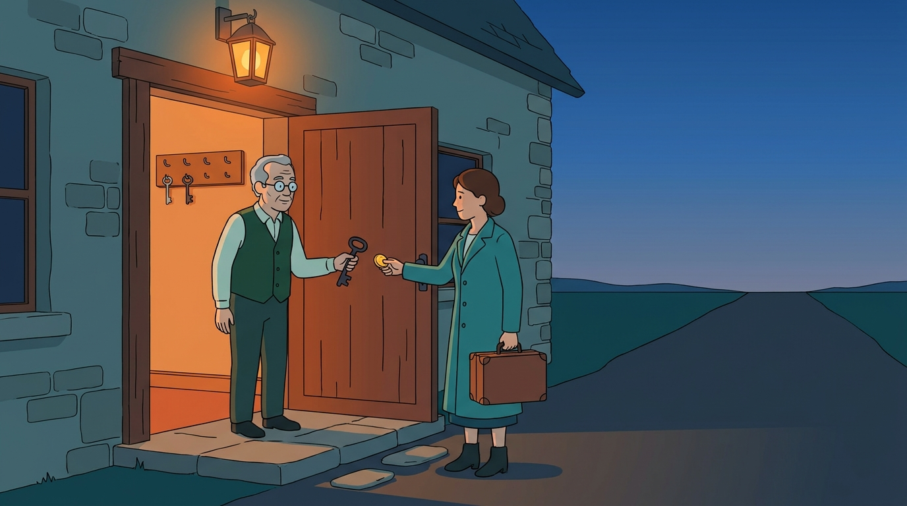
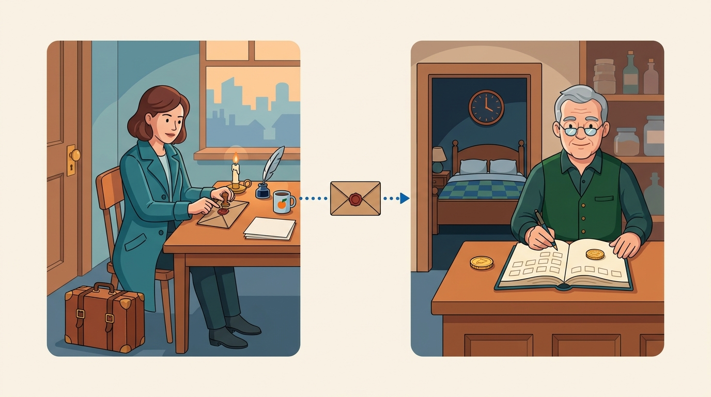
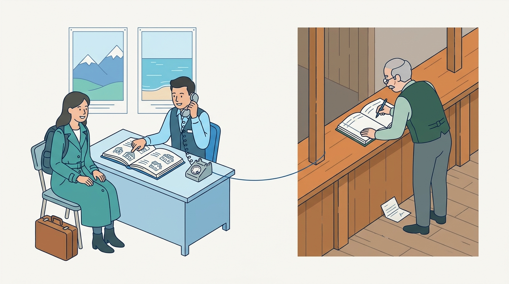
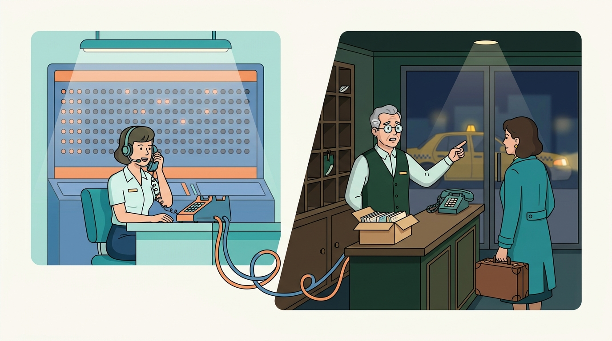
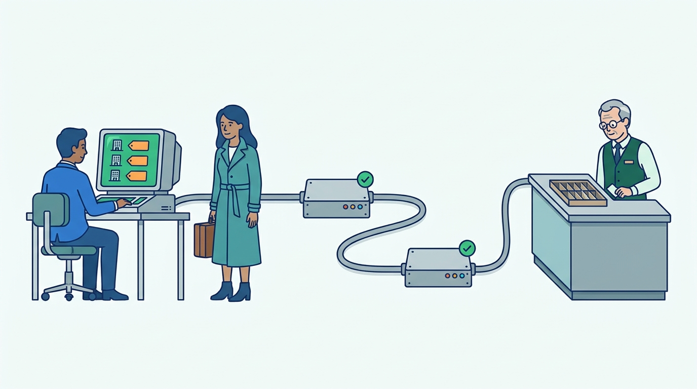
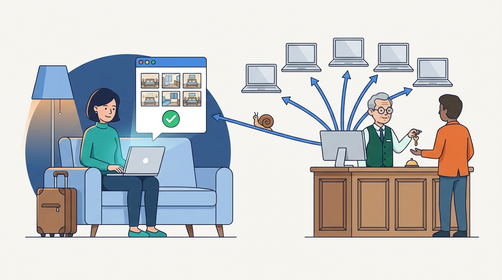
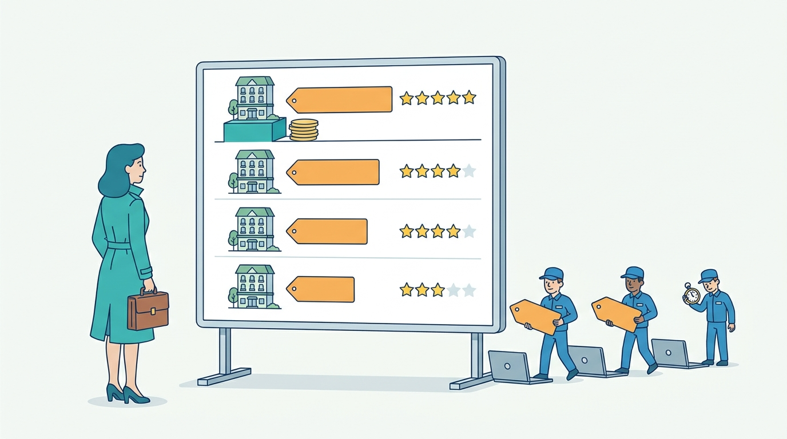
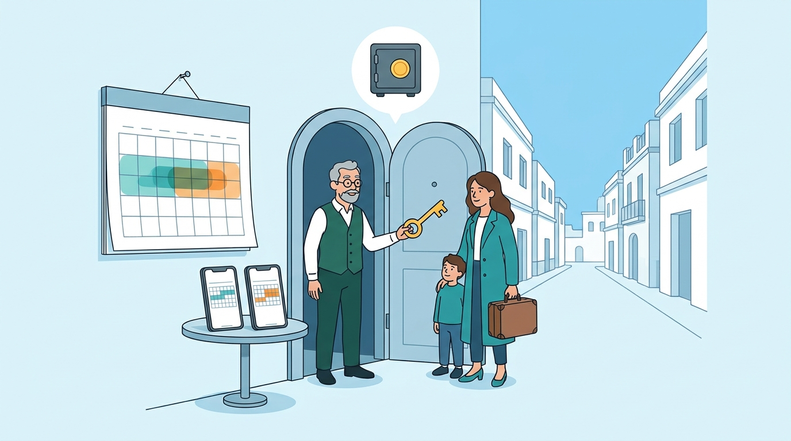

> **IN THIS SECTION, YOU WILL:** Follow the booking of a night from a knock on an inn door at dusk to a tap on a phone, and meet each stays-marketplace concept at the step that first needed it.

> **KEY POINTS:**
>
> * **Every new way of selling a night let someone travel or host who could not before.** The letter ahead let a traveler set out sure of a bed. The guidebook and the travel agent let her choose an inn she had never seen, and the website let her book alone at midnight. The host's listing let a family rent a flat with a kitchen, and let its owner earn from it.
> * **The price each time was one more copy of the innkeeper's book and one more party behind the promise.** The chain's central office, the airline screen, the channel manager, the website, the comparison site and the host's other platform each keep their own copy of which rooms are free, and an agent, a website or a platform now stands between guest and host. None of these ways of selling was retired, so one booking today rests on all of them.
> * **Stay platforms fail where a copy of the room book learns the truth late, or a party stands behind less than the guest believes.** The family turned away at midnight and the flat sold twice for the same festival week are those cases. The sixteen patterns of the next page name them.

 
Picture a traveler on foot at dusk, as an illustration of a common practice, knocking at the door of a country inn. The innkeeper glances at the board of keys behind him: two still hang there. He names a price, she pays, and he hands her a key and points up the stairs. The room, the price and the payment meet at one door, and the whole booking takes a minute. Now take the family the [[introduction]] opened with. At 23:40 on a Friday in August they stand at the reception desk of a full hotel, holding a confirmation e-mail for a room booked and paid seven weeks earlier, and hear that there is no booking under that name.

The knock and the e-mail are the same request, served by different machinery. Between them lie seven other ways of selling a night, and this page walks through them in the order they were added. **Each was a good bargain: it let a guest book a room she could not see, and let a hotel or host fill a night that would otherwise be lost, at the price of one more copy of the innkeeper's book and one more party standing behind the promise. None was ever retired.** The account is simplified. It follows the ideas, not the full history, which was messier and differed by country; [[two-stay-marketplaces]] tells that history, with its companies and deals. The inns, letters and offices are illustrations of common practice, the few dates are anchors with sources listed at the end, and the chapters carry the detail.

Each of the nine steps says what stopped working, what was added and what the book calls it, what it made possible for guest and host, and what it cost. Each then answers one question: **is the room really free for these nights, and who stands behind the promise?**

**Figure 1:** *Nine steps, one stack: each way of selling a night was added on top of the one before and none was removed, so a booking today rests on all of them.*

## The Inn Door at Dusk: A Bed for Tonight

Start at the inn door, the simplest way to sell a night, again as an illustration. The traveler can see the inn, and often the room, and the innkeeper can see her. If a key hangs on the board, a room is free. She pays, commonly before she gets the key, and in the morning she leaves.

Both sides gain. She gets a bed tonight in a town where she knows nobody. He fills a room that would otherwise earn nothing tonight, and that is the whole economics of the trade in one sentence: **a night not sold by evening is lost for good**. The [[introduction]] calls what a stays marketplace sells a perishable promise. At the inn door it is not yet a promise, only a room, and it perishes at midnight.

The trade already carries the concerns this book keeps meeting. Whether the room is free is a glance at the board. Whether to let a stranger in, and how much to ask for in advance, is the innkeeper's call, made by eye at the door: trust between strangers in its plainest form. And what she buys is one thing, this room for this night, which the book calls a **unit** ([[property-and-listing-model]]).

It is that simple only under three conditions. The traveler is at the door. The innkeeper is there to answer it. And she arrives before the rooms are gone; if the board is empty, she walks on in the dark. **The steps that follow begin where one of these conditions did not hold.**

**Figure 2:** *At the inn door the room, the price and the payment meet in one place, and a key on the board says the room is free, but only a traveler who reaches the door before the rooms are gone gets a bed.*

**Is the room really free?** The key on the board says so. **Who stands behind the promise?** The innkeeper, face to face, for tonight only.

## The Letter Ahead: A Promise in the Innkeeper's Book

A traveler who finds an empty board has lost her evening. So she writes ahead, or later sends a telegram or telephones: a room for two nights from the fourteenth. Picture this as common practice too. The innkeeper writes her name and dates against a room in his book and writes back. A room promised to a named guest for named nights is what the book calls a **reservation** ([[reservation-lifecycle]]). The book itself, rooms down the side and nights across the top, is the ancestor of **inventory**: how many rooms of each kind are still free on each night ([[rates-and-availability-model]]).

Both sides gain. She sets out knowing there is a bed at the end of the road. He fills his rooms weeks ahead, knows who is coming, and can buy food and hire help for a busy week.

The price is a promise about a room she cannot see, kept in a book she cannot see either. The room may not be what the letter implied. Two letters may arrive for the last room, and if the innkeeper writes one in the wrong column, both guests come. And a guest who promised to come may not: the room is held for nobody and sold to no one else, which the book calls a **no-show** ([[reservation-lifecycle]]). So innkeepers commonly ask for a deposit and say what happens to it if the guest cancels late. Rules of that kind are what the book calls a **cancellation policy** ([[changes-and-cancellations]]).

**Figure 3:** *The letter ahead turns a room into a promise written in the innkeeper's book, so the traveler sets out sure of a bed, and a room held for a guest who never comes is lost for the night.*

**Is the room really free?** If the book says so, and the book was written right. **Who stands behind the promise?** The innkeeper, by letter; the deposit binds the guest.

## The Guidebook and the Travel Agent: Someone Vouches for a Room You Cannot See

A letter needs an address. A traveler bound for a town she has never visited does not know which inn to write to, or whether it is clean. So someone who has been there vouches for it. Michelin dates its first guide to 1900, when "35,000 copies were given out for free", and says the guide "cataloged hotels, restaurants, mechanics and gas stations" for motorists. What a guide says about a place is the ancestor of what the book calls **content**: the description, photos and facts a guest decides on ([[content-and-media]]).

In common practice the travel agent goes one step further, choosing for the traveler and booking for her by letter, telegram or telephone, and the inn pays the agent a share of the price for sending the guest. That share is a **commission**, and an intermediary who passes the booking to the property and is paid a commission works on what the book calls the **agency model** ([[merchant-and-agency-models]]).

Both sides gain. The traveler chooses an inn in a strange town on someone's word and books it without writing a letter herself. The inn gets guests from cities it never advertised in, and the agent earns a living from knowing which inns are good.

The price is a third party and a longer road for the promise. A guide can flatter, and a description goes stale long before the next edition. The inn now pays a share of every guest the agent sends. And the agent's booking must reach the inn and be written into its book: a message that goes astray leaves a guest at the desk with a booking the inn has never seen.

**Figure 4:** *The guidebook and the travel agent let a traveler choose an inn she has never seen, for a commission the inn pays, and the booking now has to travel to the inn's book, where it can go astray.*

**Is the room really free?** The agent believes so, from the inn's last reply. **Who stands behind the promise?** The inn, and an agent who stands behind the choice but not the room.

## The Chain's Central Office: One Number, One Count, Many Hotels

When hotels joined into chains, a guest wanted to book any hotel of the chain from any town, with an answer at once, not by return of post. So a chain could keep the count of free rooms for all its hotels in one central place and answer the telephone from there. IHG's history dates to 1965 the launch of Holidex, which it calls a "computerised hotel reservation system", for its Holiday Inn hotels. A chain's central record of rooms, prices and bookings for all its hotels is what the book calls a **central reservation system**, or CRS ([[connectivity-and-channel-managers]]).

A central office cannot easily sell by room number, so it commonly sells by kind: a double, a twin, a suite, each kind with a number of rooms free per night. That is a **room type** ([[property-and-listing-model]]). It also sells each kind at several prices with different conditions, such as a weekend price, a company price or a price with breakfast, each under a code. Those codes are the ancestors of the **rate plan** ([[rates-and-availability-model]]).

With the records of many hotels, a hotel can also see how many guests usually fail to come, and promise a few more rooms than it has. Selling beyond the rooms that exist, on purpose, to cover no-shows is **overbooking**; sending a guest who arrives to a full hotel to a room in another hotel is a **walk** ([[inventory-integrity]]).

Both sides gain. The guest gets a confirmed room in another city from one telephone call. The chain fills rooms in all its cities, and fewer rooms stand empty because a guest did not come.

The price is two copies of the count, the central one and the hotel's own, which must agree. Codes commonly multiply with every new deal and are rarely retired. And when more guests come than the plan expected, one of them is walked, however polite the apology.

**Figure 5:** *A chain's central office confirms a room in any of its hotels from one telephone call, but its count is a second copy of the hotel's, and a hotel that promises more rooms than it has walks a guest.*

**Is the room really free?** In the central count, yes; at the front desk, if the two counts agree and fewer guests come than were promised. **Who stands behind the promise?** The chain, which keeps a promise it cannot keep by finding a room elsewhere.

## The Airline Systems: The Same Hotel on Every Agent's Screen

By then travel agents booked flights on screens linked to the airlines' reservation computers, and they wanted to book the hotel at the other end on the same screen. IHG's history dates to 1977 the moment Holidex came "to link directly with airline and travel agents systems". The large shared systems through which agents book flights, hotels and cars are what the book calls **global distribution systems**, or GDSs ([[two-stay-marketplaces]]). Each hotel company's system spoke its own language, so the industry built switches between them, translators that pass requests and bookings along.

Both sides gain. An agent anywhere books flight and hotel in one place, for a guest who never phones the hotel. The hotel gets a worldwide sales force it does not pay a salary.

The price is distance and copies. A booking now passes through the agent's system, the GDS, a switch and the chain's central system before it reaches the front desk, and each hop can say "received" without the hotel having accepted anything. The same hotel can appear several times on one screen, sold directly and resold by wholesalers, with different names, rooms and prices. And agents ask about rooms far more often than they book them, so the hotel's systems carry the load of shopping, not of selling; requests per booking are what the book calls the **look-to-book ratio** ([[stays-marketplace-economics]]).

**Figure 6:** *The airline systems put a hotel on every agent's screen, but a booking now crosses several systems that each confirm only their own hop, and the same hotel can appear several times at different prices.*

**Is the room really free?** As of the last answer that crossed the switch. **Who stands behind the promise?** The hotel, through several systems that each confirmed only their own part.

## The Online Travel Agency: The Guest Books Alone

The airline systems served agents, and they still do. A guest who books through an agent commonly waits for office hours and trusts the agent's choice; from the mid-1990s, on the web, she could look for herself at any hour. "Expedia.com launched in 1996 as a division of Microsoft", Expedia Group says, and Booking.com says it was "Founded in 1996". A website where guests search and book rooms in many independently run properties is what the book calls an **online travel agency**, or OTA ([[two-stay-marketplaces]]).

Two ways of handling the money grew up. Under the agency model of the travel agent, the website passes the booking to the hotel, the guest pays at the hotel, and the hotel pays a commission. Under the **merchant model**, the website charges the guest and pays the hotel later; Expedia's annual report for 2025 says that it is then "the merchant of record" for rooms over which it has "no control" ([[merchant-and-agency-models]]).

A hotel on ten such websites cannot retype its free rooms on each of them every hour. So it commonly uses software that keeps the counts and prices on every site in step with its own system and brings the bookings back, a **channel manager** ([[connectivity-and-channel-managers]]). Each change of rooms, prices or conditions it sends is an **ARI update**, for availability, rates and inventory ([[rates-and-availability-model]]).

Both sides gain. The guest compares photos, prices and cancellation terms at midnight and has a confirmation in seconds. A small independent hotel reaches guests on every continent for a commission, with no sales office and no chain.

The price is that the website promises from a copy. Its search shows the last update it received, and the room may be gone when she presses "Book". Each website maps the hotel's room and price codes through its own connection, and a wrong mapping sells the wrong room at the wrong price. Under the merchant model the website can hold the guest's money for weeks and owes it to the hotel, so it must always know who is owed what. And cancellation terms become rules written into the website's checkout, support tools and payments and the hotel's system, which can give four answers to one question.

**Figure 7:** *The online travel agency lets a guest book alone at midnight with an answer in seconds, but it promises from its copy of the hotel's count, and each copy learns of the last room's sale at its own time.*

**Is the room really free?** As of the last update the website received. **Who stands behind the promise?** The hotel for the room, and the website for whatever it charged or promised in its own name.

## Comparing Everyone: Reviews, Price Lists and the Order of Results

With dozens of websites and thousands of hotels in one city, no guest can check them all. Three things answered that. Websites invited guests to say how the stay was, so strangers vouch for the room as the guidebook once did; a review that only a guest who stayed may write is what the book calls a **verified review** ([[reviews-and-reputation]]). Sites appeared that compare the price of the same room on many websites and send the guest to book elsewhere; trivago's annual report says it was "incorporated in 2005". Such a site is **metasearch** ([[two-stay-marketplaces]]). And every site must decide which of a city's hotels to show first, which the book calls **ranking** ([[stays-ranking]]).

Both sides gain. The guest sees many sellers' prices for one room in one place and reads what earlier guests found. A small, good hotel with no famous name is found on its merit and its price.

The price is that the comparison is only as good as the copies behind it. A metasearch site shows each price as of its last check, and taxes and fees are commonly added later, so the list, the hotel page and checkout can show three prices. The order can be shaped by commission or paid programs, and the guest cannot tell whether the first hotel is the best or the one that paid. Some websites also wrote clauses into hotel contracts against selling more cheaply elsewhere, which the book calls **rate parity** ([[promotions-and-loyalty]]). The law has since stepped in: the European Commission designated Booking a gatekeeper for Booking.com on 13 May 2024, under a regulation that bars a gatekeeper from preventing business users from offering "prices or conditions that are different" elsewhere.

**Figure 8:** *Comparing everyone puts many sellers' prices and other guests' word for one room in one place, but each price is a copy as of its last check, and the order of the list can be bought.*

**Is the room really free?** On the list, as of the last check. **Who stands behind the promise?** Not the comparison site, which sends the guest elsewhere to book.

## Homes as Stays: Strangers in Each Other's Homes

Meanwhile, alongside the hotel websites, homes came online. Hotels are not the only rooms: some families want a whole flat with a kitchen, some travelers want a room in a local's home, and owners of a holiday house or a spare room want to earn from it. Owners first advertised homes much like classified ads. HomeAway's 2011 prospectus says "Property owners and managers pay annual listing fees", with "Most listings" sold "on a subscription basis", and travelers sent inquiries. Then platforms took the booking itself. Airbnb dates its beginning to 2007, "when two hosts welcomed three guests to their San Francisco home". One home with one calendar, published by the person who lets it, is what the book calls a **listing**, and that person a **host** ([[property-and-listing-model]]).

Letting a stranger sleep in your home needs more than a calendar. The platform takes the guest's payment and holds it until the stay begins: Airbnb's annual report for 2025 says it holds "the total amount the guest has paid until check-in" and pays the host "generally" on "the business day after the scheduled check-in". A platform that collects for the host this way works under what the book calls **facilitated payments** ([[merchant-and-agency-models]]). Host and guest review each other, commonly without seeing the other's review until both have written, a **double-blind review** ([[reviews-and-reputation]]). A host chooses whether a guest may book at once or must ask first: **instant book** or **request to book** ([[checkout-orchestration]]). And platforms commonly cover hosts against damage ([[protection-and-incidents]]).

Hosts commonly let one home on several platforms. Each platform can publish the home's booked dates as a calendar file and read the other platforms' files every few hours, in the iCalendar format that the IETF published in September 2009. That is **iCal sync** ([[calendar-sync]]).

Both sides gain. The guest gets a kitchen, a family under one roof and a street where people live. A person with one flat lets it to strangers she will never meet, and is paid without chasing anyone.

The price is one unit and two strangers. A hotel with a hundred rooms can absorb a mistake in the count; a flat has no spare room, and two platforms that learn of each other's bookings only when they next read the file can sell the same night twice. The platform can hold guests' money for months. And trust between private strangers now has to be built by the platform, with verification, screening and protection, often added after an incident made the need plain.

**Figure 9:** *Homes as stays let a family rent a flat and its owner let it to strangers, with the platform holding the money until check-in, but one home has no spare room, and two platforms can sell the same week before they read each other's calendar.*

**Is the room really free?** On this platform, yes; on the others, only after their next read of the calendar. **Who stands behind the promise?** The host, and the platform that holds the money and promises to rehouse the guest.

## Today: Every Step at Once

None of these ways of selling was retired: inns still take travelers at the door, and agents still book on GDS screens. What the present adds is speed, overlap and law. Prices commonly change daily, set by software that reads demand, which the book calls **revenue management**, and some platforms suggest prices to hosts ([[dynamic-pricing]]). Hotel websites sell homes and home platforms sell hotels, so each must fit the other's supply into its own model ([[converging-two-marketplaces]]). Many cities charge a tax per guest per night, collected by the platform or the host, a **tourist tax** ([[taxes-on-stays]]). The European Union's short-term rental regulation "shall apply from 20 May 2026"; where an authority requires homes to be registered, it makes platforms collect and show each home's **registration number** ([[partner-onboarding]], [[stays-regulation]]). Models rank, price and screen ([[stays-ml-platform]]). And shocks arrive all at once: on 5 May 2020 Airbnb wrote that "global travel came to a standstill", with its revenue that year "forecasted to be less than half" of 2019's.

Corvane, the fictional travel group this book follows ([[meet-corvane]]), meets both kinds of failure in one spring. On 26 April 2027 the channel manager of Hotel Prinsenkade in Amsterdam queued updates for 47 minutes during an outage, and the hotel ended King's Day 9 rooms oversold across channels. Roomstead, Corvane's accommodation marketplace, relocated 4 of its guests to hotels in Haarlem and Amstelveen for €2,150. In Seville, Carmen Ruiz lets her apartment on Nookaway, Corvane's hosted-stays marketplace, and on a competing platform linked by iCal. On 2 February 2027 at 10:12 the Bauer family booked Feria week on Nookaway, €1,360 before guest fees. At 10:40 the competitor, which had last read Nookaway's calendar at 10:00, sold 21–24 April. Carmen canceled the Bauers' booking at 13:05. Nookaway's guest guarantee rebooked them in a comparable apartment for €1,780, and Nookaway paid the €420 difference.

Both sides gain. The guest books any night anywhere in seconds, in her own language and currency. A hotel or a host sells on every channel at once and prices each night to demand.

The price is all the earlier costs at once: each copy of the count learns of a booking at its own time, each party stands behind only a part of the promise, and new rules arrive city by city.

**Figure 10:** *One booking today rests on every earlier way of selling a night and on prices, taxes and law, and each copy of the count learns of a booking at its own time, so a hotel can walk a guest and a home can be sold twice.*

**Is the room really free?** In Nookaway's calendar, as soon as it is booked; on the competitor's, only after its next read. **Who stands behind the promise?** Carmen, Nookaway and its guest guarantee, the payment provider that holds the money, and, for the registration number on the page, the city.

## What the Steps Add Up To

Here are the nine steps side by side, each with what it made possible and what it added. The last column uses the names the next page gives to these failures, in bold, and plain words where it has none.

| Step | What it made possible | What it added | New party or delay | What can now go wrong |
| --- | --- | --- | --- | --- |
| Inn door | A bed tonight for a traveler at the door; a room filled that would earn nothing | Nothing: room, price and payment at one door | None | The inn is full; a stranger leaves without paying |
| Letter ahead | Setting out sure of a bed; rooms filled weeks ahead | The reservation, the book of rooms (inventory), the no-show, the deposit and cancellation terms | Days for the letter; a promise kept in a book | A room held for nobody; two guests for the last room; a room unlike the letter |
| Guidebook and agent | Choosing an inn never seen; guests from distant cities | Content that vouches; the commission and the agency model | The guide and the agent; the agent's message to the inn | A flattering or stale description; a booking that never reaches the inn's book |
| Chain's central office | A confirmed room in any city from one call | The CRS, room types, rate codes, overbooking and the walk | A central copy of the count | **Rate Plan Sprawl**; a walked guest |
| Airline systems | Hotel and flight on one screen, anywhere | The GDS, the switch, the look-to-book load | Several systems between agent and front desk | **The Same Hotel Twice**, **Lost at the Front Desk** |
| Online travel agency | Booking alone at midnight; the world's guests for a small hotel | The OTA, the merchant model, the channel manager, ARI updates | A copy per website; a connection per website; money held by the website | **Phantom Availability**, **Connectivity Roulette**, **Ledgerless Money**, **Policy Spaghetti** |
| Comparing everyone | Every seller's price and other guests' word in one place | Verified reviews, metasearch, ranking, rate parity | Copies of copies; an order the site decides | **Price Drift**, **Pay-to-Rank Creep** |
| Homes as stays | A flat for a family; one home let safely to strangers | The listing and host, facilitated payments, two-way reviews, instant book, iCal sync, protection | Platforms that read each other's calendars every few hours; money held until check-in | **The Double-Booked Night**, **Trust After the Incident** |
| Today | Any night, anywhere, in seconds; every channel at once | Revenue management, convergence, tourist taxes, registration numbers, models | Tax offices, cities and models | **The Hotel-Shaped Home**, **The Tax Patchwork**, **City-by-City Firefighting**, **Built for Sunny Days**, **The Unwatched Model** |

The table follows the ideas; the page's dates place the steps in time. The guidebook is about 125 years old, the chain's computer about 60, the websites about 30 and the newest law under one. The inn door and the letter ahead carry no date, because they are common practice, not events.

| Year | What its source dates to that year | Step |
| --- | --- | --- |
| 1900 | The first Michelin guide, 35,000 free copies for motorists | Guidebook and agent |
| 1965 | Holidex, Holiday Inn's computerized reservation system | Chain's central office |
| 1977 | Holidex linked to airline and travel agents' systems | Airline systems |
| 1996 | Expedia.com launched as a division of Microsoft; Booking.com founded | Online travel agency |
| 2005 | trivago incorporated | Comparing everyone |
| 2007 | Airbnb's first hosts welcome three guests in San Francisco | Homes as stays |
| 2009 | The IETF publishes the iCalendar format | Homes as stays |
| 2011 | HomeAway's prospectus: owners pay annual listing fees | Homes as stays |
| 2020 | "Global travel came to a standstill" (5 May) | Today |
| 2024 | Booking designated a gatekeeper under the Digital Markets Act (13 May) | Comparing everyone |
| 2026 | The EU short-term rental regulation applies (20 May) | Today |

Count what stood behind the Bauers' Feria week that did not stand behind the knock at the inn door: two platforms, two copies of one calendar, a calendar file read every few hours, a payment held for weeks, a guest guarantee and its €420, a fee taken from Carmen's next payout, and a registration number a public authority issues. **Every step moved the promise further from the room**, and put more copies and more parties between guest and host. The answer to "is the room really free, and who stands behind the promise?" grew from "the key on the board, and the innkeeper" to one calendar and several copies that learn at different times, and a chain of parties each standing behind a part of the promise.

It is tempting to think that a clean rebuild would restore a simple calendar of rooms and a payment button. It would not, and **the complexity is the price of all that travel, not a mistake**. Each step answers a limit that has not gone away: guests still cannot see the room, still book weeks ahead, still compare everyone and still sleep in strangers' homes, and hotels and hosts still sell on every channel because an unsold night is lost. So expect every one of these steps to stay, and **expect a failure wherever a copy of the room book learns the truth late, or a party stands behind less than the guest believes**.

The next page names those failures. [[where-stay-platforms-go-wrong]] describes sixteen recurring patterns, and after this walk none of them should come as a surprise: each is the price of one of these steps.

## Sources and Evidence

Each date and quotation was read on its source's page on 18 November 2026. No primary source was read for the inn door, the letter ahead, the travel agent's commission or the channel manager, so those are common practice and illustration, without dates, and the page claims no "first" for any step. Where a company describes its own history, the page reports what the company says. The anchors come from the United States, France, the Netherlands, Germany and the European Union; [[two-stay-marketplaces]] carries the fuller history and its sources.

*Company engineering and investor sources*

- [Our history](https://www.ihgplc.com/en/about-us/our-history) — IHG Hotels & Resorts, n.d., accessed 2026-11; 1965, "Holiday Inn launches Holidex", a "computerised hotel reservation system"; 1977, Holidex links "directly with airline and travel agents systems" (the company's own account).
- [The History of the Michelin Guide](https://guide.michelin.com/kr/en/article/features/history-michelin-guide) — Yerica Park, MICHELIN Guide, 2016; the first edition in 1900, "35,000 copies were given out for free", a guide for motorists that "cataloged hotels, restaurants, mechanics and gas stations" (the publisher's own account).
- [About Booking.com](https://www.booking.com/content/about.html) — Booking.com, n.d., accessed 2026-11; "Founded in 1996" (the company's own account; [[two-stay-marketplaces]] gives the fuller founding history).
- [About us](http://www.expediagroup.com/en-us/about-us) — Expedia Group, n.d., accessed 2026-11; "Expedia.com launched in 1996 as a division of Microsoft".
- [Form 10-K for fiscal 2025](https://www.sec.gov/Archives/edgar/data/1324424/000132442426000008/expe-20251231.htm) — Expedia Group, 2026; under the merchant model "we are the merchant of record", with "no control over the rooms" (also in [[two-stay-marketplaces]]).
- [Form 20-F for fiscal 2016](https://www.sec.gov/Archives/edgar/data/1683825/000168382517000009/trvg20f.htm) — trivago N.V., 2017; "incorporated in 2005" (evidence age: 9 years, used as a date only).
- [Form S-1 registration statement](https://www.sec.gov/Archives/edgar/data/1366684/000119312511064128/ds1.htm) — HomeAway, Inc., 2011-03-11; "Property owners and managers pay annual listing fees", "Most listings are sold on a subscription basis" (evidence age: 15 years, used to describe the listing model of that time).
- [About us](https://news.airbnb.com/about-us/) — Airbnb, n.d., accessed 2026-11; "Airbnb was born in 2007 when two hosts welcomed three guests to their San Francisco home" (the company's own account).
- [Form 10-K for fiscal 2025](https://www.sec.gov/Archives/edgar/data/1559720/000155972026000004/abnb-20251231.htm) — Airbnb, 2026; it holds "the total amount the guest has paid until check-in", and remittance "generally occurs on the business day after the scheduled check-in" (also in [[two-stay-marketplaces]]).
- [A message from co-founder and CEO Brian Chesky](https://news.airbnb.com/a-message-from-co-founder-and-ceo-brian-chesky/) — Airbnb, 2020-05-05; "global travel came to a standstill", revenue "forecasted to be less than half of what we earned in 2019" (also in [[two-stay-marketplaces]]).

*Standards, regulation and documentation*

- [RFC 5545: Internet Calendaring and Scheduling Core Object Specification (iCalendar)](https://www.rfc-editor.org/rfc/rfc5545) — IETF, September 2009; the calendar format behind iCal sync (also in [[two-stay-marketplaces]] and [[calendar-sync]]).
- [Regulation (EU) 2022/1925 (Digital Markets Act)](http://publications.europa.eu/resource/celex/32022R1925) — Official Journal, 2022; Article 5(3), a gatekeeper "shall not prevent business users from offering the same products or services ... at prices or conditions that are different".
- [Gatekeepers](https://digital-markets-act.ec.europa.eu/gatekeepers_en) — European Commission, n.d., accessed 2026-11; "On 13 May 2024, the Commission also designated under the DMA, Booking as a gatekeeper for its online intermediation service Booking.com".
- [Regulation (EU) 2024/1028 on short-term accommodation rental services](http://publications.europa.eu/resource/celex/32024R1028) — Official Journal, 2024; Article 19, "It shall apply from 20 May 2026"; registration numbers as the identifier of a rented unit (also in [[stays-regulation]]).

Corvane is fictional; architectural recommendations and labeled inferences are the author's judgement.
